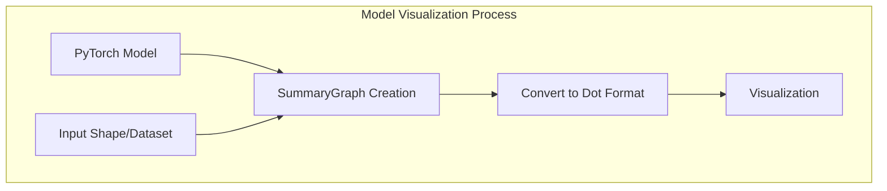
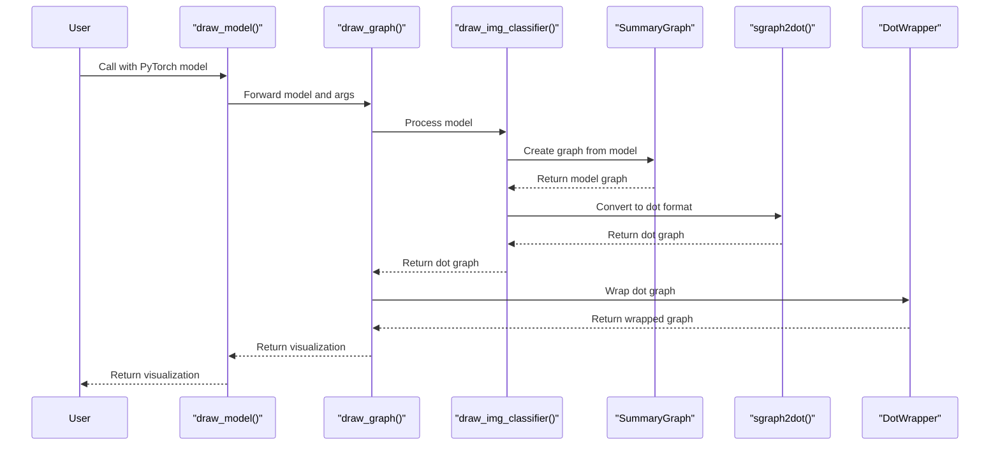
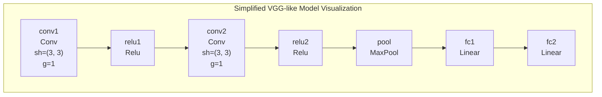
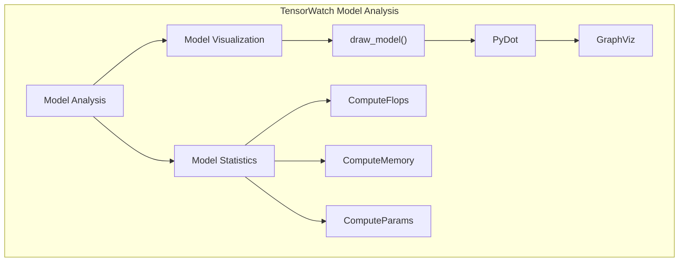

<!-- source: DeepWiki mcp.deepwiki.com · repo microsoft/tensorwatch · page 5.2 Model Visualization · fetched 2026-10-26 -->

# Model Visualization

<details>
<summary>Relevant source files</summary>

The following files were used as context for generating this wiki page:

- [.vscode/launch.json](.vscode/launch.json)
- [MANIFEST.in](MANIFEST.in)
- [setup.py](setup.py)
- [tensorwatch/model_graph/hiddenlayer/distiller.py](tensorwatch/model_graph/hiddenlayer/distiller.py)
- [tensorwatch/model_graph/hiddenlayer/distiller_utils.py](tensorwatch/model_graph/hiddenlayer/distiller_utils.py)
- [tensorwatch/model_graph/hiddenlayer/graph.py](tensorwatch/model_graph/hiddenlayer/graph.py)
- [tensorwatch/model_graph/hiddenlayer/pytorch_builder.py](tensorwatch/model_graph/hiddenlayer/pytorch_builder.py)
- [tensorwatch/model_graph/hiddenlayer/pytorch_builder_grad.py](tensorwatch/model_graph/hiddenlayer/pytorch_builder_grad.py)
- [tensorwatch/model_graph/hiddenlayer/pytorch_draw_model.py](tensorwatch/model_graph/hiddenlayer/pytorch_draw_model.py)
- [test/pre_train/dot_manual.bat](test/pre_train/dot_manual.bat)
- [test/pre_train/sample.dot](test/pre_train/sample.dot)
- [test/pre_train/test_pydot.py](test/pre_train/test_pydot.py)

</details>


## Purpose and Scope

This document covers TensorWatch's model visualization capabilities, which enable users to generate visual representations of neural network architectures. The primary focus is on PyTorch models, with the ability to create directed graph visualizations showing layers, connections, and other model details. For information about calculating model statistics (parameters, FLOPs, etc.), see [Model Statistics](#5.1).

## Overview

Model visualization helps users understand complex neural network architectures through graphical representations. TensorWatch leverages libraries like PyDot and GraphViz to generate these visualizations, which can be displayed directly in Jupyter notebooks or saved as image files.



Sources: [tensorwatch/model_graph/hiddenlayer/pytorch_draw_model.py:25-36]()

## Core Components

TensorWatch's model visualization system consists of several key components working together to translate PyTorch models into visual representations.

```mermaid
classDiagram
    class DotWrapper {
        +dot
        +_repr_svg_()
        +save(filename, format)
    }
    
    class draw_graph {
        <<function>>
    }
    
    class draw_img_classifier {
        <<function>>
    }
    
    class sgraph2dot {
        <<function>>
    }
    
    class SummaryGraph {
        <<class>>
    }
    
    draw_graph --> DotWrapper : creates
    draw_graph --> draw_img_classifier : calls
    draw_img_classifier --> SummaryGraph : creates
    draw_img_classifier --> sgraph2dot : uses
    sgraph2dot --> "pydot.Digraph" : generates
```

Sources: [tensorwatch/model_graph/hiddenlayer/pytorch_draw_model.py:8-14](), [tensorwatch/model_graph/hiddenlayer/pytorch_draw_model.py:25-36]()

### Key Components Description

1. **DotWrapper** - A wrapper class that enables the visualization of PyDot graphs in Jupyter notebooks and provides methods to save the visualizations.

2. **SummaryGraph** - Creates a graph representation of a PyTorch model by analyzing its structure.

3. **draw_graph** - The primary function for generating model visualizations. Takes a PyTorch model and input shape, and returns a visualizable graph.

4. **draw_img_classifier** - Specialized function for visualizing image classification models.

5. **sgraph2dot** - Converts a SummaryGraph instance to a GraphViz Dot graph.

Sources: [tensorwatch/model_graph/hiddenlayer/pytorch_draw_model.py:8-73]()

## Visualizing PyTorch Models

### Basic Usage

To visualize a PyTorch model with TensorWatch:

```python
import tensorwatch as tw
import torchvision.models as models

# Load a pre-trained model
model = models.resnet18(pretrained=True)

# Visualize the model
graph = tw.draw_model(model)

# Display the visualization (in Jupyter)
graph
```

Sources: [tensorwatch/model_graph/hiddenlayer/pytorch_draw_model.py:25-36]()

### Process Flow



Sources: [tensorwatch/model_graph/hiddenlayer/pytorch_draw_model.py:25-36](), [tensorwatch/model_graph/hiddenlayer/pytorch_draw_model.py:38-72]()

## Visualization Parameters

The model visualization functions support several parameters to customize the output:

| Parameter | Description | Default |
|-----------|-------------|---------|
| `model` | PyTorch model to visualize | Required |
| `args` | Input shape or tensor for the model | `[1, 3, 224, 224]` |
| `display_param_nodes` | Whether to show parameter nodes | `False` |
| `rankdir` | Direction of the graph layout (`'TB'`, `'LR'`, etc.) | `'TB'` |
| `styles` | Dictionary of styles for specific layers | `None` |

Sources: [tensorwatch/model_graph/hiddenlayer/pytorch_draw_model.py:38-56]()

### Input Shape Specification

The input shape can be specified in various ways:

1. As a list or tuple of dimensions (e.g., `[1, 3, 224, 224]`)
2. As a tensor of the correct shape
3. Using a dataset name like 'imagenet' or 'cifar10'

If not specified, TensorWatch uses a default shape of `[1, 3, 224, 224]` (batch size, channels, height, width) for image classification models.

Sources: [tensorwatch/model_graph/hiddenlayer/pytorch_draw_model.py:25-36](), [tensorwatch/model_graph/hiddenlayer/distiller_utils.py:562-609]()

## Customization Options

### Graph Direction

The `rankdir` parameter controls the direction of the graph:

- `'TB'`: Top to Bottom (default)
- `'BT'`: Bottom to Top
- `'LR'`: Left to Right
- `'RL'`: Right to Left

### Layer Styles

The `styles` parameter allows customization of specific layers in the visualization:

```python
styles = {
    'conv1': {
        'shape': 'oval',
        'fillcolor': 'gray',
        'style': 'rounded, filled'
    }
}
```

This would apply the specified style to the layer named 'conv1'.

Sources: [tensorwatch/model_graph/hiddenlayer/pytorch_draw_model.py:38-56](), [tensorwatch/model_graph/hiddenlayer/pytorch_draw_model.py:138-168]()

## Graph Structure

The visualization represents a neural network as a directed graph where:

- **Nodes** represent layers or operations in the model
- **Edges** represent the flow of data between layers
- **Labels** show details like kernel size, stride, and repeat count



Sources: [test/pre_train/sample.dot:1-154](), [tensorwatch/model_graph/hiddenlayer/pytorch_draw_model.py:94-173]()

## Implementation Details

### Graph Creation Process

1. **Model Tracing**: A dummy input is passed through the model to trace its execution graph.
2. **Graph Construction**: The traced model is analyzed to create a directed graph of operations.
3. **Node Creation**: Each operation in the model becomes a node in the graph.
4. **Edge Creation**: Data flow between operations is represented as edges.
5. **Visualization**: The graph is converted to GraphViz DOT format and rendered.

Sources: [tensorwatch/model_graph/hiddenlayer/pytorch_draw_model.py:38-72](), [tensorwatch/model_graph/hiddenlayer/pytorch_builder.py:97-145]()

### Node Representation

Each node in the graph contains the following information:

- **Name**: The name of the layer or operation
- **Type**: The type of operation (Conv, ReLU, Linear, etc.)
- **Parameters**: Additional details like kernel size, stride, etc.
- **Shape**: The output shape of the layer

Sources: [tensorwatch/model_graph/hiddenlayer/graph.py:75-146]()

## Saving Visualizations

The visualization can be saved to a file using the `save` method:

```python
graph = tw.draw_model(model)
graph.save('model_architecture.png', format='png')
```

Supported formats include 'png', 'svg', 'pdf', and other formats supported by GraphViz.

Sources: [tensorwatch/model_graph/hiddenlayer/pytorch_draw_model.py:14-23](), [tensorwatch/model_graph/hiddenlayer/graph.py:395-402]()

## Dependencies

TensorWatch's model visualization functionality requires the following dependencies:

- pydot
- graphviz
- PyTorch

These dependencies are installed automatically when installing TensorWatch through pip.

Sources: [setup.py:26-30]()

## Integration with Other TensorWatch Components

Model visualization is part of TensorWatch's larger Model Analysis system, which also includes model statistics computation.



Sources: [setup.py:26-30]()

## Limitations

- Currently focuses primarily on PyTorch models
- Visualization of very large models may be challenging to render and interpret
- Some advanced PyTorch constructs (like dynamic control flow) may not visualize perfectly

## Troubleshooting

If visualization fails with a GraphViz error, ensure that GraphViz is properly installed in your system. On Ubuntu, you can install it with:

```
sudo apt-get install graphviz
```

Sources: [tensorwatch/model_graph/hiddenlayer/pytorch_draw_model.py:67-72]()

---

