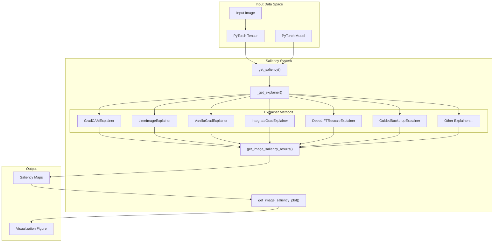
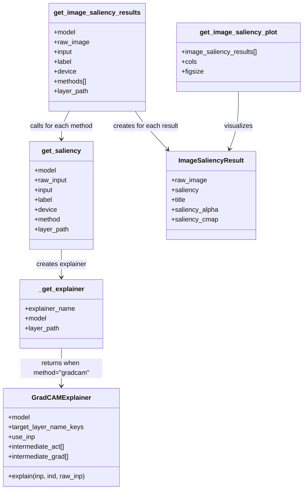
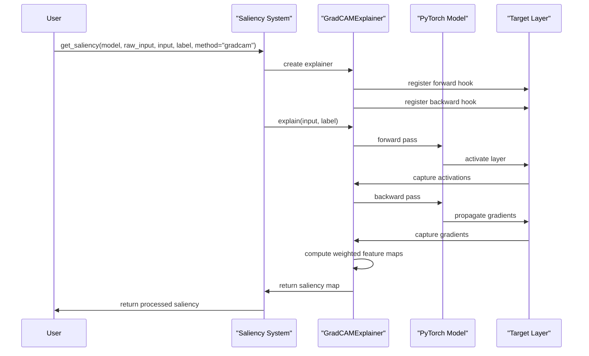
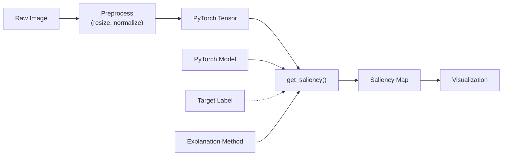

<!-- source: DeepWiki mcp.deepwiki.com · repo microsoft/tensorwatch · page 6 Saliency and Explanations · fetched 2026-10-26 -->

# Saliency and Explanations

<details>
<summary>Relevant source files</summary>

The following files were used as context for generating this wiki page:

- [notebooks/cnn_pred_explain.ipynb](notebooks/cnn_pred_explain.ipynb)
- [tensorwatch.pyproj](tensorwatch.pyproj)
- [tensorwatch/imagenet_utils.py](tensorwatch/imagenet_utils.py)
- [tensorwatch/pytorch_utils.py](tensorwatch/pytorch_utils.py)
- [tensorwatch/saliency/gradcam.py](tensorwatch/saliency/gradcam.py)
- [tensorwatch/saliency/lime/wrappers/generic_utils.py](tensorwatch/saliency/lime/wrappers/generic_utils.py)
- [tensorwatch/saliency/lime/wrappers/scikit_image.py](tensorwatch/saliency/lime/wrappers/scikit_image.py)
- [tensorwatch/saliency/saliency.py](tensorwatch/saliency/saliency.py)

</details>


This document covers the model interpretability and explanation tools available in TensorWatch. These tools help visualize and understand what features or regions of input data most influence a model's predictions, making complex deep learning models more transparent and interpretable.

## 1. Overview of Saliency and Explanation System

TensorWatch provides various saliency and explanation methods that highlight important regions in input data (especially images) that influence model predictions. These techniques help developers understand model behavior, diagnose issues, and build trust in model decisions.

The system supports multiple state-of-the-art explanation methods including gradient-based approaches (like Grad-CAM, Integrated Gradients), perturbation-based methods (like LIME), and other specialized techniques.



Sources: [tensorwatch/saliency/saliency.py:1-100](), [tensorwatch/saliency/gradcam.py:1-65]()

## 2. Supported Explanation Methods

TensorWatch implements multiple explanation techniques, each with different approaches to highlighting important features:

| Method | Type | Description |
|--------|------|-------------|
| Grad-CAM | Gradient-based | Uses gradients flowing into the final convolutional layer to produce coarse localization maps |
| Vanilla Gradients | Gradient-based | Simple gradients of output with respect to input |
| Gradient × Input | Gradient-based | Element-wise product of input and gradients |
| Integrated Gradients | Gradient-based | Accumulates gradients along a path from a baseline to input |
| Guided Backpropagation | Gradient-based | Modified backpropagation that only passes positive gradients |
| SmoothGrad | Gradient-based | Averages gradients by adding noise to input multiple times |
| DeepLIFT | Rule-based | Compares activation with reference and assigns importance scores |
| Occlusion | Perturbation-based | Systematically occludes parts of input and measures impact on prediction |
| LIME | Perturbation-based | Fits local interpretable model around the prediction |
| Epsilon-LRP | Propagation-based | Layer-wise relevance propagation with epsilon stabilization |

Sources: [tensorwatch/saliency/saliency.py:1-45]()

## 3. System Architecture

The saliency system has a modular architecture with a factory pattern for creating explainers and standardized interfaces for processing inputs and visualizing results.



Sources: [tensorwatch/saliency/saliency.py:13-126](), [tensorwatch/saliency/gradcam.py:14-65]()

## 4. Core Components

### 4.1 Explainer Factory

The explainer factory (`_get_explainer()`) creates the appropriate explainer instance based on the requested method:

```python
def _get_explainer(explainer_name, model, layer_path=None):
    if explainer_name == 'gradcam':
        return GradCAMExplainer(model, target_layer_name_keys=layer_path, use_inp=True)
    if explainer_name == 'vanilla_grad':
        return VanillaGradExplainer(model)
    # ... other explainers
```

Sources: [tensorwatch/saliency/saliency.py:18-43]()

### 4.2 Grad-CAM Implementation

The Grad-CAM explainer is a key implementation that shows how TensorWatch uses PyTorch hooks to extract gradient and activation information:



Sources: [tensorwatch/saliency/gradcam.py:14-65]()

### 4.3 LIME Integration

TensorWatch incorporates LIME for model-agnostic explanations, particularly for image classification tasks:

```mermaid
flowchart TD
    subgraph "LIME System"
        LimeImageExplainer["LimeImageExplainer"]
        SegmentationAlgorithm["SegmentationAlgorithm"]
        SkImageWrappers["Scikit-Image Wrappers"]
    end
    
    LimeImageExplainer --> SegmentationAlgorithm: uses
    SegmentationAlgorithm --> SkImageWrappers: wraps
    SkImageWrappers --> Segmentation["Image Segmentation\n(quickshift, slic, felzenszwalb)"]
    
    LimeImageExplainer --> Perturb["Perturb Segments"]
    Perturb --> LocalModel["Train Linear Model\non Perturbations"]
    LocalModel --> Weights["Segment Weights"]
    Weights --> Visualization["Highlight Important Regions"]
```

Sources: [tensorwatch/saliency/lime/wrappers/scikit_image.py:1-118](), [tensorwatch/saliency/lime/wrappers/generic_utils.py:1-40]()

## 5. Usage

### 5.1 Basic Usage Flow

The main entry point for saliency generation is the `get_saliency()` function, which requires:
- A PyTorch model
- Input data (both raw and tensor format)  
- Target label (optional)
- Method selection



Sources: [tensorwatch/saliency/saliency.py:58-85](), [tensorwatch/pytorch_utils.py:24-31]()

### 5.2 Generating Multiple Explanations

TensorWatch makes it easy to compare different explanation methods using the `get_image_saliency_results()` function, which applies multiple techniques to the same input:

```python
results = get_image_saliency_results(
    model, raw_image, input, label,
    methods=['lime_imagenet', 'gradcam', 'smooth_grad', 'guided_backprop']
)
```

The results can be visualized side-by-side using `get_image_saliency_plot()`:

```python
fig = get_image_saliency_plot(results, cols=2)
```

Sources: [tensorwatch/saliency/saliency.py:87-126]()

## 6. Integration with PyTorch and Image Processing

The saliency system seamlessly integrates with PyTorch models and includes utilities for image processing:

```mermaid
flowchart TD
    subgraph "Image Processing"
        ImageUtils["image_utils"]
        TensorUtils["tensor_utils"]
        PyTorchUtils["pytorch_utils"]
        ImagenetUtils["imagenet_utils"]
    end
    
    subgraph "Saliency System"
        SaliencyModule["saliency.py"]
    end
    
    ImageUtils --> SaliencyModule: image manipulation
    TensorUtils --> SaliencyModule: tensor operations
    PyTorchUtils --> SaliencyModule: model interaction
    ImagenetUtils --> SaliencyModule: ImageNet-specific utilities
    
    SaliencyModule --> PyTorchModel["PyTorch Model"]
    PyTorchModel --> LayerHooks["Layer Hooks"]
    LayerHooks --> Activations["Activations\nand Gradients"]
    Activations --> SaliencyMap["Saliency Map"]
```

Sources: [tensorwatch/pytorch_utils.py:1-59](), [tensorwatch/imagenet_utils.py:1-70]()

## 7. Common Use Cases

### 7.1 Model Debugging

Saliency maps help identify if a model is focusing on irrelevant features, which can guide model improvements.

### 7.2 Model Validation

Explanations can verify that a model bases its predictions on reasonable features, building trust in the model.

### 7.3 Scientific Discovery

In domains like medical imaging, saliency methods can highlight potentially important regions that might be overlooked by human experts.

## 8. API Reference

### 8.1 Key Functions

- `get_saliency(model, raw_input, input, label, device=None, method='integrate_grad', layer_path=None)`: Generate a saliency map using the specified method
- `get_image_saliency_results(model, raw_image, input, label, device=None, methods=[...], layer_path=None)`: Generate multiple saliency maps using different methods
- `get_image_saliency_plot(image_saliency_results, cols=2, figsize=None)`: Create a visualization of multiple saliency results

### 8.2 Supported Explainers

- `GradCAMExplainer`: Grad-CAM implementation
- `VanillaGradExplainer`: Simple gradient-based explanation
- `GradxInputExplainer`: Gradient × Input explanation
- `IntegrateGradExplainer`: Integrated Gradients implementation
- `SmoothGradExplainer`: SmoothGrad implementation
- `LimeImageExplainer`: LIME for images
- And several others as listed in section 2

Sources: [tensorwatch/saliency/saliency.py:1-45](), [tensorwatch/saliency/gradcam.py:14-65]()

---

