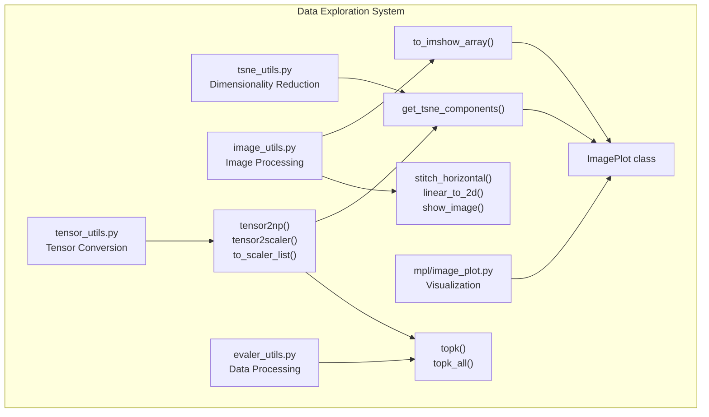
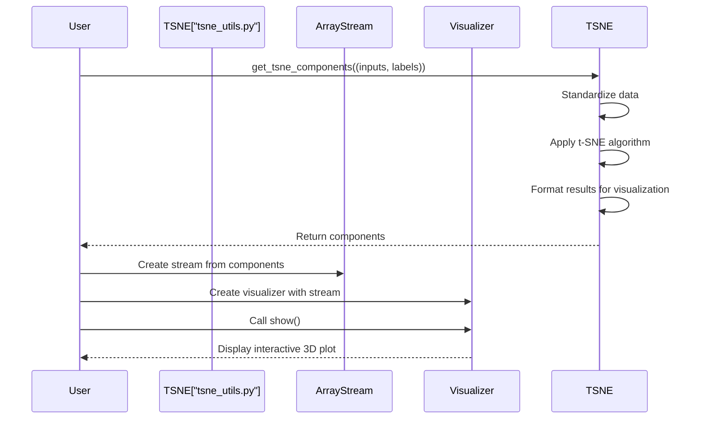
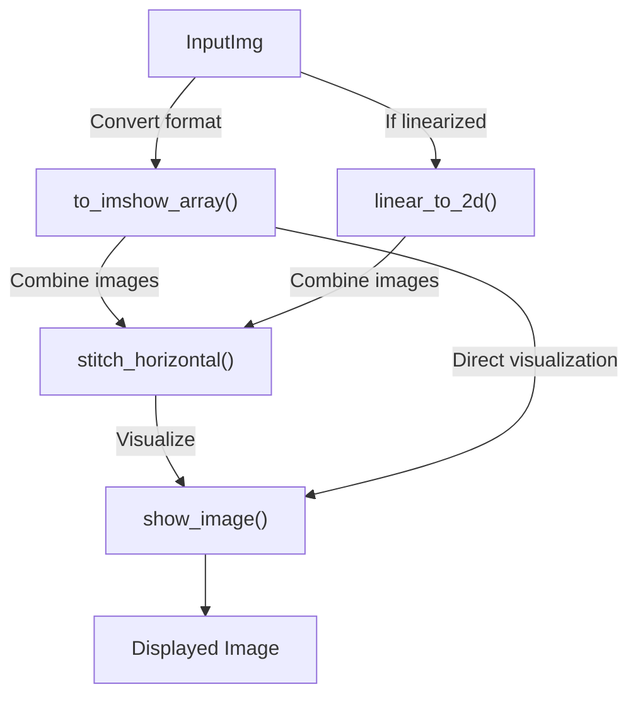
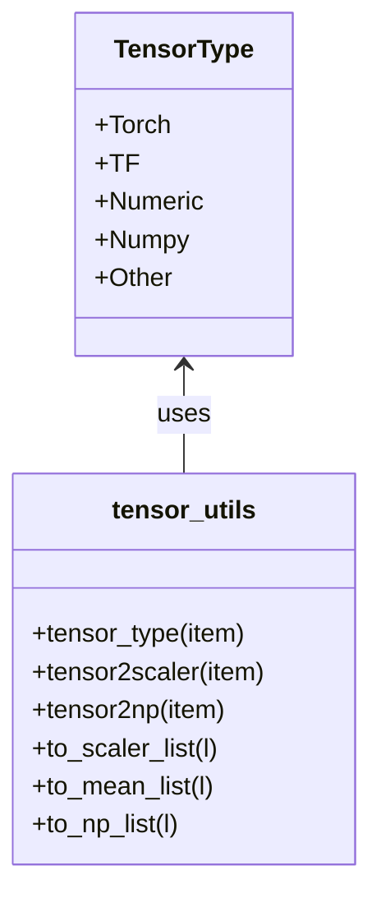
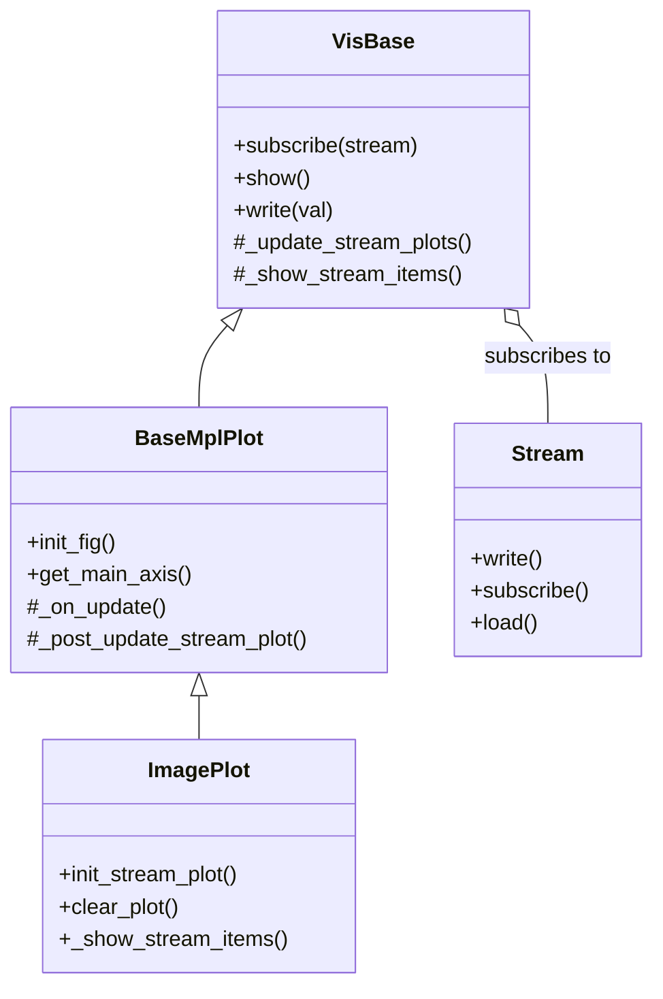
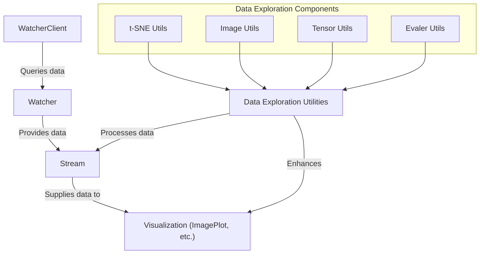

<!-- source: DeepWiki mcp.deepwiki.com · repo microsoft/tensorwatch · page 7 Data Exploration · fetched 2026-10-26 -->

# Data Exploration

<details>
<summary>Relevant source files</summary>

The following files were used as context for generating this wiki page:

- [TODO.md](TODO.md)
- [docs/images/teaser.gif](docs/images/teaser.gif)
- [notebooks/data_exploration.ipynb](notebooks/data_exploration.ipynb)
- [notebooks/fruits_analysis.ipynb](notebooks/fruits_analysis.ipynb)
- [notebooks/mnist.ipynb](notebooks/mnist.ipynb)
- [tensorwatch/embeddings/tsne_utils.py](tensorwatch/embeddings/tsne_utils.py)
- [tensorwatch/evaler_utils.py](tensorwatch/evaler_utils.py)
- [tensorwatch/image_utils.py](tensorwatch/image_utils.py)
- [tensorwatch/mpl/__init__.py](tensorwatch/mpl/__init__.py)
- [tensorwatch/mpl/image_plot.py](tensorwatch/mpl/image_plot.py)
- [tensorwatch/tensor_utils.py](tensorwatch/tensor_utils.py)
- [tensorwatch/zmq_wrapper.py](tensorwatch/zmq_wrapper.py)
- [test/mnist/cli_mnist.py](test/mnist/cli_mnist.py)

</details>


This document explains the data exploration capabilities provided by TensorWatch, which allow you to analyze and visualize your data during machine learning workflows. The data exploration utilities help researchers and developers understand complex datasets through dimensionality reduction, visualization, and tensor manipulation techniques.

For information about model analysis tools, see [Model Analysis Tools](#5). For visualization capabilities, see [Visualization System](#4).

## Overview of Data Exploration System

TensorWatch provides several components for data exploration, including dimensionality reduction techniques, image utilities, tensor conversion tools, and visualization capabilities specifically designed for machine learning data.



Sources: [tensorwatch/embeddings/tsne_utils.py](), [tensorwatch/image_utils.py](), [tensorwatch/tensor_utils.py](), [tensorwatch/mpl/image_plot.py](), [tensorwatch/evaler_utils.py]()

## Dimensionality Reduction with t-SNE

TensorWatch includes support for t-SNE (t-Distributed Stochastic Neighbor Embedding), a popular technique for dimensionality reduction that is particularly well-suited for visualizing high-dimensional datasets.

### t-SNE Workflow



Sources: [tensorwatch/embeddings/tsne_utils.py:23-38](), [notebooks/data_exploration.ipynb:82-92]()

### Using t-SNE

The main function for t-SNE is `get_tsne_components`, which takes your input data and labels and returns lower-dimensional components:

```python
components = tw.get_tsne_components((inputs, labels))
```

This function takes several parameters:
- `data`: Tuple containing features and labels
- `features_col`: Index for features in data tuple (default: 0)
- `labels_col`: Index for labels in data tuple (default: 1)
- `whitten`: Whether to standardize features (default: True)
- `n_components`: Number of dimensions for output (default: 3)
- `perplexity`: t-SNE perplexity parameter (default: 20)
- `for_plot`: Whether to format output for plotting (default: True)

The returned components can be directly visualized using TensorWatch's visualization capabilities:

```python
comp_stream = tw.ArrayStream(components)
vis = tw.Visualizer(comp_stream, vis_type='tsne', 
                    hover_images=inputs, hover_image_reshape=(28,28))
vis.show()
```

This creates an interactive 3D scatter plot where:
- Each point represents a data sample
- Points are colored according to their labels
- Hovering over a point displays the original image

Sources: [tensorwatch/embeddings/tsne_utils.py:23-38](), [notebooks/data_exploration.ipynb:91-129]()

## Image Utilities

TensorWatch provides a range of utility functions for working with images in the `image_utils` module, which are especially useful when processing and visualizing image datasets.

### Image Processing Workflow



Sources: [tensorwatch/image_utils.py:8-136]()

### Key Image Functions

| Function | Description |
|----------|-------------|
| `guess_image_dims(img)` | Attempts to determine the dimensions of an image from its shape |
| `to_imshow_array(img, width=None, height=None)` | Converts various image formats to a format suitable for display |
| `stitch_horizontal(images, width_dim=1)` | Combines multiple images side by side |
| `linear_to_2d(img, size=None)` | Reshapes a linearized image into 2D |
| `show_image(img, size=None, alpha=None, cmap=None)` | Displays an image or overlays multiple images |
| `stack_images(imgs)` | Stacks multiple images together horizontally |

Sources: [tensorwatch/image_utils.py:8-118]()

## Tensor Utilities

The `tensor_utils` module provides functions for working with different types of tensors (PyTorch, TensorFlow, NumPy) and converting between them. This is particularly useful when processing data from different deep learning frameworks.

### Tensor Types and Conversions



Sources: [tensorwatch/tensor_utils.py:1-96]()

### Key Tensor Functions

| Function | Description |
|----------|-------------|
| `tensor_type(item)` | Identifies the type of tensor (PyTorch, TensorFlow, NumPy, etc.) |
| `tensor2np(item)` | Converts any tensor to a NumPy array |
| `tensor2scaler(item)` | Extracts a scalar value from a tensor |
| `to_scaler_list(l)` | Converts a list of tensors to a list of scalars |
| `to_mean_list(l)` | Calculates the mean of each tensor in a list |
| `to_np_list(l)` | Converts a list of tensors to a list of NumPy arrays |

The module handles different tensor types transparently, allowing you to work with mixed tensor types in your code. It also provides efficient conversion between tensor formats, which is essential when using tools from different frameworks together.

Sources: [tensorwatch/tensor_utils.py:12-96]()

## Data Visualization with Image Plots

TensorWatch's `ImagePlot` class provides functionality for displaying images in a grid layout, which is useful for visualizing image datasets, model predictions, or activation maps.

### Image Plot Class Architecture



Sources: [tensorwatch/mpl/image_plot.py:10-98]()

### Using Image Plots

To create and display an image plot:

```python
img_plot = tw.ImagePlot()
img_plot.subscribe(stream)
img_plot.show()
```

You can customize the image plot with parameters like:
- `rows` and `cols`: Specify the grid layout
- `img_width` and `img_height`: Set the dimensions of each image
- `colormap`: Choose a colormap for displaying the images
- `viz_img_scale`: Scale the images for better visibility

The `ImagePlot` class integrates with TensorWatch's stream system, allowing you to visualize data in real-time as it's generated during model training or evaluation.

Sources: [tensorwatch/mpl/image_plot.py:10-34](), [test/mnist/cli_mnist.py:13-16]()

## Advanced Data Processing

TensorWatch provides advanced data processing utilities in the `evaler_utils` module for selecting, filtering, and manipulating data during exploration.

### Top-K Selection and Batch Processing

Two key functions for data processing are:

1. `topk`: Selects the top-k items for each label based on a metric
   ```python
   top_items = tw.topk(labels, metric, items, k=5)
   ```

2. `topk_all`: Maintains the top items across multiple batches
   ```python
   best_items = tw.topk_all(batches, batch_vals, out_f, k=5)
   ```

These functions are particularly useful for:
- Finding the best or worst examples in your dataset
- Identifying misclassified examples
- Analyzing model performance across different classes
- Tracking performance across training iterations

Sources: [tensorwatch/evaler_utils.py:65-149](), [test/mnist/cli_mnist.py:8-16]()

## Example Workflow: MNIST Visualization

Here's a complete example of using TensorWatch for data exploration with the MNIST dataset:

```python
import tensorwatch as tw
from regim import DataUtils

# Get MNIST dataset
ds = DataUtils.mnist_datasets(linearize=True, train_test=False)

# Sample the dataset (50 examples per class)
inputs, labels = DataUtils.sample_by_class(ds, k=50, shuffle=True, as_np=True, no_test=True)

# Apply t-SNE to reduce dimensions
components = tw.get_tsne_components((inputs, labels))

# Visualize the components
comp_stream = tw.ArrayStream(components)
vis = tw.Visualizer(comp_stream, vis_type='tsne', 
                    hover_images=inputs, hover_image_reshape=(28,28))
vis.show()
```

The visualization shows clusters of MNIST digits in 3D space, where similar digits are positioned close to each other. Hovering over any point displays the original digit image, allowing you to see which images are clustered together and potentially identify patterns or outliers in your data.

Sources: [notebooks/data_exploration.ipynb:38-129]()

## Integration with TensorWatch Core

The data exploration utilities integrate with TensorWatch's core streaming and visualization system, allowing for interactive, real-time data exploration.



Sources: [notebooks/data_exploration.ipynb:38-129](), [tensorwatch/embeddings/tsne_utils.py](), [tensorwatch/image_utils.py](), [tensorwatch/tensor_utils.py](), [tensorwatch/evaler_utils.py]()

The data exploration components can be used independently or as part of a larger TensorWatch workflow, making them flexible for different use cases and integration scenarios.

---

