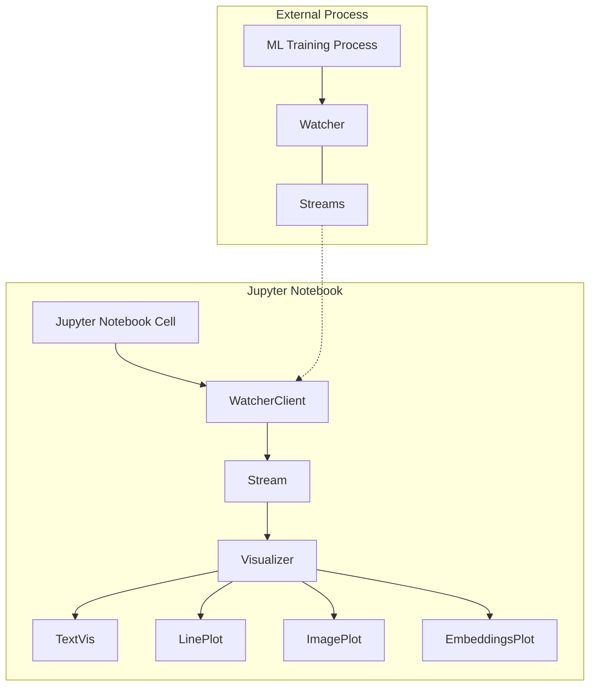
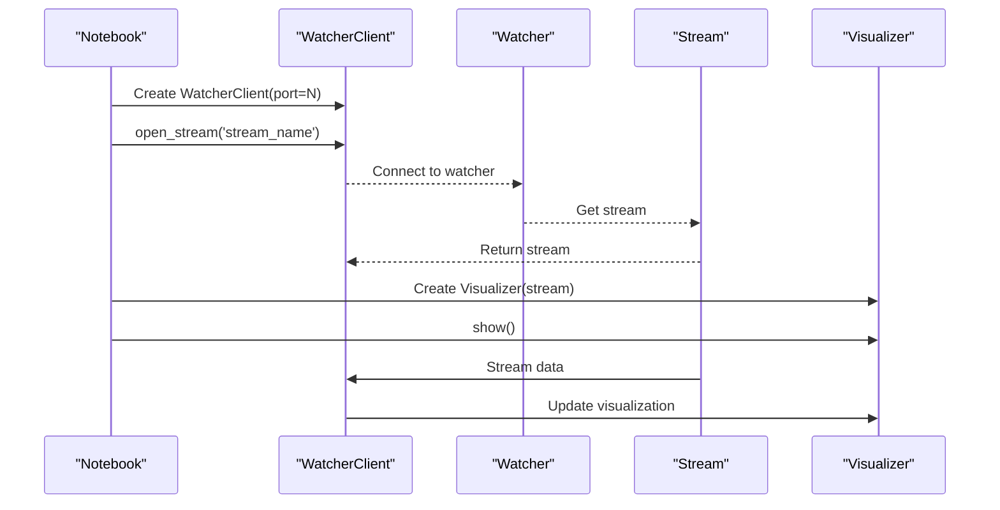
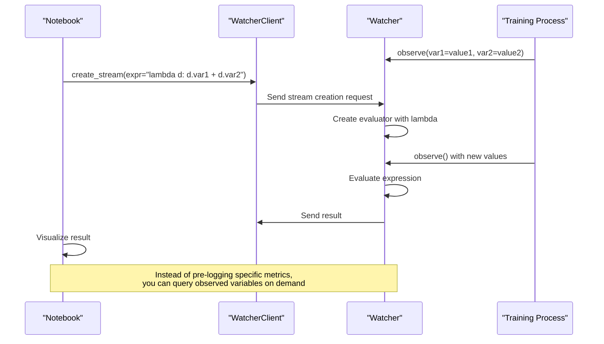
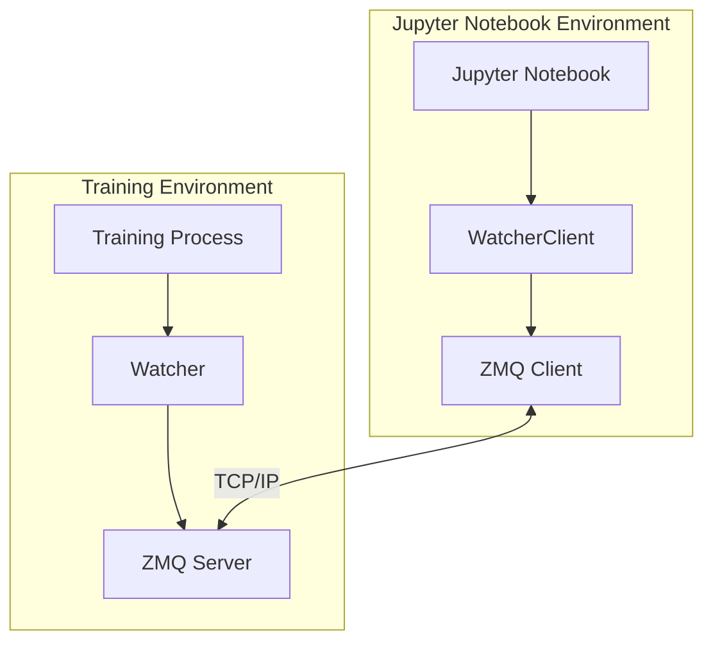

<!-- source: DeepWiki mcp.deepwiki.com · repo microsoft/tensorwatch · page 8 Notebook Integration · fetched 2026-10-26 -->

# Notebook Integration

<details>
<summary>Relevant source files</summary>

The following files were used as context for generating this wiki page:

- [docs/images/teaser.gif](docs/images/teaser.gif)
- [notebooks/data_exploration.ipynb](notebooks/data_exploration.ipynb)
- [notebooks/fruits_analysis.ipynb](notebooks/fruits_analysis.ipynb)
- [notebooks/mnist.ipynb](notebooks/mnist.ipynb)
- [notebooks/simple_logging.ipynb](notebooks/simple_logging.ipynb)
- [tensorwatch/__init__.py](tensorwatch/__init__.py)
- [tensorwatch/embeddings/tsne_utils.py](tensorwatch/embeddings/tsne_utils.py)
- [tensorwatch/lv_types.py](tensorwatch/lv_types.py)
- [tensorwatch/notebook_maker.py](tensorwatch/notebook_maker.py)
- [tensorwatch/zmq_wrapper.py](tensorwatch/zmq_wrapper.py)

</details>


This page explains how to use TensorWatch within Jupyter notebooks, highlighting the integration features, workflows, and best practices. TensorWatch's notebook integration allows you to visualize and monitor machine learning processes in real-time, query running processes for specific information, and explore data interactively.

For information about the underlying stream system that powers the notebook integration, see [Stream System](#3.1). For details on the visualizations available, see [Visualization System](#4).

## Key Components of Notebook Integration

TensorWatch provides several components specifically designed for notebook environments, allowing seamless monitoring and visualization of machine learning processes.



Sources:
- [tensorwatch/__init__.py:5-20]()
- [notebooks/mnist.ipynb:31-41]()
- [notebooks/fruits_analysis.ipynb:41-47]()

## Setting Up TensorWatch in Jupyter

To use TensorWatch in a Jupyter notebook, you need to import the library and set up the appropriate matplotlib backend:

```python
%matplotlib notebook
import tensorwatch as tw
```

This configuration enables interactive visualizations within the notebook. The `%matplotlib notebook` magic command is essential for proper integration of matplotlib-based visualizations.

Sources:
- [notebooks/mnist.ipynb:38-40]()
- [notebooks/fruits_analysis.ipynb:46-47]()
- [notebooks/data_exploration.ipynb:37-39]()
- [notebooks/simple_logging.ipynb:63-65]()

## Creating and Connecting to Streams

The fundamental workflow for notebook integration involves connecting to data streams from running processes. This is done using the `WatcherClient` class, which allows you to open and monitor streams created by `Watcher` objects.



### Basic Stream Connection

```python
# Create a client that connects to a watcher
client = tw.WatcherClient()

# Open a specific stream by name
stream = client.open_stream('stream_name')

# Create a visualizer for this stream
vis = tw.Visualizer(stream)
vis.show()
```

### Multiple Watchers

You can connect to multiple watchers by specifying different ports:

```python
# Connect to different watchers
train = tw.WatcherClient(port=0)
test = tw.WatcherClient(port=1)

# Open streams from each watcher
train_stream = train.open_stream('metrics')
test_stream = test.open_stream('metrics')
```

Sources:
- [notebooks/mnist.ipynb:85-86]()
- [notebooks/fruits_analysis.ipynb:92-93]()
- [notebooks/simple_logging.ipynb:82-84]()

## Visualization in Notebooks

TensorWatch provides various visualization types that can be used directly in notebooks. The `Visualizer` class acts as a wrapper that connects streams to specific visualization implementations.

### Available Visualizers

| Visualization Type | Description | Example Usage |
|--------------------|-------------|--------------|
| `text` | Text-based visualization | `tw.Visualizer(stream, vis_type='text')` |
| `line` | Line plot (matplotlib) | `tw.Visualizer(stream, vis_type='line')` |
| `image` | Image display | `tw.Visualizer(stream, vis_type='image')` |
| `histogram` | Histogram plot | `tw.Visualizer(stream, vis_type='histogram')` |
| `bar` | Bar plot | `tw.Visualizer(stream, vis_type='bar')` |
| `pie` | Pie chart | `tw.Visualizer(stream, vis_type='pie')` |
| `tsne` | t-SNE embeddings plot | `tw.Visualizer(stream, vis_type='tsne')` |

### Customizing Visualizations

The `Visualizer` constructor accepts various parameters to customize the appearance and behavior of visualizations:

```python
vis = tw.Visualizer(
    stream,
    vis_type='line',
    title='Training Loss',
    clear_after_end=False,
    history_len=100,
    xtitle='Epoch',
    ytitle='Loss'
)
vis.show()
```

Sources:
- [tensorwatch/__init__.py:10-17]()
- [tensorwatch/lv_types.py:46-97]()
- [notebooks/data_exploration.ipynb:126-129]()
- [notebooks/simple_logging.ipynb:117-119]()

## Lazy Logging in Notebooks

One of TensorWatch's most powerful features for notebook integration is "lazy logging," which allows you to query variables in a running process without pre-defining logging statements.



### Using Lazy Logging

1. In your training script, create a `Watcher` and use `observe()` to make variables available:
   ```python
   w = tw.Watcher()
   # Inside training loop
   w.observe(loss=current_loss, accuracy=current_accuracy)
   ```

2. In your notebook, create a stream with an expression to evaluate:
   ```python
   client = tw.WatcherClient()
   stream = client.create_stream(expr="lambda d: d.loss")
   vis = tw.Visualizer(stream)
   vis.show()
   ```

3. You can create complex expressions:
   ```python
   # Plot the ratio of loss to accuracy
   stream = client.create_stream(expr="lambda d: d.loss / (d.accuracy + 1e-10)")
   ```

Sources:
- [notebooks/mnist.ipynb:47-51]()
- [notebooks/fruits_analysis.ipynb:54-58]()
- [notebooks/mnist.ipynb:99-107]()

## Data Exploration in Notebooks

TensorWatch provides utilities for data exploration that integrate well with notebooks, particularly for dimensionality reduction and visualization.

### t-SNE Visualization Example

```python
# Get t-SNE components from data (inputs and labels)
components = tw.get_tsne_components((inputs, labels))

# Create a stream from components and visualize
comp_stream = tw.ArrayStream(components)
vis = tw.Visualizer(comp_stream, vis_type='tsne', 
                    hover_images=inputs, hover_image_reshape=(28,28))
vis.show()
```

This creates an interactive 3D plot where you can hover over points to see corresponding images.

Sources:
- [tensorwatch/embeddings/tsne_utils.py:23-38]()
- [notebooks/data_exploration.ipynb:91-129]()

## Programmatic Notebook Creation

TensorWatch includes a `NotebookMaker` class that can programmatically generate Jupyter notebooks with TensorWatch code. This is useful for creating template notebooks or generating notebooks from scripts.

```python
# Create a notebook maker
notebook = NotebookMaker(watcher, filename='analysis.ipynb')

# Add streams to the notebook
notebook.add_streams(event_stream_infos)

# Write the notebook to disk
notebook.write()
```

The generated notebook will include all the necessary imports and code to connect to the watcher and visualize the streams.

Sources:
- [tensorwatch/notebook_maker.py:12-88]()

## Example Workflows

### Real-time Training Monitoring

```python
# Connect to a watcher in a training process
client = tw.WatcherClient()

# Create a stream for monitoring loss
loss_stream = client.create_stream(expr="lambda d: d.batch_loss")
loss_vis = tw.Visualizer(loss_stream, vis_type='line', title='Batch Loss')
loss_vis.show()

# Create another stream for monitoring accuracy
acc_stream = client.create_stream(expr="lambda d: d.accuracy")
acc_vis = tw.Visualizer(acc_stream, vis_type='line', title='Accuracy')
acc_vis.show()
```

### Comparing Training and Validation Metrics

```python
# Connect to training and testing watchers
train = tw.WatcherClient(port=0)
test = tw.WatcherClient(port=1)

# Create streams for loss from both watchers
train_loss = train.create_stream(expr="lambda d: d.loss")
test_loss = test.create_stream(expr="lambda d: d.loss")

# Visualize both in the same plot
vis = tw.Visualizer([train_loss, test_loss], vis_type='line', 
                   title='Train vs Test Loss')
vis.show()
```

Sources:
- [notebooks/mnist.ipynb:85-118]()
- [notebooks/fruits_analysis.ipynb:92-107]()

## Communication with External Processes

TensorWatch uses ZeroMQ for communication between notebooks and external processes, enabling real-time data streaming across network boundaries.



The communication is handled transparently through the `WatcherClient` and `Watcher` classes, but understanding the underlying mechanism can help with debugging network connectivity issues.

Sources:
- [tensorwatch/zmq_wrapper.py:14-289]()

## Best Practices

1. **Use the correct matplotlib backend**: Always include `%matplotlib notebook` at the top of your notebook for interactive visualizations.

2. **Manage memory efficiently**: For long-running training processes, consider using `history_len` parameter in visualizers to limit the amount of data kept in memory.

3. **Close connections when done**: Call `close()` on `WatcherClient` instances when you're done with them to release network resources.

4. **Separate concerns**: Use different streams for different metrics rather than combining everything into one stream.

5. **Use lazy logging for exploratory analysis**: Instead of logging everything upfront, use lazy logging to query specific metrics as needed during exploration.

Sources:
- [notebooks/mnist.ipynb:38-40]()
- [tensorwatch/lv_types.py:46-97]()

By following these integration patterns, you can effectively use TensorWatch within Jupyter notebooks to monitor, debug, and visualize your machine learning processes in real-time.

---

