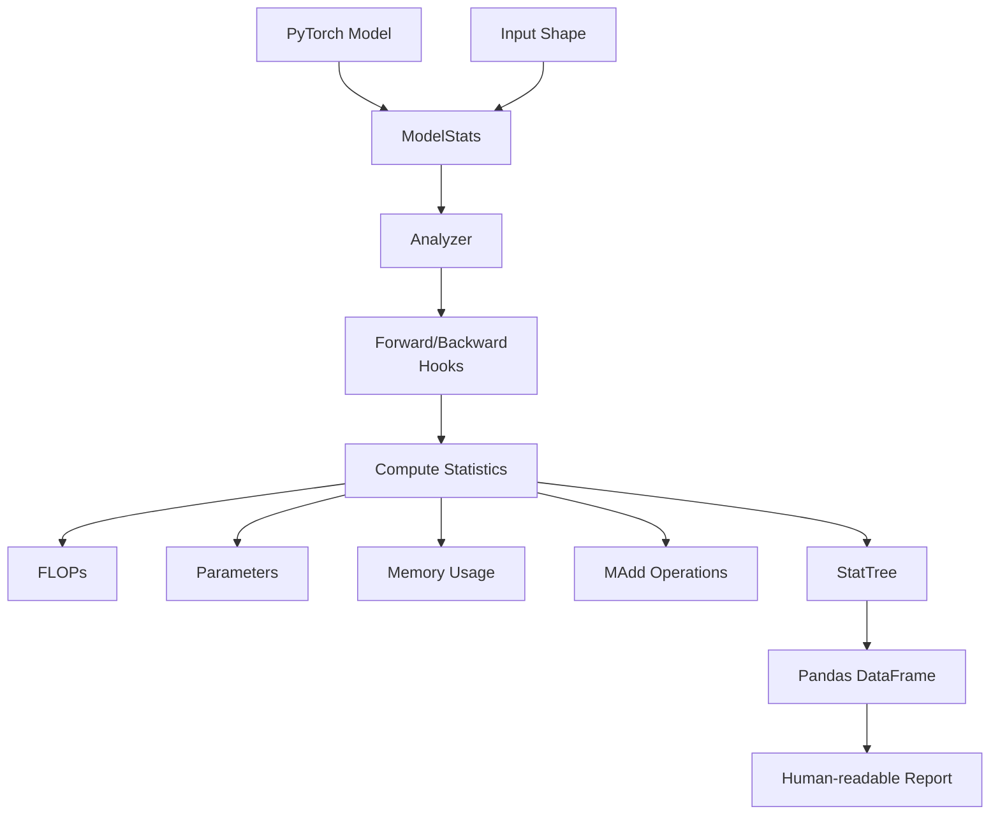
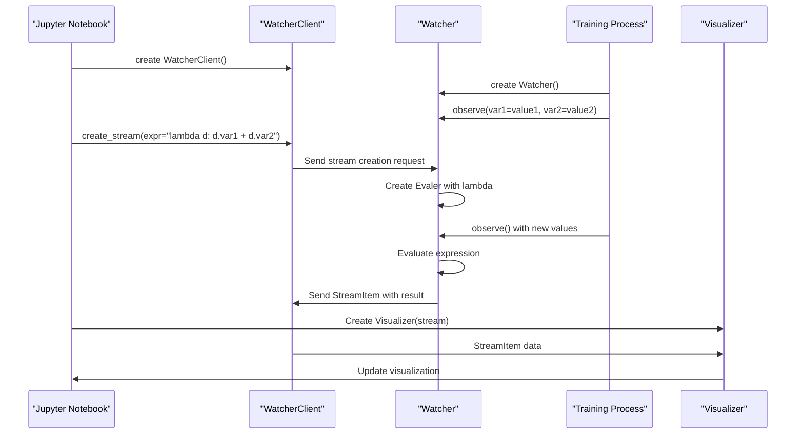
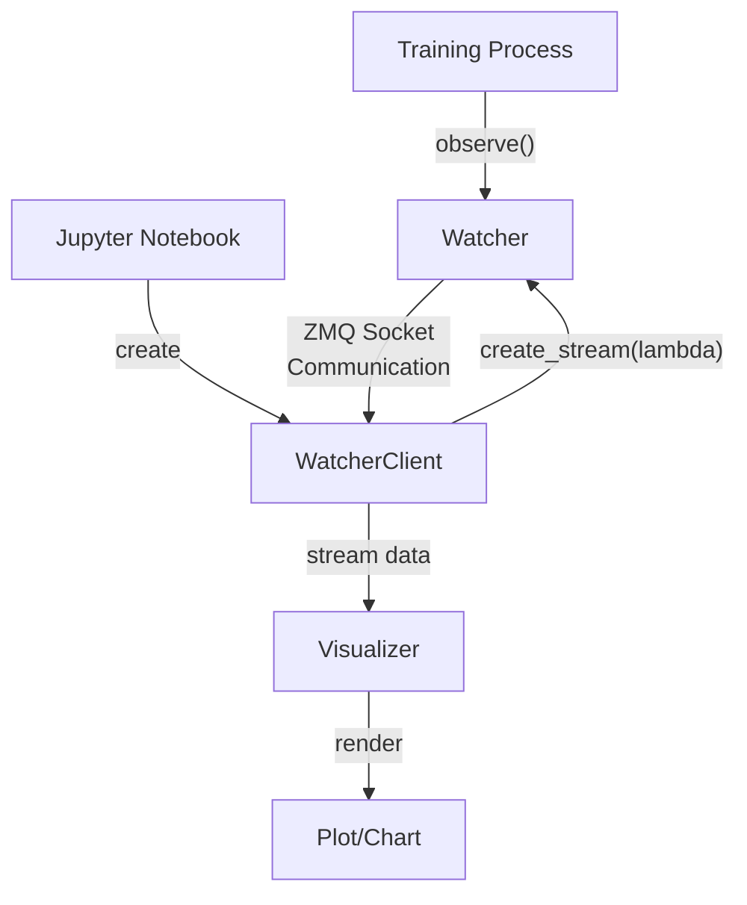
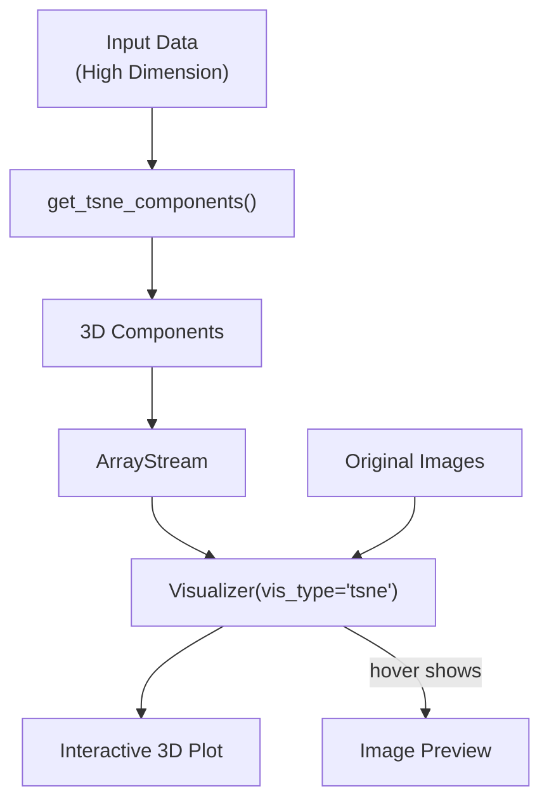
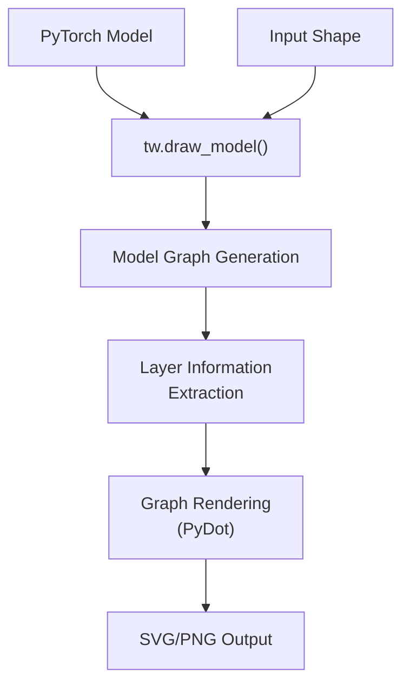
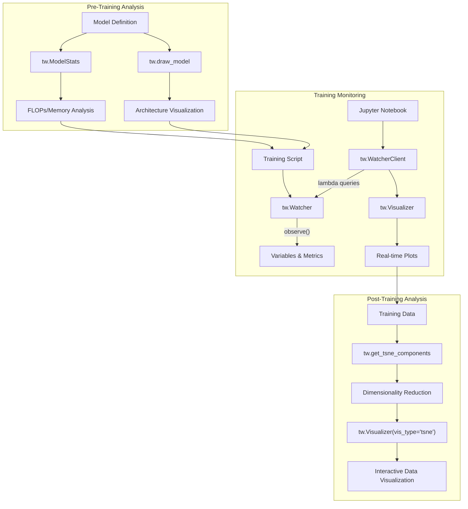

<!-- source: DeepWiki mcp.deepwiki.com · repo microsoft/tensorwatch · page 9 Examples and Use Cases · fetched 2026-10-26 -->

# Examples and Use Cases

<details>
<summary>Relevant source files</summary>

The following files were used as context for generating this wiki page:

- [.gitignore](.gitignore)
- [docs/images/teaser.gif](docs/images/teaser.gif)
- [notebooks/data_exploration.ipynb](notebooks/data_exploration.ipynb)
- [notebooks/fruits_analysis.ipynb](notebooks/fruits_analysis.ipynb)
- [notebooks/mnist.ipynb](notebooks/mnist.ipynb)
- [notebooks/network_arch.ipynb](notebooks/network_arch.ipynb)
- [tensorwatch/embeddings/tsne_utils.py](tensorwatch/embeddings/tsne_utils.py)
- [tensorwatch/model_graph/torchstat/README.md](tensorwatch/model_graph/torchstat/README.md)
- [tensorwatch/model_graph/torchstat/__init__.py](tensorwatch/model_graph/torchstat/__init__.py)
- [tensorwatch/model_graph/torchstat/reporter.py](tensorwatch/model_graph/torchstat/reporter.py)
- [tensorwatch/model_graph/torchstat/stat_tree.py](tensorwatch/model_graph/torchstat/stat_tree.py)
- [tensorwatch/zmq_wrapper.py](tensorwatch/zmq_wrapper.py)
- [test/pre_train/draw_model.py](test/pre_train/draw_model.py)
- [test/pre_train/model_stats.py](test/pre_train/model_stats.py)

</details>


This page provides practical examples and use cases for TensorWatch, demonstrating its capabilities in model analysis, real-time monitoring, data exploration, and visualization. TensorWatch's flexibility allows it to be used across a wide range of deep learning workflows. For information about the core architecture, see [Core Architecture](#3).

## Table of Key Examples

| Example Type | Description | Primary Classes Used |
| ------------ | ----------- | -------------------- |
| Model Statistics | Analyze model parameters, FLOPs, and memory usage | `ModelStats` |
| Lazy Logging | Real-time monitoring of training metrics | `Watcher`, `WatcherClient` |
| Data Exploration | Visualize high-dimensional data with t-SNE | `get_tsne_components`, `ArrayStream` |
| Network Visualization | Generate model architecture diagrams | `draw_model` |

## Model Statistics Analysis

TensorWatch provides tools to analyze PyTorch models, calculating statistics like:
- Parameter counts
- Floating-point operations (FLOPs)
- Memory requirements
- Layer-by-layer metrics

### Example: Analyzing Common CNN Architectures

```python
import tensorwatch as tw
import torchvision.models

model = torchvision.models.resnet18()
model_stats = tw.ModelStats(model, [1, 3, 224, 224], clone_model=False)
print(f'FLOPs: {model_stats.Flops}, parameters: {model_stats.parameters}, memory: {model_stats.inference_memory}')
```

The `ModelStats` class analyzes model architectures before training, giving insights into computational requirements and memory usage.

Sources: [test/pre_train/model_stats.py:1-9]()

### Model Analysis Flow



Sources: [tensorwatch/model_graph/torchstat/stat_tree.py](), [tensorwatch/model_graph/torchstat/reporter.py]()

## Real-Time Training Monitoring

TensorWatch enables real-time monitoring of neural network training through its "lazy logging" system, which allows querying variables without pre-defined logging statements.

### Lazy Logging Architecture



### Example: Monitoring MNIST Training

The following workflow demonstrates how to monitor an MNIST training run in real-time:

1. Start the training script in a separate process
2. Create `WatcherClient` instances in a Jupyter notebook
3. Request specific metrics using lambda expressions
4. Visualize the metrics as they're produced

```python
import tensorwatch as tw

# Connect to training process
train = tw.WatcherClient(port=0)
test = tw.WatcherClient(port=1)

# Request batch loss vs epoch data
batch_loss_stream = train.create_stream(
    lambda data: (data.epochf, data.batch_loss)
)

# Visualize with line plot
vis = tw.Visualizer(batch_loss_stream, vis_type='line')
vis.show()
```

Sources: [notebooks/mnist.ipynb:32-104](), [notebooks/fruits_analysis.ipynb:41-107]()

### ZMQ Communication Flow



Sources: [tensorwatch/zmq_wrapper.py:14-290]()

## Data Exploration and Visualization

TensorWatch offers tools for exploring high-dimensional data through dimensionality reduction techniques like t-SNE.

### Example: Visualizing MNIST with t-SNE

The following process visualizes MNIST digit clusters using t-SNE:

1. Load the MNIST dataset
2. Sample a subset of images for each digit class
3. Apply t-SNE to reduce dimensionality to 3D
4. Visualize the resulting components in an interactive plot

```python
import tensorwatch as tw

# Get t-SNE components from dataset
components = tw.get_tsne_components((inputs, labels))

# Create stream and visualize
comp_stream = tw.ArrayStream(components)
vis = tw.Visualizer(comp_stream, vis_type='tsne', 
                    hover_images=inputs, hover_image_reshape=(28,28))
vis.show()
```

Sources: [notebooks/data_exploration.ipynb:38-130](), [tensorwatch/embeddings/tsne_utils.py:1-42]()

### t-SNE Visualization Workflow



Sources: [tensorwatch/embeddings/tsne_utils.py:23-38]()

## Network Architecture Visualization

TensorWatch can generate visual representations of neural network architectures, helping to understand model structure.

### Example: Visualizing VGG16 Architecture

```python
import tensorwatch as tw
import torchvision.models

vgg16_model = torchvision.models.vgg16()
drawing = tw.draw_model(vgg16_model, [1, 3, 224, 224])
drawing.save('model_architecture.png')
```

Sources: [test/pre_train/draw_model.py:1-10](), [notebooks/network_arch.ipynb:1-13]()

### Network Visualization Pipeline



Sources: [notebooks/network_arch.ipynb:1-13](), [test/pre_train/draw_model.py:1-10]()

## Integrated Workflow Example

The following diagram illustrates a complete deep learning workflow using TensorWatch for monitoring, analysis, and visualization:



Sources: [notebooks/mnist.ipynb](), [notebooks/fruits_analysis.ipynb](), [notebooks/data_exploration.ipynb](), [test/pre_train/model_stats.py](), [test/pre_train/draw_model.py]()

## Common Use Cases

### 1. Model Development and Debugging

Use TensorWatch to:
- Analyze model complexity before training
- Visualize architecture to verify design
- Monitor training in real-time to identify problems early
- Compare parameter counts and computational demands between model variants

### 2. Training Optimization

Use TensorWatch to:
- Monitor batch-level metrics to fine-tune hyperparameters
- Identify computational bottlenecks in model architecture
- Compare training behavior across different optimization strategies
- Track resource usage during training

### 3. Data Understanding

Use TensorWatch to:
- Visualize high-dimensional data using t-SNE
- Explore relationships between data points
- Identify clusters and patterns in training data
- Examine model's internal representations

### 4. Educational and Research Applications

Use TensorWatch to:
- Visualize neural network architectures for teaching
- Compare different model designs side-by-side
- Demonstrate training dynamics in real-time
- Explore model behavior interactively

## Additional Resources

For comprehensive examples of these use cases, refer to the Jupyter notebooks in the repository:
- MNIST training monitoring: `notebooks/mnist.ipynb`
- Fruits dataset analysis: `notebooks/fruits_analysis.ipynb`
- Data exploration: `notebooks/data_exploration.ipynb`
- Network architecture visualization: `notebooks/network_arch.ipynb`

For information about the Lazy Logging system, see [Lazy Logging](#3.3).