# Page: TensorWatch Overview

# TensorWatch Overview

<details>
<summary>Relevant source files</summary>

The following files were used as context for generating this wiki page:

- [README.md](README.md)
- [docs/images/teaser_small.gif](docs/images/teaser_small.gif)
- [docs/paper/main.pdf](docs/paper/main.pdf)
- [docs/paper/main.tex](docs/paper/main.tex)
- [docs/paper/sample-base.bib](docs/paper/sample-base.bib)

</details>


TensorWatch is a powerful debugging and visualization tool for data science, deep learning, and reinforcement learning developed by Microsoft Research. This document provides a technical overview of TensorWatch's architecture, key components, and capabilities.

TensorWatch is designed to provide real-time visualization of machine learning training processes within Jupyter Notebooks or standalone applications, enabling interactive analysis without requiring the traditional stop-change-restart cycle when you need new information.

Sources: [README.md:3-7]()

## Core Architecture

TensorWatch is built on a stream-based architecture that decouples data producers (like training processes) from consumers (like visualizations). This enables flexible data flow and real-time analysis.

### Stream-based Data Flow

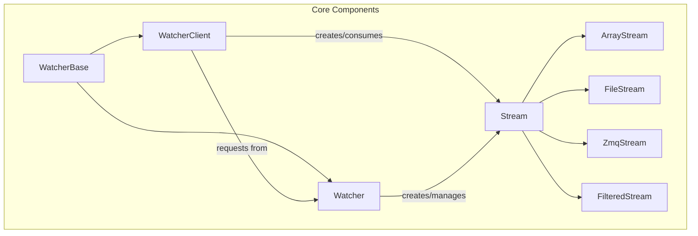

The stream-based architecture features:

- **Stream**: Base class defining the stream interface
- **ArrayStream**: In-memory storage of stream values
- **FileStream**: Persists stream values to disk files
- **ZmqStream**: Transmits stream values over network via ZeroMQ
- **FilteredStream**: Applies filtering to stream values

Streams can be chained together to create complex data flow graphs. Each stream can be subscribed to by multiple consumers, enabling the same data to be visualized in different ways simultaneously.

Sources: [README.md:52-56]()

### Watcher and WatcherClient

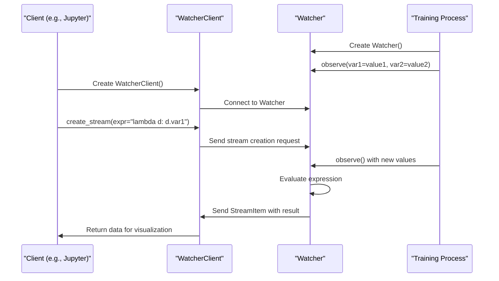

The communication system consists of:

- **Watcher**: Runs in the training process, observes variables, evaluates queries
- **WatcherClient**: Runs in a separate process (e.g., Jupyter Notebook), connects to the Watcher
- Communication happens via TCP/IP sockets using ZeroMQ

Sources: [README.md:51-56]()

### Lazy Logging Mode

One of TensorWatch's unique capabilities is "Lazy Logging," which allows querying variables in a running process without pre-defining logging statements:

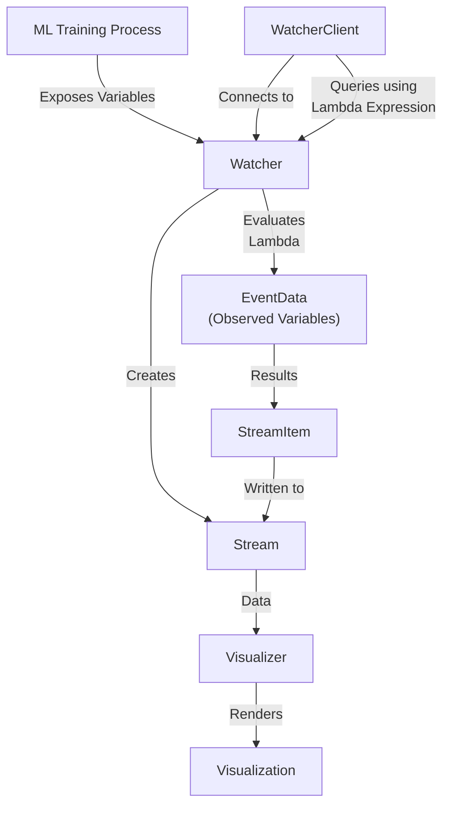

With Lazy Logging:
1. Training process exposes variables via `Watcher.observe()`
2. Client sends lambda expressions via `WatcherClient.create_stream(expr=...)`
3. Watcher evaluates the lambda against the observed variables
4. Results are streamed back to the client for visualization

Sources: [README.md:68-75]()

## Visualization System

TensorWatch provides a flexible visualization system built around the `VisBase` class:

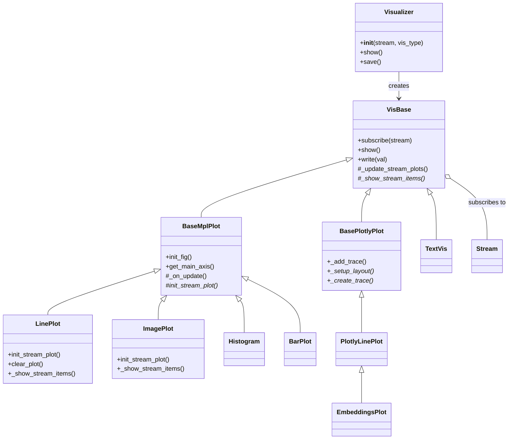

Key features of the visualization system:
- Support for multiple visualization backends (Matplotlib, Plotly)
- Various plot types (line plots, histograms, image plots, etc.)
- Real-time updates as new data arrives
- Ability to direct the same stream to multiple visualizations simultaneously
- Support for composing visualizations side-by-side

Sources: [README.md:57-62]()

## Model Analysis Tools

TensorWatch includes tools for analyzing model architecture and performance:

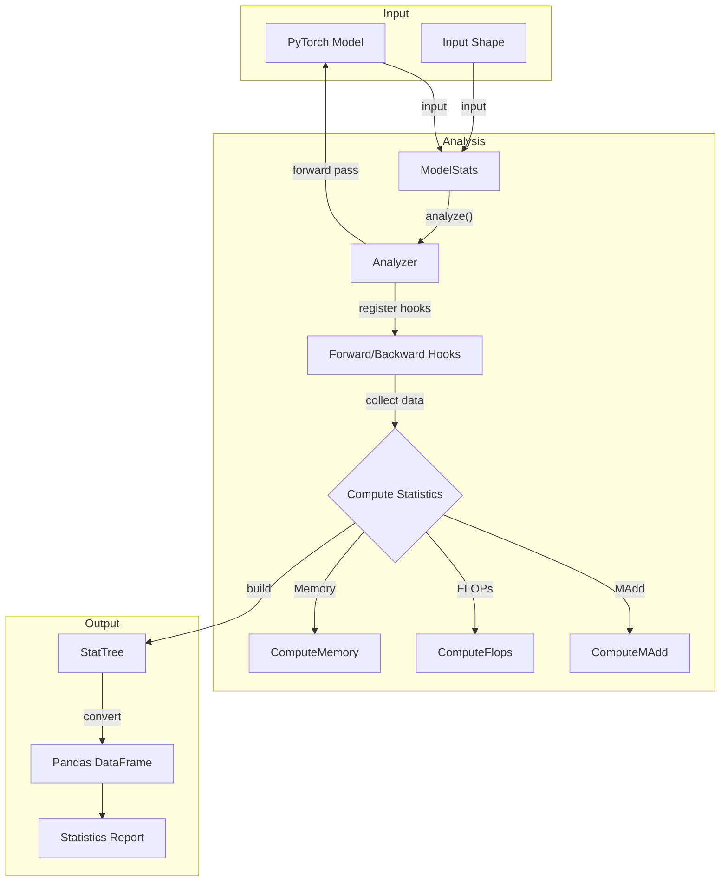

The model analysis system:
- Uses PyTorch hooks to gather statistics during a forward pass
- Calculates computational complexity (FLOPs, MADDs)
- Calculates parameter counts and memory usage
- Produces a comprehensive statistics report as a pandas DataFrame
- Visualizes model architecture as a graph

Sources: [README.md:81-89]()

## Prediction Explanations

TensorWatch includes tools for explaining model predictions:

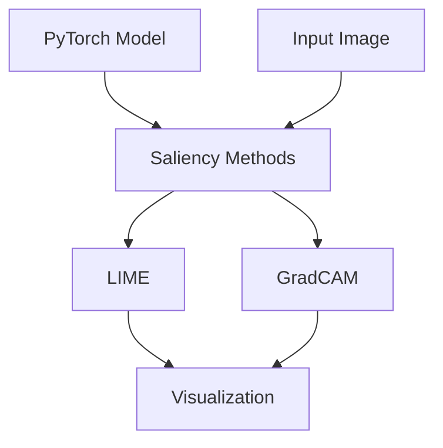

These tools help visualize what parts of an input (e.g., image) contribute to a model's prediction, making it easier to understand and debug model behavior.

Sources: [README.md:97-102]()

## Example Usage

Here's a simple example of using TensorWatch for tracking metrics:

```python
import tensorwatch as tw
import time

# Create a watcher and stream for logging
w = tw.Watcher(filename='test.log')
s = w.create_stream(name='metric1')

# Generate Jupyter Notebook to view real-time streams
w.make_notebook()

# Log data to the stream
for i in range(1000):
    # Write x,y pair to log
    s.write((i, i*i))
    time.sleep(1)
```

When run, this code:
1. Creates a `Watcher` that will serialize data to `test.log`
2. Creates a stream for logging metric values
3. Generates a Jupyter Notebook file for visualization
4. Logs pairs of values (x, x²) to the stream

Sources: [README.md:24-42]()

Example of lazy logging for monitoring a deep learning training process:

```python
# In training script
import tensorwatch as tw
import torch

# Create a Watcher
w = tw.Watcher()

# Train model
for epoch in range(epochs):
    for batch_idx, (data, target) in enumerate(dataloader):
        output = model(data)
        loss = loss_fn(output, target)
        loss.backward()
        optimizer.step()
        
        # Observe variables for lazy logging
        w.observe(loss=loss.item(), 
                  data=data,
                  output=output,
                  gradients=[p.grad for p in model.parameters()])
```

```python
# In Jupyter Notebook
client = tw.WatcherClient()
client.connect('localhost')

# Create stream with lambda expression to query live data
loss_stream = client.create_stream(expr='lambda d: d.loss')
vis = tw.Visualizer(loss_stream, vis_type='line')
vis.show()

# Query random batch of images with predictions
img_stream = client.create_stream(
    expr='lambda d: (d.data[0:5], d.output[0:5].argmax(dim=1))')
vis2 = tw.Visualizer(img_stream, vis_type='image')
vis2.show()
```

Sources: [README.md:68-75]()

## Integration with Other Libraries

TensorWatch leverages several open source libraries:
- **hiddenlayer**: For model visualization
- **torchstat**: For model statistics
- **Visual-Attribution**: For prediction explanations
- **pyzmq**: For network communication
- **nbformat**: For Jupyter notebook generation

This approach allows TensorWatch to provide a wide range of capabilities through a consistent interface.

Sources: [README.md:152-153]()

## Key Features Summary

1. **Real-time Visualization**: Monitor training metrics as they're generated
2. **Lazy Logging**: Query any variable in a running training process without pre-defined logging
3. **Multiple Visualizations**: Direct the same data to multiple visualizations simultaneously
4. **Model Analysis**: Analyze model architecture, parameter counts, FLOPs, and memory usage
5. **Prediction Explanations**: Visualize what parts of an input contribute to model predictions
6. **Data Exploration**: Visualize high-dimensional data using techniques like t-SNE
7. **Extensibility**: Build custom visualizations and integrate into existing workflows

Sources: [README.md:5-7]()

For more detailed information on specific features, refer to:
- Lazy Logging: [page 3.3](#3.3)
- Visualization System: [page 4](#4)
- Model Analysis Tools: [page 5](#5)

Sources: [README.md:107-120]()

---

# Page: Key Features

# Key Features

<details>
<summary>Relevant source files</summary>

The following files were used as context for generating this wiki page:

- [README.md](README.md)
- [docs/images/lazy_log_array_sum.png](docs/images/lazy_log_array_sum.png)
- [docs/images/teaser.gif](docs/images/teaser.gif)
- [docs/images/teaser_small.gif](docs/images/teaser_small.gif)
- [docs/lazy_logging.md](docs/lazy_logging.md)
- [notebooks/data_exploration.ipynb](notebooks/data_exploration.ipynb)
- [notebooks/fruits_analysis.ipynb](notebooks/fruits_analysis.ipynb)
- [notebooks/mnist.ipynb](notebooks/mnist.ipynb)
- [tensorwatch/embeddings/tsne_utils.py](tensorwatch/embeddings/tsne_utils.py)
- [tensorwatch/zmq_wrapper.py](tensorwatch/zmq_wrapper.py)
- [test/simple_log/sum_lazy.py](test/simple_log/sum_lazy.py)

</details>


This document provides an overview of the core features and capabilities of TensorWatch, a debugging and visualization tool designed for data science, deep learning, and reinforcement learning. TensorWatch offers a flexible platform for monitoring and visualizing machine learning training processes within Jupyter Notebook environments.

## Stream-Based Architecture

TensorWatch is built around a powerful stream-based architecture that enables flexible data flow between processes. This architecture decouples data sources from visualizations, allowing for composition of complex data flows.

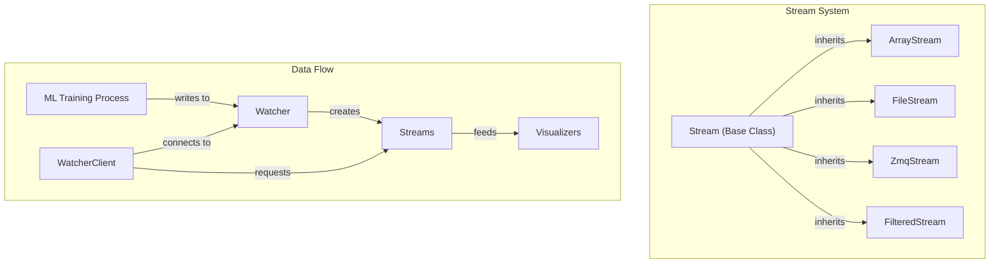

Streams in TensorWatch can:
- Receive data from multiple sources
- Save data to files for later analysis
- Feed data to multiple visualizations simultaneously
- Compose and transform data flows

Sources: [README.md:54-57](). 

## Lazy Logging Mode

One of the most unique features of TensorWatch is "Lazy Logging," which allows you to query a live running process without predefined logging statements.

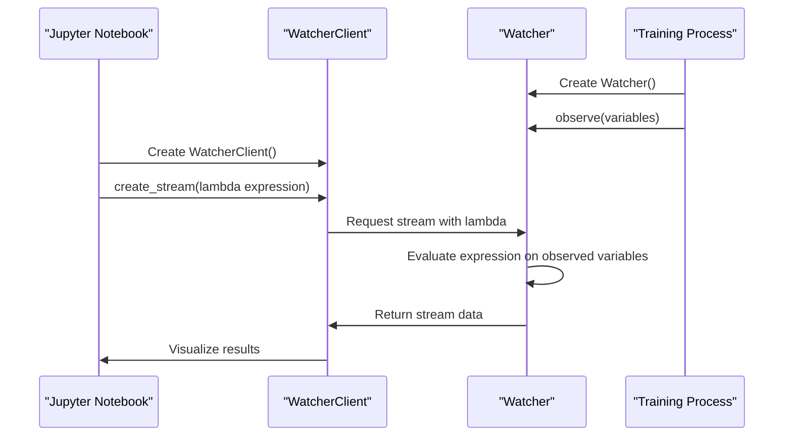

With Lazy Logging:
- No need to pre-define what to log - query any observed variable
- Lambda expressions execute in the context of observed variables
- Very low performance overhead when observing variables
- Query data dynamically as your debugging needs change

Example usage:
```python
# In training script
w = tw.Watcher()
w.observe(weights=weights)  # Observe with minimal overhead

# In Jupyter notebook
client = tw.WatcherClient()
stream = client.create_stream(expr='lambda d: np.sum(d.weights)')
```

Sources: [test/simple_log/sum_lazy.py:1-16](), [docs/lazy_logging.md:27-29](), [README.md:68-75]().

## Visualization System

TensorWatch provides a rich visualization system with multiple plot types and backends (Matplotlib and Plotly).

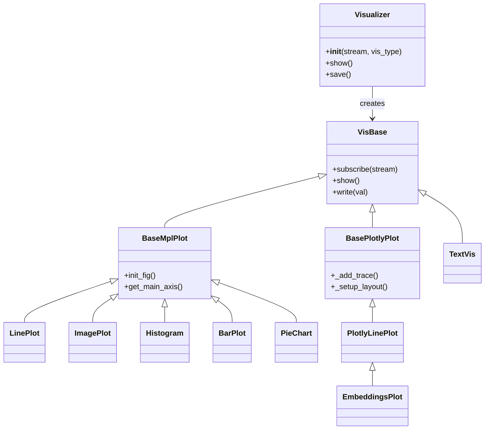

TensorWatch supports the following visualization types:

| Visualization Type | Description | Backend |
|--------------------|-------------|---------|
| Line Plot | Time series or numeric data | Matplotlib & Plotly |
| Histogram | Distribution of values | Matplotlib |
| Bar Chart | Categorical data | Matplotlib |
| Pie Chart | Proportional data | Matplotlib |
| Image Plot | Display images, tensors | Matplotlib |
| Embeddings Plot | t-SNE and embeddings | Plotly |

Key visualization features:
- Real-time updates as data arrives
- Multiple visualizations can subscribe to the same stream
- Multiple streams can feed into a single visualization
- Composable layouts with multiple visualizations side-by-side
- Custom visualization widgets

Sources: [README.md:57-63]().

## Pre-Training and Post-Training Analysis

TensorWatch provides tools for analyzing models before, during, and after training.

### Model Statistics

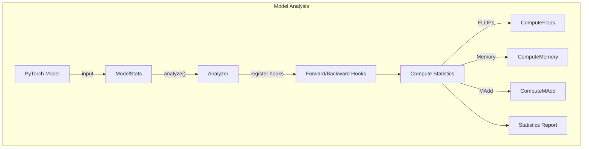

TensorWatch can calculate detailed statistics for deep learning models:
- Model parameter count
- FLOPs (floating point operations)
- Multiply-add operations
- Memory usage by layer
- Layer type breakdowns

### Network Visualization

TensorWatch can visualize model architectures with tensor shapes:

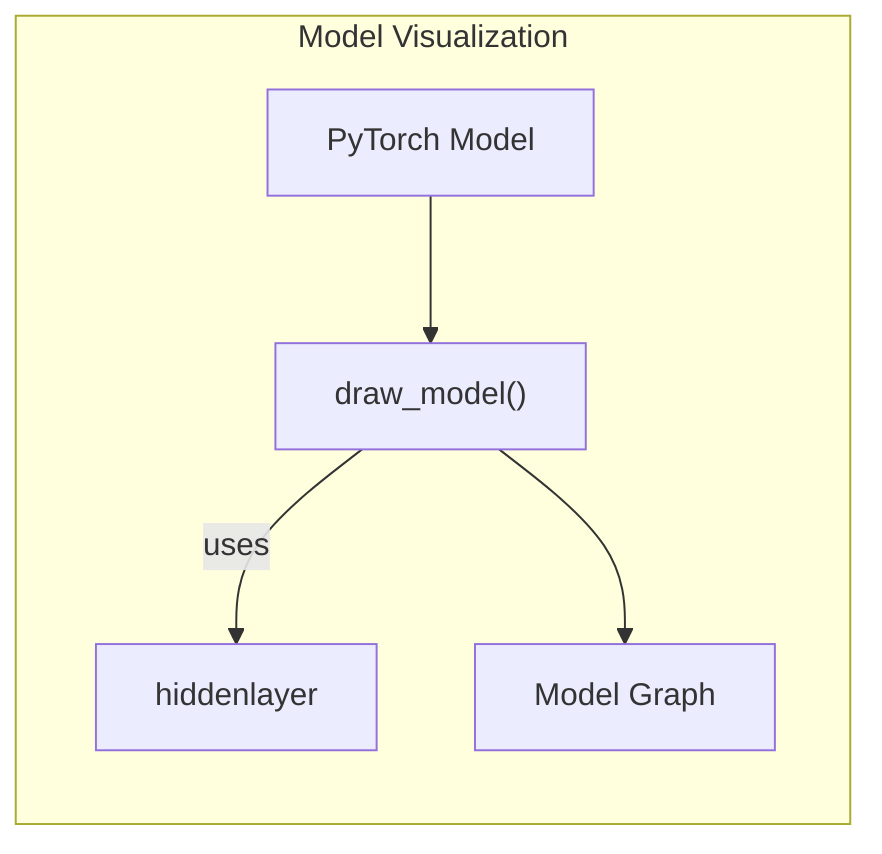

### Prediction Explanations

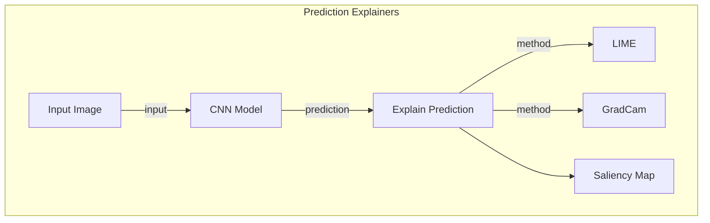

TensorWatch provides explanation tools for model predictions:
- LIME (Local Interpretable Model-agnostic Explanations)
- GradCAM (Gradient-weighted Class Activation Mapping)
- Saliency maps to highlight important image regions

Sources: [README.md:77-102]().

## Data Exploration

TensorWatch includes utilities for data exploration, particularly for high-dimensional data visualization.

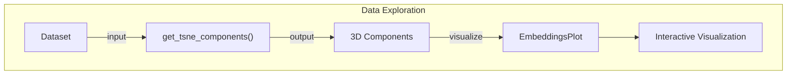

The t-SNE functionality allows:
- Dimensionality reduction to 2D or 3D
- Interactive exploration of high-dimensional data
- Hover capability to see original data points (like MNIST images)
- Color coding by class or label

Example usage:
```python
# Get t-SNE components for your dataset
components = tw.get_tsne_components((inputs, labels))

# Visualize the components with original images on hover
comp_stream = tw.ArrayStream(components)
vis = tw.Visualizer(comp_stream, vis_type='tsne', 
                    hover_images=inputs, hover_image_reshape=(28,28))
vis.show()
```

Sources: [notebooks/data_exploration.ipynb:67-103](), [tensorwatch/embeddings/tsne_utils.py:23-38]().

## Integration with Jupyter Notebook

TensorWatch is designed to work seamlessly with Jupyter Notebooks, enabling interactive debugging and visualization workflows.

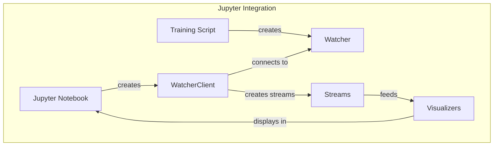

TensorWatch's Jupyter integration enables:
- Real-time visualization of training metrics
- Dynamic querying of training processes
- Interactive exploration of models and data
- Automated generation of notebook interfaces from scripts

Example:
```python
# In training script
w = tw.Watcher(filename='test.log')
s = w.create_stream(name='metric1')
w.make_notebook()  # Generates Jupyter notebook automatically

# Later in the script
s.write((i, i*i))  # Log data to stream
```

Sources: [README.md:22-49]().

## Comparison of Multiple Runs

TensorWatch facilitates comparing the results of multiple training runs by allowing you to:
- Save metrics from different runs in separate files
- Load multiple streams from different runs
- Visualize multiple streams in the same plot for direct comparison
- Track experiment variations and their impacts

This is especially useful for hyperparameter tuning and model comparison.

Sources: [README.md:62-64]().

## Cross-Platform Support

TensorWatch supports:
- Python 3.x
- PyTorch 0.4-1.x
- TensorFlow eager tensors
- Works across operating systems (Windows, Linux, macOS)

Sources: [README.md:16-17]().

---

# Page: Installation and Setup

# Installation and Setup

<details>
<summary>Relevant source files</summary>

The following files were used as context for generating this wiki page:

- [.gitignore](.gitignore)
- [MANIFEST.in](MANIFEST.in)
- [setup.py](setup.py)
- [tensorwatch/model_graph/hiddenlayer/pytorch_draw_model.py](tensorwatch/model_graph/hiddenlayer/pytorch_draw_model.py)
- [test/pre_train/draw_model.py](test/pre_train/draw_model.py)

</details>


This guide provides instructions for installing and setting up TensorWatch, an interactive real-time debugging and visualization tool for AI. For information about TensorWatch's architecture and components, see [Core Architecture](#3).

## System Requirements

TensorWatch is a Python-based library that works with Python 3. It has been tested on various operating systems, including Windows, macOS, and Linux.

## Prerequisites

Before installing TensorWatch, you should have the following prerequisites:

- Python 3.6 or higher
- pip (Python package installer)
- For model visualization: Graphviz (system dependency)

## Installation Methods

### Installation via pip

The simplest way to install TensorWatch is using pip:

```bash
pip install tensorwatch
```

This will install TensorWatch and its dependencies.

Sources: [setup.py:9-31]()

### Installation from Source

For the latest development version or if you want to modify the source code, you can install TensorWatch directly from the GitHub repository:

1. Clone the repository:
   ```bash
   git clone https://github.com/microsoft/tensorwatch.git
   ```

2. Navigate to the repository directory:
   ```bash
   cd tensorwatch
   ```

3. Install the package in development mode:
   ```bash
   pip install -e .
   ```

Sources: [setup.py:9-31]()

## Dependencies

TensorWatch has the following Python package dependencies, which will be automatically installed when using pip:

| Dependency | Purpose |
|------------|---------|
| matplotlib | Core visualization backend |
| numpy | Numerical computing |
| pyzmq | Messaging library for communication between components |
| plotly | Interactive visualization backend |
| ipywidgets | Interactive widgets for Jupyter notebooks |
| pydot (≥1.4.2) | Graph visualization for model architectures |
| nbformat | Notebook file handling |
| scikit-image | Image processing utilities |
| pyyaml | YAML file parsing |
| graphviz | Graph visualization utilities |

Sources: [setup.py:26-30]()

## System Dependencies

In addition to Python packages, TensorWatch requires some system dependencies:

### Graphviz

Graphviz is required for model visualization features. If not installed, you may encounter errors when trying to visualize model architectures.

#### Installation

- **Ubuntu/Debian**:
  ```bash
  sudo apt-get install graphviz
  ```

- **macOS**:
  ```bash
  brew install graphviz
  ```

- **Windows**:
  Download and install from the [Graphviz website](https://graphviz.org/download/).

Sources: [tensorwatch/model_graph/hiddenlayer/pytorch_draw_model.py:67-70]()

## TensorWatch Component Architecture

Below is a simplified view of how the installation components relate to each other:

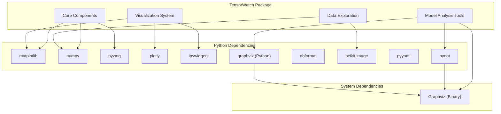

Sources: [setup.py:26-30](), [tensorwatch/model_graph/hiddenlayer/pytorch_draw_model.py:1-7]()

## Verifying Your Installation

After installing TensorWatch, you can verify that it's working correctly by running a simple test script.

### Testing Model Visualization

If you have PyTorch installed, you can test the model visualization feature:

```python
import torch
import torchvision.models
import tensorwatch as tw

# Load a pre-trained model
vgg16_model = torchvision.models.vgg16()

# Draw the model architecture
drawing = tw.draw_model(vgg16_model, [1, 3, 224, 224])
drawing.save('model_visualization.png')
```

This script should generate an image file with the VGG16 model architecture.

Sources: [test/pre_train/draw_model.py:1-9]()

## Installation Components Flow

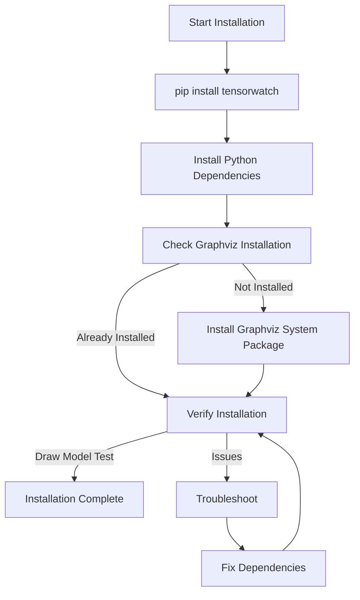

Sources: [setup.py:9-31](), [tensorwatch/model_graph/hiddenlayer/pytorch_draw_model.py:67-70]()

## Troubleshooting

### Model Visualization Issues

If you encounter errors when trying to visualize models, check that Graphviz is properly installed:

```bash
# Check if graphviz is in your PATH
dot -V
```

If the command is not found, install Graphviz using the instructions in the System Dependencies section.

Sources: [tensorwatch/model_graph/hiddenlayer/pytorch_draw_model.py:67-70]()

### Python Package Conflicts

If you encounter package conflicts or version issues, consider creating a virtual environment:

```bash
# Create a new virtual environment
python -m venv tensorwatch_env

# Activate the environment
# On Windows:
tensorwatch_env\Scripts\activate
# On macOS/Linux:
source tensorwatch_env/bin/activate

# Install TensorWatch in the clean environment
pip install tensorwatch
```

## Next Steps

After completing the installation, you can explore TensorWatch's capabilities by checking the [TensorWatch Overview](#1) or diving into specific components like the [Stream System](#3.1).

---

# Page: Core Architecture

# Core Architecture

<details>
<summary>Relevant source files</summary>

The following files were used as context for generating this wiki page:

- [tensorwatch/__init__.py](tensorwatch/__init__.py)
- [tensorwatch/lv_types.py](tensorwatch/lv_types.py)
- [tensorwatch/notebook_maker.py](tensorwatch/notebook_maker.py)
- [tensorwatch/watcher.py](tensorwatch/watcher.py)
- [tensorwatch/watcher_base.py](tensorwatch/watcher_base.py)
- [tensorwatch/watcher_client.py](tensorwatch/watcher_client.py)

</details>


This document describes the fundamental design and components of TensorWatch, a debugging and visualization library for machine learning. This page focuses on the underlying architecture that enables the core functionality of data streaming, lazy logging, and visualization in TensorWatch. For more information about specific systems built on top of this core, see [Stream System](#3.1), [Watcher and WatcherClient](#3.2), [Lazy Logging](#3.3), and [Visualization System](#4).

## System Overview

TensorWatch's core architecture follows a client-server model with a stream-based communication system. The architecture enables real-time observation, collection, and visualization of data from machine learning processes.

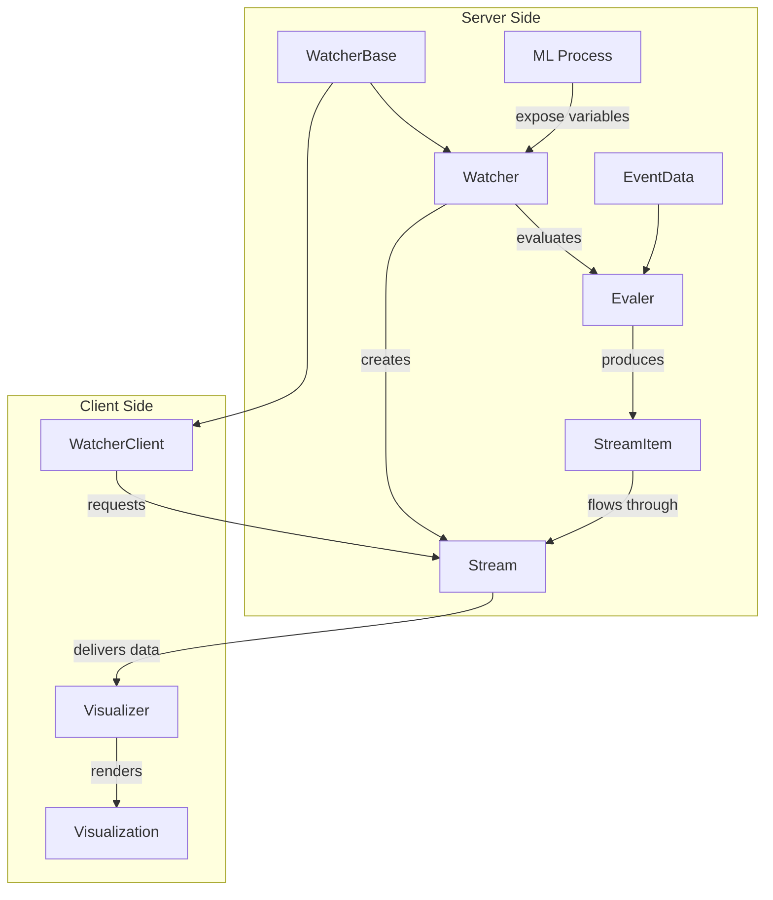

Sources: [tensorwatch/watcher_base.py:15-216](), [tensorwatch/watcher.py:13-98](), [tensorwatch/watcher_client.py:13-90](), [tensorwatch/lv_types.py:9-27]()

## Core Components

TensorWatch's architecture is built around several key classes that work together to provide its functionality:

### WatcherBase

`WatcherBase` is the foundation class that provides the core functionality for both `Watcher` and `WatcherClient`. It manages streams, handles expression evaluation, and processes observed variables.

Key responsibilities:
- Managing streams through `create_stream()`, `open_stream()`, and `del_stream()`
- Processing observed variables via `observe()`
- Setting global variables with `set_globals()`
- Evaluating expressions on observed data

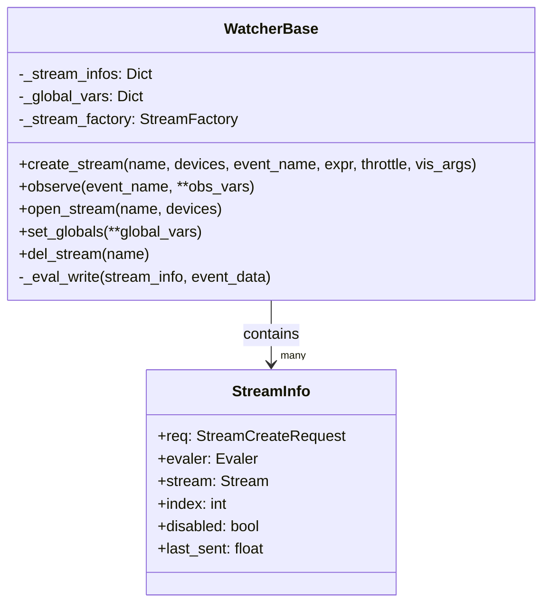

Sources: [tensorwatch/watcher_base.py:15-216]()

### Watcher and WatcherClient

`Watcher` and `WatcherClient` extend `WatcherBase` to implement the server-side and client-side functionality respectively:

- `Watcher`: Runs in the monitored process and captures variables
- `WatcherClient`: Connects to a Watcher remotely to request data

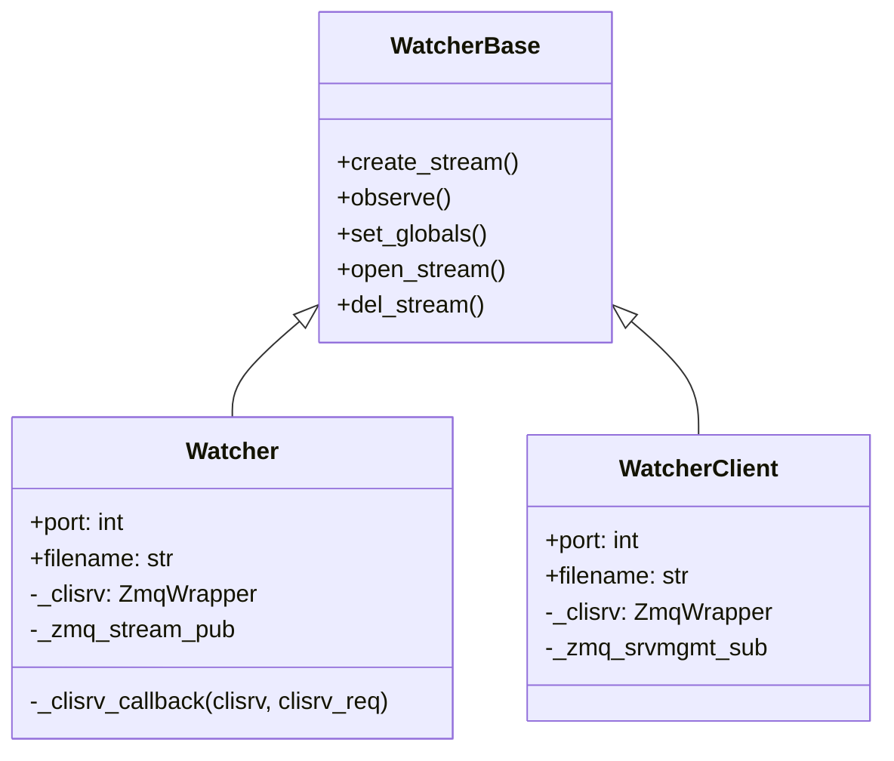

Sources: [tensorwatch/watcher.py:13-98](), [tensorwatch/watcher_client.py:13-90]()

### Data Structures

TensorWatch uses several key data structures for communication:

1. **EventData**: Container for variables being observed
   ```python
   # Dynamically creates attributes for each variable
   event_data = EventData(globals_val, var1=value1, var2=value2)
   ```

2. **StreamItem**: Data structure for items flowing through streams
   ```python
   # Contains the actual data and metadata
   stream_item = StreamItem(value=result, exception=None, stream_name="stream1")
   ```

3. **StreamCreateRequest**: Contains information for creating a stream
   ```python
   # Specifies how a stream should be created
   stream_req = StreamCreateRequest(stream_name="stream1", expr="lambda d: d.var1 + d.var2")
   ```

Sources: [tensorwatch/lv_types.py:9-175]()

## Data Flow

The data flow in TensorWatch follows a specific pattern:

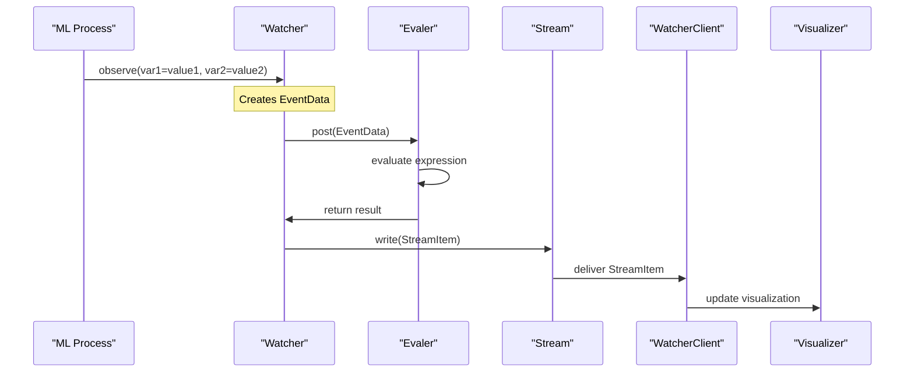

When a process calls `observe()` with variables:
1. The `Watcher` creates an `EventData` object with those variables
2. For each active stream:
   - The associated `Evaler` evaluates its expression on the `EventData`
   - The result is packaged as a `StreamItem`
   - The `StreamItem` is written to the stream
   - The stream delivers the item to subscribers (e.g., `WatcherClient`)
   - The `Visualizer` updates with the new data

Sources: [tensorwatch/watcher_base.py:157-185]()

## Stream Creation and Management

Stream creation is a core part of TensorWatch's architecture:

```mermaid
flowchart TD
    A["WatcherClient.create_stream()"] --> B["StreamCreateRequest created"]
    B --> C["Request sent to Watcher"]
    C --> D["Watcher.create_stream()"]
    D --> E["Stream created"]
    D --> F["Evaler created for expression"]
    E --> G["Stream stored in _stream_infos"]
    F --> G
```

The key steps in this process are:
1. A client calls `create_stream()` with an expression (typically a lambda)
2. A `StreamCreateRequest` is created with the details
3. The request is sent to the `Watcher` (server)
4. The `Watcher` creates a `Stream` and an `Evaler` for the expression
5. The stream is stored in the `_stream_infos` dictionary for later use

Sources: [tensorwatch/watcher_base.py:106-152](), [tensorwatch/watcher_client.py:67-79]()

## Communication Mechanism

TensorWatch uses a combination of file storage and ZeroMQ for communication:

| Communication Method | Implementation | Purpose |
|----------------------|----------------|---------|
| File Storage | `FileStream` | Persistently store observations |
| ZeroMQ Sockets | `ZmqStream` | Real-time communication between processes |
| In-Memory | `ArrayStream` | Fast storage within the same process |

The choice of communication channel is determined by the "devices" parameter when creating streams:
```python
# Create a stream that communicates over TCP port 8080
stream = watcher.create_stream(devices=["tcp:8080"])

# Create a stream that saves to a file
stream = watcher.create_stream(devices=["file:data.json"])
```

Sources: [tensorwatch/watcher_base.py:59-98](), [tensorwatch/watcher.py:49-63](), [tensorwatch/watcher_client.py:50-64]()

## Notebook Integration

TensorWatch provides seamless integration with Jupyter notebooks through the `NotebookMaker` class, which can generate notebooks from existing watchers:

```mermaid
graph TD
    W["Watcher"] --> |"input to"| NB["NotebookMaker"]
    NB --> |"generates"| JN["Jupyter Notebook"]
    JN --> |"contains"| Code["TensorWatch Code"]
    Code --> |"creates"| WC["WatcherClient"]
    Code --> |"visualizes"| VS["Visualizers"]
```

Sources: [tensorwatch/notebook_maker.py:12-92](), [tensorwatch/watcher_base.py:216-220]()

## Conclusion

TensorWatch's core architecture provides a flexible foundation for debugging and visualizing machine learning models. The key features of this architecture include:

1. A client-server model for observing variables remotely
2. Stream-based communication for real-time data flow
3. Expression evaluation for lazy logging
4. Integration with visualization components

This architecture enables the more advanced features of TensorWatch, including the visualization system, model analysis tools, and data exploration utilities.

---

# Page: Stream System

# Stream System

<details>
<summary>Relevant source files</summary>

The following files were used as context for generating this wiki page:

- [tensorwatch/array_stream.py](tensorwatch/array_stream.py)
- [tensorwatch/file_stream.py](tensorwatch/file_stream.py)
- [tensorwatch/filtered_stream.py](tensorwatch/filtered_stream.py)
- [tensorwatch/stream.py](tensorwatch/stream.py)
- [tensorwatch/stream_factory.py](tensorwatch/stream_factory.py)
- [tensorwatch/zmq_mgmt_stream.py](tensorwatch/zmq_mgmt_stream.py)
- [tensorwatch/zmq_stream.py](tensorwatch/zmq_stream.py)

</details>


The Stream System forms the foundation of TensorWatch's data flow architecture. It enables real-time data exchange between components, connecting data producers (like training processes) with consumers (like visualizations). This page describes the core stream abstractions, how they interact, and the different stream implementations available in TensorWatch.

For information about the Watcher and WatcherClient that use these streams, see [Watcher and WatcherClient](#3.2).

## Core Stream Concept

At its heart, TensorWatch's stream system implements a publish-subscribe pattern where streams can:
- Receive data through `write()` operations
- Propagate data to subscribed streams 
- Be read from using `read_all()` 
- Be chained together to form data pipelines

```mermaid
flowchart TD
    subgraph "Stream Architecture"
        A["Producer"] -->|"write()"| B["Stream"]
        B -->|"subscribe()"| C["Subscriber Stream"]
        B -->|"subscribe()"| D["Subscriber Stream"]
        E["Source Stream"] -->|"subscribe()"| B
        B -->|"read_all()"| F["Consumer"]
    end
```

Sources: [tensorwatch/stream.py:9-92]()

## Base Stream Class

The `Stream` class in TensorWatch defines the fundamental stream interface. All specialized stream types inherit from this base class.

```mermaid
classDiagram
    class Stream {
        +stream_name: str
        +items_written: int
        +console_debug: bool
        +closed: bool
        +subscribe(stream: Stream)
        +unsubscribe(stream: Stream)
        +write(val: Any, from_stream: Stream)
        +read_all(from_stream: Stream)
        +load(from_stream: Stream)
        +save(from_stream: Stream)
        +close()
        +to_stream_item(val: Any)
    }
```

A Stream has the following key responsibilities:
- Maintaining a set of subscribers (other streams)
- Converting input values to structured `StreamItem` objects
- Propagating writes to all subscribers
- Managing stream lifecycle (open/close)

The Stream class supports full multi-threading and provides a pipeline-like mechanism where data can flow through connected streams.

Sources: [tensorwatch/stream.py:9-92]()

## Stream Types

TensorWatch provides several stream implementations for different use cases.

### Stream Type Hierarchy

```mermaid
classDiagram
    Stream <|-- FileStream
    Stream <|-- ZmqStream
    Stream <|-- ArrayStream
    Stream <|-- FilteredStream
    ZmqStream <|-- ZmqMgmtStream

    class Stream {
        +write(val, from_stream)
        +read_all(from_stream)
        +subscribe(stream)
    }
    class FileStream {
        +file_name: str
        +for_write: bool
    }
    class ZmqStream {
        +for_write: bool
        +topic: PublisherTopics
    }
    class ArrayStream {
        +array: Any
    }
    class FilteredStream {
        +filter_expr: Callable
    }
    class ZmqMgmtStream {
        +add_stream_req(req)
        +del_stream(name)
    }
```

Sources: [tensorwatch/stream.py:9-92](), [tensorwatch/file_stream.py:10-59](), [tensorwatch/zmq_stream.py:11-51](), [tensorwatch/array_stream.py:8-18](), [tensorwatch/filtered_stream.py:7-35](), [tensorwatch/zmq_mgmt_stream.py:11-58]()

### Specialized Stream Types

| Stream Type | Purpose | Key Features |
|-------------|---------|-------------|
| FileStream | Persists data to disk | Uses pickle serialization, supports read/write modes |
| ZmqStream | Enables network communication | Uses ZeroMQ for pub/sub messaging |
| ArrayStream | Wraps array data as a stream | Simple wrapper for arrays |
| FilteredStream | Filters data from source stream | Applies custom filtering logic |
| ZmqMgmtStream | Manages ZMQ stream communication | Handles server management events |

Sources: [tensorwatch/file_stream.py:10-59](), [tensorwatch/zmq_stream.py:11-51](), [tensorwatch/array_stream.py:8-18](), [tensorwatch/filtered_stream.py:7-35](), [tensorwatch/zmq_mgmt_stream.py:11-58]()

## Stream Items

Data in streams is wrapped in `StreamItem` objects which contain:
- The actual value
- Stream name
- Item index
- Timestamp and other metadata

This structured format ensures consistent handling across different stream types.

Sources: [tensorwatch/stream.py:46-53]()

## Stream Factory

The `StreamFactory` class provides a centralized way to create and manage streams. It helps:
- Create shared streams (file, ZMQ) with consistent configuration
- Reuse existing streams when appropriate
- Combine multiple streams into a unified interface
- Manage stream lifecycle

```mermaid
sequenceDiagram
    participant Client
    participant Factory as StreamFactory
    participant FileStream
    participant ZmqStream
    
    Client->>Factory: get_streams(["file:data.pkl", "tcp:5000"], for_write=True)
    Factory->>Factory: _create_stream_by_string("file:data.pkl", True)
    Factory->>FileStream: new FileStream(file_name="data.pkl", for_write=True)
    Factory->>Factory: _create_stream_by_string("tcp:5000", True)
    Factory->>ZmqStream: new ZmqStream(port=5000, for_write=True)
    Factory-->>Client: [fileStream, zmqStream]
```

The factory maintains references to created streams, enabling reuse and management of shared resources.

Sources: [tensorwatch/stream_factory.py:12-100]()

## Stream Data Flow

The following diagram illustrates how data flows through the TensorWatch stream system in a typical monitoring scenario:

```mermaid
flowchart TD
    A["ML Training Process"] -->|"observed variables"| B["Watcher"]
    B -->|"creates"| C["Stream"]
    D["WatcherClient"] -->|"queries"| B
    D -->|"creates/consumes"| C
    C -->|"data"| E["Visualizer"]
    
    subgraph "Stream Implementations"
        C --- F["FileStream\n(persistent storage)"]
        C --- G["ZmqStream\n(network communication)"]
        C --- H["FilteredStream\n(data filtering)"]
        C --- I["ArrayStream\n(in-memory data)"]
    end
```

This architecture enables flexible data routing between components through different stream implementations.

Sources: [tensorwatch/stream.py:9-92](), [tensorwatch/file_stream.py:10-59](), [tensorwatch/zmq_stream.py:11-51](), [tensorwatch/array_stream.py:8-18](), [tensorwatch/filtered_stream.py:7-35]()

## Stream Subscription Model

Streams implement a subscription model where one stream can subscribe to many others. When data is written to a stream, it propagates to all subscribers.

```mermaid
sequenceDiagram
    participant Producer
    participant StreamA
    participant StreamB
    participant StreamC
    participant Consumer
    
    Producer->>StreamA: write(value)
    StreamA->>StreamA: to_stream_item(value)
    Note over StreamA: Creates StreamItem with stream name and index
    StreamA->>StreamB: write(stream_item)
    StreamA->>StreamC: write(stream_item)
    Consumer->>StreamB: read_all()
    StreamB-->>Consumer: stream_item
```

This model enables:
- One-to-many data distribution
- Stream chaining for complex data flows
- Independent consumers with shared data sources

Sources: [tensorwatch/stream.py:34-42](), [tensorwatch/stream.py:55-65]()

## Stream Operations

### Writing Data

When data is written to a stream:
1. It's converted to a `StreamItem` if not already
2. Stream name and index are added if missing
3. The item is propagated to all subscribers
4. The items_written counter is incremented

```python
# Simplified write operation flow
value = ... # Some data
stream.write(value)  # Converts to StreamItem and propagates
```

Sources: [tensorwatch/stream.py:55-65]()

### Reading Data

The `read_all()` method yields items from subscribed streams:

```python
# Reading from a stream
for item in stream.read_all():
    process(item)
```

Sources: [tensorwatch/stream.py:67-70]()

### Loading Data

Specialized streams can generate data through the `load()` method:

```python
# FileStream loading data from disk
file_stream.load()  # Reads file contents into stream
```

Sources: [tensorwatch/stream.py:72-74](), [tensorwatch/file_stream.py:45-53](), [tensorwatch/array_stream.py:15-18]()

## Integration with TensorWatch Components

The Stream System integrates with other TensorWatch components:

```mermaid
flowchart TD
    subgraph "TensorWatch Architecture"
        A["Watcher\n(Data Producer)"] -->|"creates/manages"| B["Stream System"]
        C["WatcherClient\n(Query Interface)"] -->|"creates/consumes"| B
        B -->|"data flow"| D["Visualization System\n(Data Consumer)"]
        E["Training Process\n(Observable)"] -->|"exposes variables"| A
    end
    
    subgraph "Stream System Details"
        B --- F["Stream Base Class"]
        F --- G["FileStream"]
        F --- H["ZmqStream"]
        F --- I["ArrayStream"]
        F --- J["FilteredStream"]
    end
```

This architecture enables:
- Separation of data production from consumption
- Flexible data routing between components
- Various data transport mechanisms (files, network, memory)
- Real-time monitoring and visualization

Sources: [tensorwatch/stream.py:9-92](), [tensorwatch/file_stream.py:10-59](), [tensorwatch/zmq_stream.py:11-51](), [tensorwatch/array_stream.py:8-18](), [tensorwatch/filtered_stream.py:7-35]()

## Conclusion

The Stream System serves as the backbone of TensorWatch's data flow architecture, providing a flexible and extensible way to move data between components. Through various stream implementations and the subscription model, it enables complex data processing pipelines while maintaining a clean separation between data producers and consumers.

---

# Page: Watcher and WatcherClient

# Watcher and WatcherClient

<details>
<summary>Relevant source files</summary>

The following files were used as context for generating this wiki page:

- [docs/images/teaser.gif](docs/images/teaser.gif)
- [notebooks/data_exploration.ipynb](notebooks/data_exploration.ipynb)
- [notebooks/fruits_analysis.ipynb](notebooks/fruits_analysis.ipynb)
- [notebooks/lazy_logging.ipynb](notebooks/lazy_logging.ipynb)
- [notebooks/mnist.ipynb](notebooks/mnist.ipynb)
- [tensorwatch/embeddings/tsne_utils.py](tensorwatch/embeddings/tsne_utils.py)
- [tensorwatch/watcher.py](tensorwatch/watcher.py)
- [tensorwatch/watcher_base.py](tensorwatch/watcher_base.py)
- [tensorwatch/watcher_client.py](tensorwatch/watcher_client.py)
- [tensorwatch/zmq_wrapper.py](tensorwatch/zmq_wrapper.py)
- [test/simple_log/cli_file_expr.py](test/simple_log/cli_file_expr.py)
- [test/simple_log/cli_sum_log.py](test/simple_log/cli_sum_log.py)
- [test/simple_log/file_expr.py](test/simple_log/file_expr.py)

</details>


Watcher and WatcherClient form the core communication architecture of TensorWatch that enables real-time data streaming and the powerful "lazy logging" capability. These components establish a client-server architecture that allows users to query and visualize data from a running machine learning process without predefined logging statements.

For information about the stream system that underlies this communication, see [Stream System](#3.1). For details on lazy logging implementation, see [Lazy Logging](#3.3).

## Overview

```mermaid
classDiagram
    WatcherBase <|-- Watcher
    WatcherBase <|-- WatcherClient
    Stream <--o WatcherBase: "manages"
    
    class WatcherBase {
        +_stream_infos: Dict
        +_global_vars: Dict
        +_stream_factory: StreamFactory
        +create_stream()
        +observe()
        +set_globals()
        +close()
    }
    
    class Watcher {
        +port: int
        +filename: str
        +srv_name: str
        +_clisrv: ZmqWrapper.ClientServer
        +_zmq_stream_pub: Stream
    }
    
    class WatcherClient {
        +port: int
        +filename: str
        +_clisrv: ZmqWrapper.ClientServer
        +_zmq_srvmgmt_sub: ZmqMgmtStream
    }
    
    class Stream {
        +stream_name: str
        +write()
        +subscribe()
    }
```

Sources: [tensorwatch/watcher_base.py](), [tensorwatch/watcher.py](), [tensorwatch/watcher_client.py]()

The Watcher and WatcherClient classes both inherit from WatcherBase, which provides common functionality for managing streams and evaluating expressions. The key differences are:

- **Watcher**: Runs in the machine learning process, collects variables, and serves them to clients
- **WatcherClient**: Runs in a separate process (e.g., a Jupyter notebook), connects to a Watcher, and retrieves data for visualization

## Communication Architecture

```mermaid
sequenceDiagram
    participant MP as "ML Process"
    participant W as "Watcher"
    participant WC as "WatcherClient"
    participant V as "Visualizer"
    
    MP->>W: observe(i=i, sum=sum)
    Note over W: Stores variables in EventData
    WC->>W: create_stream(expr="lambda d: np.sum(d.weights)")
    Note over W: Creates Evaler with lambda
    W->>W: Register stream request
    MP->>W: observe() with new values
    W->>W: Evaluate expressions for each stream
    W-->>WC: Send results as StreamItems
    WC->>V: Feed stream to Visualizer
    V->>V: Update visualization
```

Sources: [notebooks/mnist.ipynb:46-59](), [tensorwatch/watcher_base.py:157-175]()

The communication between Watcher and WatcherClient is built on ZeroMQ (ZMQ), which provides robust messaging patterns:

1. Request-reply pattern for stream creation and management
2. Publish-subscribe pattern for streaming data between processes

## WatcherBase

WatcherBase is the parent class that provides core functionality shared by both Watcher and WatcherClient:

```mermaid
classDiagram
    class WatcherBase {
        +_stream_infos: Dict
        +_global_vars: Dict
        +_stream_count: int
        +_stream_factory: StreamFactory
        +create_stream(name, devices, event_name, expr, throttle, vis_args)
        +observe(event_name, **obs_vars)
        +set_globals(**global_vars)
        +open_stream(name, devices)
        +del_stream(name)
        +close()
    }
```

Sources: [tensorwatch/watcher_base.py:15-220]()

Key methods:

- **create_stream()**: Creates a new stream with optional expression for data transformation
- **observe()**: Makes variables available for evaluation by stream expressions
- **set_globals()**: Sets global variables available to all streams
- **open_stream()**: Opens an existing stream by name or from devices
- **del_stream()**: Disables a stream
- **close()**: Closes all streams and resources

## Watcher

The Watcher class extends WatcherBase to add server-side functionality:

```mermaid
classDiagram
    WatcherBase <|-- Watcher
    
    class Watcher {
        +port: int
        +filename: str
        +srv_name: str
        +_clisrv: ZmqWrapper.ClientServer
        +_zmq_stream_pub: Stream
        +devices_or_default(devices)
        +close()
        -_clisrv_callback(clisrv, clisrv_req)
        -_open_devices()
        -_send_server_start()
    }
```

Sources: [tensorwatch/watcher.py:13-97]()

The Watcher is typically created in the ML training script:

```python
watcher = tw.Watcher(port=0)
```

When initialized, Watcher:
1. Sets up a ZMQ server to handle client requests
2. Creates a stream publisher for sending data
3. Registers a callback to handle incoming client requests

Key methods:
- **\_clisrv_callback()**: Handles client requests like stream creation/deletion
- **devices_or_default()**: Determines which devices (TCP, file) to use for streams
- **observe()**: Inherited from WatcherBase, collects variables from the ML process

## WatcherClient

The WatcherClient class extends WatcherBase to add client-side functionality:

```mermaid
classDiagram
    WatcherBase <|-- WatcherClient
    
    class WatcherClient {
        +port: int
        +filename: str
        +_clisrv: ZmqWrapper.ClientServer
        +_zmq_srvmgmt_sub: ZmqMgmtStream
        +devices_or_default(devices)
        +create_stream(name, devices, event_name, expr, throttle, vis_args)
        +open_stream(name, devices)
        +del_stream(name)
        +close()
    }
```

Sources: [tensorwatch/watcher_client.py:13-89]()

The WatcherClient is typically created in a Jupyter notebook or analysis script:

```python
client = tw.WatcherClient(port=0)
```

When initialized, WatcherClient:
1. Connects to a Watcher's ZMQ server
2. Creates a subscription to receive server management events

Key methods:
- **create_stream()**: Overridden to send requests to the Watcher instead of creating locally
- **open_stream()**: Opens a stream to receive data from the specified devices
- **del_stream()**: Sends a request to the Watcher to delete a stream

## Stream Creation and Management

When a client requests a stream with an expression, the following sequence occurs:

```mermaid
sequenceDiagram
    participant WC as "WatcherClient"
    participant W as "Watcher"
    participant E as "Evaler"
    participant S as "Stream"
    
    WC->>WC: create_stream(expr="lambda d: ...")
    WC->>W: Send StreamCreateRequest
    W->>W: Process request in _clisrv_callback
    W->>E: Create Evaler with lambda expression
    W->>S: Create Stream
    W->>W: Register StreamInfo in _stream_infos
    W-->>WC: Confirm stream creation
    WC->>S: Subscribe to Stream
```

Sources: [tensorwatch/watcher_base.py:106-152](), [tensorwatch/watcher_client.py:67-79]()

## Data Flow During Observation

When the Watcher receives new variables via observe():

```mermaid
flowchart TD
    A["ML Process"] -->|"observe(var1=val1, var2=val2)"| B["Watcher"]
    B -->|"Create EventData"| C["EventData"]
    C -->|"For each stream"| D["Stream Expression"]
    D -->|"Evaluate"| E["Result"]
    E -->|"Create StreamItem"| F["StreamItem"]
    F -->|"Write to Stream"| G["Stream"]
    G -->|"Send via ZMQ/File"| H["WatcherClient"]
    H -->|"Forward to"| I["Visualizer"]
```

Sources: [tensorwatch/watcher_base.py:157-175](), [tensorwatch/watcher_base.py:177-185]()

## Usage Example

This example demonstrates how Watcher and WatcherClient are used together:

1. In the ML training script:
```python
# Create a watcher that clients can connect to
watcher = tw.Watcher(port=0)

# Training loop
for epoch in range(epochs):
    for batch_idx, (data, target) in enumerate(train_loader):
        # Training code...
        loss = ...
        
        # Make variables available to clients
        watcher.observe(epochf=epoch+batch_idx/len(train_loader), 
                       batch_loss=loss.item())
```

2. In a Jupyter notebook:
```python
# Connect to the watcher
client = tw.WatcherClient(port=0)

# Create a stream with a lambda expression
stream = client.create_stream(expr='lambda d: (d.epochf, d.batch_loss)')

# Visualize the stream
visualizer = tw.Visualizer(stream, vis_type='line')
visualizer.show()
```

Sources: [notebooks/mnist.ipynb:82-107](), [notebooks/fruits_analysis.ipynb:92-107]()

## Implementation Details

### StreamInfo Structure

The `WatcherBase.StreamInfo` class holds together the components of a stream:

| Attribute | Description |
|-----------|-------------|
| req | StreamCreateRequest containing name, expression, etc. |
| evaler | Evaler object that evaluates the expression |
| stream | Stream object that sends/receives data |
| index | Numeric identifier for the stream |
| disabled | Boolean indicating if the stream is active |
| last_sent | Timestamp of last sent item (for throttling) |

Sources: [tensorwatch/watcher_base.py:16-22]()

### Expression Evaluation

When `observe()` is called, for each stream associated with the event:

1. An `EventData` object is created with the observed variables
2. The stream's `Evaler` executes the expression on the `EventData`
3. The result is packaged as a `StreamItem`
4. The `StreamItem` is written to the stream

Sources: [tensorwatch/watcher_base.py:157-185]()

### ZMQ Communication

Both Watcher and WatcherClient use ZeroMQ for communication:

- Watcher creates a ZMQ REP socket to handle client requests
- WatcherClient creates a ZMQ REQ socket to send requests to the server
- Stream data is transferred using ZMQ PUB/SUB sockets

Sources: [tensorwatch/zmq_wrapper.py:219-289](), [tensorwatch/watcher.py:31-43](), [tensorwatch/watcher_client.py:35-41]()

## Summary

The Watcher and WatcherClient architecture provides the foundation for TensorWatch's powerful real-time monitoring capabilities. They enable:

1. Remote monitoring of ML processes
2. Dynamic queries on live variables without predefined logging
3. Flexible stream creation and management
4. Integration with visualization components

This client-server design allows users to inspect and visualize internal variables of a running ML process in real-time, making it a powerful tool for debugging and monitoring machine learning models.

---

# Page: Lazy Logging

# Lazy Logging

<details>
<summary>Relevant source files</summary>

The following files were used as context for generating this wiki page:

- [docs/images/lazy_log_array_sum.png](docs/images/lazy_log_array_sum.png)
- [docs/lazy_logging.md](docs/lazy_logging.md)
- [docs/paper/main.pdf](docs/paper/main.pdf)
- [docs/paper/main.tex](docs/paper/main.tex)
- [docs/paper/sample-base.bib](docs/paper/sample-base.bib)
- [notebooks/lazy_logging.ipynb](notebooks/lazy_logging.ipynb)
- [test/simple_log/cli_file_expr.py](test/simple_log/cli_file_expr.py)
- [test/simple_log/cli_sum_log.py](test/simple_log/cli_sum_log.py)
- [test/simple_log/file_expr.py](test/simple_log/file_expr.py)
- [test/simple_log/sum_lazy.py](test/simple_log/sum_lazy.py)

</details>


Lazy Logging is a core feature of TensorWatch that enables real-time interactive querying and visualization of variables in a running process. Unlike traditional logging approaches that require pre-defined logging statements, Lazy Logging allows you to dynamically specify what data you want to observe without having to restart the process. This eliminates the stop-change-restart cycle typically required when debugging or analyzing long-running processes like deep learning training.

## Basic Concepts

Lazy Logging works on a simple principle: instead of explicitly logging values, you make variables *observable* by the Watcher, and then query them on-demand using lambda expressions. The core components are:

```mermaid
graph TD
    subgraph "Process Being Monitored"
        W["Watcher"]
        O["Observable Variables"]
    end
    
    subgraph "Client Process"
        WC["WatcherClient"]
        V["Visualizer"]
    end
    
    O --"observe()"--> W
    WC --"create_stream(lambda expression)"--> W
    W --"Evaluation Results"--> WC
    WC --"Data"--> V
```

- **Watcher**: Lives in the monitored process and observes variables
- **WatcherClient**: Lives in a client process (e.g., Jupyter notebook) and queries the Watcher
- **Lambda Expressions**: Define what to extract from the observed variables
- **Streams**: Carry data from the Watcher to the WatcherClient
- **Visualizers**: Display the stream data in various formats

Sources: [docs/lazy_logging.md:9-32](). [test/simple_log/sum_lazy.py:1-15]()

## How It Works

The Lazy Logging mechanism works through a client-server architecture where the monitoring process (server) and analysis process (client) communicate over TCP/IP sockets.

```mermaid
sequenceDiagram
    participant P as Process Running Code
    participant W as Watcher
    participant WC as WatcherClient
    participant V as Visualizer
    
    Note over P,W: Process Being Monitored
    Note over WC,V: Client (e.g. Jupyter Notebook)
    
    P->>W: Create Watcher()
    P->>W: observe(var1=val1, var2=val2)
    WC->>W: create_stream(expr="lambda d: d.var1 + d.var2")
    W->>W: Create evaler with lambda
    P->>W: observe() with new values
    W->>W: Evaluate expression
    W->>WC: Send result to client
    WC->>V: Send data to visualizer
    V->>V: Update visualization
```

1. In your monitored process, you create a `Watcher` object and call `observe()` to make variables available.
2. In your client, you create a `WatcherClient` that connects to the Watcher.
3. You create a stream with a lambda expression that defines what data to extract.
4. When new values are observed, the Watcher evaluates the lambda and sends the results back to the client.
5. The client routes these results to visualizers.

Sources: [docs/lazy_logging.md:30-67](). [test/simple_log/sum_lazy.py:1-15](). [notebooks/lazy_logging.ipynb:22-46]()

## Implementation Details

### Watcher

The `Watcher` class serves as an agent within the monitored process. It:
- Opens TCP/IP sockets and listens for incoming requests
- Maintains a registry of observed variables
- Evaluates lambda expressions when variables change
- Sends results back to clients

```python
w = tw.Watcher()
# Make variables observable (very cheap operation)
w.observe(weights=weights)
```

Sources: [test/simple_log/sum_lazy.py:4-13]()

### WatcherClient

The `WatcherClient` class connects to a `Watcher` and allows you to:
- Create streams with lambda expressions to query observed variables
- Receive data from the Watcher
- Route data to visualizers

```python
client = tw.WatcherClient()
stream = client.create_stream(expr='lambda d: np.sum(d.weights)')
```

Sources: [notebooks/lazy_logging.ipynb:44-46](), [docs/lazy_logging.md:47-49]()

### Lambda Expressions

Lambda expressions are the key to lazy logging's flexibility. They:
- Are Python functions that take an object containing all observed variables
- Can perform any computation on those variables
- Return a value that becomes the stream data

```python
# Lambda that sums all values in the weights array
'lambda d: np.sum(d.weights)'
```

Sources: [docs/lazy_logging.md:44-49](), [notebooks/lazy_logging.ipynb:44-46]()

### Streams

Streams are abstract channels that:
- Carry data from the Watcher to the WatcherClient
- Can be subscribed to by Visualizers
- Represent the results of evaluating lambda expressions on observed variables

Sources: [docs/lazy_logging.md:47-49]()

### Visualizers

Visualizers display stream data in various formats:
- Line charts
- Image plots
- Text displays
- And more

```python
line_plot = tw.Visualizer(stream, vis_type='line')
line_plot.show()
```

Sources: [docs/lazy_logging.md:54-56](), [notebooks/lazy_logging.ipynb:52-53]()

## Complete Example Workflow

The following diagram illustrates the complete data flow in a Lazy Logging scenario:

```mermaid
flowchart TD
    subgraph "Training Process"
        W["Watcher"] 
        O["Observed Variables (weights)"]
    end
    
    subgraph "Jupyter Notebook"
        WC["WatcherClient"]
        S["Stream (sum of weights)"]
        V["Visualizer (line plot)"]
    end
    
    O --"observe(weights=weights)"--> W
    WC --"create_stream('lambda d: np.sum(d.weights)')"--> W
    W --"Evaluates lambda on each observation"--> S
    S --"Data flow"--> V
    V --"Show visualization"--> User["User"]
    
    classDef process fill:#f9f9f9,stroke:#333,stroke-width:1px;
    classDef component fill:#f9f9f9,stroke:#333,stroke-width:1px;
    class Training,Jupyter process;
    class W,O,WC,S,V component;
```

1. In the monitored process:
   ```python
   import tensorwatch as tw
   
   # Create watcher 
   w = tw.Watcher()
   
   # Main loop
   for i in range(10000):
       weights = [random.random() for _ in range(5)]
       # Make weights observable
       w.observe(weights=weights)
       time.sleep(1)
   ```

2. In your Jupyter notebook:
   ```python
   import tensorwatch as tw
   
   # Connect to the watcher
   client = tw.WatcherClient()
   
   # Create stream with lambda to sum weights
   stream = client.create_stream(expr='lambda d: np.sum(d.weights)')
   
   # Visualize the stream
   line_plot = tw.Visualizer(stream, vis_type='line')
   line_plot.show()
   ```

This setup allows you to dynamically query and visualize the sum of weights as they change, without ever having to explicitly log that sum in your code.

Sources: [docs/lazy_logging.md:6-56](), [test/simple_log/sum_lazy.py:1-15](), [notebooks/lazy_logging.ipynb:22-53]()

## Performance Considerations

The Lazy Logging approach has minimal performance impact on the monitored process:

- The `observe()` call is very cheap (almost no performance cost)
- Lambda expressions are only evaluated when streams are active
- If no streams are requested for an event, there's virtually no performance penalty
- You can observe many variables but only query the ones you need at any given time

This makes it feasible to observe large objects like entire models or batches of data without worrying about performance degradation.

Sources: [docs/lazy_logging.md:12-21](), [test/simple_log/sum_lazy.py:11-12]()

## Advanced Features

Beyond the basics, Lazy Logging supports:

- **Events**: You can create events that trigger lambda evaluation only under certain conditions
- **Multiple Streams**: You can create multiple streams to visualize different aspects of your data
- **Multiple Visualizations**: The same stream can feed multiple visualizers
- **Stream Persistence**: Streams can be saved to files for later analysis

Sources: [docs/lazy_logging.md:67-73]()

## Relation to Other TensorWatch Components

Lazy Logging is a core feature of TensorWatch that works in conjunction with the Visualization System (see [Visualization System](#4)) and Stream System (see [Stream System](#3.1)). It provides the data that flows through these systems, allowing for real-time analysis and visualization of running processes.

Sources: [docs/lazy_logging.md:3-73]()

## Summary

Lazy Logging inverts the traditional logging paradigm, separating the act of making variables observable from the specification of what to log. This provides several key benefits:

1. **Flexibility**: Query any observable variable at runtime without code changes
2. **Efficiency**: No performance cost for variables you don't query
3. **Interactivity**: Dynamically create new visualizations as your analysis evolves
4. **Convenience**: Analyze your process from a separate environment (like a Jupyter notebook)

This approach is particularly valuable for deep learning workflows and other long-running processes where the cost of the stop-change-restart cycle is high.

Sources: [docs/lazy_logging.md:26-32](), [docs/lazy_logging.md:63-67]()

---

# Page: Visualization System

# Visualization System

<details>
<summary>Relevant source files</summary>

The following files were used as context for generating this wiki page:

- [tensorwatch/mpl/base_mpl_plot.py](tensorwatch/mpl/base_mpl_plot.py)
- [tensorwatch/plotly/base_plotly_plot.py](tensorwatch/plotly/base_plotly_plot.py)
- [tensorwatch/plotly/line_plot.py](tensorwatch/plotly/line_plot.py)
- [tensorwatch/text_vis.py](tensorwatch/text_vis.py)
- [tensorwatch/vis_base.py](tensorwatch/vis_base.py)
- [tensorwatch/visualizer.py](tensorwatch/visualizer.py)
- [test/visualizations/arr_mpl_line.py](test/visualizations/arr_mpl_line.py)

</details>


The Visualization System in TensorWatch provides a flexible, extensible framework for visualizing data streams. It supports various visualization types including line plots, scatter plots, image plots, histograms, bar charts, and pie charts using both Matplotlib and Plotly backends. This page covers the architecture, components, and usage of the visualization system. For specific details about Matplotlib or Plotly visualizations, see [Matplotlib Visualizations](#4.1) and [Plotly Visualizations](#4.2) respectively.

## Architecture Overview

The visualization system is designed with a hierarchical class structure that separates the core visualization logic from the specific rendering backends.

```mermaid
classDiagram
    class "VisBase" {
        +subscribe(stream)
        +write(val)
        +show()
        +clear_plot()*
        +_show_stream_items()*
        +_post_add_subscription()*
        +_update_stream_plots()
    }
    
    class "BaseMplPlot" {
        +init_fig()
        +get_main_axis()
        #_on_update()
        #_post_update_stream_plot()
        #init_stream_plot()*
    }
    
    class "BasePlotlyPlot" {
        +_add_trace()
        +_setup_layout()*
        +_create_trace()*
    }
    
    class "Visualizer" {
        +__init__(stream, vis_type)
        +show()
        +save()
        -_get_vis_base()
    }
    
    class "Stream" {
        +write()
        +subscribe()
    }
    
    "VisBase" --|> "Stream"
    "BaseMplPlot" --|> "VisBase"
    "BasePlotlyPlot" --|> "VisBase"
    "LinePlot" --|> "BaseMplPlot"
    "ImagePlot" --|> "BaseMplPlot"
    "Histogram" --|> "BaseMplPlot"
    "BarPlot" --|> "BaseMplPlot"
    "PieChart" --|> "BaseMplPlot"
    "PlotlyLinePlot" --|> "BasePlotlyPlot"
    "EmbeddingsPlot" --|> "PlotlyLinePlot"
    "TextVis" --|> "VisBase"
    "Visualizer" ..> "VisBase" : creates
    "VisBase" ..> "Stream" : subscribes to
```

Sources: [tensorwatch/vis_base.py:14-185](), [tensorwatch/mpl/base_mpl_plot.py:22-173](), [tensorwatch/plotly/base_plotly_plot.py:10-110](), [tensorwatch/visualizer.py:9-91]()

## Data Flow

The visualization system works by subscribing to data streams and updating visualizations as new data arrives.

```mermaid
sequenceDiagram
    participant Client as "Client Code"
    participant Vis as "Visualizer"
    participant VBase as "VisBase Implementation"
    participant Strm as "Stream"
    
    Client->>Vis: create(stream, vis_type)
    Vis->>VBase: _get_vis_base(vis_type)
    Vis->>VBase: subscribe(stream)
    VBase->>Strm: subscribe(stream)
    Strm->>VBase: write(data)
    VBase->>VBase: _show_stream_items()
    VBase->>VBase: _post_update_stream_plot()
    Client->>Vis: show()
    Vis->>VBase: show()
```

Sources: [tensorwatch/visualizer.py:9-91](), [tensorwatch/vis_base.py:39-57](), [tensorwatch/vis_base.py:73-85]()

## Key Components

### Visualizer

The `Visualizer` class serves as a factory for creating visualization objects. It takes a stream, visualization type, and other parameters, and instantiates the appropriate visualization class.

```python
# Example usage
import tensorwatch as tw
stream = tw.ArrayStream([(i, i*i) for i in range(50)])
line_plot = tw.Visualizer(stream, vis_type='mpl-line', xtitle='Epochs', ytitle='Gain')
line_plot.show()
```

The `Visualizer` supports a wide range of visualization types:

| Visualization Type | Description | Backend |
|--------------------|-------------|---------|
| line, mpl-line | Line plot | Matplotlib |
| mpl-line3d | 3D line plot | Matplotlib |
| image, mpl-image | Image display | Matplotlib |
| bar | Bar chart | Matplotlib |
| bar3d | 3D bar chart | Matplotlib |
| histogram | Histogram | Matplotlib |
| pie | Pie chart | Matplotlib |
| text, summary | Text display | Custom |
| line3d, scatter, scatter3d | Line/scatter plot | Plotly |
| plotly-line, plotly-line3d | Line plot | Plotly |
| plotly-scatter, plotly-scatter3d | Scatter plot | Plotly |
| tsne, embeddings | TSNE visualization | Plotly |
| mesh3d | 3D mesh | Plotly |

Sources: [tensorwatch/visualizer.py:9-91](), [test/visualizations/arr_mpl_line.py:1-8]()

### VisBase

The `VisBase` class is the abstract base class for all visualizations. It inherits from `Stream`, allowing visualizations to subscribe to data streams and also act as streams themselves. 

Key methods include:
- `subscribe()`: Subscribes to a data stream
- `write()`: Handles incoming data
- `show()`: Displays the visualization
- `save()`: Saves the visualization to a file

`VisBase` defines several abstract methods that must be implemented by derived classes:
- `clear_plot()`: Clears the data in the plot
- `_show_stream_items()`: Updates the visualization with new data
- `_post_add_subscription()`: Handles setup after subscribing to a stream
- `_post_update_stream_plot()`: Finalizes updates to the plot

Sources: [tensorwatch/vis_base.py:14-185]()

### Matplotlib Backend (BaseMplPlot)

`BaseMplPlot` is the base class for Matplotlib-based visualizations. It implements the abstract methods from `VisBase` and provides common functionality for Matplotlib plots, such as figure initialization and animation.

Key methods include:
- `init_fig()`: Initializes the Matplotlib figure
- `get_main_axis()`: Gets or creates the main plot axis
- `_on_update()`: Animation update function
- `init_stream_plot()`: Abstract method that derived classes implement to create specific plot types

Sources: [tensorwatch/mpl/base_mpl_plot.py:22-173]()

### Plotly Backend (BasePlotlyPlot)

`BasePlotlyPlot` is the base class for Plotly-based visualizations. Like `BaseMplPlot`, it implements the abstract methods from `VisBase` but tailored for the Plotly library.

Key methods include:
- `_add_trace()`: Adds a new trace (data series) to the plot
- `_add_trace_with_history()`: Adds a trace with history tracking
- `_setup_layout()`: Abstract method for setting up the plot layout
- `_create_trace()`: Abstract method for creating a trace

Sources: [tensorwatch/plotly/base_plotly_plot.py:10-110]()

## Text Visualization

The `TextVis` class provides text-based visualization, including summary statistics. It uses pandas DataFrames to organize and display data in tabular format, which is particularly useful for displaying statistics or debugging information.

```mermaid
classDiagram
    class "VisBase" {
        +subscribe(stream)
        +write(val)
        +show()
    }
    
    class "TextVis" {
        -df: DataFrame
        +_append(stream_vis, vals)
        +_post_update_stream_plot(stream_vis)
    }
    
    "TextVis" --|> "VisBase"
```

Sources: [tensorwatch/text_vis.py:7-83]()

## Integration with Stream System

The visualization system integrates closely with TensorWatch's [Stream System](#3.1). Each visualization subscribes to one or more streams and updates automatically when new data arrives. The `StreamVisInfo` class maintains information about the subscription between a stream and a visualization, including display options and history tracking.

```mermaid
flowchart TD
    A["Stream"] -->|"write(data)"| B["VisBase"]
    B -->|"_extract_results()"| C["Extract and process data"]
    C -->|"_show_stream_items()"| D["Update visualization"]
    D -->|"_post_update_stream_plot()"| E["Finalize visualization update"]
```

Sources: [tensorwatch/vis_base.py:95-177]()

## Visualization Customization

The visualization system provides extensive customization options through parameters passed to the `Visualizer` constructor:

- **General options**: `title`, `cell`, `cell_width`, `cell_height`, `show_legend`
- **Data tracking**: `history_len`, `clear_after_end`, `clear_after_each`, `dim_history`, `opacity`
- **Axes**: `xtitle`, `ytitle`, `ztitle`, `xrange`, `yrange`, `zrange`, `separate_yaxis`
- **Appearance**: `color`, `draw_line`, `draw_marker`
- **Image specific**: `rows`, `cols`, `img_width`, `img_height`, `img_channels`, `colormap`
- **Histogram specific**: `bins`, `normed`, `histtype`, `edge_color`, `linewidth`, `bar_width`
- **Pie chart specific**: `autopct`, `shadow`

Sources: [tensorwatch/visualizer.py:14-54]()

## Implementation Details

The visualization system follows a few key design patterns:

1. **Factory Pattern**: The `Visualizer` class acts as a factory, creating appropriate visualization objects based on the requested type.

2. **Strategy Pattern**: The abstract `VisBase` class defines the interface, and concrete implementations provide specific visualization strategies.

3. **Observer Pattern**: Visualizations observe streams and update when new data arrives.

4. **Template Method Pattern**: Base classes like `BaseMplPlot` and `BasePlotlyPlot` implement common functionality and defer specific implementation details to derived classes.

Sources: [tensorwatch/visualizer.py:9-91](), [tensorwatch/vis_base.py:14-185]()

## Common Usage Patterns

The typical usage pattern for the visualization system is:

1. Create a stream that provides data (e.g., `ArrayStream`, `FileStream`)
2. Create a `Visualizer` with the stream and desired visualization type
3. Call `show()` to display the visualization
4. Optionally call `save()` to save the visualization to a file

The visualization will automatically update as new data arrives on the stream.

Sources: [test/visualizations/arr_mpl_line.py:1-8]()

---

# Page: Matplotlib Visualizations

# Matplotlib Visualizations

<details>
<summary>Relevant source files</summary>

The following files were used as context for generating this wiki page:

- [tensorwatch/mpl/bar_plot.py](tensorwatch/mpl/bar_plot.py)
- [tensorwatch/mpl/base_mpl_plot.py](tensorwatch/mpl/base_mpl_plot.py)
- [tensorwatch/mpl/histogram.py](tensorwatch/mpl/histogram.py)
- [tensorwatch/mpl/line_plot.py](tensorwatch/mpl/line_plot.py)
- [tensorwatch/mpl/pie_chart.py](tensorwatch/mpl/pie_chart.py)
- [tensorwatch/plotly/embeddings_plot.py](tensorwatch/plotly/embeddings_plot.py)
- [tensorwatch/visualizer.py](tensorwatch/visualizer.py)
- [test/test.pyproj](test/test.pyproj)

</details>


This page documents the Matplotlib-based visualization capabilities in TensorWatch. TensorWatch leverages Matplotlib, a popular Python plotting library, to create a variety of visualizations for real-time data monitoring and analysis. For Plotly-based visualizations, see [Plotly Visualizations](#4.2).

## Architecture Overview

Matplotlib visualizations in TensorWatch follow a hierarchical structure, with specialized visualization types inheriting from common base classes.

```mermaid
classDiagram
    class VisBase {
        +subscribe(stream)
        +show()
        +write(val)
        #_update_stream_plots()
        #_show_stream_items()*
    }
    
    class BaseMplPlot {
        +init_fig()
        +get_main_axis()
        #_on_update()
        #_post_update_stream_plot()
        #init_stream_plot()*
    }
    
    class LinePlot {
        +init_stream_plot()
        +clear_plot()
        +_show_stream_items()
    }
    
    class ImagePlot {
        +init_stream_plot()
        +_show_stream_items()
    }
    
    class Histogram {
        +init_stream_plot()
        +clear_artists()
        +clear_plot()
        +_show_stream_items()
    }
    
    class BarPlot {
        +init_stream_plot()
        +clear_artists()
        +clear_plot()
        +_show_stream_items()
    }
    
    class PieChart {
        +init_stream_plot()
        +clear_artists()
        +clear_plot()
        +_show_stream_items()
    }
    
    VisBase <|-- BaseMplPlot
    BaseMplPlot <|-- LinePlot
    BaseMplPlot <|-- ImagePlot
    BaseMplPlot <|-- Histogram
    BaseMplPlot <|-- BarPlot
    BaseMplPlot <|-- PieChart
```

Sources: [tensorwatch/mpl/base_mpl_plot.py:22-173](), [tensorwatch/mpl/line_plot.py:10-190](), [tensorwatch/mpl/histogram.py:9-71](), [tensorwatch/mpl/bar_plot.py:11-129](), [tensorwatch/mpl/pie_chart.py:9-61]()

## Data Flow in Matplotlib Visualizations

The following diagram illustrates how data flows through the Matplotlib visualization system:

```mermaid
flowchart TD
    Stream["Stream"] -->|"subscribe()"| VisBase
    VisBase -->|"create"| StreamVis["StreamVis Object"]
    StreamVis -->|"call"| BaseMplPlot
    BaseMplPlot -->|"init figure"| Figure["Matplotlib Figure"]
    
    StreamItem["Stream Item"] -->|"write()"| Stream
    Stream -->|"data event"| VisBase
    VisBase -->|"_update_stream_plots()"| BaseMplPlot
    BaseMplPlot -->|"_show_stream_items()"| ConcreteVis["Concrete Visualization\n(LinePlot, Histogram, etc.)"]
    ConcreteVis -->|"update"| Figure
    
    Visualizer["Visualizer"] -->|"create"| VisBase
```

Sources: [tensorwatch/visualizer.py:9-92](), [tensorwatch/mpl/base_mpl_plot.py:22-173]()

## Using Matplotlib Visualizations

TensorWatch provides a unified interface through the `Visualizer` class to create different types of visualizations. The following Matplotlib visualization types are available:

| Visualization Type | Description | Class |
|-------------------|-------------|-------|
| `'line'`, `'mpl-line'` | 2D line plot | `LinePlot` |
| `'mpl-line3d'`, `'mpl-scatter3d'` | 3D line/scatter plot | `LinePlot` (with `is_3d=True`) |
| `'image'`, `'mpl-image'` | Image plot | `ImagePlot` |
| `'bar'` | Bar chart | `BarPlot` |
| `'bar3d'` | 3D bar chart | `BarPlot` (with `is_3d=True`) |
| `'histogram'` | Histogram | `Histogram` |
| `'pie'` | Pie chart | `PieChart` |

Sources: [tensorwatch/visualizer.py:65-92]()

To create a visualization:

```python
import tensorwatch as tw
stream = tw.Stream()
vis = tw.Visualizer(stream, vis_type='line')
vis.show()
```

## Base Matplotlib Plot Functionality

The `BaseMplPlot` class serves as the foundation for all Matplotlib visualizations in TensorWatch. It provides:

1. Figure and axis management
2. Animation handling for real-time updates
3. Grid and layout configuration
4. Legend handling
5. Saving visualizations to files

Key methods include:

- `init_fig()`: Initializes the Matplotlib figure
- `get_main_axis()`: Returns the main axis for plotting
- `show()`: Displays the visualization
- `save()`: Saves the visualization to a file

Sources: [tensorwatch/mpl/base_mpl_plot.py:22-173]()

## Visualization Types

### Line Plot

The `LinePlot` class implements 2D and 3D line plots. It supports:

- Multiple lines with different colors
- Multiple y-axes
- Line customizations (color, width, opacity)
- Data point annotations
- Confidence intervals

```mermaid
sequenceDiagram
    participant Client
    participant Visualizer
    participant LinePlot
    participant Stream
    
    Client->>Visualizer: create(stream, vis_type="line")
    Visualizer->>LinePlot: _get_vis_base()
    LinePlot->>Stream: subscribe()
    Client->>LinePlot: show()
    Stream->>LinePlot: stream data
    LinePlot->>LinePlot: _show_stream_items()
    LinePlot->>LinePlot: update plot
```

Sources: [tensorwatch/mpl/line_plot.py:10-190]()

### Histogram

The `Histogram` class implements histograms for visualizing data distributions. It supports:

- Customizable bins
- Normalization options
- Different histogram types (bar, step, etc.)
- Customizable bar appearance (edge color, line width)

Sources: [tensorwatch/mpl/histogram.py:9-71]()

### Bar Plot

The `BarPlot` class implements bar charts for comparing discrete data points. Features include:

- 2D and 3D bar charts
- Customizable bar width and alignment
- Bar grouping by categories
- Color customization

Sources: [tensorwatch/mpl/bar_plot.py:11-129]()

### Pie Chart

The `PieChart` class implements pie charts for visualizing proportions. Features include:

- Automatic percentage labels
- Exploded slices
- Shadow effects
- Custom colors

Sources: [tensorwatch/mpl/pie_chart.py:9-61]()

## Customization Options

Matplotlib visualizations in TensorWatch offer extensive customization options through parameters passed to the `Visualizer` constructor:

```python
vis = tw.Visualizer(stream, vis_type='line',
                   title='My Plot',
                   xtitle='X Axis',
                   ytitle='Y Axis',
                   color='blue',
                   linewidth=2,
                   history_len=10,
                   colormap='viridis')
```

Common customization parameters include:

| Parameter | Description | Applicable Visualization Types |
|-----------|-------------|-------------------------------|
| `title` | Plot title | All |
| `xtitle`, `ytitle`, `ztitle` | Axis labels | All |
| `color` | Line/marker color | All |
| `colormap` | Color palette | All |
| `linewidth` | Line width | Line, Histogram, Bar |
| `opacity` | Transparency | All |
| `history_len` | Number of lines to keep | Line |
| `bins` | Number of bins | Histogram |
| `normed` | Normalize histogram | Histogram |
| `histtype` | Histogram type | Histogram |
| `bar_width` | Width of bars | Bar |
| `autopct` | Format for percentage display | Pie |
| `shadow` | Show shadow | Pie |

Sources: [tensorwatch/visualizer.py:14-55]()

## Integration with TensorWatch Streams

Matplotlib visualizations in TensorWatch are designed to work with the stream-based architecture. The visualization subscribes to a stream and updates automatically when new data is written to the stream.

```mermaid
sequenceDiagram
    participant App as "Application"
    participant Stream as "Stream"
    participant Vis as "Visualizer"
    participant Mpl as "BaseMplPlot"
    
    App->>Stream: create Stream()
    App->>Vis: Visualizer(stream, vis_type="line")
    Vis->>Mpl: create visualization
    Mpl->>Stream: subscribe()
    
    loop Data Updates
        App->>Stream: write(data)
        Stream->>Mpl: notify new data
        Mpl->>Mpl: _update_stream_plots()
        Mpl->>Mpl: _show_stream_items()
    end
```

Sources: [tensorwatch/visualizer.py:9-92](), [tensorwatch/mpl/base_mpl_plot.py:83-95]()

## Internal Implementation Details

The Matplotlib visualization system in TensorWatch uses a hierarchical approach:

1. The `BaseMplPlot` class manages figure creation, animation, and stream subscription.
2. Each concrete visualization class (e.g., `LinePlot`, `Histogram`) implements:
   - `init_stream_plot()`: Sets up the visualization for a stream
   - `clear_plot()`: Clears the visualization
   - `_show_stream_items()`: Updates the visualization with new data

When new data arrives through a stream, the base class calls these methods to update the visualization accordingly.

Sources: [tensorwatch/mpl/base_mpl_plot.py:83-95](), [tensorwatch/mpl/line_plot.py:101-185](), [tensorwatch/mpl/histogram.py:50-70](), [tensorwatch/mpl/bar_plot.py:73-127](), [tensorwatch/mpl/pie_chart.py:34-59]()

---

# Page: Plotly Visualizations

# Plotly Visualizations

<details>
<summary>Relevant source files</summary>

The following files were used as context for generating this wiki page:

- [tensorwatch/mpl/bar_plot.py](tensorwatch/mpl/bar_plot.py)
- [tensorwatch/mpl/histogram.py](tensorwatch/mpl/histogram.py)
- [tensorwatch/mpl/pie_chart.py](tensorwatch/mpl/pie_chart.py)
- [tensorwatch/plotly/base_plotly_plot.py](tensorwatch/plotly/base_plotly_plot.py)
- [tensorwatch/plotly/embeddings_plot.py](tensorwatch/plotly/embeddings_plot.py)
- [tensorwatch/plotly/line_plot.py](tensorwatch/plotly/line_plot.py)
- [tensorwatch/text_vis.py](tensorwatch/text_vis.py)

</details>


This page documents the Plotly-based visualization capabilities in TensorWatch. These visualizations leverage the interactive features of Plotly to create dynamic, web-based plots that are particularly useful in Jupyter notebooks. For information about Matplotlib-based visualizations, see [Matplotlib Visualizations](#4.1).

## Overview of Plotly Visualization System

TensorWatch's Plotly visualization system is built on top of Plotly's `FigureWidget` and provides a reactive interface that automatically updates as new data arrives through streams. The system is designed to work seamlessly with TensorWatch's stream architecture (see [Stream System](#3.1)), allowing visualizations to subscribe to data streams and update in real-time.

```mermaid
classDiagram
    class VisBase {
        +subscribe(stream)
        +show()
        +write(val)
        #_update_stream_plots()
        #_show_stream_items()*
    }
    
    class BasePlotlyPlot {
        +_add_trace()
        +_add_trace_with_history()
        +_setup_layout()*
        +_create_trace()*
        +clear_plot()*
        +_show_stream_items()*
    }
    
    class LinePlot {
        +_create_2d_trace()
        +_create_3d_trace()
        +_setup_layout()
        +_create_trace()
        +_show_stream_items()
        +clear_plot()
    }
    
    class EmbeddingsPlot {
        +hover_fn()
        +_create_trace()
        +subscribe()
    }
    
    VisBase <|-- BasePlotlyPlot : "inherits"
    BasePlotlyPlot <|-- LinePlot : "inherits"
    LinePlot <|-- EmbeddingsPlot : "inherits"
    
    note for BasePlotlyPlot "Base class for all Plotly visualizations\nHandles trace management and layout"
    note for LinePlot "Implements line plots with markers\nSupports both 2D and 3D"
    note for EmbeddingsPlot "Specialized for embedding visualization\nSupports hover images for data points"
```

Sources: [tensorwatch/plotly/base_plotly_plot.py](), [tensorwatch/plotly/line_plot.py](), [tensorwatch/plotly/embeddings_plot.py]()

## Key Components

### BasePlotlyPlot

`BasePlotlyPlot` is the foundation class for all Plotly visualizations in TensorWatch. It extends `VisBase` and provides core functionality for managing traces, layout, and stream subscriptions.

Key features of `BasePlotlyPlot`:
- Creation and management of Plotly `FigureWidget`
- Support for both 2D and 3D visualizations
- Trace history management for visualizing data over time
- Built-in styling and color management

```mermaid
flowchart TD
    subgraph "BasePlotlyPlot Workflow"
        A["Constructor creates FigureWidget"] --> B["subscribe() receives stream"]
        B --> C["_post_add_subscription() sets up visualization"]
        C --> D["_add_trace_with_history() adds trace to figure"]
        D --> E["_setup_layout() configures layout"]
        F["Stream delivers data"] --> G["_update_stream_plots() processes data"]
        G --> H["_show_stream_items() renders data"]
        H --> I["_post_update_stream_plot() finalizes update"]
    end
```

Sources: [tensorwatch/plotly/base_plotly_plot.py:10-109]()

### LinePlot

`LinePlot` extends `BasePlotlyPlot` to create line plots with various customization options. It supports both 2D and 3D line plots and includes features for markers, annotations, and hover text.

Key features of `LinePlot`:
- Separate Y-axis support for multiple data series
- Customizable markers, lines, and text
- Support for confidence intervals
- Annotations for data points

Sources: [tensorwatch/plotly/line_plot.py:8-187]()

### EmbeddingsPlot

`EmbeddingsPlot` extends `LinePlot` to specialize in visualizing high-dimensional embeddings. It adds hover functionality that can display images associated with data points.

Key features of `EmbeddingsPlot`:
- Image display on hover for data points
- Optimized for 3D visualization of embeddings
- Customized marker styles appropriate for embedding visualization

Sources: [tensorwatch/plotly/embeddings_plot.py:10-82]()

## Data Flow in Plotly Visualizations

```mermaid
sequenceDiagram
    participant Stream as Stream
    participant VisBase as VisBase
    participant BasePlotlyPlot as BasePlotlyPlot
    participant FigureWidget as Plotly FigureWidget
    
    Stream->>VisBase: subscribe(stream)
    VisBase->>BasePlotlyPlot: _post_add_subscription()
    BasePlotlyPlot->>BasePlotlyPlot: _add_trace_with_history()
    BasePlotlyPlot->>BasePlotlyPlot: _setup_layout()
    
    Stream->>VisBase: StreamItem data
    VisBase->>BasePlotlyPlot: _update_stream_plots()
    BasePlotlyPlot->>BasePlotlyPlot: _show_stream_items()
    BasePlotlyPlot->>FigureWidget: Update trace data
    
    Note over FigureWidget: FigureWidget automatically updates display
```

Sources: [tensorwatch/plotly/base_plotly_plot.py:66-92](), [tensorwatch/plotly/line_plot.py:85-174]()

## Using Plotly Visualizations

### Creating a Plotly Visualization

To create a Plotly visualization, instantiate the appropriate class:

- For general line plots: `LinePlot()`
- For embedding visualization: `EmbeddingsPlot()`

Each constructor accepts parameters for customization:

- `cell`: Container widget (in Jupyter)
- `title`: Plot title
- `show_legend`: Boolean to control legend visibility
- `is_3d`: Boolean for 3D visualization
- `stream_name`: Optional name for the stream

### Subscribing to Streams

Once you have a visualization object, you can subscribe it to data streams:

```python
# Create visualization
line_plot = tw.plotly.LinePlot(title="Training Loss")

# Subscribe to stream
line_plot.subscribe(loss_stream, xtitle="Epoch", ytitle="Loss", 
                    draw_line=True, draw_marker=True)

# Show the visualization
line_plot.show()
```

### Customization Options for LinePlot

`LinePlot` supports the following customization options when subscribing to a stream:

| Option | Description |
|--------|-------------|
| `xtitle`, `ytitle`, `ztitle` | Axis titles |
| `xrange`, `yrange`, `zrange` | Axis range limits |
| `color` | Line/marker color |
| `draw_line` | Boolean to show lines |
| `draw_marker` | Boolean to show markers |
| `draw_marker_text` | Boolean to show text at markers |
| `hoverinfo` | Hover information type |
| `separate_yaxis` | Boolean for separate Y axis per stream |
| `marker` | Dict of marker properties |
| `line` | Dict of line properties |

Sources: [tensorwatch/plotly/line_plot.py:57-83]()

### Customization Options for EmbeddingsPlot

`EmbeddingsPlot` includes additional parameters specifically for embedding visualization:

- `hover_images`: Array of images to display on hover
- `hover_image_reshape`: Optional shape to reshape images

By default, `EmbeddingsPlot` optimizes settings for embedding visualization:
- 3D visualization enabled
- Markers enabled, lines disabled
- Hover text enabled

Sources: [tensorwatch/plotly/embeddings_plot.py:10-82]()

## Implementation Details

### Trace Management

`BasePlotlyPlot` implements a sophisticated trace management system that supports historical data visualization. When configured, it maintains a history of traces with decreasing opacity to show data evolution over time.

Key methods:
- `_add_trace`: Adds a new trace to the figure
- `_add_trace_with_history`: Manages trace history with decay in visibility

Sources: [tensorwatch/plotly/base_plotly_plot.py:21-52]()

### Layout Configuration

Each visualization type implements a `_setup_layout` method that configures the Plotly layout according to the visualization needs:

- `LinePlot._setup_layout`: Configures axes, ranges, colors, and overlays
- For 3D plots, it configures the 3D scene properties

Sources: [tensorwatch/plotly/line_plot.py:9-36]()

### Data Rendering

Data rendering happens in the `_show_stream_items` method, which processes incoming stream data and updates the visualization:

1. Extract values from stream items
2. Process values into appropriate format
3. Update trace data in the Plotly figure
4. Add any annotations, text, or colors

Sources: [tensorwatch/plotly/line_plot.py:85-174]()

## Technical Differences from Matplotlib Visualizations

While both Plotly and Matplotlib visualizations in TensorWatch share the same base architecture through `VisBase`, they differ in several technical aspects:

1. **Interactive Updates**: Plotly visualizations use `FigureWidget` which automatically updates when data changes, while Matplotlib requires explicit redraws
2. **Web-based Rendering**: Plotly generates web-based visualizations that can be more easily shared
3. **Event Handling**: Plotly provides built-in event handling (e.g., hover events in `EmbeddingsPlot`)
4. **Layout Management**: Plotly's layout configuration is more declarative compared to Matplotlib's imperative approach

See [Matplotlib Visualizations](#4.1) for details on the alternative visualization system.

---

# Page: Model Analysis Tools

# Model Analysis Tools

<details>
<summary>Relevant source files</summary>

The following files were used as context for generating this wiki page:

- [MANIFEST.in](MANIFEST.in)
- [setup.py](setup.py)
- [tensorwatch/model_graph/hiddenlayer/pytorch_draw_model.py](tensorwatch/model_graph/hiddenlayer/pytorch_draw_model.py)
- [tensorwatch/model_graph/torchstat/analyzer.py](tensorwatch/model_graph/torchstat/analyzer.py)
- [tensorwatch/model_graph/torchstat/compute_memory.py](tensorwatch/model_graph/torchstat/compute_memory.py)
- [tensorwatch/model_graph/torchstat_utils.py](tensorwatch/model_graph/torchstat_utils.py)
- [test/pre_train/model_stats.py](test/pre_train/model_stats.py)
- [test/pre_train/model_stats_perf.py](test/pre_train/model_stats_perf.py)

</details>


This document describes TensorWatch's model analysis tools, which provide capabilities for analyzing and visualizing PyTorch model architectures and computing performance metrics. These tools help developers understand the computational complexity, memory requirements, and structure of deep learning models.

For information about stream-based data visualization, see [Visualization System](#4). For details on the data exploration utilities, see [Data Exploration](#7).

## Overview of Model Analysis Features

TensorWatch offers two primary model analysis capabilities:

1. **Model Statistics**: Computing performance metrics like FLOPs, parameter counts, and memory usage
2. **Model Visualization**: Rendering neural network architectures as visual graphs

These tools operate independently from TensorWatch's stream-based visualization system and can be used as standalone utilities.

## Model Statistics Analysis

### Key Statistics Provided

TensorWatch's `ModelStats` class analyzes PyTorch models and provides the following metrics:

| Statistic | Description |
|-----------|-------------|
| Parameters | Total number of trainable parameters |
| Flops | Floating point operations required for inference |
| MAdd | Multiply-add operations required for inference |
| Inference Memory | Memory required for the model's activations (in MB) |
| Memory Read/Write | Bytes read from/written to memory during inference |

### Architecture

The model statistics system works by registering hooks on PyTorch modules, running a forward pass with dummy input, and collecting performance data.

```mermaid
flowchart TD
    A["PyTorch Model"] --> B["ModelStats"]
    I["Input Shape"] --> B
    
    B --> C["analyzer.analyze()"]
    C --> D["Register Hooks"]
    D --> E["Forward Pass"]
    E --> F["Collect Statistics"]
    F --> G["Build StatTree"]
    G --> H["Return Statistics"]
    
    F --> F1["ComputeMAdd"]
    F --> F2["ComputeFlops"] 
    F --> F3["ComputeMemory"]
    
    style B stroke-width:2px
    style C stroke-width:2px
```

Sources: [tensorwatch/model_graph/torchstat_utils.py:20-38](). [tensorwatch/model_graph/torchstat/analyzer.py:36-64]().

### Implementation Components

```mermaid
classDiagram
    class ModelStats {
        +name: str
        +input_shape: list
        +output_shape: list
        +parameters: int
        +inference_memory: float
        +MAdd: int
        +Flops: int
        +mread: int
        +mwrite: int
        +duration: float
        +layer_stats: list
        +__init__(model, input_shape, clone_model)
    }
    
    class LayerStats {
        +name: str
        +input_shape: list
        +output_shape: list
        +parameters: int
        +inference_memory: float
        +MAdd: int
        +Flops: int
        +mread: int
        +mwrite: int
        +duration: float
        +__init__(node)
    }
    
    class StatNode {
        +name: str
        +input_shape: list
        +output_shape: list
        +parameter_quantity: int
        +inference_memory: float
        +MAdd: int
        +Flops: int
        +Memory: tuple
        +duration: float
    }
    
    ModelStats --|> LayerStats: inherits
    ModelStats o-- LayerStats: contains
    LayerStats .. StatNode: initialized from
    
    style ModelStats stroke-width:2px
```

Sources: [tensorwatch/model_graph/torchstat_utils.py:8-38]().

### Usage Example

To analyze a PyTorch model:

```python
import tensorwatch as tw
import torchvision.models

# Load a pre-trained model
model = torchvision.models.resnet18()

# Analyze the model (input shape is [batch_size, channels, height, width])
model_stats = tw.ModelStats(model, [1, 3, 224, 224], clone_model=False)

# Access statistics
print(f'FLOPs: {model_stats.Flops}')
print(f'Parameters: {model_stats.parameters}')
print(f'Inference Memory: {model_stats.inference_memory} MB')
```

Sources: [test/pre_train/model_stats.py:1-9]().

## Model Visualization

TensorWatch provides capabilities to visualize PyTorch model architectures as directed graphs, where nodes represent layers and edges represent data flow.

### Architecture

The model visualization system leverages PyDot (a Python interface to Graphviz) to render network architectures.

```mermaid
flowchart TD
    A["PyTorch Model"] --> B["draw_graph()"]
    I["Input Shape"] --> B
    
    B --> C["draw_img_classifier()"]
    C --> D["Create Dummy Input"]
    D --> E["SummaryGraph"]
    E --> F["sgraph2dot()"]
    F --> G["create_pydot_graph()"]
    G --> H["DotWrapper"]
    
    H --> H1["_repr_svg_()"]
    H --> H2["save()"]
    
    style B stroke-width:2px
    style E stroke-width:2px
    style F stroke-width:2px
```

Sources: [tensorwatch/model_graph/hiddenlayer/pytorch_draw_model.py:25-36](), [tensorwatch/model_graph/hiddenlayer/pytorch_draw_model.py:38-72]().

### Implementation Details

The visualization process follows these steps:

1. Create a dummy input tensor based on the specified input shape
2. Generate a `SummaryGraph` by executing the model with the dummy input
3. Convert the `SummaryGraph` to a PyDot graph
4. Return a `DotWrapper` that can display the graph in Jupyter notebooks or save it to a file

The graph shows:
- Operation nodes (model layers)
- Data nodes (tensor shapes)
- Parameter nodes (optional)
- Connections between them

Sources: [tensorwatch/model_graph/hiddenlayer/pytorch_draw_model.py:94-168]().

### Usage Example

To visualize a PyTorch model:

```python
import tensorwatch as tw
import torchvision.models

# Load a pre-trained model
model = torchvision.models.resnet18()

# Create a visualization
dot_graph = tw.draw_model(model, [1, 3, 224, 224])

# In Jupyter notebooks, the graph will automatically render
# To save the graph to a file:
dot_graph.save('resnet18_architecture.png')
```

The `draw_model` function accepts the following parameters:

| Parameter | Description |
|-----------|-------------|
| model | PyTorch model to visualize |
| args | Input shape or tensor |
| display_param_nodes | Whether to show parameter nodes (default: False) |
| rankdir | Graph direction: 'TB' (top-to-bottom), 'LR' (left-to-right), etc. |
| styles | Custom node styles dictionary |

Sources: [tensorwatch/model_graph/hiddenlayer/pytorch_draw_model.py:25-36](), [tensorwatch/model_graph/hiddenlayer/pytorch_draw_model.py:38-72]().

## Integration with Other Components

The model analysis tools are primarily designed as standalone utilities within TensorWatch, but they can be integrated with other components:

```mermaid
flowchart TD
    A["ModelStats"] --> B["Pandas DataFrame"]
    B --> C["Visualizer"]
    
    D["draw_model()"] --> E["DotWrapper"]
    E --> F["Jupyter Display"]
    E --> G["PNG/SVG Files"]
    
    style A stroke-width:2px
    style D stroke-width:2px
```

The statistics calculated by `ModelStats` can be converted to a Pandas DataFrame using the `model_stats2df` function, which can then be visualized using TensorWatch's visualization system.

Sources: [tensorwatch/model_graph/torchstat_utils.py:40-90]().

## Dependencies

The model analysis tools rely on several dependencies:

- PyTorch: For model introspection and execution
- Pydot/Graphviz: For creating and rendering model graphs
- NumPy: For numerical operations
- Pandas: For organizing and displaying model statistics

These dependencies are included in TensorWatch's setup requirements.

Sources: [setup.py:26-30]().

## Example Use Cases

1. **Model Debugging**: Analyze if your model architecture is as expected
2. **Performance Profiling**: Identify computational bottlenecks in your model
3. **Model Comparison**: Compare different architectures based on computational efficiency
4. **Resource Estimation**: Determine memory requirements for deployment
5. **Academic Research**: Document model architectures for papers and presentations

---

# Page: Model Statistics

# Model Statistics

<details>
<summary>Relevant source files</summary>

The following files were used as context for generating this wiki page:

- [tensorwatch/model_graph/torchstat/analyzer.py](tensorwatch/model_graph/torchstat/analyzer.py)
- [tensorwatch/model_graph/torchstat/compute_flops.py](tensorwatch/model_graph/torchstat/compute_flops.py)
- [tensorwatch/model_graph/torchstat/compute_madd.py](tensorwatch/model_graph/torchstat/compute_madd.py)
- [tensorwatch/model_graph/torchstat/compute_memory.py](tensorwatch/model_graph/torchstat/compute_memory.py)
- [tensorwatch/model_graph/torchstat_utils.py](tensorwatch/model_graph/torchstat_utils.py)
- [test/pre_train/model_stats.py](test/pre_train/model_stats.py)
- [test/pre_train/model_stats_perf.py](test/pre_train/model_stats_perf.py)

</details>


## Purpose and Scope

The Model Statistics component of TensorWatch provides tooling to analyze PyTorch models and calculate various metrics including floating-point operations (FLOPs), parameters count, memory usage, and more. This information is valuable for understanding model complexity, comparing different architectures, and optimizing for deployment constraints.

This page covers the ModelStats class and related utilities that analyze PyTorch models to produce these statistics. For information about model visualization, see [Model Visualization](#5.2).

## Overview

The Model Statistics system works by attaching hooks to PyTorch modules, performing a forward pass with a dummy input tensor, and collecting detailed statistics about computations performed by each layer. These statistics are then aggregated to provide a comprehensive view of the model's computational requirements.

```mermaid
flowchart TD
    A["PyTorch Model"] --> B["ModelStats"]
    I["Input Shape"] --> B
    B --> C["Register Hooks"]
    C --> D["Execute Forward Pass"]
    D --> E["Collect Statistics"]
    E --> F["Calculate Metrics"]
    F --> G["Generate Reports"]
    
    subgraph "Metrics Calculated"
        H1["FLOPs"]
        H2["Parameters"]
        H3["Memory Usage"]
        H4["MAdd Operations"]
    end
    
    F --> H1
    F --> H2
    F --> H3
    F --> H4
```

Sources:
- [tensorwatch/model_graph/torchstat_utils.py:20-38]()
- [tensorwatch/model_graph/torchstat/analyzer.py:36-53]()

## Usage Example

Here's a simple example of how to use the ModelStats class to analyze popular CNN architectures:

```python
import tensorwatch as tw
import torchvision.models

# Load a pre-trained model
model = torchvision.models.resnet18()

# Create ModelStats with input shape [batch_size, channels, height, width]
model_stats = tw.ModelStats(model, [1, 3, 224, 224])

# Access the statistics
print(f"Parameters: {model_stats.parameters:,}")
print(f"FLOPs: {model_stats.Flops:,}")
print(f"Inference Memory (MB): {model_stats.inference_memory:.2f}")
```

Sources:
- [test/pre_train/model_stats.py:1-9]()

## Architecture

The Model Statistics system consists of several components that work together to analyze PyTorch models:

```mermaid
classDiagram
    class ModelStats {
        +layer_stats: List[LayerStats]
        +name: str
        +input_shape: tuple
        +output_shape: tuple
        +parameters: int
        +inference_memory: float
        +MAdd: int
        +Flops: int
        +mread: int
        +mwrite: int
        +duration: float
        +__init__(model, input_shape, clone_model)
    }
    
    class LayerStats {
        +name: str
        +input_shape: tuple
        +output_shape: tuple
        +parameters: int
        +inference_memory: float
        +MAdd: int
        +Flops: int
        +mread: int
        +mwrite: int
        +duration: float
        +__init__(node)
    }
    
    class Analyzer {
        +analyze(model, input_size, query_granularity)
        -_register_hooks()
        -_forward_pre_hook()
        -_forward_post_hook()
    }
    
    class StatTree {
        +root: StatNode
        +get_collected_stat_nodes()
    }
    
    ModelStats --> LayerStats : contains
    ModelStats --> Analyzer : uses
    Analyzer --> StatTree : builds
```

Sources:
- [tensorwatch/model_graph/torchstat_utils.py:8-90]()
- [tensorwatch/model_graph/torchstat/analyzer.py:17-164]()

## Key Components

### ModelStats Class

The `ModelStats` class is the main entry point for the model analysis functionality. It takes a PyTorch model and input shape, runs the analysis, and provides properties to access the resulting statistics.

Key properties:
- `parameters`: Total number of trainable parameters
- `Flops`: Total floating point operations
- `MAdd`: Total multiply-add operations
- `inference_memory`: Memory required for inference (in MB)
- `mread`/`mwrite`: Memory read/write operations
- `layer_stats`: Detailed statistics for each layer

Sources:
- [tensorwatch/model_graph/torchstat_utils.py:20-38]()

### Analysis Process

When you create a `ModelStats` object, the following process occurs:

```mermaid
sequenceDiagram
    participant User
    participant ModelStats
    participant Analyzer
    participant Model as "PyTorch Model"
    participant Compute as "Compute Utilities"
    
    User->>ModelStats: Create ModelStats(model, input_shape)
    ModelStats->>ModelStats: Clone model (if clone_model=True)
    ModelStats->>Analyzer: analyze(model, input_shape, 1)
    Analyzer->>Model: Register pre/post hooks
    Analyzer->>Model: Execute forward pass
    Model-->>Analyzer: Forward pass completes
    
    loop For each module
        Model->>Analyzer: Trigger hooks
        Analyzer->>Compute: Calculate FLOPs, MAdd, Memory
        Compute-->>Analyzer: Return metrics
        Analyzer->>Analyzer: Store in StatNode
    end
    
    Analyzer-->>ModelStats: Return collected_nodes
    ModelStats->>ModelStats: Create LayerStats for each node
    ModelStats->>ModelStats: Aggregate statistics
    ModelStats-->>User: Return ModelStats object
```

Sources:
- [tensorwatch/model_graph/torchstat/analyzer.py:36-59]()

## Metrics Calculated

### FLOPs Calculation

Floating Point Operations (FLOPs) are calculated for each supported layer type, considering the layer's parameters, input/output dimensions, and operations:

- **Conv2d**: Calculates based on kernel size, input/output channels, stride, padding
- **Linear**: Considers input and output dimensions
- **BatchNorm2d**: Counts normalization operations
- **Pooling Layers**: Counts comparisons (MaxPool) or additions (AvgPool)

Sources:
- [tensorwatch/model_graph/torchstat/compute_flops.py:6-119]()

### Memory Usage Calculation

Memory usage is calculated for both parameters and activations:

- **Parameter Memory**: Space needed to store model weights and biases
- **Inference Memory**: Space needed for activations during forward pass
- **Memory R/W**: Amount of memory read/write operations

Sources:
- [tensorwatch/model_graph/torchstat/compute_memory.py:6-92]()

### MAdd Calculation

Multiply-Add operations (MAdd) count the actual arithmetic operations:

- For Conv2d: Kernel size × Input channels × Output dimensions
- For Linear: Input features × Output features
- For other layers: Custom calculations based on the operation

Sources:
- [tensorwatch/model_graph/torchstat/compute_madd.py:8-161]()

## Supported Layer Types

The Model Statistics system supports many common PyTorch layer types:

| Layer Type | FLOPs | MAdd | Memory |
|------------|-------|------|--------|
| Conv2d | ✓ | ✓ | ✓ |
| Linear | ✓ | ✓ | ✓ |
| BatchNorm2d | ✓ | ✓ | ✓ |
| ReLU/ReLU6 | ✓ | ✓ | ✓ |
| MaxPool2d | ✓ | ✓ | ✓ |
| AvgPool2d | ✓ | ✓ | ✓ |
| AdaptivePool2d | ✓ | - | - |
| Softmax | - | ✓ | - |
| PReLU | - | - | ✓ |

Sources:
- [tensorwatch/model_graph/torchstat/compute_flops.py:6-23]()
- [tensorwatch/model_graph/torchstat/compute_madd.py:140-161]()
- [tensorwatch/model_graph/torchstat/compute_memory.py:6-21]()

## Output Format

By default, `ModelStats` provides the statistics through its properties, but you can also convert the statistics to a pandas DataFrame for easier analysis and visualization using the `model_stats2df` function:

```python
import tensorwatch as tw
import torchvision.models

model = torchvision.models.resnet18()
model_stats = tw.ModelStats(model, [1, 3, 224, 224])
stats_df = tw.model_stats2df(model_stats)

# Display the DataFrame
print(stats_df)
```

The DataFrame contains detailed information about each layer, including:
- Module name
- Input/output shapes
- Parameters count
- FLOPs
- Memory usage
- Operation counts

Sources:
- [tensorwatch/model_graph/torchstat_utils.py:58-90]()

## Implementation Details

### Hook Registration

The system uses PyTorch's hook mechanism to capture information during forward passes:

```mermaid
flowchart TD
    A["PyTorch Model"] -->|"Register hooks"| B["Module Hooks"]
    B -->|"Pre-hook"| C["Capture Start Time"]
    B -->|"Post-hook"| D["Capture Statistics"]
    D --> E["Input/Output Shapes"]
    D --> F["Parameter Count"]
    D --> G["Memory Usage"]
    D --> H["FLOPs"]
    D --> I["MAdd Operations"]
    D --> J["Execution Time"]
```

Sources:
- [tensorwatch/model_graph/torchstat/analyzer.py:75-124]()

### Statistics Tree

The statistics are organized in a tree structure that mirrors the model's module hierarchy:

```mermaid
flowchart TD
    A["Root Node"] --> B["Layer 1"]
    A --> C["Layer 2"]
    C --> D["Layer 2.1"]
    C --> E["Layer 2.2"] 
    A --> F["Layer 3"]
    
    subgraph "Each Node Contains"
        G["Name"]
        H["Input/Output Shape"]
        I["Parameters"]
        J["FLOPs"]
        K["Memory Usage"]
        L["Duration"]
    end
```

Sources:
- [tensorwatch/model_graph/torchstat/analyzer.py:127-164]()

## Performance Considerations

Analyzing a model using `ModelStats` adds some overhead due to the hooks and computations. For large models, consider:

1. Setting `clone_model=False` to avoid memory duplication
2. Running the analysis on a CPU to avoid GPU memory pressure
3. Be aware that the analysis itself impacts model performance

Sources:
- [test/pre_train/model_stats_perf.py:1-19]()

## Limitations

1. Not all layer types are supported for all metrics
2. Custom layers require manual implementation of computation functions
3. The statistics are estimates and may differ from actual runtime performance
4. Dynamic operations (e.g., control flow) may not be accurately captured

## Conclusion

The Model Statistics component provides valuable insights into the computational requirements of PyTorch models. By analyzing parameters, FLOPs, memory usage, and other metrics, it helps developers understand model complexity and make informed decisions about architecture design and optimization.

---

# Page: Model Visualization

# Model Visualization

<details>
<summary>Relevant source files</summary>

The following files were used as context for generating this wiki page:

- [.vscode/launch.json](.vscode/launch.json)
- [MANIFEST.in](MANIFEST.in)
- [setup.py](setup.py)
- [tensorwatch/model_graph/hiddenlayer/distiller.py](tensorwatch/model_graph/hiddenlayer/distiller.py)
- [tensorwatch/model_graph/hiddenlayer/distiller_utils.py](tensorwatch/model_graph/hiddenlayer/distiller_utils.py)
- [tensorwatch/model_graph/hiddenlayer/graph.py](tensorwatch/model_graph/hiddenlayer/graph.py)
- [tensorwatch/model_graph/hiddenlayer/pytorch_builder.py](tensorwatch/model_graph/hiddenlayer/pytorch_builder.py)
- [tensorwatch/model_graph/hiddenlayer/pytorch_builder_grad.py](tensorwatch/model_graph/hiddenlayer/pytorch_builder_grad.py)
- [tensorwatch/model_graph/hiddenlayer/pytorch_draw_model.py](tensorwatch/model_graph/hiddenlayer/pytorch_draw_model.py)
- [test/pre_train/dot_manual.bat](test/pre_train/dot_manual.bat)
- [test/pre_train/sample.dot](test/pre_train/sample.dot)
- [test/pre_train/test_pydot.py](test/pre_train/test_pydot.py)

</details>


## Purpose and Scope

This document covers TensorWatch's model visualization capabilities, which enable users to generate visual representations of neural network architectures. The primary focus is on PyTorch models, with the ability to create directed graph visualizations showing layers, connections, and other model details. For information about calculating model statistics (parameters, FLOPs, etc.), see [Model Statistics](#5.1).

## Overview

Model visualization helps users understand complex neural network architectures through graphical representations. TensorWatch leverages libraries like PyDot and GraphViz to generate these visualizations, which can be displayed directly in Jupyter notebooks or saved as image files.

```mermaid
flowchart TD
    subgraph "Model Visualization Process"
        A["PyTorch Model"] --> B["SummaryGraph Creation"]
        B --> C["Convert to Dot Format"]
        C --> D["Visualization"]
        
        E["Input Shape/Dataset"] --> B
    end
```

Sources: [tensorwatch/model_graph/hiddenlayer/pytorch_draw_model.py:25-36]()

## Core Components

TensorWatch's model visualization system consists of several key components working together to translate PyTorch models into visual representations.

```mermaid
classDiagram
    class DotWrapper {
        +dot
        +_repr_svg_()
        +save(filename, format)
    }
    
    class draw_graph {
        <<function>>
    }
    
    class draw_img_classifier {
        <<function>>
    }
    
    class sgraph2dot {
        <<function>>
    }
    
    class SummaryGraph {
        <<class>>
    }
    
    draw_graph --> DotWrapper : creates
    draw_graph --> draw_img_classifier : calls
    draw_img_classifier --> SummaryGraph : creates
    draw_img_classifier --> sgraph2dot : uses
    sgraph2dot --> "pydot.Digraph" : generates
```

Sources: [tensorwatch/model_graph/hiddenlayer/pytorch_draw_model.py:8-14](), [tensorwatch/model_graph/hiddenlayer/pytorch_draw_model.py:25-36]()

### Key Components Description

1. **DotWrapper** - A wrapper class that enables the visualization of PyDot graphs in Jupyter notebooks and provides methods to save the visualizations.

2. **SummaryGraph** - Creates a graph representation of a PyTorch model by analyzing its structure.

3. **draw_graph** - The primary function for generating model visualizations. Takes a PyTorch model and input shape, and returns a visualizable graph.

4. **draw_img_classifier** - Specialized function for visualizing image classification models.

5. **sgraph2dot** - Converts a SummaryGraph instance to a GraphViz Dot graph.

Sources: [tensorwatch/model_graph/hiddenlayer/pytorch_draw_model.py:8-73]()

## Visualizing PyTorch Models

### Basic Usage

To visualize a PyTorch model with TensorWatch:

```python
import tensorwatch as tw
import torchvision.models as models

# Load a pre-trained model
model = models.resnet18(pretrained=True)

# Visualize the model
graph = tw.draw_model(model)

# Display the visualization (in Jupyter)
graph
```

Sources: [tensorwatch/model_graph/hiddenlayer/pytorch_draw_model.py:25-36]()

### Process Flow

```mermaid
sequenceDiagram
    participant User
    participant draw_model as "draw_model()"
    participant draw_graph as "draw_graph()"
    participant draw_img_classifier as "draw_img_classifier()"
    participant SummaryGraph as "SummaryGraph"
    participant sgraph2dot as "sgraph2dot()"
    participant DotWrapper as "DotWrapper"
    
    User->>draw_model: Call with PyTorch model
    draw_model->>draw_graph: Forward model and args
    draw_graph->>draw_img_classifier: Process model
    draw_img_classifier->>SummaryGraph: Create graph from model
    SummaryGraph-->>draw_img_classifier: Return model graph
    draw_img_classifier->>sgraph2dot: Convert to dot format
    sgraph2dot-->>draw_img_classifier: Return dot graph
    draw_img_classifier-->>draw_graph: Return dot graph
    draw_graph->>DotWrapper: Wrap dot graph
    DotWrapper-->>draw_graph: Return wrapped graph
    draw_graph-->>draw_model: Return visualization
    draw_model-->>User: Return visualization
```

Sources: [tensorwatch/model_graph/hiddenlayer/pytorch_draw_model.py:25-36](), [tensorwatch/model_graph/hiddenlayer/pytorch_draw_model.py:38-72]()

## Visualization Parameters

The model visualization functions support several parameters to customize the output:

| Parameter | Description | Default |
|-----------|-------------|---------|
| `model` | PyTorch model to visualize | Required |
| `args` | Input shape or tensor for the model | `[1, 3, 224, 224]` |
| `display_param_nodes` | Whether to show parameter nodes | `False` |
| `rankdir` | Direction of the graph layout (`'TB'`, `'LR'`, etc.) | `'TB'` |
| `styles` | Dictionary of styles for specific layers | `None` |

Sources: [tensorwatch/model_graph/hiddenlayer/pytorch_draw_model.py:38-56]()

### Input Shape Specification

The input shape can be specified in various ways:

1. As a list or tuple of dimensions (e.g., `[1, 3, 224, 224]`)
2. As a tensor of the correct shape
3. Using a dataset name like 'imagenet' or 'cifar10'

If not specified, TensorWatch uses a default shape of `[1, 3, 224, 224]` (batch size, channels, height, width) for image classification models.

Sources: [tensorwatch/model_graph/hiddenlayer/pytorch_draw_model.py:25-36](), [tensorwatch/model_graph/hiddenlayer/distiller_utils.py:562-609]()

## Customization Options

### Graph Direction

The `rankdir` parameter controls the direction of the graph:

- `'TB'`: Top to Bottom (default)
- `'BT'`: Bottom to Top
- `'LR'`: Left to Right
- `'RL'`: Right to Left

### Layer Styles

The `styles` parameter allows customization of specific layers in the visualization:

```python
styles = {
    'conv1': {
        'shape': 'oval',
        'fillcolor': 'gray',
        'style': 'rounded, filled'
    }
}
```

This would apply the specified style to the layer named 'conv1'.

Sources: [tensorwatch/model_graph/hiddenlayer/pytorch_draw_model.py:38-56](), [tensorwatch/model_graph/hiddenlayer/pytorch_draw_model.py:138-168]()

## Graph Structure

The visualization represents a neural network as a directed graph where:

- **Nodes** represent layers or operations in the model
- **Edges** represent the flow of data between layers
- **Labels** show details like kernel size, stride, and repeat count

```mermaid
graph TB
    subgraph "Simplified VGG-like Model Visualization"
        conv1["conv1\nConv\nsh=(3, 3)\ng=1"]
        relu1["relu1\nRelu"]
        conv2["conv2\nConv\nsh=(3, 3)\ng=1"]
        relu2["relu2\nRelu"]
        pool["pool\nMaxPool"]
        fc1["fc1\nLinear"]
        fc2["fc2\nLinear"]
        
        conv1 --> relu1
        relu1 --> conv2
        conv2 --> relu2
        relu2 --> pool
        pool --> fc1
        fc1 --> fc2
    end
```

Sources: [test/pre_train/sample.dot:1-154](), [tensorwatch/model_graph/hiddenlayer/pytorch_draw_model.py:94-173]()

## Implementation Details

### Graph Creation Process

1. **Model Tracing**: A dummy input is passed through the model to trace its execution graph.
2. **Graph Construction**: The traced model is analyzed to create a directed graph of operations.
3. **Node Creation**: Each operation in the model becomes a node in the graph.
4. **Edge Creation**: Data flow between operations is represented as edges.
5. **Visualization**: The graph is converted to GraphViz DOT format and rendered.

Sources: [tensorwatch/model_graph/hiddenlayer/pytorch_draw_model.py:38-72](), [tensorwatch/model_graph/hiddenlayer/pytorch_builder.py:97-145]()

### Node Representation

Each node in the graph contains the following information:

- **Name**: The name of the layer or operation
- **Type**: The type of operation (Conv, ReLU, Linear, etc.)
- **Parameters**: Additional details like kernel size, stride, etc.
- **Shape**: The output shape of the layer

Sources: [tensorwatch/model_graph/hiddenlayer/graph.py:75-146]()

## Saving Visualizations

The visualization can be saved to a file using the `save` method:

```python
graph = tw.draw_model(model)
graph.save('model_architecture.png', format='png')
```

Supported formats include 'png', 'svg', 'pdf', and other formats supported by GraphViz.

Sources: [tensorwatch/model_graph/hiddenlayer/pytorch_draw_model.py:14-23](), [tensorwatch/model_graph/hiddenlayer/graph.py:395-402]()

## Dependencies

TensorWatch's model visualization functionality requires the following dependencies:

- pydot
- graphviz
- PyTorch

These dependencies are installed automatically when installing TensorWatch through pip.

Sources: [setup.py:26-30]()

## Integration with Other TensorWatch Components

Model visualization is part of TensorWatch's larger Model Analysis system, which also includes model statistics computation.

```mermaid
graph TD
    subgraph "TensorWatch Model Analysis"
        A["Model Analysis"]
        B["Model Visualization"]
        C["Model Statistics"]
        
        A --> B
        A --> C
        
        B1["draw_model()"]
        B2["PyDot"]
        B3["GraphViz"]
        
        C1["ComputeFlops"]
        C2["ComputeMemory"]
        C3["ComputeParams"]
        
        B --> B1
        B1 --> B2
        B2 --> B3
        
        C --> C1
        C --> C2
        C --> C3
    end
```

Sources: [setup.py:26-30]()

## Limitations

- Currently focuses primarily on PyTorch models
- Visualization of very large models may be challenging to render and interpret
- Some advanced PyTorch constructs (like dynamic control flow) may not visualize perfectly

## Troubleshooting

If visualization fails with a GraphViz error, ensure that GraphViz is properly installed in your system. On Ubuntu, you can install it with:

```
sudo apt-get install graphviz
```

Sources: [tensorwatch/model_graph/hiddenlayer/pytorch_draw_model.py:67-72]()

---

# Page: Saliency and Explanations

# Saliency and Explanations

<details>
<summary>Relevant source files</summary>

The following files were used as context for generating this wiki page:

- [notebooks/cnn_pred_explain.ipynb](notebooks/cnn_pred_explain.ipynb)
- [tensorwatch.pyproj](tensorwatch.pyproj)
- [tensorwatch/imagenet_utils.py](tensorwatch/imagenet_utils.py)
- [tensorwatch/pytorch_utils.py](tensorwatch/pytorch_utils.py)
- [tensorwatch/saliency/gradcam.py](tensorwatch/saliency/gradcam.py)
- [tensorwatch/saliency/lime/wrappers/generic_utils.py](tensorwatch/saliency/lime/wrappers/generic_utils.py)
- [tensorwatch/saliency/lime/wrappers/scikit_image.py](tensorwatch/saliency/lime/wrappers/scikit_image.py)
- [tensorwatch/saliency/saliency.py](tensorwatch/saliency/saliency.py)

</details>


This document covers the model interpretability and explanation tools available in TensorWatch. These tools help visualize and understand what features or regions of input data most influence a model's predictions, making complex deep learning models more transparent and interpretable.

## 1. Overview of Saliency and Explanation System

TensorWatch provides various saliency and explanation methods that highlight important regions in input data (especially images) that influence model predictions. These techniques help developers understand model behavior, diagnose issues, and build trust in model decisions.

The system supports multiple state-of-the-art explanation methods including gradient-based approaches (like Grad-CAM, Integrated Gradients), perturbation-based methods (like LIME), and other specialized techniques.

```mermaid
flowchart TD
    subgraph "Input Data Space"
        InputImage["Input Image"]
        InputTensor["PyTorch Tensor"]
        Model["PyTorch Model"]
    end
    
    subgraph "Saliency System"
        SaliencyModule["get_saliency()"]
        ExplainerFactory["_get_explainer()"]
        
        subgraph "Explainer Methods"
            GradCAM["GradCAMExplainer"]
            LIME["LimeImageExplainer"]
            VanillaGrad["VanillaGradExplainer"]
            IntegratedGrad["IntegrateGradExplainer"]
            DeepLIFT["DeepLIFTRescaleExplainer"]
            GuidedBackprop["GuidedBackpropExplainer"]
            Others["Other Explainers..."]
        end
        
        ResultsCollector["get_image_saliency_results()"]
        Visualization["get_image_saliency_plot()"]
    end
    
    subgraph "Output"
        SaliencyMap["Saliency Maps"]
        VisualizationOutput["Visualization Figure"]
    end
    
    InputImage --> InputTensor
    InputTensor --> SaliencyModule
    Model --> SaliencyModule
    SaliencyModule --> ExplainerFactory
    ExplainerFactory --> GradCAM
    ExplainerFactory --> LIME
    ExplainerFactory --> VanillaGrad
    ExplainerFactory --> IntegratedGrad
    ExplainerFactory --> DeepLIFT
    ExplainerFactory --> GuidedBackprop
    ExplainerFactory --> Others
    
    GradCAM --> ResultsCollector
    LIME --> ResultsCollector
    VanillaGrad --> ResultsCollector
    IntegratedGrad --> ResultsCollector
    DeepLIFT --> ResultsCollector
    GuidedBackprop --> ResultsCollector
    Others --> ResultsCollector
    
    ResultsCollector --> SaliencyMap
    SaliencyMap --> Visualization
    Visualization --> VisualizationOutput
```

Sources: [tensorwatch/saliency/saliency.py:1-100](), [tensorwatch/saliency/gradcam.py:1-65]()

## 2. Supported Explanation Methods

TensorWatch implements multiple explanation techniques, each with different approaches to highlighting important features:

| Method | Type | Description |
|--------|------|-------------|
| Grad-CAM | Gradient-based | Uses gradients flowing into the final convolutional layer to produce coarse localization maps |
| Vanilla Gradients | Gradient-based | Simple gradients of output with respect to input |
| Gradient × Input | Gradient-based | Element-wise product of input and gradients |
| Integrated Gradients | Gradient-based | Accumulates gradients along a path from a baseline to input |
| Guided Backpropagation | Gradient-based | Modified backpropagation that only passes positive gradients |
| SmoothGrad | Gradient-based | Averages gradients by adding noise to input multiple times |
| DeepLIFT | Rule-based | Compares activation with reference and assigns importance scores |
| Occlusion | Perturbation-based | Systematically occludes parts of input and measures impact on prediction |
| LIME | Perturbation-based | Fits local interpretable model around the prediction |
| Epsilon-LRP | Propagation-based | Layer-wise relevance propagation with epsilon stabilization |

Sources: [tensorwatch/saliency/saliency.py:1-45]()

## 3. System Architecture

The saliency system has a modular architecture with a factory pattern for creating explainers and standardized interfaces for processing inputs and visualizing results.

```mermaid
classDiagram
    class ImageSaliencyResult {
        +raw_image
        +saliency
        +title
        +saliency_alpha
        +saliency_cmap
    }
    
    class get_saliency {
        +model
        +raw_input
        +input
        +label
        +device
        +method
        +layer_path
    }
    
    class _get_explainer {
        +explainer_name
        +model
        +layer_path
    }
    
    class get_image_saliency_results {
        +model
        +raw_image
        +input
        +label
        +device
        +methods[]
        +layer_path
    }
    
    class get_image_saliency_plot {
        +image_saliency_results[]
        +cols
        +figsize
    }
    
    class GradCAMExplainer {
        +model
        +target_layer_name_keys
        +use_inp
        +intermediate_act[]
        +intermediate_grad[]
        +explain(inp, ind, raw_inp)
    }
    
    get_saliency --> _get_explainer: creates explainer
    get_image_saliency_results --> get_saliency: calls for each method
    get_image_saliency_results --> ImageSaliencyResult: creates for each result
    get_image_saliency_plot --> ImageSaliencyResult: visualizes
    _get_explainer --> GradCAMExplainer: returns when method="gradcam"
```

Sources: [tensorwatch/saliency/saliency.py:13-126](), [tensorwatch/saliency/gradcam.py:14-65]()

## 4. Core Components

### 4.1 Explainer Factory

The explainer factory (`_get_explainer()`) creates the appropriate explainer instance based on the requested method:

```python
def _get_explainer(explainer_name, model, layer_path=None):
    if explainer_name == 'gradcam':
        return GradCAMExplainer(model, target_layer_name_keys=layer_path, use_inp=True)
    if explainer_name == 'vanilla_grad':
        return VanillaGradExplainer(model)
    # ... other explainers
```

Sources: [tensorwatch/saliency/saliency.py:18-43]()

### 4.2 Grad-CAM Implementation

The Grad-CAM explainer is a key implementation that shows how TensorWatch uses PyTorch hooks to extract gradient and activation information:

```mermaid
sequenceDiagram
    participant User
    participant SaliencySystem as "Saliency System"
    participant GradCAM as "GradCAMExplainer"
    participant Model as "PyTorch Model"
    participant Layer as "Target Layer"
    
    User->>SaliencySystem: get_saliency(model, raw_input, input, label, method="gradcam")
    SaliencySystem->>GradCAM: create explainer
    GradCAM->>Layer: register forward hook
    GradCAM->>Layer: register backward hook
    SaliencySystem->>GradCAM: explain(input, label)
    GradCAM->>Model: forward pass
    Model->>Layer: activate layer
    Layer->>GradCAM: capture activations
    GradCAM->>Model: backward pass
    Model->>Layer: propagate gradients
    Layer->>GradCAM: capture gradients
    GradCAM->>GradCAM: compute weighted feature maps
    GradCAM->>SaliencySystem: return saliency map
    SaliencySystem->>User: return processed saliency
```

Sources: [tensorwatch/saliency/gradcam.py:14-65]()

### 4.3 LIME Integration

TensorWatch incorporates LIME for model-agnostic explanations, particularly for image classification tasks:

```mermaid
flowchart TD
    subgraph "LIME System"
        LimeImageExplainer["LimeImageExplainer"]
        SegmentationAlgorithm["SegmentationAlgorithm"]
        SkImageWrappers["Scikit-Image Wrappers"]
    end
    
    LimeImageExplainer --> SegmentationAlgorithm: uses
    SegmentationAlgorithm --> SkImageWrappers: wraps
    SkImageWrappers --> Segmentation["Image Segmentation\n(quickshift, slic, felzenszwalb)"]
    
    LimeImageExplainer --> Perturb["Perturb Segments"]
    Perturb --> LocalModel["Train Linear Model\non Perturbations"]
    LocalModel --> Weights["Segment Weights"]
    Weights --> Visualization["Highlight Important Regions"]
```

Sources: [tensorwatch/saliency/lime/wrappers/scikit_image.py:1-118](), [tensorwatch/saliency/lime/wrappers/generic_utils.py:1-40]()

## 5. Usage

### 5.1 Basic Usage Flow

The main entry point for saliency generation is the `get_saliency()` function, which requires:
- A PyTorch model
- Input data (both raw and tensor format)  
- Target label (optional)
- Method selection

```mermaid
flowchart LR
    Data["Raw Image"] --> Preprocess["Preprocess\n(resize, normalize)"]
    Preprocess --> Tensor["PyTorch Tensor"]
    Tensor --> GetSaliency["get_saliency()"]
    Model["PyTorch Model"] --> GetSaliency
    Label["Target Label"] -.-> GetSaliency
    Method["Explanation Method"] --> GetSaliency
    GetSaliency --> SaliencyMap["Saliency Map"]
    SaliencyMap --> Visualization["Visualization"]
```

Sources: [tensorwatch/saliency/saliency.py:58-85](), [tensorwatch/pytorch_utils.py:24-31]()

### 5.2 Generating Multiple Explanations

TensorWatch makes it easy to compare different explanation methods using the `get_image_saliency_results()` function, which applies multiple techniques to the same input:

```python
results = get_image_saliency_results(
    model, raw_image, input, label,
    methods=['lime_imagenet', 'gradcam', 'smooth_grad', 'guided_backprop']
)
```

The results can be visualized side-by-side using `get_image_saliency_plot()`:

```python
fig = get_image_saliency_plot(results, cols=2)
```

Sources: [tensorwatch/saliency/saliency.py:87-126]()

## 6. Integration with PyTorch and Image Processing

The saliency system seamlessly integrates with PyTorch models and includes utilities for image processing:

```mermaid
flowchart TD
    subgraph "Image Processing"
        ImageUtils["image_utils"]
        TensorUtils["tensor_utils"]
        PyTorchUtils["pytorch_utils"]
        ImagenetUtils["imagenet_utils"]
    end
    
    subgraph "Saliency System"
        SaliencyModule["saliency.py"]
    end
    
    ImageUtils --> SaliencyModule: image manipulation
    TensorUtils --> SaliencyModule: tensor operations
    PyTorchUtils --> SaliencyModule: model interaction
    ImagenetUtils --> SaliencyModule: ImageNet-specific utilities
    
    SaliencyModule --> PyTorchModel["PyTorch Model"]
    PyTorchModel --> LayerHooks["Layer Hooks"]
    LayerHooks --> Activations["Activations\nand Gradients"]
    Activations --> SaliencyMap["Saliency Map"]
```

Sources: [tensorwatch/pytorch_utils.py:1-59](), [tensorwatch/imagenet_utils.py:1-70]()

## 7. Common Use Cases

### 7.1 Model Debugging

Saliency maps help identify if a model is focusing on irrelevant features, which can guide model improvements.

### 7.2 Model Validation

Explanations can verify that a model bases its predictions on reasonable features, building trust in the model.

### 7.3 Scientific Discovery

In domains like medical imaging, saliency methods can highlight potentially important regions that might be overlooked by human experts.

## 8. API Reference

### 8.1 Key Functions

- `get_saliency(model, raw_input, input, label, device=None, method='integrate_grad', layer_path=None)`: Generate a saliency map using the specified method
- `get_image_saliency_results(model, raw_image, input, label, device=None, methods=[...], layer_path=None)`: Generate multiple saliency maps using different methods
- `get_image_saliency_plot(image_saliency_results, cols=2, figsize=None)`: Create a visualization of multiple saliency results

### 8.2 Supported Explainers

- `GradCAMExplainer`: Grad-CAM implementation
- `VanillaGradExplainer`: Simple gradient-based explanation
- `GradxInputExplainer`: Gradient × Input explanation
- `IntegrateGradExplainer`: Integrated Gradients implementation
- `SmoothGradExplainer`: SmoothGrad implementation
- `LimeImageExplainer`: LIME for images
- And several others as listed in section 2

Sources: [tensorwatch/saliency/saliency.py:1-45](), [tensorwatch/saliency/gradcam.py:14-65]()

---

# Page: Data Exploration

# Data Exploration

<details>
<summary>Relevant source files</summary>

The following files were used as context for generating this wiki page:

- [TODO.md](TODO.md)
- [docs/images/teaser.gif](docs/images/teaser.gif)
- [notebooks/data_exploration.ipynb](notebooks/data_exploration.ipynb)
- [notebooks/fruits_analysis.ipynb](notebooks/fruits_analysis.ipynb)
- [notebooks/mnist.ipynb](notebooks/mnist.ipynb)
- [tensorwatch/embeddings/tsne_utils.py](tensorwatch/embeddings/tsne_utils.py)
- [tensorwatch/evaler_utils.py](tensorwatch/evaler_utils.py)
- [tensorwatch/image_utils.py](tensorwatch/image_utils.py)
- [tensorwatch/mpl/__init__.py](tensorwatch/mpl/__init__.py)
- [tensorwatch/mpl/image_plot.py](tensorwatch/mpl/image_plot.py)
- [tensorwatch/tensor_utils.py](tensorwatch/tensor_utils.py)
- [tensorwatch/zmq_wrapper.py](tensorwatch/zmq_wrapper.py)
- [test/mnist/cli_mnist.py](test/mnist/cli_mnist.py)

</details>


This document explains the data exploration capabilities provided by TensorWatch, which allow you to analyze and visualize your data during machine learning workflows. The data exploration utilities help researchers and developers understand complex datasets through dimensionality reduction, visualization, and tensor manipulation techniques.

For information about model analysis tools, see [Model Analysis Tools](#5). For visualization capabilities, see [Visualization System](#4).

## Overview of Data Exploration System

TensorWatch provides several components for data exploration, including dimensionality reduction techniques, image utilities, tensor conversion tools, and visualization capabilities specifically designed for machine learning data.

```mermaid
graph TD
    subgraph "Data Exploration System"
        TSNE["tsne_utils.py<br>Dimensionality Reduction"] --> Components["get_tsne_components()"]
        Image["image_utils.py<br>Image Processing"] --> ImgConvert["to_imshow_array()"]
        Image --> ImgManip["stitch_horizontal()<br>linear_to_2d()<br>show_image()"]
        Tensor["tensor_utils.py<br>Tensor Conversion"] --> TensorConvert["tensor2np()<br>tensor2scaler()<br>to_scaler_list()"]
        Plot["mpl/image_plot.py<br>Visualization"] --> ImagePlot["ImagePlot class"]
        Eval["evaler_utils.py<br>Data Processing"] --> TopK["topk()<br>topk_all()"]
        
        Components --> ImagePlot
        ImgConvert --> ImagePlot
        TensorConvert --> Components
        TensorConvert --> TopK
    end
```

Sources: [tensorwatch/embeddings/tsne_utils.py](), [tensorwatch/image_utils.py](), [tensorwatch/tensor_utils.py](), [tensorwatch/mpl/image_plot.py](), [tensorwatch/evaler_utils.py]()

## Dimensionality Reduction with t-SNE

TensorWatch includes support for t-SNE (t-Distributed Stochastic Neighbor Embedding), a popular technique for dimensionality reduction that is particularly well-suited for visualizing high-dimensional datasets.

### t-SNE Workflow

```mermaid
sequenceDiagram
    participant User
    participant TSNE["tsne_utils.py"]
    participant ArrayStream
    participant Visualizer
    
    User->>TSNE: get_tsne_components((inputs, labels))
    TSNE->>TSNE: Standardize data
    TSNE->>TSNE: Apply t-SNE algorithm
    TSNE->>TSNE: Format results for visualization
    TSNE-->>User: Return components
    User->>ArrayStream: Create stream from components
    User->>Visualizer: Create visualizer with stream
    User->>Visualizer: Call show()
    Visualizer-->>User: Display interactive 3D plot
```

Sources: [tensorwatch/embeddings/tsne_utils.py:23-38](), [notebooks/data_exploration.ipynb:82-92]()

### Using t-SNE

The main function for t-SNE is `get_tsne_components`, which takes your input data and labels and returns lower-dimensional components:

```python
components = tw.get_tsne_components((inputs, labels))
```

This function takes several parameters:
- `data`: Tuple containing features and labels
- `features_col`: Index for features in data tuple (default: 0)
- `labels_col`: Index for labels in data tuple (default: 1)
- `whitten`: Whether to standardize features (default: True)
- `n_components`: Number of dimensions for output (default: 3)
- `perplexity`: t-SNE perplexity parameter (default: 20)
- `for_plot`: Whether to format output for plotting (default: True)

The returned components can be directly visualized using TensorWatch's visualization capabilities:

```python
comp_stream = tw.ArrayStream(components)
vis = tw.Visualizer(comp_stream, vis_type='tsne', 
                    hover_images=inputs, hover_image_reshape=(28,28))
vis.show()
```

This creates an interactive 3D scatter plot where:
- Each point represents a data sample
- Points are colored according to their labels
- Hovering over a point displays the original image

Sources: [tensorwatch/embeddings/tsne_utils.py:23-38](), [notebooks/data_exploration.ipynb:91-129]()

## Image Utilities

TensorWatch provides a range of utility functions for working with images in the `image_utils` module, which are especially useful when processing and visualizing image datasets.

### Image Processing Workflow

```mermaid
graph TD
    InputImg["InputImg"] -->|"Convert format"| ToImshow["to_imshow_array()"]
    InputImg -->|"If linearized"| Reshape["linear_to_2d()"]
    ToImshow -->|"Combine images"| Stitch["stitch_horizontal()"]
    Reshape -->|"Combine images"| Stitch
    Stitch -->|"Visualize"| Show["show_image()"]
    ToImshow -->|"Direct visualization"| Show
    Show --> Display["Displayed Image"]
```

Sources: [tensorwatch/image_utils.py:8-136]()

### Key Image Functions

| Function | Description |
|----------|-------------|
| `guess_image_dims(img)` | Attempts to determine the dimensions of an image from its shape |
| `to_imshow_array(img, width=None, height=None)` | Converts various image formats to a format suitable for display |
| `stitch_horizontal(images, width_dim=1)` | Combines multiple images side by side |
| `linear_to_2d(img, size=None)` | Reshapes a linearized image into 2D |
| `show_image(img, size=None, alpha=None, cmap=None)` | Displays an image or overlays multiple images |
| `stack_images(imgs)` | Stacks multiple images together horizontally |

Sources: [tensorwatch/image_utils.py:8-118]()

## Tensor Utilities

The `tensor_utils` module provides functions for working with different types of tensors (PyTorch, TensorFlow, NumPy) and converting between them. This is particularly useful when processing data from different deep learning frameworks.

### Tensor Types and Conversions

```mermaid
classDiagram
    class TensorType {
        +Torch
        +TF
        +Numeric
        +Numpy
        +Other
    }
    
    class tensor_utils {
        +tensor_type(item)
        +tensor2scaler(item)
        +tensor2np(item)
        +to_scaler_list(l)
        +to_mean_list(l)
        +to_np_list(l)
    }
    
    TensorType <-- tensor_utils: uses
```

Sources: [tensorwatch/tensor_utils.py:1-96]()

### Key Tensor Functions

| Function | Description |
|----------|-------------|
| `tensor_type(item)` | Identifies the type of tensor (PyTorch, TensorFlow, NumPy, etc.) |
| `tensor2np(item)` | Converts any tensor to a NumPy array |
| `tensor2scaler(item)` | Extracts a scalar value from a tensor |
| `to_scaler_list(l)` | Converts a list of tensors to a list of scalars |
| `to_mean_list(l)` | Calculates the mean of each tensor in a list |
| `to_np_list(l)` | Converts a list of tensors to a list of NumPy arrays |

The module handles different tensor types transparently, allowing you to work with mixed tensor types in your code. It also provides efficient conversion between tensor formats, which is essential when using tools from different frameworks together.

Sources: [tensorwatch/tensor_utils.py:12-96]()

## Data Visualization with Image Plots

TensorWatch's `ImagePlot` class provides functionality for displaying images in a grid layout, which is useful for visualizing image datasets, model predictions, or activation maps.

### Image Plot Class Architecture

```mermaid
classDiagram
    class VisBase {
        +subscribe(stream)
        +show()
        +write(val)
        #_update_stream_plots()
        #_show_stream_items()
    }
    
    class BaseMplPlot {
        +init_fig()
        +get_main_axis()
        #_on_update()
        #_post_update_stream_plot()
    }
    
    class ImagePlot {
        +init_stream_plot()
        +clear_plot()
        +_show_stream_items()
    }
    
    class Stream {
        +write()
        +subscribe()
        +load()
    }
    
    VisBase <|-- BaseMplPlot
    BaseMplPlot <|-- ImagePlot
    VisBase o-- Stream: subscribes to
```

Sources: [tensorwatch/mpl/image_plot.py:10-98]()

### Using Image Plots

To create and display an image plot:

```python
img_plot = tw.ImagePlot()
img_plot.subscribe(stream)
img_plot.show()
```

You can customize the image plot with parameters like:
- `rows` and `cols`: Specify the grid layout
- `img_width` and `img_height`: Set the dimensions of each image
- `colormap`: Choose a colormap for displaying the images
- `viz_img_scale`: Scale the images for better visibility

The `ImagePlot` class integrates with TensorWatch's stream system, allowing you to visualize data in real-time as it's generated during model training or evaluation.

Sources: [tensorwatch/mpl/image_plot.py:10-34](), [test/mnist/cli_mnist.py:13-16]()

## Advanced Data Processing

TensorWatch provides advanced data processing utilities in the `evaler_utils` module for selecting, filtering, and manipulating data during exploration.

### Top-K Selection and Batch Processing

Two key functions for data processing are:

1. `topk`: Selects the top-k items for each label based on a metric
   ```python
   top_items = tw.topk(labels, metric, items, k=5)
   ```

2. `topk_all`: Maintains the top items across multiple batches
   ```python
   best_items = tw.topk_all(batches, batch_vals, out_f, k=5)
   ```

These functions are particularly useful for:
- Finding the best or worst examples in your dataset
- Identifying misclassified examples
- Analyzing model performance across different classes
- Tracking performance across training iterations

Sources: [tensorwatch/evaler_utils.py:65-149](), [test/mnist/cli_mnist.py:8-16]()

## Example Workflow: MNIST Visualization

Here's a complete example of using TensorWatch for data exploration with the MNIST dataset:

```python
import tensorwatch as tw
from regim import DataUtils

# Get MNIST dataset
ds = DataUtils.mnist_datasets(linearize=True, train_test=False)

# Sample the dataset (50 examples per class)
inputs, labels = DataUtils.sample_by_class(ds, k=50, shuffle=True, as_np=True, no_test=True)

# Apply t-SNE to reduce dimensions
components = tw.get_tsne_components((inputs, labels))

# Visualize the components
comp_stream = tw.ArrayStream(components)
vis = tw.Visualizer(comp_stream, vis_type='tsne', 
                    hover_images=inputs, hover_image_reshape=(28,28))
vis.show()
```

The visualization shows clusters of MNIST digits in 3D space, where similar digits are positioned close to each other. Hovering over any point displays the original digit image, allowing you to see which images are clustered together and potentially identify patterns or outliers in your data.

Sources: [notebooks/data_exploration.ipynb:38-129]()

## Integration with TensorWatch Core

The data exploration utilities integrate with TensorWatch's core streaming and visualization system, allowing for interactive, real-time data exploration.

```mermaid
graph TD
    WatcherClient["WatcherClient"] -->|"Queries data"| Watcher
    Watcher -->|"Provides data"| Stream
    Stream -->|"Supplies data to"| Visualization["Visualization (ImagePlot, etc.)"]
    DataExploration["Data Exploration Utilities"] -->|"Processes data"| Stream
    DataExploration -->|"Enhances"| Visualization
    
    subgraph "Data Exploration Components"
        TSNE["t-SNE Utils"]
        ImageUtils["Image Utils"]
        TensorUtils["Tensor Utils"]
        EvalerUtils["Evaler Utils"]
    end
    
    TSNE --> DataExploration
    ImageUtils --> DataExploration
    TensorUtils --> DataExploration
    EvalerUtils --> DataExploration
```

Sources: [notebooks/data_exploration.ipynb:38-129](), [tensorwatch/embeddings/tsne_utils.py](), [tensorwatch/image_utils.py](), [tensorwatch/tensor_utils.py](), [tensorwatch/evaler_utils.py]()

The data exploration components can be used independently or as part of a larger TensorWatch workflow, making them flexible for different use cases and integration scenarios.

---

# Page: Notebook Integration

# Notebook Integration

<details>
<summary>Relevant source files</summary>

The following files were used as context for generating this wiki page:

- [docs/images/teaser.gif](docs/images/teaser.gif)
- [notebooks/data_exploration.ipynb](notebooks/data_exploration.ipynb)
- [notebooks/fruits_analysis.ipynb](notebooks/fruits_analysis.ipynb)
- [notebooks/mnist.ipynb](notebooks/mnist.ipynb)
- [notebooks/simple_logging.ipynb](notebooks/simple_logging.ipynb)
- [tensorwatch/__init__.py](tensorwatch/__init__.py)
- [tensorwatch/embeddings/tsne_utils.py](tensorwatch/embeddings/tsne_utils.py)
- [tensorwatch/lv_types.py](tensorwatch/lv_types.py)
- [tensorwatch/notebook_maker.py](tensorwatch/notebook_maker.py)
- [tensorwatch/zmq_wrapper.py](tensorwatch/zmq_wrapper.py)

</details>


This page explains how to use TensorWatch within Jupyter notebooks, highlighting the integration features, workflows, and best practices. TensorWatch's notebook integration allows you to visualize and monitor machine learning processes in real-time, query running processes for specific information, and explore data interactively.

For information about the underlying stream system that powers the notebook integration, see [Stream System](#3.1). For details on the visualizations available, see [Visualization System](#4).

## Key Components of Notebook Integration

TensorWatch provides several components specifically designed for notebook environments, allowing seamless monitoring and visualization of machine learning processes.

```mermaid
graph TD
    subgraph "Jupyter Notebook"
        JNC["Jupyter Notebook Cell"] --> TWC["WatcherClient"]
        TWC --> ST["Stream"]
        ST --> VIS["Visualizer"]
        VIS --> V1["TextVis"]
        VIS --> V2["LinePlot"]
        VIS --> V3["ImagePlot"]
        VIS --> V4["EmbeddingsPlot"]
    end
    
    subgraph "External Process"
        ML["ML Training Process"] --> TW["Watcher"]
        TW --- STR["Streams"]
    end
    
    STR -..-> TWC
```

Sources:
- [tensorwatch/__init__.py:5-20]()
- [notebooks/mnist.ipynb:31-41]()
- [notebooks/fruits_analysis.ipynb:41-47]()

## Setting Up TensorWatch in Jupyter

To use TensorWatch in a Jupyter notebook, you need to import the library and set up the appropriate matplotlib backend:

```python
%matplotlib notebook
import tensorwatch as tw
```

This configuration enables interactive visualizations within the notebook. The `%matplotlib notebook` magic command is essential for proper integration of matplotlib-based visualizations.

Sources:
- [notebooks/mnist.ipynb:38-40]()
- [notebooks/fruits_analysis.ipynb:46-47]()
- [notebooks/data_exploration.ipynb:37-39]()
- [notebooks/simple_logging.ipynb:63-65]()

## Creating and Connecting to Streams

The fundamental workflow for notebook integration involves connecting to data streams from running processes. This is done using the `WatcherClient` class, which allows you to open and monitor streams created by `Watcher` objects.

```mermaid
sequenceDiagram
    participant NB as "Notebook"
    participant WC as "WatcherClient"
    participant W as "Watcher"
    participant S as "Stream"
    participant V as "Visualizer"
    
    NB->>WC: Create WatcherClient(port=N)
    NB->>WC: open_stream('stream_name')
    WC-->>W: Connect to watcher
    W-->>S: Get stream
    S-->>WC: Return stream
    NB->>V: Create Visualizer(stream)
    NB->>V: show()
    S->>WC: Stream data
    WC->>V: Update visualization
```

### Basic Stream Connection

```python
# Create a client that connects to a watcher
client = tw.WatcherClient()

# Open a specific stream by name
stream = client.open_stream('stream_name')

# Create a visualizer for this stream
vis = tw.Visualizer(stream)
vis.show()
```

### Multiple Watchers

You can connect to multiple watchers by specifying different ports:

```python
# Connect to different watchers
train = tw.WatcherClient(port=0)
test = tw.WatcherClient(port=1)

# Open streams from each watcher
train_stream = train.open_stream('metrics')
test_stream = test.open_stream('metrics')
```

Sources:
- [notebooks/mnist.ipynb:85-86]()
- [notebooks/fruits_analysis.ipynb:92-93]()
- [notebooks/simple_logging.ipynb:82-84]()

## Visualization in Notebooks

TensorWatch provides various visualization types that can be used directly in notebooks. The `Visualizer` class acts as a wrapper that connects streams to specific visualization implementations.

### Available Visualizers

| Visualization Type | Description | Example Usage |
|--------------------|-------------|--------------|
| `text` | Text-based visualization | `tw.Visualizer(stream, vis_type='text')` |
| `line` | Line plot (matplotlib) | `tw.Visualizer(stream, vis_type='line')` |
| `image` | Image display | `tw.Visualizer(stream, vis_type='image')` |
| `histogram` | Histogram plot | `tw.Visualizer(stream, vis_type='histogram')` |
| `bar` | Bar plot | `tw.Visualizer(stream, vis_type='bar')` |
| `pie` | Pie chart | `tw.Visualizer(stream, vis_type='pie')` |
| `tsne` | t-SNE embeddings plot | `tw.Visualizer(stream, vis_type='tsne')` |

### Customizing Visualizations

The `Visualizer` constructor accepts various parameters to customize the appearance and behavior of visualizations:

```python
vis = tw.Visualizer(
    stream,
    vis_type='line',
    title='Training Loss',
    clear_after_end=False,
    history_len=100,
    xtitle='Epoch',
    ytitle='Loss'
)
vis.show()
```

Sources:
- [tensorwatch/__init__.py:10-17]()
- [tensorwatch/lv_types.py:46-97]()
- [notebooks/data_exploration.ipynb:126-129]()
- [notebooks/simple_logging.ipynb:117-119]()

## Lazy Logging in Notebooks

One of TensorWatch's most powerful features for notebook integration is "lazy logging," which allows you to query variables in a running process without pre-defining logging statements.

```mermaid
sequenceDiagram
    participant Client as "Notebook"
    participant WC as "WatcherClient"
    participant W as "Watcher"
    participant P as "Training Process"
    
    P->>W: observe(var1=value1, var2=value2)
    Client->>WC: create_stream(expr="lambda d: d.var1 + d.var2")
    WC->>W: Send stream creation request
    W->>W: Create evaluator with lambda
    P->>W: observe() with new values
    W->>W: Evaluate expression
    W->>WC: Send result
    Client->>Client: Visualize result
    
    Note over Client,W: Instead of pre-logging specific metrics,<br/>you can query observed variables on demand
```

### Using Lazy Logging

1. In your training script, create a `Watcher` and use `observe()` to make variables available:
   ```python
   w = tw.Watcher()
   # Inside training loop
   w.observe(loss=current_loss, accuracy=current_accuracy)
   ```

2. In your notebook, create a stream with an expression to evaluate:
   ```python
   client = tw.WatcherClient()
   stream = client.create_stream(expr="lambda d: d.loss")
   vis = tw.Visualizer(stream)
   vis.show()
   ```

3. You can create complex expressions:
   ```python
   # Plot the ratio of loss to accuracy
   stream = client.create_stream(expr="lambda d: d.loss / (d.accuracy + 1e-10)")
   ```

Sources:
- [notebooks/mnist.ipynb:47-51]()
- [notebooks/fruits_analysis.ipynb:54-58]()
- [notebooks/mnist.ipynb:99-107]()

## Data Exploration in Notebooks

TensorWatch provides utilities for data exploration that integrate well with notebooks, particularly for dimensionality reduction and visualization.

### t-SNE Visualization Example

```python
# Get t-SNE components from data (inputs and labels)
components = tw.get_tsne_components((inputs, labels))

# Create a stream from components and visualize
comp_stream = tw.ArrayStream(components)
vis = tw.Visualizer(comp_stream, vis_type='tsne', 
                    hover_images=inputs, hover_image_reshape=(28,28))
vis.show()
```

This creates an interactive 3D plot where you can hover over points to see corresponding images.

Sources:
- [tensorwatch/embeddings/tsne_utils.py:23-38]()
- [notebooks/data_exploration.ipynb:91-129]()

## Programmatic Notebook Creation

TensorWatch includes a `NotebookMaker` class that can programmatically generate Jupyter notebooks with TensorWatch code. This is useful for creating template notebooks or generating notebooks from scripts.

```python
# Create a notebook maker
notebook = NotebookMaker(watcher, filename='analysis.ipynb')

# Add streams to the notebook
notebook.add_streams(event_stream_infos)

# Write the notebook to disk
notebook.write()
```

The generated notebook will include all the necessary imports and code to connect to the watcher and visualize the streams.

Sources:
- [tensorwatch/notebook_maker.py:12-88]()

## Example Workflows

### Real-time Training Monitoring

```python
# Connect to a watcher in a training process
client = tw.WatcherClient()

# Create a stream for monitoring loss
loss_stream = client.create_stream(expr="lambda d: d.batch_loss")
loss_vis = tw.Visualizer(loss_stream, vis_type='line', title='Batch Loss')
loss_vis.show()

# Create another stream for monitoring accuracy
acc_stream = client.create_stream(expr="lambda d: d.accuracy")
acc_vis = tw.Visualizer(acc_stream, vis_type='line', title='Accuracy')
acc_vis.show()
```

### Comparing Training and Validation Metrics

```python
# Connect to training and testing watchers
train = tw.WatcherClient(port=0)
test = tw.WatcherClient(port=1)

# Create streams for loss from both watchers
train_loss = train.create_stream(expr="lambda d: d.loss")
test_loss = test.create_stream(expr="lambda d: d.loss")

# Visualize both in the same plot
vis = tw.Visualizer([train_loss, test_loss], vis_type='line', 
                   title='Train vs Test Loss')
vis.show()
```

Sources:
- [notebooks/mnist.ipynb:85-118]()
- [notebooks/fruits_analysis.ipynb:92-107]()

## Communication with External Processes

TensorWatch uses ZeroMQ for communication between notebooks and external processes, enabling real-time data streaming across network boundaries.

```mermaid
graph TD
    subgraph "Jupyter Notebook Environment"
        JN["Jupyter Notebook"] --> WC["WatcherClient"]
        WC --> ZC["ZMQ Client"]
    end
    
    subgraph "Training Environment"
        TP["Training Process"] --> W["Watcher"]
        W --> ZS["ZMQ Server"]
    end
    
    ZC <--> |"TCP/IP"| ZS
```

The communication is handled transparently through the `WatcherClient` and `Watcher` classes, but understanding the underlying mechanism can help with debugging network connectivity issues.

Sources:
- [tensorwatch/zmq_wrapper.py:14-289]()

## Best Practices

1. **Use the correct matplotlib backend**: Always include `%matplotlib notebook` at the top of your notebook for interactive visualizations.

2. **Manage memory efficiently**: For long-running training processes, consider using `history_len` parameter in visualizers to limit the amount of data kept in memory.

3. **Close connections when done**: Call `close()` on `WatcherClient` instances when you're done with them to release network resources.

4. **Separate concerns**: Use different streams for different metrics rather than combining everything into one stream.

5. **Use lazy logging for exploratory analysis**: Instead of logging everything upfront, use lazy logging to query specific metrics as needed during exploration.

Sources:
- [notebooks/mnist.ipynb:38-40]()
- [tensorwatch/lv_types.py:46-97]()

By following these integration patterns, you can effectively use TensorWatch within Jupyter notebooks to monitor, debug, and visualize your machine learning processes in real-time.

---

# Page: Examples and Use Cases

# Examples and Use Cases

<details>
<summary>Relevant source files</summary>

The following files were used as context for generating this wiki page:

- [.gitignore](.gitignore)
- [docs/images/teaser.gif](docs/images/teaser.gif)
- [notebooks/data_exploration.ipynb](notebooks/data_exploration.ipynb)
- [notebooks/fruits_analysis.ipynb](notebooks/fruits_analysis.ipynb)
- [notebooks/mnist.ipynb](notebooks/mnist.ipynb)
- [notebooks/network_arch.ipynb](notebooks/network_arch.ipynb)
- [tensorwatch/embeddings/tsne_utils.py](tensorwatch/embeddings/tsne_utils.py)
- [tensorwatch/model_graph/torchstat/README.md](tensorwatch/model_graph/torchstat/README.md)
- [tensorwatch/model_graph/torchstat/__init__.py](tensorwatch/model_graph/torchstat/__init__.py)
- [tensorwatch/model_graph/torchstat/reporter.py](tensorwatch/model_graph/torchstat/reporter.py)
- [tensorwatch/model_graph/torchstat/stat_tree.py](tensorwatch/model_graph/torchstat/stat_tree.py)
- [tensorwatch/zmq_wrapper.py](tensorwatch/zmq_wrapper.py)
- [test/pre_train/draw_model.py](test/pre_train/draw_model.py)
- [test/pre_train/model_stats.py](test/pre_train/model_stats.py)

</details>


This page provides practical examples and use cases for TensorWatch, demonstrating its capabilities in model analysis, real-time monitoring, data exploration, and visualization. TensorWatch's flexibility allows it to be used across a wide range of deep learning workflows. For information about the core architecture, see [Core Architecture](#3).

## Table of Key Examples

| Example Type | Description | Primary Classes Used |
| ------------ | ----------- | -------------------- |
| Model Statistics | Analyze model parameters, FLOPs, and memory usage | `ModelStats` |
| Lazy Logging | Real-time monitoring of training metrics | `Watcher`, `WatcherClient` |
| Data Exploration | Visualize high-dimensional data with t-SNE | `get_tsne_components`, `ArrayStream` |
| Network Visualization | Generate model architecture diagrams | `draw_model` |

## Model Statistics Analysis

TensorWatch provides tools to analyze PyTorch models, calculating statistics like:
- Parameter counts
- Floating-point operations (FLOPs)
- Memory requirements
- Layer-by-layer metrics

### Example: Analyzing Common CNN Architectures

```python
import tensorwatch as tw
import torchvision.models

model = torchvision.models.resnet18()
model_stats = tw.ModelStats(model, [1, 3, 224, 224], clone_model=False)
print(f'FLOPs: {model_stats.Flops}, parameters: {model_stats.parameters}, memory: {model_stats.inference_memory}')
```

The `ModelStats` class analyzes model architectures before training, giving insights into computational requirements and memory usage.

Sources: [test/pre_train/model_stats.py:1-9]()

### Model Analysis Flow

```mermaid
flowchart TD
    A["PyTorch Model"] --> B["ModelStats"]
    C["Input Shape"] --> B
    B --> D["Analyzer"]
    D --> E["Forward/Backward\nHooks"]
    E --> F["Compute Statistics"]
    F --> G["FLOPs"]
    F --> H["Parameters"]
    F --> I["Memory Usage"]
    F --> J["MAdd Operations"]
    K["StatTree"] --> L["Pandas DataFrame"]
    F --> K
    L --> M["Human-readable Report"]
```

Sources: [tensorwatch/model_graph/torchstat/stat_tree.py](), [tensorwatch/model_graph/torchstat/reporter.py]()

## Real-Time Training Monitoring

TensorWatch enables real-time monitoring of neural network training through its "lazy logging" system, which allows querying variables without pre-defined logging statements.

### Lazy Logging Architecture

```mermaid
sequenceDiagram
    participant NB as "Jupyter Notebook"
    participant WC as "WatcherClient"
    participant W as "Watcher"
    participant TP as "Training Process"
    participant V as "Visualizer"
    
    NB->>WC: create WatcherClient()
    TP->>W: create Watcher()
    TP->>W: observe(var1=value1, var2=value2)
    NB->>WC: create_stream(expr="lambda d: d.var1 + d.var2")
    WC->>W: Send stream creation request
    W->>W: Create Evaler with lambda
    TP->>W: observe() with new values
    W->>W: Evaluate expression
    W->>WC: Send StreamItem with result
    NB->>V: Create Visualizer(stream)
    WC->>V: StreamItem data
    V->>NB: Update visualization
```

### Example: Monitoring MNIST Training

The following workflow demonstrates how to monitor an MNIST training run in real-time:

1. Start the training script in a separate process
2. Create `WatcherClient` instances in a Jupyter notebook
3. Request specific metrics using lambda expressions
4. Visualize the metrics as they're produced

```python
import tensorwatch as tw

# Connect to training process
train = tw.WatcherClient(port=0)
test = tw.WatcherClient(port=1)

# Request batch loss vs epoch data
batch_loss_stream = train.create_stream(
    lambda data: (data.epochf, data.batch_loss)
)

# Visualize with line plot
vis = tw.Visualizer(batch_loss_stream, vis_type='line')
vis.show()
```

Sources: [notebooks/mnist.ipynb:32-104](), [notebooks/fruits_analysis.ipynb:41-107]()

### ZMQ Communication Flow

```mermaid
flowchart TD
    A["Training Process"] -->|"observe()"| B["Watcher"]
    C["Jupyter Notebook"] -->|"create"| D["WatcherClient"]
    D -->|"create_stream(lambda)"| B
    B -->|"ZMQ Socket\nCommunication"| D
    D -->|"stream data"| E["Visualizer"]
    E -->|"render"| F["Plot/Chart"]
```

Sources: [tensorwatch/zmq_wrapper.py:14-290]()

## Data Exploration and Visualization

TensorWatch offers tools for exploring high-dimensional data through dimensionality reduction techniques like t-SNE.

### Example: Visualizing MNIST with t-SNE

The following process visualizes MNIST digit clusters using t-SNE:

1. Load the MNIST dataset
2. Sample a subset of images for each digit class
3. Apply t-SNE to reduce dimensionality to 3D
4. Visualize the resulting components in an interactive plot

```python
import tensorwatch as tw

# Get t-SNE components from dataset
components = tw.get_tsne_components((inputs, labels))

# Create stream and visualize
comp_stream = tw.ArrayStream(components)
vis = tw.Visualizer(comp_stream, vis_type='tsne', 
                    hover_images=inputs, hover_image_reshape=(28,28))
vis.show()
```

Sources: [notebooks/data_exploration.ipynb:38-130](), [tensorwatch/embeddings/tsne_utils.py:1-42]()

### t-SNE Visualization Workflow

```mermaid
flowchart TD
    A["Input Data\n(High Dimension)"] --> B["get_tsne_components()"]
    B --> C["3D Components"]
    C --> D["ArrayStream"]
    D --> E["Visualizer(vis_type='tsne')"]
    E --> F["Interactive 3D Plot"]
    G["Original Images"] --> E
    E -->|"hover shows"| H["Image Preview"]
```

Sources: [tensorwatch/embeddings/tsne_utils.py:23-38]()

## Network Architecture Visualization

TensorWatch can generate visual representations of neural network architectures, helping to understand model structure.

### Example: Visualizing VGG16 Architecture

```python
import tensorwatch as tw
import torchvision.models

vgg16_model = torchvision.models.vgg16()
drawing = tw.draw_model(vgg16_model, [1, 3, 224, 224])
drawing.save('model_architecture.png')
```

Sources: [test/pre_train/draw_model.py:1-10](), [notebooks/network_arch.ipynb:1-13]()

### Network Visualization Pipeline

```mermaid
flowchart TD
    A["PyTorch Model"] --> B["tw.draw_model()"]
    C["Input Shape"] --> B
    B --> D["Model Graph Generation"]
    D --> E["Layer Information\nExtraction"]
    E --> F["Graph Rendering\n(PyDot)"]
    F --> G["SVG/PNG Output"]
```

Sources: [notebooks/network_arch.ipynb:1-13](), [test/pre_train/draw_model.py:1-10]()

## Integrated Workflow Example

The following diagram illustrates a complete deep learning workflow using TensorWatch for monitoring, analysis, and visualization:

```mermaid
flowchart TD
    subgraph "Pre-Training Analysis"
        A1["Model Definition"] --> A2["tw.ModelStats"]
        A2 --> A3["FLOPs/Memory Analysis"]
        A1 --> A4["tw.draw_model"]
        A4 --> A5["Architecture Visualization"]
    end
    
    subgraph "Training Monitoring"
        B1["Training Script"] --> B2["tw.Watcher"]
        B2 -->|"observe()"| B3["Variables & Metrics"]
        B4["Jupyter Notebook"] --> B5["tw.WatcherClient"]
        B5 -->|"lambda queries"| B2
        B5 --> B6["tw.Visualizer"]
        B6 --> B7["Real-time Plots"]
    end
    
    subgraph "Post-Training Analysis"
        C1["Training Data"] --> C2["tw.get_tsne_components"]
        C2 --> C3["Dimensionality Reduction"]
        C3 --> C4["tw.Visualizer(vis_type='tsne')"]
        C4 --> C5["Interactive Data Visualization"]
    end
    
    A3 --> B1
    A5 --> B1
    B7 --> C1
```

Sources: [notebooks/mnist.ipynb](), [notebooks/fruits_analysis.ipynb](), [notebooks/data_exploration.ipynb](), [test/pre_train/model_stats.py](), [test/pre_train/draw_model.py]()

## Common Use Cases

### 1. Model Development and Debugging

Use TensorWatch to:
- Analyze model complexity before training
- Visualize architecture to verify design
- Monitor training in real-time to identify problems early
- Compare parameter counts and computational demands between model variants

### 2. Training Optimization

Use TensorWatch to:
- Monitor batch-level metrics to fine-tune hyperparameters
- Identify computational bottlenecks in model architecture
- Compare training behavior across different optimization strategies
- Track resource usage during training

### 3. Data Understanding

Use TensorWatch to:
- Visualize high-dimensional data using t-SNE
- Explore relationships between data points
- Identify clusters and patterns in training data
- Examine model's internal representations

### 4. Educational and Research Applications

Use TensorWatch to:
- Visualize neural network architectures for teaching
- Compare different model designs side-by-side
- Demonstrate training dynamics in real-time
- Explore model behavior interactively

## Additional Resources

For comprehensive examples of these use cases, refer to the Jupyter notebooks in the repository:
- MNIST training monitoring: `notebooks/mnist.ipynb`
- Fruits dataset analysis: `notebooks/fruits_analysis.ipynb`
- Data exploration: `notebooks/data_exploration.ipynb`
- Network architecture visualization: `notebooks/network_arch.ipynb`

For information about the Lazy Logging system, see [Lazy Logging](#3.3).