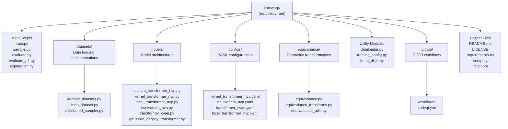
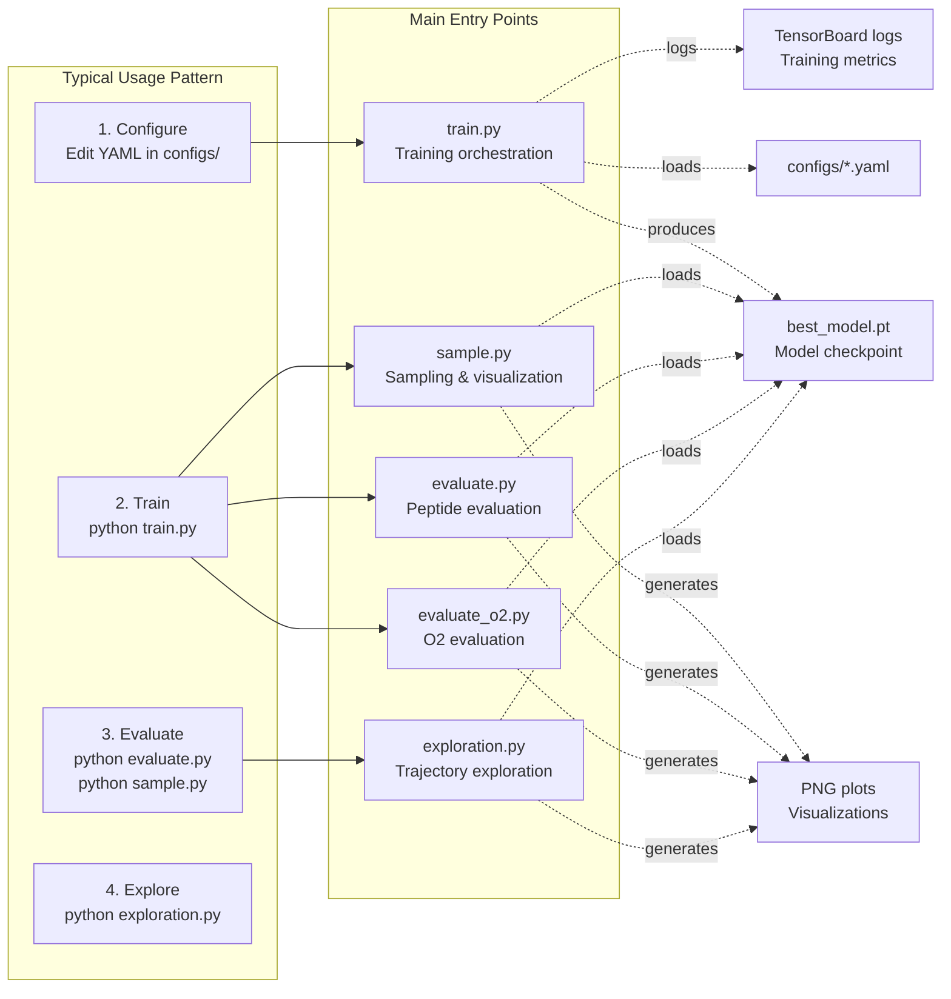
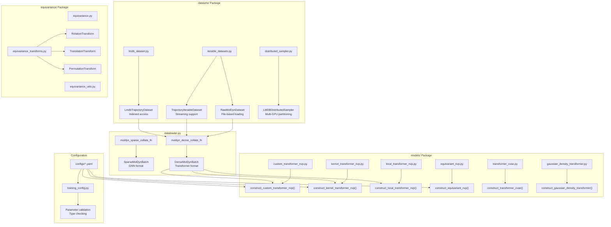

<!-- source: DeepWiki mcp.deepwiki.com · repo microsoft/timewarp · page 1.1 Project Structure · fetched 2026-10-26 -->

# Project Structure

<details>
<summary>Relevant source files</summary>

The following files were used as context for generating this wiki page:

- [.gitignore](.gitignore)
- [__init__.py](__init__.py)
- [datasets/__init__.py](datasets/__init__.py)
- [equivariance/__init__.py](equivariance/__init__.py)

</details>


This page documents the organization of the Timewarp codebase, including the directory hierarchy, key files, and how different components are structured. For detailed information about specific subsystems, see [Data Pipeline](#3), [Model Architectures](#4), [Training](#5), and [Evaluation and Analysis](#7).

## Purpose and Scope

This document provides a map of the codebase structure, explaining:
- The purpose of each directory and major file
- How files are organized by functionality
- Where to find specific components when working with the code
- The relationship between file structure and system architecture

## Directory Tree Overview

The following diagram shows the high-level directory structure of the Timewarp repository:



**Sources:** [.gitignore:1-161](), [__init__.py:1](), [datasets/__init__.py:1-3](), [equivariance/__init__.py:1]()

## Component Organization by System

The following table organizes the codebase components according to the major systems identified in the overall architecture:

| System | Directory/Files | Key Components | Purpose |
|--------|----------------|----------------|---------|
| **Configuration** | `configs/` | `kernel_transformer_nvp.yaml`, `equivariant_nvp.yaml`, `transformer_cvae.yaml`, `local_transformer_nvp.yaml` | YAML files defining model architectures and training parameters |
| | Root | `training_config.py` | Parameter validation and configuration loading |
| **Data Pipeline** | `datasets/` | `RawMolDynDataset`, `TrajectoryIterableDataset`, `LmdbTrajectoryDataset` | Dataset implementations for loading molecular dynamics data |
| | Root | `dataloader.py` | Batch formatting with `SparseMolDynBatch` and `DenseMolDynBatch` |
| | `datasets/` | `distributed_sampler.py` | `LMDBDistributedSampler` for multi-GPU data partitioning |
| **Model Architectures** | `models/` | `custom_transformer_nvp.py`, `kernel_transformer_nvp.py`, `local_transformer_nvp.py` | Transformer-based normalizing flow models |
| | `models/` | `equivariant_nvp.py` | Equivariant normalizing flow architecture |
| | `models/` | `transformer_cvae.py` | Conditional variational autoencoder |
| | `models/` | `gaussian_density_transformer.py` | Gaussian baseline model |
| **Training System** | Root | `train.py` | Main training script with DeepSpeed support |
| **Evaluation System** | Root | `sample.py` | General sampling and visualization |
| | Root | `evaluate.py` | Peptide evaluation with Metropolis-Hastings |
| | Root | `evaluate_o2.py` | Oxygen molecule evaluation |
| | Root | `exploration.py` | Trajectory exploration and generation |
| **Equivariance** | `equivariance/` | `equivariance.py`, `equivariance_transforms.py` | Geometric transformation classes and utilities |
| **Physics Integration** | Root | `bond_dists.py` | Bond distance calculations and statistics |
| | (External) | OpenMM integration | Energy calculations and MD simulations (via Python imports) |
| **CI/CD** | `.github/workflows/` | `codeql.yml` | CodeQL security analysis workflow |
| **Project Metadata** | Root | `README.md`, `LICENSE`, `requirements.txt`, `setup.py` | Documentation and package configuration |

**Sources:** [datasets/__init__.py:1-3](), [equivariance/__init__.py:1]()

## Main Entry Points

The following diagram maps the main executable scripts to their roles in the system workflow:



### Entry Point Descriptions

| Script | Primary Function | Key Features |
|--------|-----------------|--------------|
| `train.py` | Model training | DeepSpeed support, checkpoint saving, TensorBoard logging, validation |
| `sample.py` | General sampling | Generates trajectory samples, creates energy plots, bond distributions |
| `evaluate.py` | Peptide evaluation | Metropolis-Hastings sampling, Ramachandran plots, KS tests, supports di-peptides and tetra-peptides |
| `evaluate_o2.py` | O2 molecule evaluation | Specialized metrics for oxygen molecules, energy distribution analysis |
| `exploration.py` | Trajectory exploration | Generates new trajectories with energy-based acceptance criteria |

**Sources:** Based on high-level architecture diagrams and system workflow

## Core Module Structure

The following diagram shows the relationship between core modules and their primary classes/functions:



**Sources:** [datasets/__init__.py:1-3](), [equivariance/__init__.py:1]()

## Directory Details

### `datasets/`

This package contains all data loading implementations for molecular dynamics trajectories.

**Key Files:**
- `iterable_datasets.py` - Contains `RawMolDynDataset` and `TrajectoryIterableDataset` classes
- `lmdb_dataset.py` - Contains `LmdbTrajectoryDataset` for efficient indexed access
- `distributed_sampler.py` - Contains `LMDBDistributedSampler` for protein-based data partitioning across GPUs
- `__init__.py` - Exports primary dataset classes

**Imports Pattern:**
```python
from datasets import RawMolDynDataset, TrajectoryIterableDataset, LmdbTrajectoryDataset
```

**Sources:** [datasets/__init__.py:1-3]()

### `models/`

This directory contains all model architecture implementations. Each file defines a constructor function that builds a specific model variant.

**Naming Convention:**
- Files are named with pattern: `<architecture_variant>.py`
- Constructor functions follow pattern: `construct_<architecture_variant>(config)`
- Each constructor accepts a configuration dictionary and returns a model instance

**Model Categories:**
- **Transformer NVP Variants**: `custom_transformer_nvp.py`, `kernel_transformer_nvp.py`, `local_transformer_nvp.py`, `kernel_cheb_transformer_nvp.py`
- **Equivariant**: `equivariant_nvp.py`
- **Variational**: `transformer_cvae.py`
- **Baselines**: `gaussian_density_transformer.py`

### `configs/`

YAML configuration files that define model architectures and training hyperparameters. Each YAML file corresponds to a specific model architecture.

**Configuration Structure:**
Each config file specifies:
- Model architecture parameters (layers, dimensions, attention mechanisms)
- Training hyperparameters (learning rate, batch size, epochs)
- Dataset settings (data paths, preprocessing options)
- Loss function configuration

**Example Config Files:**
- `kernel_transformer_nvp.yaml` - Kernel attention configuration
- `equivariant_nvp.yaml` - Equivariant model configuration
- `transformer_cvae.yaml` - CVAE architecture configuration
- `local_transformer_nvp.yaml` - Local attention configuration

### `equivariance/`

Contains implementations of geometric transformations that preserve physical symmetries in molecular systems.

**Key Components:**
- `equivariance_transforms.py` - Transformation classes for rotations, translations, and permutations
- `equivariance_utils.py` - Utility functions for generating and applying random transformations
- `equivariance.py` - Core equivariance logic and integration with models
- `__init__.py` - Package initialization

**Sources:** [equivariance/__init__.py:1]()

### Root-Level Modules

**Utility Modules:**
- `dataloader.py` - Batch formatting with `SparseMolDynBatch` and `DenseMolDynBatch` classes, collate functions
- `training_config.py` - Configuration validation and parameter type checking
- `bond_dists.py` - Bond distance calculations and statistical analysis

**Main Scripts:**
- `train.py` - Training orchestration, checkpoint management, metrics logging
- `sample.py` - Sample generation and visualization
- `evaluate.py` - Peptide evaluation with physical validation
- `evaluate_o2.py` - O2 molecule-specific evaluation
- `exploration.py` - Trajectory exploration and generation

### `.github/`

Contains GitHub-specific configurations for continuous integration and project management.

**Structure:**
- `workflows/` - GitHub Actions workflow definitions
  - `codeql.yml` - CodeQL security analysis workflow

For detailed information about CI/CD, see [Continuous Integration](#1.3).

## Ignored Files and Directories

The `.gitignore` file specifies patterns for files that should not be tracked in version control:

**Key Exclusions:**
- Python bytecode and cache files (`__pycache__/`, `*.pyc`)
- Virtual environments (`venv/`, `env/`)
- Build artifacts (`build/`, `dist/`, `*.egg-info/`)
- IDE configurations (`.idea/`, `.vscode/`)
- Test coverage reports (`.coverage`, `htmlcov/`)
- Jupyter notebook checkpoints (`.ipynb_checkpoints/`)
- Log files (`*.log`)

**Sources:** [.gitignore:1-161]()

## File Organization Best Practices

The codebase follows these organizational principles:

1. **Separation of Concerns**: Data loading, models, training, and evaluation are in separate modules
2. **Configuration-Driven**: Models and training are configured via YAML files rather than hardcoded parameters
3. **Modular Architecture**: Each model variant is self-contained in its own file with a standard constructor interface
4. **Package Structure**: Related functionality is grouped into packages (e.g., `datasets/`, `models/`, `equivariance/`)
5. **Standard Entry Points**: Main scripts in root directory for easy discovery and execution
6. **External Dependencies**: Physics engines (OpenMM) and training frameworks (DeepSpeed) are imported rather than vendored

## Package Initialization Pattern

The codebase uses `__init__.py` files to control package exports:

**Example - `datasets/__init__.py`:**
```python
from .iterable_datasets import RawMolDynDataset, TrajectoryIterableDataset
from .lmdb_dataset import LmdbTrajectoryDataset
```

This pattern:
- Makes imports cleaner: `from datasets import LmdbTrajectoryDataset` instead of `from datasets.lmdb_dataset import LmdbTrajectoryDataset`
- Explicitly declares the public API of each package
- Allows internal refactoring without breaking external imports

**Sources:** [datasets/__init__.py:1-3](), [equivariance/__init__.py:1](), [__init__.py:1]()

## Output Artifacts

While not part of the source code structure, the system generates several output artifacts during execution:

**Training Outputs:**
- `best_model.pt` - Model checkpoint with best validation performance
- `tensorboard_logs/` - TensorBoard event files for training metrics
- `deepspeed_checkpoints/` - DeepSpeed distributed training checkpoints (when using multi-GPU)

**Evaluation Outputs:**
- `*.png` - Visualization plots (energy distributions, Ramachandran plots, bond distributions)
- `statistics.txt` - Numerical evaluation metrics and test results
- `samples/` - Generated trajectory samples (coordinates and velocities)

These output locations may be configured via command-line arguments or configuration files.

---

