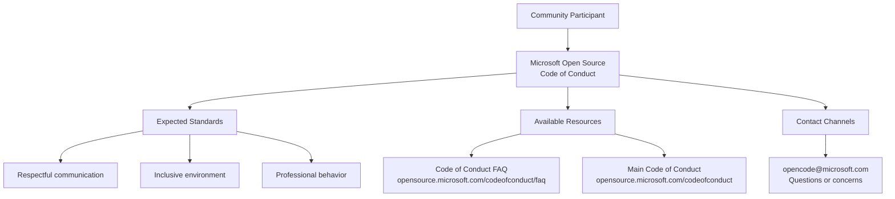
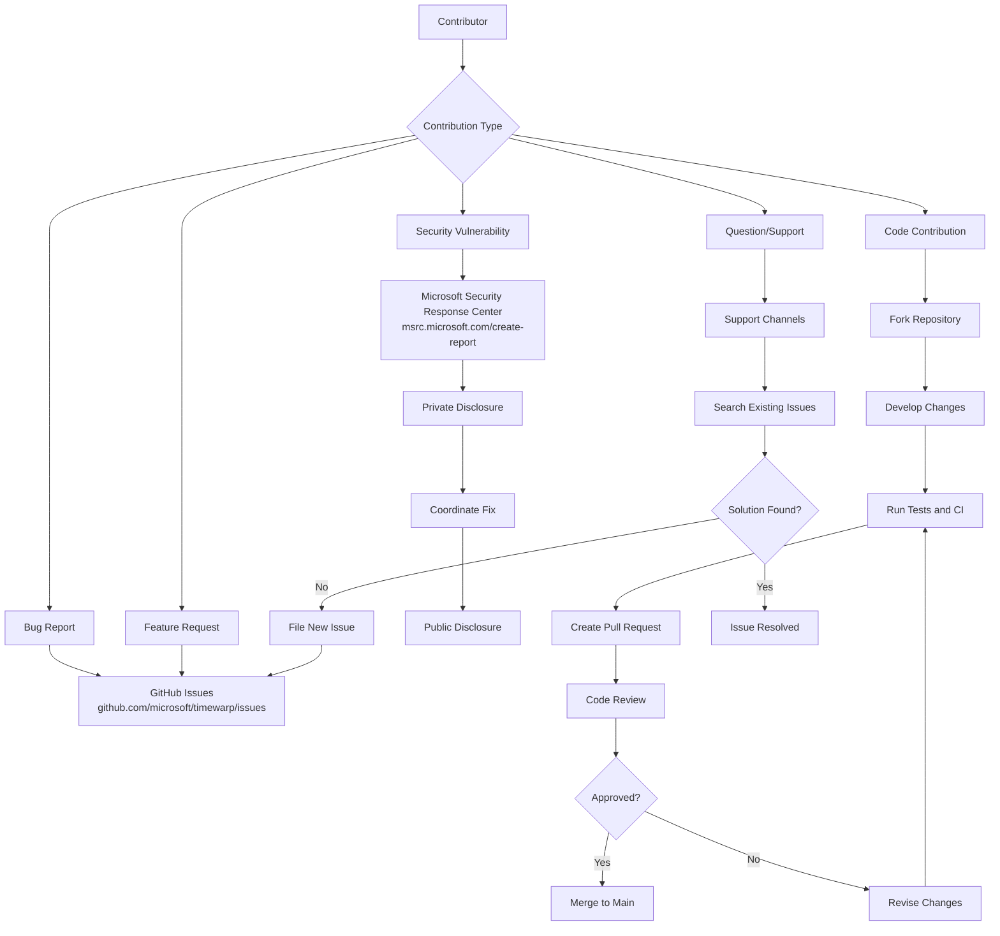
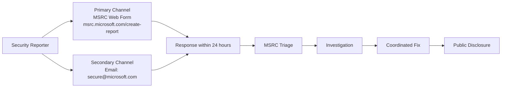
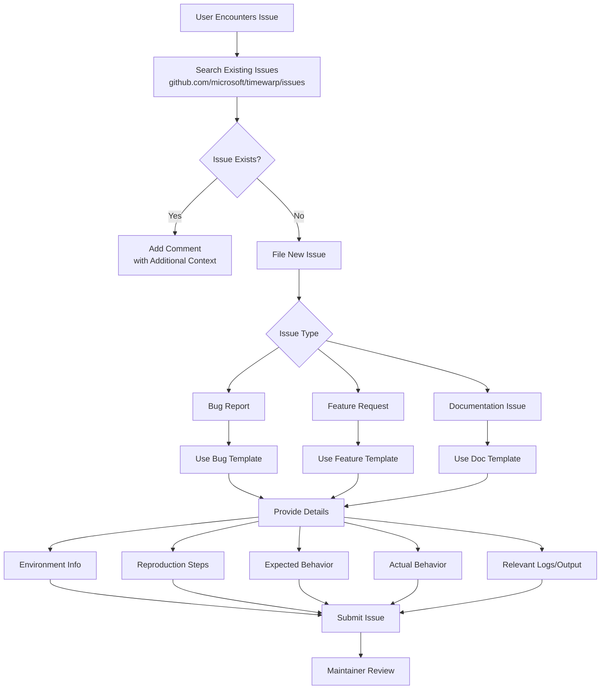
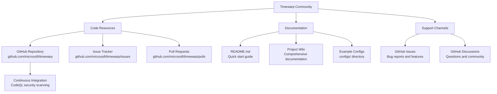

<!-- source: DeepWiki mcp.deepwiki.com · repo microsoft/timewarp · page 1.2 Contributing and Community · fetched 2026-10-26 -->

# Contributing and Community

Relevant source files

The following files were used as context for generating this wiki page:

- [CODE_OF_CONDUCT.md](CODE_OF_CONDUCT.md)
- [SECURITY.md](SECURITY.md)
- [SUPPORT.md](SUPPORT.md)

This document outlines the guidelines for contributing to the Timewarp project, community standards, security reporting procedures, and how to get support. It covers the code of conduct, issue reporting workflows, and communication channels for the project.

For information about setting up the development environment and running the codebase, see [Getting Started](#2). For details on the CI/CD pipeline and automated testing, see [Continuous Integration](#1.3).

## Purpose and Scope

The Timewarp project welcomes contributions from the community and maintains open channels for reporting issues, requesting features, and addressing security concerns. This page documents the established processes and community standards that govern interactions within the project.

## Code of Conduct

The Timewarp project has adopted the Microsoft Open Source Code of Conduct. All contributors and community members are expected to adhere to these standards when participating in project discussions, submitting code, or interacting with other community members.

### Code of Conduct Overview

**Sources:** [CODE_OF_CONDUCT.md:1-10]()

The code of conduct applies to all project spaces including:
- GitHub repository interactions (issues, pull requests, discussions)
- Code reviews and contributions
- Communication channels
- Project events and meetings

For questions or concerns about conduct issues, contact `opencode@microsoft.com`.

## Contribution Workflow

The following diagram illustrates the different types of contributions and how they are processed through the project's workflow:

### Contribution Processing Flow

**Sources:** [SECURITY.md:1-42](), [SUPPORT.md:1-26]()

## Security Reporting

Microsoft takes security seriously for all source code repositories. The Timewarp project follows Microsoft's coordinated vulnerability disclosure policy.

### Security Vulnerability Reporting Process

| Step | Action | Details |
|------|--------|---------|
| 1 | Identify Issue | Determine if the issue meets Microsoft's definition of a security vulnerability |
| 2 | Report Privately | **Do not** file public GitHub issues for security vulnerabilities |
| 3 | Submit to MSRC | Report to Microsoft Security Response Center at `https://msrc.microsoft.com/create-report` |
| 4 | Alternative Method | Email `secure@microsoft.com` (optionally encrypted with MSRC PGP key) |
| 5 | Expect Response | Response expected within 24 hours |
| 6 | Coordinated Disclosure | Follow coordinated vulnerability disclosure principles |

**Sources:** [SECURITY.md:9-40]()

### Required Information for Security Reports

When reporting a security vulnerability, include as much of the following information as possible:

- **Type of issue**: Buffer overflow, injection vulnerability, etc.
- **Source file paths**: Full paths of affected files
- **Source location**: Tag, branch, commit, or direct URL
- **Configuration**: Special configuration needed to reproduce
- **Reproduction steps**: Detailed step-by-step instructions
- **Proof-of-concept**: Code demonstrating the vulnerability (if possible)
- **Impact assessment**: How an attacker might exploit the issue

Complete reports may qualify for the Microsoft Bug Bounty Program. See `https://aka.ms/opensource/security/bounty` for details.

**Sources:** [SECURITY.md:19-31]()

### Security Contact Channels

**Sources:** [SECURITY.md:13-17]()

## Filing Issues and Getting Support

GitHub Issues are the primary mechanism for tracking bugs and feature requests. Before filing a new issue, search existing issues to avoid duplicates.

### Issue Filing Guidelines

**Sources:** [SUPPORT.md:13-21]()

### Issue Types and Information Requirements

| Issue Type | Required Information | Optional Information |
|------------|---------------------|---------------------|
| **Bug Report** | Environment details, reproduction steps, expected vs actual behavior, error logs | Screenshots, sample data, configuration files |
| **Feature Request** | Use case description, proposed solution, benefits | Alternative solutions, implementation suggestions |
| **Documentation Issue** | Location of unclear documentation, suggested improvements | Examples of better documentation |
| **Performance Issue** | Benchmark results, hardware specifications, dataset details | Profiling results, comparison with baselines |
| **Installation Issue** | OS version, Python version, dependency versions, error messages | Virtual environment details, installation logs |

**Sources:** [SUPPORT.md:13-26]()

## Community Resources and Communication

### Available Resources

**Sources:** [CODE_OF_CONDUCT.md:1-10](), [SECURITY.md:1-42](), [SUPPORT.md:1-26]()

### Contribution Types

The project accepts various types of contributions:

1. **Code Contributions**
   - Bug fixes
   - New model architectures
   - Performance improvements
   - Dataset implementations
   - Evaluation scripts

2. **Documentation Contributions**
   - Wiki page improvements
   - Code comments and docstrings
   - Example notebooks
   - Tutorial content

3. **Testing Contributions**
   - Unit tests
   - Integration tests
   - Performance benchmarks
   - Dataset validation

4. **Community Contributions**
   - Issue triage and responses
   - Code reviews
   - Tutorial creation
   - Community support

## Support Policy

Support for the Timewarp project is limited to the resources listed in this document. The project is maintained by Microsoft Research and community contributors.

### Support Channels

| Channel | Purpose | Response Time |
|---------|---------|---------------|
| GitHub Issues | Bug reports, feature requests | Best effort |
| GitHub Discussions | General questions, community help | Community-driven |
| Security Email | Security vulnerabilities only | Within 24 hours |
| Code of Conduct Email | Conduct concerns | As needed |

**Sources:** [SUPPORT.md:23-25]()

The project does not provide dedicated customer service support beyond the self-service resources available through GitHub. Community members are encouraged to help each other through discussions and issue responses.

## Microsoft Open Source Organizations

The Timewarp project is part of Microsoft's broader open source ecosystem. Related Microsoft organizations include:

- [Microsoft](https://github.com/microsoft)
- [Azure](https://github.com/Azure)
- [DotNet](https://github.com/dotnet)
- [AspNet](https://github.com/aspnet)
- [Xamarin](https://github.com/xamarin)

For a complete list, see `https://opensource.microsoft.com/`

**Sources:** [SECURITY.md:5-5]()

---

