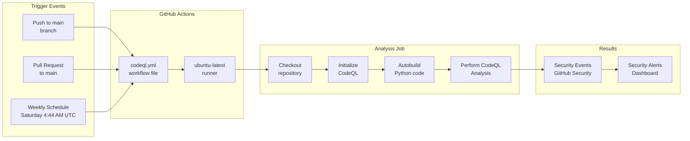
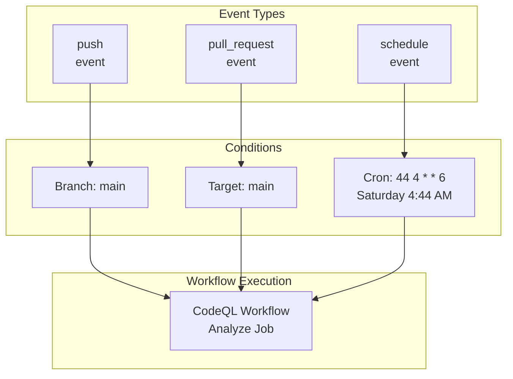
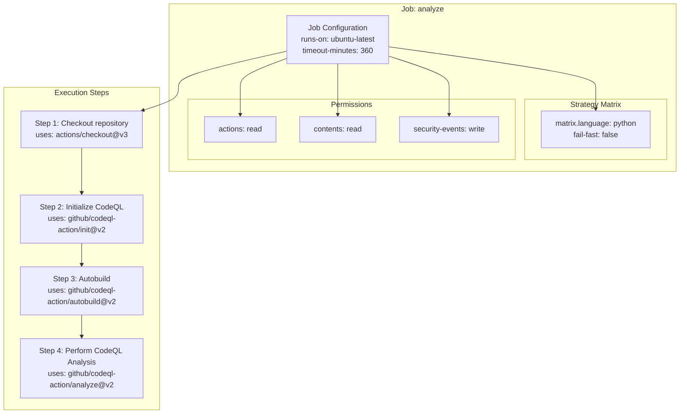
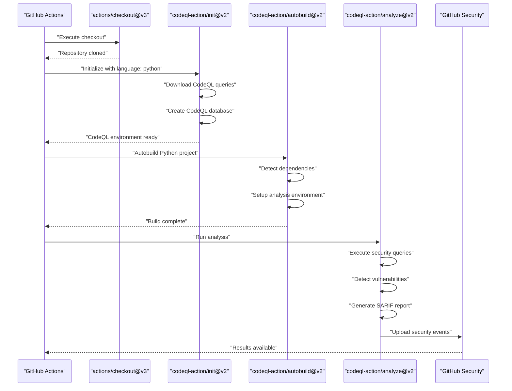
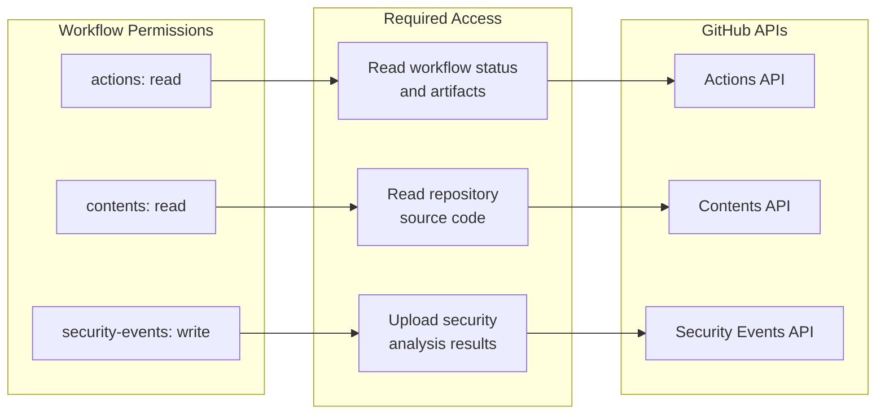

<!-- source: DeepWiki mcp.deepwiki.com · repo microsoft/timewarp · page 1.3 Continuous Integration · fetched 2026-10-26 -->

# Continuous Integration

<details>
<summary>Relevant source files</summary>

The following files were used as context for generating this wiki page:

- [.github/workflows/codeql.yml](.github/workflows/codeql.yml)

</details>


## Purpose and Scope

This document describes the Continuous Integration (CI) system implemented in the Timewarp repository. The CI system currently focuses on automated security and code quality analysis using GitHub's CodeQL analysis framework. The system runs automated scans on code changes to detect potential security vulnerabilities, bugs, and code quality issues in the Python codebase.

For information about local testing and validation during development, see [Getting Started](#2). For details on model training validation, see [Evaluation and Analysis](#7).

---

## CI Pipeline Overview

The Timewarp repository implements a minimal CI pipeline centered on security analysis. Unlike typical CI systems that include unit tests, integration tests, and build verification, this repository currently implements only automated security scanning through CodeQL.

### Pipeline Architecture



**Sources:** [.github/workflows/codeql.yml:1-83]()

---

## CodeQL Workflow Configuration

The CI pipeline is defined in a single GitHub Actions workflow file that configures automated security analysis.

### Workflow Metadata

The workflow is named `CodeQL` and is defined in [.github/workflows/codeql.yml:12](). It analyzes Python code exclusively, as specified in the language matrix [.github/workflows/codeql.yml:41]().

| Property | Value | Description |
|----------|-------|-------------|
| Workflow Name | `CodeQL` | Identifies the workflow in GitHub Actions UI |
| Language | `python` | Only Python code is analyzed |
| Runner OS | `ubuntu-latest` | Linux environment for analysis |
| Timeout | 360 minutes | Maximum execution time (6 hours) |
| Permissions | `actions: read`<br/>`contents: read`<br/>`security-events: write` | Required GitHub API permissions |

**Sources:** [.github/workflows/codeql.yml:12-45]()

---

## Trigger Conditions

The CodeQL workflow is triggered by three distinct event types, ensuring comprehensive coverage of security analysis across different development scenarios.

### Trigger Event Matrix



### Event Details

| Trigger | Condition | Purpose | Configuration |
|---------|-----------|---------|---------------|
| **Push** | Branch is `main` | Analyze all direct commits to main branch | [.github/workflows/codeql.yml:15-16]() |
| **Pull Request** | Target branch is `main` | Scan code changes before merging | [.github/workflows/codeql.yml:17-19]() |
| **Schedule** | `44 4 * * 6` | Weekly security audit on Saturdays | [.github/workflows/codeql.yml:20-21]() |

The scheduled execution runs every Saturday at 4:44 AM UTC, providing regular security audits even when no code changes occur. This ensures that new vulnerability patterns discovered by CodeQL are detected in the existing codebase.

**Sources:** [.github/workflows/codeql.yml:14-21]()

---

## Analysis Job Execution

The `analyze` job executes a sequence of steps to perform security analysis on the Python codebase. The job runs with specific permissions and timeout constraints.

### Job Configuration



**Sources:** [.github/workflows/codeql.yml:23-46]()

### Step-by-Step Execution Flow

#### Step 1: Checkout Repository

The workflow begins by checking out the repository code using the `actions/checkout@v3` action [.github/workflows/codeql.yml:48-49](). This provides the workflow with access to all source files for analysis.

#### Step 2: Initialize CodeQL

The CodeQL tools are initialized with the `github/codeql-action/init@v2` action [.github/workflows/codeql.yml:52-53](). This step:
- Configures the CodeQL database for the specified language (Python)
- Downloads the appropriate CodeQL query packs
- Prepares the analysis environment

The language matrix specifies `python` [.github/workflows/codeql.yml:55](), which determines which CodeQL queries and analysis rules are applied.

#### Step 3: Autobuild

The `github/codeql-action/autobuild@v2` action [.github/workflows/codeql.yml:66-67]() attempts to automatically build the project. For Python projects, this typically involves:
- Detecting Python dependencies
- Installing required packages
- Resolving import paths

Since Python is an interpreted language, the autobuild step primarily sets up the analysis environment rather than compiling code.

#### Step 4: Perform CodeQL Analysis

The final step executes the security analysis using `github/codeql-action/analyze@v2` [.github/workflows/codeql.yml:79-80](). This step:
- Runs CodeQL queries against the codebase
- Identifies potential security vulnerabilities
- Generates a category-based analysis report with the category `/language:python` [.github/workflows/codeql.yml:82]()
- Uploads results to GitHub Security Events

**Sources:** [.github/workflows/codeql.yml:47-83]()

---

## Security Analysis Process

The CodeQL analysis examines the Python codebase for security vulnerabilities and code quality issues. The workflow uses GitHub's default CodeQL query set, which includes security-focused queries appropriate for Python.

### Analysis Workflow



### Query Configuration

The workflow uses default CodeQL queries [.github/workflows/codeql.yml:56-61](). While custom queries can be specified, the current configuration relies on GitHub's maintained query packs. These queries are commented out in the workflow file and can be enabled by uncommenting:

```yaml
# queries: security-extended,security-and-quality
```

The available query packs include:
- **security-extended**: Enhanced security-focused queries
- **security-and-quality**: Combined security and code quality queries

**Sources:** [.github/workflows/codeql.yml:51-61](), [.github/workflows/codeql.yml:79-82]()

---

## Execution Environment

The analysis job runs on GitHub-hosted runners with specific resource allocations and timeout constraints.

### Runner Configuration

| Configuration | Value | Purpose |
|--------------|-------|---------|
| Operating System | `ubuntu-latest` | Linux environment for Python analysis |
| Runner Selection Logic | `${{ (matrix.language == 'swift' && 'macos-latest') \|\| 'ubuntu-latest' }}` | Conditional OS selection (Python uses Ubuntu) |
| Timeout | 360 minutes (6 hours) | Maximum execution time for analysis job |
| Fail-Fast Strategy | `false` | Continue analysis even if one language matrix entry fails |

The runner selection logic [.github/workflows/codeql.yml:31]() demonstrates matrix-based OS selection, though for Python analysis, it consistently evaluates to `ubuntu-latest`.

The extended timeout of 360 minutes [.github/workflows/codeql.yml:32]() provides sufficient time for comprehensive analysis of the Timewarp codebase, including all model architectures, data pipeline code, and evaluation scripts.

**Sources:** [.github/workflows/codeql.yml:27-32](), [.github/workflows/codeql.yml:38-40]()

---

## Permissions and Security

The workflow requires specific GitHub API permissions to function correctly and securely upload analysis results.

### Permission Model



### Permission Details

| Permission | Level | Purpose |
|-----------|-------|---------|
| `actions` | `read` | Access workflow run information and artifacts |
| `contents` | `read` | Read repository files for analysis |
| `security-events` | `write` | Upload SARIF results to GitHub Security tab |

The `security-events: write` permission [.github/workflows/codeql.yml:36]() is critical for the workflow, as it allows CodeQL to upload analysis results to GitHub's Security dashboard where vulnerabilities can be reviewed and managed.

**Sources:** [.github/workflows/codeql.yml:33-36]()

---

## Monitoring and Results

Analysis results are automatically uploaded to GitHub's Security tab, where they can be reviewed by repository maintainers. The results are categorized by language using the category identifier `/language:python` [.github/workflows/codeql.yml:82]().

### Results Access Points

| Location | Content | Access |
|----------|---------|--------|
| GitHub Security Tab | All detected vulnerabilities and code quality issues | Repository maintainers with security access |
| Actions Workflow Logs | Detailed execution logs and debugging information | Anyone with repository read access |
| Code Scanning Alerts | Individual alerts with file locations and remediation guidance | Repository maintainers |

The weekly scheduled scan ensures that even without active development, the repository is regularly audited for newly discovered vulnerability patterns as CodeQL's query database is updated.

**Sources:** [.github/workflows/codeql.yml:79-82]()

---

## Extending the CI Pipeline

The current CI implementation can be extended by modifying the workflow file or adding new workflow files to `.github/workflows/`. Potential extensions include:

### Suggested Enhancements

| Enhancement | Purpose | Implementation |
|------------|---------|----------------|
| Unit Tests | Validate model components and data pipeline | Add pytest workflow |
| Linting | Enforce code style consistency | Add flake8 or black workflow |
| Type Checking | Validate type annotations | Add mypy workflow |
| Documentation Build | Verify documentation generates correctly | Add sphinx build check |
| Integration Tests | Test end-to-end training pipeline | Add training smoke test |

### Custom CodeQL Queries

Custom security queries can be enabled by uncommenting the `queries` configuration in [.github/workflows/codeql.yml:61]() and specifying query packs:

```yaml
queries: security-extended,security-and-quality
```

This would expand the analysis to include additional security patterns and code quality checks beyond the default query set.

**Sources:** [.github/workflows/codeql.yml:56-61]()

---

