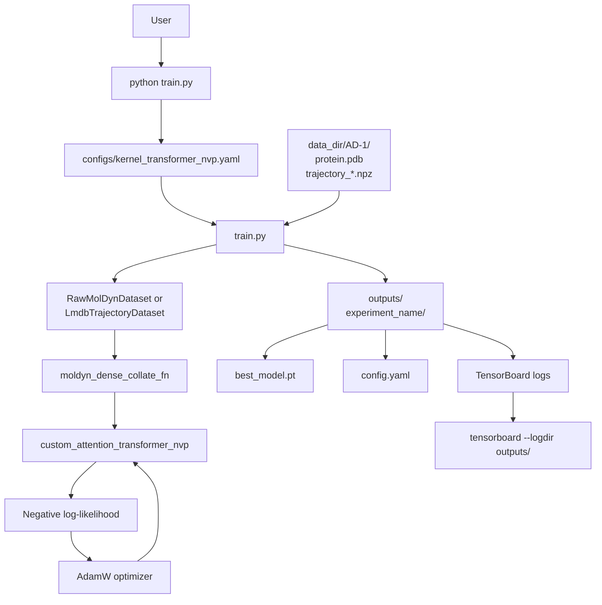
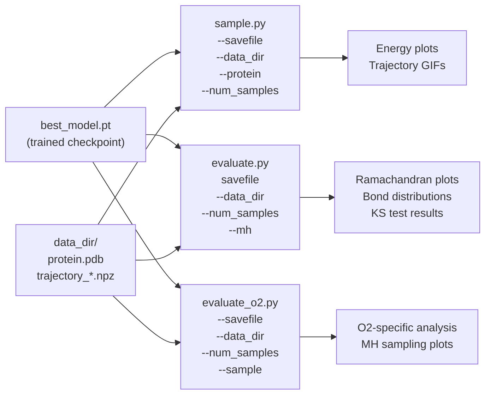
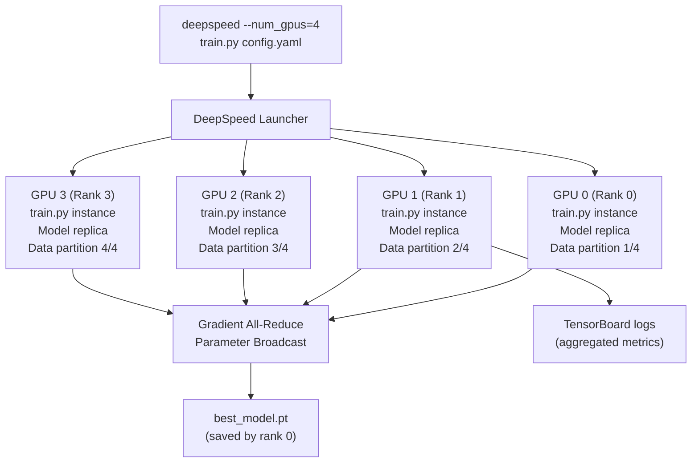

<!-- source: DeepWiki mcp.deepwiki.com · repo microsoft/timewarp · page 2 Getting Started · fetched 2026-10-26 -->

# Getting Started

<details>
<summary>Relevant source files</summary>

The following files were used as context for generating this wiki page:

- [README.md](README.md)
- [configs/kernel_transformer_nvp.yaml](configs/kernel_transformer_nvp.yaml)

</details>


This guide provides a quick start for training and evaluating Timewarp models. It covers installation, dataset preparation, running your first training session, and generating evaluation outputs. For detailed information about specific components, see [Data Pipeline](#3), [Model Architectures](#4), [Training](#5), and [Evaluation and Analysis](#7).

---

## Prerequisites

Timewarp requires:
- Python 3.7 or later
- CUDA-capable GPU (tested with Tesla P100 and newer)
- PyTorch with CUDA support
- DeepSpeed (for multi-GPU training)
- OpenMM (for physics-based validation)
- Standard scientific Python stack (NumPy, SciPy)

The system has been tested on Linux environments. Windows and macOS may require additional configuration for OpenMM integration.

**Sources:** [README.md:1-132]()

---

## Dataset Preparation

### Downloading Data

Training data and pre-trained model checkpoints are hosted on Hugging Face at `microsoft/timewarp`. The repository contains molecular dynamics trajectories for multiple systems including:

| Dataset | Description | System Size |
|---------|-------------|-------------|
| `AD-1` | Alanine dipeptide (2 amino acids) | Small peptide |
| `AD-2`, `AD-3` | Additional alanine dipeptide trajectories | Small peptide |
| `O2` | Oxygen molecule | Diatomic molecule |
| `O2-CoM` | Oxygen molecule (center of mass) | Diatomic molecule |

### Local Data Structure

After downloading, organize data in a local directory with the following structure:

```
data_dir/
├── AD-1/
│   ├── protein.pdb
│   └── trajectory_*.npz
├── AD-2/
│   ├── protein.pdb
│   └── trajectory_*.npz
└── O2/
    ├── protein.pdb
    └── trajectory_*.npz
```

Each `.npz` file contains molecular dynamics trajectory data with coordinates, velocities, and forces. The `.pdb` files define the molecular topology.

**Sources:** [README.md:7-9]()

---

## Your First Training Run

### Basic Training Command

The simplest way to train a model is using a pre-configured YAML file. For example, to train the kernel transformer NVP model on the AD-1 dataset:

```bash
python train.py configs/kernel_transformer_nvp.yaml
```

This command trains a model with the following architecture:
- 3 transformer layers with kernel attention
- 8 coupling layers for the normalizing flow
- 32-dimensional atom embeddings
- Batch size of 32
- 1000 training epochs

**Expected Training Time:** Less than 12 hours on a Tesla P100 GPU

**Sources:** [README.md:15-22](), [configs/kernel_transformer_nvp.yaml:1-31]()

### Command-Line Overrides

You can override any parameter from the YAML configuration file via command-line arguments:

```bash
python train.py configs/kernel_transformer_nvp.yaml \
    learning_rate=0.01 \
    batch_size=64 \
    num_epochs=500
```

Parameters are passed as `key=value` pairs without dashes or equals signs between the script name and config file.

**Sources:** [README.md:19-22]()

### Training Workflow Diagram



**Sources:** [README.md:15-26](), [configs/kernel_transformer_nvp.yaml:1-31]()

### Output Directory Structure

Training creates an output directory (default: `outputs/`) containing:

```
outputs/
└── experiment_name/
    ├── best_model.pt          # Model checkpoint with lowest validation loss
    ├── config.yaml            # Full configuration used for training
    ├── events.out.tfevents.*  # TensorBoard event files
    └── training.log           # Training progress logs
```

The experiment name is automatically generated based on the model type, dataset, and timestamp unless specified via the `output_dir` parameter.

**Sources:** [README.md:24-26]()

### Monitoring Training Progress

Metrics are automatically logged to TensorBoard during training. To monitor:

```bash
tensorboard --logdir outputs/
```

Then navigate to `http://localhost:6006` in your browser. Available metrics include:
- Training loss (negative log-likelihood)
- Validation loss
- Learning rate schedule
- Gradient norms

**Sources:** [README.md:24-26]()

---

## Your First Evaluation

### General Visualization with sample.py

After training completes, use `sample.py` to generate visualizations:

```bash
python sample.py \
    --savefile outputs/experiment_name/best_model.pt \
    --data_dir data_dir/ \
    --protein AD-1 \
    --num_samples 20 \
    --output_dir figures/
```

This generates:
- Conditional sample trajectories from the model
- Ground truth initial and final states
- Potential, kinetic, and total energy plots along trajectories
- Animated GIFs showing molecular motion

**Sources:** [README.md:29-40]()

### Evaluation Script Selection

Different evaluation scripts are optimized for different molecular systems:

| Script | Target Systems | Key Features |
|--------|----------------|--------------|
| `sample.py` | All systems | General visualization, energy plots |
| `evaluate.py` | Di-peptides, tetra-peptides | Ramachandran plots, bond distributions, Metropolis-Hastings sampling |
| `evaluate_o2.py` | Oxygen molecules (`O2`, `O2-CoM`) | Specialized O2 analysis |
| `exploration.py` | All systems | Trajectory generation with energy-based acceptance |

**Sources:** [README.md:29-74]()

### Peptide Evaluation Example

For more comprehensive evaluation of peptide systems:

```bash
python evaluate.py \
    outputs/experiment_name/best_model.pt \
    --data_dir data_dir/ \
    --num_samples 1000 \
    --output_dir figures/
```

This generates:
- Ramachandran plots comparing model samples to ground truth
- Bond length and angle distributions
- Kolmogorov-Smirnov test statistics for distribution agreement

**Sources:** [README.md:53-61]()

### Evaluation Command Relationships



**Sources:** [README.md:29-74]()

---

## Multi-GPU Training with DeepSpeed

### Basic Multi-GPU Command

For data-parallel training across multiple GPUs, use the DeepSpeed launcher:

```bash
deepspeed --num_gpus=2 train.py configs/kernel_transformer_nvp.yaml
```

This distributes training across 2 GPUs. DeepSpeed automatically:
- Replicates the model on each GPU
- Partitions data across GPUs
- Synchronizes gradients via all-reduce
- Manages distributed checkpointing

**Sources:** [README.md:76-82]()

### Batch Size Scaling

**Important:** The `batch_size` parameter in the configuration specifies the **total batch size across all GPUs**, not the per-GPU batch size. 

| GPUs | Config `batch_size` | Actual Per-GPU Batch Size | Total Effective Batch Size |
|------|---------------------|---------------------------|----------------------------|
| 1 | 32 | 32 | 32 |
| 2 | 32 | 16 | 32 |
| 4 | 32 | 8 | 32 |

To maintain constant GPU utilization when scaling to more GPUs, multiply the `batch_size` parameter by the number of GPUs:

```bash
# Single GPU: batch_size=32
python train.py configs/kernel_transformer_nvp.yaml batch_size=32

# Four GPUs: batch_size=128 (32 per GPU)
deepspeed --num_gpus=4 train.py configs/kernel_transformer_nvp.yaml batch_size=128
```

**Sources:** [README.md:76-82]()

### Multi-GPU Architecture



**Sources:** [README.md:76-82]()

---

## Configuration System Overview

All training parameters are defined in YAML configuration files located in `configs/`. Key configuration sections:

| Section | Parameters | Purpose |
|---------|-----------|---------|
| Training | `learning_rate`, `batch_size`, `num_epochs` | Optimization settings |
| Data | `dataset`, `step_width`, `data_augmentation` | Dataset selection and preprocessing |
| Model | `model_config.model_type`, `custom_transformer_nvp_config` | Architecture definition |
| Regularization | `weight_decay`, `patience` | Training stability |

For complete parameter documentation, see [Configuration System](#4.1) and [Training Configuration](#5.1).

**Sources:** [README.md:85-87](), [configs/kernel_transformer_nvp.yaml:1-31]()

---

## Quick Reference: File-to-Command Mapping

| Task | Primary File | Supporting Files | Output Location |
|------|-------------|------------------|-----------------|
| Train model | `train.py` | YAML configs in `configs/` | `outputs/experiment_name/` |
| General sampling | `sample.py` | Trained `best_model.pt` | Specified `--output_dir` |
| Peptide evaluation | `evaluate.py` | Trained `best_model.pt` | Specified `--output_dir` |
| O2 evaluation | `evaluate_o2.py` | Trained `best_model.pt` | Specified `--output_dir` |
| Trajectory exploration | `exploration.py` | Trained `best_model.pt` | Specified `--output_dir` |
| Monitor training | TensorBoard | Event files in `outputs/` | Browser at `localhost:6006` |

**Sources:** [README.md:1-132]()

---

## Next Steps

After completing your first training and evaluation run, explore:

- **[Data Pipeline](#3)** - Understand how molecular dynamics data is loaded, preprocessed, and batched
- **[Model Architectures](#4)** - Learn about the seven available model variants and their configurations
- **[Training](#5)** - Deep dive into training hyperparameters, learning rate schedules, and optimization
- **[Evaluation and Analysis](#7)** - Comprehensive guide to evaluation metrics, visualizations, and Metropolis-Hastings sampling
- **[Equivariance System](#6)** - Understand geometric transformations and data augmentation

For model selection guidance, see [Model Architectures](#4). The kernel transformer NVP used in this guide achieved -8.22 training loss and -6.56 validation loss on the AD-1 dataset as of October 2021.

**Sources:** [README.md:1-132](), [configs/kernel_transformer_nvp.yaml:1-3]()

---

