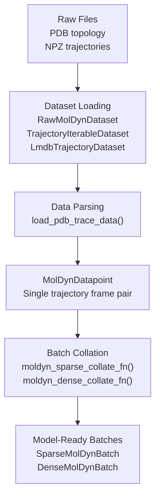
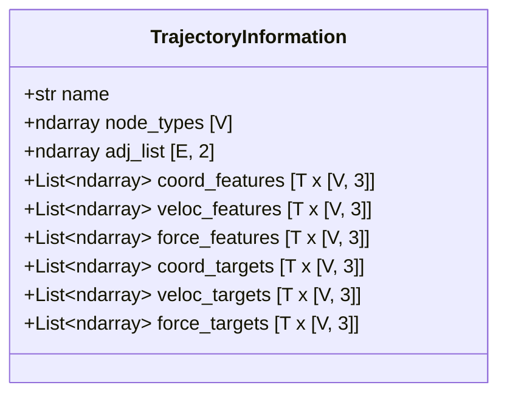
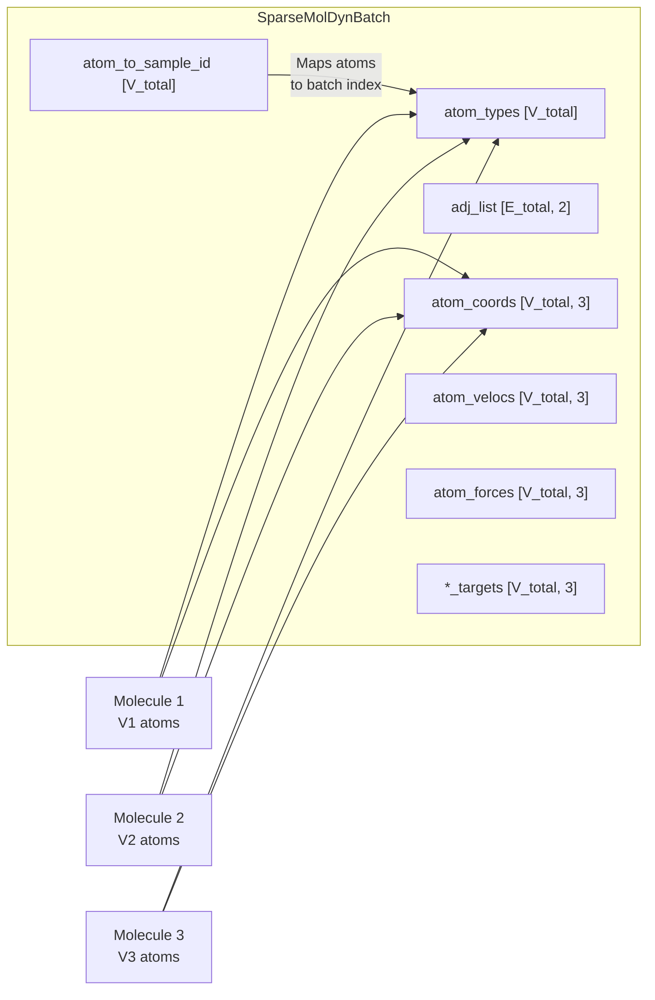
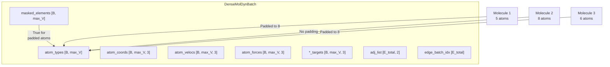
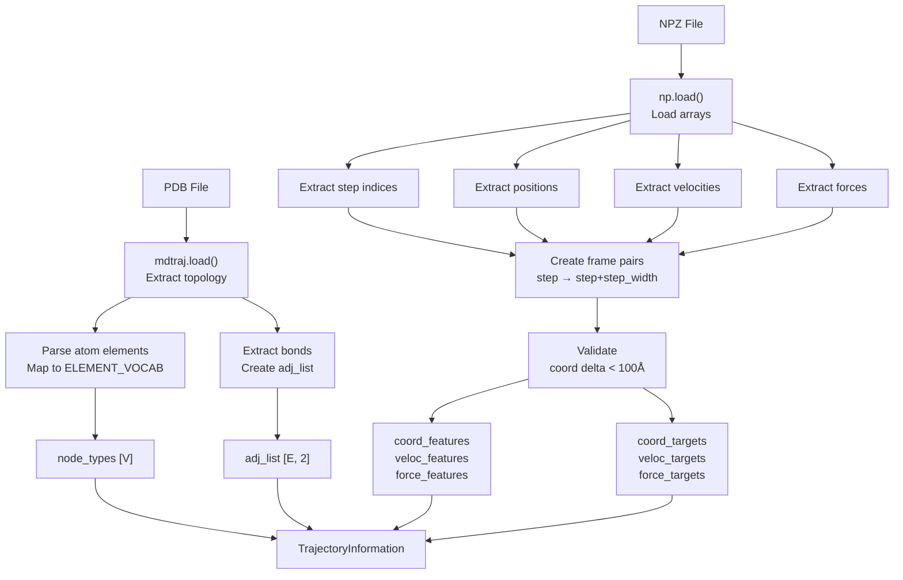
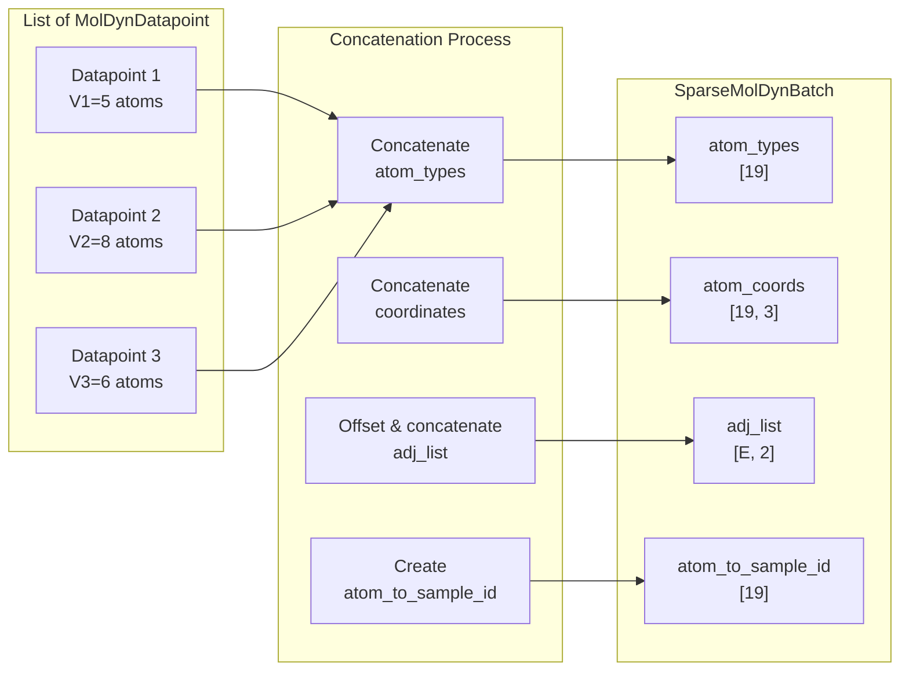
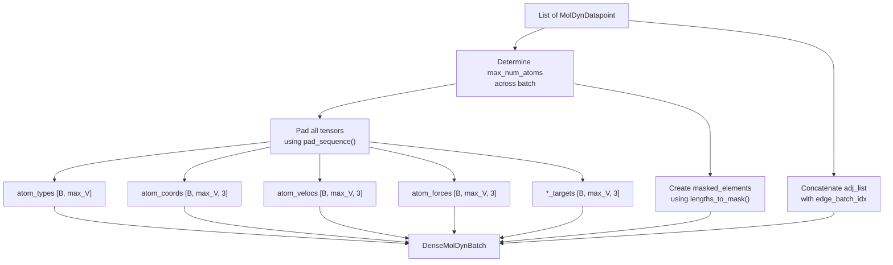

<!-- source: DeepWiki mcp.deepwiki.com · repo microsoft/timewarp · page 3 Data Pipeline · fetched 2026-10-26 -->

# Data Pipeline

<details>
<summary>Relevant source files</summary>

The following files were used as context for generating this wiki page:

- [dataloader.py](dataloader.py)
- [datasets/__init__.py](datasets/__init__.py)

</details>


## Purpose and Scope

This document provides a comprehensive overview of how molecular dynamics data flows through the Timewarp system, from raw PDB and NPZ files to model-ready batches. The data pipeline transforms raw trajectory data into structured tensors suitable for training conditional density models.

This page covers the high-level architecture and data flow patterns. For detailed information on specific components, see:
- [Data Loaders](#3.1) - Details on `SparseMolDynBatch` and `DenseMolDynBatch` formats
- [Dataset Implementations](#3.2) - Overview of the three dataset classes
- [Distributed Sampling](#3.3) - Multi-GPU data partitioning strategies

## Pipeline Overview

The data pipeline consists of four major stages that transform raw molecular dynamics simulations into batches suitable for model training:



**Sources:** [dataloader.py:1-418](), [datasets/__init__.py:1-3]()

### Pipeline Stages

| Stage | Input | Output | Key Components |
|-------|-------|--------|----------------|
| **Raw Storage** | PDB topology + NPZ trajectories | File paths | Huggingface datasets or local storage |
| **Dataset Loading** | File paths | `TrajectoryInformation` objects | `RawMolDynDataset`, `TrajectoryIterableDataset`, `LmdbTrajectoryDataset` |
| **Frame Extraction** | `TrajectoryInformation` | `MolDynDatapoint` instances | Individual frame pairs (x→y) |
| **Batch Collation** | List of `MolDynDatapoint` | `SparseMolDynBatch` or `DenseMolDynBatch` | `moldyn_sparse_collate_fn()`, `moldyn_dense_collate_fn()` |

**Sources:** [dataloader.py:45-76]()

## Data Formats and Structures

The pipeline uses three primary data structures to represent molecular dynamics data at different stages of processing:

### TrajectoryInformation

The `TrajectoryInformation` dataclass [dataloader.py:45-56]() represents a complete molecular dynamics trajectory with multiple timesteps:



Where:
- `V` = number of atoms
- `E` = number of bonds
- `T` = number of timestep pairs in the trajectory

This structure is created by `load_pdb_trace_data()` [dataloader.py:213-276](), which reads PDB topology files and NPZ trajectory files.

**Sources:** [dataloader.py:45-56](), [dataloader.py:213-276]()

### MolDynDatapoint

The `MolDynDatapoint` dataclass [dataloader.py:58-75]() represents a single conditioning-target frame pair:

| Field | Type | Shape | Description |
|-------|------|-------|-------------|
| `name` | `str` | - | Molecule identifier |
| `atom_types` | `torch.Tensor` | `[V]` | Integer atom type indices |
| `adj_list` | `torch.Tensor` | `[E, 2]` | Bond connectivity |
| `atom_coords` | `torch.Tensor` | `[V, 3]` | Conditioning coordinates |
| `atom_velocs` | `torch.Tensor` | `[V, 3]` | Conditioning velocities |
| `atom_forces` | `torch.Tensor` | `[V, 3]` | Conditioning forces |
| `atom_coord_targets` | `torch.Tensor` | `[V, 3]` | Target coordinates |
| `atom_veloc_targets` | `torch.Tensor` | `[V, 3]` | Target velocities |
| `atom_force_targets` | `torch.Tensor` | `[V, 3]` | Target forces |

This structure represents the core learning task: predicting target state `y` (coordinates, velocities, forces) given conditioning state `x`.

**Sources:** [dataloader.py:58-75]()

### Atom Type Vocabulary

The system uses a fixed vocabulary of five elements [dataloader.py:24-25]():

```python
KNOWN_ELEMENTS = ["C", "H", "N", "O", "S"]
ELEMENT_VOCAB = {e: i for i, e in enumerate(KNOWN_ELEMENTS)}
```

Atom types are encoded as integers 0-4 corresponding to Carbon, Hydrogen, Nitrogen, Oxygen, and Sulfur.

**Sources:** [dataloader.py:24-25]()

## Batch Representations

The pipeline supports two distinct batch formats optimized for different model architectures:

### Sparse Representation (GNN-friendly)

The `SparseMolDynBatch` dataclass [dataloader.py:77-107]() collates all molecules in a batch into a single large graph:



Key characteristics:
- All tensors have first dimension `V_total = V1 + V2 + ... + VB`
- Adjacency lists are concatenated with offset node indices [dataloader.py:302]()
- `atom_to_sample_id` tensor maps each atom to its batch index [dataloader.py:309-311]()
- No padding required
- Efficient for Graph Neural Networks

**Sources:** [dataloader.py:77-107](), [dataloader.py:279-325]()

### Dense Representation (Transformer-friendly)

The `DenseMolDynBatch` dataclass [dataloader.py:109-198]() pads molecules to a uniform size:



Key characteristics:
- All per-atom tensors have shape `[B, max_num_atoms, ...]` where `B` is batch size
- Smaller molecules are padded with zeros [dataloader.py:342-365]()
- `masked_elements` tensor indicates padded positions [dataloader.py:368]()
- `adj_list` remains sparse but includes `edge_batch_idx` for batch association [dataloader.py:371-381]()
- Efficient for Transformer architectures
- Supports FP16 conversion via `tofp16()` method [dataloader.py:144-157]()

**Sources:** [dataloader.py:109-198](), [dataloader.py:328-400]()

### Comparison Table

| Feature | SparseMolDynBatch | DenseMolDynBatch |
|---------|-------------------|------------------|
| **Tensor shape** | `[V_total, ...]` | `[B, max_V, ...]` |
| **Padding** | None | Zero-padding to max size |
| **Memory efficiency** | High (no padding) | Lower (padding overhead) |
| **Best for** | Graph Neural Networks | Transformer models |
| **Batch identification** | `atom_to_sample_id` | Implicit in first dimension |
| **Adjacency format** | Single concatenated list | Sparse with `edge_batch_idx` |
| **FP16 support** | No | Yes (`tofp16()` method) |

**Sources:** [dataloader.py:77-198]()

## Data Loading Process

### File Format Requirements

The pipeline expects two files per molecule:

1. **PDB Topology File**: Defines molecular structure
   - Atom elements (mapped to `KNOWN_ELEMENTS`)
   - Bond connectivity (adjacency list)
   - Loaded via `mdtraj` library [dataloader.py:220]()

2. **NPZ Trajectory File**: Contains time-series data
   - `step`: Array of timestep indices
   - `positions`: Atom coordinates at each step
   - `velocities`: Atom velocities at each step
   - `forces`: Forces on each atom at each step

**Sources:** [dataloader.py:213-276]()

### Trajectory Parsing

The `load_pdb_trace_data()` function [dataloader.py:213-276]() processes raw files:



**Key processing steps:**

1. **Topology Extraction** [dataloader.py:220-226]():
   - Load PDB file with `mdtraj`
   - Map atom elements to integer indices using `ELEMENT_VOCAB`
   - Extract bond connectivity as adjacency list
   - Validate indices are within bounds

2. **Frame Pair Creation** [dataloader.py:228-264]():
   - Create dictionary mapping step index to (position, velocity, force)
   - For each conditioning step, find target step at `step + step_width`
   - Validate coordinate delta is reasonable (< 100Å) [dataloader.py:255-257]()
   - Skip frames with missing target data

3. **Spacing Control** [dataloader.py:236-249]():
   - Supports `equal_data_spacing` flag for uniform temporal spacing
   - Automatically detects logarithmic spacing in data
   - Issues warning if `step_width` conflicts with data spacing

**Sources:** [dataloader.py:213-276]()

## Collation Strategies

Two collation functions transform lists of `MolDynDatapoint` instances into batches:

### Sparse Collation

The `moldyn_sparse_collate_fn()` [dataloader.py:279-325]() creates `SparseMolDynBatch`:



**Algorithm:**
1. Iterate through datapoints, tracking cumulative atom count [dataloader.py:298-312]()
2. Concatenate all per-atom tensors (types, coords, velocities, forces, targets)
3. Offset adjacency list indices by cumulative atom count [dataloader.py:302]()
4. Create `atom_to_sample_id` mapping tensor [dataloader.py:309-311]()
5. Return concatenated tensors [dataloader.py:314-325]()

**Sources:** [dataloader.py:279-325]()

### Dense Collation

The `moldyn_dense_collate_fn()` [dataloader.py:328-400]() creates `DenseMolDynBatch`:



**Algorithm:**
1. Compute number of atoms per datapoint [dataloader.py:337-339]()
2. Pad all per-atom tensors using `torch.nn.utils.rnn.pad_sequence()` [dataloader.py:342-365]()
3. Generate mask tensor using `lengths_to_mask()` [dataloader.py:368](), [dataloader.py:403-417]()
4. Concatenate adjacency lists with batch index tracking [dataloader.py:371-381]()
5. Optionally convert to FP16 if requested [dataloader.py:400]()

**Sources:** [dataloader.py:328-400](), [dataloader.py:403-417]()

### Mask Generation

The `lengths_to_mask()` helper function [dataloader.py:403-417]() creates boolean masks:

```python
# Given lengths [5, 8, 6] with max=8
# Returns mask of shape [3, 8]:
# [[0, 0, 0, 0, 0, 1, 1, 1],   # First molecule: 5 atoms, 3 padded
#  [0, 0, 0, 0, 0, 0, 0, 0],   # Second molecule: 8 atoms, 0 padded
#  [0, 0, 0, 0, 0, 0, 1, 1]]   # Third molecule: 6 atoms, 2 padded
```

Where `1` indicates padded positions and `0` indicates real atoms.

**Sources:** [dataloader.py:403-417]()

## Integration with PyTorch DataLoader

Both collation functions are designed for use with PyTorch's `DataLoader`:

```python
# Example usage (not actual code)
from torch.utils.data import DataLoader
from dataloader import moldyn_dense_collate_fn

dataloader = DataLoader(
    dataset,
    batch_size=32,
    collate_fn=moldyn_dense_collate_fn,
    num_workers=4,
    pin_memory=True
)
```

**Important notes:**
- Both batch classes implement `pin_memory()` methods for efficient GPU transfer [dataloader.py:96-106](), [dataloader.py:131-142]()
- Collation functions avoid creating CUDA tensors when `num_workers > 0` (PyTorch best practice) [dataloader.py:284-285](), [dataloader.py:332-334]()
- `DenseMolDynBatch` supports device transfer via `todevice()` method [dataloader.py:159-172]()

**Sources:** [dataloader.py:96-106](), [dataloader.py:131-142](), [dataloader.py:159-172]()

## Dataset Implementations

The pipeline provides three dataset implementations, each optimized for different use cases:

| Dataset Class | Storage Format | Access Pattern | Best For |
|---------------|----------------|----------------|----------|
| `RawMolDynDataset` | PDB + NPZ files | Random access | Small datasets, development |
| `TrajectoryIterableDataset` | Streaming from Huggingface | Sequential | Large datasets, cloud storage |
| `LmdbTrajectoryDataset` | LMDB database | Indexed access | Production training, fast I/O |

For detailed documentation of these implementations, see [Dataset Implementations](#3.2).

**Sources:** [datasets/__init__.py:1-2]()

## Data Validation

The pipeline includes several validation checks to ensure data quality:

1. **Coordinate Delta Validation** [dataloader.py:255-257]():
   - Raises `CoordDeltaTooBig` exception if atoms move > 100Å between frames
   - Prevents physically unrealistic trajectories from entering the pipeline

2. **Index Bounds Validation** [dataloader.py:225-226]():
   - Ensures adjacency list indices are within `[0, num_atoms)`
   - Prevents out-of-bounds errors in graph construction

3. **Element Vocabulary Validation** [dataloader.py:223]():
   - Only accepts atoms from `KNOWN_ELEMENTS` (C, H, N, O, S)
   - Implicitly validates via dictionary lookup

**Sources:** [dataloader.py:202-211](), [dataloader.py:223-226](), [dataloader.py:255-257]()

---

