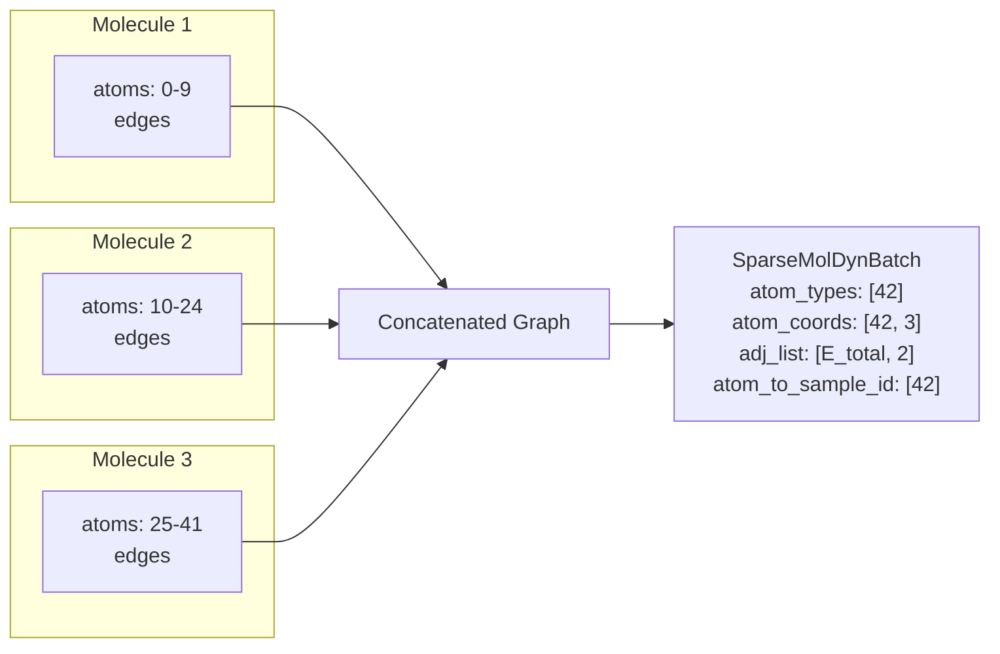
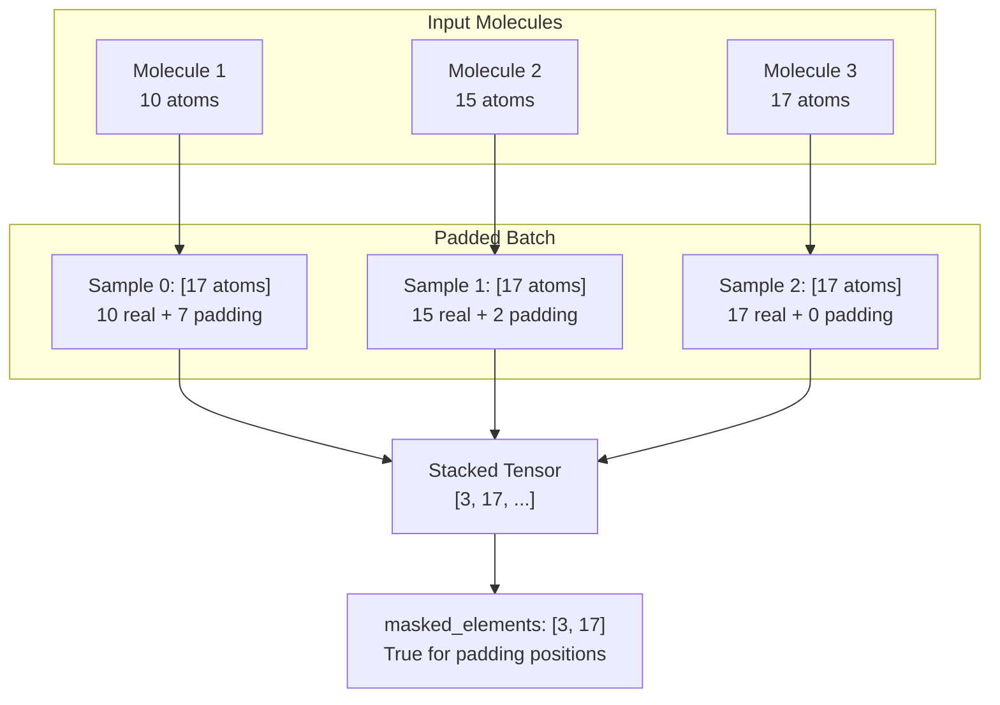
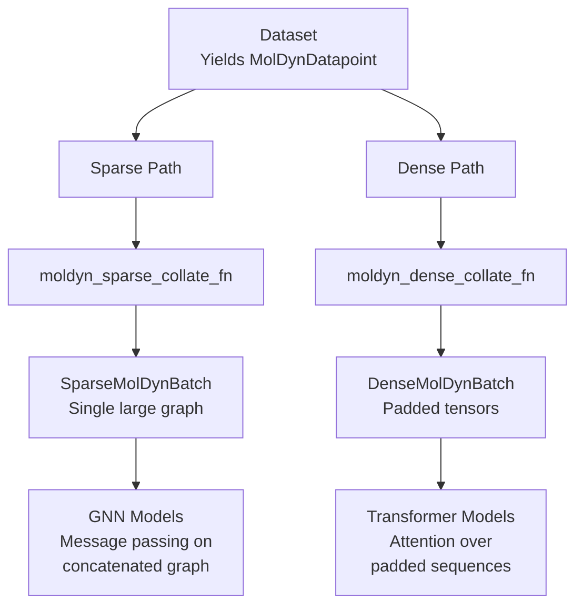
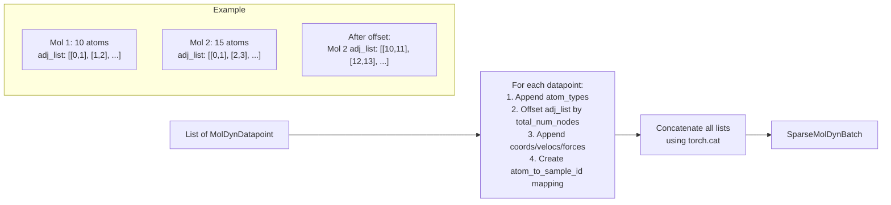
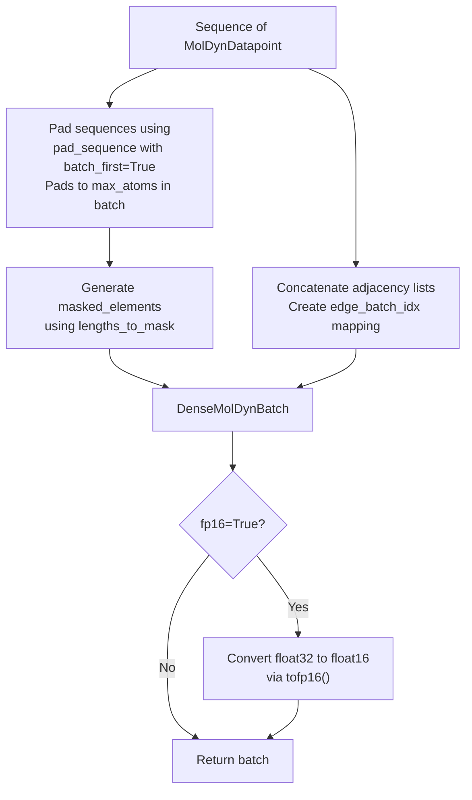
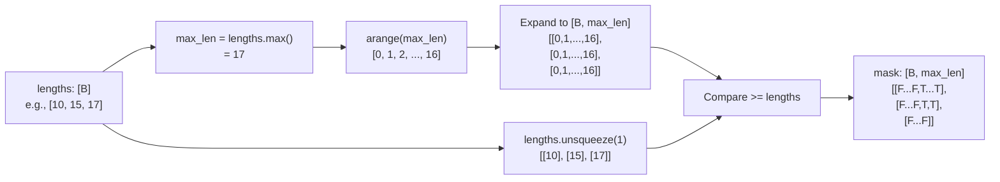
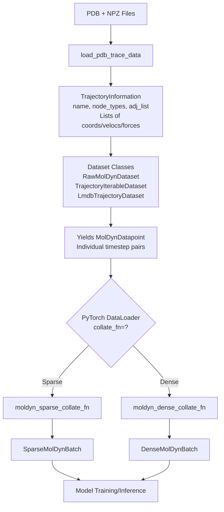

<!-- source: DeepWiki mcp.deepwiki.com · repo microsoft/timewarp · page 3.1 Data Loaders · fetched 2026-10-26 -->

# Data Loaders

<details>
<summary>Relevant source files</summary>

The following files were used as context for generating this wiki page:

- [dataloader.py](dataloader.py)

</details>


This module implements the data loading and batching logic for molecular dynamics simulation data. It provides two distinct batch representation formats: a **sparse format** suitable for Graph Neural Network (GNN) models and a **dense format** suitable for transformer models. The module handles the collation of individual molecular dynamics datapoints into batches, including padding, masking, and adjacency list management.

For information about the dataset implementations that produce individual datapoints, see [Dataset Implementations](#3.2). For distributed data sampling across GPUs, see [Distributed Sampling](#3.3).

## Overview

The dataloader module transforms individual molecular dynamics datapoints into batched tensors ready for model consumption. The key design decision is supporting two distinct batching strategies:

- **Sparse batching**: Concatenates all molecules in a batch into a single large graph, efficient for GNN-style models
- **Dense batching**: Pads molecules to uniform size and stacks them into `[batch_size, max_num_atoms, ...]` tensors, suitable for transformers

Sources: [dataloader.py:1-13]()

## Data Representation Classes

### MolDynDatapoint

The `MolDynDatapoint` class represents a single training example consisting of an initial molecular state (features) and a target future state. Each datapoint contains:

| Field | Type | Shape | Description |
|-------|------|-------|-------------|
| `name` | str | - | Identifier for the molecule/trajectory |
| `atom_types` | int64 tensor | `[V]` | Element indices for each atom |
| `adj_list` | int64 tensor | `[E, 2]` | Adjacency list of bonded atom pairs |
| `atom_coords` | float32 tensor | `[V, 3]` | Input 3D coordinates (Angstroms) |
| `atom_velocs` | float32 tensor | `[V, 3]` | Input velocities |
| `atom_forces` | float32 tensor | `[V, 3]` | Input forces |
| `atom_coord_targets` | float32 tensor | `[V, 3]` | Target coordinates at future timestep |
| `atom_veloc_targets` | float32 tensor | `[V, 3]` | Target velocities |
| `atom_force_targets` | float32 tensor | `[V, 3]` | Target forces |

Where `V` is the number of atoms in the molecule and `E` is the number of bonds. The adjacency list uses zero-indexed atom IDs.

Sources: [dataloader.py:58-75]()

### SparseMolDynBatch

The `SparseMolDynBatch` class represents a batch of molecules concatenated into a single large graph structure:



**SparseMolDynBatch Structure**

| Field | Type | Shape | Description |
|-------|------|-------|-------------|
| `names` | List[str] | `[B]` | Molecule identifiers |
| `atom_types` | int64 tensor | `[V_total]` | Concatenated atom types |
| `adj_list` | int64 tensor | `[E_total, 2]` | Concatenated adjacency list with adjusted indices |
| `atom_coords` | float32 tensor | `[V_total, 3]` | Concatenated coordinates |
| `atom_velocs` | float32 tensor | `[V_total, 3]` | Concatenated velocities |
| `atom_forces` | float32 tensor | `[V_total, 3]` | Concatenated forces |
| `atom_coord_targets` | float32 tensor | `[V_total, 3]` | Concatenated target coordinates |
| `atom_veloc_targets` | float32 tensor | `[V_total, 3]` | Concatenated target velocities |
| `atom_force_targets` | float32 tensor | `[V_total, 3]` | Concatenated target forces |
| `atom_to_sample_id` | int32 tensor | `[V_total]` | Maps each atom to its batch index |

Where `V_total` is the sum of all atoms across the batch, `E_total` is the sum of all edges, and `B` is the batch size.

The `atom_to_sample_id` tensor is critical for GNN models to track which atoms belong to which molecule in the batch. The adjacency list indices are offset appropriately during concatenation.

Sources: [dataloader.py:77-107]()

### DenseMolDynBatch

The `DenseMolDynBatch` class represents a batch where molecules are padded to a uniform size:



**DenseMolDynBatch Structure**

| Field | Type | Shape | Description |
|-------|------|-------|-------------|
| `names` | List[str] | `[B]` | Molecule identifiers |
| `atom_types` | int64 tensor | `[B, max_atoms]` | Padded atom types |
| `adj_list` | int64 tensor | `[E_total, 2]` | Concatenated adjacency list |
| `edge_batch_idx` | int64 tensor | `[E_total]` | Maps each edge to its batch index |
| `atom_coords` | float32 tensor | `[B, max_atoms, 3]` | Padded coordinates |
| `atom_velocs` | float32 tensor | `[B, max_atoms, 3]` | Padded velocities |
| `atom_forces` | float32 tensor | `[B, max_atoms, 3]` | Padded forces |
| `atom_coord_targets` | float32 tensor | `[B, max_atoms, 3]` | Padded target coordinates |
| `atom_veloc_targets` | float32 tensor | `[B, max_atoms, 3]` | Padded target velocities |
| `atom_force_targets` | float32 tensor | `[B, max_atoms, 3]` | Padded target forces |
| `masked_elements` | bool tensor | `[B, max_atoms]` | True for padding positions, False for real atoms |

Where `max_atoms` is the maximum number of atoms in any molecule in the batch. The adjacency list remains sparse (concatenated, not padded) with `edge_batch_idx` tracking which batch element each edge belongs to.

**Key Methods:**

- `tofp16()`: Converts float32 tensors to float16 for memory efficiency [dataloader.py:144-157]()
- `todevice(device)`: Moves all tensors to specified device [dataloader.py:159-172]()
- `sort_by_name()`: Reorders batch elements alphabetically by name [dataloader.py:174-175]()
- `permute(permutation)`: Applies arbitrary permutation to batch order [dataloader.py:177-192]()
- `segments`: Cached property returning indices of contiguous same-name groups [dataloader.py:194-196]()

Sources: [dataloader.py:109-198]()

## Batch Format Comparison

The choice between sparse and dense formats depends on the model architecture:



**Comparison Table**

| Aspect | Sparse Format | Dense Format |
|--------|---------------|--------------|
| **Memory efficiency** | Optimal - no padding | Less efficient due to padding |
| **Computation** | Efficient for GNNs | Efficient for transformers |
| **Atom tensors** | 1D concatenated `[V_total, ...]` | 2D padded `[B, max_atoms, ...]` |
| **Adjacency handling** | Offset indices during concat | Keep separate, track with `edge_batch_idx` |
| **Masking** | Via `atom_to_sample_id` | Via `masked_elements` boolean tensor |
| **Batch indexing** | Requires mapping through `atom_to_sample_id` | Direct indexing `batch[i]` |
| **Model types** | GNNs, equivariant networks | Transformers, attention-based models |

Sources: [dataloader.py:1-13](), [dataloader.py:77-198]()

## Collation Functions

### moldyn_sparse_collate_fn

The `moldyn_sparse_collate_fn` function creates sparse batches by concatenating all molecules into a single graph:



**Key Logic:**
1. Iterate through each datapoint, tracking `total_num_nodes`
2. Offset each datapoint's `adj_list` by adding `total_num_nodes` to all indices
3. Create `atom_to_sample_id` tensor mapping each atom to its batch index
4. Concatenate all tensors along dimension 0

Sources: [dataloader.py:279-325]()

### moldyn_dense_collate_fn

The `moldyn_dense_collate_fn` function creates dense batches with padding:



**Key Logic:**
1. Use PyTorch's `pad_sequence` with `batch_first=True` to pad all per-atom features
2. Generate `masked_elements` boolean mask using `lengths_to_mask` utility
3. Concatenate adjacency lists and create `edge_batch_idx` to track edge ownership
4. Optionally convert to float16 for memory efficiency

**Parameters:**
- `datapoints`: Sequence of `MolDynDatapoint` objects
- `fp16`: If True, converts float32 tensors to float16

Sources: [dataloader.py:328-400]()

## Utility Functions

### lengths_to_mask

The `lengths_to_mask` function generates a boolean mask for padded sequences:



The function creates a mask where `mask[i, j] = True` if `j >= lengths[i]` (padding position), and `False` otherwise (real atom position).

Sources: [dataloader.py:403-417]()

### load_pdb_trace_data

The `load_pdb_trace_data` function loads molecular dynamics trajectories from PDB and NPZ files:

**Input Files:**
- `state0_file`: PDB file containing initial molecular structure and topology
- `traj_file`: NPZ file containing trajectory data (steps, positions, velocities, forces)

**Process:**
1. Load topology from PDB using MDTraj to extract atom types and bonds
2. Map element symbols to integer indices using `ELEMENT_VOCAB`
3. Extract bond connectivity into adjacency list
4. Load trajectory arrays (positions, velocities, forces) from NPZ
5. Create conditioning-target pairs with configurable `step_width`
6. Validate coordinate deltas don't exceed 100 Angstroms (raises `CoordDeltaTooBig`)

**Parameters:**
- `step_width`: Timestep interval between conditioning and target states
- `equal_data_spacing`: If True, only uses conditioning states at regular spacing intervals

**Returns:** `TrajectoryInformation` object containing the molecule structure and trajectory sequence.

Sources: [dataloader.py:213-276]()

### contiguous_segments

The `contiguous_segments` function identifies groups of consecutive identical names:

```python
# Example:
names = ["A", "A", "B", "B", "B", "C"]
segments = contiguous_segments(names)
# Returns: [0, 2, 5, 6]
# Meaning: A spans [0:2], B spans [2:5], C spans [5:6]
```

This is used by `DenseMolDynBatch.segments` to efficiently group trajectory frames from the same molecule.

Sources: [dataloader.py:28-42]()

## Element Vocabulary

The dataloader uses a fixed vocabulary of chemical elements:

| Element | Index |
|---------|-------|
| Carbon (C) | 0 |
| Hydrogen (H) | 1 |
| Nitrogen (N) | 2 |
| Oxygen (O) | 3 |
| Sulfur (S) | 4 |

The `ELEMENT_VOCAB` dictionary maps element symbols to indices, used when converting topology information to integer tensors. Molecules containing elements outside this vocabulary will raise a `KeyError`.

Sources: [dataloader.py:24-25]()

## Integration with Data Pipeline



**Integration Points:**

1. **Dataset Layer**: Dataset classes (see [Dataset Implementations](#3.2)) yield individual `MolDynDatapoint` objects
2. **DataLoader Layer**: PyTorch `DataLoader` uses either `moldyn_sparse_collate_fn` or `moldyn_dense_collate_fn` as the collation function
3. **Model Layer**: Models receive batched data in either sparse or dense format depending on architecture requirements

**Usage Example:**

```python
from torch.utils.data import DataLoader
from dataloader import moldyn_dense_collate_fn

# For transformer models - use dense batches
train_loader = DataLoader(
    dataset,
    batch_size=32,
    collate_fn=moldyn_dense_collate_fn,
    shuffle=True
)

# For GNN models - use sparse batches
train_loader = DataLoader(
    dataset,
    batch_size=32,
    collate_fn=moldyn_sparse_collate_fn,
    shuffle=True
)
```

Sources: [dataloader.py:1-13](), [dataloader.py:279-400]()

## Memory and Performance Considerations

### Pin Memory

Both `SparseMolDynBatch` and `DenseMolDynBatch` implement a `pin_memory()` method that pins all tensors to page-locked memory for faster CPU-to-GPU transfers. This is automatically utilized by PyTorch's `DataLoader` when `pin_memory=True`.

Sources: [dataloader.py:96-106](), [dataloader.py:131-142]()

### FP16 Support

The `DenseMolDynBatch` class supports automatic float16 conversion via the `tofp16()` method, reducing memory usage by 50% for floating-point tensors. This can be enabled during collation:

```python
collate_fn = lambda x: moldyn_dense_collate_fn(x, fp16=True)
```

Sources: [dataloader.py:144-157](), [dataloader.py:400]()

### Multi-Processing Warning

The collation functions are designed to return CPU tensors. Returning CUDA tensors when `num_workers > 0` in the DataLoader is not recommended due to multiprocessing constraints. Models should move batches to GPU after receiving them from the DataLoader.

Sources: [dataloader.py:283-285](), [dataloader.py:332-334]()

---

