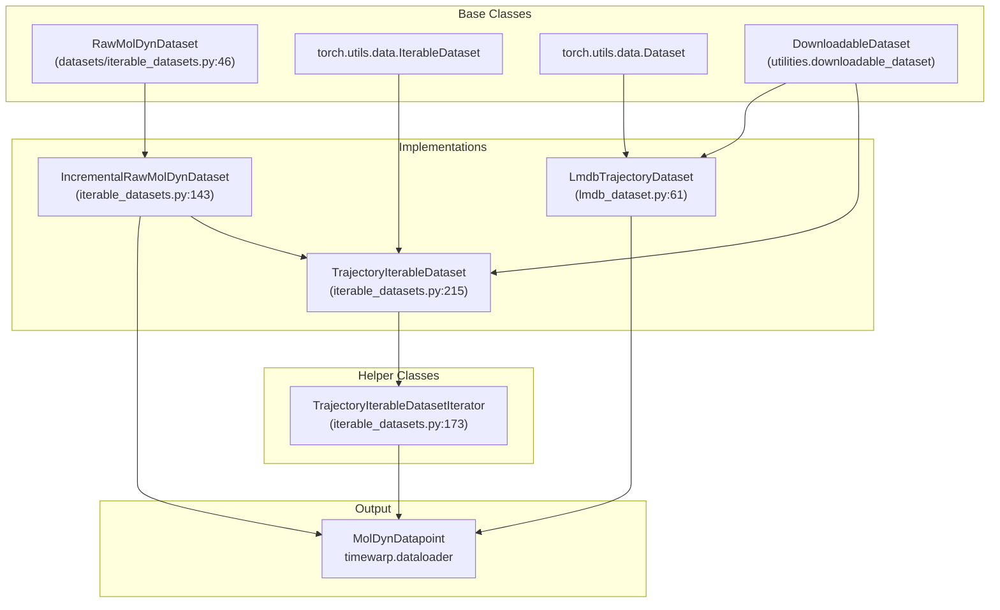
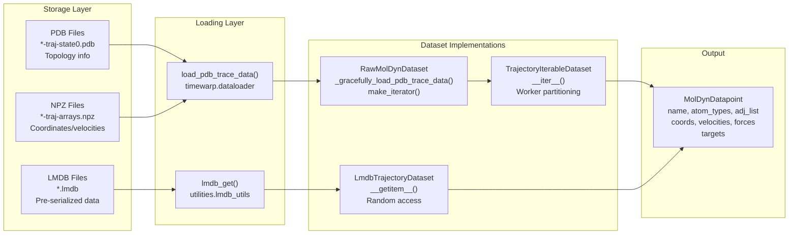
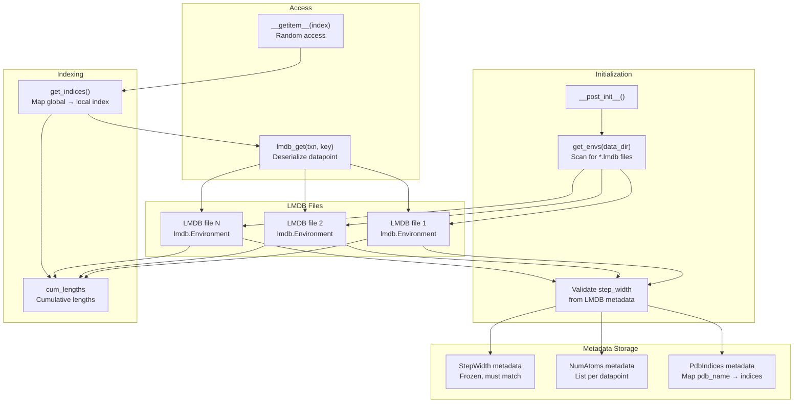
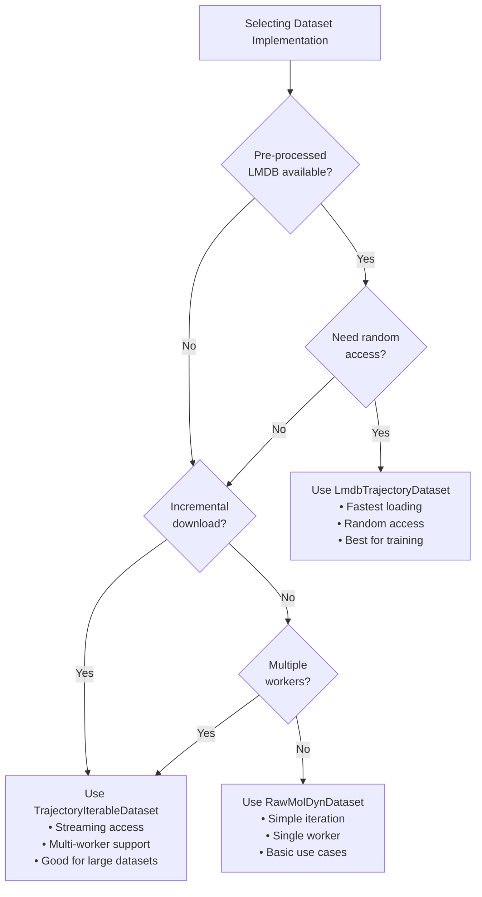
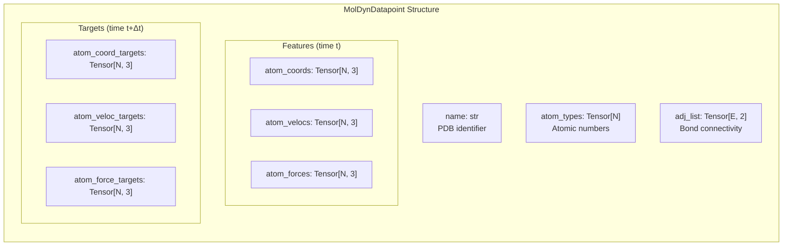

<!-- source: DeepWiki mcp.deepwiki.com · repo microsoft/timewarp · page 3.2 Dataset Implementations · fetched 2026-10-26 -->

# Dataset Implementations

<details>
<summary>Relevant source files</summary>

The following files were used as context for generating this wiki page:

- [datasets/__init__.py](datasets/__init__.py)
- [datasets/iterable_datasets.py](datasets/iterable_datasets.py)
- [datasets/lmdb_dataset.py](datasets/lmdb_dataset.py)

</details>


## Purpose and Scope

This document provides an overview of the three dataset implementations available in Timewarp for loading molecular dynamics trajectory data. These implementations provide different trade-offs between flexibility, performance, and storage requirements. For detailed information on the iterable streaming approach, see [Iterable Datasets](#3.2.1). For indexed LMDB-based access, see [LMDB Datasets](#3.2.2). For information on how datasets are batched and fed to models, see [Data Loaders](#3.1).

## Overview

Timewarp provides three dataset implementations for loading molecular dynamics trajectories:

| Class | Type | Storage Format | Use Case | File Location |
|-------|------|----------------|----------|---------------|
| `RawMolDynDataset` | Base class | PDB + NPZ files | Base functionality for loading raw files | [datasets/iterable_datasets.py:46-130]() |
| `TrajectoryIterableDataset` | Iterable | PDB + NPZ files | Streaming data loading, multi-worker support | [datasets/iterable_datasets.py:215-280]() |
| `LmdbTrajectoryDataset` | Indexed | LMDB database | Random access, fastest loading | [datasets/lmdb_dataset.py:61-135]() |

All three implementations produce `MolDynDatapoint` objects containing atomic coordinates, velocities, forces, and connectivity information for molecular dynamics simulations.

**Sources:** [datasets/__init__.py:1-3](), [datasets/iterable_datasets.py:1-280](), [datasets/lmdb_dataset.py:1-135]()

## Dataset Class Hierarchy



**Sources:** [datasets/iterable_datasets.py:34-280](), [datasets/lmdb_dataset.py:60-135]()

## Core Data Flow



**Sources:** [datasets/iterable_datasets.py:59-130](), [datasets/lmdb_dataset.py:113-116]()

## RawMolDynDataset: Base File Loading

The `RawMolDynDataset` class provides the foundation for loading molecular dynamics trajectories from PDB and NPZ files. It is not used directly but serves as the base for `TrajectoryIterableDataset`.

### Key Attributes

| Attribute | Type | Description |
|-----------|------|-------------|
| `data_dir` | `StrPath` | Directory containing PDB and NPZ files |
| `step_width` | `int` | Temporal spacing between trajectory samples |
| `equal_data_spacing` | `bool` | Whether to enforce uniform time spacing |
| `pdb_names` | `Sequence[str]` | Cached list of available PDB file basenames |

### Core Methods

**`pdb_names` (cached property)** [datasets/iterable_datasets.py:47-51]()
- Scans `data_dir` for files ending in `-traj-state0.pdb`
- Returns sorted list of PDB basenames
- Cached to avoid repeated directory scans

**`_gracefully_load_pdb_trace_data(pdb_name: str)`** [datasets/iterable_datasets.py:59-80]()
- Loads trajectory data for a given PDB name
- Returns `TrajectoryInformation` containing coordinates, velocities, forces
- Returns `None` if files are missing or contain invalid data
- Catches `CoordDeltaTooBig` exceptions for trajectories with discontinuities

**`make_iterator(pdb_names: Sequence[str])`** [datasets/iterable_datasets.py:82-129]()
- Creates an iterator over trajectory datapoints
- Iterates through specified PDB names
- Yields `MolDynDatapoint` objects with features and targets
- Displays progress bar using `tqdm`

**Sources:** [datasets/iterable_datasets.py:34-130]()

## TrajectoryIterableDataset: Streaming Access

`TrajectoryIterableDataset` extends `RawMolDynDataset` to provide PyTorch `IterableDataset` functionality with multi-worker support and optional incremental downloading.

### Architecture

```mermaid
graph TB
    subgraph "TrajectoryIterableDataset"
        Dataset["TrajectoryIterableDataset<br/>num_traces_per_chunk=16<br/>shuffle=False"]
        RawDS["raw_dataset property<br/>RawMolDynDataset or<br/>IncrementalRawMolDynDataset"]
    end
    
    subgraph "Multi-Worker Support"
        WorkerInfo["torch.utils.data.get_worker_info()"]
        Partition["approximately_equal_partition()<br/>Splits PDB names by worker"]
    end
    
    subgraph "Iterator"
        Iterator["TrajectoryIterableDatasetIterator<br/>Chunks by num_traces"]
        Buffer["loaded_datapoints buffer<br/>Shuffle within chunk"]
    end
    
    subgraph "Output"
        Datapoint["MolDynDatapoint stream"]
    end
    
    Dataset --> RawDS
    Dataset --> WorkerInfo
    WorkerInfo --> Partition
    Partition --> RawDS
    RawDS --> Iterator
    Iterator --> Buffer
    Buffer --> Datapoint
```

### Key Features

**Multi-Worker Data Partitioning** [datasets/iterable_datasets.py:240-246]()
- Divides PDB files across workers using `approximately_equal_partition()`
- Each worker processes a disjoint subset of molecules
- Seed management ensures different ordering per epoch

**Chunked Loading** [datasets/iterable_datasets.py:173-211]()
- `TrajectoryIterableDatasetIterator` loads data in chunks of `num_traces_per_chunk` molecules
- Buffers datapoints in `loaded_datapoints` list
- Optional shuffling within each chunk
- Can skip incomplete chunks at end of iteration

**Incremental Downloading** [datasets/iterable_datasets.py:143-169]()
- `IncrementalRawMolDynDataset` extends base with `downloader` support
- Downloads PDB/NPZ files on-demand from blob storage
- Tracks attempted downloads to avoid repeated failures
- Falls back to local loading if download fails

**Sources:** [datasets/iterable_datasets.py:132-280]()

## LmdbTrajectoryDataset: Indexed Access

`LmdbTrajectoryDataset` provides random access to pre-serialized trajectory data stored in LMDB (Lightning Memory-Mapped Database) files. This is the fastest dataset implementation for training.

### Architecture



### Key Attributes

| Attribute | Type | Description |
|-----------|------|-------------|
| `envs` | `List[lmdb.Environment]` | Open LMDB database environments |
| `cum_lengths` | `List[int]` | Cumulative lengths for indexing across databases |
| `num_atoms` | `List[int]` | Number of atoms in each datapoint |
| `pdb_indices` | `Dict[str, List[int]]` | Mapping from PDB name to datapoint indices |

### Metadata System

The LMDB dataset stores three types of metadata alongside the trajectory data:

**`StepWidth`** [datasets/lmdb_dataset.py:21-27]()
- Frozen metadata that must match the requested `step_width`
- Validation ensures LMDB files are compatible with training configuration

**`NumAtoms`** [datasets/lmdb_dataset.py:29-39]()
- Stores number of atoms for each datapoint
- Used for validation and efficient memory allocation

**`PdbIndices`** [datasets/lmdb_dataset.py:42-52]()
- Maps each PDB name to its constituent datapoint indices
- Enables filtering by molecule type for evaluation
- Used by `LMDBDistributedSampler` for protein-based partitioning (see [Distributed Sampling](#3.3))

### Random Access Implementation

**`__getitem__(index: int)`** [datasets/lmdb_dataset.py:113-116]()
1. `get_indices()` maps global index to (database_index, element_index) pair
2. Opens transaction on appropriate LMDB environment
3. `lmdb_get()` deserializes the datapoint from LMDB
4. Returns `MolDynDatapoint` object

**Sources:** [datasets/lmdb_dataset.py:1-135]()

## Dataset Selection Guide



### Recommendations

**Use `LmdbTrajectoryDataset` when:**
- LMDB files have been pre-created from raw data
- Training requires multiple epochs over the same data
- Random access is needed (e.g., distributed sampling by PDB)
- Maximum loading performance is critical

**Use `TrajectoryIterableDataset` when:**
- Working with raw PDB/NPZ files
- Dataset is too large to pre-process entirely
- Using multiple DataLoader workers
- Incremental downloading from remote storage is needed

**Use `RawMolDynDataset` when:**
- Building custom iteration logic
- Single-worker sequential access is sufficient
- Subclassing to add custom functionality

**Sources:** [datasets/__init__.py:1-3](), [datasets/iterable_datasets.py:1-280](), [datasets/lmdb_dataset.py:1-135]()

## Common Interface

All three dataset implementations produce `MolDynDatapoint` objects with the following structure:



This common interface ensures that all downstream components (collate functions, models, evaluation scripts) work seamlessly with any dataset implementation.

**Sources:** [timewarp/dataloader.py]() (referenced in [datasets/iterable_datasets.py:11-16]() and [datasets/lmdb_dataset.py:9]())

## File Format Details

### PDB + NPZ Storage

**PDB Files** (topology): `{pdb_name}-traj-state0.pdb`
- Contains atomic structure and connectivity
- Standard PDB format with atom types and bonds
- Parsed by `load_pdb_trace_data()` from `timewarp.dataloader`

**NPZ Files** (dynamics): `{pdb_name}-traj-arrays.npz`
- NumPy compressed archive containing trajectory arrays
- Keys: coordinates, velocities, forces at each timestep
- Loaded using `numpy.load()` with memory mapping

### LMDB Storage

**Database Files**: `*.lmdb`
- Key-value store with integer keys ("0", "1", "2", ...) for datapoints
- Special metadata keys: "step_width", "num_atoms", "pdb_indices"
- Each value is a serialized `MolDynDatapoint` using pickle
- Multiple LMDB files can be in the same directory (concatenated virtually)

**Sources:** [datasets/iterable_datasets.py:22-58](), [datasets/lmdb_dataset.py:69-106]()

## Performance Characteristics

| Characteristic | RawMolDynDataset | TrajectoryIterableDataset | LmdbTrajectoryDataset |
|----------------|------------------|---------------------------|------------------------|
| **Loading Speed** | Moderate | Moderate | Fast |
| **Memory Usage** | Low | Low | Low (memory-mapped) |
| **Access Pattern** | Sequential | Sequential | Random |
| **Multi-worker Support** | No | Yes | Yes |
| **Preprocessing Required** | No | No | Yes |
| **Storage Overhead** | None | None | ~20-30% larger |
| **Best Use Case** | Simple iteration | Training with streaming | Training with indexing |

The `step_width` parameter controls temporal spacing between samples. Larger values reduce data volume but may miss fast dynamics. All implementations validate this parameter during loading [datasets/lmdb_dataset.py:76-82]().

**Sources:** [datasets/iterable_datasets.py:1-280](), [datasets/lmdb_dataset.py:1-135]()

---

