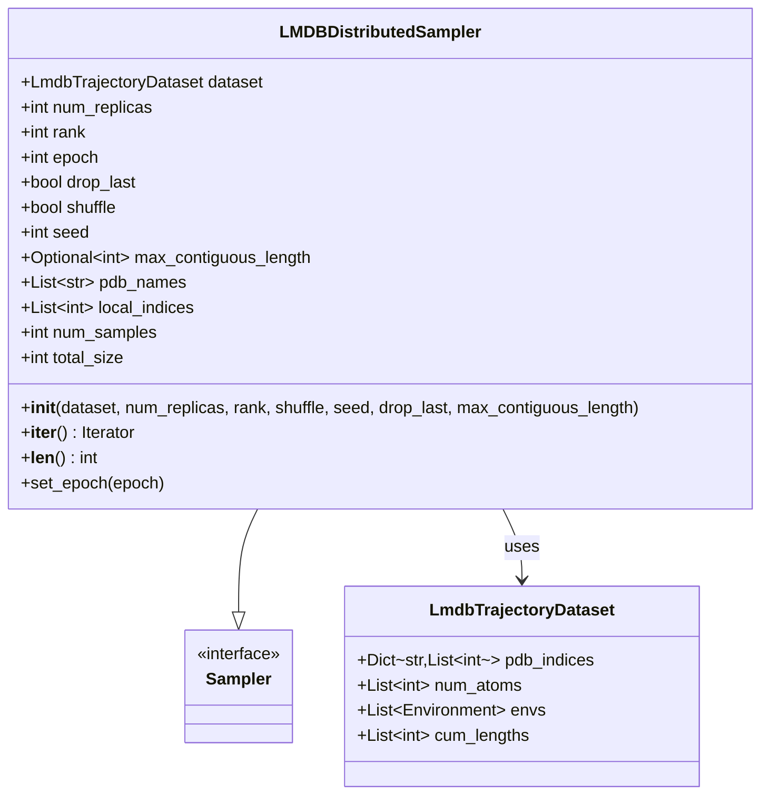
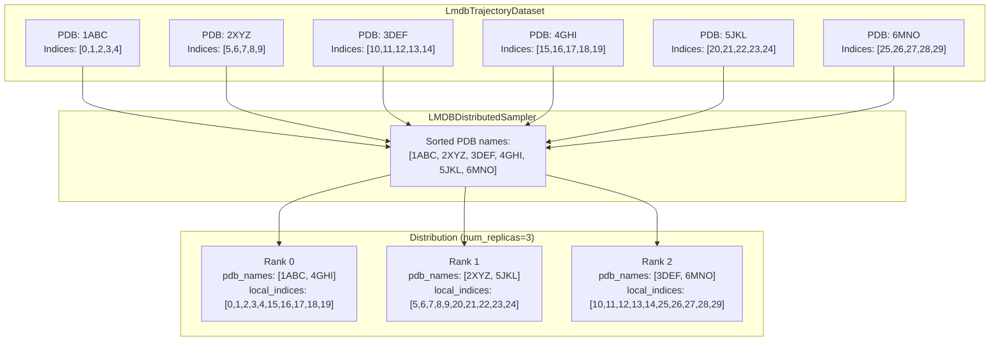
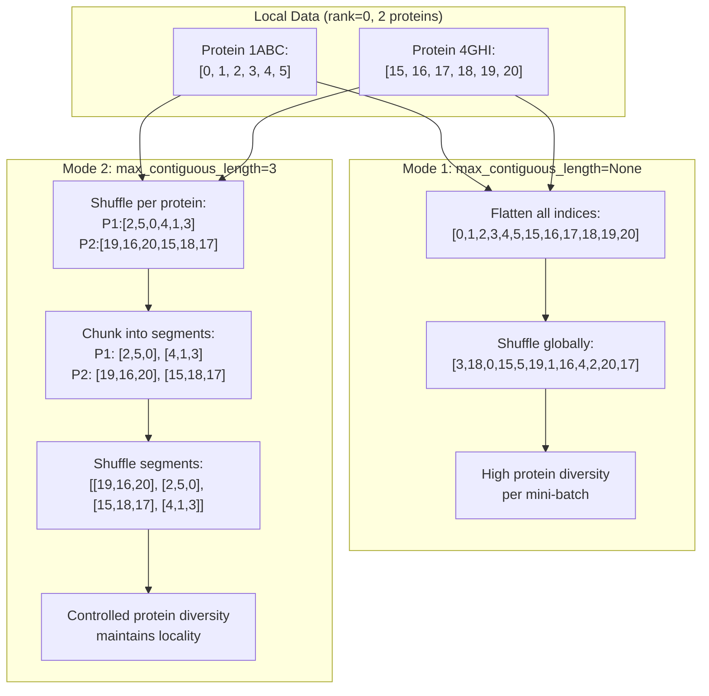
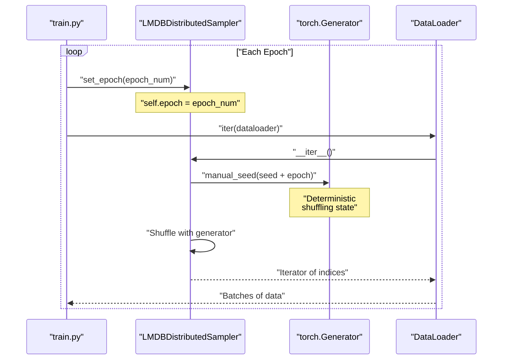
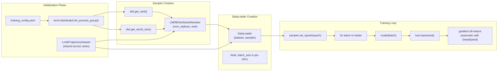

<!-- source: DeepWiki mcp.deepwiki.com · repo microsoft/timewarp · page 3.3 Distributed Sampling · fetched 2026-10-26 -->

# Distributed Sampling

<details>
<summary>Relevant source files</summary>

The following files were used as context for generating this wiki page:

- [datasets/lmdb_dataset.py](datasets/lmdb_dataset.py)
- [datasets/pdb_sampler.py](datasets/pdb_sampler.py)

</details>


## Purpose and Scope

This page documents the `LMDBDistributedSampler` class, which provides protein-based data partitioning for distributed training across multiple GPUs. Unlike standard distributed samplers that partition datasets by individual data indices, this sampler partitions by entire protein (PDB) files to ensure efficient memory utilization and computational performance.

For information about the underlying LMDB dataset structure, see [LMDB Datasets](#3.2.2). For details on multi-GPU training orchestration with DeepSpeed, see [Multi-GPU Training with DeepSpeed](#5.3).

**Sources:** [datasets/pdb_sampler.py:19-218]()

---

## Overview

The `LMDBDistributedSampler` addresses a specific challenge in distributed molecular dynamics training: how to partition trajectory data across multiple GPUs efficiently. Standard PyTorch distributed samplers partition datasets by data point indices, which can result in each GPU loading data from many different proteins. This creates two problems:

1. **Memory inefficiency**: Each GPU must load metadata and structures for many proteins
2. **Computational overhead**: Operations like neighbor list construction cannot be amortized across multiple samples from the same protein

The `LMDBDistributedSampler` solves this by partitioning the dataset at the protein level rather than the sample level. Each GPU is assigned a subset of proteins and processes all trajectory frames from those proteins. This approach enables better memory locality and computational efficiency.

**Sources:** [datasets/pdb_sampler.py:19-39]()

---

## LMDBDistributedSampler Architecture

The following diagram shows the class structure and key attributes of the distributed sampler:



**Key Components:**

| Attribute | Type | Purpose |
|-----------|------|---------|
| `dataset` | `LmdbTrajectoryDataset` | Source dataset containing trajectory data |
| `num_replicas` | `int` | Number of distributed processes (GPUs) |
| `rank` | `int` | Current process rank (0 to num_replicas-1) |
| `pdb_names` | `List[str]` | Subset of proteins assigned to this rank |
| `local_indices` | `List[int]` | Flattened indices of all samples from assigned proteins |
| `max_contiguous_length` | `Optional[int]` | Maximum consecutive samples from same protein |
| `epoch` | `int` | Current training epoch for shuffle determinism |

**Sources:** [datasets/pdb_sampler.py:71-148]()

---

## Protein-Based Partitioning Strategy

The following diagram illustrates how proteins are distributed across multiple ranks:



**Partitioning Algorithm:**

The sampler uses a strided assignment strategy implemented in [datasets/pdb_sampler.py:126]():

```
self.pdb_names = pdb_names[self.rank : self.total_num_pdb_names : self.num_replicas]
```

This ensures that:
- PDB names are sorted consistently across all ranks
- Each rank receives approximately equal numbers of proteins
- Assignment is deterministic based on rank number
- If proteins have unequal numbers of samples, padding or dropping is applied based on `drop_last`

**Load Balancing Considerations:**

The sampler prints diagnostic information at initialization showing the largest molecule assigned to each rank [datasets/pdb_sampler.py:131-133]():

```
print(f"LMDBDistributedSampler: rank={rank} largest molecule={max([dataset.num_atoms[idx] for idx in self.local_indices])} pdb_names={self.pdb_names}")
```

This helps identify potential load imbalances where one rank may be assigned disproportionately large proteins.

**Sources:** [datasets/pdb_sampler.py:103-134](), [datasets/lmdb_dataset.py:42-53]()

---

## Shuffling Strategies

The sampler supports two shuffling modes controlled by the `max_contiguous_length` parameter. The following diagram shows the data ordering produced by each mode:



### Standard Shuffling (max_contiguous_length=None)

When `max_contiguous_length` is not specified, the sampler performs simple global shuffling [datasets/pdb_sampler.py:156-160]():

1. Flatten all local indices into a single list
2. Generate random permutation using epoch-seeded generator
3. Reorder indices according to permutation

This produces maximum diversity but may result in poor cache locality and redundant computations.

### Chunked Shuffling (max_contiguous_length specified)

When `max_contiguous_length` is specified, the sampler uses a three-stage process [datasets/pdb_sampler.py:162-190]():

1. **Per-protein shuffle**: Shuffle indices within each protein independently
2. **Segmentation**: Split each protein's indices into chunks of size `max_contiguous_length`
3. **Segment shuffle**: Shuffle the chunks globally

This approach provides a balance between diversity and locality. A mini-batch of size N will contain samples from approximately `N / max_contiguous_length` different proteins rather than N different proteins.

**Example:** With `max_contiguous_length=2` and batch size 8, each batch contains samples from approximately 4 proteins, with consecutive samples often from the same protein. This improves computational efficiency for operations like neighbor list construction.

**Sources:** [datasets/pdb_sampler.py:149-203](), [datasets/pdb_sampler.py:15-16]()

---

## Epoch Management and Determinism

The sampler ensures deterministic shuffling across epochs while allowing different orderings for each epoch:



**Key Implementation Details:**

| Method | Purpose | Location |
|--------|---------|----------|
| `set_epoch(epoch)` | Updates epoch counter for shuffle seed | [datasets/pdb_sampler.py:208-217]() |
| `manual_seed(seed + epoch)` | Creates epoch-specific deterministic generator | [datasets/pdb_sampler.py:152-153]() |

The seed is computed as `self.seed + self.epoch`, ensuring:
- **Determinism**: Same epoch produces same ordering across runs
- **Diversity**: Different epochs produce different orderings
- **Synchronization**: All ranks use same seed, ensuring coordinated shuffling

**Critical Usage Note:** The training loop must call `set_epoch()` before creating the DataLoader iterator each epoch, as documented in [datasets/pdb_sampler.py:64-68]().

**Sources:** [datasets/pdb_sampler.py:149-153](), [datasets/pdb_sampler.py:208-217]()

---

## Integration with Distributed Training

The following diagram shows how `LMDBDistributedSampler` integrates with the training pipeline:



**Initialization Sequence:**

1. **Distributed Setup**: Initialize distributed process group (typically done by DeepSpeed launcher)
2. **Dataset Creation**: All ranks load the same `LmdbTrajectoryDataset` instance
3. **Sampler Creation**: Each rank creates sampler with its specific rank and world size
4. **DataLoader Creation**: Pass sampler to DataLoader (automatic batching over sampler indices)

**Rank and World Size Handling:**

The sampler automatically queries the distributed environment if not explicitly provided [datasets/pdb_sampler.py:81-93]():

```python
if num_replicas is None:
    num_replicas = dist.get_world_size()
if rank is None:
    rank = dist.get_rank()
```

**Batch Size Considerations:**

- The `batch_size` parameter in `DataLoader` is **per-GPU**
- Global effective batch size = `batch_size × num_replicas`
- Each rank processes `batch_size` samples from its assigned proteins
- Gradients are synchronized across ranks after backward pass

**Sources:** [datasets/pdb_sampler.py:71-93](), [datasets/pdb_sampler.py:81-93]()

---

## Usage Patterns and Configuration

### Basic Usage

```python
from datasets.lmdb_dataset import LmdbTrajectoryDataset
from datasets.pdb_sampler import LMDBDistributedSampler
from torch.utils.data import DataLoader

# Create dataset
dataset = LmdbTrajectoryDataset(data_dir="data/lmdb", step_width=10)

# Create distributed sampler
sampler = LMDBDistributedSampler(
    dataset=dataset,
    shuffle=True,
    seed=42,
    drop_last=False
)

# Create dataloader
loader = DataLoader(
    dataset,
    batch_size=32,  # per-GPU batch size
    sampler=sampler,
    num_workers=4
)

# Training loop
for epoch in range(num_epochs):
    sampler.set_epoch(epoch)  # Critical for proper shuffling
    for batch in loader:
        # Training logic
        pass
```

### Configuration Options

| Parameter | Default | Recommended Usage |
|-----------|---------|-------------------|
| `num_replicas` | `None` (auto-detect) | Leave as None for automatic detection |
| `rank` | `None` (auto-detect) | Leave as None for automatic detection |
| `shuffle` | `True` | Enable for training, disable for evaluation |
| `seed` | `0` | Set to consistent value for reproducibility |
| `drop_last` | `False` | Set to True for strictly even batch sizes |
| `max_contiguous_length` | `None` | Set to 2-4 for better cache locality on large proteins |

### Advanced: Controlling Protein Diversity

For systems with many atoms per protein (e.g., >1000 atoms), setting `max_contiguous_length` can significantly improve performance:

```python
sampler = LMDBDistributedSampler(
    dataset=dataset,
    shuffle=True,
    max_contiguous_length=3  # Max 3 consecutive samples from same protein
)
```

**Performance Impact:**
- **Without `max_contiguous_length`**: Random access pattern, frequent protein switches
- **With `max_contiguous_length=3`**: Local access pattern, ~3× fewer protein switches
- **Trade-off**: Slightly reduced diversity within mini-batches

### Assumptions and Limitations

The current implementation makes the following assumptions documented in [datasets/pdb_sampler.py:139-145]():

1. **Equal samples per protein**: All proteins must have the same number of trajectory samples
2. **Constant dataset size**: Dataset size does not change during training
3. **Homogeneous hardware**: All GPUs have similar compute and memory capabilities

If proteins have unequal numbers of samples, the assertion at [datasets/pdb_sampler.py:142-145]() will fail. Future enhancements may relax this requirement.

**Sources:** [datasets/pdb_sampler.py:71-148](), [datasets/pdb_sampler.py:139-145]()

---

## Performance Characteristics

The `LMDBDistributedSampler` provides the following performance characteristics:

| Operation | Time Complexity | Space Complexity |
|-----------|----------------|------------------|
| Initialization | O(P) where P = # proteins | O(N) where N = # samples |
| Iteration setup (no shuffle) | O(1) | O(1) |
| Iteration setup (shuffle, no chunking) | O(N) | O(1) |
| Iteration setup (shuffle with chunking) | O(N + C log C) where C = # chunks | O(C) |
| Memory per rank | - | O(N/R) where R = # ranks |

**Memory Distribution:**

The diagnostic print statement [datasets/pdb_sampler.py:131-133]() helps identify memory imbalances by showing the largest molecule per rank. Ideally, ranks should have similar maximum molecule sizes to ensure balanced GPU memory utilization.

**Scaling Behavior:**

- **Strong scaling**: Adding more GPUs reduces samples per GPU proportionally
- **Weak scaling**: Protein-level partitioning maintains efficiency as dataset grows with more proteins
- **Load imbalance**: May occur if protein sizes vary significantly; monitor diagnostic output

**Sources:** [datasets/pdb_sampler.py:15-16](), [datasets/pdb_sampler.py:131-133](), [datasets/pdb_sampler.py:162-190]()

---

