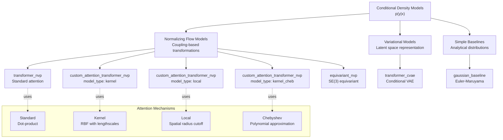
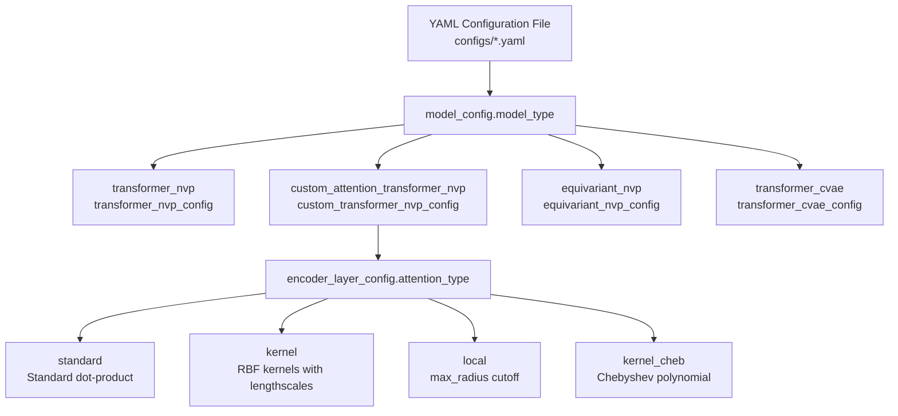
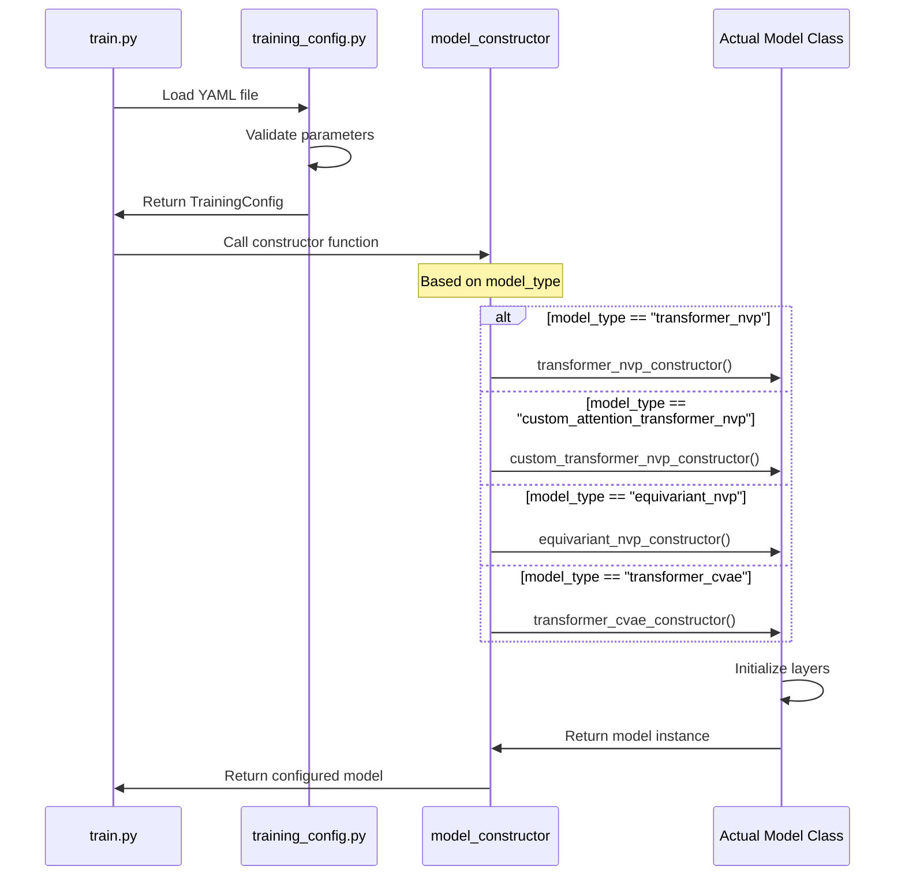
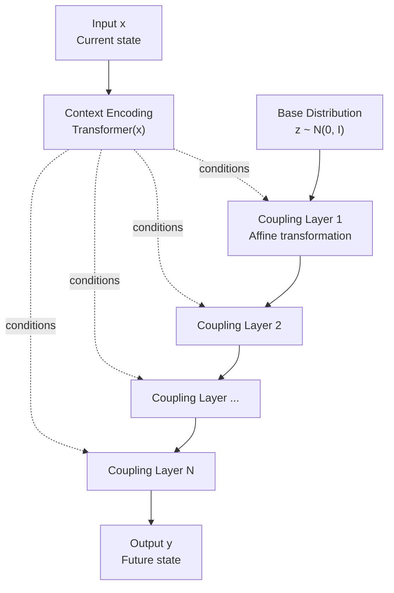
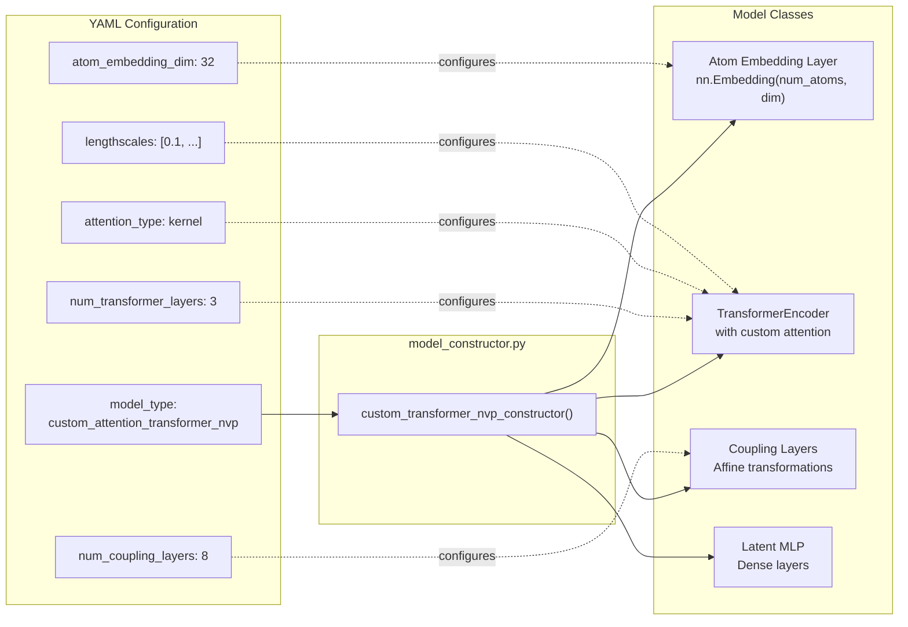

<!-- source: DeepWiki mcp.deepwiki.com · repo microsoft/timewarp · page 4 Model Architectures · fetched 2026-10-26 -->

# Model Architectures

<details>
<summary>Relevant source files</summary>

The following files were used as context for generating this wiki page:

- [README.md](README.md)
- [configs/kernel_transformer_nvp.yaml](configs/kernel_transformer_nvp.yaml)
- [configs/transformer_nvp.yaml](configs/transformer_nvp.yaml)

</details>


## Purpose and Scope

This document provides an overview of the conditional density model architectures available in Timewarp for learning time-coarsened molecular dynamics. All models in this system share a common objective: learning the conditional probability distribution p(y|x), where x represents the initial molecular state and y represents the final state after a specified time step. 

For detailed information on:
- How models are configured and instantiated, see [Configuration System](#4.1)
- Specific transformer-based normalizing flow variants, see [Transformer NVP Models](#4.2)
- Equivariant architectures, see [Equivariant NVP](#4.3)
- CVAE-based models, see [Transformer CVAE](#4.4)
- Baseline implementations, see [Baseline Models](#4.6)

For training these models, see [Training](#5).

---

## Conditional Density Modeling for Molecular Dynamics

The core task in Timewarp is to learn a conditional probability distribution p(y|x) that models the evolution of molecular systems over time. Given:
- **x**: Initial molecular state (atom positions, velocities, atomic numbers)
- **y**: Final molecular state after a time step Δt
- **Δt**: Time step width (e.g., 1000 femtoseconds)

The model learns to predict the distribution of possible future states, rather than a single deterministic prediction. This probabilistic approach captures the inherent stochasticity of molecular dynamics and enables sampling of multiple physically plausible trajectories.

**Sources:** [README.md:1-6]()

---

## Available Model Architectures

Timewarp provides seven distinct model architecture families, each implementing different approaches to conditional density estimation:

| Model Type | Key Characteristics | Configuration File |
|------------|---------------------|-------------------|
| **Standard Transformer NVP** | Baseline with standard dot-product attention | `configs/transformer_nvp.yaml` |
| **Kernel Transformer NVP** | Kernel-based attention with multiple lengthscales | `configs/kernel_transformer_nvp.yaml` |
| **Local Transformer NVP** | Spatially-restricted attention neighborhoods | `configs/local_transformer_nvp.yaml` |
| **Chebyshev Kernel NVP** | Kernel approximation via Chebyshev polynomials | `configs/kernel_cheb_transformer_nvp.yaml` |
| **Equivariant NVP** | Geometric equivariance-preserving architecture | `configs/equivariant_nvp.yaml` |
| **Transformer CVAE** | Conditional VAE with latent space representation | `configs/transformer_cvae.yaml` |
| **Gaussian Baseline** | Euler-Maruyama integration baseline | Various configs |

All models are specified via YAML configuration files in the `configs/` directory and instantiated through the model constructor system.

**Sources:** [README.md:90-94](), [configs/kernel_transformer_nvp.yaml:1-31](), [configs/transformer_nvp.yaml:1-26]()

---

## Model Architecture Taxonomy



**Model Architecture Taxonomy**

This diagram shows the hierarchical organization of model architectures. The primary division is between normalizing flow models (which use coupling layers), variational models (which use latent spaces), and simple analytical baselines.

**Sources:** [configs/kernel_transformer_nvp.yaml:16-30](), [configs/transformer_nvp.yaml:14-25]()

---

## Core Model Components

All transformer-based models share common architectural components, though their specific configurations differ:

### Shared Components

```mermaid
graph LR
    Input["Input Molecular State<br/>positions, velocities, atom_types"]
    
    Embed["Atom Embedding Layer<br/>atom_embedding_dim: 16-32"]
    
    PosEnc["Positional Encoding<br/>Optional RFF encoding"]
    
    TransStack["Transformer Stack<br/>num_transformer_layers: 3-24"]
    
    Coupling["Coupling Layers<br/>num_coupling_layers: 4-8"]
    
    LatentMLP["Latent MLP<br/>latent_mlp_hidden_dims"]
    
    Output["Output Distribution<br/>p(y|x)"]
    
    Input --> Embed
    Embed --> PosEnc
    PosEnc --> TransStack
    TransStack --> Coupling
    Coupling --> LatentMLP
    LatentMLP --> Output
```



**Shared Component Pipeline**

**Sources:** [configs/kernel_transformer_nvp.yaml:18-30](), [configs/transformer_nvp.yaml:16-25]()

### Configuration Parameters

Each model is defined by a set of configuration parameters specified in YAML files:

| Parameter | Purpose | Typical Range |
|-----------|---------|---------------|
| `atom_embedding_dim` | Dimension of atom embeddings | 16, 32 |
| `num_transformer_layers` | Depth of transformer stack | 3-24 |
| `num_coupling_layers` | Number of normalizing flow layers | 4-8 |
| `latent_mlp_hidden_dims` | Hidden dimensions for latent space MLP | [256] |
| `encoder_layer_config.d_model` | Transformer model dimension | 128, 256 |
| `encoder_layer_config.num_heads` | Number of attention heads | 6, 8 |
| `encoder_layer_config.dim_feedforward` | FFN hidden dimension | 2048 |
| `encoder_layer_config.dropout` | Dropout rate | 0.0, 0.1 |

**Sources:** [configs/kernel_transformer_nvp.yaml:18-30](), [configs/transformer_nvp.yaml:16-25]()

---

## Model Type Selection

The model architecture is selected via the `model_type` field in the configuration:



**Model Type Selection Mechanism**

The `custom_attention_transformer_nvp` model type provides the most flexibility, supporting multiple attention variants through the `attention_type` parameter.

**Sources:** [configs/kernel_transformer_nvp.yaml:16-30](), [configs/transformer_nvp.yaml:14-25]()

---

## Kernel Transformer NVP Configuration Example

The kernel transformer NVP represents the primary model architecture used in Timewarp research. Here is a detailed breakdown of its configuration:

```yaml
model_config:
  model_type: custom_attention_transformer_nvp
  custom_transformer_nvp_config:
    atom_embedding_dim: 32
    latent_mlp_hidden_dims: [256]
    num_coupling_layers: 8
    num_transformer_layers: 3
    encoder_layer_config:
      d_model: 128
      dim_feedforward: 2048
      num_heads: 6
      dropout: 0
      attention_type: kernel
      lengthscales: [0.1, 0.2, 0.5, 0.7, 1., 1.2]
      normalise_kernel_values: true
```

**Configuration Structure:**
- **Outer layer** (`model_config`): Specifies the model type
- **Middle layer** (`custom_transformer_nvp_config`): Global architecture parameters
- **Inner layer** (`encoder_layer_config`): Transformer encoder details

The `attention_type: kernel` with multiple `lengthscales` enables the model to capture interactions at different spatial scales, from local bonded interactions (0.1 Å) to longer-range non-bonded interactions (1.2 Å).

**Sources:** [configs/kernel_transformer_nvp.yaml:16-31]()

---

## Model Instantiation Flow



**Model Instantiation Sequence**

The instantiation process follows a factory pattern where configuration dictates which constructor function is called.

**Sources:** [README.md:86-94]()

---

## Attention Mechanism Variants

A key differentiator between model variants is the attention mechanism used in the transformer encoder:

### Standard Attention

Standard dot-product attention computes attention weights as:

```
Attention(Q, K, V) = softmax(QK^T / sqrt(d_k)) V
```

Used by: `transformer_nvp`

### Kernel Attention

Kernel attention replaces dot-product similarity with RBF kernels:

```
Attention(Q, K, V) = softmax(K(Q, K)) V
K(q, k) = sum_i exp(-||q - k||^2 / (2 * lengthscale_i^2))
```

Multiple lengthscales capture interactions at different spatial scales.

Used by: `custom_attention_transformer_nvp` with `attention_type: kernel`

**Configuration:**
```yaml
attention_type: kernel
lengthscales: [0.1, 0.2, 0.5, 0.7, 1., 1.2]
normalise_kernel_values: true
```

### Local Attention

Local attention restricts attention to atoms within a spatial radius:

```
Attention(Q, K, V) = softmax(QK^T * mask(r < max_radius)) V
```

Used by: `custom_attention_transformer_nvp` with `attention_type: local`

### Chebyshev Kernel Attention

Approximates kernel attention using Chebyshev polynomials for computational efficiency.

Used by: `custom_attention_transformer_nvp` with `attention_type: kernel_cheb`

**Sources:** [configs/kernel_transformer_nvp.yaml:28-30]()

---

## Normalizing Flow Architecture

Most models use normalizing flows (NVP - Non-Volume Preserving) to represent the conditional distribution p(y|x):



**Normalizing Flow Architecture**

The transformer processes the input state x to create a context embedding. This context conditions a series of coupling layers that transform samples from a base Gaussian distribution into samples from the target distribution p(y|x).

**Sources:** [configs/kernel_transformer_nvp.yaml:21](), [configs/transformer_nvp.yaml:19]()

---

## Model Performance Characteristics

Different architectures offer different trade-offs:

| Model | Computational Cost | Physical Accuracy | Equivariance | Best Use Case |
|-------|-------------------|-------------------|--------------|---------------|
| **Standard Transformer NVP** | Low | Moderate | Approximate | Baseline comparisons |
| **Kernel Transformer NVP** | Medium | High | Approximate | General purpose, recommended |
| **Local Transformer NVP** | Low-Medium | Moderate-High | Approximate | Large systems |
| **Chebyshev Kernel NVP** | Low-Medium | High | Approximate | Efficiency focus |
| **Equivariant NVP** | High | High | Exact | Symmetry-critical applications |
| **Transformer CVAE** | Medium | Moderate | None | Latent space analysis |
| **Gaussian Baseline** | Very Low | Low | None | Baseline comparisons |

The kernel transformer NVP (`configs/kernel_transformer_nvp.yaml`) represents the recommended default for most applications, offering strong performance on standard benchmarks like alanine dipeptide (validation NLL of -6.56).

**Sources:** [configs/kernel_transformer_nvp.yaml:1-3](), [configs/transformer_nvp.yaml:1]()

---

## Configuration to Code Mapping

The following shows how configuration parameters map to actual code constructs:



**Configuration to Code Entity Mapping**

This diagram bridges the natural language configuration with actual code entities, showing how YAML parameters directly influence model construction.

**Sources:** [configs/kernel_transformer_nvp.yaml:16-31]()

---

## Common Training Settings

While model architectures differ, most share common training hyperparameters:

| Parameter | Typical Value | Purpose |
|-----------|---------------|---------|
| `learning_rate` | 1e-4 | Adam optimizer learning rate |
| `warmup_steps` | 1000 | Linear warmup period |
| `batch_size` | 32 | Samples per batch (per GPU) |
| `num_epochs` | 1000 | Maximum training epochs |
| `patience` | 100 | Early stopping patience |
| `data_augmentation` | true | Apply rotations/translations |
| `weight_decay` | 0.0 | L2 regularization |

These parameters are specified alongside `model_config` in the same YAML file.

**Sources:** [configs/kernel_transformer_nvp.yaml:4-15](), [configs/transformer_nvp.yaml:2-13]()

---

## Next Steps

For detailed information on specific model architectures:
- **Configuration details**: See [Configuration System](#4.1)
- **Transformer NVP variants**: See [Transformer NVP Models](#4.2)
- **Equivariant architectures**: See [Equivariant NVP](#4.3)
- **CVAE models**: See [Transformer CVAE](#4.4)
- **Baseline models**: See [Baseline Models](#4.6)

For training models:
- **Training guide**: See [Training](#5)
- **Multi-GPU setup**: See [Multi-GPU Training with DeepSpeed](#5.3)

For evaluation:
- **Sampling and visualization**: See [Evaluation and Analysis](#7)

**Sources:** [README.md:11-94]()

---

