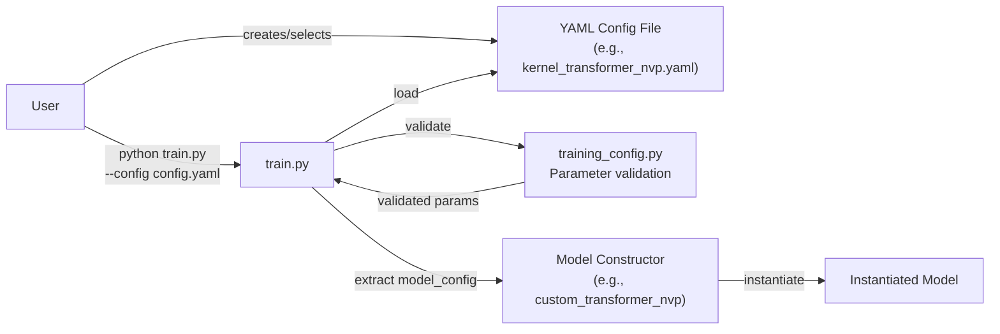
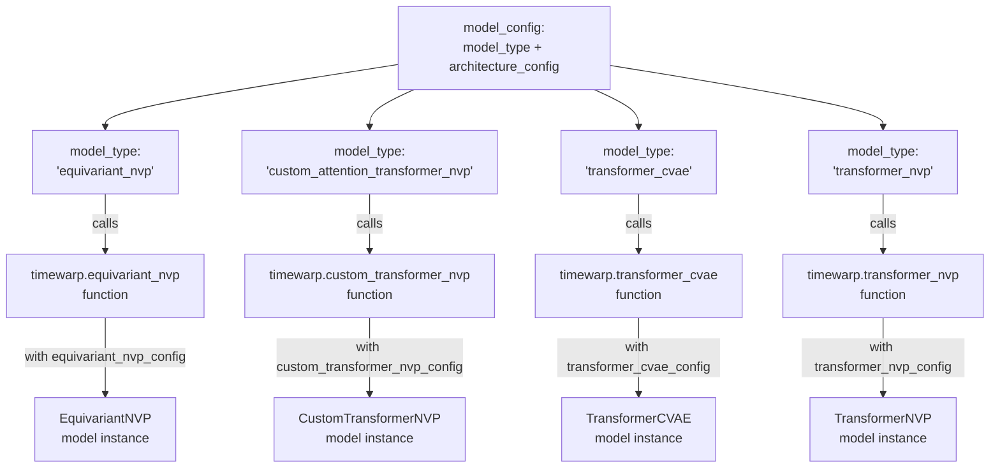

<!-- source: DeepWiki mcp.deepwiki.com · repo microsoft/timewarp · page 4.1 Configuration System · fetched 2026-10-26 -->

# Configuration System

<details>
<summary>Relevant source files</summary>

The following files were used as context for generating this wiki page:

- [configs/equivariant_nvp.yaml](configs/equivariant_nvp.yaml)
- [configs/kernel_transformer_nvp.yaml](configs/kernel_transformer_nvp.yaml)
- [configs/transformer_cvae.yaml](configs/transformer_cvae.yaml)

</details>


## Purpose and Scope

The Configuration System defines how model architectures and training hyperparameters are specified, validated, and used to instantiate models in the Timewarp codebase. Configuration files are written in YAML format and contain both training-level parameters (learning rate, batch size, etc.) and model-specific architectural parameters (number of layers, attention mechanisms, etc.).

This page covers the structure of configuration files and how they map to code entities. For details on specific model architectures, see [Transformer NVP Models](#4.2), [Equivariant NVP](#4.3), and [Transformer CVAE](#4.4). For information on how configurations are used during training, see [Training](#5).

## Configuration File Structure

Configuration files follow a two-tier structure: top-level training parameters applicable to all models, and a nested `model_config` section containing model-specific architectural parameters.

### Configuration File Hierarchy

```mermaid
graph TD
    YAML["YAML Configuration File"]
    
    TrainingParams["Training Parameters"]
    ModelConfig["model_config"]
    
    Seed["seed: Random seed"]
    Dataset["dataset: Dataset name"]
    StepWidth["step_width: Timesteps"]
    LR["learning_rate: Learning rate"]
    Warmup["warmup_steps: Warmup steps"]
    WD["weight_decay: Weight decay"]
    BS["batch_size: Batch size"]
    Epochs["num_epochs: Training epochs"]
    Patience["patience: Early stopping"]
    DataAug["data_augmentation: bool"]
    MeasEquiv["measure_equivariance_discrepancy: bool"]
    UseAML["use_aml_logging: bool"]
    UseLMDB["dataset_use_lmdb: bool (optional)"]
    
    ModelType["model_type: Architecture selector"]
    ArchConfig["Architecture-specific config"]
    
    YAML --> TrainingParams
    YAML --> ModelConfig
    
    TrainingParams --> Seed
    TrainingParams --> Dataset
    TrainingParams --> StepWidth
    TrainingParams --> LR
    TrainingParams --> Warmup
    TrainingParams --> WD
    TrainingParams --> BS
    TrainingParams --> Epochs
    TrainingParams --> Patience
    TrainingParams --> DataAug
    TrainingParams --> MeasEquiv
    TrainingParams --> UseAML
    TrainingParams --> UseLMDB
    
    ModelConfig --> ModelType
    ModelConfig --> ArchConfig
```



**Sources:** [configs/equivariant_nvp.yaml:1-19](), [configs/kernel_transformer_nvp.yaml:1-31](), [configs/transformer_cvae.yaml:1-28]()

### Top-Level Training Parameters

The following parameters control the training process and are applicable regardless of model architecture:

| Parameter | Type | Description | Example Values |
|-----------|------|-------------|----------------|
| `seed` | int | Random seed for reproducibility | `0` |
| `dataset` | str | Dataset identifier | `"AD-1"`, `"AD-2"`, `"ADP"` |
| `step_width` | int | Number of MD timesteps between consecutive frames | `1000` |
| `learning_rate` | float | Initial learning rate | `1e-4`, `1e-2` |
| `warmup_steps` | int | Learning rate warmup duration | `1000` |
| `weight_decay` | float | L2 regularization coefficient | `0.0` |
| `batch_size` | int | Batch size per GPU | `32` |
| `num_epochs` | int | Maximum training epochs | `1000` |
| `patience` | int | Early stopping patience (epochs) | `100` |
| `data_augmentation` | bool | Enable equivariance data augmentation | `true`, `false` |
| `measure_equivariance_discrepancy` | bool | Compute equivariance metrics during training | `false` |
| `use_aml_logging` | bool | Enable Azure ML logging | `false` |
| `dataset_use_lmdb` | bool | Use LMDB dataset implementation (optional) | `true` |

**Sources:** [configs/equivariant_nvp.yaml:1-12](), [configs/kernel_transformer_nvp.yaml:4-15](), [configs/transformer_cvae.yaml:1-13]()

### Model Configuration Section

The `model_config` section contains two required keys:

1. **`model_type`**: A string identifier that determines which model constructor to invoke
2. **Architecture-specific config**: A nested dictionary with parameters specific to the chosen model type

The architecture-specific config key name follows the pattern `{model_type}_config` (e.g., `equivariant_nvp_config`, `custom_transformer_nvp_config`, `transformer_cvae_config`).

**Sources:** [configs/equivariant_nvp.yaml:13-18](), [configs/kernel_transformer_nvp.yaml:16-30](), [configs/transformer_cvae.yaml:14-27]()

## Model Types and Their Configurations

### Model Type Mapping

The `model_type` string determines which model constructor is called during instantiation. The following table maps configuration strings to their corresponding architectures:

| `model_type` Value | Architecture | Config Key | Wiki Page |
|--------------------|--------------|------------|-----------|
| `equivariant_nvp` | Equivariant Normalizing Flow | `equivariant_nvp_config` | [4.3](#4.3) |
| `custom_attention_transformer_nvp` | Kernel/Local Attention Transformer NVP | `custom_transformer_nvp_config` | [4.2.2](#4.2.2), [4.2.3](#4.2.3) |
| `transformer_nvp` | Standard Transformer NVP | `transformer_nvp_config` | [4.2.1](#4.2.1) |
| `kernel_cheb_transformer_nvp` | Chebyshev Kernel Transformer NVP | `kernel_cheb_transformer_nvp_config` | [4.2.2](#4.2.2) |
| `transformer_cvae` | Transformer Conditional VAE | `transformer_cvae_config` | [4.4](#4.4) |
| `gaussian_density_transformer` | Gaussian Density Transformer | `gaussian_density_transformer_config` | [4.5](#4.5) |
| `gaussian_baseline` | Euler-Maruyama Gaussian Baseline | `gaussian_baseline_config` | [4.6](#4.6) |

### Equivariant NVP Configuration

Configuration schema for `equivariant_nvp`:

```yaml
model_config:
  model_type: equivariant_nvp
  equivariant_nvp_config:
    atom_embedding_dim: 32
    num_coupling_layers: 4
    latent_mlp_hidden_dims: [256, 256]
```

| Parameter | Type | Description |
|-----------|------|-------------|
| `atom_embedding_dim` | int | Dimensionality of atom embeddings |
| `num_coupling_layers` | int | Number of normalizing flow coupling layers |
| `latent_mlp_hidden_dims` | list[int] | Hidden layer dimensions for latent MLP |

**Sources:** [configs/equivariant_nvp.yaml:13-18]()

### Custom Transformer NVP Configuration

Configuration schema for kernel and local attention transformers (`custom_attention_transformer_nvp`):

```yaml
model_config:
  model_type: custom_attention_transformer_nvp
  custom_transformer_nvp_config:
    atom_embedding_dim: 32
    latent_mlp_hidden_dims: [256]
    num_coupling_layers: 8
    num_transformer_layers: 3
    encoder_layer_config:
      d_model: 128
      dim_feedforward: 2048
      num_heads: 6
      dropout: 0
      attention_type: kernel
      lengthscales: [0.1, 0.2, 0.5, 0.7, 1.0, 1.2]
      normalise_kernel_values: true
```

| Parameter | Type | Description |
|-----------|------|-------------|
| `atom_embedding_dim` | int | Dimensionality of atom embeddings |
| `latent_mlp_hidden_dims` | list[int] | Hidden layer dimensions for latent MLP |
| `num_coupling_layers` | int | Number of normalizing flow coupling layers |
| `num_transformer_layers` | int | Number of transformer encoder layers |

#### Encoder Layer Configuration

Nested under `encoder_layer_config`:

| Parameter | Type | Description | Applicable Attention Types |
|-----------|------|-------------|---------------------------|
| `d_model` | int | Model dimension | All |
| `dim_feedforward` | int | Feedforward network dimension | All |
| `num_heads` | int | Number of attention heads | All |
| `dropout` | float | Dropout probability | All |
| `attention_type` | str | Attention mechanism type | `"standard"`, `"kernel"`, `"local"` |
| `lengthscales` | list[float] | Kernel lengthscales | `"kernel"` only |
| `normalise_kernel_values` | bool | Normalize kernel attention values | `"kernel"` only |
| `max_radius` | float | Maximum attention radius | `"local"` only |

**Sources:** [configs/kernel_transformer_nvp.yaml:16-30]()

### Transformer CVAE Configuration

Configuration schema for `transformer_cvae`:

```yaml
model_config:
  model_type: transformer_cvae
  transformer_cvae_config:
    atom_embedding_dim: 32
    transformer_hidden_dim: 128
    latent_mlp_hidden_dims: [256]
    num_transformer_layers: 24
    latent_cvae_dim: 8
    num_elbo_samples: 1
    elbo_estimator: elbo
    transformer_config:
      n_head: 8
      dim_feedforward: 2048
      dropout: 0
```

| Parameter | Type | Description |
|-----------|------|-------------|
| `atom_embedding_dim` | int | Dimensionality of atom embeddings |
| `transformer_hidden_dim` | int | Transformer hidden dimension |
| `latent_mlp_hidden_dims` | list[int] | Hidden layer dimensions for latent MLP |
| `num_transformer_layers` | int | Number of transformer layers |
| `latent_cvae_dim` | int | Per-atom CVAE latent dimension |
| `num_elbo_samples` | int | Number of samples for ELBO estimation |
| `elbo_estimator` | str | ELBO estimator type (`"elbo"`, `"iwae"`) |

#### Transformer Configuration

Nested under `transformer_config`:

| Parameter | Type | Description |
|-----------|------|-------------|
| `n_head` | int | Number of attention heads |
| `dim_feedforward` | int | Feedforward network dimension |
| `dropout` | float | Dropout probability |

**Sources:** [configs/transformer_cvae.yaml:14-27]()

## Configuration Flow Through the System

### Configuration Loading and Validation Pipeline



**Sources:** [configs/kernel_transformer_nvp.yaml:1-31]()

### Model Type to Constructor Mapping



**Sources:** [configs/equivariant_nvp.yaml:14](), [configs/kernel_transformer_nvp.yaml:17](), [configs/transformer_cvae.yaml:15]()

## Configuration Validation

Configuration files are validated by the `training_config.py` module to ensure:

1. **Required parameters are present**: All mandatory training and model parameters are specified
2. **Type correctness**: Parameters have the correct data types (int, float, bool, list, etc.)
3. **Value constraints**: Parameters fall within valid ranges (e.g., positive learning rates)
4. **Model-specific schema compliance**: Architecture-specific configs match the expected schema for the given `model_type`

The validation process occurs before model instantiation to provide early error detection and clear error messages.

**Sources:** Based on system architecture diagrams showing `training_config.py` validation role

## Usage in Training and Evaluation

### Training Usage

Configuration files are passed to the training script:

```bash
python train.py --config configs/kernel_transformer_nvp.yaml
```

For multi-GPU training with DeepSpeed:

```bash
deepspeed --num_gpus=4 train.py --config configs/kernel_transformer_nvp.yaml
```

The training script loads the configuration, validates it, extracts training hyperparameters, and passes the `model_config` section to the appropriate model constructor.

### Evaluation Usage

Evaluation scripts load the model configuration from saved checkpoints rather than YAML files. The checkpoint contains both the model state dict and the original configuration used during training, ensuring consistency between training and evaluation.

**Sources:** Based on training workflow described in system architecture diagrams

## Example Configurations by Use Case

### Small Molecule (AD-1) with Kernel Attention

The configuration in [configs/kernel_transformer_nvp.yaml:1-31]() is optimized for the alanine-dipeptide dataset and achieves:
- Final train loss: -8.22
- Final validation loss: -6.56

Key settings:
- `batch_size: 32`
- `num_transformer_layers: 3`
- `attention_type: kernel` with 6 lengthscales
- `data_augmentation: true`

### Equivariant Model

The configuration in [configs/equivariant_nvp.yaml:1-19]() uses a purely equivariant architecture:
- `model_type: equivariant_nvp`
- `num_coupling_layers: 4`
- `data_augmentation: false` (redundant with equivariance)

### CVAE with Deep Transformer

The configuration in [configs/transformer_cvae.yaml:1-28]() uses a deeper transformer with a latent variable model:
- `num_transformer_layers: 24` (much deeper than NVP variants)
- `latent_cvae_dim: 8` per-atom latent dimension
- `learning_rate: 1e-2` (higher than NVP variants)
- `dataset_use_lmdb: true` for efficient data loading

## Configuration Best Practices

### Batch Size Scaling for Multi-GPU

When training with multiple GPUs, the effective batch size becomes `batch_size * num_gpus`. The configured `batch_size` is the per-GPU batch size. See [Multi-GPU Training with DeepSpeed](#5.3) for details on batch size scaling.

### Learning Rate Warmup

All example configurations use `warmup_steps: 1000`. Warmup gradually increases the learning rate from 0 to the configured `learning_rate` over the specified number of steps, which stabilizes training for transformer-based models.

### Data Augmentation and Equivariance

- Set `data_augmentation: true` for non-equivariant models to improve generalization through random rotations, translations, and permutations
- Set `data_augmentation: false` for equivariant models, as they already handle geometric symmetries
- Set `measure_equivariance_discrepancy: true` to monitor how well the model preserves equivariance properties (adds computational overhead)

**Sources:** [configs/equivariant_nvp.yaml:10-11](), [configs/kernel_transformer_nvp.yaml:13-14](), [configs/transformer_cvae.yaml:11-12]()

---

