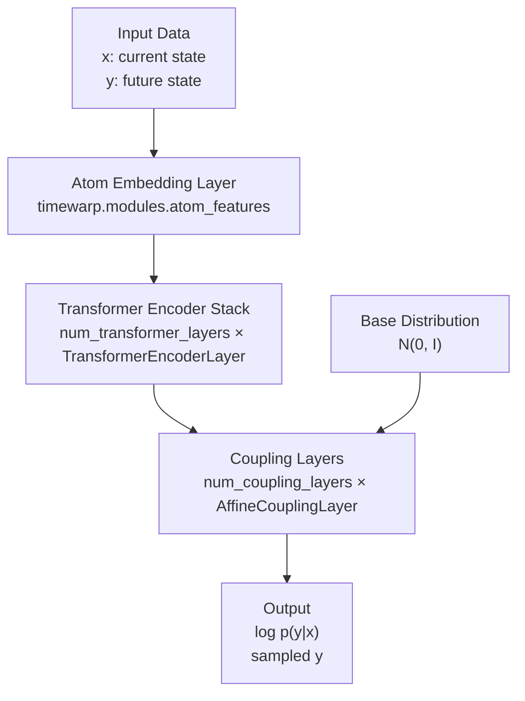
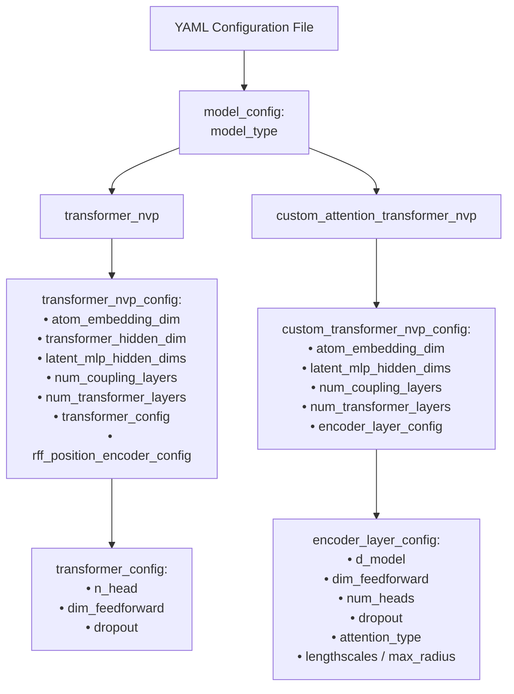
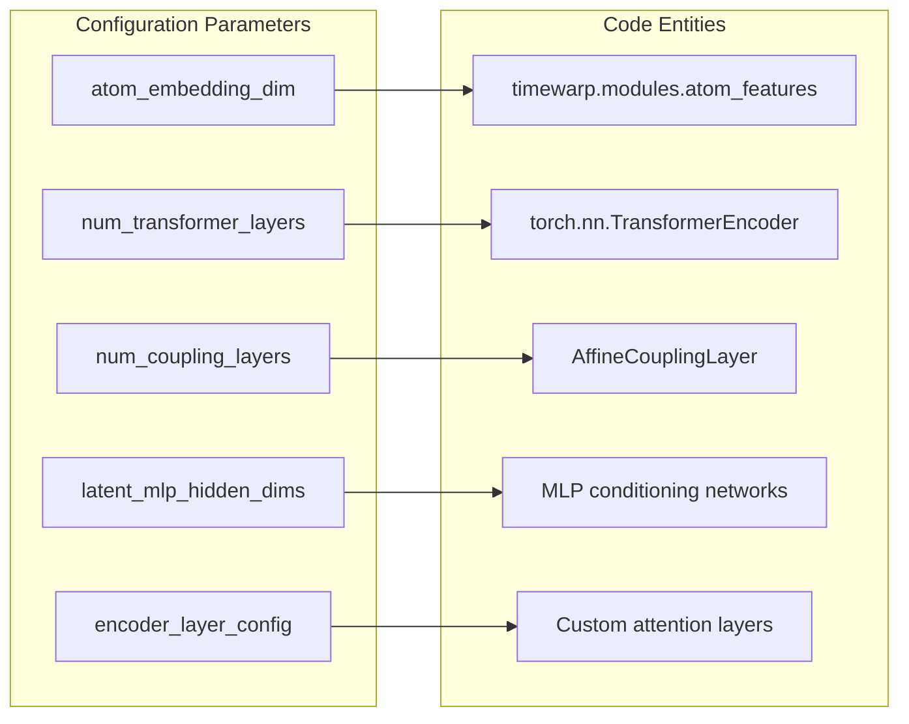
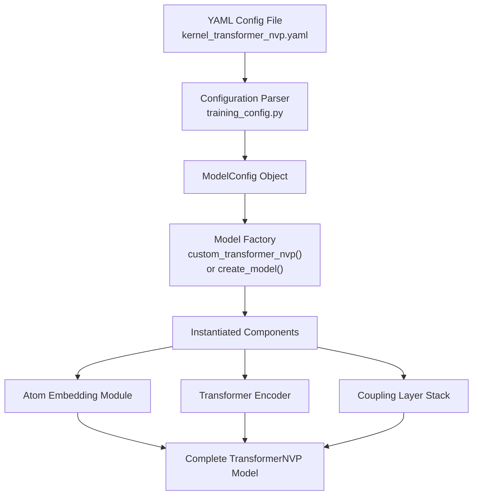
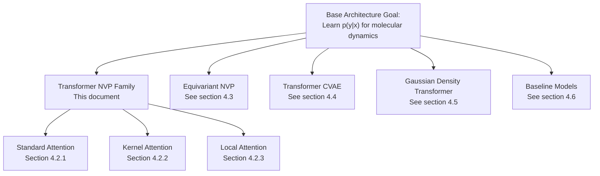

<!-- source: DeepWiki mcp.deepwiki.com · repo microsoft/timewarp · page 4.2 Transformer NVP Models · fetched 2026-10-26 -->

# Transformer NVP Models

<details>
<summary>Relevant source files</summary>

The following files were used as context for generating this wiki page:

- [configs/kernel_transformer_nvp.yaml](configs/kernel_transformer_nvp.yaml)
- [configs/local_transformer_nvp.yaml](configs/local_transformer_nvp.yaml)
- [configs/transformer_nvp.yaml](configs/transformer_nvp.yaml)
- [configs/transformer_nvp_posenc.yaml](configs/transformer_nvp_posenc.yaml)

</details>


## Purpose and Scope

This document provides comprehensive coverage of the Transformer NVP (Non-Volume Preserving) model family, which represents the core architecture family in Timewarp for learning conditional density models p(y|x) of molecular dynamics. Transformer NVP models combine transformer encoders with normalizing flow coupling layers to model the distribution of future molecular states given current states.

This page covers the shared architecture, common components, and configuration structure across all Transformer NVP variants. For details on specific attention mechanisms, see:
- Standard attention implementation: [4.2.1](#4.2.1)
- Kernel and Chebyshev attention variants: [4.2.2](#4.2.2)
- Local attention with spatial neighborhoods: [4.2.3](#4.2.3)
- Positional encoding options: [4.2.4](#4.2.4)

For alternative architectures, see [Equivariant NVP](#4.3), [Transformer CVAE](#4.4), and [Baseline Models](#4.6).

## Architecture Overview

Transformer NVP models use a two-stage architecture: (1) a transformer encoder processes the conditioning data x to produce contextual embeddings, and (2) a series of coupling layers implements the normalizing flow that transforms a base distribution into the conditional distribution p(y|x).

### High-Level Architecture Flow



**Key Architecture Stages:**

| Stage | Component | Purpose | Configuration |
|-------|-----------|---------|---------------|
| **Input Processing** | Atom embeddings | Convert atomic features to learned vectors | `atom_embedding_dim` |
| **Context Encoding** | Transformer layers | Build relational representations | `num_transformer_layers` |
| **Density Modeling** | Coupling layers | Transform base distribution to p(y\|x) | `num_coupling_layers` |
| **Latent Conditioning** | MLP networks | Map context to coupling parameters | `latent_mlp_hidden_dims` |

Sources: [configs/transformer_nvp.yaml:14-26](), [configs/kernel_transformer_nvp.yaml:16-30]()

## Model Type Identifiers

Transformer NVP models are instantiated using two primary `model_type` identifiers in configuration files:

| Model Type | Configuration Section | Use Case |
|------------|----------------------|----------|
| `transformer_nvp` | `transformer_nvp_config` | Standard attention with optional RFF positional encoding |
| `custom_attention_transformer_nvp` | `custom_transformer_nvp_config` | Kernel or local attention variants |

### Configuration Structure Mapping



Sources: [configs/transformer_nvp.yaml:14-26](), [configs/kernel_transformer_nvp.yaml:16-30](), [configs/local_transformer_nvp.yaml:13-26]()

## Common Components

All Transformer NVP variants share the following architectural components:

### Atom Embedding Layer

The atom embedding layer converts raw atomic features (atom types, masses, etc.) into learned dense vectors. This layer is implemented in the `timewarp.modules.atom_features` module.

**Configuration Parameters:**
- `atom_embedding_dim`: Dimensionality of atom embeddings (typically 16-32)

### Transformer Encoder Stack

The transformer encoder processes the embedded atoms to build contextual representations. The number of layers and hidden dimensions control the model's representational capacity.

**Configuration Parameters:**
- `num_transformer_layers`: Number of sequential transformer layers (typically 3-24)
- `d_model` or `transformer_hidden_dim`: Hidden dimension of transformer (typically 128)
- `dim_feedforward`: Feedforward network dimension (typically 2048)
- `num_heads` or `n_head`: Number of attention heads (typically 6-8)
- `dropout`: Dropout probability (typically 0)

### Coupling Layers

Coupling layers implement the normalizing flow transformation. Each layer splits the target variables and applies affine transformations conditioned on the context.

**Configuration Parameters:**
- `num_coupling_layers`: Number of coupling layers in the flow (typically 8)
- `latent_mlp_hidden_dims`: Hidden dimensions of conditioning MLPs (typically [256])

### Architecture Component Mapping to Code



Sources: [configs/transformer_nvp.yaml:17-21](), [configs/kernel_transformer_nvp.yaml:19-22]()

## Attention Mechanism Variants

The primary differentiator among Transformer NVP models is the attention mechanism used in the transformer encoder. Three variants are supported:

### Standard Attention

Uses PyTorch's native multi-head attention with dot-product similarity.

**Configuration:**
```yaml
model_type: transformer_nvp
transformer_nvp_config:
  transformer_config:
    n_head: 8
    dim_feedforward: 2048
    dropout: 0
```

**Performance:** Achieves validation NLL of -6.25 on AD-1 dataset.

Sources: [configs/transformer_nvp.yaml:22-25]()

### Kernel Attention

Replaces dot-product attention with kernel-based attention using multiple lengthscales. This allows the model to capture multi-scale interactions.

**Configuration:**
```yaml
model_type: custom_attention_transformer_nvp
custom_transformer_nvp_config:
  encoder_layer_config:
    attention_type: kernel
    lengthscales: [0.1, 0.2, 0.5, 0.7, 1.0, 1.2]
    normalise_kernel_values: true
```

**Performance:** Achieves validation NLL of -6.56 on AD-1 dataset (best performance).

Sources: [configs/kernel_transformer_nvp.yaml:23-30]()

### Local Attention

Restricts attention to spatial neighborhoods defined by a radius threshold. This reduces computational cost and enforces locality bias.

**Configuration:**
```yaml
model_type: custom_attention_transformer_nvp
custom_transformer_nvp_config:
  encoder_layer_config:
    attention_type: local
    max_radius: 0.2
```

Sources: [configs/local_transformer_nvp.yaml:20-26]()

## Positional Encoding

Transformer NVP models support optional Random Fourier Feature (RFF) positional encoding to incorporate spatial information into the transformer.

**Configuration:**
```yaml
model_type: transformer_nvp
transformer_nvp_config:
  rff_position_encoder_config:
    encoding_dim: 128
    scale_mean: 1.0
    scale_stddev: 1.0
```

**Performance:** With positional encoding, achieves validation NLL of -6.9 on AD-1 dataset.

Sources: [configs/transformer_nvp_posenc.yaml:26-29]()

## Configuration Parameter Reference

### Complete Parameter Table

| Parameter | Location | Type | Default | Description |
|-----------|----------|------|---------|-------------|
| `model_type` | `model_config` | string | required | `transformer_nvp` or `custom_attention_transformer_nvp` |
| `atom_embedding_dim` | `*_nvp_config` | int | 16-32 | Dimension of atom embedding vectors |
| `transformer_hidden_dim` | `transformer_nvp_config` | int | 128 | Hidden dimension for standard transformer |
| `d_model` | `encoder_layer_config` | int | 128 | Hidden dimension for custom transformer |
| `num_transformer_layers` | `*_nvp_config` | int | 3 | Number of transformer encoder layers |
| `num_coupling_layers` | `*_nvp_config` | int | 8 | Number of normalizing flow coupling layers |
| `latent_mlp_hidden_dims` | `*_nvp_config` | list[int] | [256] | Hidden dimensions for coupling MLPs |
| `n_head` / `num_heads` | `transformer_config` / `encoder_layer_config` | int | 6-8 | Number of attention heads |
| `dim_feedforward` | `transformer_config` / `encoder_layer_config` | int | 2048 | Feedforward network dimension |
| `dropout` | `transformer_config` / `encoder_layer_config` | float | 0 | Dropout probability |
| `attention_type` | `encoder_layer_config` | string | N/A | `kernel` or `local` for custom attention |
| `lengthscales` | `encoder_layer_config` | list[float] | N/A | Lengthscales for kernel attention |
| `normalise_kernel_values` | `encoder_layer_config` | bool | true | Whether to normalize kernel attention weights |
| `max_radius` | `encoder_layer_config` | float | N/A | Radius threshold for local attention |
| `encoding_dim` | `rff_position_encoder_config` | int | 128 | RFF encoding dimension |
| `scale_mean` | `rff_position_encoder_config` | float | 1.0 | Mean of RFF scale distribution |
| `scale_stddev` | `rff_position_encoder_config` | float | 1.0 | Std dev of RFF scale distribution |

Sources: [configs/transformer_nvp.yaml:16-30](), [configs/kernel_transformer_nvp.yaml:18-30](), [configs/local_transformer_nvp.yaml:15-26](), [configs/transformer_nvp_posenc.yaml:16-29]()

## Model Instantiation Flow

The following diagram shows how configuration parameters flow from YAML files to instantiated model objects:



**Instantiation Steps:**
1. Configuration file is parsed and validated by `training_config.py`
2. Model factory function (`custom_transformer_nvp()` or similar) is called
3. Atom embedding layer is created with `atom_embedding_dim`
4. Transformer encoder is created with specified layers and attention type
5. Coupling layers are created and stacked
6. All components are assembled into the complete model

Sources: [configs/transformer_nvp.yaml](), [configs/kernel_transformer_nvp.yaml](), [configs/local_transformer_nvp.yaml]()

## Performance Comparison

The following table summarizes validation performance of different Transformer NVP variants on the AD-1 (Alanine Dipeptide) dataset:

| Variant | Attention Type | Validation NLL | Key Configuration |
|---------|----------------|----------------|-------------------|
| Standard Transformer NVP | Dot-product | -6.25 | 8 heads, no positional encoding |
| Transformer NVP + Positional Encoding | Dot-product + RFF | -6.9 | 8 heads, RFF encoding_dim=128 |
| Kernel Transformer NVP | Kernel | -6.56 | 6 heads, 6 lengthscales |
| Local Transformer NVP | Local | Not specified | 8 heads, max_radius=0.2 |

**Note:** Lower (more negative) NLL values indicate better model performance. The Kernel Transformer NVP achieves the best reported performance with a final validation loss of -6.56.

Sources: [configs/transformer_nvp.yaml:1](), [configs/transformer_nvp_posenc.yaml:1](), [configs/kernel_transformer_nvp.yaml:1-3]()

## Training Hyperparameters

All provided Transformer NVP configurations use consistent training hyperparameters:

| Parameter | Value | Description |
|-----------|-------|-------------|
| `learning_rate` | 1e-4 | Adam optimizer learning rate |
| `warmup_steps` | 1000 | Linear warmup steps |
| `weight_decay` | 0.0 | L2 regularization coefficient |
| `batch_size` | 32 | Training batch size |
| `num_epochs` | 1000 | Maximum training epochs |
| `patience` | 100 | Early stopping patience |
| `data_augmentation` | true | Apply geometric augmentations |
| `step_width` | 1000 | Temporal coarsening factor |

Sources: [configs/transformer_nvp.yaml:3-13](), [configs/kernel_transformer_nvp.yaml:4-13](), [configs/local_transformer_nvp.yaml:1-12]()

## Configuration File Examples

### Standard Transformer NVP
Located at [configs/transformer_nvp.yaml]()

### Kernel Attention Variant
Located at [configs/kernel_transformer_nvp.yaml]()

### Local Attention Variant
Located at [configs/local_transformer_nvp.yaml]()

### Positional Encoding Variant
Located at [configs/transformer_nvp_posenc.yaml]()

## Relationship to Other Architectures

Transformer NVP models are one architecture family within the broader Timewarp ecosystem:



**Key Distinctions:**
- **Transformer NVP**: Uses normalizing flows with transformer encoders
- **Equivariant NVP**: Adds geometric equivariance constraints
- **Transformer CVAE**: Uses variational autoencoder instead of normalizing flows
- **Gaussian Density Transformer**: Predicts Gaussian parameters directly
- **Baseline**: Simpler models like Euler-Maruyama

Sources: [configs/transformer_nvp.yaml:15](), [configs/kernel_transformer_nvp.yaml:17]()

---

