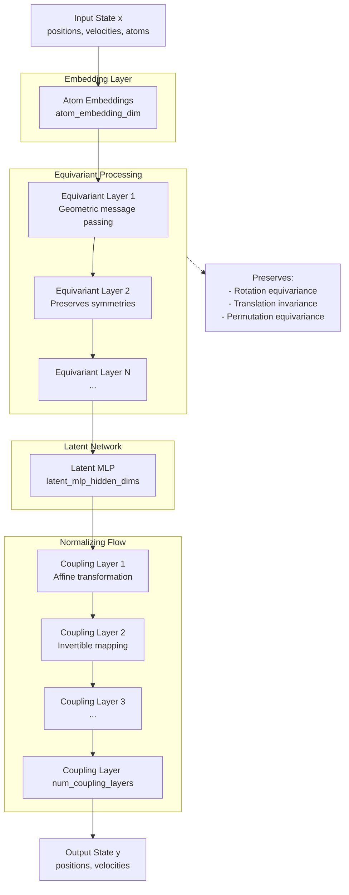
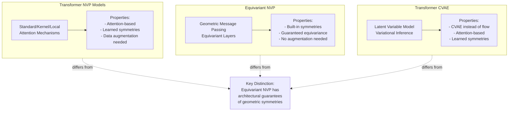

<!-- source: DeepWiki mcp.deepwiki.com · repo microsoft/timewarp · page 4.3 Equivariant NVP · fetched 2026-10-26 -->

# Equivariant NVP

<details>
<summary>Relevant source files</summary>

The following files were used as context for generating this wiki page:

- [configs/equivariant_nvp.yaml](configs/equivariant_nvp.yaml)

</details>


## Purpose and Scope

This document describes the **Equivariant NVP** model architecture, a normalizing flow-based conditional density model that preserves geometric symmetries (rotations, translations, and permutations) of molecular systems. This model is specifically designed to respect the physical invariances inherent in molecular dynamics by using equivariant neural network layers rather than standard attention mechanisms.

For information about geometric transformations and data augmentation, see [Equivariance System](#6). For other normalizing flow variants using transformer architectures, see [Transformer NVP Models](#4.2). For details on training this model, see [Training](#5).

---

## Architecture Overview

The Equivariant NVP model implements a conditional normalizing flow p(y|x) where both input coordinates x and output coordinates y maintain equivariance properties under rotation, translation, and permutation of atoms. Unlike transformer-based variants that use attention mechanisms, this architecture employs specialized equivariant layers that operate on geometric features.

### High-Level Architecture Flow



**Sources:** [configs/equivariant_nvp.yaml:13-18]()

---

## Configuration Parameters

The Equivariant NVP model is configured through the `equivariant_nvp_config` section of the model configuration YAML file.

### Configuration Schema

| Parameter | Type | Description | Default Value |
|-----------|------|-------------|---------------|
| `atom_embedding_dim` | int | Dimensionality of atom embeddings | 32 |
| `num_coupling_layers` | int | Number of coupling layers in the normalizing flow | 4 |
| `latent_mlp_hidden_dims` | list[int] | Hidden layer dimensions for latent MLP | [256, 256] |

### Example Configuration

```yaml
model_config:
  model_type: equivariant_nvp
  equivariant_nvp_config:
    atom_embedding_dim: 32
    num_coupling_layers: 4
    latent_mlp_hidden_dims: [256, 256]
```

**Sources:** [configs/equivariant_nvp.yaml:13-18]()

---

## Model Components

The Equivariant NVP architecture consists of three primary components that work together to produce an equivariant conditional density model.

### Component Architecture

```mermaid
graph LR
    subgraph Input["Input Processing"]
        Pos["positions<br/>Shape: [B, N, 3]"]
        Vel["velocities<br/>Shape: [B, N, 3]"]
        Atoms["atoms<br/>Shape: [B, N]"]
    end
    
    subgraph Embedding["AtomEmbedding"]
        EmbedTable["Embedding Table<br/>atom_embedding_dim"]
        EmbedOut["Embedded Atoms<br/>Shape: [B, N, D]"]
    end
    
    subgraph EquivariantNet["Equivariant Network"]
        GeomFeats["Geometric Features<br/>Distances, angles"]
        MessagePass["Message Passing<br/>Preserves equivariance"]
        NodeFeats["Node Features<br/>Shape: [B, N, D]"]
    end
    
    subgraph LatentMLP["Latent MLP"]
        Hidden1["Linear + ReLU<br/>latent_mlp_hidden_dims[0]"]
        Hidden2["Linear + ReLU<br/>latent_mlp_hidden_dims[1]"]
        LatentOut["Latent Representation"]
    end
    
    subgraph NormFlow["Normalizing Flow"]
        CouplingSeq["Coupling Layer Sequence<br/>num_coupling_layers"]
        Affine["Affine Transformations<br/>Scale + Shift"]
        InvTransform["Invertible Transform"]
    end
    
    subgraph Output["Output"]
        OutPos["Output Positions y<br/>Shape: [B, N, 3]"]
        OutVel["Output Velocities y<br/>Shape: [B, N, 3]"]
    end
    
    Atoms --> EmbedTable
    EmbedTable --> EmbedOut
    
    Pos --> GeomFeats
    EmbedOut --> MessagePass
    GeomFeats --> MessagePass
    MessagePass --> NodeFeats
    
    NodeFeats --> Hidden1
    Hidden1 --> Hidden2
    Hidden2 --> LatentOut
    
    LatentOut --> CouplingSeq
    CouplingSeq --> Affine
    Affine --> InvTransform
    
    InvTransform --> OutPos
    InvTransform --> OutVel
```



**Sources:** [configs/equivariant_nvp.yaml:13-18]()

### 1. Atom Embedding Layer

The atom embedding layer maps discrete atom types to continuous vector representations of dimension `atom_embedding_dim`. This provides the initial features for downstream equivariant processing.

**Configuration:** `atom_embedding_dim: 32`

### 2. Equivariant Network Layers

Equivariant layers perform geometric message passing that respects the symmetries of the molecular system. These layers:
- Process node features (atom embeddings) and geometric information (positions, distances)
- Maintain equivariance to rotations and permutations
- Maintain invariance to translations
- Use geometric features (distances, angles) that are inherently symmetric

### 3. Latent MLP

The latent MLP processes the equivariant features to produce the conditioning information for the coupling layers. It consists of:
- Multiple hidden layers with ReLU activations
- Configurable hidden dimensions via `latent_mlp_hidden_dims`
- Standard fully-connected architecture

**Configuration:** `latent_mlp_hidden_dims: [256, 256]` creates a 2-layer MLP with 256 hidden units each

### 4. Coupling Layers

The normalizing flow uses `num_coupling_layers` coupling layers to transform a base distribution (typically Gaussian) into the target conditional distribution p(y|x). Each coupling layer:
- Performs an affine transformation (scale and shift)
- Is invertible, allowing both sampling and density evaluation
- Splits coordinates and applies transformations conditioned on latent features

**Configuration:** `num_coupling_layers: 4`

---

## Equivariance Properties

The Equivariant NVP model preserves three fundamental geometric symmetries of molecular systems:

### Symmetry Properties

| Symmetry | Type | Description | Mathematical Property |
|----------|------|-------------|----------------------|
| **Rotation** | Equivariant | Output rotates with input | f(Rx) = Rf(x) |
| **Translation** | Invariant | Output unchanged by translation | f(x + t) = f(x) |
| **Permutation** | Equivariant | Output permutes with input atoms | f(Px) = Pf(x) |

### Property Verification

The configuration includes an option to measure equivariance discrepancy during training:

```yaml
measure_equivariance_discrepancy: false
```

When enabled, this flag activates checks that verify the model maintains these symmetry properties throughout training.

**Sources:** [configs/equivariant_nvp.yaml:11]()

---

## Comparison with Other Model Architectures

The Equivariant NVP differs from other Timewarp model variants in its approach to preserving geometric symmetries.

### Architecture Comparison



### Key Differences

| Aspect | Transformer NVP Models | Equivariant NVP | Transformer CVAE |
|--------|----------------------|-----------------|------------------|
| **Core Architecture** | Self-attention layers | Equivariant message passing | Variational encoder-decoder |
| **Symmetry Handling** | Learned via data augmentation | Built-in architectural guarantee | Learned via data augmentation |
| **Data Augmentation** | Required (`data_augmentation: true`) | Optional (`data_augmentation: false`) | Required |
| **Attention Mechanism** | Standard/Kernel/Local variants | No attention (geometric) | Standard attention |
| **Equivariance Guarantee** | Approximate (depends on training) | Exact (by construction) | Approximate (depends on training) |
| **Computational Focus** | Pairwise attention | Local geometric features | Latent space encoding |

**Sources:** [configs/equivariant_nvp.yaml:10]()

---

## Data Augmentation

Unlike transformer-based models that typically require geometric data augmentation to learn equivariance properties, the Equivariant NVP model has these properties built into its architecture. Therefore, data augmentation can be disabled:

```yaml
data_augmentation: false
```

However, augmentation can still be enabled if desired for additional regularization. When enabled, the model would receive randomly rotated and translated versions of molecular configurations during training, though this is redundant given the architectural guarantees.

**Sources:** [configs/equivariant_nvp.yaml:10]()

---

## Training Configuration

The Equivariant NVP model uses standard training hyperparameters consistent with other Timewarp models:

| Parameter | Value | Description |
|-----------|-------|-------------|
| `learning_rate` | 1e-4 | Adam optimizer learning rate |
| `warmup_steps` | 1000 | Learning rate warmup period |
| `weight_decay` | 0.0 | L2 regularization (disabled) |
| `batch_size` | 32 | Training batch size per GPU |
| `num_epochs` | 1000 | Maximum training epochs |
| `patience` | 100 | Early stopping patience |

For detailed information on training procedures, including multi-GPU training with DeepSpeed, see [Training](#5).

**Sources:** [configs/equivariant_nvp.yaml:4-9]()

---

## Use Cases and Applications

The Equivariant NVP model is particularly well-suited for:

1. **Systems requiring strict symmetry preservation**: When exact geometric invariances are critical for physical validity
2. **Small to medium-sized molecules**: Where geometric message passing scales efficiently
3. **Research on architectural inductive biases**: Comparing learned vs. built-in symmetries
4. **Systems with limited training data**: Architectural priors reduce sample complexity

For larger molecular systems where computational efficiency is paramount, transformer-based variants may be more appropriate. See [Transformer NVP Models](#4.2) for alternatives.

---

## Model Instantiation

The Equivariant NVP model is instantiated through the model factory system using the configuration:

```yaml
model_config:
  model_type: equivariant_nvp
  equivariant_nvp_config:
    # configuration parameters
```

The model constructor reads this configuration and builds the appropriate equivariant layers, embedding layers, latent MLP, and coupling layers according to the specified parameters.

**Sources:** [configs/equivariant_nvp.yaml:13-18]()

---

