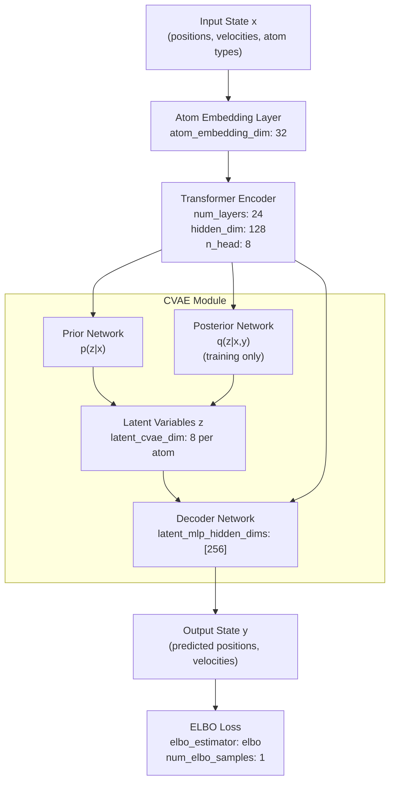
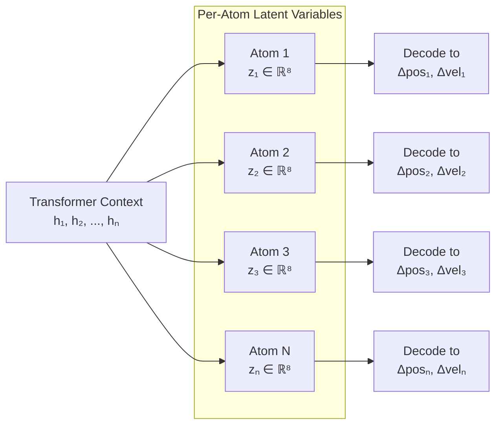
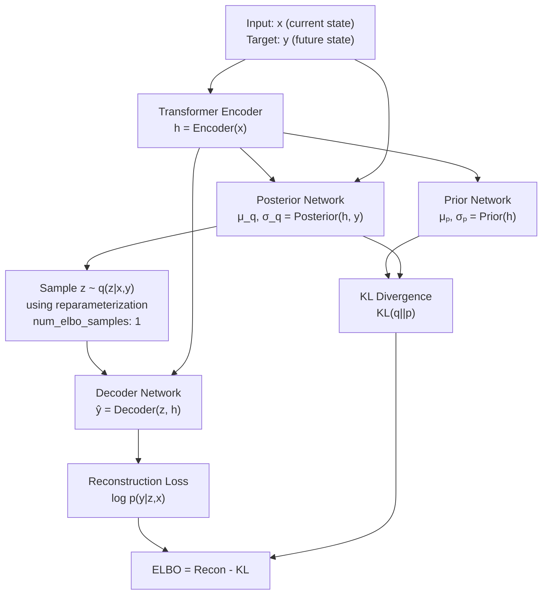
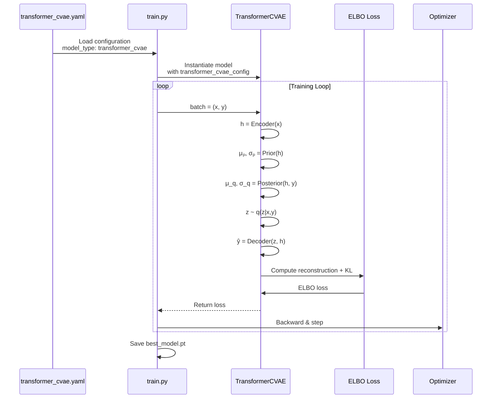

<!-- source: DeepWiki mcp.deepwiki.com · repo microsoft/timewarp · page 4.4 Transformer CVAE · fetched 2026-10-26 -->

# Transformer CVAE

<details>
<summary>Relevant source files</summary>

The following files were used as context for generating this wiki page:

- [configs/transformer_cvae.yaml](configs/transformer_cvae.yaml)

</details>


## Purpose and Scope

This document describes the Transformer CVAE (Conditional Variational Autoencoder) model architecture, an alternative to normalizing flow-based models for learning conditional molecular dynamics distributions. The Transformer CVAE uses a transformer encoder with a latent variable model to learn p(y|x), where x represents the current molecular state and y represents the future state.

For other model architectures in the system, see [Model Architectures](#4). For transformer-based normalizing flow variants, see [Transformer NVP Models](#4.2). For training procedures, see [Training](#5).

---

## Overview

The Transformer CVAE is one of seven model variants available in Timewarp. Unlike the NVP (Real-NVP normalizing flow) models described in [Transformer NVP Models](#4.2), the CVAE architecture uses a **latent variable model** with variational inference rather than invertible coupling layers. This approach provides an alternative method for learning the conditional distribution of future molecular states.

**Key distinguishing features:**
- Uses variational inference with ELBO (Evidence Lower Bound) objective
- Employs a per-atom latent space representation
- Leverages transformer architecture for encoding molecular context
- Generates samples by decoding from latent space rather than through flow transformations

**Model Type Identifier:** `transformer_cvae`

Sources: [configs/transformer_cvae.yaml:15]()

---

## Architecture Components

The Transformer CVAE consists of three primary components: the transformer encoder, the latent space module, and the decoder network.

### High-Level Architecture Diagram



Sources: [configs/transformer_cvae.yaml:14-27]()

---

## Configuration Parameters

The Transformer CVAE model is configured through the `transformer_cvae_config` section in YAML configuration files. Below are the key parameters:

| Parameter | Type | Example Value | Description |
|-----------|------|---------------|-------------|
| `atom_embedding_dim` | int | 32 | Dimensionality of atom embeddings |
| `transformer_hidden_dim` | int | 128 | Hidden dimension of transformer layers |
| `num_transformer_layers` | int | 24 | Number of transformer encoder layers |
| `latent_cvae_dim` | int | 8 | Latent dimension per atom in CVAE |
| `latent_mlp_hidden_dims` | list[int] | [256] | Hidden dimensions for decoder MLP |
| `num_elbo_samples` | int | 1 | Number of samples for ELBO estimation |
| `elbo_estimator` | str | "elbo" | Type of ELBO estimator to use |
| `transformer_config.n_head` | int | 8 | Number of attention heads |
| `transformer_config.dim_feedforward` | int | 2048 | Feedforward network dimension |
| `transformer_config.dropout` | float | 0.0 | Dropout rate in transformer |

### Standard Configuration Example

```yaml
model_config:
  model_type: transformer_cvae
  transformer_cvae_config:
    atom_embedding_dim: 32
    transformer_hidden_dim: 128
    latent_mlp_hidden_dims: [256]
    num_transformer_layers: 24
    latent_cvae_dim: 8
    num_elbo_samples: 1
    elbo_estimator: elbo
    transformer_config:
      n_head: 8
      dim_feedforward: 2048
      dropout: 0
```

Sources: [configs/transformer_cvae.yaml:14-27]()

---

## Latent Variable Model

The CVAE architecture uses a per-atom latent variable representation, allowing the model to capture local uncertainty and variability in atomic motion.

### Latent Space Structure



**Key characteristics:**
- Each atom has an independent latent variable **z ∈ ℝ^8** (when `latent_cvae_dim=8`)
- For a molecule with N atoms, the total latent space dimension is **N × 8**
- The latent variables are sampled from distributions conditioned on transformer-encoded context
- During training, both prior **p(z|x)** and posterior **q(z|x,y)** are learned
- During inference, samples are drawn from the prior **p(z|x)** only

Sources: [configs/transformer_cvae.yaml:21]()

---

## ELBO Training Objective

The Transformer CVAE is trained using the Evidence Lower Bound (ELBO) objective, which balances reconstruction accuracy with regularization of the latent space.

### ELBO Decomposition

The ELBO objective for the conditional CVAE can be written as:

```
ELBO = 𝔼[log p(y|z,x)] - KL(q(z|x,y) || p(z|x))
       \_____________/   \____________________/
       Reconstruction    Latent Regularization
           Term                  Term
```

Where:
- **Reconstruction term**: Expected log-likelihood of predicting y given latent z and context x
- **KL term**: Kullback-Leibler divergence between posterior and prior, ensuring the posterior doesn't deviate too far from the prior
- **p(z|x)**: Prior network that predicts latent distribution from context only
- **q(z|x,y)**: Posterior network that has access to both context and target (used only during training)

### ELBO Estimation Flow



**Configuration parameters:**
- `num_elbo_samples`: Number of latent samples to draw for ELBO estimation (typically 1)
- `elbo_estimator`: Type of ELBO estimator (set to "elbo" for standard estimation)

Sources: [configs/transformer_cvae.yaml:22-23]()

---

## Comparison with NVP Models

The Transformer CVAE differs fundamentally from the normalizing flow-based NVP models in how they parameterize and sample from the conditional distribution p(y|x).

| Aspect | Transformer NVP | Transformer CVAE |
|--------|----------------|------------------|
| **Generative Model** | Normalizing flows with coupling layers | Conditional VAE with latent variables |
| **Invertibility** | Requires exact invertibility | No invertibility requirement |
| **Exact Likelihood** | Computes exact log-likelihood | Uses ELBO lower bound on likelihood |
| **Latent Space** | Maps through bijective transformations | Explicit probabilistic latent variables |
| **Training Objective** | Negative log-likelihood (NLL) | Evidence Lower Bound (ELBO) |
| **Sampling** | Deterministic transformation from base | Stochastic sampling from latent space |
| **Expressiveness** | Limited by coupling layer design | More flexible decoder architecture |
| **Memory** | Must store forward/backward passes | Only needs forward pass |

Sources: [configs/transformer_cvae.yaml:15]()

---

## Integration with Training System

The Transformer CVAE integrates into the standard Timewarp training pipeline like other model architectures.

### Training Flow Diagram



**Training hyperparameters** (from example configuration):
- `learning_rate`: 1.0e-2
- `warmup_steps`: 1000
- `weight_decay`: 0.0
- `batch_size`: 32
- `num_epochs`: 1000
- `patience`: 100 (early stopping)

Sources: [configs/transformer_cvae.yaml:1-27]()

---

## Usage Example

To train a Transformer CVAE model, use the standard training command with the appropriate configuration file:

```bash
# Single GPU training
python train.py configs/transformer_cvae.yaml

# Multi-GPU training with DeepSpeed
deepspeed --num_gpus=4 train.py configs/transformer_cvae.yaml
```

**Key configuration choices:**
1. **latent_cvae_dim**: Controls the expressiveness of the per-atom latent space. Larger values (e.g., 16) allow more complex behavior but increase computational cost.
2. **num_transformer_layers**: Deeper transformers (e.g., 24) capture longer-range dependencies but require more memory.
3. **num_elbo_samples**: Multiple samples (e.g., 5) provide better gradient estimates but increase training time.

For evaluation and sampling procedures that work with Transformer CVAE models, see [Evaluation and Analysis](#7).

Sources: [configs/transformer_cvae.yaml:1-28]()

---

## Data Augmentation and Equivariance

The Transformer CVAE, like other models in Timewarp, supports data augmentation through geometric transformations.

**Configuration:**
- `data_augmentation: true` - Applies random rotations, translations, and permutations during training
- `measure_equivariance_discrepancy: false` - Option to measure how well the model preserves equivariance properties

**Note:** The Transformer CVAE architecture is not inherently equivariant. Unlike the equivariant NVP model (see [Equivariant NVP](#4.3)), the CVAE must learn equivariance properties from data augmentation rather than having them built into the architecture.

Sources: [configs/transformer_cvae.yaml:11-12]()

---

