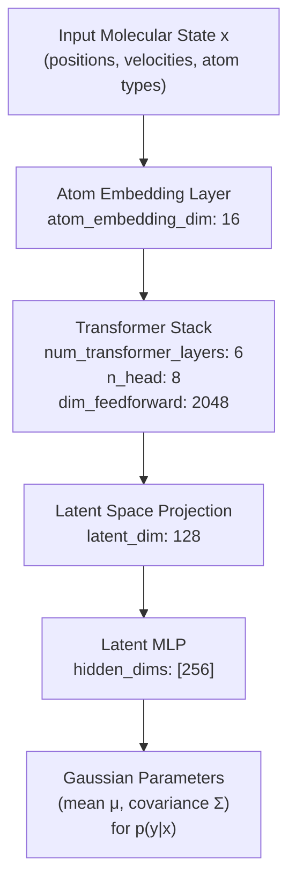
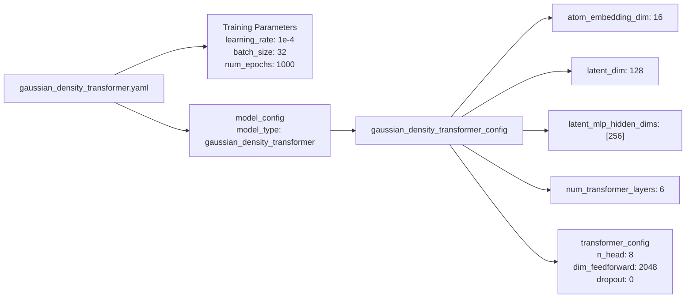
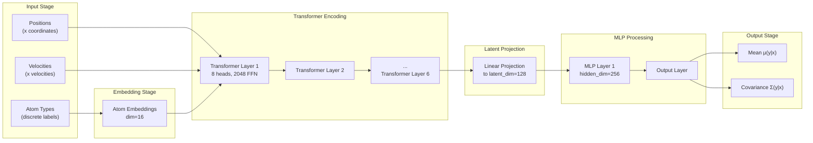
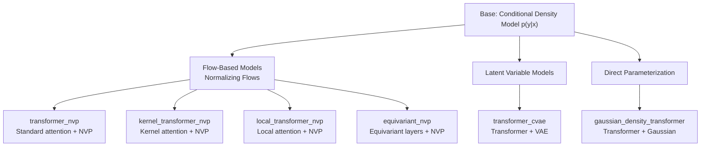

<!-- source: DeepWiki mcp.deepwiki.com · repo microsoft/timewarp · page 4.5 Gaussian Density Transformer · fetched 2026-10-26 -->

# Gaussian Density Transformer

<details>
<summary>Relevant source files</summary>

The following files were used as context for generating this wiki page:

- [configs/gaussian_density_transformer.yaml](configs/gaussian_density_transformer.yaml)

</details>


## Purpose and Scope

The Gaussian Density Transformer is a conditional density model architecture that learns to predict future molecular states by modeling the conditional distribution p(y|x) as a Gaussian distribution parameterized by a transformer network. This model provides an alternative approach to the normalizing flow-based models (see [Transformer NVP Models](#4.2)) and the variational autoencoder approach (see [Transformer CVAE](#4.4)).

This page documents the architecture, configuration parameters, and key components of the Gaussian Density Transformer. For simple Gaussian baseline models using Euler-Maruyama integration, see [Baseline Models](#4.6).

## Architecture Overview

The Gaussian Density Transformer architecture consists of three main processing stages that transform input molecular states into predicted output distributions:



**Sources:** [configs/gaussian_density_transformer.yaml:13-23]()

Unlike the normalizing flow models that use coupling layers to transform a base distribution, the Gaussian Density Transformer directly parameterizes a Gaussian distribution over the output space. The transformer network processes the input molecular configuration and produces the mean and covariance parameters of the conditional Gaussian distribution.

## Configuration Structure

The Gaussian Density Transformer is configured via YAML files that specify all architectural and training hyperparameters. The model configuration is nested under the `model_config` key with type identifier `gaussian_density_transformer`.

### Configuration Hierarchy



**Sources:** [configs/gaussian_density_transformer.yaml:1-24]()

## Configuration Parameters

### Top-Level Training Parameters

| Parameter | Default Value | Description |
|-----------|--------------|-------------|
| `seed` | 0 | Random seed for reproducibility |
| `dataset` | AD-1 | Dataset identifier (e.g., AD-1, AD-2, AD-3) |
| `step_width` | 1000 | Time step width for predictions |
| `learning_rate` | 1e-4 | Adam optimizer learning rate |
| `warmup_steps` | 1000 | Number of learning rate warmup steps |
| `weight_decay` | 0.0 | L2 regularization coefficient |
| `batch_size` | 32 | Training batch size per GPU |
| `num_epochs` | 1000 | Maximum training epochs |
| `patience` | 100 | Early stopping patience (epochs) |
| `data_augmentation` | true | Enable equivariant data augmentation |
| `measure_equivariance_discrepancy` | false | Compute equivariance error metrics |
| `use_aml_logging` | false | Enable Azure ML logging |

**Sources:** [configs/gaussian_density_transformer.yaml:1-12]()

### Model-Specific Parameters

The `gaussian_density_transformer_config` section contains architecture-specific parameters:

| Parameter | Value | Description |
|-----------|-------|-------------|
| `atom_embedding_dim` | 16 | Dimensionality of atom feature embeddings |
| `latent_dim` | 128 | Dimensionality of latent representation |
| `latent_mlp_hidden_dims` | [256] | Hidden layer sizes for latent space MLP |
| `num_transformer_layers` | 6 | Number of transformer encoder layers |

**Sources:** [configs/gaussian_density_transformer.yaml:15-19]()

### Transformer Configuration

The nested `transformer_config` specifies the standard PyTorch transformer encoder parameters:

| Parameter | Value | Description |
|-----------|-------|-------------|
| `n_head` | 8 | Number of attention heads per layer |
| `dim_feedforward` | 2048 | Dimensionality of feedforward network |
| `dropout` | 0 | Dropout probability (0 = no dropout) |

**Sources:** [configs/gaussian_density_transformer.yaml:20-23]()

## Model Components

### Component Pipeline

The Gaussian Density Transformer processes molecular states through a sequence of transformations:



**Sources:** [configs/gaussian_density_transformer.yaml:15-23]()

### Atom Embedding Layer

The atom embedding layer converts discrete atom type identifiers into continuous vector representations. With `atom_embedding_dim: 16`, each atom type is mapped to a 16-dimensional learned embedding vector that captures chemical properties and enables the transformer to reason about atom-specific features.

### Transformer Stack

The transformer stack consists of `num_transformer_layers: 6` standard transformer encoder layers. Each layer applies:
- Multi-head self-attention with `n_head: 8` attention heads
- Feedforward network with `dim_feedforward: 2048` intermediate dimensions
- Layer normalization and residual connections

The transformer processes the sequence of atoms in the molecular system, allowing the model to capture long-range interactions and dependencies between atoms.

### Latent Space Projection

After transformer encoding, the model projects the learned representations into a `latent_dim: 128` dimensional latent space. This latent representation is then processed by an MLP to produce the Gaussian distribution parameters.

### Latent MLP

The latent MLP has `latent_mlp_hidden_dims: [256]`, indicating a single hidden layer with 256 units. This MLP transforms the latent representations into the parameters (mean and covariance) of the conditional Gaussian distribution p(y|x).

## Relationship to Other Models

The following diagram illustrates how the Gaussian Density Transformer relates to other model architectures in Timewarp:



**Sources:** [configs/gaussian_density_transformer.yaml:14-15]()

### Key Differences

| Aspect | Gaussian Density Transformer | Transformer NVP Models | Transformer CVAE |
|--------|------------------------------|------------------------|------------------|
| **Density Representation** | Direct Gaussian parameterization | Normalizing flow with coupling layers | Latent variable model with VAE |
| **Expressiveness** | Limited to Gaussian distributions | Can model complex non-Gaussian distributions | Can model complex distributions via latent space |
| **Training Objective** | Negative log-likelihood of Gaussian | Negative log-likelihood via flow | ELBO (reconstruction + KL divergence) |
| **Sampling** | Direct sampling from Gaussian | Inverse flow transformation | Decode from latent samples |
| **Complexity** | Lower (fewer parameters) | Higher (coupling layers + transformer) | Higher (encoder + decoder + latent) |

The Gaussian Density Transformer makes a strong distributional assumption (Gaussianity) which simplifies the architecture but may limit expressiveness compared to normalizing flows or VAEs.

## Usage and Configuration

### Creating a Configuration File

To use the Gaussian Density Transformer, create a YAML configuration file following this structure:

```yaml
seed: 0
dataset: AD-1
step_width: 1000
learning_rate: 1e-4
warmup_steps: 1000
weight_decay: 0.0
batch_size: 32
num_epochs: 1000
patience: 100
data_augmentation: true
measure_equivariance_discrepancy: false
use_aml_logging: false

model_config:
  model_type: gaussian_density_transformer
  gaussian_density_transformer_config:
    atom_embedding_dim: 16
    latent_dim: 128
    latent_mlp_hidden_dims: [256]
    num_transformer_layers: 6
    transformer_config:
      n_head: 8
      dim_feedforward: 2048
      dropout: 0
```

**Sources:** [configs/gaussian_density_transformer.yaml:1-24]()

### Training Command

Once configured, train the model using the standard training workflow:

```bash
python train.py configs/gaussian_density_transformer.yaml
```

For multi-GPU training with DeepSpeed:

```bash
deepspeed --num_gpus=4 train.py configs/gaussian_density_transformer.yaml
```

For more details on training, see [Training](#5).

### Configuration Tuning

Key hyperparameters to tune for different systems:

| Parameter | Small Systems (< 50 atoms) | Large Systems (> 100 atoms) |
|-----------|---------------------------|----------------------------|
| `atom_embedding_dim` | 16 | 32 |
| `latent_dim` | 128 | 256 |
| `num_transformer_layers` | 3-6 | 6-12 |
| `n_head` | 4-8 | 8-16 |
| `batch_size` | 32-64 | 8-16 |

## When to Use This Model

The Gaussian Density Transformer is appropriate when:

1. **Computational Efficiency**: You need faster training and inference compared to normalizing flow models
2. **Interpretability**: The Gaussian assumption provides interpretable mean and variance predictions
3. **Unimodal Distributions**: The target conditional distribution p(y|x) is approximately Gaussian
4. **Baseline Comparisons**: You want to compare against a simple but expressive baseline

This model may be less suitable when:

1. **Multimodal Distributions**: The target distribution has multiple modes (use NVP models instead)
2. **Complex Constraints**: Physical constraints require more sophisticated density representations
3. **Maximum Flexibility**: You need the most expressive model possible (use normalizing flows or CVAE)

For simple Gaussian baselines without transformers, see [Baseline Models](#4.6). For more expressive flow-based models, see [Transformer NVP Models](#4.2).

**Sources:** [configs/gaussian_density_transformer.yaml:1-24]()

---

