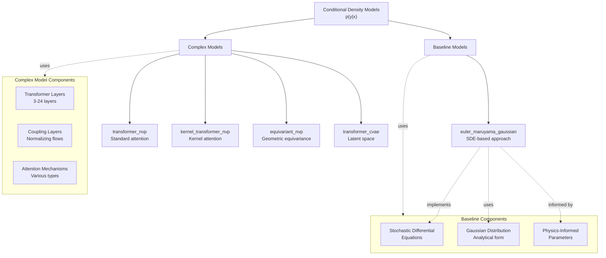
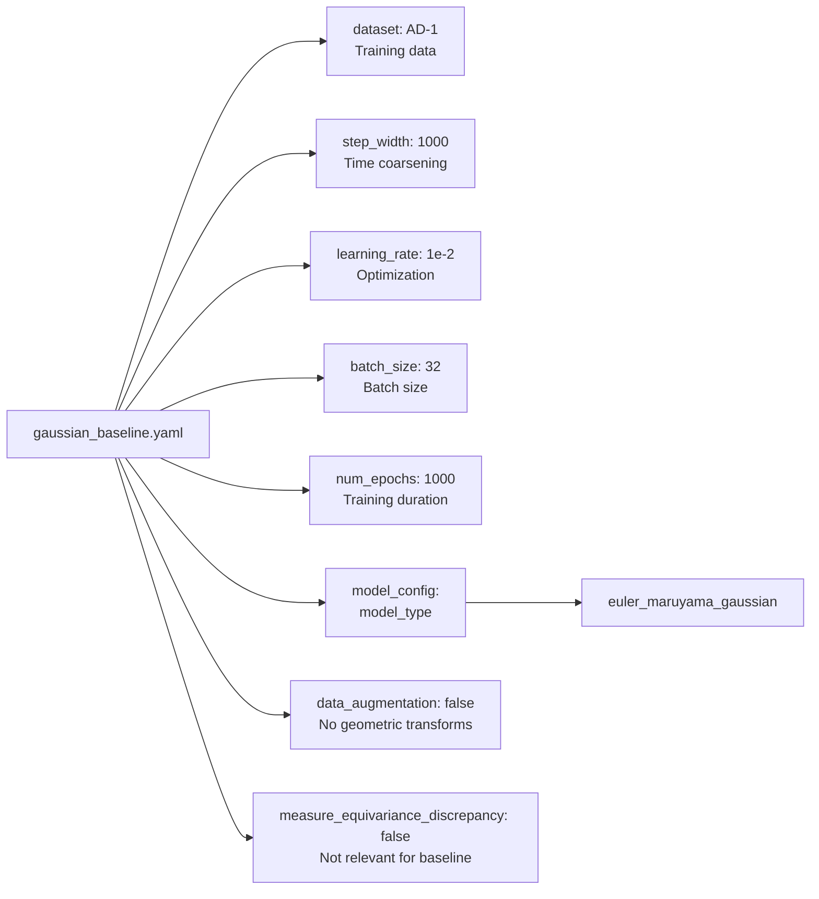
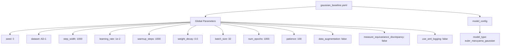
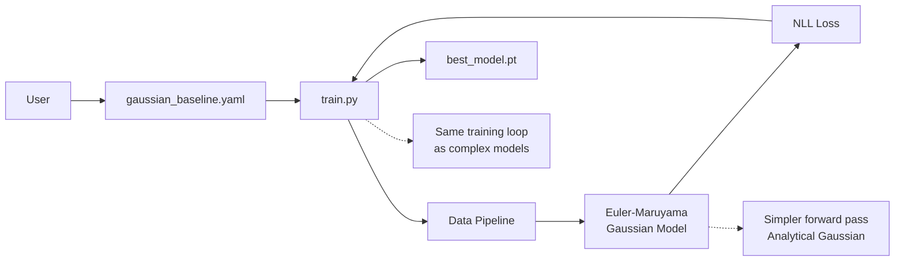

<!-- source: DeepWiki mcp.deepwiki.com · repo microsoft/timewarp · page 4.6 Baseline Models · fetched 2026-10-26 -->

# Baseline Models

<details>
<summary>Relevant source files</summary>

The following files were used as context for generating this wiki page:

- [configs/gaussian_baseline.yaml](configs/gaussian_baseline.yaml)

</details>


## Purpose and Scope

This document describes the baseline models available in Timewarp for comparison against more sophisticated architectures. Baseline models provide simplified approaches to learning time-coarsened molecular dynamics that serve as performance benchmarks and validation tools. The primary baseline is the Euler-Maruyama Gaussian model, which uses a physics-informed stochastic differential equation approach.

For information about the full range of model architectures in Timewarp, see [Model Architectures](#4). For configuration details, see [Configuration System](#4.1). For training baseline models, see [Training](#5).

## Overview

Baseline models in Timewarp serve several critical purposes:

1. **Performance Benchmarking**: Provide reference points for evaluating more complex architectures
2. **Validation**: Ensure that sophisticated models provide meaningful improvements over simpler approaches
3. **Physics-Informed Comparison**: Test whether learned models outperform physics-based analytical approximations
4. **Computational Efficiency**: Offer faster alternatives when full model complexity is unnecessary

The baseline models follow the same training and evaluation pipeline as other architectures but use simpler conditional density estimation approaches.

Sources: [configs/gaussian_baseline.yaml:1-15]()

## Model Architecture Hierarchy



Sources: [configs/gaussian_baseline.yaml:13-14]()

## Euler-Maruyama Gaussian Model

### Conceptual Foundation

The Euler-Maruyama Gaussian baseline (`euler_maruyama_gaussian`) models molecular dynamics using a stochastic differential equation (SDE) approach. This method treats molecular motion as a combination of deterministic drift and stochastic diffusion, approximating the continuous-time dynamics with discrete time steps.

The model assumes that transitions between molecular states follow a Gaussian distribution whose parameters are determined by the Euler-Maruyama discretization scheme. This provides an analytical baseline that incorporates fundamental physics principles without requiring deep neural network architectures.

### Model Type Specification

The baseline model is specified through the `model_type` configuration parameter:

| Configuration Field | Value | Description |
|-------------------|-------|-------------|
| `model_type` | `euler_maruyama_gaussian` | Specifies the Euler-Maruyama Gaussian baseline |

Sources: [configs/gaussian_baseline.yaml:14]()

### Configuration Parameters

The Gaussian baseline uses a simplified configuration compared to complex models:



Sources: [configs/gaussian_baseline.yaml:1-15]()

### Key Configuration Differences

The baseline configuration differs from complex model configurations in several ways:

| Parameter | Baseline Value | Complex Models | Rationale |
|-----------|---------------|----------------|-----------|
| `learning_rate` | `1e-2` | `1e-4` to `5e-4` | Higher learning rate suitable for simpler parameter space |
| `data_augmentation` | `false` | Often `true` | Geometric augmentation not beneficial for analytical model |
| `measure_equivariance_discrepancy` | `false` | Often `true` | Equivariance not enforced in SDE formulation |
| `warmup_steps` | `1000` | `1000-5000` | Shorter warmup for simpler optimization landscape |
| `weight_decay` | `0.0` | `0.0` to `1e-4` | No regularization needed for physics-based parameters |

Sources: [configs/gaussian_baseline.yaml:1-15]()

## Configuration File Structure

The complete baseline configuration follows this structure:



Sources: [configs/gaussian_baseline.yaml:1-15]()

## Training Parameters

### Standard Training Settings

The baseline model uses standard training parameters that align with the overall Timewarp training framework:

| Parameter | Value | Purpose |
|-----------|-------|---------|
| `seed` | `0` | Reproducible random initialization |
| `dataset` | `AD-1` | Training on Alanine Dipeptide system |
| `step_width` | `1000` | Predicting 1000 simulation steps ahead |
| `batch_size` | `32` | Number of trajectory segments per batch |
| `num_epochs` | `1000` | Maximum training iterations |
| `patience` | `100` | Early stopping threshold |

Sources: [configs/gaussian_baseline.yaml:1-12]()

### Optimization Configuration

The baseline uses a straightforward optimization setup:

- **Learning Rate**: `1e-2` - Higher than complex models due to simpler parameter space
- **Warmup Steps**: `1000` - Linear warmup to full learning rate
- **Weight Decay**: `0.0` - No L2 regularization applied
- **Scheduler**: Uses the same learning rate schedule as other models (configured in [Training Configuration](#5.1))

Sources: [configs/gaussian_baseline.yaml:4-6]()

## Use Cases and Comparison

### When to Use Baseline Models

Baseline models are appropriate in the following scenarios:

1. **Initial Validation**: Before training complex models, establish baseline performance
2. **Ablation Studies**: Compare contributions of architectural components
3. **Simple Systems**: For systems where analytical approaches may suffice
4. **Quick Prototyping**: Test data pipeline and training infrastructure
5. **Computational Constraints**: When GPU resources are limited

### Performance Characteristics

Expected characteristics of the Euler-Maruyama Gaussian baseline:

| Aspect | Baseline Behavior | Complex Model Behavior |
|--------|------------------|----------------------|
| **Training Time** | Fast - fewer parameters to optimize | Slower - large transformer networks |
| **Memory Usage** | Low - analytical model | High - attention matrices and embeddings |
| **Physical Accuracy** | Moderate - physics-informed but simplified | Higher - learned from data |
| **Generalization** | Limited - fixed Gaussian assumptions | Better - flexible learned distributions |
| **Interpretability** | High - explicit SDE formulation | Lower - learned representations |

### Integration with Training Pipeline



Sources: [configs/gaussian_baseline.yaml:1-15]()

## Evaluation Workflow

Baseline models are evaluated using the same scripts as complex models:

1. **General Sampling**: Use `sample.py` with the baseline checkpoint
2. **Peptide Evaluation**: Run `evaluate.py` for Ramachandran analysis
3. **Energy Analysis**: Compare energy distributions with OpenMM ground truth
4. **Statistical Tests**: Apply Kolmogorov-Smirnov tests to distributions

For detailed evaluation procedures, see [Evaluation and Analysis](#7).

The baseline provides reference metrics that indicate whether complex architectures justify their additional computational cost. A well-performing complex model should significantly outperform the baseline on metrics such as:

- Negative log-likelihood on test data
- Energy distribution accuracy
- Structural property preservation (bond lengths, angles, dihedrals)
- Long-trajectory stability

Sources: [configs/gaussian_baseline.yaml:1-15]()

## Running the Baseline

### Training Command

```bash
python train.py configs/gaussian_baseline.yaml
```

### Multi-GPU Training

```bash
deepspeed --num_gpus=4 train.py configs/gaussian_baseline.yaml
```

Note: Adjust `batch_size` proportionally when using multiple GPUs (see [Multi-GPU Training with DeepSpeed](#5.3)).

### Expected Output

Training the baseline produces:
- `best_model.pt` - Model checkpoint with lowest validation loss
- TensorBoard logs in `runs/` directory
- Training progress with NLL loss values

The baseline typically converges faster than complex models due to its simpler parameter space.

Sources: [configs/gaussian_baseline.yaml:1-15]()

---

