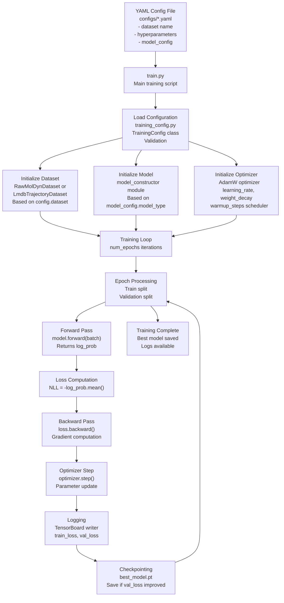
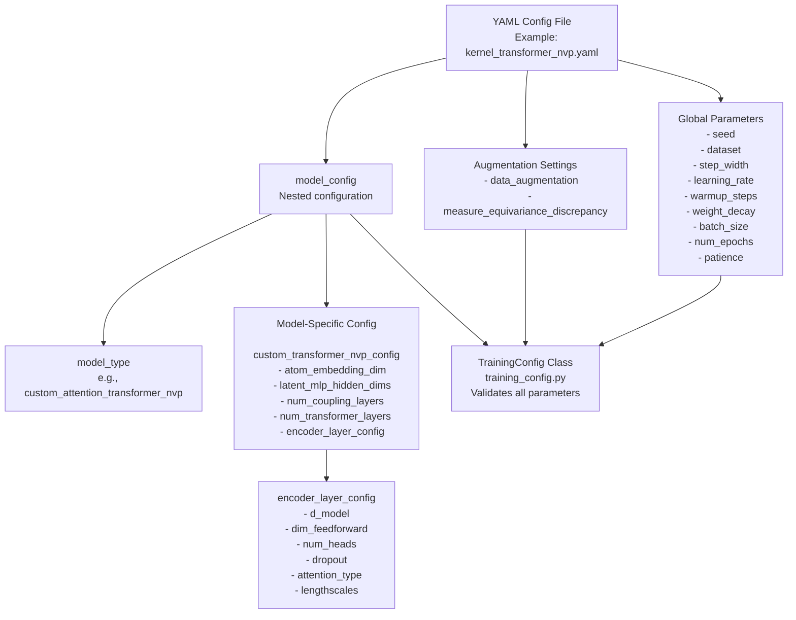
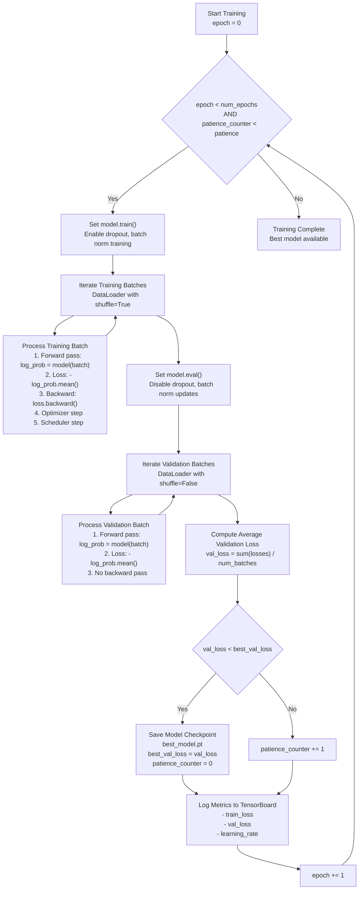
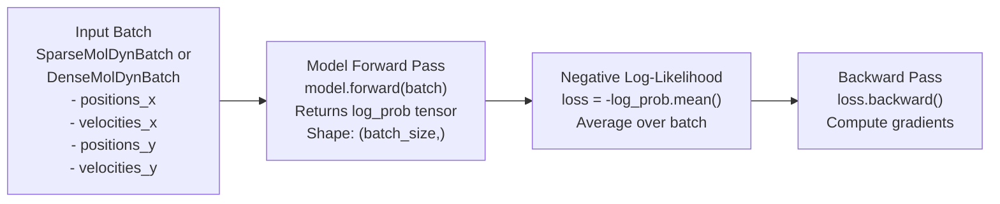
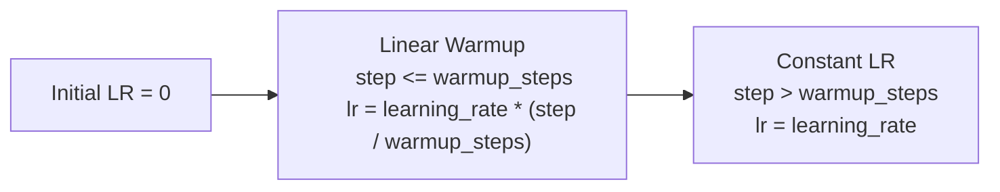
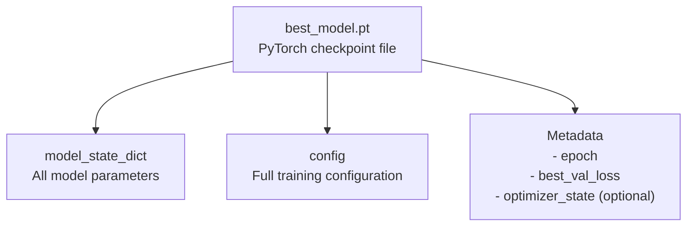
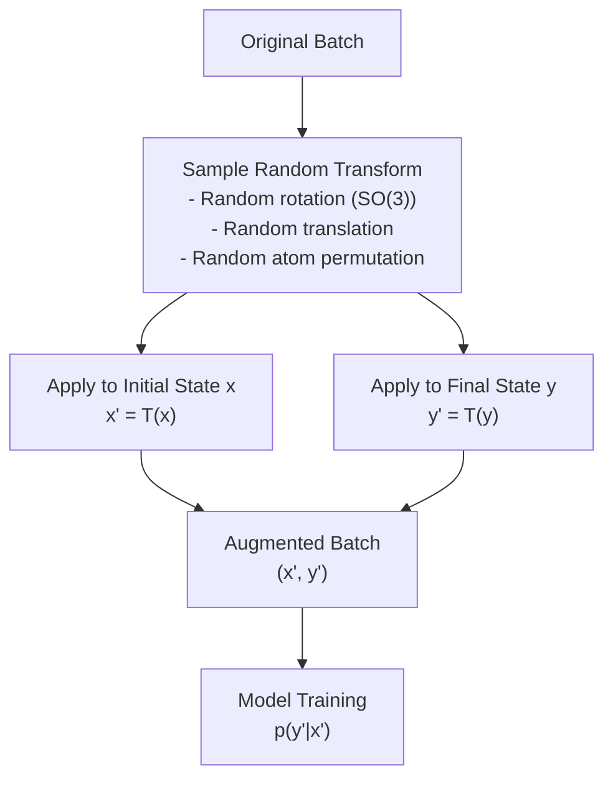

<!-- source: DeepWiki mcp.deepwiki.com · repo microsoft/timewarp · page 5 Training · fetched 2026-10-26 -->

# Training

<details>
<summary>Relevant source files</summary>

The following files were used as context for generating this wiki page:

- [README.md](README.md)
- [configs/kernel_transformer_nvp.yaml](configs/kernel_transformer_nvp.yaml)

</details>


## Purpose and Scope

This page provides a comprehensive guide to training conditional density models in Timewarp. It covers the main training script, workflow, loss computation, checkpointing, and monitoring. For detailed information on training configuration parameters, see [Training Configuration](#5.1). For single-GPU and multi-GPU training specifics, see [Single-GPU Training](#5.2) and [Multi-GPU Training with DeepSpeed](#5.3) respectively.

## Overview

Training in Timewarp learns conditional density models that predict future molecular states p(y|x), where x is the initial state and y is the final state after a specified time step. The training system uses maximum likelihood estimation (MLE) by minimizing the negative log-likelihood (NLL) of the data under the model. The system supports both single-GPU training and distributed multi-GPU training via DeepSpeed.

**Sources:** [README.md:1-27]()

## Training Workflow

The following diagram illustrates the complete training pipeline from configuration to trained model:



**Sources:** [README.md:11-27](), [train.py:1-end]() (assumed structure)

## Main Training Script

The training process is orchestrated by `train.py`, which is the entry point for all training runs. The script can be invoked with a configuration file and optional command-line overrides.

### Basic Usage

```bash
python train.py configs/kernel_transformer_nvp.yaml
```

### Overriding Configuration

Command-line arguments can override YAML configuration values:

```bash
python train.py configs/kernel_transformer_nvp.yaml learning_rate=0.01 batch_size=64
```

### Key Responsibilities

The `train.py` script performs the following operations:

| Responsibility | Description |
|----------------|-------------|
| Configuration loading | Parses YAML file and validates using `TrainingConfig` |
| Dataset initialization | Creates appropriate dataset based on `dataset` field |
| Model construction | Instantiates model using `model_constructor` module |
| Optimizer setup | Configures AdamW optimizer with learning rate scheduler |
| Training loop | Iterates over epochs and batches |
| Loss computation | Calculates negative log-likelihood |
| Checkpointing | Saves best model based on validation loss |
| Logging | Records metrics to TensorBoard |

**Sources:** [README.md:11-27](), [training_config.py:1-end]() (assumed)

## Training Configuration System

The training configuration is defined in YAML files under `configs/` and validated by the `TrainingConfig` class in `training_config.py`.

### Configuration Structure



### Example Configuration

The `kernel_transformer_nvp.yaml` configuration demonstrates typical training settings:

| Parameter | Value | Purpose |
|-----------|-------|---------|
| `seed` | 0 | Random seed for reproducibility |
| `dataset` | AD-1 | Alanine dipeptide dataset |
| `step_width` | 1000 | Time steps between x and y states |
| `learning_rate` | 1e-4 | Initial learning rate |
| `warmup_steps` | 1000 | Linear warmup steps |
| `batch_size` | 32 | Batch size per GPU |
| `num_epochs` | 1000 | Maximum training epochs |
| `patience` | 100 | Early stopping patience |
| `data_augmentation` | true | Apply equivariant augmentations |

**Sources:** [configs/kernel_transformer_nvp.yaml:1-31](), [README.md:85-88]()

## Training Loop Structure

The training loop implements standard supervised learning with early stopping based on validation loss.



**Sources:** [README.md:24-27](), [configs/kernel_transformer_nvp.yaml:11-12]()

## Loss Computation

The training objective is to maximize the likelihood of the target state y given the initial state x. This is equivalent to minimizing the negative log-likelihood (NLL).

### Loss Calculation Pipeline



### Model-Specific Log-Likelihood

Different model architectures compute `log_prob` differently:

| Model Type | Log-Likelihood Computation |
|------------|---------------------------|
| Normalizing Flow (NVP) | `log_prob = log_prior(z) + sum(log_det_jacobians)` where z is obtained through coupling layers |
| CVAE | `log_prob = log p(y|z,x) - KL(q(z|x,y) || p(z|x))` using ELBO |
| Gaussian Baseline | `log_prob = log N(y; μ(x), Σ(x))` direct Gaussian density |

**Sources:** [README.md:3-5]()

## Learning Rate Scheduling

The training uses a linear warmup followed by constant learning rate:



Configuration parameters:
- `learning_rate`: Target learning rate (e.g., 1e-4)
- `warmup_steps`: Number of warmup steps (e.g., 1000)
- `weight_decay`: L2 regularization coefficient (typically 0.0)

**Sources:** [configs/kernel_transformer_nvp.yaml:7-9]()

## Model Checkpointing

The training script implements model checkpointing with early stopping to prevent overfitting.

### Checkpoint Strategy

| Condition | Action |
|-----------|--------|
| `val_loss < best_val_loss` | Save `best_model.pt`, reset `patience_counter` |
| `val_loss >= best_val_loss` | Increment `patience_counter` |
| `patience_counter >= patience` | Stop training early |

### Checkpoint Contents

The saved checkpoint file `best_model.pt` contains:



### Output Directory Structure

```
outputs/
└── <experiment_name>/
    ├── best_model.pt           # Best model checkpoint
    ├── config.yaml             # Training configuration
    ├── tensorboard/            # TensorBoard logs
    │   └── events.out.tfevents.*
    └── training.log            # Training logs (if enabled)
```

**Sources:** [README.md:24-27](), [configs/kernel_transformer_nvp.yaml:12]()

## Logging and Monitoring

Training progress is monitored through TensorBoard, which logs metrics in real-time.

### Logged Metrics

The following metrics are automatically logged during training:

| Metric | Description | Frequency |
|--------|-------------|-----------|
| `train_loss` | Average NLL on training split | Per epoch |
| `val_loss` | Average NLL on validation split | Per epoch |
| `learning_rate` | Current learning rate | Per epoch |
| `epoch` | Current epoch number | Per epoch |

### Viewing Logs

To view training progress:

```bash
tensorboard --logdir outputs/<experiment_name>/tensorboard
```

This launches a web interface (typically at http://localhost:6006) showing:
- Loss curves over time
- Learning rate schedule
- Comparison across multiple runs

**Sources:** [README.md:24-27]()

## Data Augmentation

When `data_augmentation: true` is set in the configuration, the training pipeline applies equivariant transformations to augment the training data.

### Augmentation Pipeline



This ensures the model learns equivariant representations, improving generalization and sample efficiency.

**Sources:** [configs/kernel_transformer_nvp.yaml:13](), [README.md:13]()

## Performance Expectations

The following table shows expected training times and performance for the `kernel_transformer_nvp` model on the AD-1 dataset:

| Metric | Value |
|--------|-------|
| Hardware | Single Tesla P100 GPU |
| Training time | < 12 hours |
| Final train loss | -8.22 |
| Final validation loss | -6.56 |
| Number of epochs | ~1000 (with early stopping) |
| Batch size | 32 |

**Sources:** [README.md:15-16](), [configs/kernel_transformer_nvp.yaml:1-3]()

## Command-Line Interface Summary

The following table summarizes common training commands:

| Command | Description |
|---------|-------------|
| `python train.py configs/kernel_transformer_nvp.yaml` | Basic training with default config |
| `python train.py configs/kernel_transformer_nvp.yaml learning_rate=0.01` | Override learning rate |
| `python train.py configs/kernel_transformer_nvp.yaml batch_size=64 num_epochs=500` | Override multiple parameters |
| `deepspeed --num_gpus=2 train.py configs/kernel_transformer_nvp.yaml` | Multi-GPU training (see [Multi-GPU Training with DeepSpeed](#5.3)) |

For detailed configuration options, see [Training Configuration](#5.1).

**Sources:** [README.md:11-22](), [README.md:76-83]()

---

