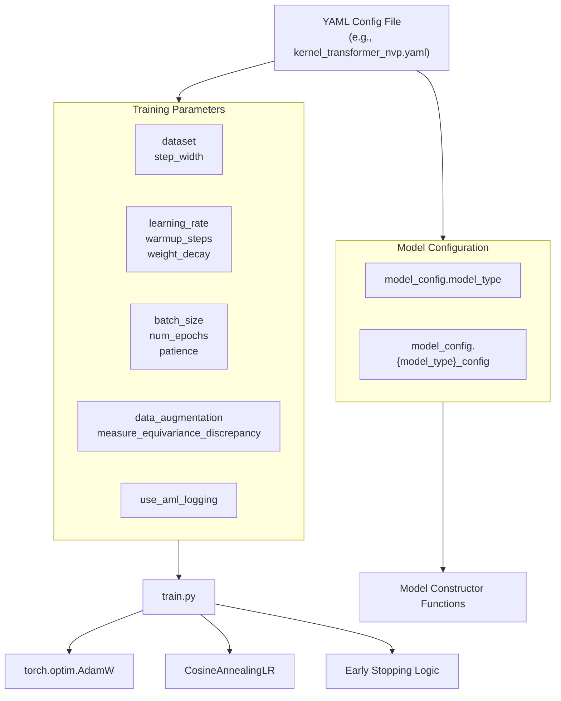
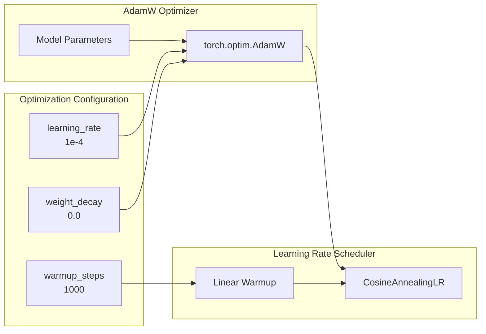
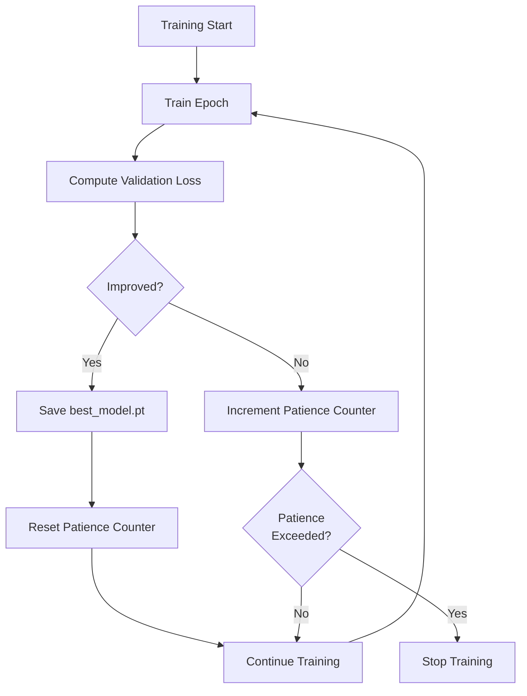
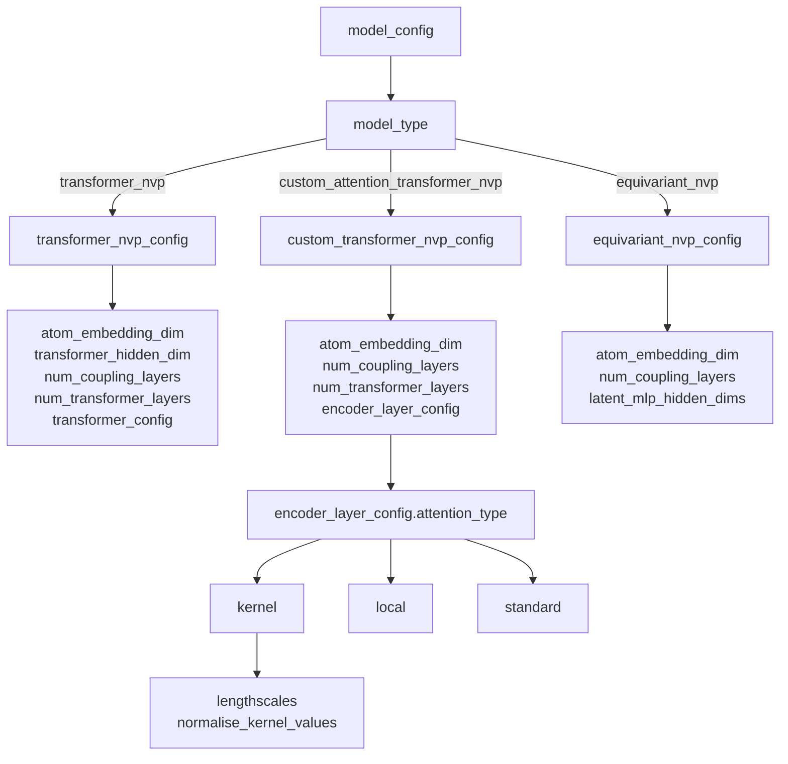
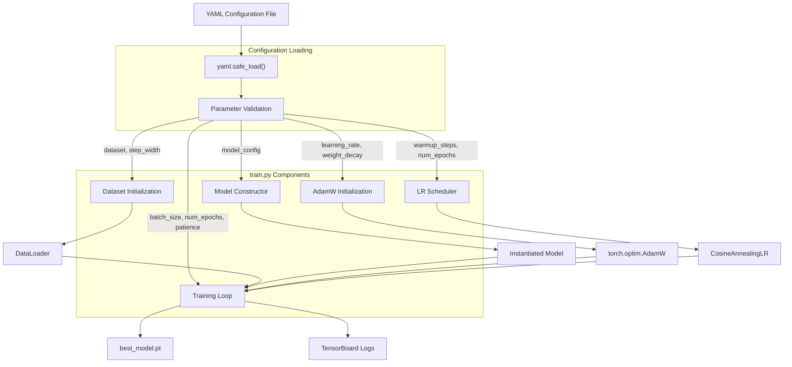

<!-- source: DeepWiki mcp.deepwiki.com · repo microsoft/timewarp · page 5.1 Training Configuration · fetched 2026-10-26 -->

# Training Configuration

<details>
<summary>Relevant source files</summary>

The following files were used as context for generating this wiki page:

- [configs/equivariant_nvp.yaml](configs/equivariant_nvp.yaml)
- [configs/kernel_transformer_nvp.yaml](configs/kernel_transformer_nvp.yaml)
- [configs/transformer_nvp.yaml](configs/transformer_nvp.yaml)

</details>


## Purpose and Scope

This document provides a detailed explanation of training configuration parameters used in Timewarp. These configurations define hyperparameters, optimization settings, learning rate schedules, and other training-related settings specified in YAML files. 

For information about running training with these configurations, see [Single-GPU Training](#5.2) and [Multi-GPU Training with DeepSpeed](#5.3). For model architecture configuration details, see [Configuration System](#4.1).

## Configuration File Structure

Training configurations are specified in YAML files located in the `configs/` directory. Each configuration file defines both training hyperparameters and model architecture settings.



**Sources:** [configs/kernel_transformer_nvp.yaml:1-31](), [configs/transformer_nvp.yaml:1-26](), [configs/equivariant_nvp.yaml:1-19]()

## Training Hyperparameters

### Dataset Parameters

| Parameter | Type | Description | Example Values |
|-----------|------|-------------|----------------|
| `dataset` | string | Dataset identifier for molecular dynamics trajectories | `"AD-1"`, `"AD-2"`, `"chignolin"` |
| `step_width` | integer | Number of simulation timesteps between consecutive frames | `1000` |
| `seed` | integer | Random seed for reproducibility | `0`, `42` |

The `dataset` parameter specifies which molecular system to train on. Common options include:
- `AD-1`, `AD-2`: Alanine dipeptide variants
- `AT-1`: Alanine tetrapeptide
- `chignolin`: Small protein
- `villin`: Villin headpiece

The `step_width` determines the temporal coarseness of the learned dynamics. A value of `1000` means the model learns to predict molecular states 1000 timesteps into the future.

**Sources:** [configs/kernel_transformer_nvp.yaml:4-6](), [configs/transformer_nvp.yaml:2-4](), [configs/equivariant_nvp.yaml:1-3]()

### Optimization Parameters



| Parameter | Type | Description | Typical Values |
|-----------|------|-------------|----------------|
| `learning_rate` | float | Initial learning rate for optimizer | `1e-4`, `1e-3` |
| `warmup_steps` | integer | Number of steps for linear learning rate warmup | `1000` |
| `weight_decay` | float | L2 regularization coefficient | `0.0`, `1e-5` |

The training system uses the **AdamW optimizer** with learning rate warmup followed by cosine annealing. During warmup, the learning rate increases linearly from 0 to the configured `learning_rate` over `warmup_steps` iterations. After warmup, cosine annealing gradually reduces the learning rate.

**Sources:** [configs/kernel_transformer_nvp.yaml:7-9](), [configs/transformer_nvp.yaml:5-7](), [configs/equivariant_nvp.yaml:4-6]()

### Batch Size Configuration

| Parameter | Type | Description | Notes |
|-----------|------|-------------|-------|
| `batch_size` | integer | Number of samples per training batch | Must be scaled for multi-GPU training |

The `batch_size` parameter specifies the number of molecular trajectory frames processed in each training iteration on a single GPU. 

**Multi-GPU Consideration:** When using distributed training with DeepSpeed, the effective global batch size is `batch_size * num_gpus`. For example, with `batch_size: 32` on 4 GPUs, the effective batch size is 128. See [Multi-GPU Training with DeepSpeed](#5.3) for details on scaling batch sizes.

**Sources:** [configs/kernel_transformer_nvp.yaml:10](), [configs/transformer_nvp.yaml:8](), [configs/equivariant_nvp.yaml:7]()

### Training Duration and Early Stopping

| Parameter | Type | Description | Typical Values |
|-----------|------|-------------|----------------|
| `num_epochs` | integer | Maximum number of training epochs | `1000` |
| `patience` | integer | Early stopping patience (epochs without improvement) | `100` |

The training system monitors validation loss and saves the model with the best validation performance. If validation loss does not improve for `patience` epochs, training terminates early to prevent overfitting.



**Sources:** [configs/kernel_transformer_nvp.yaml:11-12](), [configs/transformer_nvp.yaml:9-10](), [configs/equivariant_nvp.yaml:8-9]()

## Data Augmentation and Equivariance

| Parameter | Type | Description | Default |
|-----------|------|-------------|---------|
| `data_augmentation` | boolean | Apply random rotations/translations to training data | `true` or `false` |
| `measure_equivariance_discrepancy` | boolean | Compute and log equivariance error metrics | `false` |

### Data Augmentation

When `data_augmentation: true`, the training pipeline applies random geometric transformations to molecular coordinates during training. This augmentation helps the model learn representations that are invariant or equivariant to rigid body transformations.

The augmentation is implemented through the equivariance system (see [Equivariance System](#6)). Transformations include:
- Random rotations
- Random translations
- Random atom permutations (for symmetric molecules)

**Usage Guidelines:**
- Set to `true` for non-equivariant models (e.g., `transformer_nvp`, `kernel_transformer_nvp`) to improve generalization
- Set to `false` for equivariant models (e.g., `equivariant_nvp`) that enforce geometric invariance architecturally

### Equivariance Discrepancy Measurement

When `measure_equivariance_discrepancy: true`, the training system computes metrics that quantify how well the model maintains equivariance properties. This adds computational overhead but provides diagnostic information about geometric consistency.

**Sources:** [configs/kernel_transformer_nvp.yaml:13-14](), [configs/transformer_nvp.yaml:11-12](), [configs/equivariant_nvp.yaml:10-11]()

## Logging Configuration

| Parameter | Type | Description | Default |
|-----------|------|-------------|---------|
| `use_aml_logging` | boolean | Enable Azure Machine Learning logging | `false` |

When `use_aml_logging: false`, training metrics are logged locally to TensorBoard. When `true`, metrics are additionally sent to Azure ML for experiment tracking.

**Local Logging:** All training runs generate TensorBoard logs containing:
- Training loss (negative log-likelihood)
- Validation loss
- Learning rate schedule
- Gradient statistics

**Sources:** [configs/kernel_transformer_nvp.yaml:15](), [configs/transformer_nvp.yaml:13](), [configs/equivariant_nvp.yaml:12]()

## Model Configuration Reference

The `model_config` section defines the model architecture and its hyperparameters. This section varies significantly between model types.



### Common Model Configuration Fields

| Field | Type | Description |
|-------|------|-------------|
| `model_type` | string | Model architecture identifier |
| `atom_embedding_dim` | integer | Dimensionality of atom embeddings |
| `num_coupling_layers` | integer | Number of normalizing flow coupling layers |
| `latent_mlp_hidden_dims` | list[integer] | Hidden layer dimensions for latent MLPs |

For detailed documentation of model-specific configuration options, see:
- [Standard Transformer NVP](#4.2.1)
- [Kernel Attention Variants](#4.2.2)
- [Local Attention NVP](#4.2.3)
- [Equivariant NVP](#4.3)
- [Transformer CVAE](#4.4)

**Sources:** [configs/kernel_transformer_nvp.yaml:16-31](), [configs/transformer_nvp.yaml:14-26](), [configs/equivariant_nvp.yaml:13-19]()

## Example Configurations

### Best Practice Configuration for Alanine Dipeptide

The following configuration achieved a validation NLL of -6.56 on the AD-1 dataset:

```yaml
seed: 0
dataset: AD-1
step_width: 1000
learning_rate: 1e-4
warmup_steps: 1000
weight_decay: 0.0
batch_size: 32
num_epochs: 1000
patience: 100
data_augmentation: true
measure_equivariance_discrepancy: false
use_aml_logging: false
model_config:
  model_type: custom_attention_transformer_nvp
  custom_transformer_nvp_config:
    atom_embedding_dim: 32
    latent_mlp_hidden_dims: [256]
    num_coupling_layers: 8
    num_transformer_layers: 3
    encoder_layer_config:
      d_model: 128
      dim_feedforward: 2048
      num_heads: 6
      dropout: 0
      attention_type: kernel
      lengthscales: [0.1, 0.2, 0.5, 0.7, 1., 1.2]
      normalise_kernel_values: true
```

**Sources:** [configs/kernel_transformer_nvp.yaml:1-31]()

### Configuration Comparison Table

The following table compares key training hyperparameters across different model configurations:

| Configuration | Dataset | Learning Rate | Batch Size | Coupling Layers | Transformer Layers | Data Aug |
|---------------|---------|---------------|------------|-----------------|-------------------|----------|
| `kernel_transformer_nvp.yaml` | AD-1 | 1e-4 | 32 | 8 | 3 | true |
| `transformer_nvp.yaml` | AD-1 | 1e-4 | 32 | 8 | 3 | true |
| `equivariant_nvp.yaml` | AD-1 | 1e-4 | 32 | 4 | N/A | false |

Key differences:
- **Kernel attention** uses 6-head attention with multiple lengthscales
- **Standard attention** uses 8-head standard dot-product attention
- **Equivariant model** uses fewer coupling layers and no data augmentation

**Sources:** [configs/kernel_transformer_nvp.yaml:1-31](), [configs/transformer_nvp.yaml:1-26](), [configs/equivariant_nvp.yaml:1-19]()

## Configuration Parameter Flow

The following diagram shows how configuration parameters flow from YAML files into the training system components:



**Sources:** [configs/kernel_transformer_nvp.yaml:1-31](), [configs/transformer_nvp.yaml:1-26](), [configs/equivariant_nvp.yaml:1-19]()

---

