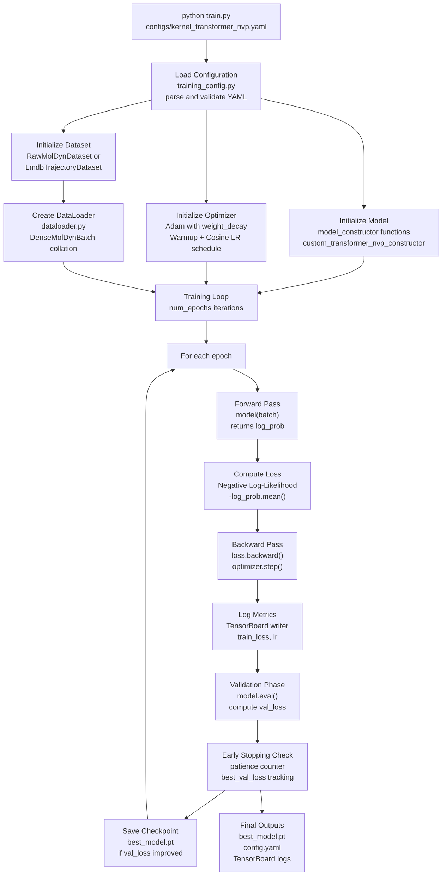
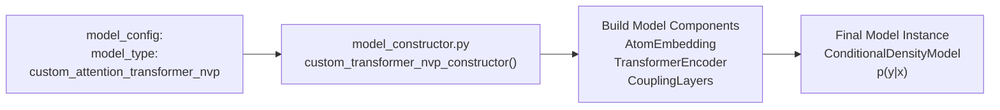
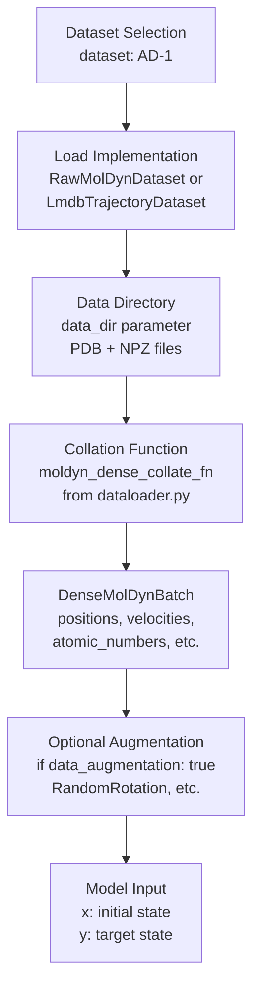
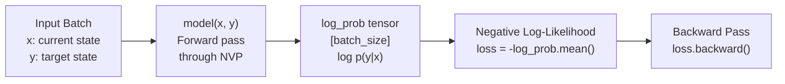
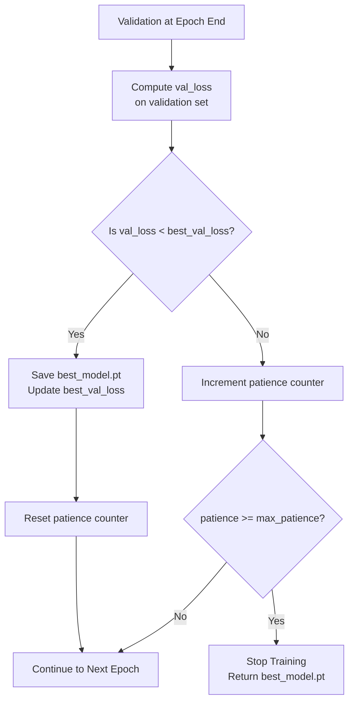
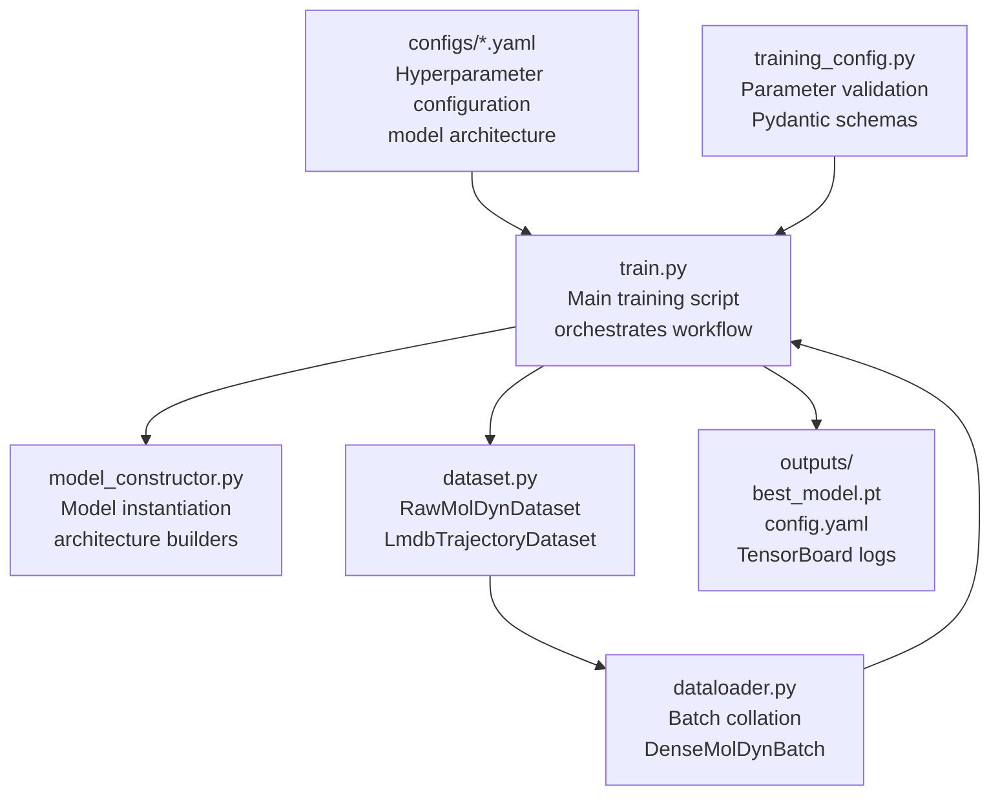

<!-- source: DeepWiki mcp.deepwiki.com · repo microsoft/timewarp · page 5.2 Single-GPU Training · fetched 2026-10-26 -->

# Single-GPU Training

<details>
<summary>Relevant source files</summary>

The following files were used as context for generating this wiki page:

- [README.md](README.md)
- [configs/kernel_transformer_nvp.yaml](configs/kernel_transformer_nvp.yaml)

</details>


## Purpose and Scope

This page covers training Timewarp models on a single GPU, including command-line usage, configuration options, expected performance, and output artifacts. For distributed training across multiple GPUs, see [Multi-GPU Training with DeepSpeed](#5.3). For details on configuring training hyperparameters, see [Training Configuration](#5.1).

## Overview

Single-GPU training is the default training mode in Timewarp. The training script [train.py]() orchestrates the complete training loop, including dataset loading, model initialization, optimization, validation, and checkpointing. Training is configured via YAML files in the [configs/]() directory.

**Sources:** [README.md:11-27]()

## Basic Training Command

The simplest training command specifies only the configuration file:

```bash
python train.py configs/kernel_transformer_nvp.yaml
```

This command will:
1. Load hyperparameters from the YAML configuration
2. Initialize the dataset specified in the `dataset` field (e.g., `AD-1`)
3. Instantiate the model based on `model_config`
4. Train for the specified number of epochs with early stopping
5. Save outputs to the default directory (`outputs/`)

**Sources:** [README.md:15-18]()

## Command-Line Overrides

Any parameter in the YAML configuration can be overridden from the command line using key-value syntax:

```bash
python train.py configs/kernel_transformer_nvp.yaml learning_rate=0.01 batch_size=64
```

This is useful for hyperparameter sweeps or quick experiments without modifying configuration files.

**Sources:** [README.md:19-22]()

## Training Workflow

The following diagram illustrates the single-GPU training workflow from command invocation to saved outputs:



**Sources:** [README.md:11-27](), [train.py]()

## Key Configuration Parameters for Single-GPU Training

The following table lists critical parameters from the YAML configuration that affect single-GPU training behavior:

| Parameter | Type | Description | Example Value |
|-----------|------|-------------|---------------|
| `dataset` | string | Dataset identifier to load (e.g., AD-1, O2) | `AD-1` |
| `step_width` | int | Simulation time step between x and y states | `1000` |
| `batch_size` | int | Number of samples per batch (full batch on single GPU) | `32` |
| `num_epochs` | int | Maximum training epochs before stopping | `1000` |
| `learning_rate` | float | Initial learning rate for optimizer | `1e-4` |
| `warmup_steps` | int | Linear warmup steps before cosine decay | `1000` |
| `weight_decay` | float | L2 regularization weight | `0.0` |
| `patience` | int | Early stopping patience (epochs without improvement) | `100` |
| `data_augmentation` | bool | Apply equivariant transformations during training | `true` |
| `seed` | int | Random seed for reproducibility | `0` |

**Sources:** [configs/kernel_transformer_nvp.yaml:1-31]()

## Expected Performance

For the Alanine Dipeptide (`AD-1`) dataset with the kernel transformer NVP configuration:

- **Training Time**: Less than 12 hours on a Tesla P100 GPU
- **Final Train Loss**: Approximately -8.22 (negative log-likelihood)
- **Final Validation Loss**: Approximately -6.56
- **Memory Usage**: Depends on `batch_size` and model size (typically 4-8 GB for default configs)

These metrics are reported for the configuration in [configs/kernel_transformer_nvp.yaml](), which achieved best performance as of October 2021.

**Sources:** [README.md:15-18](), [configs/kernel_transformer_nvp.yaml:2-3]()

## Output Directory Structure

By default, training outputs are saved to the `outputs/` directory. The structure includes:

```
outputs/
├── experiment_timestamp/
│   ├── best_model.pt          # Best model checkpoint based on validation loss
│   ├── config.yaml            # Copy of configuration used for this run
│   ├── tensorboard/           # TensorBoard event files
│   │   └── events.out.tfevents.*
│   └── checkpoints/           # Optional intermediate checkpoints
```

The output directory can be changed via the `output_dir` configuration parameter.

**Sources:** [README.md:24-27]()

## Training Process Details

### Model Initialization

The training script uses model constructor functions to instantiate models based on the `model_config` section of the YAML file:



For the kernel transformer NVP model, the constructor reads:
- `atom_embedding_dim`: Embedding dimension for atom types (e.g., 32)
- `num_transformer_layers`: Number of transformer blocks (e.g., 3)
- `num_coupling_layers`: Number of normalizing flow coupling layers (e.g., 8)
- `encoder_layer_config`: Attention mechanism configuration

**Sources:** [configs/kernel_transformer_nvp.yaml:16-31]()

### Data Loading Pipeline



The batch format used for single-GPU training is `DenseMolDynBatch`, which contains:
- `positions`: Atom coordinates [batch_size, num_atoms, 3]
- `velocities`: Atom velocities [batch_size, num_atoms, 3]
- `atomic_numbers`: Atom types [batch_size, num_atoms]
- `edge_index`: Optional connectivity information
- `num_atoms`: Number of atoms per sample

**Sources:** [README.md:15-18](), [dataloader.py]()

### Loss Computation

The training objective is to maximize the log-likelihood of the conditional distribution p(y|x):



The loss function is the negative log-likelihood (NLL), which is equivalent to minimizing the KL divergence between the model distribution and the true data distribution.

**Sources:** [train.py]()

## Monitoring Training Progress

### TensorBoard Integration

Training metrics are automatically logged to TensorBoard:

```bash
tensorboard --logdir outputs/experiment_timestamp/tensorboard/
```

Logged metrics include:
- **train_loss**: Training NLL per batch
- **val_loss**: Validation NLL per epoch
- **learning_rate**: Current learning rate (warmup + cosine schedule)
- **epoch**: Current epoch number

**Sources:** [README.md:24-27]()

### Console Output

The training script prints progress information to the console, typically including:
- Epoch number and progress
- Training loss (averaged over batches)
- Validation loss (computed on validation set)
- Time elapsed per epoch
- Best validation loss so far

## Early Stopping and Checkpointing

Training employs early stopping based on validation loss:



The `patience` parameter (default: 100) controls how many epochs without improvement are tolerated before training stops. The best model is always saved to `best_model.pt`.

**Sources:** [configs/kernel_transformer_nvp.yaml:12]()

## Example Training Sessions

### Standard Training Run

```bash
python train.py configs/kernel_transformer_nvp.yaml
```

Expected console output:
```
Loading dataset AD-1 from data_dir...
Initializing custom_attention_transformer_nvp model...
Model has 2.3M parameters
Starting training for 1000 epochs...
Epoch 1/1000: train_loss=-5.23, val_loss=-4.89, lr=1.0e-7, time=45s
Epoch 2/1000: train_loss=-6.12, val_loss=-5.67, lr=2.0e-7, time=43s
...
Epoch 523/1000: train_loss=-8.22, val_loss=-6.56, lr=3.2e-5, time=44s
Early stopping at epoch 523 (patience=100)
Best validation loss: -6.56
Saved best model to outputs/2024-01-15_10-30-45/best_model.pt
```

### Training with Overrides

```bash
python train.py configs/kernel_transformer_nvp.yaml \
    batch_size=64 \
    learning_rate=5e-4 \
    num_epochs=500
```

This command increases the batch size, raises the learning rate, and reduces the maximum epochs.

## Memory Considerations for Single-GPU

### Batch Size Selection

The `batch_size` parameter directly controls GPU memory usage. If you encounter out-of-memory (OOM) errors:

1. **Reduce batch_size**: Try halving the value (e.g., 32 → 16)
2. **Reduce model size**: Decrease `atom_embedding_dim` or `num_transformer_layers`
3. **Use gradient accumulation**: Not natively supported but can be added

### Memory Usage Estimation

Approximate GPU memory usage:

| Model Configuration | Batch Size | Estimated Memory |
|---------------------|------------|------------------|
| kernel_transformer_nvp (default) | 32 | ~6 GB |
| kernel_transformer_nvp (default) | 64 | ~10 GB |
| equivariant_nvp (larger) | 32 | ~8 GB |
| transformer_cvae (default) | 32 | ~5 GB |

**Note:** Memory usage scales roughly linearly with batch size and quadratically with sequence length (number of atoms).

## Common Issues and Solutions

### Issue: Training Loss Not Decreasing

**Symptoms:** Loss remains high or fluctuates wildly

**Solutions:**
1. Verify data loading: Check that dataset files exist in `data_dir`
2. Reduce learning rate: Try `learning_rate=1e-5`
3. Increase warmup steps: Try `warmup_steps=2000`
4. Check data augmentation: Try disabling with `data_augmentation=false`

### Issue: Out of Memory

**Symptoms:** `RuntimeError: CUDA out of memory`

**Solutions:**
1. Reduce batch size: `batch_size=16` or `batch_size=8`
2. Reduce model capacity: Lower `num_transformer_layers` or `atom_embedding_dim`
3. Clear GPU cache between runs: Run `nvidia-smi` to check for orphaned processes

### Issue: Training Too Slow

**Symptoms:** Each epoch takes more than 1-2 minutes

**Solutions:**
1. Use LMDB dataset format (see [LMDB Datasets](#3.2.2))
2. Verify GPU utilization with `nvidia-smi` (should be >80%)
3. Reduce `step_width` for smaller trajectory gaps
4. Consider multi-GPU training (see [Multi-GPU Training with DeepSpeed](#5.3))

## Reproducibility

To ensure reproducible results:

1. **Set seed**: Specify `seed: 0` in configuration
2. **Disable data augmentation**: Set `data_augmentation: false` for deterministic training
3. **Fix CUDA behavior**: Set environment variable `CUBLAS_WORKSPACE_CONFIG=:4096:8`
4. **Save configuration**: The training script automatically saves the full config to the output directory

The saved `config.yaml` in the output directory contains all parameters used for training, enabling exact reproduction of experiments.

**Sources:** [configs/kernel_transformer_nvp.yaml:4]()

## File Structure Summary

The following files are involved in single-GPU training:



**Sources:** [README.md:11-27](), [train.py](), [training_config.py](), [model_constructor.py](), [dataloader.py]()

---

