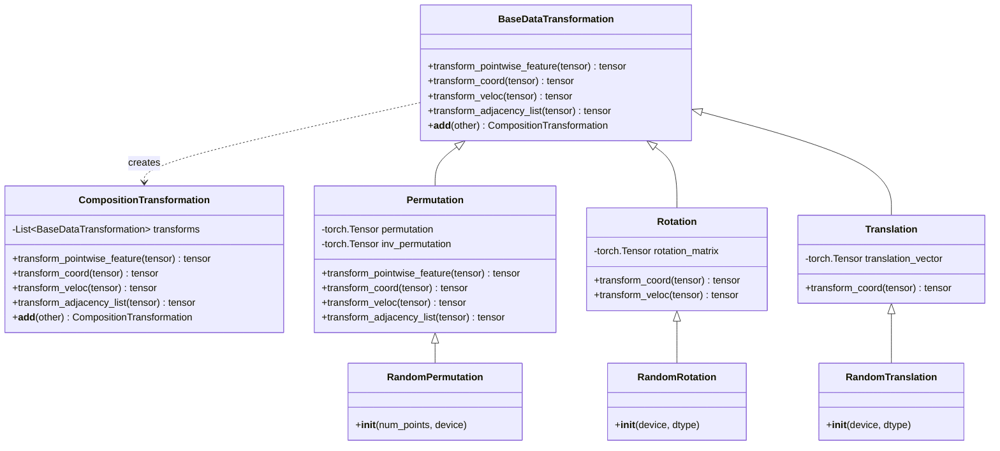
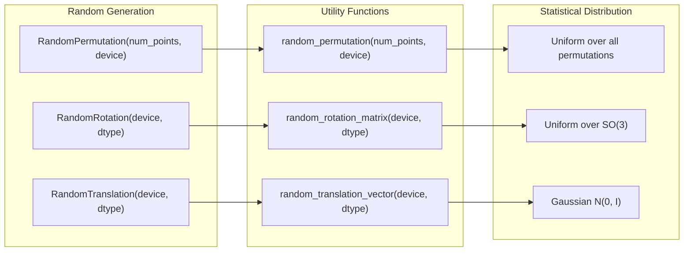
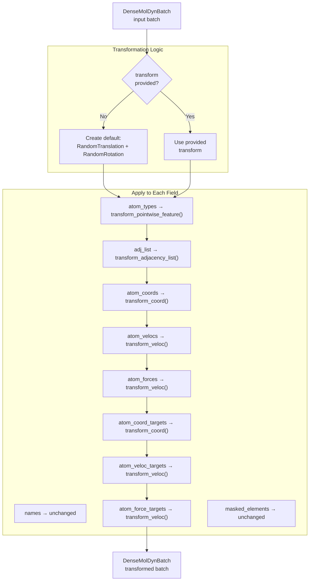
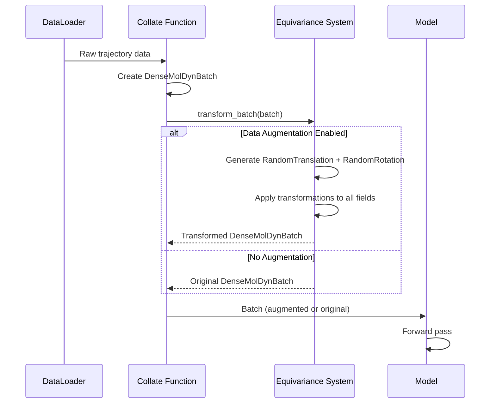

<!-- source: DeepWiki mcp.deepwiki.com · repo microsoft/timewarp · page 6 Equivariance System · fetched 2026-10-26 -->

# Equivariance System

<details>
<summary>Relevant source files</summary>

The following files were used as context for generating this wiki page:

- [equivariance/__init__.py](equivariance/__init__.py)
- [equivariance/equivariance_transforms.py](equivariance/equivariance_transforms.py)
- [equivariance/equivariance_utils.py](equivariance/equivariance_utils.py)

</details>


The Equivariance System provides geometric transformations for molecular dynamics data, enabling data augmentation and enforcing geometric symmetries during training. The system supports three fundamental types of transformations: **rotations**, **translations**, and **permutations** of atomic coordinates, velocities, and related features.

This page documents the transformation classes and utility functions. For information about how these transformations are used during training, see [Training](#5). For details about the model architectures that leverage equivariance properties, see [Equivariant NVP](#4.3).

## System Overview

The Equivariance System is organized around a base transformation abstraction that allows composition of multiple transformations. The system operates on `DenseMolDynBatch` objects (see [Data Loaders](#3.1)) and transforms various molecular properties consistently.

**Key Design Principles:**
- **Composability**: Transformations can be combined using the `+` operator
- **Type-specific handling**: Different transformation logic for coordinates, velocities, features, and adjacency lists
- **Random generation**: Convenience classes for generating random transformations
- **Physical consistency**: Transformations preserve physical relationships (e.g., forces transform like velocities)

```mermaid
graph TB
    subgraph Input["Input Data"]
        Batch["DenseMolDynBatch"]
        Coords["atom_coords"]
        Velocs["atom_velocs"]
        Features["atom_types"]
        AdjList["adj_list"]
    end
    
    subgraph Transforms["Transformation Classes"]
        Base["BaseDataTransformation"]
        Comp["CompositionTransformation"]
        Perm["Permutation"]
        Rot["Rotation"]
        Trans["Translation"]
        RandPerm["RandomPermutation"]
        RandRot["RandomRotation"]
        RandTrans["RandomTranslation"]
    end
    
    subgraph Utils["Utility Functions"]
        RandRotMat["random_rotation_matrix()"]
        RandTransVec["random_translation_vector()"]
        RandPermGen["random_permutation()"]
    end
    
    subgraph Output["Transformed Data"]
        TransBatch["Transformed DenseMolDynBatch"]
        TransCoords["Rotated/Translated coords"]
        TransVelocs["Rotated velocities"]
        TransFeatures["Permuted features"]
        TransAdjList["Permuted adjacency"]
    end
    
    Base --> Perm
    Base --> Rot
    Base --> Trans
    Perm --> RandPerm
    Rot --> RandRot
    Trans --> RandTrans
    
    RandRotMat --> RandRot
    RandTransVec --> RandTrans
    RandPermGen --> RandPerm
    
    Batch --> Perm
    Batch --> Rot
    Batch --> Trans
    
    Perm --> TransBatch
    Rot --> TransBatch
    Trans --> TransBatch
    Comp -.combines.-> Perm
    Comp -.combines.-> Rot
    Comp -.combines.-> Trans
    
    Coords --> Rot
    Coords --> Trans
    Velocs --> Rot
    Features --> Perm
    AdjList --> Perm
    
    Rot --> TransCoords
    Trans --> TransCoords
    Rot --> TransVelocs
    Perm --> TransFeatures
    Perm --> TransAdjList
```



**Diagram: Equivariance System Architecture**

Sources: [equivariance/equivariance_transforms.py:1-176](), [equivariance/equivariance_utils.py:1-29]()

## Transformation Class Hierarchy

The transformation system uses inheritance to provide specialized behavior for different geometric operations while maintaining a common interface.



**Diagram: Transformation Class Hierarchy**

Sources: [equivariance/equivariance_transforms.py:15-151]()

### BaseDataTransformation

The `BaseDataTransformation` class defines the interface for all transformations. By default, it applies the identity transformation (no change) to all data types.

| Method | Input | Output | Purpose |
|--------|-------|--------|---------|
| `transform_pointwise_feature()` | `torch.Tensor` | `torch.Tensor` | Transform per-atom features (e.g., atom types) |
| `transform_coord()` | `torch.Tensor` | `torch.Tensor` | Transform 3D coordinates |
| `transform_veloc()` | `torch.Tensor` | `torch.Tensor` | Transform 3D velocities/forces |
| `transform_adjacency_list()` | `torch.Tensor` | `torch.Tensor` | Transform graph connectivity |
| `__add__()` | `BaseDataTransformation` | `CompositionTransformation` | Combine transformations |

The `__add__` operator enables intuitive composition syntax: `transform = Translation() + Rotation()` creates a combined transformation that applies translation followed by rotation.

Sources: [equivariance/equivariance_transforms.py:15-35]()

### CompositionTransformation

The `CompositionTransformation` class chains multiple transformations together, applying them sequentially to each data type.

**Key Implementation Detail**: Transformations are applied in the order they appear in the `transforms` list. When using the `+` operator, transformations are applied left-to-right: `A + B + C` applies `A`, then `B`, then `C`.

**Shape Handling**: Each method iterates through the transformation list and applies each transform to the output of the previous transform:

```python
# Pseudocode from line 53-59
for transform in self.transforms:
    trans_coord = transform.transform_coord(trans_coord)
```

Sources: [equivariance/equivariance_transforms.py:37-85]()

### Permutation

The `Permutation` class reorders atoms according to a specified permutation vector. This is useful for data augmentation and testing model invariance to atom ordering.

**Key Attributes:**
- `permutation`: The permutation vector mapping old indices to new indices
- `inv_permutation`: Inverse permutation computed via `torch.argsort()` for efficient reversal

**Transformation Logic:**
- **Pointwise features, coordinates, velocities**: Apply inverse permutation to reorder atoms [equivariance/equivariance_transforms.py:93-112]()
- **Adjacency list**: Apply forward permutation to update edge indices [equivariance/equivariance_transforms.py:114-115]()

**Limitation**: Currently does not support batched inputs (tensors with `ndim > 2`) as indicated by the `NotImplementedError` checks.

Sources: [equivariance/equivariance_transforms.py:87-116]()

### Rotation

The `Rotation` class applies a 3D rotation matrix to coordinates and velocities. Rotations are SE(3) transformations that preserve distances and angles.

**Key Attribute:**
- `rotation_matrix`: A 3×3 orthogonal matrix with determinant 1

**Transformation Logic:**
```python
# From lines 122-126
transformed = (rotation_matrix @ tensor.transpose(-1, -2)).transpose(-1, -2)
```

This performs matrix multiplication on the last dimension (the 3D spatial coordinates) while preserving batch and atom dimensions.

**Physical Properties:**
- Coordinates transform: `x' = Rx`
- Velocities transform identically: `v' = Rv`
- Forces also transform like velocities (angular momentum preservation)

Sources: [equivariance/equivariance_transforms.py:118-127]()

### Translation

The `Translation` class applies a 3D translation vector to coordinates only. Translations are SE(3) transformations that shift all points by a constant vector.

**Key Attribute:**
- `translation_vector`: A 3D vector `[x, y, z]`

**Transformation Logic:**
```python
# From line 133-134
transformed_coord = coord + translation_vector
```

**Important Note**: Translation only affects coordinates. Velocities and forces are invariant to translation (they represent changes in position, not absolute positions).

Sources: [equivariance/equivariance_transforms.py:129-135]()

## Random Transformation Classes

The system provides three convenience classes for generating random transformations, useful for data augmentation during training.



**Diagram: Random Transformation Generation Pipeline**

Sources: [equivariance/equivariance_transforms.py:137-151](), [equivariance/equivariance_utils.py:5-28]()

### RandomPermutation

`RandomPermutation` generates a uniformly distributed random permutation of `num_points` atoms. 

**Constructor**: `RandomPermutation(num_points: int, device: Optional[str] = None)`

**Implementation**: Calls `random_permutation()` from utilities, which uses `torch.randperm()` to generate a uniform random permutation.

Sources: [equivariance/equivariance_transforms.py:137-140](), [equivariance/equivariance_utils.py:27-28]()

### RandomRotation

`RandomRotation` generates a uniformly distributed random rotation matrix from SO(3) (the special orthogonal group in 3D).

**Constructor**: `RandomRotation(device: Optional[str] = None, dtype=torch.float32)`

**Implementation**: Uses `scipy.spatial.transform.Rotation.random()` to generate a uniformly distributed random rotation, then converts to matrix form [equivariance/equivariance_utils.py:5-8]().

**Mathematical Property**: The distribution is uniform with respect to the Haar measure on SO(3), ensuring no directional bias.

Sources: [equivariance/equivariance_transforms.py:143-145](), [equivariance/equivariance_utils.py:5-8]()

### RandomTranslation

`RandomTranslation` generates a normally distributed random translation vector.

**Constructor**: `RandomTranslation(device: Optional[str] = None, dtype=torch.float32)`

**Implementation**: Samples from a standard normal distribution `N(0, I)` for each of the three spatial dimensions [equivariance/equivariance_utils.py:16-19]().

**Statistical Properties**: 
- Mean: `[0, 0, 0]`
- Covariance: Identity matrix
- Unbounded support (translation magnitude can be arbitrarily large)

Sources: [equivariance/equivariance_transforms.py:148-150](), [equivariance/equivariance_utils.py:16-19]()

## Utility Functions

The `equivariance_utils.py` module provides low-level functions for generating and applying transformations.

### Random Generation Functions

| Function | Return Type | Description |
|----------|-------------|-------------|
| `random_rotation_matrix(device, dtype)` | `torch.Tensor` (3×3) | Generate uniform random rotation from SO(3) |
| `random_translation_vector(device, dtype)` | `torch.Tensor` (1×3) | Generate Gaussian random translation |
| `random_permutation(num_points, device)` | `torch.Tensor` | Generate uniform random permutation |

**Implementation Details:**

The `random_rotation_matrix()` function uses scipy's `Rotation.random()` which implements the algorithm from Shepperd (1978) for uniform sampling from SO(3) [equivariance/equivariance_utils.py:5-8]().

Sources: [equivariance/equivariance_utils.py:5-28]()

### Application Functions

| Function | Signature | Description |
|----------|-----------|-------------|
| `apply_rotation(Q, *args)` | `tuple` | Apply rotation matrix `Q` to multiple tensors |
| `apply_translation(a, *args)` | `tuple` | Apply translation vector `a` to multiple tensors |

**Usage Pattern:**
```python
# Pseudocode example
rotated_coords, rotated_velocs = apply_rotation(Q, coords, velocs)
translated_coords, translated_targets = apply_translation(a, coords, targets)
```

These functions use unpacking and tuple comprehensions to apply the same transformation to multiple tensors simultaneously, which is convenient when processing coordinates, velocities, and forces together.

Sources: [equivariance/equivariance_utils.py:11-24]()

## Batch Transformation Function

The `transform_batch()` function provides a high-level interface for transforming complete `DenseMolDynBatch` objects.



**Diagram: transform_batch() Execution Flow**

Sources: [equivariance/equivariance_transforms.py:153-176]()

**Function Signature:**
```python
def transform_batch(batch: DenseMolDynBatch, transform=None, dtype=torch.float32)
```

**Parameters:**
- `batch`: Input `DenseMolDynBatch` object containing molecular dynamics data
- `transform`: Optional transformation to apply (defaults to `RandomTranslation() + RandomRotation()`)
- `dtype`: Data type for generated random transformations

**Default Behavior**: When `transform=None`, the function applies a random translation followed by a random rotation, providing SE(3) data augmentation [equivariance/equivariance_transforms.py:154-156]().

**Field Transformation Mapping:**

| Batch Field | Transformation Method | Rationale |
|-------------|----------------------|-----------|
| `names` | None (unchanged) | String identifiers are invariant |
| `atom_types` | `transform_pointwise_feature()` | Permutation reorders atom types |
| `adj_list` | `transform_adjacency_list()` | Graph edges must follow permutation |
| `edge_batch_idx` | None (unchanged) | Batch indices unchanged |
| `atom_coords` | `transform_coord()` | 3D positions transform |
| `atom_velocs` | `transform_veloc()` | 3D velocities transform |
| `atom_forces` | `transform_veloc()` | Forces transform like velocities |
| `atom_coord_targets` | `transform_coord()` | Target positions transform |
| `atom_veloc_targets` | `transform_veloc()` | Target velocities transform |
| `atom_force_targets` | `transform_veloc()` | Target forces transform |
| `masked_elements` | None (unchanged) | Masking information preserved |

**Note on Forces**: Forces transform identically to velocities because they represent 3D vectors that must preserve angular momentum under rotation [equivariance/equivariance_transforms.py:165-172]().

**Limitation**: The current implementation notes that permutation of `masked_elements` is not yet supported [equivariance/equivariance_transforms.py:173]().

Sources: [equivariance/equivariance_transforms.py:153-176]()

## Usage Patterns

### Basic Transformation Composition

```python
# Example usage pattern (not actual code)
from timewarp.equivariance.equivariance_transforms import (
    RandomRotation, RandomTranslation, RandomPermutation
)

# Create a composite transformation
transform = RandomTranslation() + RandomRotation()

# Apply to a batch
transformed_batch = transform_batch(batch, transform=transform)
```

### Custom Transformation Sequences

```python
# Creating specific transformations
from timewarp.equivariance.equivariance_transforms import (
    Rotation, Translation, Permutation
)

# Define specific rotation, translation, permutation
rotation = Rotation(rotation_matrix=my_rotation_matrix)
translation = Translation(translation_vector=my_translation_vector)
permutation = Permutation(permutation=my_permutation)

# Compose in desired order
transform = translation + rotation + permutation
```

The composition order matters: `A + B` applies `A` first, then `B`.

## Integration with Training Pipeline

The Equivariance System integrates with the training pipeline through data augmentation. The `transform_batch()` function can be called during the data loading phase to augment training data with random geometric transformations.



**Diagram: Equivariance System in Training Pipeline**

**Benefits of Geometric Augmentation:**
1. **Increased effective dataset size**: Each batch can be randomly transformed
2. **Rotational/translational invariance**: Models learn to ignore absolute position/orientation
3. **Improved generalization**: Models see molecules in varied poses
4. **Physical consistency**: SE(3) transformations preserve molecular structure

Sources: [equivariance/equivariance_transforms.py:153-176]()

## Mathematical Properties

### SE(3) Transformations

The combination of rotations and translations forms the Special Euclidean group SE(3), which represents rigid body motions in 3D space. These transformations:

- **Preserve distances**: `||x' - y'|| = ||x - y||` for all points
- **Preserve angles**: The angle between any two vectors is unchanged
- **Preserve chirality**: No reflections (determinant of rotation = +1)
- **Form a group**: Composition of SE(3) transformations is also SE(3)

### Equivariance Properties

A function `f` is **equivariant** to transformation `T` if:
```
f(T(x)) = T(f(x))
```

For molecular dynamics:
- **Coordinates** are equivariant to SE(3)
- **Velocities** are equivariant to rotations, invariant to translations
- **Energies** are invariant to SE(3)
- **Forces** are equivariant to rotations, invariant to translations

The Equivariance System ensures that transformed inputs produce consistently transformed outputs, which is essential for training equivariant neural networks (see [Equivariant NVP](#4.3)).

## Code Reference Summary

**Main Transformation Classes:**
- `BaseDataTransformation`: [equivariance/equivariance_transforms.py:15-35]()
- `CompositionTransformation`: [equivariance/equivariance_transforms.py:37-85]()
- `Permutation`: [equivariance/equivariance_transforms.py:87-116]()
- `Rotation`: [equivariance/equivariance_transforms.py:118-127]()
- `Translation`: [equivariance/equivariance_transforms.py:129-135]()
- `RandomPermutation`: [equivariance/equivariance_transforms.py:137-140]()
- `RandomRotation`: [equivariance/equivariance_transforms.py:143-145]()
- `RandomTranslation`: [equivariance/equivariance_transforms.py:148-150]()

**Utility Functions:**
- `random_rotation_matrix()`: [equivariance/equivariance_utils.py:5-8]()
- `random_translation_vector()`: [equivariance/equivariance_utils.py:16-19]()
- `random_permutation()`: [equivariance/equivariance_utils.py:27-28]()
- `apply_rotation()`: [equivariance/equivariance_utils.py:11-13]()
- `apply_translation()`: [equivariance/equivariance_utils.py:22-24]()

**Batch Transformation:**
- `transform_batch()`: [equivariance/equivariance_transforms.py:153-176]()

---

