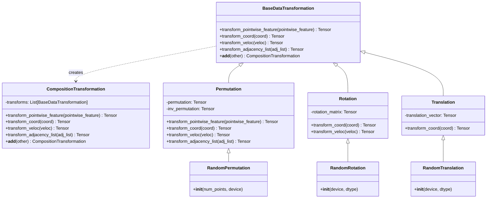
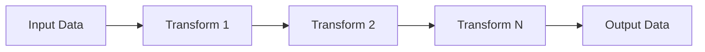
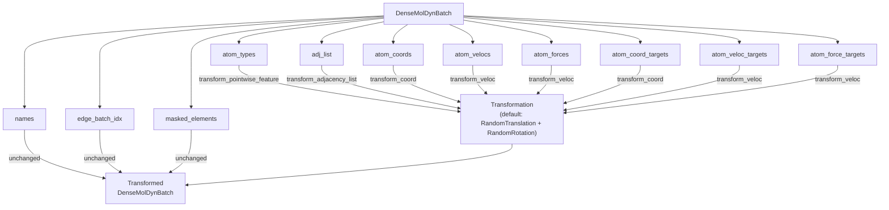
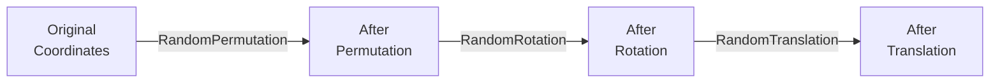

<!-- source: DeepWiki mcp.deepwiki.com · repo microsoft/timewarp · page 6.1 Equivariance Transformations · fetched 2026-10-26 -->

# Equivariance Transformations

<details>
<summary>Relevant source files</summary>

The following files were used as context for generating this wiki page:

- [equivariance/equivariance_transforms.py](equivariance/equivariance_transforms.py)

</details>


## Purpose and Scope

This document describes the transformation classes used to apply geometric symmetries (rotations, translations, permutations) to molecular dynamics data in Timewarp. These transformations enable data augmentation during training and support equivariant model architectures that preserve physical symmetries.

For utility functions that generate random transformation parameters, see [Equivariance Utilities](#6.2). For the broader equivariance system overview, see [Equivariance System](#6).

---

## Transformation Class Hierarchy

The transformation system is built on a base class that defines how different data types (coordinates, velocities, features, adjacency lists) should be transformed. Concrete implementations apply specific geometric operations.



**Sources:** [equivariance/equivariance_transforms.py:15-151]()

---

## Base Transformation Classes

### BaseDataTransformation

The `BaseDataTransformation` class provides the abstract interface for all transformations. By default, it applies identity transforms to all data types.

| Method | Input Type | Output Type | Purpose |
|--------|------------|-------------|---------|
| `transform_pointwise_feature` | `torch.Tensor` | `torch.Tensor` | Transform atom-level features (e.g., atom types) |
| `transform_coord` | `torch.Tensor` | `torch.Tensor` | Transform spatial coordinates |
| `transform_veloc` | `torch.Tensor` | `torch.Tensor` | Transform velocity vectors |
| `transform_adjacency_list` | `torch.Tensor` | `torch.Tensor` | Transform adjacency/connectivity information |

The base class implements all methods as identity functions, returning the input unchanged. Concrete transformations override only the methods relevant to their operation.

**Sources:** [equivariance/equivariance_transforms.py:15-35]()

### CompositionTransformation

The `CompositionTransformation` class allows multiple transformations to be composed sequentially. It stores a list of transforms and applies them in order.



Transformations can be composed using the `+` operator:

```python
# Example: rotation followed by translation
combined = RandomRotation() + RandomTranslation()
```

The `CompositionTransformation` class applies each transform sequentially to coordinates, velocities, features, and adjacency lists.

**Sources:** [equivariance/equivariance_transforms.py:37-85]()

---

## Concrete Transformation Types

### Permutation

The `Permutation` class reorders atoms according to a permutation vector. This is useful for testing permutation invariance and data augmentation.

**Initialization:**
- `permutation`: `torch.Tensor` - A permutation vector where `permutation[i]` indicates the source index for position `i`
- Automatically computes `inv_permutation` using `torch.argsort(permutation)`

**Transformation behavior:**
- `transform_pointwise_feature`: Applies `inv_permutation` to reorder features - [equivariance/equivariance_transforms.py:93-98]()
- `transform_coord`: Applies `inv_permutation` to reorder coordinates - [equivariance/equivariance_transforms.py:100-105]()
- `transform_veloc`: Applies `inv_permutation` to reorder velocities - [equivariance/equivariance_transforms.py:107-112]()
- `transform_adjacency_list`: Applies `permutation` to remap adjacency indices - [equivariance/equivariance_transforms.py:114-115]()

**Limitations:** Currently does not support batched inputs (tensors with `ndim > 2`) - [equivariance/equivariance_transforms.py:94-111]()

**Sources:** [equivariance/equivariance_transforms.py:87-116]()

### Rotation

The `Rotation` class applies a 3D rotation matrix to coordinates and velocities. Rotations preserve distances and angles, making them natural symmetries for molecular systems.

**Initialization:**
- `rotation_matrix`: `torch.Tensor` - A 3×3 orthogonal rotation matrix

**Transformation behavior:**
- `transform_coord`: Applies rotation via matrix multiplication: `(R @ coords.T).T` - [equivariance/equivariance_transforms.py:122-123]()
- `transform_veloc`: Applies same rotation to velocities - [equivariance/equivariance_transforms.py:125-126]()
- Pointwise features and adjacency lists remain unchanged

The implementation uses transpose operations to handle batch dimensions correctly, applying the rotation matrix from the left.

**Sources:** [equivariance/equivariance_transforms.py:118-127]()

### Translation

The `Translation` class applies a constant vector offset to all coordinates. Translation does not affect velocities, forces, or relative positions.

**Initialization:**
- `translation_vector`: `torch.Tensor` - A 3D translation vector

**Transformation behavior:**
- `transform_coord`: Adds translation vector to coordinates: `coords + translation_vector` - [equivariance/equivariance_transforms.py:133-134]()
- Velocities, features, and adjacency lists remain unchanged

**Sources:** [equivariance/equivariance_transforms.py:129-135]()

---

## Random Transformations

The library provides convenience classes that generate random transformation parameters automatically.

| Class | Base Class | Random Parameter | Generation Function |
|-------|------------|------------------|---------------------|
| `RandomPermutation` | `Permutation` | Permutation vector | `random_permutation(num_points, device)` |
| `RandomRotation` | `Rotation` | 3×3 rotation matrix | `random_rotation_matrix(device, dtype)` |
| `RandomTranslation` | `Translation` | 3D translation vector | `random_translation_vector(device, dtype)` |

### RandomPermutation

Creates a permutation of `num_points` atoms using `random_permutation()` from [Equivariance Utilities](#6.2).

**Parameters:**
- `num_points`: `int` - Number of atoms to permute
- `device`: `Optional[str]` - Device for tensor allocation (default: `None`)

**Sources:** [equivariance/equivariance_transforms.py:137-140]()

### RandomRotation

Creates a uniformly distributed random 3D rotation using `random_rotation_matrix()` from [Equivariance Utilities](#6.2).

**Parameters:**
- `device`: `Optional[str]` - Device for tensor allocation (default: `None`)
- `dtype`: `torch.dtype` - Data type for the matrix (default: `torch.float32`)

**Sources:** [equivariance/equivariance_transforms.py:143-145]()

### RandomTranslation

Creates a random translation vector using `random_translation_vector()` from [Equivariance Utilities](#6.2).

**Parameters:**
- `device`: `Optional[str]` - Device for tensor allocation (default: `None`)
- `dtype`: `torch.dtype` - Data type for the vector (default: `torch.float32`)

**Sources:** [equivariance/equivariance_transforms.py:148-150]()

---

## Batch Transformation

### transform_batch Function

The `transform_batch()` function applies transformations to a complete `DenseMolDynBatch` object, transforming all relevant fields.



**Function signature:**
```python
def transform_batch(batch: DenseMolDynBatch, transform=None, dtype=torch.float32) -> DenseMolDynBatch
```

**Parameters:**
- `batch`: `DenseMolDynBatch` - Input batch to transform
- `transform`: `Optional[BaseDataTransformation]` - Transformation to apply. If `None`, defaults to `RandomTranslation() + RandomRotation()` - [equivariance/equivariance_transforms.py:154-156]()
- `dtype`: `torch.dtype` - Data type for transformation parameters (default: `torch.float32`)

**Transformed fields:**
- `atom_types`: Via `transform_pointwise_feature()` - [equivariance/equivariance_transforms.py:160]()
- `adj_list`: Via `transform_adjacency_list()` - [equivariance/equivariance_transforms.py:161]()
- `atom_coords`: Via `transform_coord()` - [equivariance/equivariance_transforms.py:163]()
- `atom_velocs`: Via `transform_veloc()` - [equivariance/equivariance_transforms.py:164]()
- `atom_forces`: Via `transform_veloc()` (forces transform like velocities) - [equivariance/equivariance_transforms.py:165-167]()
- `atom_coord_targets`: Via `transform_coord()` - [equivariance/equivariance_transforms.py:168]()
- `atom_veloc_targets`: Via `transform_veloc()` - [equivariance/equivariance_transforms.py:169]()
- `atom_force_targets`: Via `transform_veloc()` - [equivariance/equivariance_transforms.py:170-172]()

**Unchanged fields:**
- `names`: Molecule identifiers
- `edge_batch_idx`: Batch indexing information
- `masked_elements`: Masking information (TODO: support permutation) - [equivariance/equivariance_transforms.py:173]()

**Sources:** [equivariance/equivariance_transforms.py:153-175]()

---

## Transformation Composition Examples

The `+` operator allows natural composition of transformations:

```python
# Single transformation
rotation_only = RandomRotation()

# Composition of two transformations
rot_trans = RandomRotation() + RandomTranslation()

# Composition of three transformations
full_augment = RandomPermutation(num_atoms) + RandomRotation() + RandomTranslation()
```

When applied to data, transformations execute left-to-right:



**Sources:** [equivariance/equivariance_transforms.py:33-34](), [equivariance/equivariance_transforms.py:77-84]()

---

## Implementation Notes

### Tensor Shape Requirements

Most transformation methods assume unbatched or simply batched tensors:

- **Permutation**: Raises `NotImplementedError` for tensors with `ndim > 2` - [equivariance/equivariance_transforms.py:94-111]()
- **Rotation/Translation**: Handle arbitrary batch dimensions via transpose operations

### Forces as Velocities

Forces are transformed using `transform_veloc()` rather than a separate method, since both are 3D vectors that transform identically under rotations - [equivariance/equivariance_transforms.py:165-172]()

### Device and Dtype Handling

Random transformations accept optional `device` and `dtype` parameters, allowing placement on GPU and control over precision (e.g., `torch.float32` vs `torch.float64`).

**Sources:** [equivariance/equivariance_transforms.py:1-176]()

---

