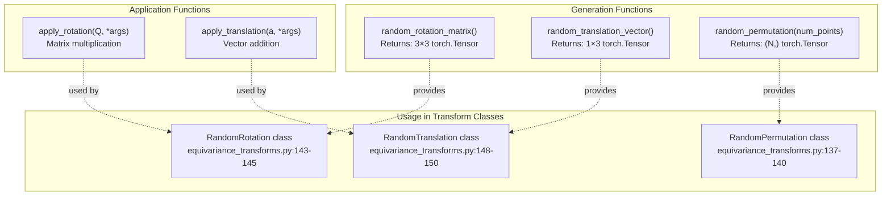
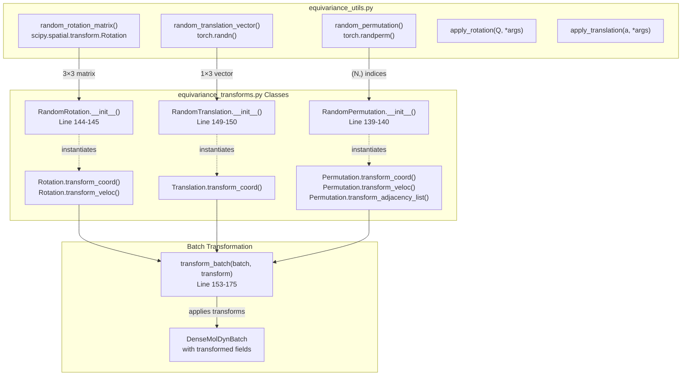

<!-- source: DeepWiki mcp.deepwiki.com · repo microsoft/timewarp · page 6.2 Equivariance Utilities · fetched 2026-10-26 -->

# Equivariance Utilities

<details>
<summary>Relevant source files</summary>

The following files were used as context for generating this wiki page:

- [equivariance/equivariance_transforms.py](equivariance/equivariance_transforms.py)
- [equivariance/equivariance_utils.py](equivariance/equivariance_utils.py)

</details>


## Purpose and Scope

This page documents the low-level utility functions in [equivariance/equivariance_utils.py]() that generate and apply random geometric transformations to molecular data. These utilities provide the mathematical primitives for rotation matrices, translation vectors, and permutations that are used by the transformation classes documented in [Equivariance Transformations](#6.1).

The utilities handle:
- Random rotation matrix generation using uniform distribution over SO(3)
- Random translation vector generation using normal distribution
- Random permutation generation for atom reordering
- Application functions for transformations

For higher-level transformation classes that compose these utilities, see [Equivariance Transformations](#6.1).

---

## Utility Function Overview

The module provides five core functions that serve as building blocks for geometric transformations:

| Function | Return Type | Purpose |
|----------|-------------|---------|
| `random_rotation_matrix()` | `torch.Tensor` (3×3) | Generate uniformly distributed rotation matrix |
| `random_translation_vector()` | `torch.Tensor` (1×3) | Generate normally distributed translation vector |
| `random_permutation()` | `torch.Tensor` (N,) | Generate random ordering of N points |
| `apply_rotation()` | `tuple` | Apply rotation matrix to multiple tensors |
| `apply_translation()` | `tuple` | Apply translation vector to multiple tensors |



**Sources:** [equivariance/equivariance_utils.py:1-29](), [equivariance/equivariance_transforms.py:7-11]()

---

## Random Rotation Matrix Generation

The `random_rotation_matrix()` function generates a uniformly distributed rotation matrix from SO(3) (the special orthogonal group in 3D).

### Function Signature

```python
def random_rotation_matrix(device=None, dtype=torch.float32)
```

### Implementation Details

The function uses `scipy.spatial.transform.Rotation.random()` to generate a uniformly distributed random rotation, then converts it to a PyTorch tensor:

1. Generate random rotation using scipy's uniform distribution over SO(3)
2. Convert to 3×3 rotation matrix representation
3. Convert to PyTorch tensor with specified dtype
4. Move to specified device (CPU or GPU)

The rotation matrix Q satisfies:
- Q^T Q = I (orthogonality)
- det(Q) = 1 (proper rotation, no reflection)

### Parameters

| Parameter | Type | Default | Description |
|-----------|------|---------|-------------|
| `device` | Optional[str] | `None` | Target device (e.g., "cuda:0", "cpu") |
| `dtype` | torch.dtype | `torch.float32` | Data type for output tensor |

### Returns

A `torch.Tensor` of shape (3, 3) representing a uniformly distributed random rotation matrix.

**Sources:** [equivariance/equivariance_utils.py:5-8]()

---

## Random Translation Vector Generation

The `random_translation_vector()` function generates a translation vector sampled from a standard normal distribution.

### Function Signature

```python
def random_translation_vector(device=None, dtype=torch.float32)
```

### Implementation Details

The function generates a 3D translation vector where each component is independently sampled from N(0, 1):

1. Sample 3 values from standard normal distribution
2. Reshape to (1, 3) for broadcasting compatibility
3. Move to specified device

The shape (1, 3) allows the translation to be broadcast across batches of coordinates during application.

### Parameters

| Parameter | Type | Default | Description |
|-----------|------|---------|-------------|
| `device` | Optional[str] | `None` | Target device (e.g., "cuda:0", "cpu") |
| `dtype` | torch.dtype | `torch.float32` | Data type for output tensor |

### Returns

A `torch.Tensor` of shape (1, 3) containing the translation vector components.

**Sources:** [equivariance/equivariance_utils.py:16-19]()

---

## Random Permutation Generation

The `random_permutation()` function generates a random ordering of integers from 0 to N-1, used to permute atom indices.

### Function Signature

```python
def random_permutation(num_points: int, device=None) -> torch.Tensor
```

### Implementation Details

Uses PyTorch's `torch.randperm()` to generate a random permutation of indices:

1. Generate permutation of [0, 1, ..., num_points-1]
2. Move to specified device

This permutation can be used to reorder atoms while maintaining molecular connectivity through adjacency list updates.

### Parameters

| Parameter | Type | Description |
|-----------|------|-------------|
| `num_points` | int | Number of points (atoms) to permute |
| `device` | Optional[str] | Target device (e.g., "cuda:0", "cpu") |

### Returns

A `torch.Tensor` of shape (num_points,) containing a random permutation of indices.

**Sources:** [equivariance/equivariance_utils.py:27-28]()

---

## Application Functions

The module provides helper functions to apply transformations to multiple tensors simultaneously.

### Rotation Application

```python
def apply_rotation(Q, *args)
```

Applies rotation matrix Q to multiple coordinate tensors. For each input tensor, computes `(Q @ arg.T).T`, which is equivalent to applying the rotation to each row (point) in the tensor.

**Mathematical Operation:**
```
For input x of shape (N, 3):
output = x @ Q^T  (equivalent to (Q @ x^T)^T)
```

**Parameters:**
- `Q`: Rotation matrix (3×3 tensor)
- `*args`: Variable number of coordinate tensors to rotate

**Returns:** Tuple of rotated tensors in same order as inputs

### Translation Application

```python
def apply_translation(a, *args)
```

Applies translation vector to multiple coordinate tensors by broadcasting addition.

**Mathematical Operation:**
```
For input x of shape (N, 3) and translation a of shape (1, 3):
output = x + a
```

**Parameters:**
- `a`: Translation vector (1×3 tensor)
- `*args`: Variable number of coordinate tensors to translate

**Returns:** Tuple of translated tensors in same order as inputs

**Sources:** [equivariance/equivariance_utils.py:11-24]()

---

## Integration with Transformation System

The utilities are consumed by the random transformation classes in `equivariance_transforms.py`. The following diagram shows the data flow from utility generation to batch transformation:



### Usage Pattern

The typical usage pattern follows this sequence:

1. **Generation Phase:** Utility functions generate random transformations
   - `random_rotation_matrix()` → 3×3 matrix
   - `random_translation_vector()` → 1×3 vector
   - `random_permutation(N)` → permutation indices

2. **Instantiation Phase:** Random classes wrap utilities in transformation objects
   - `RandomRotation()` → `Rotation` instance
   - `RandomTranslation()` → `Translation` instance
   - `RandomPermutation(N)` → `Permutation` instance

3. **Composition Phase:** Transformations can be composed using `+` operator
   - `RandomTranslation() + RandomRotation()` → `CompositionTransformation`

4. **Application Phase:** `transform_batch()` applies composed transformations
   - Transforms coordinates: `atom_coords`, `atom_coord_targets`
   - Transforms velocities: `atom_velocs`, `atom_veloc_targets`
   - Transforms forces: `atom_forces`, `atom_force_targets`
   - Updates adjacency lists for permutations

**Sources:** [equivariance/equivariance_transforms.py:137-176]()

---

## Device and Dtype Management

All generation functions support explicit device and dtype specification for efficient GPU training:

```python
# Generate transformations on GPU with float32
rot_matrix = random_rotation_matrix(device="cuda:0", dtype=torch.float32)
trans_vector = random_translation_vector(device="cuda:0", dtype=torch.float32)
perm_indices = random_permutation(num_points=100, device="cuda:0")
```

**Device Handling:**
- If `device=None`, tensors are created on CPU
- Device specification matches PyTorch conventions ("cuda:0", "cpu", etc.)
- Transformation classes inherit device from utility functions

**Dtype Handling:**
- Default is `torch.float32` for numerical stability
- `torch.float64` can be used for higher precision if needed
- Permutation indices are always integer type regardless of dtype argument

**Sources:** [equivariance/equivariance_utils.py:5-28]()

---

## Mathematical Properties

The utilities preserve important mathematical properties required for equivariant transformations:

### Rotation Properties

| Property | Description |
|----------|-------------|
| Orthogonality | Q^T Q = I (preserves distances and angles) |
| Proper rotation | det(Q) = 1 (no reflection) |
| Uniform distribution | Samples uniformly from SO(3) using scipy |
| Linearity | Q(ax + by) = aQ(x) + bQ(y) |

### Translation Properties

| Property | Description |
|----------|-------------|
| Normal distribution | Each component ~ N(0, 1) independently |
| Broadcast compatible | Shape (1, 3) broadcasts across batch dimension |
| Affine operation | Preserves lines and parallelism |

### Permutation Properties

| Property | Description |
|----------|-------------|
| Bijection | One-to-one mapping of indices |
| Invertible | `torch.argsort()` computes inverse |
| Uniform distribution | All orderings equally likely |
| Graph structure preserved | Adjacency lists updated accordingly |

**Sources:** [equivariance/equivariance_utils.py:1-29]()

---

