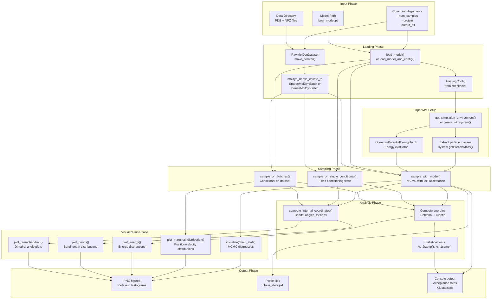
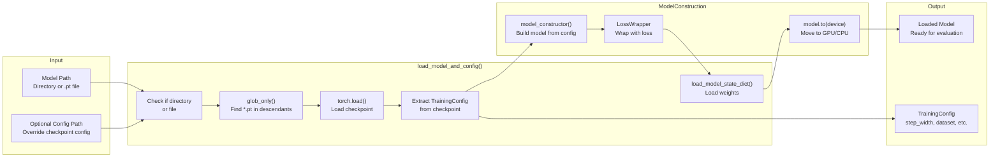
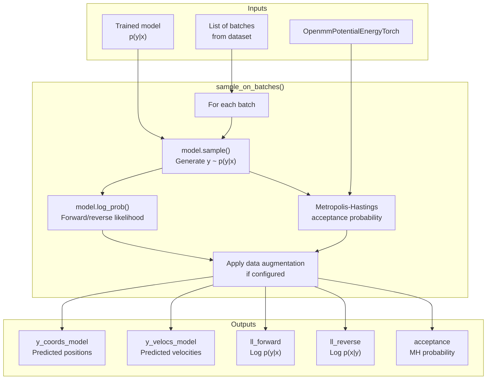
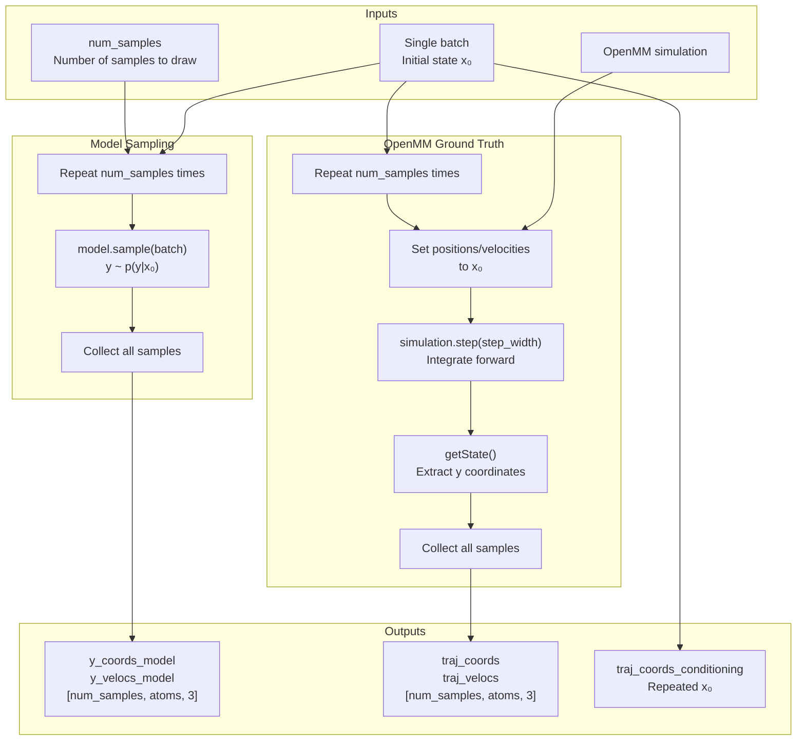
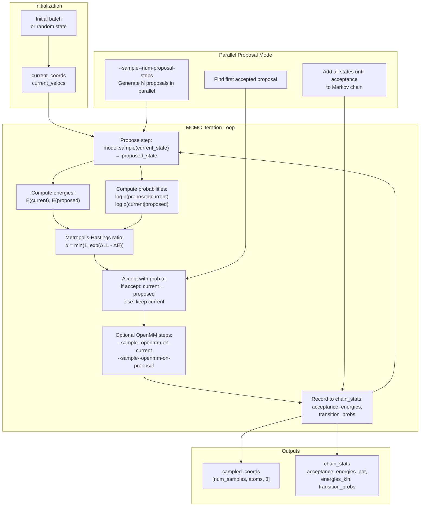
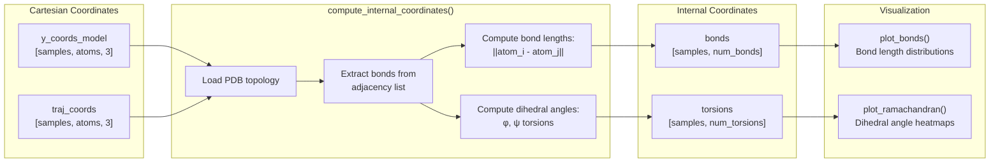
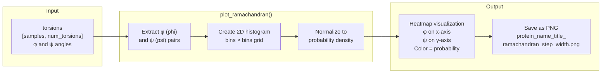
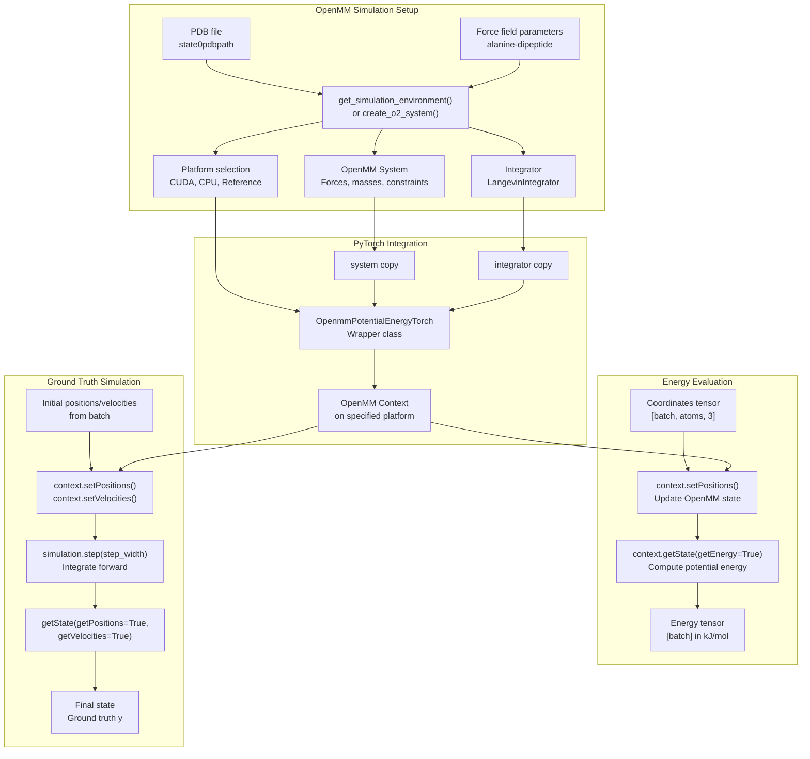
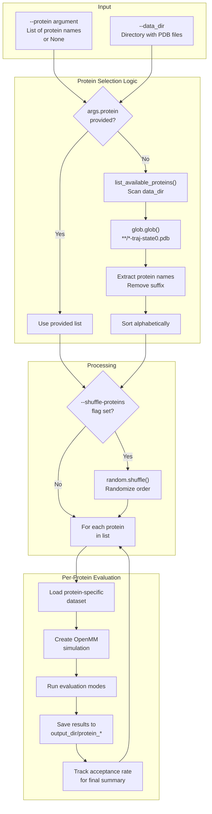

<!-- source: DeepWiki mcp.deepwiki.com · repo microsoft/timewarp · page 7 Evaluation and Analysis · fetched 2026-10-26 -->

# Evaluation and Analysis

<details>
<summary>Relevant source files</summary>

The following files were used as context for generating this wiki page:

- [README.md](README.md)
- [evaluate.py](evaluate.py)
- [evaluate_o2.py](evaluate_o2.py)

</details>


This page provides a comprehensive guide to evaluating trained Timewarp models. It covers the evaluation scripts, metrics, visualizations, and sampling strategies available for assessing model quality and physical accuracy.

For information about training models, see [Training](#5). For details on specific evaluation scripts, see [Sampling Script](#7.1), [Peptide Evaluation](#7.2), [O2 Molecule Evaluation](#7.3), and [Trajectory Exploration](#7.4).

## Overview of the Evaluation System

The Timewarp evaluation system consists of multiple specialized scripts that assess different aspects of model performance. Each script is designed for specific molecular systems and evaluation objectives:

| Script | Primary Purpose | Target Systems | Key Features |
|--------|----------------|----------------|--------------|
| `sample.py` | General visualization and sampling | All systems | Trajectory visualization, energy plots, basic sampling |
| `evaluate.py` | Comprehensive peptide evaluation | Di-peptides, Tetra-peptides | Ramachandran plots, internal coordinates, Metropolis-Hastings sampling |
| `evaluate_o2.py` | O2 molecule evaluation | O2, O2-CoM datasets | Bond length distributions, KS tests, harmonic oscillator comparison |
| `exploration.py` | Long trajectory generation | All systems | Extended sampling with energy-based acceptance |

All evaluation scripts share common functionality: they load trained models, sample from the learned conditional distribution `p(y|x)`, compare predictions against OpenMM ground truth simulations, and generate visualizations to assess physical accuracy.

Sources: [README.md:29-74](), [evaluate.py:1-47](), [evaluate_o2.py:1-28]()

## Evaluation Workflow

The following diagram illustrates the standard evaluation workflow used across all evaluation scripts:



**Evaluation Workflow Phases**

The evaluation process follows five distinct phases:

1. **Loading Phase**: Model checkpoints and datasets are loaded. The `load_model_and_config()` function [evaluate.py:49-91]() retrieves both the model state and its configuration. Datasets are created using `RawMolDynDataset` and collated into batches.

2. **OpenMM Setup**: A simulation environment is configured to provide ground truth physics. For peptides, `get_simulation_environment()` [evaluate.py:292]() creates the OpenMM system. For O2 molecules, `create_o2_system()` [evaluate_o2.py:98]() is used. The `OpenmmPotentialEnergyTorch` wrapper [evaluate.py:296-301]() enables efficient energy evaluation on GPU.

3. **Sampling Phase**: Three sampling modes are available:
   - `sample_on_batches()` [evaluate.py:367-375](): Samples from `p(y|x)` for each conditioning state in the dataset
   - `sample_on_single_conditional()` [evaluate.py:576-584](): Samples multiple times from a fixed conditioning state
   - `sample_with_model()` [evaluate.py:680-697](): Generates long trajectories using MCMC with optional Metropolis-Hastings correction

4. **Analysis Phase**: Predictions are analyzed using:
   - Internal coordinates (bonds, angles, torsions) via `compute_internal_coordinates()` [evaluate.py:334-336]()
   - Energy calculations for potential and kinetic energy [evaluate.py:347-349]()
   - Statistical tests like Kolmogorov-Smirnov to compare distributions [evaluate_o2.py:152]()

5. **Visualization Phase**: Results are visualized through multiple plot types:
   - Ramachandran plots for dihedral angles [evaluate.py:333-344]()
   - Bond length distributions [evaluate.py:495-506]()
   - Energy distributions [evaluate.py:542-559]()
   - Marginal position/velocity distributions [evaluate.py:382-394]()
   - MCMC chain statistics [evaluate.py:759-773]()

Sources: [evaluate.py:49-91](), [evaluate.py:292-301](), [evaluate.py:367-375](), [evaluate.py:680-697]()

## Model and Configuration Loading

The evaluation scripts use a consistent approach to load trained models and their configurations:



**Key Loading Functions**

The `load_model_and_config()` function [evaluate.py:49-91]() handles two loading scenarios:

1. **Standard Loading** (no `config_path` specified): Loads the complete checkpoint including both model state and configuration [evaluate.py:82-89](). This is the typical case.

2. **Config Override** (with `config_path`): Loads configuration from a separate file while using weights from the checkpoint [evaluate.py:72-78](). This is useful if the checkpoint's config is corrupted or needs modification.

The function automatically detects whether `model_path` is a file or directory. When given a directory, it uses `glob_only()` [evaluate.py:85]() to search for checkpoint files in descendant directories, supporting both standard and DeepSpeed training runs.

Sources: [evaluate.py:49-91](), [evaluate.py:82-89]()

## Evaluation Modes and Sampling Strategies

The evaluation system supports three primary sampling modes, each serving different evaluation purposes:

### Sampling Mode Comparison

| Mode | Function | Purpose | Key Parameters | Output |
|------|----------|---------|----------------|--------|
| **Conditional on Dataset** | `sample_on_batches()` | Evaluate conditional distribution accuracy | `batches`, `model`, `device` | Predictions for each data point |
| **Fixed Conditioning** | `sample_on_single_conditional()` | Analyze single conditional distribution | `batch`, `num_samples`, `simulation` | Multiple samples from p(y\|x₀) |
| **MCMC Sampling** | `sample_with_model()` | Generate long trajectories | `mh`, `num_proposal_steps`, `openmm_on_*` | Markov chain samples |

### Conditional Sampling on Dataset

This mode evaluates how well the model captures the conditional distribution by sampling from `p(y|x)` for each conditioning state in the dataset:



The `sample_on_batches()` function [evaluate.py:367-375]() processes each batch independently and computes:
- Forward log-likelihood `log p(y|x)` [evaluate.py:363]()
- Reverse log-likelihood `log p(x|y)` [evaluate.py:364]()
- Metropolis-Hastings acceptance probability [evaluate.py:366]()

This mode is enabled by default in `evaluate.py` and can be disabled with `--not-on-data` [evaluate.py:145-147]().

### Fixed Conditioning Sampling

This mode samples multiple times from the same conditioning state to visualize the full conditional distribution:



The `sample_on_single_conditional()` function [evaluate.py:576-584]() is useful for:
- Visualizing the spread of the conditional distribution [evaluate.py:591-606]()
- Comparing model variance to OpenMM variance
- Creating detailed plots centered on a single initial state

This mode is enabled by default unless `--no-conditional` is specified [evaluate.py:140-143]().

### MCMC Sampling with Metropolis-Hastings

This mode generates long trajectories by iteratively sampling from the model and optionally applying Metropolis-Hastings acceptance:



The `sample_with_model()` function [evaluate.py:680-697]() provides several MCMC options:

**Metropolis-Hastings Correction** (`--mh` flag [evaluate.py:130-133]()):
- Computes acceptance probability based on energy changes and likelihood ratios
- Ensures detailed balance and produces physically valid samples
- Essential for accurate equilibrium sampling

**Parallel Proposals** (`--sample--num-proposal-steps` [evaluate.py:210-214]()):
- Generates multiple proposals per iteration in parallel [evaluate.py:695]()
- All states until the first accepted one are added to the chain
- Significantly speeds up sampling when acceptance rates are low

**Adaptive Parallelism** (`--sample--adaptive-parallelism` [evaluate.py:215-219]()):
- Dynamically adjusts number of parallel proposals [evaluate.py:696]()
- Based on smoothed average of recent acceptance rates
- Balances computational cost with sampling efficiency

**OpenMM Integration** (`--sample--openmm-on-current` or `--sample--openmm-on-proposal` [evaluate.py:194-208]()):
- Performs OpenMM simulation steps on current or proposed states [evaluate.py:692-694]()
- Useful for hybrid sampling strategies
- Number of steps controlled by `--sample--num-openmm-steps` [evaluate.py:204-208]()

Sources: [evaluate.py:367-375](), [evaluate.py:576-584](), [evaluate.py:680-697]()

## Key Metrics and Statistical Tests

The evaluation system computes various metrics to quantify model performance and physical accuracy:

### Energy Metrics

| Metric | Computation | Physical Interpretation |
|--------|-------------|------------------------|
| **Potential Energy** | `OpenmmPotentialEnergyTorch(coords)` | Force field energy (kJ/mol) |
| **Kinetic Energy** | `compute_kinetic_energy(velocs, masses)` | 0.5 * m * v² summed over atoms |
| **Total Energy** | Potential + Kinetic | Conserved in NVE ensemble |
| **ΔE (Energy Change)** | E(proposed) - E(current) | Used in MH acceptance |

**Energy Distribution Comparison**: The `plot_energy()` function [evaluate.py:542-559]() creates histograms comparing model-generated energies against OpenMM ground truth. For physically accurate models, these distributions should closely overlap.

### Internal Coordinate Metrics

Internal coordinates provide geometry-based validation:



The `compute_internal_coordinates()` function [evaluate.py:488-494]() extracts:
- **Bond lengths**: Distances between bonded atoms, should match equilibrium values
- **Dihedral angles**: Backbone φ and ψ angles for peptides, visualized in Ramachandran plots

### Statistical Tests

**Kolmogorov-Smirnov (KS) Test**: Quantifies the difference between two probability distributions:

For O2 molecules [evaluate_o2.py:152]():
```python
ks_result, p_value = ks_2samp(bond_length, bond_length_openmm)
```
- Tests whether model and OpenMM bond length distributions are statistically similar
- Low p-values indicate significant distribution differences
- KS statistic measures maximum distance between cumulative distributions

For velocity distributions [evaluate.py:722-725]():
```python
ks = scipy_stats.ks_1samp(
    2 * chain_stats.energies_kin, 
    scipy_stats.chi2(df=num_atoms * 3).cdf
)
```
- Tests if velocity norms follow the expected χ² distribution
- Validates Maxwell-Boltzmann velocity distribution
- Kinetic energies should follow χ²(3N) distribution at equilibrium

### MCMC Diagnostics

The `ChainStats` object [evaluate.py:748-750]() tracks sampling quality:

| Diagnostic | Interpretation | Visualization |
|------------|----------------|---------------|
| **Acceptance Rate** | Fraction of proposals accepted | Should be 20-50% for efficient sampling |
| **Energy Trajectories** | E_pot and E_kin over time | Should fluctuate around equilibrium values |
| **Transition Probabilities** | Forward and reverse log-likelihoods | Indicates model reversibility quality |
| **Energy Deltas** | ΔE_pot and ΔE_kin | Shows energy barriers encountered |

The `visualize()` function [evaluate.py:759-773]() generates diagnostic plots showing these metrics over the MCMC trajectory.

Sources: [evaluate.py:347-349](), [evaluate.py:488-494](), [evaluate.py:542-559](), [evaluate_o2.py:152](), [evaluate.py:722-725](), [evaluate.py:748-773]()

## Visualization Outputs

The evaluation system generates comprehensive visualizations across multiple plot types:

### Ramachandran Plots

Ramachandran plots visualize the distribution of backbone dihedral angles (φ, ψ) in peptides:



The `plot_ramachandran()` function [evaluate.py:333-344]() creates heatmaps showing:
- Favored regions of conformational space (α-helix, β-sheet)
- Agreement between model and OpenMM distributions
- Proper sampling of rare conformations

Ramachandran plots are generated for three scenarios [evaluate.py:509-525]():
1. **Model samples**: Conditioned on dataset states
2. **OpenMM samples**: Ground truth from simulation
3. **Model MCMC samples**: Long trajectory sampling [evaluate.py:838-846]()

### Bond Length Distributions

Bond length plots compare geometric accuracy between model and OpenMM:

The `plot_bonds()` function [evaluate.py:495-506]() creates histograms for each bond type showing:
- Distribution overlap between model and OpenMM [evaluate.py:620-633]()
- Deviation from equilibrium bond lengths
- Bond-specific errors

For O2 molecules, bond lengths are compared against the theoretical harmonic oscillator distribution [evaluate_o2.py:129-148]().

### Energy Distributions

Energy plots validate thermodynamic properties:

The `plot_energy()` function [evaluate.py:542-559]() generates:
- **Potential energy histograms**: Should match Boltzmann distribution shape [evaluate.py:777-814]()
- **Kinetic energy histograms**: Should follow Maxwell-Boltzmann distribution [evaluate.py:551-559]()
- Overlay of model and OpenMM distributions for direct comparison

### Marginal Position and Velocity Distributions

The `plot_marginal_distribution()` function [evaluate.py:382-394]() creates:
- Per-atom position change distributions (Δx = y - x)
- Per-atom velocity distributions
- Comparison between model, OpenMM, and optionally dataset background distributions [evaluate.py:604]()

### MCMC Chain Diagnostics

For MCMC sampling, the `visualize()` function [evaluate.py:759-773]() produces time-series plots:

| Plot Type | Content | Purpose |
|-----------|---------|---------|
| **Acceptance Trace** | Acceptance rate over iterations | Check for consistent sampling |
| **Energy Traces** | E_pot and E_kin over time | Verify equilibration |
| **Transition Probabilities** | log p(y\|x) and log p(x\|y) | Assess model reversibility |
| **Energy Deltas** | ΔE_pot and ΔE_kin distributions | Identify energy barriers |

The `visualize()` function can display either absolute values or deltas (changes from previous state) using the `delta=True` parameter [evaluate.py:764-773]().

### Output Organization

All visualizations are saved to the output directory with systematic naming:

```
output_dir/
  ├── {protein}_sample_on_data_marginal_distribution_{step_width}.png
  ├── {protein}_sample_on_data_correlation_openmm_{step_width}.png
  ├── {protein}_sample_on_data_ramachandran_{step_width}.png
  ├── {protein}_sample_on_data_bonds_{step_width}.png
  ├── {protein}_sample_on_samples_potential_energy_distribution_step_width_{step_width}.png
  ├── {protein}_chain_stats.pkl  # Serialized ChainStats object
  ├── {protein}_chain_stats.png  # MCMC diagnostics
  └── ...
```

The naming convention includes:
- Protein/molecule identifier
- Evaluation mode (`sample_on_data`, `sample_on_conditioning`, `sample_on_samples`)
- Plot type (`ramachandran`, `bonds`, `energy`, etc.)
- Step width parameter

Sources: [evaluate.py:333-344](), [evaluate.py:495-506](), [evaluate.py:542-559](), [evaluate.py:382-394](), [evaluate.py:759-773]()

## Command-Line Interface

The evaluation scripts provide extensive command-line options for customization:

### Common Arguments

| Argument | Type | Default | Description |
|----------|------|---------|-------------|
| `--savefile` | str | Required | Path to trained model checkpoint (best_model.pt) |
| `--data_dir` | str | Required | Path to directory containing PDB and NPZ files |
| `--protein` | str | All proteins | Specific protein(s) to evaluate (space-separated list) |
| `--num_samples` | int | 1000 | Number of samples to generate |
| `--output_dir` | str | Auto-generated | Directory to save output figures and statistics |
| `--device` | str | Auto (CUDA/CPU) | Device to use for evaluation |
| `--seed` | int | 42 | Random seed for reproducibility |

### Peptide Evaluation Arguments (`evaluate.py`)

**Sampling Control**:
- `--mh`: Enable Metropolis-Hastings correction [evaluate.py:130-133]()
- `--no-sample`: Skip MCMC sampling phase [evaluate.py:135-138]()
- `--no-conditional`: Skip fixed conditioning evaluation [evaluate.py:140-143]()
- `--not-on-data`: Skip conditional sampling on dataset [evaluate.py:145-147]()

**Velocity Options**:
- `--random-velocities`: Treat velocities as isotropic Gaussians [evaluate.py:161-164]()
- `--resample-velocities`: Resample velocities at each MCMC iteration [evaluate.py:166-169]()

**MCMC Advanced Options**:
- `--sample--num-proposal-steps`: Number of parallel proposals per iteration [evaluate.py:210-214]()
- `--sample--adaptive-parallelism`: Adaptively adjust proposal count [evaluate.py:215-219]()
- `--sample--openmm-on-current`: Run OpenMM on current state [evaluate.py:194-197]()
- `--sample--openmm-on-proposal`: Run OpenMM on proposed state [evaluate.py:198-202]()
- `--sample--num-openmm-steps`: OpenMM steps per iteration [evaluate.py:204-208]()
- `--sample--initialize-randomly`: Random initialization instead of data [evaluate.py:188-192]()

### O2 Evaluation Arguments (`evaluate_o2.py`)

| Argument | Type | Default | Description |
|----------|------|---------|-------------|
| `--sample` | bool | False | Whether to perform MCMC sampling with model |

### Example Commands

**Basic peptide evaluation** [README.md:53-60]():
```bash
python evaluate.py \
    path-to-model-output-directory/best_model.pt \
    --data_dir path-to-directory-containing-protein-data/ \
    --num_samples 1000 \
    --output_dir path-to-directory-to-save-figures/
```

**MCMC sampling with Metropolis-Hastings** [README.md:64-72]():
```bash
python evaluate.py \
    path-to-model-output-directory/best_model.pt \
    --data_dir path-to-directory-containing-protein-data/ \
    --num_samples 1000 \
    --output_dir path-to-directory-to-save-figures/ \
    --mh \
    --sample--num-proposal-steps 1000
```

**O2 molecule evaluation** [README.md:43-50]():
```bash
python evaluate_o2.py \
    --savefile path-to-model-output-directory/best_model.pt \
    --data_dir path-to-directory-containing-protein-data/ \
    --num_samples 20 \
    --output_dir path-to-directory-to-save-figures/ \
    --sample True
```

Sources: [README.md:53-72](), [evaluate.py:103-227](), [evaluate_o2.py:31-52]()

## Integration with OpenMM

All evaluation scripts integrate with OpenMM to provide ground truth physics-based comparisons:



### OpenMM System Creation

For peptides [evaluate.py:290-292]():
```python
simulation = get_simulation_environment(state0pdbpath, parameters)
integrator = get_simulation_environment_integrator(parameters)
system = simulation.system
```

For O2 molecules [evaluate_o2.py:98-101]():
```python
system, topology = create_o2_system()
integrator = mm.LangevinIntegrator(310 * u.kelvin, 1 / u.picosecond, 1 * u.femtosecond)
simulation = mm.app.Simulation(topology, system, integrator)
```

### Energy Computation Bridge

The `OpenmmPotentialEnergyTorch` wrapper [evaluate.py:296-301]() enables efficient GPU-based energy evaluation:

```python
platform, platform_properties = device_to_platform_and_properties(device, num_threads=1)
openmm_potential_energy_torch = OpenmmPotentialEnergyTorch(
    system,
    integrator,
    platform_name=platform,
    platform_properties=platform_properties,
)
```

This wrapper:
- Accepts PyTorch tensors as input
- Returns PyTorch tensors as output
- Maintains gradients if needed
- Runs on the specified platform (CUDA, CPU, etc.)

### Ground Truth Trajectory Generation

For single conditional evaluation [evaluate_o2.py:105-111]():
```python
for _ in range(args.num_samples):
    simulation.context.setPositions(batch.atom_coords.squeeze(0).cpu().numpy())
    simulation.context.setVelocities(batch.atom_velocs.squeeze(0).cpu().numpy())
    simulation.step(step_width)
    state = simulation.context.getState(getPositions=True, getVelocities=True)
    openMM_samples.append(state.getPositions(asNumpy=True)._value)
```

This process:
1. Resets the simulation to the initial state
2. Integrates forward by `step_width` timesteps
3. Extracts the final positions and velocities
4. Repeats to generate multiple independent trajectories from the same starting point

### Mass Extraction

Particle masses are extracted for kinetic energy calculations [evaluate.py:303-305]():
```python
num_atoms = system.getNumParticles()
masses = [system.getParticleMass(i).value_in_unit(u.dalton) for i in range(num_atoms)]
masses = torch.tensor(masses).to(device)
```

These masses are used in:
- `compute_kinetic_energy()` function [evaluate.py:536-539]()
- Metropolis-Hastings acceptance calculations
- Velocity distribution validation

Sources: [evaluate.py:290-305](), [evaluate_o2.py:98-111]()

## Protein Selection and Iteration

The evaluation scripts support flexible protein selection for batch evaluation:



### Protein Discovery

The `list_available_proteins()` function [evaluate.py:94-99]() automatically discovers available proteins:

```python
protein_filenames = glob.glob(
    os.path.join(str(pdb_dir), "**/*-traj-state0.pdb"), recursive=True
)
num_chars_to_drop = len("-traj-state0.pdb")
return sorted([os.path.split(f)[-1][:-num_chars_to_drop] for f in protein_filenames])
```

This searches recursively for all PDB files matching the pattern `*-traj-state0.pdb` and extracts the protein identifiers.

### Protein Loop

The main evaluation loop [evaluate.py:282-288]():

```python
proteins = args.protein if args.protein is not None else list_available_proteins(args.data_dir)
if args.shuffle_proteins:
    random.shuffle(proteins)

average_acceptance_rate_all_proteins = []
for protein in proteins:
    print(f"Running evaluation for {protein}...")
    # ... per-protein evaluation ...
```

**Per-protein execution**:
1. Load protein-specific PDB file [evaluate.py:290]()
2. Create OpenMM simulation environment [evaluate.py:292]()
3. Load trajectory dataset for this protein [evaluate.py:308-312]()
4. Run all enabled evaluation modes
5. Save results with protein name in filename
6. Track acceptance rate for summary statistics [evaluate.py:701]()

### Final Summary

After evaluating all proteins, a summary is generated [evaluate.py:857-864]():

```python
if len(average_acceptance_rate_all_proteins) > 0:
    print(
        f"Average acceptance rate over all: {np.array(average_acceptance_rate_all_proteins).mean()}"
    )
    plt.figure(figsize=(16, 9))
    plt.hist(average_acceptance_rate_all_proteins)
    plt.savefig(os.path.join(output_dir, "acceptance_rate.png"))
```

This provides:
- Mean acceptance rate across all proteins
- Histogram of per-protein acceptance rates
- Saved to `acceptance_rate.png` in output directory

Sources: [evaluate.py:94-99](), [evaluate.py:282-288](), [evaluate.py:857-864]()

## Error Handling and Warnings

The evaluation scripts include several validation checks and warnings:

### Data Availability Warning

If the requested number of samples exceeds available data [evaluate.py:315-321]():

```python
if args.num_samples > len(batches):
    warnings.warn(
        (
            f"The data set consists of only {len(batches)} datapoints."
            f"Hence, some evaluation functions will only use {len(batches)}."
        )
    )
```

This prevents errors when datasets have limited trajectory data.

### Sample Count Recommendation

For O2 evaluation [evaluate_o2.py:83-84]():
```python
if args.num_samples < 10000:
    warnings.warn("It is recommended to use 10000 samples.")
```

Statistical tests require sufficient samples for reliable results.

### Unsupported Dataset Detection

For O2 evaluation script [evaluate_o2.py:66-74]():
```python
if data_set == "O2" or data_set == "O2-CoM":
    protein = "o2"
elif data_set == "AD-1":
    raise ValueError(
        f"So far the evaluation is not implemented for the {data_set} dataset. It is only available for the O2 dataset."
    )
else:
    raise ValueError(...)
```

This ensures the correct evaluation script is used for each dataset type.

### Device Selection

Device selection with fallback [evaluate.py:268-273]():
```python
device = (
    torch.device("cuda" if torch.cuda.is_available() else "cpu")
    if args.device is None
    else torch.device(args.device)
)
print(f"Using device: {device}")
```

Automatically selects CUDA if available, with manual override option.

Sources: [evaluate.py:315-321](), [evaluate_o2.py:83-84](), [evaluate_o2.py:66-74](), [evaluate.py:268-273]()

---

