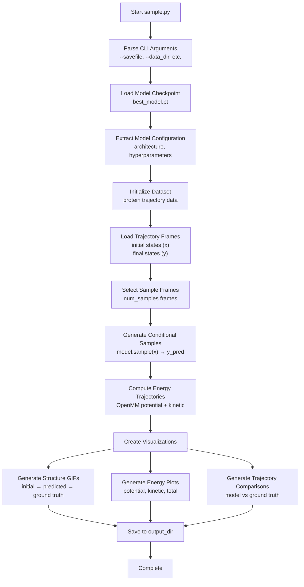
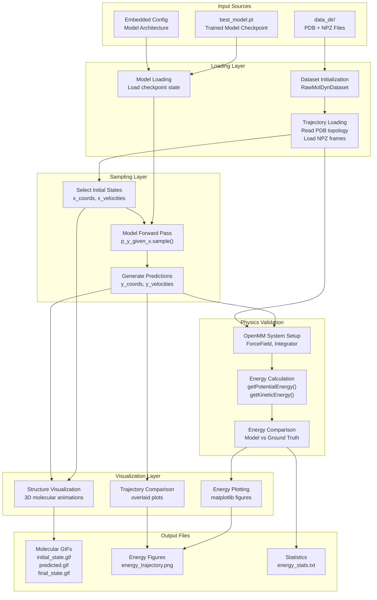
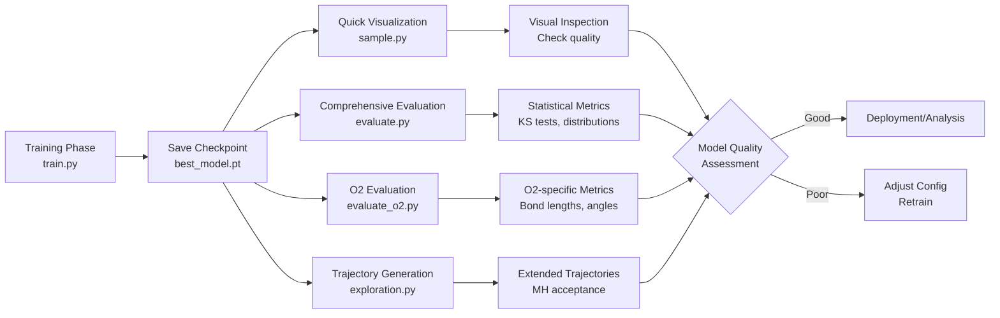

<!-- source: DeepWiki mcp.deepwiki.com · repo microsoft/timewarp · page 7.1 Sampling Script · fetched 2026-10-26 -->

# Sampling Script

<details>
<summary>Relevant source files</summary>

The following files were used as context for generating this wiki page:

- [README.md](README.md)

</details>


## Purpose and Scope

The sampling script (`sample.py`) is a general-purpose evaluation tool for generating visualizations and conditional samples from trained Timewarp models. This script provides a quick way to visually inspect model behavior by producing trajectory animations, energy plots, and molecular structure visualizations for a specified protein system.

For more comprehensive evaluation with statistical metrics and Metropolis-Hastings sampling, see [Peptide Evaluation](#7.2). For specialized oxygen molecule evaluation, see [O2 Molecule Evaluation](#7.3). For generating extended trajectories with energy-based acceptance, see [Trajectory Exploration](#7.4).

**Sources:** [README.md:29-40]()

## Overview

The `sample.py` script performs the following operations:

1. **Loads a trained model checkpoint** from a specified output directory
2. **Loads molecular dynamics trajectory data** for a specified protein system
3. **Generates conditional samples** by sampling from the learned distribution p(y|x)
4. **Computes energy trajectories** using OpenMM for both predictions and ground truth
5. **Creates visualizations** including molecular structure GIFs, energy plots, and trajectory comparisons

This script is designed for quick qualitative assessment of model performance and is typically the first evaluation step after training completes.

**Sources:** [README.md:29-40]()

## Command-Line Interface

### Basic Usage

```bash
python sample.py \
    --savefile path-to-model-output-directory/best_model.pt \
    --data_dir path-to-directory-containing-protein-data/ \
    --protein protein-pdb-name \
    --num_samples 20 \
    --output_dir path-to-directory-to-save-figures/
```

### Required Arguments

| Argument | Type | Description |
|----------|------|-------------|
| `--savefile` | String | Path to the trained model checkpoint file (`best_model.pt`) |
| `--data_dir` | String | Directory containing the molecular dynamics trajectory data (PDB and NPZ files) |
| `--protein` | String | PDB identifier for the protein system to evaluate (e.g., `AD-1`, `AT-1`) |
| `--num_samples` | Integer | Number of conditional samples to generate from the model |
| `--output_dir` | String | Directory where generated figures and visualizations will be saved |

**Sources:** [README.md:33-38]()

## Execution Workflow

The following diagram illustrates the step-by-step execution flow of the sampling script:



**Execution Steps:**

1. **Argument Parsing**: The script parses command-line arguments to determine model path, data location, and output settings
2. **Model Loading**: Loads the trained model checkpoint and extracts the configuration used during training
3. **Data Initialization**: Creates a dataset object for the specified protein system and loads trajectory data
4. **Frame Selection**: Selects a subset of trajectory frames based on `num_samples` parameter
5. **Sample Generation**: For each initial state x, generates conditional samples y_pred by sampling from p(y|x)
6. **Energy Computation**: Uses OpenMM to compute potential energy, kinetic energy, and total energy for both predicted and ground truth trajectories
7. **Visualization Creation**: Generates multiple types of visualizations comparing model predictions with ground truth
8. **Output Saving**: Writes all generated figures and data to the specified output directory

**Sources:** [README.md:29-40]()

## Data Flow Architecture

The following diagram shows how data flows through the sampling script, connecting to key system components:



**Key Components:**

- **Model Loading**: Restores the trained conditional density model from the checkpoint file, including architecture and learned parameters
- **Dataset Initialization**: Creates a dataset object (typically `RawMolDynDataset`) for loading molecular trajectory data
- **Sampling Process**: Uses the model's `sample()` method to draw samples from the conditional distribution p(y|x)
- **OpenMM Integration**: Sets up force fields and computes energy values to validate physical realism of predictions
- **Visualization Pipeline**: Creates multiple visualization types to facilitate qualitative assessment

**Sources:** [README.md:29-40]()

## Generated Outputs

The sampling script produces several categories of outputs in the specified `output_dir`:

### Molecular Structure Visualizations

| File Type | Description |
|-----------|-------------|
| `initial_state_*.gif` | Animated 3D visualization of the initial molecular configuration (x) |
| `predicted_state_*.gif` | Animated 3D visualization of the model's predicted final configuration (y_pred) |
| `ground_truth_*.gif` | Animated 3D visualization of the actual final configuration from MD simulation (y_true) |

These GIFs allow visual comparison of molecular conformations to assess whether the model captures realistic structural changes.

### Energy Trajectory Plots

| File Type | Description |
|-----------|-------------|
| `energy_trajectory.png` | Line plot showing potential, kinetic, and total energy over time for both model predictions and ground truth |
| `energy_comparison.png` | Comparison of energy distributions between predicted and ground truth trajectories |

Energy plots reveal whether the model generates physically plausible states. Large energy deviations from ground truth indicate unphysical predictions.

### Statistical Summaries

| File Type | Description |
|-----------|-------------|
| `energy_stats.txt` | Summary statistics including mean, standard deviation, and min/max energy values |
| `sample_metadata.json` | Metadata about the sampling run including model path, protein name, and number of samples |

**Sources:** [README.md:40]()

## Integration with Evaluation Pipeline

The following diagram shows how `sample.py` fits into the broader evaluation workflow:



**Workflow Context:**

1. **Post-Training**: `sample.py` is typically run immediately after training completes to get a quick visual assessment
2. **Qualitative Check**: Provides rapid feedback on whether the model is generating reasonable molecular structures
3. **Energy Validation**: Energy plots offer an immediate sanity check on physical plausibility
4. **Decision Point**: Results inform whether to proceed with more comprehensive evaluation or adjust the model

For production evaluation workflows, `sample.py` serves as a screening tool before running more computationally expensive evaluations like [Metropolis-Hastings sampling](#7.2) or [trajectory exploration](#7.4).

**Sources:** [README.md:29-73]()

## Usage Examples

### Example 1: Basic Sampling for Alanine Dipeptide

```bash
python sample.py \
    --savefile outputs/kernel_transformer_nvp/best_model.pt \
    --data_dir data/alanine_dipeptide/ \
    --protein AD-1 \
    --num_samples 20 \
    --output_dir figures/ad1_samples/
```

This generates 20 conditional samples for the AD-1 alanine dipeptide system, creating visualizations in `figures/ad1_samples/`.

### Example 2: Sampling for Alanine Tetrapeptide

```bash
python sample.py \
    --savefile outputs/equivariant_nvp/best_model.pt \
    --data_dir data/alanine_tetrapeptide/ \
    --protein AT-1 \
    --num_samples 50 \
    --output_dir figures/at1_equivariant/
```

This evaluates an equivariant model on the larger AT-1 tetrapeptide system with 50 samples.

### Example 3: Quick Model Comparison

To compare multiple model architectures on the same system:

```bash
# Sample from transformer NVP
python sample.py \
    --savefile outputs/transformer_nvp/best_model.pt \
    --data_dir data/alanine_dipeptide/ \
    --protein AD-1 \
    --num_samples 20 \
    --output_dir figures/comparison/transformer_nvp/

# Sample from kernel transformer NVP
python sample.py \
    --savefile outputs/kernel_transformer_nvp/best_model.pt \
    --data_dir data/alanine_dipeptide/ \
    --protein AD-1 \
    --num_samples 20 \
    --output_dir figures/comparison/kernel_transformer_nvp/

# Sample from equivariant NVP
python sample.py \
    --savefile outputs/equivariant_nvp/best_model.pt \
    --data_dir data/alanine_dipeptide/ \
    --protein AD-1 \
    --num_samples 20 \
    --output_dir figures/comparison/equivariant_nvp/
```

This allows side-by-side comparison of different model architectures on the same test cases.

**Sources:** [README.md:33-40]()

## Relationship to Other Evaluation Scripts

The Timewarp repository provides multiple evaluation scripts, each serving different purposes:

| Script | Primary Use Case | Key Features |
|--------|-----------------|--------------|
| **sample.py** | Quick visual assessment | GIFs, energy plots, general-purpose |
| `evaluate.py` | Comprehensive peptide evaluation | Statistical tests, Ramachandran plots, MH sampling |
| `evaluate_o2.py` | O2 molecule systems | Bond length/angle distributions, conditional plots |
| `exploration.py` | Extended trajectory generation | Energy-based acceptance, long simulations |

**When to Use sample.py:**

- **Initial model validation**: Quick check after training completes
- **Visual debugging**: Understanding what the model is predicting
- **Presentation materials**: Generating illustrative figures and animations
- **Comparative analysis**: Side-by-side comparison of different models

**When to Use Other Scripts:**

- Use [evaluate.py](#7.2) for rigorous statistical validation with KS tests and distribution matching
- Use [evaluate_o2.py](#7.3) for specialized O2 molecule analysis with bond-specific metrics
- Use [exploration.py](#7.4) for generating long trajectories with Metropolis-Hastings acceptance

**Sources:** [README.md:29-73]()

## Technical Notes

### Model Compatibility

The `sample.py` script is compatible with all model architectures supported by Timewarp:

- Transformer NVP variants (standard, kernel, local, Chebyshev)
- Equivariant NVP
- Transformer CVAE
- Gaussian baselines

The script automatically detects the model architecture from the checkpoint configuration.

### Performance Considerations

- **Sample count**: Higher `num_samples` values provide better coverage but increase runtime
- **Trajectory length**: Longer trajectories (more frames in the dataset) increase OpenMM energy computation time
- **System size**: Larger molecules (more atoms) increase both sampling and visualization time
- **GPU usage**: The script uses GPU for model inference if available, falling back to CPU otherwise

### Output Organization

Generated files are organized in the `output_dir` with naming conventions that include:
- Protein identifier (e.g., `AD-1`)
- Sample index (e.g., `sample_00`, `sample_01`)
- Visualization type (e.g., `initial`, `predicted`, `ground_truth`)

This organization facilitates batch processing and automated analysis of results.

**Sources:** [README.md:29-40]()

---

