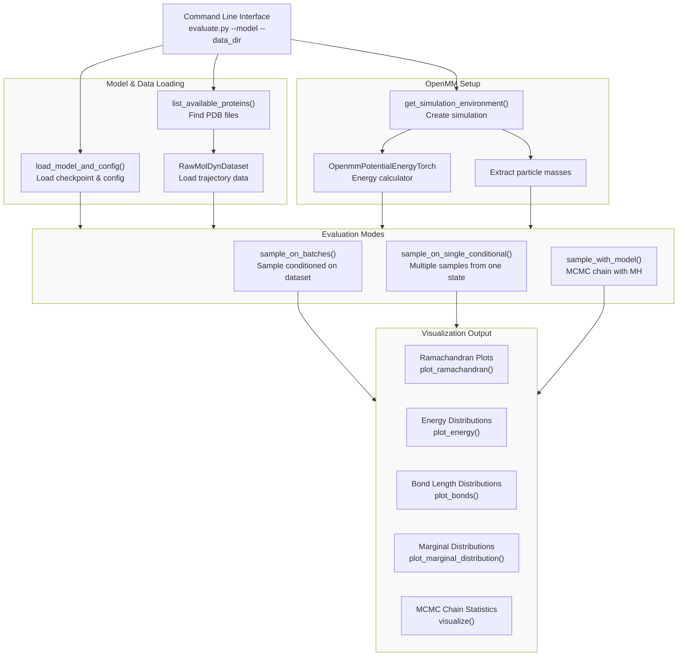
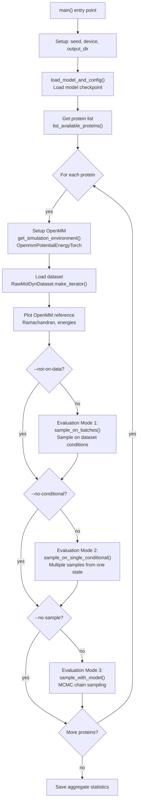
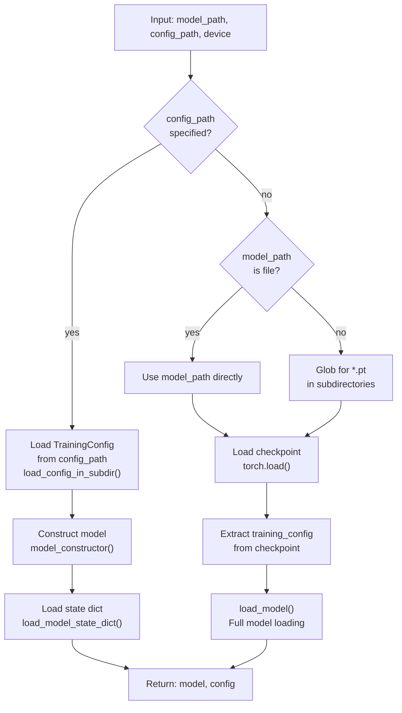
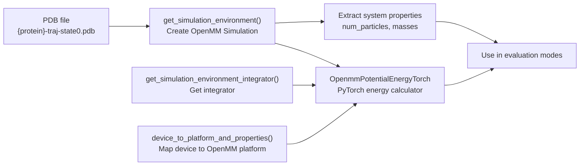

<!-- source: DeepWiki mcp.deepwiki.com · repo microsoft/timewarp · page 7.2 Peptide Evaluation · fetched 2026-10-26 -->

# Peptide Evaluation

<details>
<summary>Relevant source files</summary>

The following files were used as context for generating this wiki page:

- [evaluate.py](evaluate.py)

</details>


The `evaluate.py` script provides comprehensive evaluation capabilities for trained models on peptide systems, specifically di-peptides (e.g., alanine-dipeptide) and tetra-peptides. This script generates samples from trained conditional density models, compares them against OpenMM ground truth simulations, and produces extensive visualizations including Ramachandran plots, energy distributions, bond length analyses, and statistical metrics.

For general-purpose sampling and visualization across different molecular systems, see [Sampling Script](#7.1). For oxygen molecule-specific evaluation, see [O2 Molecule Evaluation](#7.3). For trajectory exploration with energy-based acceptance, see [Trajectory Exploration](#7.4).

**Sources:** [evaluate.py:1-872]()

## Overview

The peptide evaluation system loads a trained model checkpoint, evaluates it on peptide test data, and produces statistical comparisons with OpenMM reference simulations. The script supports three primary evaluation modes and optional Metropolis-Hastings correction for physically realistic sampling.



**Sources:** [evaluate.py:49-91](), [evaluate.py:94-100](), [evaluate.py:102-872]()

## Command-Line Interface

The script accepts numerous command-line arguments to control evaluation behavior:

| Argument | Type | Default | Description |
|----------|------|---------|-------------|
| `savefile` | str | required | Path to saved model checkpoint |
| `--data_dir` | str | required | Path to directory containing PDB and NPZ files |
| `--protein` | str[] | all | Specific protein(s) to evaluate (e.g., "AD-1") |
| `--config` | str | None | Override config from checkpoint |
| `--device` | str | auto | Device (cuda/cpu) |
| `--num_samples` | int | 1000 | Number of samples to generate |
| `--output-dir` | str | auto | Output directory for results |
| `--mh` | flag | False | Enable Metropolis-Hastings correction |
| `--no-sample` | flag | False | Skip MCMC sampling mode |
| `--no-conditional` | flag | False | Skip conditional evaluation mode |
| `--not-on-data` | flag | False | Skip dataset-conditioned evaluation |
| `--random-velocities` | flag | False | Sample velocities from isotropic Gaussian |
| `--resample-velocities` | flag | False | Resample velocities at each MCMC step |
| `--seed` | int | 42 | Random seed |

**Sources:** [evaluate.py:103-227]()

### Sampling-Specific Arguments

Additional arguments control MCMC sampling behavior when `--no-sample` is not specified:

| Argument | Type | Default | Description |
|----------|------|---------|-------------|
| `--sample--initialize-randomly` | flag | False | Random initialization instead of data point |
| `--sample--openmm-on-current` | flag | False | Run OpenMM on current state each iteration |
| `--sample--openmm-on-proposal` | flag | False | Run OpenMM on proposed state each iteration |
| `--sample--num-openmm-steps` | int | 1 | Number of OpenMM steps per iteration |
| `--sample--num-proposal-steps` | int | 1 | Parallel proposals per iteration |
| `--sample--adaptive-parallelism` | flag | False | Adaptively set num_proposal_steps |

**Sources:** [evaluate.py:188-222]()

### Example Usage

```bash
# Basic evaluation on all proteins
python evaluate.py best_model.pt --data_dir data/

# Evaluate specific protein with Metropolis-Hastings
python evaluate.py best_model.pt --data_dir data/ --protein AD-1 --mh

# MCMC sampling with random velocities and 5000 samples
python evaluate.py best_model.pt --data_dir data/ --num_samples 5000 \
    --random-velocities --mh

# Skip dataset evaluation, only generate MCMC samples
python evaluate.py best_model.pt --data_dir data/ --not-on-data
```

**Sources:** [evaluate.py:102-227]()

## Evaluation Pipeline

The main evaluation pipeline iterates over proteins and performs up to three evaluation modes:



**Sources:** [evaluate.py:102-872](), [evaluate.py:288-866]()

## Evaluation Modes

### Mode 1: Sample on Dataset Batches

This mode evaluates the model's conditional distribution p(y|x) by sampling from the model for each conditioning state x in the dataset and comparing against the true next state y.

**Key Function:** `sample_on_batches()` from [timewarp/utils/evaluation_utils.py]()

**Process:**
1. Iterate through all batches in the dataset
2. For each batch with conditioning state x and target state y:
   - Sample ŷ ~ p(y|x) from the model
   - Optionally apply Metropolis-Hastings correction
   - Compute energies, internal coordinates, and likelihoods
3. Generate visualizations comparing model samples to ground truth

**Outputs:**
- Marginal distribution plots (positions and velocities)
- Correlation matrices (delta_x correlations)
- Likelihood distributions (forward, reverse, training)
- Bond length distributions
- Ramachandran plots
- Energy distributions (potential and kinetic)

**Sources:** [evaluate.py:352-560](), [evaluate.py:367-376]()

### Mode 2: Conditional Distribution Sampling

This mode samples multiple predictions from a single conditioning state to evaluate the learned conditional distribution p(y|x) more thoroughly.

**Key Function:** `sample_on_single_conditional()` from [timewarp/utils/evaluation_utils.py]()

**Process:**
1. Select a single initial state from the dataset (controlled by `--initial_state_idx`)
2. Generate `num_samples` predictions from the model
3. Generate `num_samples` ground truth trajectories from OpenMM starting from the same state
4. Compare distributions

**Outputs:**
- Marginal distributions with background from Mode 1
- Bond length distributions with initial state marker
- Energy distributions

**Sources:** [evaluate.py:561-677](), [evaluate.py:576-584]()

### Mode 3: MCMC Chain Sampling

This mode generates a Markov chain by iteratively sampling from the model, optionally with Metropolis-Hastings correction to ensure detailed balance with respect to the equilibrium distribution.

**Key Function:** `sample_with_model()` from [timewarp/utils/evaluation_utils.py]()

**Process:**
1. Initialize from dataset state or random configuration
2. For each iteration:
   - Sample proposal ŷ ~ p(y|x) from current state x
   - Compute acceptance probability using energies and model likelihoods
   - Accept/reject proposal
   - Optionally run OpenMM steps on current or proposed state
3. Track chain statistics (acceptance rate, energies, transition probabilities)

**Parameters controlled by command-line:**
- `--mh`: Enable Metropolis-Hastings acceptance/rejection
- `--random-velocities`: Sample velocities from Maxwell-Boltzmann distribution
- `--resample-velocities`: Resample velocities at each iteration
- `--sample--num-proposal-steps`: Number of parallel proposals
- `--sample--adaptive-parallelism`: Dynamically adjust proposal count

**Outputs:**
- Chain statistics (acceptance rate, energy traces, transition probabilities)
- Potential energy distributions vs OpenMM reference
- Bond length distributions
- Ramachandran plots showing transitions
- Kolmogorov-Smirnov test for velocity distribution (if `--random-velocities`)

**Sources:** [evaluate.py:678-866](), [evaluate.py:680-697]()

## Model and Configuration Loading

The `load_model_and_config()` function handles loading trained models and their configurations:



**Key Behavior:**
- If `config_path` is provided, it overrides the config stored in the checkpoint
- If `model_path` is a directory, the function searches for `*.pt` files recursively
- This supports both regular training and DeepSpeed training (which saves in subdirectories)

**Sources:** [evaluate.py:49-91]()

## OpenMM Integration

Each protein evaluation requires setting up OpenMM for ground truth simulations and energy calculations:



**Key Components:**

1. **`get_simulation_environment()`**: Creates OpenMM `Simulation` object from PDB file and force field parameters (typically "alanine-dipeptide")

2. **`OpenmmPotentialEnergyTorch`**: Wraps OpenMM potential energy calculation in a PyTorch-compatible function, enabling gradient computation and GPU acceleration

3. **Particle masses**: Extracted for kinetic energy calculations using `system.getParticleMass()`

**Sources:** [evaluate.py:290-305]()

## Visualization Outputs

The evaluation script generates comprehensive visualizations for each protein:

### Ramachandran Plots

**Function:** `plot_ramachandran()` from [timewarp/utils/evaluation_utils.py]()

Plots dihedral angles (φ, ψ) to visualize peptide backbone conformations. Generated for:
- OpenMM reference data
- Model samples conditioned on dataset
- Model MCMC samples with transitions

**Sources:** [evaluate.py:334-344](), [evaluate.py:510-525](), [evaluate.py:838-855]()

### Energy Distributions

**Function:** `plot_energy()` from [timewarp/utils/evaluation_utils.py]()

Compares potential and kinetic energy distributions between model and OpenMM:
- Potential energy computed via `OpenmmPotentialEnergyTorch`
- Kinetic energy computed via `compute_kinetic_energy()` using particle masses
- Histograms show overlap between model and reference distributions

**Sources:** [evaluate.py:528-560](), [evaluate.py:637-676](), [evaluate.py:775-814]()

### Bond Length Distributions

**Function:** `plot_bonds()` from [timewarp/utils/evaluation_utils.py]()

Analyzes bond length distributions for each bond type in the molecule:
- Uses `compute_internal_coordinates()` to extract bond lengths and torsions
- Compares model vs OpenMM distributions
- Can show initial state and background distributions from other modes

**Sources:** [evaluate.py:487-506](), [evaluate.py:620-633](), [evaluate.py:817-834]()

### Marginal Distributions

**Function:** `plot_marginal_distribution()` from [timewarp/utils/evaluation_utils.py]()

Plots marginal distributions of position displacements (Δx) and velocities:
- Shows per-atom-coordinate distributions
- Overlays model samples and ground truth
- Can include background distributions for comparison

**Sources:** [evaluate.py:382-394](), [evaluate.py:592-606]()

### MCMC Chain Statistics

**Function:** `visualize()` from [timewarp/utils/evaluation_utils.py]()

Visualizes Markov chain behavior when using `sample_with_model()`:
- Acceptance rate over iterations
- Energy traces (potential, kinetic, total)
- Transition probabilities
- Can show delta values (differences between consecutive states)

**Sources:** [evaluate.py:757-773]()

## Metropolis-Hastings Sampling

When the `--mh` flag is specified, the evaluation uses Metropolis-Hastings correction to ensure detailed balance. The acceptance probability for a proposal ŷ given current state y is:

```
α = min(1, exp(-ΔE) × p(y|ŷ) / p(ŷ|y))
```

where:
- ΔE is the change in total energy (potential + kinetic)
- p(y|ŷ) is the reverse model likelihood
- p(ŷ|y) is the forward model likelihood

**Key Features:**

1. **Random Velocities** (`--random-velocities`): Treats velocities as isotropic Gaussians independent of the model, simplifying the acceptance ratio

2. **Velocity Resampling** (`--resample-velocities`): Samples new velocities at each MCMC iteration, helping explore configuration space

3. **Parallel Proposals** (`--sample--num-proposal-steps`): Generates multiple proposals per iteration, accepting the first one that meets the acceptance criterion

4. **Adaptive Parallelism** (`--sample--adaptive-parallelism`): Dynamically adjusts the number of parallel proposals based on smoothed acceptance rate

5. **OpenMM Integration**: Can run OpenMM steps on current state (`--sample--openmm-on-current`) or proposed state (`--sample--openmm-on-proposal`) to mix model and physics-based sampling

**Statistical Validation:**

For random velocities, the script performs a Kolmogorov-Smirnov test to verify that velocity norms follow a χ² distribution with 3N degrees of freedom (N = number of atoms), which is expected for Maxwell-Boltzmann distributed velocities.

**Sources:** [evaluate.py:130-133](), [evaluate.py:161-169](), [evaluate.py:680-746](), [evaluate.py:721-746]()

## Output Directory Structure

The script creates an output directory with automatically generated name based on parameters:

```
evaluation--num-samples-{N}--initial-state-idx-{I}[--mh][--random-velocities]...
├── {protein}_sample_on_data_*.png          # Mode 1 visualizations
├── {protein}_sample_on_conditioning_*.png  # Mode 2 visualizations
├── {protein}_sample_on_samples_*.png       # Mode 3 visualizations
├── {protein}_chain_stats.pkl               # Serialized chain statistics
├── {protein}_chain_stats.png               # Chain statistics plots
└── acceptance_rate.png                      # Aggregate acceptance rates
```

Output filename components include:
- Base name: `evaluation` (default) or custom via `--output-dir-basename`
- Sample count: `--num-samples-{N}`
- Initial state: `--initial-state-idx-{I}`
- Flags: `--mh`, `--random-velocities`, `--resample-velocities`, etc.

**Sources:** [evaluate.py:243-265]()

## Protein Discovery

The `list_available_proteins()` function discovers available peptides by searching for PDB files:

```python
def list_available_proteins(pdb_dir):
    protein_filenames = glob.glob(
        os.path.join(str(pdb_dir), "**/*-traj-state0.pdb"), recursive=True
    )
    num_chars_to_drop = len("-traj-state0.pdb")
    return sorted([os.path.split(f)[-1][:-num_chars_to_drop] for f in protein_filenames])
```

**Expected File Pattern:** `{protein_name}-traj-state0.pdb`

**Example Proteins:**
- `AD-1` (alanine-dipeptide variant 1)
- `AD-2` (alanine-dipeptide variant 2)
- `AAQAA` (tetra-peptide sequence)

The `--protein` argument can specify a subset of proteins to evaluate. If not specified, all discovered proteins are evaluated in alphabetical order (or random order if `--shuffle-proteins` is set).

**Sources:** [evaluate.py:94-100](), [evaluate.py:282-284]()

## Statistical Metrics

The script computes several statistical metrics for model evaluation:

### Acceptance Rates

Computed for both Mode 1 (sampling on dataset) and Mode 3 (MCMC chain):
- Per-iteration acceptance for Metropolis-Hastings
- Average acceptance rate per protein
- Aggregate acceptance rate across all proteins

**Sources:** [evaluate.py:380-381](), [evaluate.py:698-701](), [evaluate.py:857-864]()

### Energy Quantiles

For MCMC sampling, the script reports quantiles of exp(-ΔE) for both potential and kinetic energy changes, which are key components of the Metropolis-Hastings acceptance probability.

**Sources:** [evaluate.py:703-718]()

### Kolmogorov-Smirnov Test

When `--random-velocities` is enabled, the script tests whether velocity norms follow the expected χ² distribution:

```python
ks = scipy_stats.ks_1samp(
    2 * chain_stats.energies_kin, scipy_stats.chi2(df=num_atoms * 3).cdf
)
```

This validates that the model's velocity sampling matches the Maxwell-Boltzmann distribution.

**Sources:** [evaluate.py:721-746]()

### Likelihood Distributions

For Mode 1 evaluation, the script plots:
- Forward likelihoods: log p(y|x) for model samples
- Reverse likelihoods: log p(x|y) for model samples
- Training likelihoods: reference distributions from training data
- Likelihood differences: log p(y|x) - log p(x|y) indicating detailed balance

**Sources:** [evaluate.py:447-484]()

## Implementation Details

### Data Batching

The script uses `RawMolDynDataset` with `moldyn_dense_collate_fn` to create individual batches:

```python
raw_dataset = RawMolDynDataset(data_dir=args.data_dir, step_width=step_width)
raw_iterator = raw_dataset.make_iterator(pdb_names)
batches = (moldyn_dense_collate_fn([datapoint]) for datapoint in raw_iterator)
batches = list(islice(batches, args.num_samples))
```

Each batch is created with a single datapoint, allowing independent evaluation of each trajectory frame.

**Sources:** [evaluate.py:308-313]()

### Internal Coordinate Computation

Bond lengths and torsion angles are computed using `compute_internal_coordinates()`, which:
1. Reads topology from PDB file
2. Uses adjacency list to identify bonds
3. Computes bond vectors and torsion angles
4. Returns arrays suitable for plotting

**Sources:** [evaluate.py:334-336](), [evaluate.py:489-494]()

### Correlation Analysis

The script computes correlation matrices for position displacements (Δx = y - x):
- Flattens 3D coordinates to 1D vectors
- Subsamples every 3rd coordinate (x-coordinates only) for efficiency
- Computes Pearson correlation using `np.corrcoef()`
- Visualizes correlations as heatmaps

**Sources:** [evaluate.py:397-445]()

### Random Seed Management

The script uses `set_seed()` from utilities to ensure reproducibility:

```python
set_seed(args.seed)
```

This sets seeds for Python's `random`, NumPy, and PyTorch to ensure deterministic evaluation across runs.

**Sources:** [evaluate.py:239]()

---

