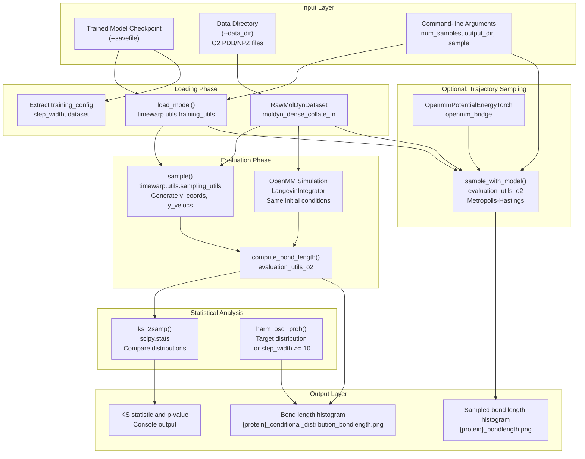
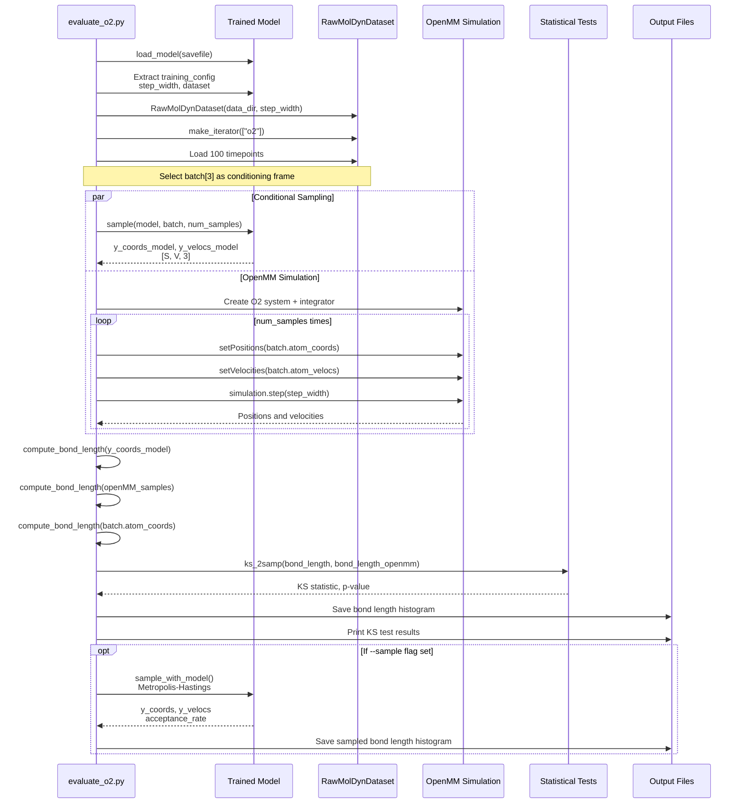
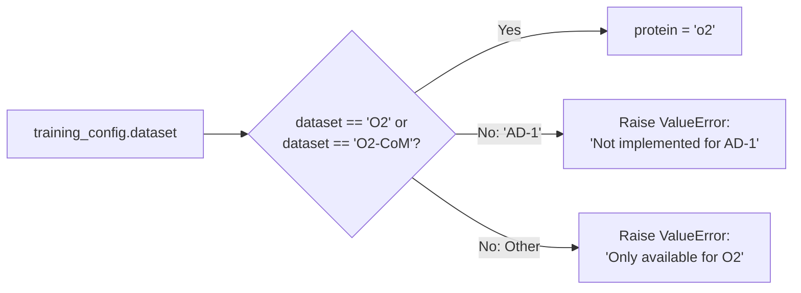
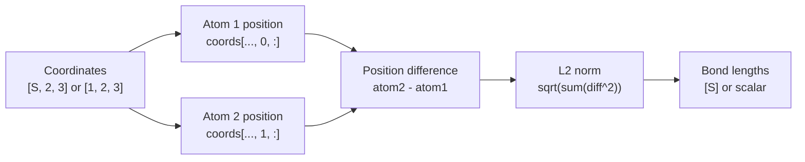
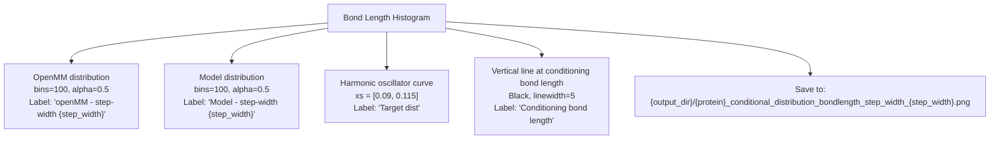
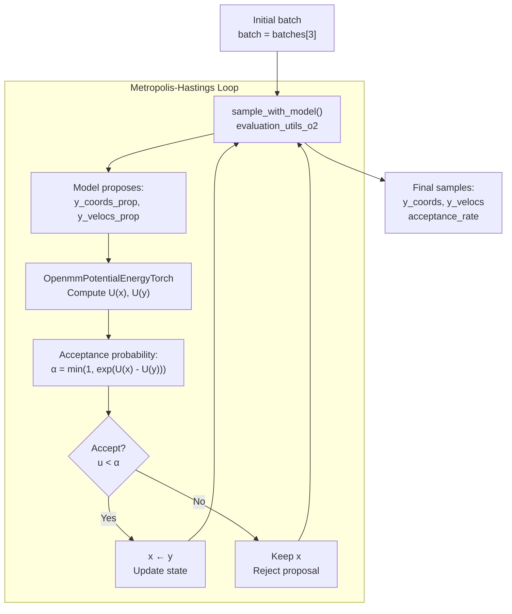
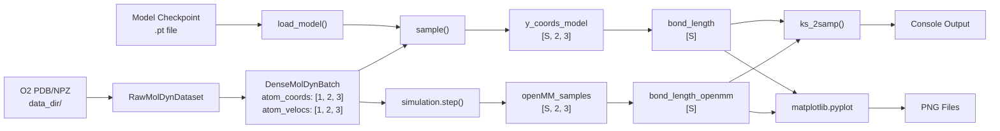

<!-- source: DeepWiki mcp.deepwiki.com · repo microsoft/timewarp · page 7.3 O2 Molecule Evaluation · fetched 2026-10-26 -->

# O2 Molecule Evaluation

<details>
<summary>Relevant source files</summary>

The following files were used as context for generating this wiki page:

- [evaluate_o2.py](evaluate_o2.py)

</details>


## Purpose and Scope

This page documents the `evaluate_o2.py` script, which provides specialized evaluation capabilities for trained models on oxygen (O2) molecule systems. The script validates learned dynamics by comparing model predictions against OpenMM molecular dynamics simulations, focusing on bond length distributions as the primary evaluation metric.

For general sampling and visualization of trained models, see [Sampling Script](#7.1). For peptide-specific evaluation with Ramachandran plots and dihedral analysis, see [Peptide Evaluation](#7.2). For generating and exploring new trajectories, see [Trajectory Exploration](#7.4).

## Overview

The O2 evaluation system validates that trained models learn physically accurate dynamics for diatomic oxygen molecules. Unlike peptide evaluation, which focuses on complex conformational spaces, O2 evaluation centers on a simpler system where the primary observable is the bond length between the two oxygen atoms. This simplicity allows for precise statistical testing of the learned distribution.

The evaluation compares two sampling approaches:
1. **Conditional sampling**: Generate predictions p(y|x) from a single conditioning frame
2. **Trajectory sampling**: Generate extended trajectories with Metropolis-Hastings acceptance

Both approaches are validated against ground truth OpenMM simulations starting from identical initial conditions.

**Sources**: [evaluate_o2.py:1-29]()

## System Architecture



**Sources**: [evaluate_o2.py:30-199]()

## Command-Line Interface

The script accepts the following arguments:

| Argument | Type | Default | Description |
|----------|------|---------|-------------|
| `--savefile` | `str` | Required | Path to saved model checkpoint containing config and state dict |
| `--data_dir` | `str` | Required | Path to directory containing O2 PDB and NPZ trajectory files |
| `--num_samples` | `int` | `1000` | Number of samples for distribution comparison (10000 recommended) |
| `--output_dir` | `str` | `evaluation_outputs` | Directory path for saving output plots |
| `--sample` | `bool` | `False` | Whether to perform trajectory sampling with Metropolis-Hastings |

**Example Usage**:
```bash
# Basic conditional distribution evaluation
python evaluate_o2.py --savefile outputs/o2_model/best_model.pt --data_dir data/

# Full evaluation with trajectory sampling
python evaluate_o2.py \
    --savefile outputs/o2_model/best_model.pt \
    --data_dir data/ \
    --num_samples 10000 \
    --output_dir o2_evaluation_results \
    --sample True
```

**Sources**: [evaluate_o2.py:30-56]()

## Evaluation Workflow



**Sources**: [evaluate_o2.py:57-96](), [evaluate_o2.py:98-116](), [evaluate_o2.py:151-196]()

## Dataset Configuration

The script validates that the loaded model was trained on an O2 dataset:



The script loads 100 consecutive timepoints from the O2 trajectory using `RawMolDynDataset` and selects batch index 3 (the 4th frame) as the conditioning point for all evaluations. This ensures reproducible comparisons across different model runs.

**Sources**: [evaluate_o2.py:60-81]()

## Bond Length Analysis

### Computing Bond Lengths

The `compute_bond_length()` function from `evaluation_utils_o2` computes the Euclidean distance between the two oxygen atoms:



Three bond length distributions are computed:

1. **Conditioning bond length**: Distance in the initial frame `batch.atom_coords` (single value)
2. **Model bond lengths**: Distances in `y_coords_model` (num_samples values)
3. **OpenMM bond lengths**: Distances in `openMM_samples` (num_samples values)

**Sources**: [evaluate_o2.py:113-116]()

### Harmonic Oscillator Target Distribution

For O2 molecules with `step_width >= 10`, the evaluation overlays a theoretical harmonic oscillator probability distribution `harm_osci_prob(xs)` on the bond length histogram. This represents the expected equilibrium distribution for a harmonic potential.

The target distribution is plotted when:
- `protein == "o2"` 
- `step_width >= 10`

**Sources**: [evaluate_o2.py:129-131](), [evaluate_o2.py:184-186]()

### Visualization Output

The script generates a histogram comparing three distributions:



**Sources**: [evaluate_o2.py:118-149]()

## Statistical Testing

### Kolmogorov-Smirnov Test

The script uses `scipy.stats.ks_2samp()` to perform a two-sample Kolmogorov-Smirnov test comparing the model's bond length distribution against OpenMM's ground truth distribution:

| Test Component | Description |
|----------------|-------------|
| **Null Hypothesis** | The two distributions are drawn from the same underlying distribution |
| **Test Statistic** | Maximum absolute difference between empirical CDFs |
| **p-value** | Probability of observing the test statistic under the null hypothesis |
| **Interpretation** | Higher p-values indicate better agreement between model and OpenMM |

**Output Format**:
```
Difference between the conditional distributions
KS statistic.: {ks_result}
p-value: {p_value}
```

A warning is issued if `num_samples < 10000`, as the KS test requires sufficient samples for reliable statistical power.

**Sources**: [evaluate_o2.py:83-84](), [evaluate_o2.py:151-156]()

## Optional Trajectory Sampling

### Metropolis-Hastings Sampling

When the `--sample` flag is set to `True`, the script generates extended trajectories using Metropolis-Hastings acceptance:



The sampling process:
1. Creates an `OpenmmPotentialEnergyTorch` instance on CUDA platform for fast energy evaluation
2. Calls `sample_with_model()` with the initial batch and target energy function
3. For each proposal, computes acceptance probability based on energy difference
4. Returns accepted samples and acceptance rate

**Sources**: [evaluate_o2.py:158-172]()

### Trajectory Sampling Output

When trajectory sampling is enabled, an additional histogram is generated showing the bond length distribution of accepted samples:

| Plot Element | Details |
|--------------|---------|
| **Data** | Bond lengths computed from `y_coords` (accepted samples) |
| **Bins** | 100 bins, normalized density |
| **Overlay** | Harmonic oscillator target (if `step_width >= 10`) |
| **Filename** | `{protein}_bondlength_step_width_{step_width}.png` |
| **Console Output** | Acceptance rate printed |

This distribution should match the target distribution more closely than conditional sampling, as Metropolis-Hastings corrects for model errors through energy-based rejection.

**Sources**: [evaluate_o2.py:173-195]()

## Code Entity Mapping

### Key Functions and Imports

| Function/Class | Module | Line | Purpose |
|----------------|--------|------|---------|
| `load_model()` | `timewarp.utils.training_utils` | 16 | Load trained model from checkpoint |
| `sample()` | `timewarp.utils.sampling_utils` | 15 | Generate conditional samples p(y\|x) |
| `create_o2_system()` | `timewarp.utils.evaluation_utils_o2` | 18 | Create OpenMM system for O2 molecule |
| `harm_osci_prob()` | `timewarp.utils.evaluation_utils_o2` | 19 | Harmonic oscillator probability density |
| `compute_bond_length()` | `timewarp.utils.evaluation_utils_o2` | 20 | Compute O-O bond distance |
| `sample_with_model()` | `timewarp.utils.evaluation_utils_o2` | 21 | Metropolis-Hastings trajectory sampling |
| `RawMolDynDataset` | `timewarp.datasets` | 23 | Load molecular dynamics trajectories |
| `moldyn_dense_collate_fn` | `timewarp.dataloader` | 24-26 | Batch collation function |
| `OpenmmPotentialEnergyTorch` | `timewarp.modules.layers.openmm_bridge` | 27 | PyTorch-compatible OpenMM energy |
| `ks_2samp()` | `scipy.stats` | 12 | Two-sample Kolmogorov-Smirnov test |

**Sources**: [evaluate_o2.py:1-28]()

### Data Flow



**Sources**: [evaluate_o2.py:58-96](), [evaluate_o2.py:98-149]()

## Implementation Details

### OpenMM Simulation Configuration

The script creates an OpenMM simulation with the following parameters:

| Parameter | Value | Unit |
|-----------|-------|------|
| Temperature | 310 | Kelvin |
| Friction coefficient | 1 | 1/picosecond |
| Timestep | 1 | femtosecond |
| Integrator | `LangevinIntegrator` | - |

For each sample, the simulation:
1. Sets positions from `batch.atom_coords.squeeze(0).cpu().numpy()`
2. Sets velocities from `batch.atom_velocs.squeeze(0).cpu().numpy()`
3. Steps forward by `step_width` timesteps
4. Retrieves final positions and velocities

**Sources**: [evaluate_o2.py:98-111]()

### Batch Selection

The script loads the first 100 timepoints from the O2 trajectory and selects `batch[3]` (0-indexed) as the conditioning frame. This hardcoded selection ensures:
- Consistent comparison across different model evaluations
- A frame that is not at the trajectory boundaries
- Reproducible statistical tests

**Sources**: [evaluate_o2.py:81-88]()

### Warning System

The script issues a warning if `num_samples < 10000`:
```python
warnings.warn("It is recommended to use 10000 samples.")
```

This ensures users are aware that statistical tests require sufficient samples for reliable results.

**Sources**: [evaluate_o2.py:83-84]()

## Output Files

The evaluation produces the following outputs:

| File | Content | Location |
|------|---------|----------|
| Conditional distribution plot | Histogram comparing model, OpenMM, and target distributions | `{output_dir}/{protein}_conditional_distribution_bondlength_step_width_{step_width}.png` |
| KS test results | Test statistic and p-value | Console output |
| Sampled distribution plot | Histogram of trajectory samples (if `--sample=True`) | `{output_dir}/{protein}_bondlength_step_width_{step_width}.png` |
| Acceptance rate | Metropolis-Hastings acceptance rate (if `--sample=True`) | Console output |

All plots include:
- Normalized density histograms
- Legend identifying each distribution
- X-axis labeled "Distance in nm"
- Vertical line marking conditioning bond length
- Harmonic oscillator target (when applicable)

**Sources**: [evaluate_o2.py:143-149](), [evaluate_o2.py:172](), [evaluate_o2.py:190-195]()

---

