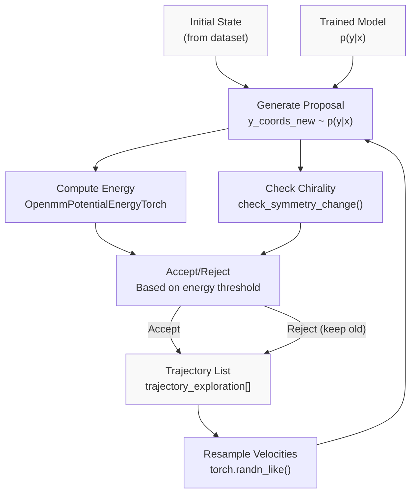
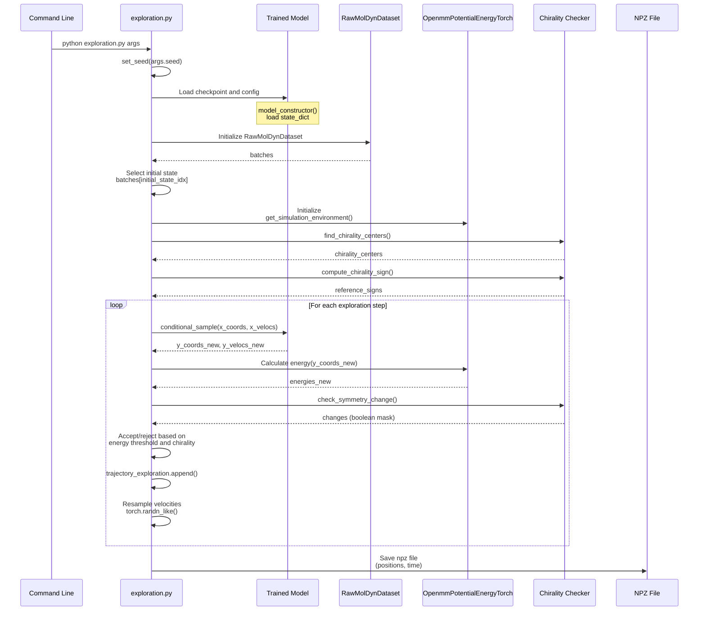
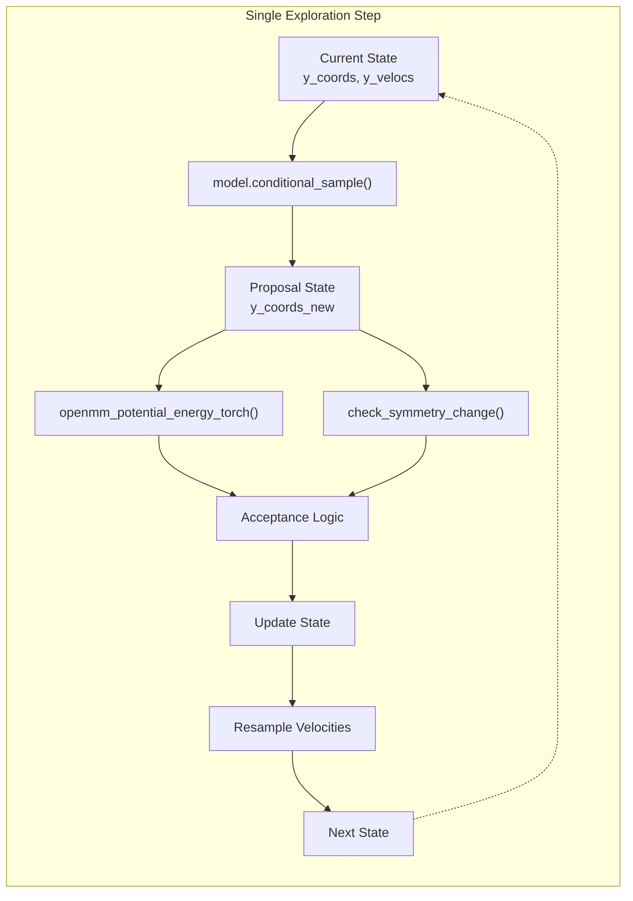
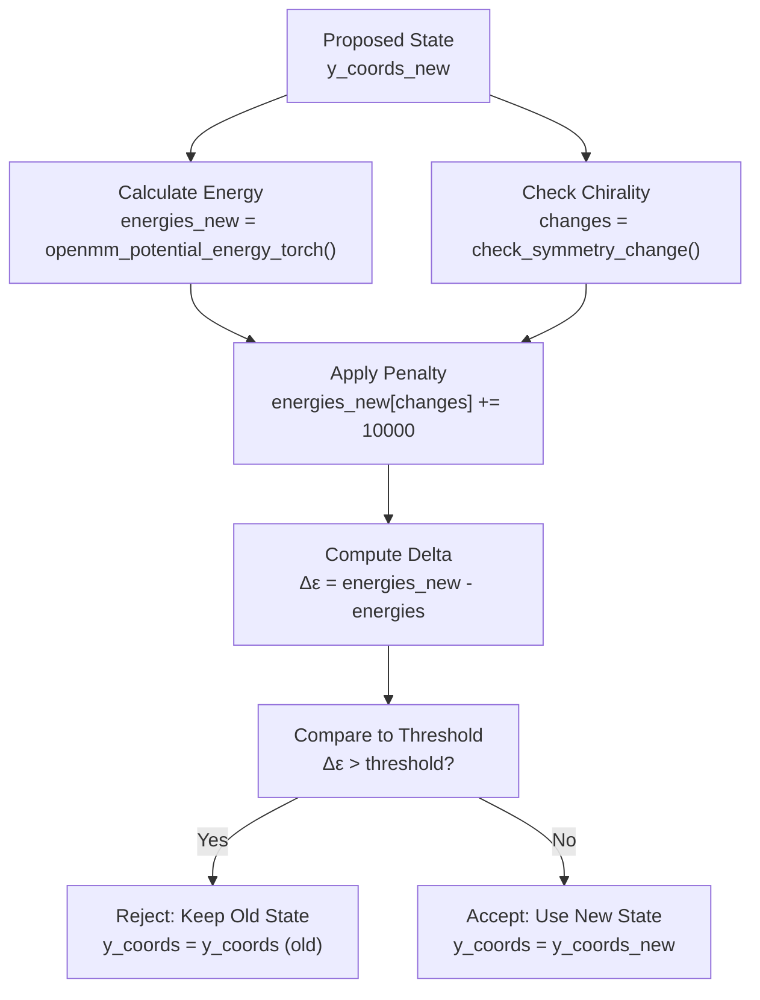
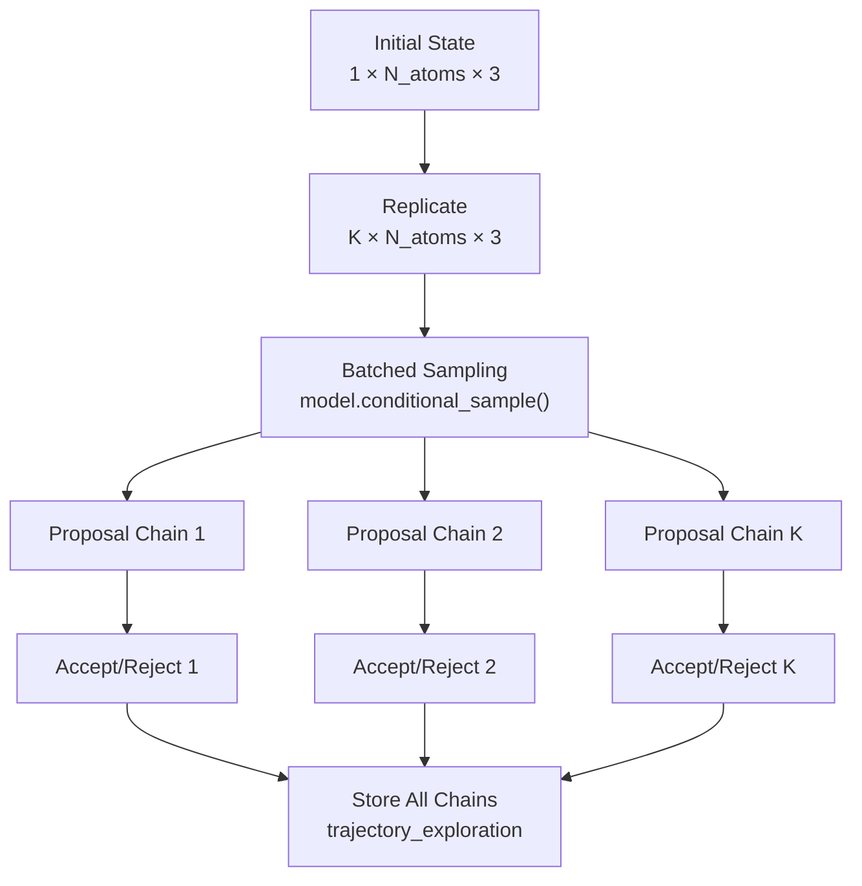

<!-- source: DeepWiki mcp.deepwiki.com · repo microsoft/timewarp · page 7.4 Trajectory Exploration · fetched 2026-10-26 -->

# Trajectory Exploration

<details>
<summary>Relevant source files</summary>

The following files were used as context for generating this wiki page:

- [exploration.py](exploration.py)

</details>


## Purpose and Scope

The trajectory exploration system enables the generation of long molecular dynamics trajectories by iteratively applying a trained model to explore conformational space with energy-based acceptance criteria. This functionality is implemented in the `exploration.py` script and differs from other evaluation scripts in its approach:

- For general sampling and visualization, see [Sampling Script](#7.1)
- For peptide evaluation with Metropolis-Hastings, see [Peptide Evaluation](#7.2)
- For oxygen molecule evaluation, see [O2 Molecule Evaluation](#7.3)

The exploration script generates trajectories by repeatedly applying the model's conditional distribution `p(y|x)` while maintaining physical validity through energy thresholds and chirality checks. This allows exploration of molecular conformational space beyond the training data distribution.

**Sources:** [exploration.py:1-267]()

## Overview

The trajectory exploration system performs iterative generation of molecular conformations using a trained conditional density model. Unlike standard sampling which generates independent samples, exploration builds a trajectory by using each generated state as the conditioning state for the next prediction. The system maintains physical validity through two mechanisms: energy-based rejection and chirality preservation.



**Sources:** [exploration.py:124-260]()

## Command-Line Interface

The exploration script is invoked from the command line with the following syntax:

```bash
python exploration.py <savefile> --data_dir <path> --protein <name> [options]
```

### Required Arguments

| Argument | Type | Description |
|----------|------|-------------|
| `savefile` | Path | Path to saved model checkpoint containing config and state dict |
| `--data_dir` | str | Path to directory containing molecular dynamics data |
| `--protein` | str | Name of protein to explore (e.g., "AD-1", "GGGG") |

### Optional Arguments

| Argument | Type | Default | Description |
|----------|------|---------|-------------|
| `--device` | str | auto | Device to use (cuda/cpu). Prefers CUDA if available |
| `--num_samples` | int | 1000 | Number of exploration steps to generate |
| `--saving_interval` | int | 1000 | Interval for saving intermediate results |
| `--energy_threshold` | int | 300 | Maximum energy increase (kJ/mol) to accept |
| `--step-width` | int | 10000 | Step width for loading MD data |
| `--initial_state_idx` | int | 1 | Index of initial state from dataset |
| `--sample--num-proposal-steps` | int | 1 | Number of parallel proposal steps per iteration |
| `--seed` | int | 42 | Random seed for reproducibility |
| `--output-dir` | str | auto | Directory to save trajectory output |
| `--output-dir-basename` | str | "evaluation" | Basename for auto-generated output directory |
| `--verbose` | flag | false | Print additional debugging information |

**Note:** Several command-line arguments related to Metropolis-Hastings (`--mh`, `--random-velocities`, `--resample-velocities`) are defined but not actively used in the current implementation.

**Sources:** [exploration.py:31-114]()

## Exploration Workflow

The exploration process follows a multi-stage pipeline from initialization through iterative generation:



**Sources:** [exploration.py:140-260]()

### Initialization Phase

The initialization phase prepares the system for trajectory exploration:

1. **Model Loading** [exploration.py:163-178]():
   - Loads saved checkpoint containing `training_config` and model state
   - Constructs model using `model_constructor()`
   - Wraps model with loss computer using `wrap_or_replace_loss()`
   - Moves model to specified device

2. **OpenMM Setup** [exploration.py:180-195]():
   - Initializes simulation environment using `get_simulation_environment()`
   - Creates `OpenmmPotentialEnergyTorch` for energy calculations
   - Extracts particle masses for kinetic energy computations

3. **Dataset Initialization** [exploration.py:202-209]():
   - Creates `RawMolDynDataset` with specified step width
   - Generates batches using `moldyn_dense_collate_fn`
   - Selects initial state based on `initial_state_idx`

4. **Chirality Setup** [exploration.py:216-223]():
   - Identifies chirality centers using `find_chirality_centers()`
   - Computes reference chirality signs from initial coordinates
   - These reference signs are used throughout exploration to reject physically impossible configurations

**Sources:** [exploration.py:140-223]()

### Iterative Generation Phase

The core exploration loop generates new conformations iteratively:



**Sources:** [exploration.py:236-250]()

#### Step Function

The `step()` function generates proposals from the model [exploration.py:124-138]():

```python
def step(x_coords, x_velocs, model, batch, num_proposal_steps=1):
```

**Functionality:**
- Takes current coordinates and velocities as input
- Calls `model.conditional_sample()` with conditioning state
- Repeats batch information to match number of parallel proposals
- Returns proposed coordinates and velocities
- Uses `torch.no_grad()` context for inference efficiency

**Key Features:**
- Supports multiple parallel proposals via `num_proposal_steps`
- Handles batch dimension expansion for parallel sampling
- Passes all necessary molecular information (atom types, adjacency list, edge indices)

**Sources:** [exploration.py:124-138]()

## Energy-Based Acceptance

The exploration system uses energy-based criteria to maintain physical validity of generated conformations. This differs from standard Metropolis-Hastings by using a simple threshold rather than probabilistic acceptance.

### Energy Threshold Criterion

The acceptance logic [exploration.py:238-246]() implements:

1. **Energy Calculation:** Compute potential energy of proposed state using OpenMM
2. **Chirality Penalty:** Add large penalty (10000 kJ/mol) if chirality changes
3. **Threshold Comparison:** Accept if energy increase ≤ threshold, reject otherwise
4. **State Update:** Use `torch.where()` to select between old and new coordinates/energies



**Sources:** [exploration.py:238-246]()

### Energy Threshold Parameter

The `--energy_threshold` parameter (default: 300 kJ/mol) controls exploration behavior:

| Threshold Value | Effect |
|----------------|---------|
| Low (< 100) | Conservative exploration, stays near low-energy states |
| Medium (100-500) | Balanced exploration, allows moderate energy fluctuations |
| High (> 500) | Aggressive exploration, accepts high-energy proposals |

The default value of 300 kJ/mol is chosen to allow exploration while preventing physically unrealistic states.

**Sources:** [exploration.py:53-57]()

## Chirality Preservation

The exploration system includes chirality checking to prevent generation of physically impossible molecular configurations where stereochemistry is inverted.

### Chirality Detection and Checking

The chirality system uses three main functions from `timewarp.utils.chirality`:

1. **find_chirality_centers()** [exploration.py:222]():
   - Identifies atoms that are chiral centers based on adjacency list and atom types
   - Returns indices of chiral atoms

2. **compute_chirality_sign()** [exploration.py:223]():
   - Computes chirality sign (handedness) for each chiral center
   - Uses coordinates to determine spatial orientation
   - Creates reference signs from initial state

3. **check_symmetry_change()** [exploration.py:240]():
   - Compares current chirality signs to reference signs
   - Returns boolean mask indicating which samples have changed chirality
   - Used to reject proposals with inverted stereochemistry

### Rejection Mechanism

Chirality violations are handled through energy penalties [exploration.py:242]():

```python
# reject if chirality changes
energies_new[changes] += 10000
```

This adds a large energy penalty (10000 kJ/mol) to any proposal that changes chirality, ensuring it will be rejected by the energy threshold comparison. This approach integrates chirality checking seamlessly with the energy-based acceptance logic.

**Sources:** [exploration.py:216-242]()

## Parallel Proposals

The exploration system supports generating multiple parallel proposal trajectories simultaneously through the `--sample--num-proposal-steps` argument.

### Parallel Exploration Behavior

When `num_proposal_steps > 1` [exploration.py:109-113]():

1. Initial state is replicated `num_proposal_steps` times
2. Model generates proposals for all parallel chains simultaneously
3. Each parallel chain has independent energy and acceptance decisions
4. All parallel chains are stored in the trajectory output

This parallelization enables:
- Exploration of multiple trajectories from the same initial state
- Efficient GPU utilization through batched computation
- Diversity in generated trajectories



**Sources:** [exploration.py:211-232]()

## Velocity Resampling

After each accepted or rejected proposal, velocities are resampled from a Gaussian distribution [exploration.py:250]():

```python
y_velocs = torch.randn_like(y_coords)
```

This resampling strategy:
- Maintains canonical ensemble sampling (constant temperature)
- Prevents correlation between successive velocity states
- Ensures exploration is not biased by velocity trajectories
- Effectively treats velocities as auxiliary variables for coordinate generation

The resampled velocities are used as conditioning input for the next model prediction, but they do not affect the energy-based acceptance criterion, which only considers potential energy.

**Sources:** [exploration.py:250]()

## Output Format

The exploration script saves generated trajectories to a NumPy compressed archive (`.npz` file) [exploration.py:257-259]().

### Output File Structure

The generated file `{protein}_exploration.npz` contains:

| Key | Shape | Type | Description |
|-----|-------|------|-------------|
| `positions` | `(num_samples * num_parallel_steps, num_atoms, 3)` | float32 | Cartesian coordinates in Ångstroms |
| `time` | scalar | float64 | Total wall-clock time for trajectory generation (seconds) |

### Output File Location

The output directory is determined by [exploration.py:142-161]():

1. If `--output-dir` is specified, use that path
2. Otherwise, auto-generate directory name based on parameters:
   - Base: `{output_dir_basename}--num-samples-{num_samples}--initial-state-idx-{initial_state_idx}`
   - Additional flags are appended if specified (e.g., `--mh`, `--random-velocities`)
3. Output directory is created relative to the model checkpoint directory

### Loading Generated Trajectories

To load and analyze generated trajectories:

```python
import numpy as np

data = np.load('AD-1_exploration.npz')
positions = data['positions']  # Shape: (num_samples, num_atoms, 3)
duration = data['time']  # Scalar: generation time in seconds

print(f"Generated {positions.shape[0]} frames in {duration:.2f} seconds")
print(f"Throughput: {positions.shape[0] / duration:.2f} frames/second")
```

**Sources:** [exploration.py:142-259]()

## Implementation Details

### Model Inference Configuration

The exploration system uses specific model configurations for inference [exploration.py:124-138]():

- **Gradient Tracking:** Disabled via `torch.no_grad()` for efficiency
- **Batch Replication:** Input batch information is repeated to match number of proposals
- **Device Placement:** All tensors moved to specified device (CPU/CUDA)
- **Sample Count:** Single sample per proposal step (squeeze dimension 0)

### System Information Requirements

The script requires access to molecular system information through the batch object:

| Batch Attribute | Purpose |
|----------------|---------|
| `atom_types` | Atomic numbers for each atom |
| `adj_list` | Adjacency list defining molecular connectivity |
| `edge_batch_idx` | Batch indices for edges (used in GNN-style processing) |
| `masked_elements` | Mask indicating which atoms are present |
| `atom_coords` | Initial atomic coordinates |
| `atom_velocs` | Initial atomic velocities |

These attributes are provided by `moldyn_dense_collate_fn` from the `RawMolDynDataset`.

**Sources:** [exploration.py:124-138](), [exploration.py:202-209]()

### Performance Considerations

The exploration process tracks wall-clock time using `timer()` [exploration.py:233-253]():

```python
from timeit import default_timer as timer
start = timer()
# ... exploration loop ...
end = timer()
duration = end - start
```

This timing information is saved with the trajectory and can be used to:
- Compute throughput (frames per second)
- Compare efficiency of different models
- Estimate computational cost for production runs

For efficient exploration:
- Use CUDA device if available
- Consider reducing `num_atoms` or `num_samples` for testing
- Adjust `num_proposal_steps` to maximize GPU utilization
- Profile energy calculation overhead if performance is limiting

**Sources:** [exploration.py:233-259]()

---

