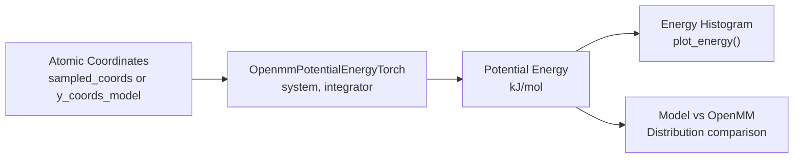
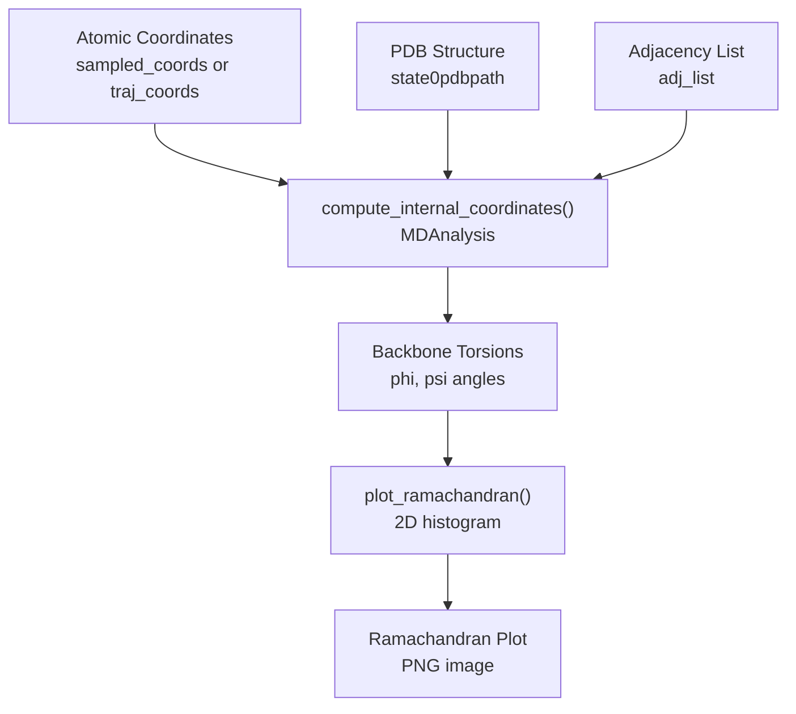
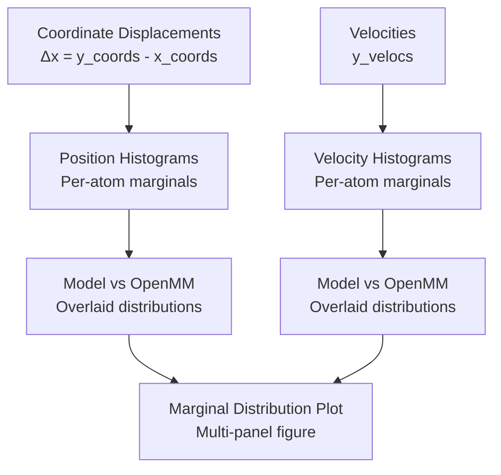
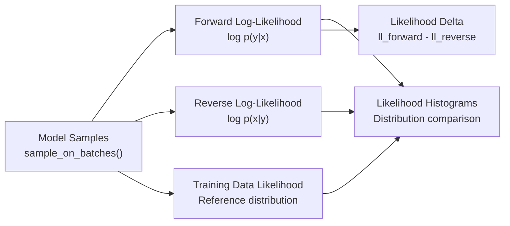

<!-- source: DeepWiki mcp.deepwiki.com · repo microsoft/timewarp · page 7.5 Visualization and Metrics · fetched 2026-10-26 -->

# Visualization and Metrics

<details>
<summary>Relevant source files</summary>

The following files were used as context for generating this wiki page:

- [evaluate.py](evaluate.py)
- [evaluate_o2.py](evaluate_o2.py)

</details>


This page documents the visualization tools and quantitative metrics available in Timewarp for analyzing trained models. These tools enable comparison between model predictions and ground truth molecular dynamics simulations from OpenMM, providing both visual and statistical assessments of model quality.

For information about running evaluation scripts that generate these visualizations, see [Peptide Evaluation](#7.2), [O2 Molecule Evaluation](#7.3), and [Trajectory Exploration](#7.4). For general sampling procedures, see [Sampling Script](#7.1).

## Overview

The Timewarp evaluation system provides comprehensive visualization and metrics organized into several categories:

| Category | Visualizations | Metrics | Primary Use Case |
|----------|---------------|---------|------------------|
| **Energy Analysis** | Potential/kinetic energy distributions, energy histograms | Mean energies, energy quantiles, KS statistics | Thermodynamic validity |
| **Structural Analysis** | Ramachandran plots, bond length distributions, internal coordinates | Bond length statistics, torsion angle distributions | Conformational accuracy |
| **Statistical Comparison** | Marginal distributions, correlation matrices | KS test statistics, correlation differences | Distribution matching |
| **Sampling Quality** | Chain statistics plots, acceptance rate histograms | Acceptance rates, transition probabilities | MCMC convergence |
| **Coordinate Analysis** | Coordinate displacement plots, transition visualizations | Coordinate correlations | Trajectory realism |

All visualization functions are implemented in the `timewarp.utils.evaluation_utils` and `timewarp.utils.evaluation_utils_o2` modules and are called by the evaluation scripts.

**Sources:** [evaluate.py:27-39](), [evaluate_o2.py:17-22]()

## Visualization Pipeline

The following diagram shows how evaluation scripts coordinate different visualization and metric computation functions:

```mermaid
graph TB
    subgraph EvalScripts["Evaluation Scripts"]
        evaluate["evaluate.py<br/>Peptide evaluation"]
        evaluate_o2["evaluate_o2.py<br/>O2 evaluation"]
        sample["sample.py<br/>General sampling"]
        exploration["exploration.py<br/>Trajectory exploration"]
    end
    
    subgraph Utils["Utility Functions"]
        plot_rama["plot_ramachandran()<br/>Torsion angle plots"]
        plot_energy["plot_energy()<br/>Energy distributions"]
        plot_bonds["plot_bonds()<br/>Bond length analysis"]
        plot_marginal["plot_marginal_distribution()<br/>Coordinate distributions"]
        visualize["visualize()<br/>Chain statistics"]
        plot_trans["plot_transitions()<br/>Trajectory transitions"]
        compute_internal["compute_internal_coordinates()<br/>Bonds and torsions"]
        compute_kinetic["compute_kinetic_energy()<br/>Velocity energies"]
    end
    
    subgraph Metrics["Statistical Metrics"]
        ks_test["KS Tests<br/>scipy.stats.ks_2samp"]
        acceptance["Acceptance Rates<br/>chain_stats.acceptance"]
        correlation["Correlation Analysis<br/>np.corrcoef"]
        likelihood["Log-likelihood<br/>ll_forward, ll_reverse"]
    end
    
    subgraph Outputs["Output Files"]
        png["PNG Images<br/>Plots and histograms"]
        pkl["PKL Files<br/>chain_stats.pkl"]
        stats["Console Output<br/>Metrics and statistics"]
    end
    
    evaluate --> plot_rama
    evaluate --> plot_energy
    evaluate --> plot_bonds
    evaluate --> plot_marginal
    evaluate --> visualize
    evaluate --> plot_trans
    evaluate --> compute_internal
    evaluate --> compute_kinetic
    
    evaluate_o2 --> compute_internal
    evaluate_o2 --> ks_test
    
    sample --> plot_rama
    sample --> plot_energy
    
    exploration --> visualize
    
    plot_rama --> png
    plot_energy --> png
    plot_bonds --> png
    plot_marginal --> png
    visualize --> png
    plot_trans --> png
    
    visualize --> pkl
    
    ks_test --> stats
    acceptance --> stats
    correlation --> png
    likelihood --> png
```



**Sources:** [evaluate.py:27-39](), [evaluate.py:328-866](), [evaluate_o2.py:88-196]()

## Energy Metrics

Energy analysis validates that model-generated samples maintain physically realistic energy distributions compared to OpenMM ground truth.

### Potential Energy

Potential energy is computed using OpenMM's force field evaluation on atomic coordinates:



The potential energy is calculated for:
- **Model samples**: Coordinates generated by the trained model
- **OpenMM samples**: Ground truth trajectories from molecular dynamics simulation
- **Conditioning states**: Initial states used as model input

The `plot_energy()` function generates overlaid histograms comparing these distributions. Energy values are clipped to exclude extreme outliers for clearer visualization.

**Key Metrics:**
- **Mean potential energy**: Average energy across samples
- **Energy range**: Minimum and maximum values (typically -50 to 100 kJ/mol for peptides)
- **Distribution overlap**: Visual assessment of model accuracy

**Sources:** [evaluate.py:346-349](), [evaluate.py:529-559](), [evaluate.py:775-814]()

### Kinetic Energy

Kinetic energy is computed from atomic velocities and masses:

```
E_kinetic = (1/2) * Σ_i m_i * ||v_i||²
```

The `compute_kinetic_energy()` function handles both standard velocities and random velocities (for evaluating coordinate-only models):

| Mode | Description | Use Case |
|------|-------------|----------|
| **Standard** | Use predicted velocities | Full model evaluation |
| **Random** | Sample from Maxwell-Boltzmann | Coordinate-only evaluation |

When `--random-velocities` flag is used, kinetic energies should follow a χ² distribution with `3N` degrees of freedom (where `N` is the number of atoms). A Kolmogorov-Smirnov test validates this:

**Sources:** [evaluate.py:535-559](), [evaluate.py:648-676](), [evaluate.py:721-746]()

### Energy Delta Metrics

For Metropolis-Hastings sampling, energy differences determine acceptance:

- **ΔE_potential**: Change in potential energy between proposal and current state
- **ΔE_kinetic**: Change in kinetic energy
- **exp(-ΔE)**: Acceptance probability factors

Quantiles (5%, 25%, 50%, 75%, 95%) of `exp(-ΔE)` distributions are reported to assess proposal quality.

**Sources:** [evaluate.py:706-718]()

## Structural Metrics

Structural metrics assess whether model-generated conformations match the geometric properties of real molecular dynamics.

### Ramachandran Plots

Ramachandran plots visualize the distribution of protein backbone torsion angles (φ, ψ) for peptides:



The plot shows:
- **Density heatmap**: 2D histogram of (φ, ψ) angles
- **Allowed regions**: High-density areas correspond to energetically favorable conformations
- **Model vs OpenMM comparison**: Side-by-side plots reveal conformational accuracy

**Output Files:**
- `{protein}_sample_on_data_ramachandran_model_{step_width}.png`
- `{protein}_sample_on_data_ramachandran_openMM_{step_width}.png`
- `{protein}_sample_on_samples_ramachandran_model_samples_{step_width}.png`

**Sources:** [evaluate.py:333-344](), [evaluate.py:487-525](), [evaluate.py:608-633](), [evaluate.py:836-855]()

### Bond Length Analysis

Bond lengths are computed for all covalent bonds and compared between model and OpenMM:

The `plot_bonds()` function generates:
- **Per-bond histograms**: Distribution of each bond length over samples
- **Overlaid comparisons**: Model (orange) vs OpenMM (green) distributions
- **Background reference**: Optional overlay of full dataset distribution
- **Initial state marker**: Vertical line showing conditioning bond length

For O2 molecules, bond length is the only structural metric (single bond between two oxygen atoms). The evaluation includes comparison to the theoretical harmonic oscillator distribution.

**Key Statistics:**
- **Mean bond length**: Average over samples
- **Standard deviation**: Bond length fluctuation
- **KS statistic**: Quantifies distribution similarity (p-value < 0.05 indicates significant difference)

**Sources:** [evaluate.py:489-506](), [evaluate.py:620-633](), [evaluate.py:819-834](), [evaluate_o2.py:113-156]()

### Internal Coordinates

The `compute_internal_coordinates()` function extracts:
- **Bond lengths**: All covalent bonds from adjacency list
- **Torsion angles**: All 4-atom dihedral angles

This function uses MDAnalysis to parse PDB topology and compute geometric features from Cartesian coordinates.

**Sources:** [evaluate.py:334-336](), [evaluate.py:489-494](), [evaluate.py:610-618]()

## Coordinate Distribution Analysis

### Marginal Distributions

The `plot_marginal_distribution()` function visualizes displacement distributions for individual atoms:



Each plot shows:
- **Model samples**: Colored histogram (default: orange)
- **OpenMM samples**: Colored histogram (default: green)
- **Background distribution**: Optional gray background from full dataset
- **Atom labels**: Atom types annotated on each subplot

**Output Files:**
- `{protein}_sample_on_data_marginal_distributions_{step_width}.png`
- `{protein}_sample_on_conditioning_marginal_distributions_{step_width}.png`

**Sources:** [evaluate.py:381-394](), [evaluate.py:591-606]()

### Correlation Analysis

Correlation matrices assess whether the model captures spatial correlations between atom movements:

```python
# Compute correlation of x-coordinates only (every 3rd element)
cor_traj = np.corrcoef(delta_x.reshape(len(batches), -1)[:, ::3].T)
cor_model = np.corrcoef(delta_x_model.reshape(len(batches), -1)[:, ::3].T)
cor_diff = np.abs(cor_traj - cor_model)
```

Three visualizations are generated:
1. **OpenMM correlation matrix**: Ground truth correlations
2. **Model correlation matrix**: Learned correlations
3. **Absolute difference**: Element-wise error visualization

**Output Files:**
- `{protein}_sample_on_data_correlation_openmm_{step_width}.png`
- `{protein}_sample_on_data_correlation_model_{step_width}.png`
- `{protein}_sample_on_data_correlation_difference_{step_width}.png`

**Sources:** [evaluate.py:395-445]()

## Likelihood Metrics

For models that provide explicit density evaluation (normalizing flows), likelihood-based metrics assess model calibration:

### Log-Likelihood Distributions

The evaluation computes:
- **Forward likelihood**: `log p(y | x)` for model samples
- **Reverse likelihood**: `log p(x | y)` (if model is reversible)
- **Training likelihood**: Likelihood on training data for reference



**Key Metrics:**
- **Mean log-likelihood**: Expected log probability
- **Likelihood delta**: Asymmetry measure (should be near zero for reversible models)
- **Distribution overlap**: Training vs sampling likelihood comparison

**Output Files:**
- `{protein}_sample_on_data_likelihood_{step_width}.png`
- `{protein}_sample_on_data_likelihood_difference_{step_width}.png`

**Sources:** [evaluate.py:360-367](), [evaluate.py:447-484]()

## Sampling Quality Metrics

For iterative sampling methods (e.g., Metropolis-Hastings), chain statistics track sampling convergence and efficiency.

### Chain Statistics

The `ChainStats` object (saved to `.pkl` files) contains:

| Attribute | Description | Interpretation |
|-----------|-------------|----------------|
| `acceptance` | Boolean acceptance decisions per iteration | Acceptance rate = mean(acceptance) |
| `energies_pot` | Potential energies of samples | Should match OpenMM distribution |
| `energies_kin` | Kinetic energies of samples | Should match Maxwell-Boltzmann |
| `energies_pot_delta` | ΔE_potential per proposal | Measures energy barriers |
| `energies_kin_delta` | ΔE_kinetic per proposal | Velocity proposal quality |
| `log_prob_forward` | Log probability of proposal | Model confidence |
| `log_prob_reverse` | Log probability of reverse | Detailed balance check |

### Visualization of Chain Statistics

The `visualize()` function creates multi-panel plots showing:

1. **Energy traces**: Potential and kinetic energy over iterations
2. **Acceptance trace**: Running acceptance rate
3. **Transition probabilities**: Forward and reverse log probabilities
4. **Energy deltas**: ΔE distributions and traces

With `delta=True`, plots show changes rather than absolute values:

**Output Files:**
- `{protein}_chain_stats.pkl` - Raw statistics for post-processing
- `{protein}_chain_stats.png` - Absolute value visualization
- `{protein}_chain_stats_delta.png` - Delta visualization

**Sources:** [evaluate.py:680-773]()

### Acceptance Rate Analysis

Acceptance rate is the primary metric for MCMC sampling efficiency:

- **Per-protein**: Mean acceptance over all samples for one protein
- **Overall**: Mean acceptance averaged across all proteins
- **Histogram**: Distribution of acceptance rates across proteins

Typical values:
- **Good**: 0.2 - 0.7 (standard MCMC recommendation)
- **Too high**: > 0.9 (proposals too conservative, slow exploration)
- **Too low**: < 0.1 (proposals too aggressive, rejections waste computation)

**Sources:** [evaluate.py:367](), [evaluate.py:698-701](), [evaluate.py:857-864]()

## Statistical Tests

### Kolmogorov-Smirnov Tests

Two-sample KS tests quantify distributional agreement:

**For bond lengths (O2 evaluation):**
```python
ks_result, p_value = ks_2samp(bond_length, bond_length_openmm)
```

**For velocity distributions (peptide evaluation):**
```python
ks = scipy_stats.ks_1samp(2 * chain_stats.energies_kin, 
                          scipy_stats.chi2(df=num_atoms * 3).cdf)
```

**Interpretation:**
- **KS statistic**: Maximum distance between empirical CDFs (0 = identical, 1 = completely different)
- **p-value**: Probability of observing this KS statistic under null hypothesis (distributions are same)
- **Threshold**: p < 0.05 typically indicates significant difference

**Sources:** [evaluate.py:722-725](), [evaluate_o2.py:152-156]()

## Transition Analysis

For sampling trajectories, transition plots show how the system moves through configuration space:

The `plot_transitions()` function visualizes:
- **Trajectory in torsion space**: Sequence of (φ, ψ) angles
- **Arrows or lines**: Connections between consecutive states
- **Starting point**: Marked initial conformation

This reveals:
- **Exploration patterns**: Does model sample diverse conformations?
- **Transition barriers**: Does model respect energy barriers?
- **Transition rates**: How quickly does model explore?

**Output Files:**
- `{protein}_sample_on_samples_transitions_model_samples_{step_width}.png`

**Sources:** [evaluate.py:848-855]()

## Output Organization

All evaluation outputs are organized in the specified output directory with standardized naming:

```
{output_dir}/
├── {protein}_sample_on_data_marginal_distributions_{step_width}.png
├── {protein}_sample_on_data_ramachandran_model_{step_width}.png
├── {protein}_sample_on_data_ramachandran_openMM_{step_width}.png
├── {protein}_sample_on_data_bonds_{step_width}.png
├── {protein}_sample_on_data_correlation_openmm_{step_width}.png
├── {protein}_sample_on_data_correlation_model_{step_width}.png
├── {protein}_sample_on_data_correlation_difference_{step_width}.png
├── {protein}_sample_on_data_likelihood_{step_width}.png
├── {protein}_sample_on_data_likelihood_difference_{step_width}.png
├── {protein}_sample_on_data_potential_energy_{step_width}.png
├── {protein}_sample_on_data_kinetic_energy_{step_width}.png
├── {protein}_sample_on_conditioning_marginal_distributions_{step_width}.png
├── {protein}_sample_on_conditioning_bonds_{step_width}.png
├── {protein}_sample_on_conditioning_potential_energy_{step_width}.png
├── {protein}_sample_on_conditioning_kinetic_energy_{step_width}.png
├── {protein}_sample_on_samples_potential_energy_distribution_step_width_{step_width}.png
├── {protein}_sample_on_samples_bonds_{step_width}.png
├── {protein}_sample_on_samples_ramachandran_model_samples_{step_width}.png
├── {protein}_sample_on_samples_transitions_model_samples_{step_width}.png
├── {protein}_chain_stats.pkl
├── {protein}_chain_stats.png
├── {protein}_chain_stats_delta.png
├── {protein}_random-velocities-target.png (if --random-velocities)
└── acceptance_rate.png
```

**Naming Convention:**
- **Protein identifier**: e.g., `ad2`, `o2`
- **Sampling mode**: `sample_on_data`, `sample_on_conditioning`, `sample_on_samples`
- **Metric type**: `ramachandran`, `bonds`, `energy`, `correlation`, etc.
- **Step width**: Trajectory coarse-graining factor
- **Format**: `.png` for plots, `.pkl` for raw data

**Sources:** [evaluate.py:244-262](), [evaluate.py:409-460](), [evaluate.py:748-814](), [evaluate_o2.py:54-55]()

## Customization Options

Visualization appearance can be customized via command-line arguments:

| Argument | Default | Purpose |
|----------|---------|---------|
| `--color_model` | `"orange"` | Color for model samples in plots |
| `--color_openMM` | `"green"` | Color for OpenMM samples in plots |
| `--font-size` | `30` | Font size for all plots |
| `--sample--ylims` | Auto | Y-axis limits for chain statistics plots |

**Sources:** [evaluate.py:149-159](), [evaluate.py:221-226](), [evaluate.py:234]()