# Page: Overview

# Overview

<details>
<summary>Relevant source files</summary>

The following files were used as context for generating this wiki page:

- [LICENSE](LICENSE)
- [README.md](README.md)
- [__init__.py](__init__.py)

</details>


This document introduces the Timewarp project, its purpose for accelerating molecular dynamics (MD) simulations through learned time-coarsened dynamics, and its high-level architecture. For installation and quick start instructions, see [Getting Started](#2). For detailed information about specific subsystems, refer to the table of contents.

## Purpose and Scope

Timewarp is a research codebase that investigates conditional density models for molecular dynamics prediction. The system learns to model the conditional probability distribution **p(y|x)**, where **x** represents the initial state of a molecule (positions and velocities) and **y** represents its future state after a time interval. By learning this distribution, Timewarp can accelerate molecular dynamics simulations by predicting future states without numerically integrating the equations of motion at every timestep.

The codebase provides multiple model architectures (transformer-based normalizing flows, equivariant networks, CVAEs), distributed training infrastructure, and comprehensive evaluation tools that compare learned dynamics against physics-based simulations from OpenMM.

**Sources:** [README.md:1-5]()

## Core Concept

Traditional molecular dynamics simulations require numerical integration with extremely small timesteps (femtoseconds) to maintain stability. Timewarp accelerates this process by learning to predict molecular states at larger time intervals directly from data. The system treats MD acceleration as a conditional density estimation problem:

- **Input (x)**: Current molecular state (3D coordinates, velocities, atom types)
- **Output (y)**: Future molecular state after time interval Δt
- **Model**: Learns p(y|x) using normalizing flows or variational autoencoders
- **Training data**: Molecular dynamics trajectories from physics-based simulations

The learned models can then generate samples from p(y|x) orders of magnitude faster than running traditional MD simulations, while maintaining physical realism through energy-based validation and Metropolis-Hastings sampling.

**Sources:** [README.md:1-5]()

## System Architecture

The Timewarp system consists of six major subsystems that form a complete pipeline from configuration to evaluation:

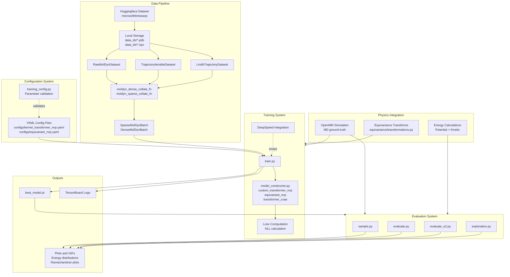

**Sources:** [README.md:1-132]()

## System Components

### Configuration System

The configuration system defines model architectures and training hyperparameters through YAML files. Each configuration file in [configs/]() specifies a complete experiment setup.

| Component | Purpose | Location |
|-----------|---------|----------|
| YAML configs | Define model architecture, hyperparameters, dataset paths | [configs/*.yaml]() |
| `training_config.py` | Validates and parses configuration parameters | [training_config.py]() |

**Sources:** [README.md:13-22, 85-87]()

### Data Pipeline

The data pipeline loads molecular dynamics trajectories and converts them into model-ready batches. Three dataset implementations support different storage formats:

| Dataset Class | Purpose | Use Case |
|--------------|---------|----------|
| `RawMolDynDataset` | Loads PDB and NPZ files directly | Development, small datasets |
| `TrajectoryIterableDataset` | Streaming access with incremental download | Large datasets, Huggingface integration |
| `LmdbTrajectoryDataset` | Indexed access to preprocessed data | Production training, fast random access |

Data is collated into two batch formats:
- **`SparseMolDynBatch`**: Graph-based representation for GNN models
- **`DenseMolDynBatch`**: Padded tensor representation for transformer models

For detailed information, see [Data Pipeline](#3).

**Sources:** High-level system architecture diagram

### Training System

The training system orchestrates model training with support for single-GPU and multi-GPU execution:

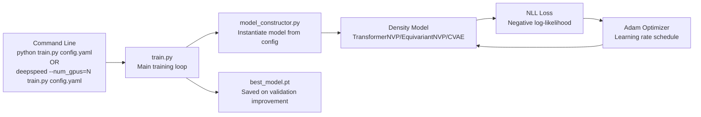

Key training components:
- **[train.py]()**: Main training script with epoch loop, validation, checkpointing
- **DeepSpeed integration**: Data-parallel training across multiple GPUs
- **Model constructors**: Factory functions in [model_constructor.py]() instantiate models from config
- **Loss computation**: Negative log-likelihood for density models

For training details, see [Training](#5). For multi-GPU setup, see [Multi-GPU Training with DeepSpeed](#5.3).

**Sources:** [README.md:11-23, 76-82]()

### Model Architectures

Timewarp provides seven distinct model architectures, all modeling the conditional distribution p(y|x):

| Model | Constructor | Key Feature |
|-------|------------|-------------|
| Transformer NVP | `custom_transformer_nvp_constructor` | Standard self-attention with normalizing flow |
| Kernel Transformer NVP | `custom_transformer_nvp_constructor` | Multi-scale kernel attention |
| Local Transformer NVP | `custom_transformer_nvp_constructor` | Spatially-restricted attention |
| Kernel Chebyshev NVP | `custom_transformer_nvp_constructor` | Chebyshev polynomial kernel approximation |
| Equivariant NVP | `equivariant_nvp_constructor` | SE(3)-equivariant layers |
| Transformer CVAE | `transformer_cvae_constructor` | Conditional VAE with latent space |
| Gaussian Baseline | `gaussian_density_transformer_constructor` | Euler-Maruyama baseline |

Configuration files in [configs/]() specify which model to use via the `model_constructor` parameter. See [Model Architectures](#4) for detailed documentation of each variant.

**Sources:** [README.md:90-94](), High-level system architecture diagram

### Evaluation System

Four specialized evaluation scripts assess different aspects of model performance:

| Script | Purpose | Key Metrics |
|--------|---------|-------------|
| [sample.py]() | General visualization and sampling | Energy distributions, trajectory GIFs |
| [evaluate.py]() | Di-peptide and tetra-peptide evaluation | Ramachandran plots, KS tests, Metropolis-Hastings sampling |
| [evaluate_o2.py]() | Oxygen molecule evaluation | Bond length distributions, energy analysis |
| [exploration.py]() | Long trajectory generation | Energy-based acceptance rates |

All evaluation scripts compare learned model predictions against OpenMM ground truth simulations to validate physical realism. See [Evaluation and Analysis](#7) for usage details.

**Sources:** [README.md:29-74]()

### Physics Integration

Timewarp integrates physics-based validation at multiple levels:

- **OpenMM**: Provides ground truth MD simulations and computes potential/kinetic energies for generated samples
- **Metropolis-Hastings**: Accepts/rejects model proposals based on energy differences to maintain Boltzmann distribution
- **Equivariance transforms**: Applies random rotations, translations, and permutations as data augmentation while preserving physical symmetries

The system ensures that learned models produce physically realistic molecular dynamics even when trained purely on data. See [Equivariance System](#6) for geometric transformation details.

**Sources:** [README.md:51, 63-73]()

## Data Flow Through the System

The following diagram traces the complete data flow from raw files to final predictions:

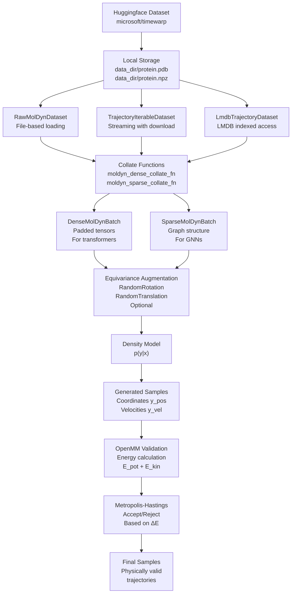

**Key stages:**

1. **Data Loading**: Raw PDB/NPZ files loaded via one of three dataset classes
2. **Collation**: Individual samples batched into dense or sparse format
3. **Augmentation**: Optional geometric transforms for equivariance
4. **Model Inference**: Generate samples from learned p(y|x)
5. **Physics Validation**: OpenMM computes energies, Metropolis-Hastings filters samples

**Sources:** High-level data flow diagram, [README.md:1-132]()

## Training and Evaluation Workflow

The typical workflow for using Timewarp involves three phases:

### Phase 1: Configuration
Select or create a YAML configuration file in [configs/]() specifying:
- Model architecture (`model_constructor`)
- Dataset paths (`data_dir`, `protein`)
- Training hyperparameters (`learning_rate`, `batch_size`, `num_epochs`)
- Model-specific parameters (attention type, number of layers, embedding dimensions)

See [Training Configuration](#5.1) for all available parameters.

### Phase 2: Training
Execute training with single or multiple GPUs:

```bash
# Single GPU
python train.py configs/kernel_transformer_nvp.yaml

# Multi-GPU with DeepSpeed
deepspeed --num_gpus=4 train.py configs/kernel_transformer_nvp.yaml
```

The system automatically:
- Loads and batches training data
- Trains the model for specified epochs
- Validates on held-out data
- Saves the best model to [outputs/best_model.pt]()
- Logs metrics to TensorBoard

Training typically takes less than 12 hours for small peptides like alanine dipeptide on a single Tesla P100 GPU. See [Training](#5) for detailed instructions.

### Phase 3: Evaluation
Evaluate the trained model using specialized scripts:

```bash
# General sampling and visualization
python sample.py --savefile outputs/best_model.pt --data_dir data/ --protein AD-1

# Peptide evaluation with Metropolis-Hastings
python evaluate.py outputs/best_model.pt --data_dir data/ --num_samples 1000 --mh

# Oxygen molecule evaluation
python evaluate_o2.py --savefile outputs/best_model.pt --data_dir data/

# Long trajectory exploration
python exploration.py outputs/best_model.pt --data_dir data/
```

Evaluation produces:
- Energy distribution plots comparing model vs. OpenMM
- Ramachandran plots for peptide backbone angles
- Bond length and angle distributions
- Kolmogorov-Smirnov test statistics
- Animated GIFs of sampled trajectories

See [Evaluation and Analysis](#7) for complete evaluation documentation.

**Sources:** [README.md:11-74]()

## Project Organization

The repository is organized into several key directories and modules:

```
timewarp/
├── configs/                  # YAML configuration files for different models
├── data_dir/                 # Local storage for molecular dynamics data
├── equivariance/             # Geometric transformation utilities
├── model_constructor.py      # Factory functions for model instantiation
├── training_config.py        # Configuration validation and parsing
├── train.py                  # Main training script
├── sample.py                 # General sampling and visualization
├── evaluate.py               # Peptide evaluation with MH sampling
├── evaluate_o2.py            # Oxygen molecule evaluation
├── exploration.py            # Long trajectory generation
└── outputs/                  # Training outputs (checkpoints, logs, plots)
```

For a detailed breakdown of the directory structure, see [Project Structure](#1.1).

**Sources:** [README.md:1-132]()

## Responsible AI and Limitations

Timewarp is a **research project** with the following scope and limitations:

| Aspect | Details |
|--------|---------|
| **Purpose** | ML and molecular dynamics research only |
| **Supported systems** | Very small peptides (2-4 amino acids), O2 molecules |
| **Limitations** | Does not achieve wall-clock speedup for many peptides; limited to small systems |
| **Evaluation** | Compared against standard MD integration (OpenMM) |
| **Intended use** | Research purposes only, not production applications |

The system is designed for investigating learned time-coarsened dynamics and should not be used for production molecular simulations without extensive validation.

**Sources:** [README.md:96-108]()

## Getting Started

To begin using Timewarp:

1. **Installation**: See [Getting Started](#2) for environment setup and dependencies
2. **Data**: Download datasets from [Huggingface](https://huggingface.co/datasets/microsoft/timewarp) to `data_dir/`
3. **Training**: Run `python train.py configs/kernel_transformer_nvp.yaml` for a quick experiment
4. **Evaluation**: Use `sample.py` to visualize model predictions

For multi-GPU training, distributed sampling strategies, and advanced configuration options, refer to the respective sections in this wiki.

**Sources:** [README.md:7-23]()

## License and Contributing

Timewarp is licensed under the MIT License (see [LICENSE]()). The project welcomes contributions following the Microsoft Contributor License Agreement (CLA) and adheres to the [Microsoft Open Source Code of Conduct](https://opensource.microsoft.com/codeofconduct/).

For contribution guidelines, see [Contributing and Community](#1.2). For information about the continuous integration pipeline, see [Continuous Integration](#1.3).

**Sources:** [README.md:111-131](), [LICENSE:1-22]()

---

# Page: Project Structure

# Project Structure

<details>
<summary>Relevant source files</summary>

The following files were used as context for generating this wiki page:

- [.gitignore](.gitignore)
- [__init__.py](__init__.py)
- [datasets/__init__.py](datasets/__init__.py)
- [equivariance/__init__.py](equivariance/__init__.py)

</details>


This page documents the organization of the Timewarp codebase, including the directory hierarchy, key files, and how different components are structured. For detailed information about specific subsystems, see [Data Pipeline](#3), [Model Architectures](#4), [Training](#5), and [Evaluation and Analysis](#7).

## Purpose and Scope

This document provides a map of the codebase structure, explaining:
- The purpose of each directory and major file
- How files are organized by functionality
- Where to find specific components when working with the code
- The relationship between file structure and system architecture

## Directory Tree Overview

The following diagram shows the high-level directory structure of the Timewarp repository:

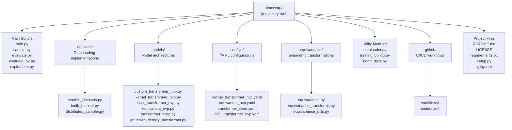

**Sources:** [.gitignore:1-161](), [__init__.py:1](), [datasets/__init__.py:1-3](), [equivariance/__init__.py:1]()

## Component Organization by System

The following table organizes the codebase components according to the major systems identified in the overall architecture:

| System | Directory/Files | Key Components | Purpose |
|--------|----------------|----------------|---------|
| **Configuration** | `configs/` | `kernel_transformer_nvp.yaml`, `equivariant_nvp.yaml`, `transformer_cvae.yaml`, `local_transformer_nvp.yaml` | YAML files defining model architectures and training parameters |
| | Root | `training_config.py` | Parameter validation and configuration loading |
| **Data Pipeline** | `datasets/` | `RawMolDynDataset`, `TrajectoryIterableDataset`, `LmdbTrajectoryDataset` | Dataset implementations for loading molecular dynamics data |
| | Root | `dataloader.py` | Batch formatting with `SparseMolDynBatch` and `DenseMolDynBatch` |
| | `datasets/` | `distributed_sampler.py` | `LMDBDistributedSampler` for multi-GPU data partitioning |
| **Model Architectures** | `models/` | `custom_transformer_nvp.py`, `kernel_transformer_nvp.py`, `local_transformer_nvp.py` | Transformer-based normalizing flow models |
| | `models/` | `equivariant_nvp.py` | Equivariant normalizing flow architecture |
| | `models/` | `transformer_cvae.py` | Conditional variational autoencoder |
| | `models/` | `gaussian_density_transformer.py` | Gaussian baseline model |
| **Training System** | Root | `train.py` | Main training script with DeepSpeed support |
| **Evaluation System** | Root | `sample.py` | General sampling and visualization |
| | Root | `evaluate.py` | Peptide evaluation with Metropolis-Hastings |
| | Root | `evaluate_o2.py` | Oxygen molecule evaluation |
| | Root | `exploration.py` | Trajectory exploration and generation |
| **Equivariance** | `equivariance/` | `equivariance.py`, `equivariance_transforms.py` | Geometric transformation classes and utilities |
| **Physics Integration** | Root | `bond_dists.py` | Bond distance calculations and statistics |
| | (External) | OpenMM integration | Energy calculations and MD simulations (via Python imports) |
| **CI/CD** | `.github/workflows/` | `codeql.yml` | CodeQL security analysis workflow |
| **Project Metadata** | Root | `README.md`, `LICENSE`, `requirements.txt`, `setup.py` | Documentation and package configuration |

**Sources:** [datasets/__init__.py:1-3](), [equivariance/__init__.py:1]()

## Main Entry Points

The following diagram maps the main executable scripts to their roles in the system workflow:

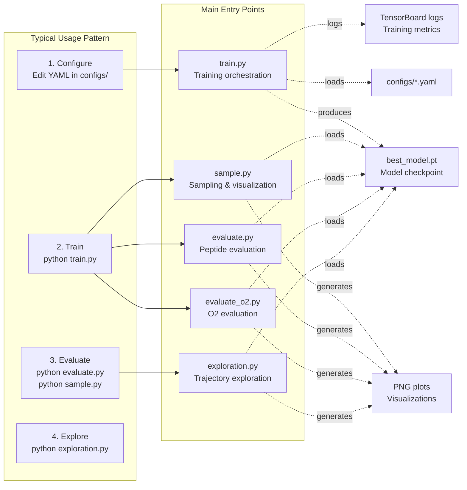

### Entry Point Descriptions

| Script | Primary Function | Key Features |
|--------|-----------------|--------------|
| `train.py` | Model training | DeepSpeed support, checkpoint saving, TensorBoard logging, validation |
| `sample.py` | General sampling | Generates trajectory samples, creates energy plots, bond distributions |
| `evaluate.py` | Peptide evaluation | Metropolis-Hastings sampling, Ramachandran plots, KS tests, supports di-peptides and tetra-peptides |
| `evaluate_o2.py` | O2 molecule evaluation | Specialized metrics for oxygen molecules, energy distribution analysis |
| `exploration.py` | Trajectory exploration | Generates new trajectories with energy-based acceptance criteria |

**Sources:** Based on high-level architecture diagrams and system workflow

## Core Module Structure

The following diagram shows the relationship between core modules and their primary classes/functions:

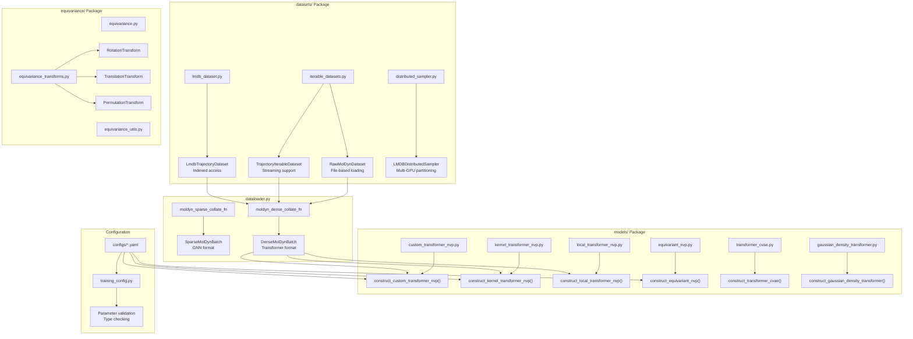

**Sources:** [datasets/__init__.py:1-3](), [equivariance/__init__.py:1]()

## Directory Details

### `datasets/`

This package contains all data loading implementations for molecular dynamics trajectories.

**Key Files:**
- `iterable_datasets.py` - Contains `RawMolDynDataset` and `TrajectoryIterableDataset` classes
- `lmdb_dataset.py` - Contains `LmdbTrajectoryDataset` for efficient indexed access
- `distributed_sampler.py` - Contains `LMDBDistributedSampler` for protein-based data partitioning across GPUs
- `__init__.py` - Exports primary dataset classes

**Imports Pattern:**
```python
from datasets import RawMolDynDataset, TrajectoryIterableDataset, LmdbTrajectoryDataset
```

**Sources:** [datasets/__init__.py:1-3]()

### `models/`

This directory contains all model architecture implementations. Each file defines a constructor function that builds a specific model variant.

**Naming Convention:**
- Files are named with pattern: `<architecture_variant>.py`
- Constructor functions follow pattern: `construct_<architecture_variant>(config)`
- Each constructor accepts a configuration dictionary and returns a model instance

**Model Categories:**
- **Transformer NVP Variants**: `custom_transformer_nvp.py`, `kernel_transformer_nvp.py`, `local_transformer_nvp.py`, `kernel_cheb_transformer_nvp.py`
- **Equivariant**: `equivariant_nvp.py`
- **Variational**: `transformer_cvae.py`
- **Baselines**: `gaussian_density_transformer.py`

### `configs/`

YAML configuration files that define model architectures and training hyperparameters. Each YAML file corresponds to a specific model architecture.

**Configuration Structure:**
Each config file specifies:
- Model architecture parameters (layers, dimensions, attention mechanisms)
- Training hyperparameters (learning rate, batch size, epochs)
- Dataset settings (data paths, preprocessing options)
- Loss function configuration

**Example Config Files:**
- `kernel_transformer_nvp.yaml` - Kernel attention configuration
- `equivariant_nvp.yaml` - Equivariant model configuration
- `transformer_cvae.yaml` - CVAE architecture configuration
- `local_transformer_nvp.yaml` - Local attention configuration

### `equivariance/`

Contains implementations of geometric transformations that preserve physical symmetries in molecular systems.

**Key Components:**
- `equivariance_transforms.py` - Transformation classes for rotations, translations, and permutations
- `equivariance_utils.py` - Utility functions for generating and applying random transformations
- `equivariance.py` - Core equivariance logic and integration with models
- `__init__.py` - Package initialization

**Sources:** [equivariance/__init__.py:1]()

### Root-Level Modules

**Utility Modules:**
- `dataloader.py` - Batch formatting with `SparseMolDynBatch` and `DenseMolDynBatch` classes, collate functions
- `training_config.py` - Configuration validation and parameter type checking
- `bond_dists.py` - Bond distance calculations and statistical analysis

**Main Scripts:**
- `train.py` - Training orchestration, checkpoint management, metrics logging
- `sample.py` - Sample generation and visualization
- `evaluate.py` - Peptide evaluation with physical validation
- `evaluate_o2.py` - O2 molecule-specific evaluation
- `exploration.py` - Trajectory exploration and generation

### `.github/`

Contains GitHub-specific configurations for continuous integration and project management.

**Structure:**
- `workflows/` - GitHub Actions workflow definitions
  - `codeql.yml` - CodeQL security analysis workflow

For detailed information about CI/CD, see [Continuous Integration](#1.3).

## Ignored Files and Directories

The `.gitignore` file specifies patterns for files that should not be tracked in version control:

**Key Exclusions:**
- Python bytecode and cache files (`__pycache__/`, `*.pyc`)
- Virtual environments (`venv/`, `env/`)
- Build artifacts (`build/`, `dist/`, `*.egg-info/`)
- IDE configurations (`.idea/`, `.vscode/`)
- Test coverage reports (`.coverage`, `htmlcov/`)
- Jupyter notebook checkpoints (`.ipynb_checkpoints/`)
- Log files (`*.log`)

**Sources:** [.gitignore:1-161]()

## File Organization Best Practices

The codebase follows these organizational principles:

1. **Separation of Concerns**: Data loading, models, training, and evaluation are in separate modules
2. **Configuration-Driven**: Models and training are configured via YAML files rather than hardcoded parameters
3. **Modular Architecture**: Each model variant is self-contained in its own file with a standard constructor interface
4. **Package Structure**: Related functionality is grouped into packages (e.g., `datasets/`, `models/`, `equivariance/`)
5. **Standard Entry Points**: Main scripts in root directory for easy discovery and execution
6. **External Dependencies**: Physics engines (OpenMM) and training frameworks (DeepSpeed) are imported rather than vendored

## Package Initialization Pattern

The codebase uses `__init__.py` files to control package exports:

**Example - `datasets/__init__.py`:**
```python
from .iterable_datasets import RawMolDynDataset, TrajectoryIterableDataset
from .lmdb_dataset import LmdbTrajectoryDataset
```

This pattern:
- Makes imports cleaner: `from datasets import LmdbTrajectoryDataset` instead of `from datasets.lmdb_dataset import LmdbTrajectoryDataset`
- Explicitly declares the public API of each package
- Allows internal refactoring without breaking external imports

**Sources:** [datasets/__init__.py:1-3](), [equivariance/__init__.py:1](), [__init__.py:1]()

## Output Artifacts

While not part of the source code structure, the system generates several output artifacts during execution:

**Training Outputs:**
- `best_model.pt` - Model checkpoint with best validation performance
- `tensorboard_logs/` - TensorBoard event files for training metrics
- `deepspeed_checkpoints/` - DeepSpeed distributed training checkpoints (when using multi-GPU)

**Evaluation Outputs:**
- `*.png` - Visualization plots (energy distributions, Ramachandran plots, bond distributions)
- `statistics.txt` - Numerical evaluation metrics and test results
- `samples/` - Generated trajectory samples (coordinates and velocities)

These output locations may be configured via command-line arguments or configuration files.

---

# Page: Contributing and Community

# Contributing and Community

<details>
<summary>Relevant source files</summary>

The following files were used as context for generating this wiki page:

- [CODE_OF_CONDUCT.md](CODE_OF_CONDUCT.md)
- [SECURITY.md](SECURITY.md)
- [SUPPORT.md](SUPPORT.md)

</details>


This document outlines the guidelines for contributing to the Timewarp project, community standards, security reporting procedures, and how to get support. It covers the code of conduct, issue reporting workflows, and communication channels for the project.

For information about setting up the development environment and running the codebase, see [Getting Started](#2). For details on the CI/CD pipeline and automated testing, see [Continuous Integration](#1.3).

## Purpose and Scope

The Timewarp project welcomes contributions from the community and maintains open channels for reporting issues, requesting features, and addressing security concerns. This page documents the established processes and community standards that govern interactions within the project.

## Code of Conduct

The Timewarp project has adopted the Microsoft Open Source Code of Conduct. All contributors and community members are expected to adhere to these standards when participating in project discussions, submitting code, or interacting with other community members.

### Code of Conduct Overview

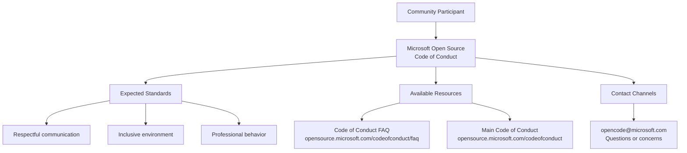

**Sources:** [CODE_OF_CONDUCT.md:1-10]()

The code of conduct applies to all project spaces including:
- GitHub repository interactions (issues, pull requests, discussions)
- Code reviews and contributions
- Communication channels
- Project events and meetings

For questions or concerns about conduct issues, contact `opencode@microsoft.com`.

## Contribution Workflow

The following diagram illustrates the different types of contributions and how they are processed through the project's workflow:

### Contribution Processing Flow

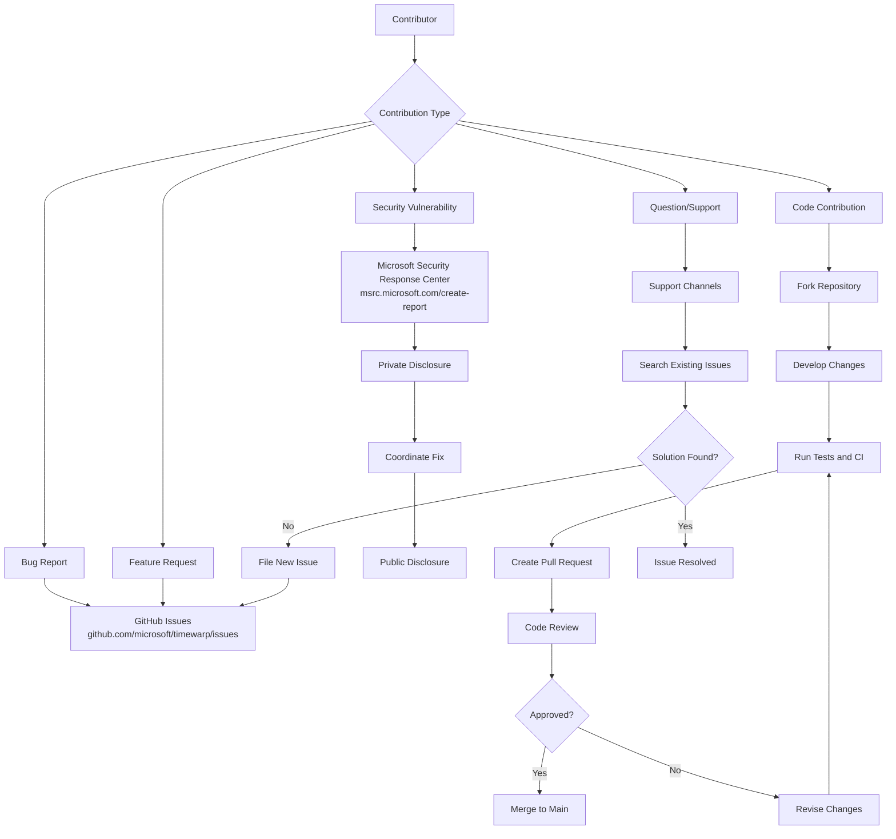

**Sources:** [SECURITY.md:1-42](), [SUPPORT.md:1-26]()

## Security Reporting

Microsoft takes security seriously for all source code repositories. The Timewarp project follows Microsoft's coordinated vulnerability disclosure policy.

### Security Vulnerability Reporting Process

| Step | Action | Details |
|------|--------|---------|
| 1 | Identify Issue | Determine if the issue meets Microsoft's definition of a security vulnerability |
| 2 | Report Privately | **Do not** file public GitHub issues for security vulnerabilities |
| 3 | Submit to MSRC | Report to Microsoft Security Response Center at `https://msrc.microsoft.com/create-report` |
| 4 | Alternative Method | Email `secure@microsoft.com` (optionally encrypted with MSRC PGP key) |
| 5 | Expect Response | Response expected within 24 hours |
| 6 | Coordinated Disclosure | Follow coordinated vulnerability disclosure principles |

**Sources:** [SECURITY.md:9-40]()

### Required Information for Security Reports

When reporting a security vulnerability, include as much of the following information as possible:

- **Type of issue**: Buffer overflow, injection vulnerability, etc.
- **Source file paths**: Full paths of affected files
- **Source location**: Tag, branch, commit, or direct URL
- **Configuration**: Special configuration needed to reproduce
- **Reproduction steps**: Detailed step-by-step instructions
- **Proof-of-concept**: Code demonstrating the vulnerability (if possible)
- **Impact assessment**: How an attacker might exploit the issue

Complete reports may qualify for the Microsoft Bug Bounty Program. See `https://aka.ms/opensource/security/bounty` for details.

**Sources:** [SECURITY.md:19-31]()

### Security Contact Channels

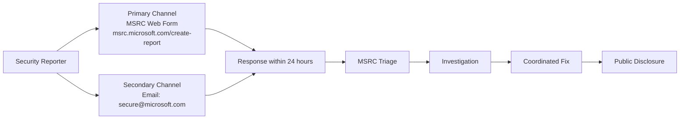

**Sources:** [SECURITY.md:13-17]()

## Filing Issues and Getting Support

GitHub Issues are the primary mechanism for tracking bugs and feature requests. Before filing a new issue, search existing issues to avoid duplicates.

### Issue Filing Guidelines

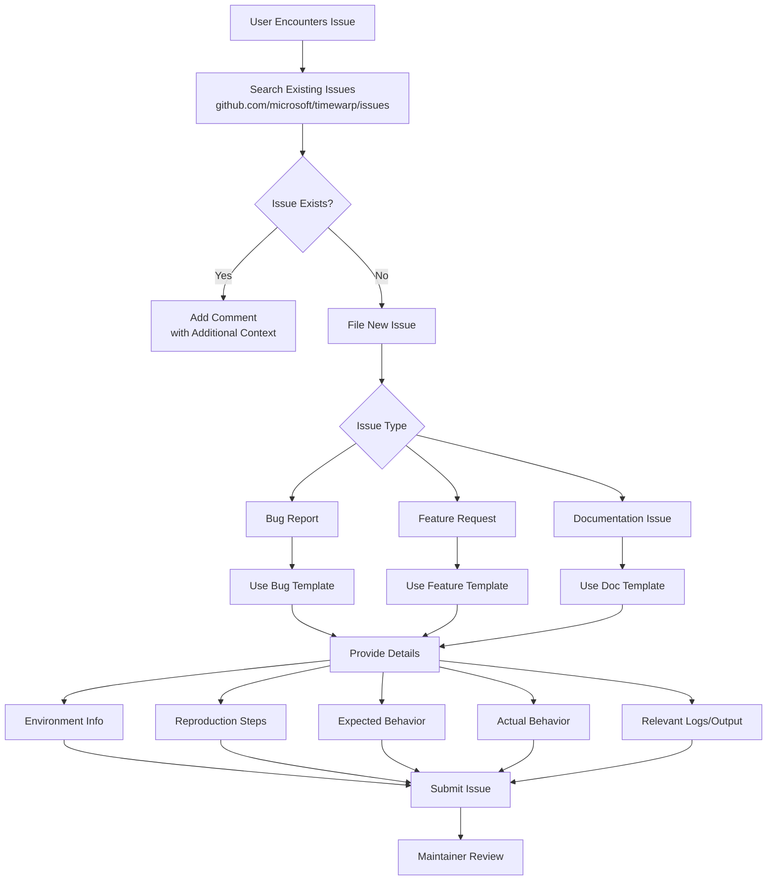

**Sources:** [SUPPORT.md:13-21]()

### Issue Types and Information Requirements

| Issue Type | Required Information | Optional Information |
|------------|---------------------|---------------------|
| **Bug Report** | Environment details, reproduction steps, expected vs actual behavior, error logs | Screenshots, sample data, configuration files |
| **Feature Request** | Use case description, proposed solution, benefits | Alternative solutions, implementation suggestions |
| **Documentation Issue** | Location of unclear documentation, suggested improvements | Examples of better documentation |
| **Performance Issue** | Benchmark results, hardware specifications, dataset details | Profiling results, comparison with baselines |
| **Installation Issue** | OS version, Python version, dependency versions, error messages | Virtual environment details, installation logs |

**Sources:** [SUPPORT.md:13-26]()

## Community Resources and Communication

### Available Resources

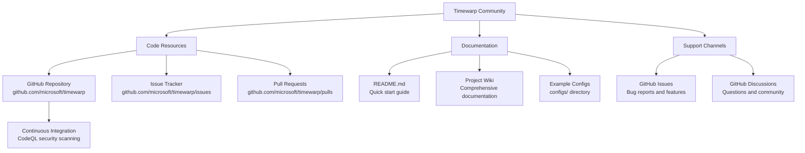

**Sources:** [CODE_OF_CONDUCT.md:1-10](), [SECURITY.md:1-42](), [SUPPORT.md:1-26]()

### Contribution Types

The project accepts various types of contributions:

1. **Code Contributions**
   - Bug fixes
   - New model architectures
   - Performance improvements
   - Dataset implementations
   - Evaluation scripts

2. **Documentation Contributions**
   - Wiki page improvements
   - Code comments and docstrings
   - Example notebooks
   - Tutorial content

3. **Testing Contributions**
   - Unit tests
   - Integration tests
   - Performance benchmarks
   - Dataset validation

4. **Community Contributions**
   - Issue triage and responses
   - Code reviews
   - Tutorial creation
   - Community support

## Support Policy

Support for the Timewarp project is limited to the resources listed in this document. The project is maintained by Microsoft Research and community contributors.

### Support Channels

| Channel | Purpose | Response Time |
|---------|---------|---------------|
| GitHub Issues | Bug reports, feature requests | Best effort |
| GitHub Discussions | General questions, community help | Community-driven |
| Security Email | Security vulnerabilities only | Within 24 hours |
| Code of Conduct Email | Conduct concerns | As needed |

**Sources:** [SUPPORT.md:23-25]()

The project does not provide dedicated customer service support beyond the self-service resources available through GitHub. Community members are encouraged to help each other through discussions and issue responses.

## Microsoft Open Source Organizations

The Timewarp project is part of Microsoft's broader open source ecosystem. Related Microsoft organizations include:

- [Microsoft](https://github.com/microsoft)
- [Azure](https://github.com/Azure)
- [DotNet](https://github.com/dotnet)
- [AspNet](https://github.com/aspnet)
- [Xamarin](https://github.com/xamarin)

For a complete list, see `https://opensource.microsoft.com/`

**Sources:** [SECURITY.md:5-5]()

---

# Page: Continuous Integration

# Continuous Integration

<details>
<summary>Relevant source files</summary>

The following files were used as context for generating this wiki page:

- [.github/workflows/codeql.yml](.github/workflows/codeql.yml)

</details>


## Purpose and Scope

This document describes the Continuous Integration (CI) system implemented in the Timewarp repository. The CI system currently focuses on automated security and code quality analysis using GitHub's CodeQL analysis framework. The system runs automated scans on code changes to detect potential security vulnerabilities, bugs, and code quality issues in the Python codebase.

For information about local testing and validation during development, see [Getting Started](#2). For details on model training validation, see [Evaluation and Analysis](#7).

---

## CI Pipeline Overview

The Timewarp repository implements a minimal CI pipeline centered on security analysis. Unlike typical CI systems that include unit tests, integration tests, and build verification, this repository currently implements only automated security scanning through CodeQL.

### Pipeline Architecture

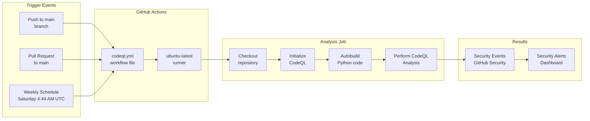

**Sources:** [.github/workflows/codeql.yml:1-83]()

---

## CodeQL Workflow Configuration

The CI pipeline is defined in a single GitHub Actions workflow file that configures automated security analysis.

### Workflow Metadata

The workflow is named `CodeQL` and is defined in [.github/workflows/codeql.yml:12](). It analyzes Python code exclusively, as specified in the language matrix [.github/workflows/codeql.yml:41]().

| Property | Value | Description |
|----------|-------|-------------|
| Workflow Name | `CodeQL` | Identifies the workflow in GitHub Actions UI |
| Language | `python` | Only Python code is analyzed |
| Runner OS | `ubuntu-latest` | Linux environment for analysis |
| Timeout | 360 minutes | Maximum execution time (6 hours) |
| Permissions | `actions: read`<br/>`contents: read`<br/>`security-events: write` | Required GitHub API permissions |

**Sources:** [.github/workflows/codeql.yml:12-45]()

---

## Trigger Conditions

The CodeQL workflow is triggered by three distinct event types, ensuring comprehensive coverage of security analysis across different development scenarios.

### Trigger Event Matrix

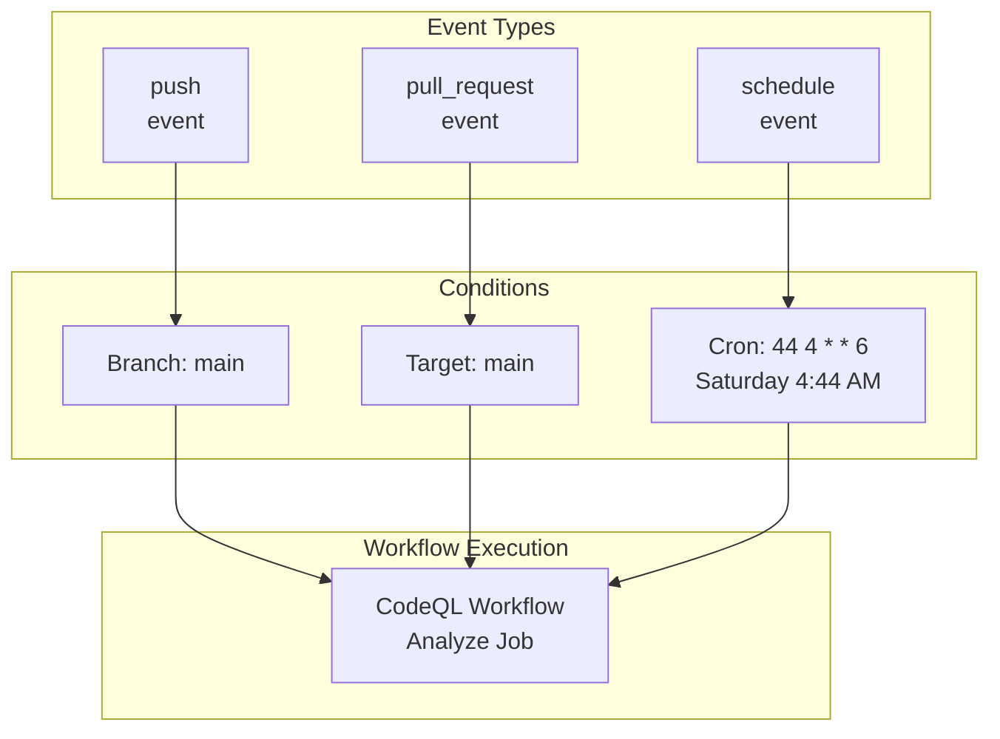

### Event Details

| Trigger | Condition | Purpose | Configuration |
|---------|-----------|---------|---------------|
| **Push** | Branch is `main` | Analyze all direct commits to main branch | [.github/workflows/codeql.yml:15-16]() |
| **Pull Request** | Target branch is `main` | Scan code changes before merging | [.github/workflows/codeql.yml:17-19]() |
| **Schedule** | `44 4 * * 6` | Weekly security audit on Saturdays | [.github/workflows/codeql.yml:20-21]() |

The scheduled execution runs every Saturday at 4:44 AM UTC, providing regular security audits even when no code changes occur. This ensures that new vulnerability patterns discovered by CodeQL are detected in the existing codebase.

**Sources:** [.github/workflows/codeql.yml:14-21]()

---

## Analysis Job Execution

The `analyze` job executes a sequence of steps to perform security analysis on the Python codebase. The job runs with specific permissions and timeout constraints.

### Job Configuration

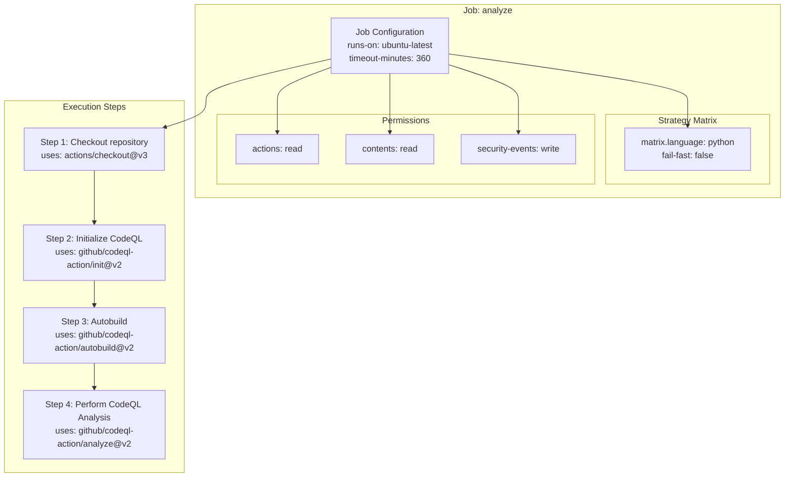

**Sources:** [.github/workflows/codeql.yml:23-46]()

### Step-by-Step Execution Flow

#### Step 1: Checkout Repository

The workflow begins by checking out the repository code using the `actions/checkout@v3` action [.github/workflows/codeql.yml:48-49](). This provides the workflow with access to all source files for analysis.

#### Step 2: Initialize CodeQL

The CodeQL tools are initialized with the `github/codeql-action/init@v2` action [.github/workflows/codeql.yml:52-53](). This step:
- Configures the CodeQL database for the specified language (Python)
- Downloads the appropriate CodeQL query packs
- Prepares the analysis environment

The language matrix specifies `python` [.github/workflows/codeql.yml:55](), which determines which CodeQL queries and analysis rules are applied.

#### Step 3: Autobuild

The `github/codeql-action/autobuild@v2` action [.github/workflows/codeql.yml:66-67]() attempts to automatically build the project. For Python projects, this typically involves:
- Detecting Python dependencies
- Installing required packages
- Resolving import paths

Since Python is an interpreted language, the autobuild step primarily sets up the analysis environment rather than compiling code.

#### Step 4: Perform CodeQL Analysis

The final step executes the security analysis using `github/codeql-action/analyze@v2` [.github/workflows/codeql.yml:79-80](). This step:
- Runs CodeQL queries against the codebase
- Identifies potential security vulnerabilities
- Generates a category-based analysis report with the category `/language:python` [.github/workflows/codeql.yml:82]()
- Uploads results to GitHub Security Events

**Sources:** [.github/workflows/codeql.yml:47-83]()

---

## Security Analysis Process

The CodeQL analysis examines the Python codebase for security vulnerabilities and code quality issues. The workflow uses GitHub's default CodeQL query set, which includes security-focused queries appropriate for Python.

### Analysis Workflow

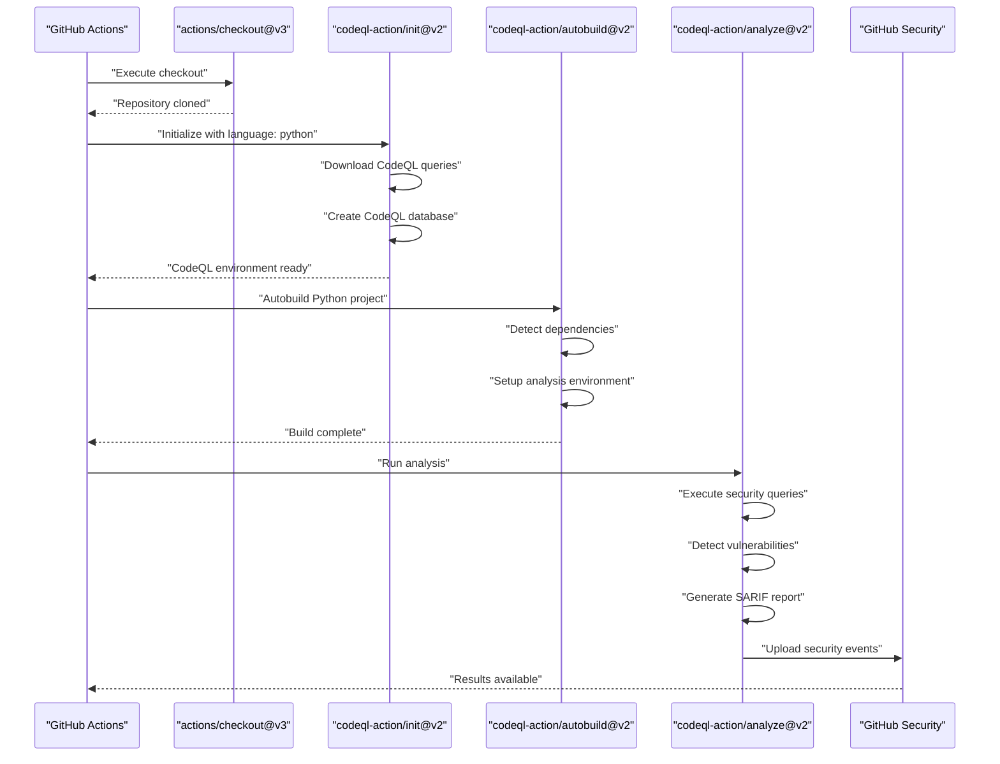

### Query Configuration

The workflow uses default CodeQL queries [.github/workflows/codeql.yml:56-61](). While custom queries can be specified, the current configuration relies on GitHub's maintained query packs. These queries are commented out in the workflow file and can be enabled by uncommenting:

```yaml
# queries: security-extended,security-and-quality
```

The available query packs include:
- **security-extended**: Enhanced security-focused queries
- **security-and-quality**: Combined security and code quality queries

**Sources:** [.github/workflows/codeql.yml:51-61](), [.github/workflows/codeql.yml:79-82]()

---

## Execution Environment

The analysis job runs on GitHub-hosted runners with specific resource allocations and timeout constraints.

### Runner Configuration

| Configuration | Value | Purpose |
|--------------|-------|---------|
| Operating System | `ubuntu-latest` | Linux environment for Python analysis |
| Runner Selection Logic | `${{ (matrix.language == 'swift' && 'macos-latest') \|\| 'ubuntu-latest' }}` | Conditional OS selection (Python uses Ubuntu) |
| Timeout | 360 minutes (6 hours) | Maximum execution time for analysis job |
| Fail-Fast Strategy | `false` | Continue analysis even if one language matrix entry fails |

The runner selection logic [.github/workflows/codeql.yml:31]() demonstrates matrix-based OS selection, though for Python analysis, it consistently evaluates to `ubuntu-latest`.

The extended timeout of 360 minutes [.github/workflows/codeql.yml:32]() provides sufficient time for comprehensive analysis of the Timewarp codebase, including all model architectures, data pipeline code, and evaluation scripts.

**Sources:** [.github/workflows/codeql.yml:27-32](), [.github/workflows/codeql.yml:38-40]()

---

## Permissions and Security

The workflow requires specific GitHub API permissions to function correctly and securely upload analysis results.

### Permission Model

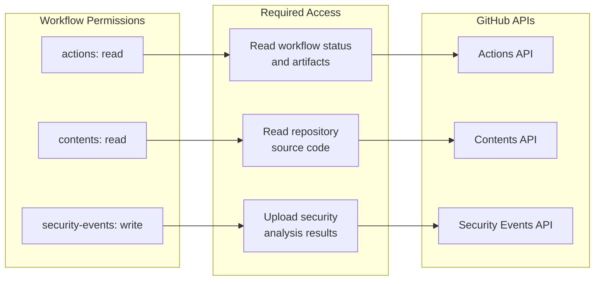

### Permission Details

| Permission | Level | Purpose |
|-----------|-------|---------|
| `actions` | `read` | Access workflow run information and artifacts |
| `contents` | `read` | Read repository files for analysis |
| `security-events` | `write` | Upload SARIF results to GitHub Security tab |

The `security-events: write` permission [.github/workflows/codeql.yml:36]() is critical for the workflow, as it allows CodeQL to upload analysis results to GitHub's Security dashboard where vulnerabilities can be reviewed and managed.

**Sources:** [.github/workflows/codeql.yml:33-36]()

---

## Monitoring and Results

Analysis results are automatically uploaded to GitHub's Security tab, where they can be reviewed by repository maintainers. The results are categorized by language using the category identifier `/language:python` [.github/workflows/codeql.yml:82]().

### Results Access Points

| Location | Content | Access |
|----------|---------|--------|
| GitHub Security Tab | All detected vulnerabilities and code quality issues | Repository maintainers with security access |
| Actions Workflow Logs | Detailed execution logs and debugging information | Anyone with repository read access |
| Code Scanning Alerts | Individual alerts with file locations and remediation guidance | Repository maintainers |

The weekly scheduled scan ensures that even without active development, the repository is regularly audited for newly discovered vulnerability patterns as CodeQL's query database is updated.

**Sources:** [.github/workflows/codeql.yml:79-82]()

---

## Extending the CI Pipeline

The current CI implementation can be extended by modifying the workflow file or adding new workflow files to `.github/workflows/`. Potential extensions include:

### Suggested Enhancements

| Enhancement | Purpose | Implementation |
|------------|---------|----------------|
| Unit Tests | Validate model components and data pipeline | Add pytest workflow |
| Linting | Enforce code style consistency | Add flake8 or black workflow |
| Type Checking | Validate type annotations | Add mypy workflow |
| Documentation Build | Verify documentation generates correctly | Add sphinx build check |
| Integration Tests | Test end-to-end training pipeline | Add training smoke test |

### Custom CodeQL Queries

Custom security queries can be enabled by uncommenting the `queries` configuration in [.github/workflows/codeql.yml:61]() and specifying query packs:

```yaml
queries: security-extended,security-and-quality
```

This would expand the analysis to include additional security patterns and code quality checks beyond the default query set.

**Sources:** [.github/workflows/codeql.yml:56-61]()

---

# Page: Getting Started

# Getting Started

<details>
<summary>Relevant source files</summary>

The following files were used as context for generating this wiki page:

- [README.md](README.md)
- [configs/kernel_transformer_nvp.yaml](configs/kernel_transformer_nvp.yaml)

</details>


This guide provides a quick start for training and evaluating Timewarp models. It covers installation, dataset preparation, running your first training session, and generating evaluation outputs. For detailed information about specific components, see [Data Pipeline](#3), [Model Architectures](#4), [Training](#5), and [Evaluation and Analysis](#7).

---

## Prerequisites

Timewarp requires:
- Python 3.7 or later
- CUDA-capable GPU (tested with Tesla P100 and newer)
- PyTorch with CUDA support
- DeepSpeed (for multi-GPU training)
- OpenMM (for physics-based validation)
- Standard scientific Python stack (NumPy, SciPy)

The system has been tested on Linux environments. Windows and macOS may require additional configuration for OpenMM integration.

**Sources:** [README.md:1-132]()

---

## Dataset Preparation

### Downloading Data

Training data and pre-trained model checkpoints are hosted on Hugging Face at `microsoft/timewarp`. The repository contains molecular dynamics trajectories for multiple systems including:

| Dataset | Description | System Size |
|---------|-------------|-------------|
| `AD-1` | Alanine dipeptide (2 amino acids) | Small peptide |
| `AD-2`, `AD-3` | Additional alanine dipeptide trajectories | Small peptide |
| `O2` | Oxygen molecule | Diatomic molecule |
| `O2-CoM` | Oxygen molecule (center of mass) | Diatomic molecule |

### Local Data Structure

After downloading, organize data in a local directory with the following structure:

```
data_dir/
├── AD-1/
│   ├── protein.pdb
│   └── trajectory_*.npz
├── AD-2/
│   ├── protein.pdb
│   └── trajectory_*.npz
└── O2/
    ├── protein.pdb
    └── trajectory_*.npz
```

Each `.npz` file contains molecular dynamics trajectory data with coordinates, velocities, and forces. The `.pdb` files define the molecular topology.

**Sources:** [README.md:7-9]()

---

## Your First Training Run

### Basic Training Command

The simplest way to train a model is using a pre-configured YAML file. For example, to train the kernel transformer NVP model on the AD-1 dataset:

```bash
python train.py configs/kernel_transformer_nvp.yaml
```

This command trains a model with the following architecture:
- 3 transformer layers with kernel attention
- 8 coupling layers for the normalizing flow
- 32-dimensional atom embeddings
- Batch size of 32
- 1000 training epochs

**Expected Training Time:** Less than 12 hours on a Tesla P100 GPU

**Sources:** [README.md:15-22](), [configs/kernel_transformer_nvp.yaml:1-31]()

### Command-Line Overrides

You can override any parameter from the YAML configuration file via command-line arguments:

```bash
python train.py configs/kernel_transformer_nvp.yaml \
    learning_rate=0.01 \
    batch_size=64 \
    num_epochs=500
```

Parameters are passed as `key=value` pairs without dashes or equals signs between the script name and config file.

**Sources:** [README.md:19-22]()

### Training Workflow Diagram

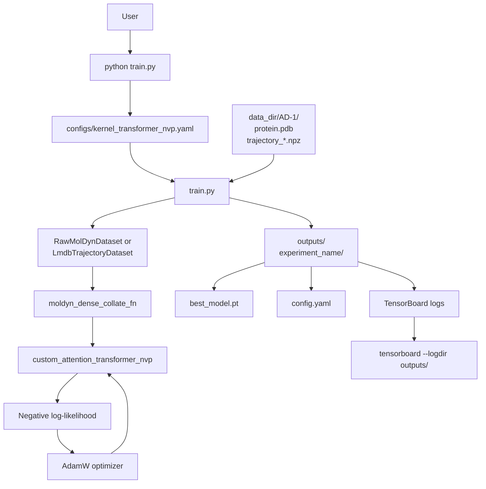

**Sources:** [README.md:15-26](), [configs/kernel_transformer_nvp.yaml:1-31]()

### Output Directory Structure

Training creates an output directory (default: `outputs/`) containing:

```
outputs/
└── experiment_name/
    ├── best_model.pt          # Model checkpoint with lowest validation loss
    ├── config.yaml            # Full configuration used for training
    ├── events.out.tfevents.*  # TensorBoard event files
    └── training.log           # Training progress logs
```

The experiment name is automatically generated based on the model type, dataset, and timestamp unless specified via the `output_dir` parameter.

**Sources:** [README.md:24-26]()

### Monitoring Training Progress

Metrics are automatically logged to TensorBoard during training. To monitor:

```bash
tensorboard --logdir outputs/
```

Then navigate to `http://localhost:6006` in your browser. Available metrics include:
- Training loss (negative log-likelihood)
- Validation loss
- Learning rate schedule
- Gradient norms

**Sources:** [README.md:24-26]()

---

## Your First Evaluation

### General Visualization with sample.py

After training completes, use `sample.py` to generate visualizations:

```bash
python sample.py \
    --savefile outputs/experiment_name/best_model.pt \
    --data_dir data_dir/ \
    --protein AD-1 \
    --num_samples 20 \
    --output_dir figures/
```

This generates:
- Conditional sample trajectories from the model
- Ground truth initial and final states
- Potential, kinetic, and total energy plots along trajectories
- Animated GIFs showing molecular motion

**Sources:** [README.md:29-40]()

### Evaluation Script Selection

Different evaluation scripts are optimized for different molecular systems:

| Script | Target Systems | Key Features |
|--------|----------------|--------------|
| `sample.py` | All systems | General visualization, energy plots |
| `evaluate.py` | Di-peptides, tetra-peptides | Ramachandran plots, bond distributions, Metropolis-Hastings sampling |
| `evaluate_o2.py` | Oxygen molecules (`O2`, `O2-CoM`) | Specialized O2 analysis |
| `exploration.py` | All systems | Trajectory generation with energy-based acceptance |

**Sources:** [README.md:29-74]()

### Peptide Evaluation Example

For more comprehensive evaluation of peptide systems:

```bash
python evaluate.py \
    outputs/experiment_name/best_model.pt \
    --data_dir data_dir/ \
    --num_samples 1000 \
    --output_dir figures/
```

This generates:
- Ramachandran plots comparing model samples to ground truth
- Bond length and angle distributions
- Kolmogorov-Smirnov test statistics for distribution agreement

**Sources:** [README.md:53-61]()

### Evaluation Command Relationships

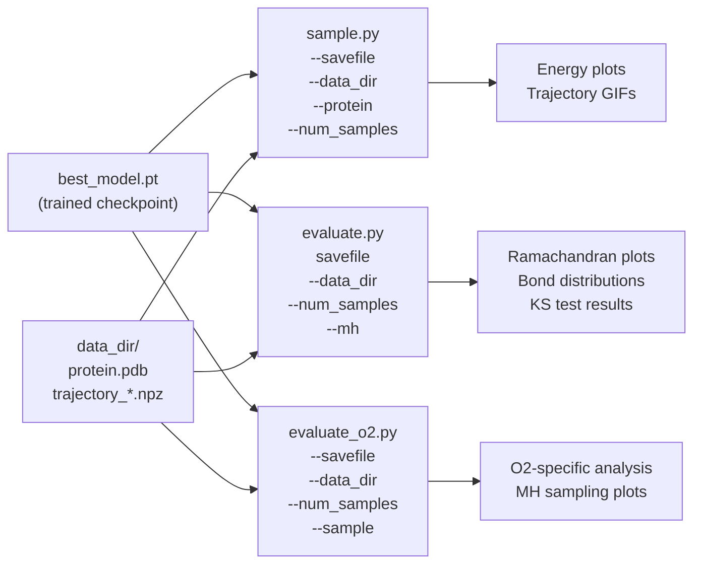

**Sources:** [README.md:29-74]()

---

## Multi-GPU Training with DeepSpeed

### Basic Multi-GPU Command

For data-parallel training across multiple GPUs, use the DeepSpeed launcher:

```bash
deepspeed --num_gpus=2 train.py configs/kernel_transformer_nvp.yaml
```

This distributes training across 2 GPUs. DeepSpeed automatically:
- Replicates the model on each GPU
- Partitions data across GPUs
- Synchronizes gradients via all-reduce
- Manages distributed checkpointing

**Sources:** [README.md:76-82]()

### Batch Size Scaling

**Important:** The `batch_size` parameter in the configuration specifies the **total batch size across all GPUs**, not the per-GPU batch size. 

| GPUs | Config `batch_size` | Actual Per-GPU Batch Size | Total Effective Batch Size |
|------|---------------------|---------------------------|----------------------------|
| 1 | 32 | 32 | 32 |
| 2 | 32 | 16 | 32 |
| 4 | 32 | 8 | 32 |

To maintain constant GPU utilization when scaling to more GPUs, multiply the `batch_size` parameter by the number of GPUs:

```bash
# Single GPU: batch_size=32
python train.py configs/kernel_transformer_nvp.yaml batch_size=32

# Four GPUs: batch_size=128 (32 per GPU)
deepspeed --num_gpus=4 train.py configs/kernel_transformer_nvp.yaml batch_size=128
```

**Sources:** [README.md:76-82]()

### Multi-GPU Architecture

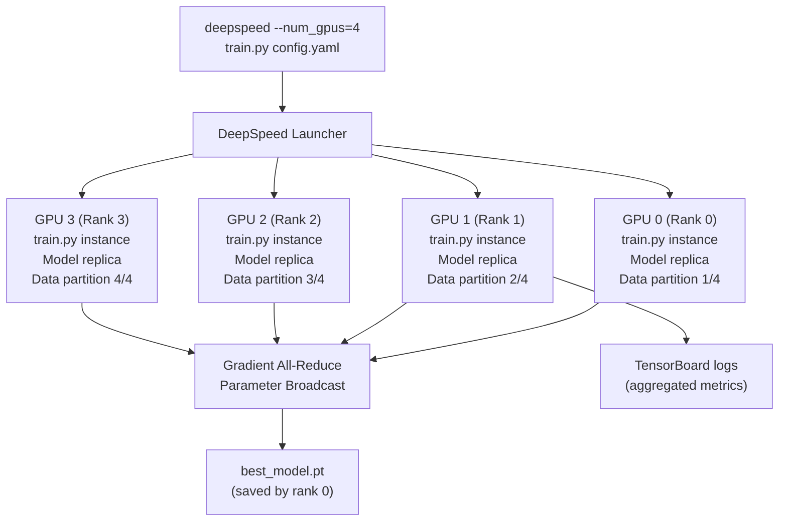

**Sources:** [README.md:76-82]()

---

## Configuration System Overview

All training parameters are defined in YAML configuration files located in `configs/`. Key configuration sections:

| Section | Parameters | Purpose |
|---------|-----------|---------|
| Training | `learning_rate`, `batch_size`, `num_epochs` | Optimization settings |
| Data | `dataset`, `step_width`, `data_augmentation` | Dataset selection and preprocessing |
| Model | `model_config.model_type`, `custom_transformer_nvp_config` | Architecture definition |
| Regularization | `weight_decay`, `patience` | Training stability |

For complete parameter documentation, see [Configuration System](#4.1) and [Training Configuration](#5.1).

**Sources:** [README.md:85-87](), [configs/kernel_transformer_nvp.yaml:1-31]()

---

## Quick Reference: File-to-Command Mapping

| Task | Primary File | Supporting Files | Output Location |
|------|-------------|------------------|-----------------|
| Train model | `train.py` | YAML configs in `configs/` | `outputs/experiment_name/` |
| General sampling | `sample.py` | Trained `best_model.pt` | Specified `--output_dir` |
| Peptide evaluation | `evaluate.py` | Trained `best_model.pt` | Specified `--output_dir` |
| O2 evaluation | `evaluate_o2.py` | Trained `best_model.pt` | Specified `--output_dir` |
| Trajectory exploration | `exploration.py` | Trained `best_model.pt` | Specified `--output_dir` |
| Monitor training | TensorBoard | Event files in `outputs/` | Browser at `localhost:6006` |

**Sources:** [README.md:1-132]()

---

## Next Steps

After completing your first training and evaluation run, explore:

- **[Data Pipeline](#3)** - Understand how molecular dynamics data is loaded, preprocessed, and batched
- **[Model Architectures](#4)** - Learn about the seven available model variants and their configurations
- **[Training](#5)** - Deep dive into training hyperparameters, learning rate schedules, and optimization
- **[Evaluation and Analysis](#7)** - Comprehensive guide to evaluation metrics, visualizations, and Metropolis-Hastings sampling
- **[Equivariance System](#6)** - Understand geometric transformations and data augmentation

For model selection guidance, see [Model Architectures](#4). The kernel transformer NVP used in this guide achieved -8.22 training loss and -6.56 validation loss on the AD-1 dataset as of October 2021.

**Sources:** [README.md:1-132](), [configs/kernel_transformer_nvp.yaml:1-3]()

---

# Page: Data Pipeline

# Data Pipeline

<details>
<summary>Relevant source files</summary>

The following files were used as context for generating this wiki page:

- [dataloader.py](dataloader.py)
- [datasets/__init__.py](datasets/__init__.py)

</details>


## Purpose and Scope

This document provides a comprehensive overview of how molecular dynamics data flows through the Timewarp system, from raw PDB and NPZ files to model-ready batches. The data pipeline transforms raw trajectory data into structured tensors suitable for training conditional density models.

This page covers the high-level architecture and data flow patterns. For detailed information on specific components, see:
- [Data Loaders](#3.1) - Details on `SparseMolDynBatch` and `DenseMolDynBatch` formats
- [Dataset Implementations](#3.2) - Overview of the three dataset classes
- [Distributed Sampling](#3.3) - Multi-GPU data partitioning strategies

## Pipeline Overview

The data pipeline consists of four major stages that transform raw molecular dynamics simulations into batches suitable for model training:

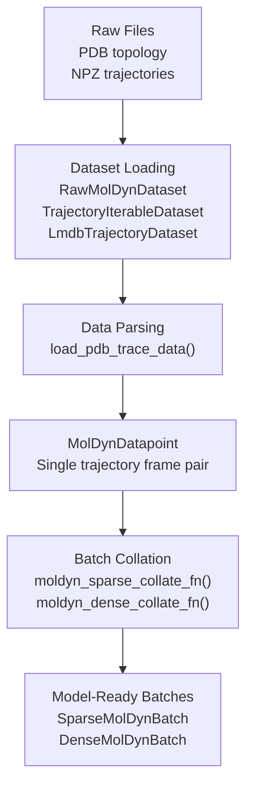

**Sources:** [dataloader.py:1-418](), [datasets/__init__.py:1-3]()

### Pipeline Stages

| Stage | Input | Output | Key Components |
|-------|-------|--------|----------------|
| **Raw Storage** | PDB topology + NPZ trajectories | File paths | Huggingface datasets or local storage |
| **Dataset Loading** | File paths | `TrajectoryInformation` objects | `RawMolDynDataset`, `TrajectoryIterableDataset`, `LmdbTrajectoryDataset` |
| **Frame Extraction** | `TrajectoryInformation` | `MolDynDatapoint` instances | Individual frame pairs (x→y) |
| **Batch Collation** | List of `MolDynDatapoint` | `SparseMolDynBatch` or `DenseMolDynBatch` | `moldyn_sparse_collate_fn()`, `moldyn_dense_collate_fn()` |

**Sources:** [dataloader.py:45-76]()

## Data Formats and Structures

The pipeline uses three primary data structures to represent molecular dynamics data at different stages of processing:

### TrajectoryInformation

The `TrajectoryInformation` dataclass [dataloader.py:45-56]() represents a complete molecular dynamics trajectory with multiple timesteps:

```mermaid
classDiagram
    class TrajectoryInformation {
        +str name
        +ndarray node_types [V]
        +ndarray adj_list [E, 2]
        +List~ndarray~ coord_features [T x [V, 3]]
        +List~ndarray~ veloc_features [T x [V, 3]]
        +List~ndarray~ force_features [T x [V, 3]]
        +List~ndarray~ coord_targets [T x [V, 3]]
        +List~ndarray~ veloc_targets [T x [V, 3]]
        +List~ndarray~ force_targets [T x [V, 3]]
    }
```

Where:
- `V` = number of atoms
- `E` = number of bonds
- `T` = number of timestep pairs in the trajectory

This structure is created by `load_pdb_trace_data()` [dataloader.py:213-276](), which reads PDB topology files and NPZ trajectory files.

**Sources:** [dataloader.py:45-56](), [dataloader.py:213-276]()

### MolDynDatapoint

The `MolDynDatapoint` dataclass [dataloader.py:58-75]() represents a single conditioning-target frame pair:

| Field | Type | Shape | Description |
|-------|------|-------|-------------|
| `name` | `str` | - | Molecule identifier |
| `atom_types` | `torch.Tensor` | `[V]` | Integer atom type indices |
| `adj_list` | `torch.Tensor` | `[E, 2]` | Bond connectivity |
| `atom_coords` | `torch.Tensor` | `[V, 3]` | Conditioning coordinates |
| `atom_velocs` | `torch.Tensor` | `[V, 3]` | Conditioning velocities |
| `atom_forces` | `torch.Tensor` | `[V, 3]` | Conditioning forces |
| `atom_coord_targets` | `torch.Tensor` | `[V, 3]` | Target coordinates |
| `atom_veloc_targets` | `torch.Tensor` | `[V, 3]` | Target velocities |
| `atom_force_targets` | `torch.Tensor` | `[V, 3]` | Target forces |

This structure represents the core learning task: predicting target state `y` (coordinates, velocities, forces) given conditioning state `x`.

**Sources:** [dataloader.py:58-75]()

### Atom Type Vocabulary

The system uses a fixed vocabulary of five elements [dataloader.py:24-25]():

```python
KNOWN_ELEMENTS = ["C", "H", "N", "O", "S"]
ELEMENT_VOCAB = {e: i for i, e in enumerate(KNOWN_ELEMENTS)}
```

Atom types are encoded as integers 0-4 corresponding to Carbon, Hydrogen, Nitrogen, Oxygen, and Sulfur.

**Sources:** [dataloader.py:24-25]()

## Batch Representations

The pipeline supports two distinct batch formats optimized for different model architectures:

### Sparse Representation (GNN-friendly)

The `SparseMolDynBatch` dataclass [dataloader.py:77-107]() collates all molecules in a batch into a single large graph:

```mermaid
graph LR
    subgraph Batch["SparseMolDynBatch"]
        AtomTypes["atom_types [V_total]"]
        AdjList["adj_list [E_total, 2]"]
        Coords["atom_coords [V_total, 3]"]
        Velocs["atom_velocs [V_total, 3]"]
        Forces["atom_forces [V_total, 3]"]
        Targets["*_targets [V_total, 3]"]
        Mapping["atom_to_sample_id [V_total]"]
    end
    
    Mol1["Molecule 1<br/>V1 atoms"]
    Mol2["Molecule 2<br/>V2 atoms"]
    Mol3["Molecule 3<br/>V3 atoms"]
    
    Mol1 --> AtomTypes
    Mol2 --> AtomTypes
    Mol3 --> AtomTypes
    
    Mol1 --> Coords
    Mol2 --> Coords
    Mol3 --> Coords
    
    Mapping --> |"Maps atoms<br/>to batch index"| AtomTypes
```

Key characteristics:
- All tensors have first dimension `V_total = V1 + V2 + ... + VB`
- Adjacency lists are concatenated with offset node indices [dataloader.py:302]()
- `atom_to_sample_id` tensor maps each atom to its batch index [dataloader.py:309-311]()
- No padding required
- Efficient for Graph Neural Networks

**Sources:** [dataloader.py:77-107](), [dataloader.py:279-325]()

### Dense Representation (Transformer-friendly)

The `DenseMolDynBatch` dataclass [dataloader.py:109-198]() pads molecules to a uniform size:

```mermaid
graph TB
    subgraph Batch["DenseMolDynBatch"]
        AtomTypes["atom_types [B, max_V]"]
        Coords["atom_coords [B, max_V, 3]"]
        Velocs["atom_velocs [B, max_V, 3]"]
        Forces["atom_forces [B, max_V, 3]"]
        Targets["*_targets [B, max_V, 3]"]
        Mask["masked_elements [B, max_V]"]
        AdjList["adj_list [E_total, 2]"]
        EdgeBatch["edge_batch_idx [E_total]"]
    end
    
    Mol1["Molecule 1<br/>5 atoms"]
    Mol2["Molecule 2<br/>8 atoms"]
    Mol3["Molecule 3<br/>6 atoms"]
    
    Mol1 --> |"Padded to 8"| AtomTypes
    Mol2 --> |"No padding"| AtomTypes
    Mol3 --> |"Padded to 8"| AtomTypes
    
    Mask --> |"True for<br/>padded atoms"| AtomTypes
```

Key characteristics:
- All per-atom tensors have shape `[B, max_num_atoms, ...]` where `B` is batch size
- Smaller molecules are padded with zeros [dataloader.py:342-365]()
- `masked_elements` tensor indicates padded positions [dataloader.py:368]()
- `adj_list` remains sparse but includes `edge_batch_idx` for batch association [dataloader.py:371-381]()
- Efficient for Transformer architectures
- Supports FP16 conversion via `tofp16()` method [dataloader.py:144-157]()

**Sources:** [dataloader.py:109-198](), [dataloader.py:328-400]()

### Comparison Table

| Feature | SparseMolDynBatch | DenseMolDynBatch |
|---------|-------------------|------------------|
| **Tensor shape** | `[V_total, ...]` | `[B, max_V, ...]` |
| **Padding** | None | Zero-padding to max size |
| **Memory efficiency** | High (no padding) | Lower (padding overhead) |
| **Best for** | Graph Neural Networks | Transformer models |
| **Batch identification** | `atom_to_sample_id` | Implicit in first dimension |
| **Adjacency format** | Single concatenated list | Sparse with `edge_batch_idx` |
| **FP16 support** | No | Yes (`tofp16()` method) |

**Sources:** [dataloader.py:77-198]()

## Data Loading Process

### File Format Requirements

The pipeline expects two files per molecule:

1. **PDB Topology File**: Defines molecular structure
   - Atom elements (mapped to `KNOWN_ELEMENTS`)
   - Bond connectivity (adjacency list)
   - Loaded via `mdtraj` library [dataloader.py:220]()

2. **NPZ Trajectory File**: Contains time-series data
   - `step`: Array of timestep indices
   - `positions`: Atom coordinates at each step
   - `velocities`: Atom velocities at each step
   - `forces`: Forces on each atom at each step

**Sources:** [dataloader.py:213-276]()

### Trajectory Parsing

The `load_pdb_trace_data()` function [dataloader.py:213-276]() processes raw files:

```mermaid
flowchart TD
    PDB["PDB File"] --> Topology["mdtraj.load()<br/>Extract topology"]
    NPZ["NPZ File"] --> Arrays["np.load()<br/>Load arrays"]
    
    Topology --> Elements["Parse atom elements<br/>Map to ELEMENT_VOCAB"]
    Topology --> Bonds["Extract bonds<br/>Create adj_list"]
    
    Arrays --> Steps["Extract step indices"]
    Arrays --> Pos["Extract positions"]
    Arrays --> Vel["Extract velocities"]
    Arrays --> Force["Extract forces"]
    
    Elements --> NodeTypes["node_types [V]"]
    Bonds --> AdjList["adj_list [E, 2]"]
    
    Steps --> Pairs["Create frame pairs<br/>step → step+step_width"]
    Pos --> Pairs
    Vel --> Pairs
    Force --> Pairs
    
    Pairs --> Validate["Validate<br/>coord delta < 100Å"]
    Validate --> Features["coord_features<br/>veloc_features<br/>force_features"]
    Validate --> Targets["coord_targets<br/>veloc_targets<br/>force_targets"]
    
    NodeTypes --> Output["TrajectoryInformation"]
    AdjList --> Output
    Features --> Output
    Targets --> Output
```

**Key processing steps:**

1. **Topology Extraction** [dataloader.py:220-226]():
   - Load PDB file with `mdtraj`
   - Map atom elements to integer indices using `ELEMENT_VOCAB`
   - Extract bond connectivity as adjacency list
   - Validate indices are within bounds

2. **Frame Pair Creation** [dataloader.py:228-264]():
   - Create dictionary mapping step index to (position, velocity, force)
   - For each conditioning step, find target step at `step + step_width`
   - Validate coordinate delta is reasonable (< 100Å) [dataloader.py:255-257]()
   - Skip frames with missing target data

3. **Spacing Control** [dataloader.py:236-249]():
   - Supports `equal_data_spacing` flag for uniform temporal spacing
   - Automatically detects logarithmic spacing in data
   - Issues warning if `step_width` conflicts with data spacing

**Sources:** [dataloader.py:213-276]()

## Collation Strategies

Two collation functions transform lists of `MolDynDatapoint` instances into batches:

### Sparse Collation

The `moldyn_sparse_collate_fn()` [dataloader.py:279-325]() creates `SparseMolDynBatch`:

```mermaid
flowchart LR
    subgraph Input["List of MolDynDatapoint"]
        DP1["Datapoint 1<br/>V1=5 atoms"]
        DP2["Datapoint 2<br/>V2=8 atoms"]
        DP3["Datapoint 3<br/>V3=6 atoms"]
    end
    
    subgraph Processing["Concatenation Process"]
        Types["Concatenate<br/>atom_types"]
        Coords["Concatenate<br/>coordinates"]
        Adj["Offset & concatenate<br/>adj_list"]
        Mapping["Create<br/>atom_to_sample_id"]
    end
    
    subgraph Output["SparseMolDynBatch"]
        OutTypes["atom_types<br/>[19]"]
        OutCoords["atom_coords<br/>[19, 3]"]
        OutAdj["adj_list<br/>[E, 2]"]
        OutMap["atom_to_sample_id<br/>[19]"]
    end
    
    DP1 --> Types
    DP2 --> Types
    DP3 --> Types
    
    Types --> OutTypes
    Coords --> OutCoords
    Adj --> OutAdj
    Mapping --> OutMap
```

**Algorithm:**
1. Iterate through datapoints, tracking cumulative atom count [dataloader.py:298-312]()
2. Concatenate all per-atom tensors (types, coords, velocities, forces, targets)
3. Offset adjacency list indices by cumulative atom count [dataloader.py:302]()
4. Create `atom_to_sample_id` mapping tensor [dataloader.py:309-311]()
5. Return concatenated tensors [dataloader.py:314-325]()

**Sources:** [dataloader.py:279-325]()

### Dense Collation

The `moldyn_dense_collate_fn()` [dataloader.py:328-400]() creates `DenseMolDynBatch`:

```mermaid
flowchart TD
    Input["List of MolDynDatapoint"]
    
    Input --> MaxSize["Determine max_num_atoms<br/>across batch"]
    
    MaxSize --> Pad["Pad all tensors<br/>using pad_sequence()"]
    
    Pad --> Types["atom_types [B, max_V]"]
    Pad --> Coords["atom_coords [B, max_V, 3]"]
    Pad --> Velocs["atom_velocs [B, max_V, 3]"]
    Pad --> Forces["atom_forces [B, max_V, 3]"]
    Pad --> Targets["*_targets [B, max_V, 3]"]
    
    MaxSize --> Mask["Create masked_elements<br/>using lengths_to_mask()"]
    
    Input --> Edges["Concatenate adj_list<br/>with edge_batch_idx"]
    
    Types --> Output["DenseMolDynBatch"]
    Coords --> Output
    Velocs --> Output
    Forces --> Output
    Targets --> Output
    Mask --> Output
    Edges --> Output
```

**Algorithm:**
1. Compute number of atoms per datapoint [dataloader.py:337-339]()
2. Pad all per-atom tensors using `torch.nn.utils.rnn.pad_sequence()` [dataloader.py:342-365]()
3. Generate mask tensor using `lengths_to_mask()` [dataloader.py:368](), [dataloader.py:403-417]()
4. Concatenate adjacency lists with batch index tracking [dataloader.py:371-381]()
5. Optionally convert to FP16 if requested [dataloader.py:400]()

**Sources:** [dataloader.py:328-400](), [dataloader.py:403-417]()

### Mask Generation

The `lengths_to_mask()` helper function [dataloader.py:403-417]() creates boolean masks:

```python
# Given lengths [5, 8, 6] with max=8
# Returns mask of shape [3, 8]:
# [[0, 0, 0, 0, 0, 1, 1, 1],   # First molecule: 5 atoms, 3 padded
#  [0, 0, 0, 0, 0, 0, 0, 0],   # Second molecule: 8 atoms, 0 padded
#  [0, 0, 0, 0, 0, 0, 1, 1]]   # Third molecule: 6 atoms, 2 padded
```

Where `1` indicates padded positions and `0` indicates real atoms.

**Sources:** [dataloader.py:403-417]()

## Integration with PyTorch DataLoader

Both collation functions are designed for use with PyTorch's `DataLoader`:

```python
# Example usage (not actual code)
from torch.utils.data import DataLoader
from dataloader import moldyn_dense_collate_fn

dataloader = DataLoader(
    dataset,
    batch_size=32,
    collate_fn=moldyn_dense_collate_fn,
    num_workers=4,
    pin_memory=True
)
```

**Important notes:**
- Both batch classes implement `pin_memory()` methods for efficient GPU transfer [dataloader.py:96-106](), [dataloader.py:131-142]()
- Collation functions avoid creating CUDA tensors when `num_workers > 0` (PyTorch best practice) [dataloader.py:284-285](), [dataloader.py:332-334]()
- `DenseMolDynBatch` supports device transfer via `todevice()` method [dataloader.py:159-172]()

**Sources:** [dataloader.py:96-106](), [dataloader.py:131-142](), [dataloader.py:159-172]()

## Dataset Implementations

The pipeline provides three dataset implementations, each optimized for different use cases:

| Dataset Class | Storage Format | Access Pattern | Best For |
|---------------|----------------|----------------|----------|
| `RawMolDynDataset` | PDB + NPZ files | Random access | Small datasets, development |
| `TrajectoryIterableDataset` | Streaming from Huggingface | Sequential | Large datasets, cloud storage |
| `LmdbTrajectoryDataset` | LMDB database | Indexed access | Production training, fast I/O |

For detailed documentation of these implementations, see [Dataset Implementations](#3.2).

**Sources:** [datasets/__init__.py:1-2]()

## Data Validation

The pipeline includes several validation checks to ensure data quality:

1. **Coordinate Delta Validation** [dataloader.py:255-257]():
   - Raises `CoordDeltaTooBig` exception if atoms move > 100Å between frames
   - Prevents physically unrealistic trajectories from entering the pipeline

2. **Index Bounds Validation** [dataloader.py:225-226]():
   - Ensures adjacency list indices are within `[0, num_atoms)`
   - Prevents out-of-bounds errors in graph construction

3. **Element Vocabulary Validation** [dataloader.py:223]():
   - Only accepts atoms from `KNOWN_ELEMENTS` (C, H, N, O, S)
   - Implicitly validates via dictionary lookup

**Sources:** [dataloader.py:202-211](), [dataloader.py:223-226](), [dataloader.py:255-257]()

---

# Page: Data Loaders

# Data Loaders

<details>
<summary>Relevant source files</summary>

The following files were used as context for generating this wiki page:

- [dataloader.py](dataloader.py)

</details>


This module implements the data loading and batching logic for molecular dynamics simulation data. It provides two distinct batch representation formats: a **sparse format** suitable for Graph Neural Network (GNN) models and a **dense format** suitable for transformer models. The module handles the collation of individual molecular dynamics datapoints into batches, including padding, masking, and adjacency list management.

For information about the dataset implementations that produce individual datapoints, see [Dataset Implementations](#3.2). For distributed data sampling across GPUs, see [Distributed Sampling](#3.3).

## Overview

The dataloader module transforms individual molecular dynamics datapoints into batched tensors ready for model consumption. The key design decision is supporting two distinct batching strategies:

- **Sparse batching**: Concatenates all molecules in a batch into a single large graph, efficient for GNN-style models
- **Dense batching**: Pads molecules to uniform size and stacks them into `[batch_size, max_num_atoms, ...]` tensors, suitable for transformers

Sources: [dataloader.py:1-13]()

## Data Representation Classes

### MolDynDatapoint

The `MolDynDatapoint` class represents a single training example consisting of an initial molecular state (features) and a target future state. Each datapoint contains:

| Field | Type | Shape | Description |
|-------|------|-------|-------------|
| `name` | str | - | Identifier for the molecule/trajectory |
| `atom_types` | int64 tensor | `[V]` | Element indices for each atom |
| `adj_list` | int64 tensor | `[E, 2]` | Adjacency list of bonded atom pairs |
| `atom_coords` | float32 tensor | `[V, 3]` | Input 3D coordinates (Angstroms) |
| `atom_velocs` | float32 tensor | `[V, 3]` | Input velocities |
| `atom_forces` | float32 tensor | `[V, 3]` | Input forces |
| `atom_coord_targets` | float32 tensor | `[V, 3]` | Target coordinates at future timestep |
| `atom_veloc_targets` | float32 tensor | `[V, 3]` | Target velocities |
| `atom_force_targets` | float32 tensor | `[V, 3]` | Target forces |

Where `V` is the number of atoms in the molecule and `E` is the number of bonds. The adjacency list uses zero-indexed atom IDs.

Sources: [dataloader.py:58-75]()

### SparseMolDynBatch

The `SparseMolDynBatch` class represents a batch of molecules concatenated into a single large graph structure:

```mermaid
graph LR
    subgraph "Molecule 1"
        M1["atoms: 0-9<br/>edges"]
    end
    
    subgraph "Molecule 2"
        M2["atoms: 10-24<br/>edges"]
    end
    
    subgraph "Molecule 3"
        M3["atoms: 25-41<br/>edges"]
    end
    
    M1 --> Concat["Concatenated Graph"]
    M2 --> Concat
    M3 --> Concat
    
    Concat --> Output["SparseMolDynBatch<br/>atom_types: [42]<br/>atom_coords: [42, 3]<br/>adj_list: [E_total, 2]<br/>atom_to_sample_id: [42]"]
```

**SparseMolDynBatch Structure**

| Field | Type | Shape | Description |
|-------|------|-------|-------------|
| `names` | List[str] | `[B]` | Molecule identifiers |
| `atom_types` | int64 tensor | `[V_total]` | Concatenated atom types |
| `adj_list` | int64 tensor | `[E_total, 2]` | Concatenated adjacency list with adjusted indices |
| `atom_coords` | float32 tensor | `[V_total, 3]` | Concatenated coordinates |
| `atom_velocs` | float32 tensor | `[V_total, 3]` | Concatenated velocities |
| `atom_forces` | float32 tensor | `[V_total, 3]` | Concatenated forces |
| `atom_coord_targets` | float32 tensor | `[V_total, 3]` | Concatenated target coordinates |
| `atom_veloc_targets` | float32 tensor | `[V_total, 3]` | Concatenated target velocities |
| `atom_force_targets` | float32 tensor | `[V_total, 3]` | Concatenated target forces |
| `atom_to_sample_id` | int32 tensor | `[V_total]` | Maps each atom to its batch index |

Where `V_total` is the sum of all atoms across the batch, `E_total` is the sum of all edges, and `B` is the batch size.

The `atom_to_sample_id` tensor is critical for GNN models to track which atoms belong to which molecule in the batch. The adjacency list indices are offset appropriately during concatenation.

Sources: [dataloader.py:77-107]()

### DenseMolDynBatch

The `DenseMolDynBatch` class represents a batch where molecules are padded to a uniform size:

```mermaid
graph TB
    subgraph "Input Molecules"
        M1["Molecule 1<br/>10 atoms"]
        M2["Molecule 2<br/>15 atoms"]
        M3["Molecule 3<br/>17 atoms"]
    end
    
    subgraph "Padded Batch"
        P1["Sample 0: [17 atoms]<br/>10 real + 7 padding"]
        P2["Sample 1: [17 atoms]<br/>15 real + 2 padding"]
        P3["Sample 2: [17 atoms]<br/>17 real + 0 padding"]
    end
    
    M1 --> P1
    M2 --> P2
    M3 --> P3
    
    P1 --> Stack["Stacked Tensor<br/>[3, 17, ...]"]
    P2 --> Stack
    P3 --> Stack
    
    Stack --> Mask["masked_elements: [3, 17]<br/>True for padding positions"]
```

**DenseMolDynBatch Structure**

| Field | Type | Shape | Description |
|-------|------|-------|-------------|
| `names` | List[str] | `[B]` | Molecule identifiers |
| `atom_types` | int64 tensor | `[B, max_atoms]` | Padded atom types |
| `adj_list` | int64 tensor | `[E_total, 2]` | Concatenated adjacency list |
| `edge_batch_idx` | int64 tensor | `[E_total]` | Maps each edge to its batch index |
| `atom_coords` | float32 tensor | `[B, max_atoms, 3]` | Padded coordinates |
| `atom_velocs` | float32 tensor | `[B, max_atoms, 3]` | Padded velocities |
| `atom_forces` | float32 tensor | `[B, max_atoms, 3]` | Padded forces |
| `atom_coord_targets` | float32 tensor | `[B, max_atoms, 3]` | Padded target coordinates |
| `atom_veloc_targets` | float32 tensor | `[B, max_atoms, 3]` | Padded target velocities |
| `atom_force_targets` | float32 tensor | `[B, max_atoms, 3]` | Padded target forces |
| `masked_elements` | bool tensor | `[B, max_atoms]` | True for padding positions, False for real atoms |

Where `max_atoms` is the maximum number of atoms in any molecule in the batch. The adjacency list remains sparse (concatenated, not padded) with `edge_batch_idx` tracking which batch element each edge belongs to.

**Key Methods:**

- `tofp16()`: Converts float32 tensors to float16 for memory efficiency [dataloader.py:144-157]()
- `todevice(device)`: Moves all tensors to specified device [dataloader.py:159-172]()
- `sort_by_name()`: Reorders batch elements alphabetically by name [dataloader.py:174-175]()
- `permute(permutation)`: Applies arbitrary permutation to batch order [dataloader.py:177-192]()
- `segments`: Cached property returning indices of contiguous same-name groups [dataloader.py:194-196]()

Sources: [dataloader.py:109-198]()

## Batch Format Comparison

The choice between sparse and dense formats depends on the model architecture:

```mermaid
graph TB
    Dataset["Dataset<br/>Yields MolDynDatapoint"]
    
    Dataset --> SparsePath["Sparse Path"]
    Dataset --> DensePath["Dense Path"]
    
    SparsePath --> SparseCollate["moldyn_sparse_collate_fn"]
    DensePath --> DenseCollate["moldyn_dense_collate_fn"]
    
    SparseCollate --> SparseBatch["SparseMolDynBatch<br/>Single large graph"]
    DenseCollate --> DenseBatch["DenseMolDynBatch<br/>Padded tensors"]
    
    SparseBatch --> GNN["GNN Models<br/>Message passing on<br/>concatenated graph"]
    DenseBatch --> Transformer["Transformer Models<br/>Attention over<br/>padded sequences"]
```

**Comparison Table**

| Aspect | Sparse Format | Dense Format |
|--------|---------------|--------------|
| **Memory efficiency** | Optimal - no padding | Less efficient due to padding |
| **Computation** | Efficient for GNNs | Efficient for transformers |
| **Atom tensors** | 1D concatenated `[V_total, ...]` | 2D padded `[B, max_atoms, ...]` |
| **Adjacency handling** | Offset indices during concat | Keep separate, track with `edge_batch_idx` |
| **Masking** | Via `atom_to_sample_id` | Via `masked_elements` boolean tensor |
| **Batch indexing** | Requires mapping through `atom_to_sample_id` | Direct indexing `batch[i]` |
| **Model types** | GNNs, equivariant networks | Transformers, attention-based models |

Sources: [dataloader.py:1-13](), [dataloader.py:77-198]()

## Collation Functions

### moldyn_sparse_collate_fn

The `moldyn_sparse_collate_fn` function creates sparse batches by concatenating all molecules into a single graph:

```mermaid
graph LR
    Input["List of MolDynDatapoint"]
    
    Input --> Process["For each datapoint:<br/>1. Append atom_types<br/>2. Offset adj_list by total_num_nodes<br/>3. Append coords/velocs/forces<br/>4. Create atom_to_sample_id mapping"]
    
    Process --> Concat["Concatenate all lists<br/>using torch.cat"]
    
    Concat --> Output["SparseMolDynBatch"]
    
    subgraph "Example"
        Ex1["Mol 1: 10 atoms<br/>adj_list: [[0,1], [1,2], ...]"]
        Ex2["Mol 2: 15 atoms<br/>adj_list: [[0,1], [2,3], ...]"]
        Ex3["After offset:<br/>Mol 2 adj_list: [[10,11], [12,13], ...]"]
    end
```

**Key Logic:**
1. Iterate through each datapoint, tracking `total_num_nodes`
2. Offset each datapoint's `adj_list` by adding `total_num_nodes` to all indices
3. Create `atom_to_sample_id` tensor mapping each atom to its batch index
4. Concatenate all tensors along dimension 0

Sources: [dataloader.py:279-325]()

### moldyn_dense_collate_fn

The `moldyn_dense_collate_fn` function creates dense batches with padding:

```mermaid
graph TB
    Input["Sequence of MolDynDatapoint"]
    
    Input --> Pad["Pad sequences using<br/>pad_sequence with batch_first=True<br/>Pads to max_atoms in batch"]
    
    Input --> Edges["Concatenate adjacency lists<br/>Create edge_batch_idx mapping"]
    
    Pad --> Mask["Generate masked_elements<br/>using lengths_to_mask"]
    
    Mask --> Batch["DenseMolDynBatch"]
    Edges --> Batch
    
    Batch --> FP16{"fp16=True?"}
    FP16 -->|Yes| Convert["Convert float32 to float16<br/>via tofp16()"]
    FP16 -->|No| Return["Return batch"]
    Convert --> Return
```

**Key Logic:**
1. Use PyTorch's `pad_sequence` with `batch_first=True` to pad all per-atom features
2. Generate `masked_elements` boolean mask using `lengths_to_mask` utility
3. Concatenate adjacency lists and create `edge_batch_idx` to track edge ownership
4. Optionally convert to float16 for memory efficiency

**Parameters:**
- `datapoints`: Sequence of `MolDynDatapoint` objects
- `fp16`: If True, converts float32 tensors to float16

Sources: [dataloader.py:328-400]()

## Utility Functions

### lengths_to_mask

The `lengths_to_mask` function generates a boolean mask for padded sequences:

```mermaid
graph LR
    Input["lengths: [B]<br/>e.g., [10, 15, 17]"]
    
    Input --> MaxLen["max_len = lengths.max()<br/>= 17"]
    
    MaxLen --> Range["arange(max_len)<br/>[0, 1, 2, ..., 16]"]
    
    Range --> Expand["Expand to [B, max_len]<br/>[[0,1,...,16],<br/> [0,1,...,16],<br/> [0,1,...,16]]"]
    
    Input --> Unsqueeze["lengths.unsqueeze(1)<br/>[[10], [15], [17]]"]
    
    Expand --> Compare["Compare >= lengths"]
    Unsqueeze --> Compare
    
    Compare --> Mask["mask: [B, max_len]<br/>[[F...F,T...T],<br/> [F...F,T,T],<br/> [F...F]]"]
```

The function creates a mask where `mask[i, j] = True` if `j >= lengths[i]` (padding position), and `False` otherwise (real atom position).

Sources: [dataloader.py:403-417]()

### load_pdb_trace_data

The `load_pdb_trace_data` function loads molecular dynamics trajectories from PDB and NPZ files:

**Input Files:**
- `state0_file`: PDB file containing initial molecular structure and topology
- `traj_file`: NPZ file containing trajectory data (steps, positions, velocities, forces)

**Process:**
1. Load topology from PDB using MDTraj to extract atom types and bonds
2. Map element symbols to integer indices using `ELEMENT_VOCAB`
3. Extract bond connectivity into adjacency list
4. Load trajectory arrays (positions, velocities, forces) from NPZ
5. Create conditioning-target pairs with configurable `step_width`
6. Validate coordinate deltas don't exceed 100 Angstroms (raises `CoordDeltaTooBig`)

**Parameters:**
- `step_width`: Timestep interval between conditioning and target states
- `equal_data_spacing`: If True, only uses conditioning states at regular spacing intervals

**Returns:** `TrajectoryInformation` object containing the molecule structure and trajectory sequence.

Sources: [dataloader.py:213-276]()

### contiguous_segments

The `contiguous_segments` function identifies groups of consecutive identical names:

```python
# Example:
names = ["A", "A", "B", "B", "B", "C"]
segments = contiguous_segments(names)
# Returns: [0, 2, 5, 6]
# Meaning: A spans [0:2], B spans [2:5], C spans [5:6]
```

This is used by `DenseMolDynBatch.segments` to efficiently group trajectory frames from the same molecule.

Sources: [dataloader.py:28-42]()

## Element Vocabulary

The dataloader uses a fixed vocabulary of chemical elements:

| Element | Index |
|---------|-------|
| Carbon (C) | 0 |
| Hydrogen (H) | 1 |
| Nitrogen (N) | 2 |
| Oxygen (O) | 3 |
| Sulfur (S) | 4 |

The `ELEMENT_VOCAB` dictionary maps element symbols to indices, used when converting topology information to integer tensors. Molecules containing elements outside this vocabulary will raise a `KeyError`.

Sources: [dataloader.py:24-25]()

## Integration with Data Pipeline

```mermaid
graph TB
    Files["PDB + NPZ Files"]
    
    Files --> LoadFn["load_pdb_trace_data"]
    LoadFn --> TrajInfo["TrajectoryInformation<br/>name, node_types, adj_list<br/>Lists of coords/velocs/forces"]
    
    TrajInfo --> Dataset["Dataset Classes<br/>RawMolDynDataset<br/>TrajectoryIterableDataset<br/>LmdbTrajectoryDataset"]
    
    Dataset --> Datapoint["Yields MolDynDatapoint<br/>Individual timestep pairs"]
    
    Datapoint --> DataLoader{"PyTorch DataLoader<br/>collate_fn=?"}
    
    DataLoader -->|Sparse| SparseCollate["moldyn_sparse_collate_fn"]
    DataLoader -->|Dense| DenseCollate["moldyn_dense_collate_fn"]
    
    SparseCollate --> SparseBatch["SparseMolDynBatch"]
    DenseCollate --> DenseBatch["DenseMolDynBatch"]
    
    SparseBatch --> Model["Model Training/Inference"]
    DenseBatch --> Model
```

**Integration Points:**

1. **Dataset Layer**: Dataset classes (see [Dataset Implementations](#3.2)) yield individual `MolDynDatapoint` objects
2. **DataLoader Layer**: PyTorch `DataLoader` uses either `moldyn_sparse_collate_fn` or `moldyn_dense_collate_fn` as the collation function
3. **Model Layer**: Models receive batched data in either sparse or dense format depending on architecture requirements

**Usage Example:**

```python
from torch.utils.data import DataLoader
from dataloader import moldyn_dense_collate_fn

# For transformer models - use dense batches
train_loader = DataLoader(
    dataset,
    batch_size=32,
    collate_fn=moldyn_dense_collate_fn,
    shuffle=True
)

# For GNN models - use sparse batches
train_loader = DataLoader(
    dataset,
    batch_size=32,
    collate_fn=moldyn_sparse_collate_fn,
    shuffle=True
)
```

Sources: [dataloader.py:1-13](), [dataloader.py:279-400]()

## Memory and Performance Considerations

### Pin Memory

Both `SparseMolDynBatch` and `DenseMolDynBatch` implement a `pin_memory()` method that pins all tensors to page-locked memory for faster CPU-to-GPU transfers. This is automatically utilized by PyTorch's `DataLoader` when `pin_memory=True`.

Sources: [dataloader.py:96-106](), [dataloader.py:131-142]()

### FP16 Support

The `DenseMolDynBatch` class supports automatic float16 conversion via the `tofp16()` method, reducing memory usage by 50% for floating-point tensors. This can be enabled during collation:

```python
collate_fn = lambda x: moldyn_dense_collate_fn(x, fp16=True)
```

Sources: [dataloader.py:144-157](), [dataloader.py:400]()

### Multi-Processing Warning

The collation functions are designed to return CPU tensors. Returning CUDA tensors when `num_workers > 0` in the DataLoader is not recommended due to multiprocessing constraints. Models should move batches to GPU after receiving them from the DataLoader.

Sources: [dataloader.py:283-285](), [dataloader.py:332-334]()

---

# Page: Dataset Implementations

# Dataset Implementations

<details>
<summary>Relevant source files</summary>

The following files were used as context for generating this wiki page:

- [datasets/__init__.py](datasets/__init__.py)
- [datasets/iterable_datasets.py](datasets/iterable_datasets.py)
- [datasets/lmdb_dataset.py](datasets/lmdb_dataset.py)

</details>


## Purpose and Scope

This document provides an overview of the three dataset implementations available in Timewarp for loading molecular dynamics trajectory data. These implementations provide different trade-offs between flexibility, performance, and storage requirements. For detailed information on the iterable streaming approach, see [Iterable Datasets](#3.2.1). For indexed LMDB-based access, see [LMDB Datasets](#3.2.2). For information on how datasets are batched and fed to models, see [Data Loaders](#3.1).

## Overview

Timewarp provides three dataset implementations for loading molecular dynamics trajectories:

| Class | Type | Storage Format | Use Case | File Location |
|-------|------|----------------|----------|---------------|
| `RawMolDynDataset` | Base class | PDB + NPZ files | Base functionality for loading raw files | [datasets/iterable_datasets.py:46-130]() |
| `TrajectoryIterableDataset` | Iterable | PDB + NPZ files | Streaming data loading, multi-worker support | [datasets/iterable_datasets.py:215-280]() |
| `LmdbTrajectoryDataset` | Indexed | LMDB database | Random access, fastest loading | [datasets/lmdb_dataset.py:61-135]() |

All three implementations produce `MolDynDatapoint` objects containing atomic coordinates, velocities, forces, and connectivity information for molecular dynamics simulations.

**Sources:** [datasets/__init__.py:1-3](), [datasets/iterable_datasets.py:1-280](), [datasets/lmdb_dataset.py:1-135]()

## Dataset Class Hierarchy

```mermaid
graph TB
    subgraph "Base Classes"
        RawBase["RawMolDynDataset<br/>(datasets/iterable_datasets.py:46)"]
        IterableBase["torch.utils.data.IterableDataset"]
        IndexedBase["torch.utils.data.Dataset"]
        Downloadable["DownloadableDataset<br/>(utilities.downloadable_dataset)"]
    end
    
    subgraph "Implementations"
        Incremental["IncrementalRawMolDynDataset<br/>(iterable_datasets.py:143)"]
        TrajIterable["TrajectoryIterableDataset<br/>(iterable_datasets.py:215)"]
        LmdbDataset["LmdbTrajectoryDataset<br/>(lmdb_dataset.py:61)"]
    end
    
    subgraph "Helper Classes"
        Iterator["TrajectoryIterableDatasetIterator<br/>(iterable_datasets.py:173)"]
    end
    
    subgraph "Output"
        Datapoint["MolDynDatapoint<br/>timewarp.dataloader"]
    end
    
    RawBase --> Incremental
    Downloadable --> TrajIterable
    IterableBase --> TrajIterable
    Incremental --> TrajIterable
    
    Downloadable --> LmdbDataset
    IndexedBase --> LmdbDataset
    
    TrajIterable --> Iterator
    Iterator --> Datapoint
    Incremental --> Datapoint
    LmdbDataset --> Datapoint
```

**Sources:** [datasets/iterable_datasets.py:34-280](), [datasets/lmdb_dataset.py:60-135]()

## Core Data Flow

```mermaid
flowchart LR
    subgraph Storage["Storage Layer"]
        PDB["PDB Files<br/>*-traj-state0.pdb<br/>Topology info"]
        NPZ["NPZ Files<br/>*-traj-arrays.npz<br/>Coordinates/velocities"]
        LMDB["LMDB Files<br/>*.lmdb<br/>Pre-serialized data"]
    end
    
    subgraph Loading["Loading Layer"]
        RawLoader["load_pdb_trace_data()<br/>timewarp.dataloader"]
        LmdbGet["lmdb_get()<br/>utilities.lmdb_utils"]
    end
    
    subgraph Datasets["Dataset Implementations"]
        RawDataset["RawMolDynDataset<br/>_gracefully_load_pdb_trace_data()<br/>make_iterator()"]
        TrajDataset["TrajectoryIterableDataset<br/>__iter__()<br/>Worker partitioning"]
        LmdbData["LmdbTrajectoryDataset<br/>__getitem__()<br/>Random access"]
    end
    
    subgraph Output["Output"]
        Datapoint["MolDynDatapoint<br/>name, atom_types, adj_list<br/>coords, velocities, forces<br/>targets"]
    end
    
    PDB --> RawLoader
    NPZ --> RawLoader
    RawLoader --> RawDataset
    RawDataset --> TrajDataset
    TrajDataset --> Datapoint
    
    LMDB --> LmdbGet
    LmdbGet --> LmdbData
    LmdbData --> Datapoint
```

**Sources:** [datasets/iterable_datasets.py:59-130](), [datasets/lmdb_dataset.py:113-116]()

## RawMolDynDataset: Base File Loading

The `RawMolDynDataset` class provides the foundation for loading molecular dynamics trajectories from PDB and NPZ files. It is not used directly but serves as the base for `TrajectoryIterableDataset`.

### Key Attributes

| Attribute | Type | Description |
|-----------|------|-------------|
| `data_dir` | `StrPath` | Directory containing PDB and NPZ files |
| `step_width` | `int` | Temporal spacing between trajectory samples |
| `equal_data_spacing` | `bool` | Whether to enforce uniform time spacing |
| `pdb_names` | `Sequence[str]` | Cached list of available PDB file basenames |

### Core Methods

**`pdb_names` (cached property)** [datasets/iterable_datasets.py:47-51]()
- Scans `data_dir` for files ending in `-traj-state0.pdb`
- Returns sorted list of PDB basenames
- Cached to avoid repeated directory scans

**`_gracefully_load_pdb_trace_data(pdb_name: str)`** [datasets/iterable_datasets.py:59-80]()
- Loads trajectory data for a given PDB name
- Returns `TrajectoryInformation` containing coordinates, velocities, forces
- Returns `None` if files are missing or contain invalid data
- Catches `CoordDeltaTooBig` exceptions for trajectories with discontinuities

**`make_iterator(pdb_names: Sequence[str])`** [datasets/iterable_datasets.py:82-129]()
- Creates an iterator over trajectory datapoints
- Iterates through specified PDB names
- Yields `MolDynDatapoint` objects with features and targets
- Displays progress bar using `tqdm`

**Sources:** [datasets/iterable_datasets.py:34-130]()

## TrajectoryIterableDataset: Streaming Access

`TrajectoryIterableDataset` extends `RawMolDynDataset` to provide PyTorch `IterableDataset` functionality with multi-worker support and optional incremental downloading.

### Architecture

```mermaid
graph TB
    subgraph "TrajectoryIterableDataset"
        Dataset["TrajectoryIterableDataset<br/>num_traces_per_chunk=16<br/>shuffle=False"]
        RawDS["raw_dataset property<br/>RawMolDynDataset or<br/>IncrementalRawMolDynDataset"]
    end
    
    subgraph "Multi-Worker Support"
        WorkerInfo["torch.utils.data.get_worker_info()"]
        Partition["approximately_equal_partition()<br/>Splits PDB names by worker"]
    end
    
    subgraph "Iterator"
        Iterator["TrajectoryIterableDatasetIterator<br/>Chunks by num_traces"]
        Buffer["loaded_datapoints buffer<br/>Shuffle within chunk"]
    end
    
    subgraph "Output"
        Datapoint["MolDynDatapoint stream"]
    end
    
    Dataset --> RawDS
    Dataset --> WorkerInfo
    WorkerInfo --> Partition
    Partition --> RawDS
    RawDS --> Iterator
    Iterator --> Buffer
    Buffer --> Datapoint
```

### Key Features

**Multi-Worker Data Partitioning** [datasets/iterable_datasets.py:240-246]()
- Divides PDB files across workers using `approximately_equal_partition()`
- Each worker processes a disjoint subset of molecules
- Seed management ensures different ordering per epoch

**Chunked Loading** [datasets/iterable_datasets.py:173-211]()
- `TrajectoryIterableDatasetIterator` loads data in chunks of `num_traces_per_chunk` molecules
- Buffers datapoints in `loaded_datapoints` list
- Optional shuffling within each chunk
- Can skip incomplete chunks at end of iteration

**Incremental Downloading** [datasets/iterable_datasets.py:143-169]()
- `IncrementalRawMolDynDataset` extends base with `downloader` support
- Downloads PDB/NPZ files on-demand from blob storage
- Tracks attempted downloads to avoid repeated failures
- Falls back to local loading if download fails

**Sources:** [datasets/iterable_datasets.py:132-280]()

## LmdbTrajectoryDataset: Indexed Access

`LmdbTrajectoryDataset` provides random access to pre-serialized trajectory data stored in LMDB (Lightning Memory-Mapped Database) files. This is the fastest dataset implementation for training.

### Architecture

```mermaid
graph TB
    subgraph "Initialization"
        Init["__post_init__()"]
        Scan["get_envs(data_dir)<br/>Scan for *.lmdb files"]
        Validate["Validate step_width<br/>from LMDB metadata"]
    end
    
    subgraph "Metadata Storage"
        StepWidth["StepWidth metadata<br/>Frozen, must match"]
        NumAtoms["NumAtoms metadata<br/>List per datapoint"]
        PdbIdx["PdbIndices metadata<br/>Map pdb_name → indices"]
    end
    
    subgraph "LMDB Files"
        Env1["LMDB file 1<br/>lmdb.Environment"]
        Env2["LMDB file 2<br/>lmdb.Environment"]
        EnvN["LMDB file N<br/>lmdb.Environment"]
    end
    
    subgraph "Indexing"
        CumLen["cum_lengths<br/>Cumulative lengths"]
        GetIndices["get_indices()<br/>Map global → local index"]
    end
    
    subgraph "Access"
        GetItem["__getitem__(index)<br/>Random access"]
        LmdbGet["lmdb_get(txn, key)<br/>Deserialize datapoint"]
    end
    
    Init --> Scan
    Scan --> Env1
    Scan --> Env2
    Scan --> EnvN
    Env1 --> Validate
    Env2 --> Validate
    EnvN --> Validate
    
    Validate --> StepWidth
    Validate --> NumAtoms
    Validate --> PdbIdx
    
    Env1 --> CumLen
    Env2 --> CumLen
    EnvN --> CumLen
    
    GetItem --> GetIndices
    GetIndices --> CumLen
    GetIndices --> LmdbGet
    LmdbGet --> Env1
    LmdbGet --> Env2
    LmdbGet --> EnvN
```

### Key Attributes

| Attribute | Type | Description |
|-----------|------|-------------|
| `envs` | `List[lmdb.Environment]` | Open LMDB database environments |
| `cum_lengths` | `List[int]` | Cumulative lengths for indexing across databases |
| `num_atoms` | `List[int]` | Number of atoms in each datapoint |
| `pdb_indices` | `Dict[str, List[int]]` | Mapping from PDB name to datapoint indices |

### Metadata System

The LMDB dataset stores three types of metadata alongside the trajectory data:

**`StepWidth`** [datasets/lmdb_dataset.py:21-27]()
- Frozen metadata that must match the requested `step_width`
- Validation ensures LMDB files are compatible with training configuration

**`NumAtoms`** [datasets/lmdb_dataset.py:29-39]()
- Stores number of atoms for each datapoint
- Used for validation and efficient memory allocation

**`PdbIndices`** [datasets/lmdb_dataset.py:42-52]()
- Maps each PDB name to its constituent datapoint indices
- Enables filtering by molecule type for evaluation
- Used by `LMDBDistributedSampler` for protein-based partitioning (see [Distributed Sampling](#3.3))

### Random Access Implementation

**`__getitem__(index: int)`** [datasets/lmdb_dataset.py:113-116]()
1. `get_indices()` maps global index to (database_index, element_index) pair
2. Opens transaction on appropriate LMDB environment
3. `lmdb_get()` deserializes the datapoint from LMDB
4. Returns `MolDynDatapoint` object

**Sources:** [datasets/lmdb_dataset.py:1-135]()

## Dataset Selection Guide

```mermaid
graph TD
    Start["Selecting Dataset Implementation"]
    
    Question1{"Pre-processed<br/>LMDB available?"}
    Question2{"Need random<br/>access?"}
    Question3{"Incremental<br/>download?"}
    Question4{"Multiple<br/>workers?"}
    
    UseLMDB["Use LmdbTrajectoryDataset<br/>• Fastest loading<br/>• Random access<br/>• Best for training"]
    UseTrajectory["Use TrajectoryIterableDataset<br/>• Streaming access<br/>• Multi-worker support<br/>• Good for large datasets"]
    UseRaw["Use RawMolDynDataset<br/>• Simple iteration<br/>• Single worker<br/>• Basic use cases"]
    
    Start --> Question1
    Question1 -->|Yes| Question2
    Question1 -->|No| Question3
    
    Question2 -->|Yes| UseLMDB
    Question2 -->|No| Question3
    
    Question3 -->|Yes| UseTrajectory
    Question3 -->|No| Question4
    
    Question4 -->|Yes| UseTrajectory
    Question4 -->|No| UseRaw
```

### Recommendations

**Use `LmdbTrajectoryDataset` when:**
- LMDB files have been pre-created from raw data
- Training requires multiple epochs over the same data
- Random access is needed (e.g., distributed sampling by PDB)
- Maximum loading performance is critical

**Use `TrajectoryIterableDataset` when:**
- Working with raw PDB/NPZ files
- Dataset is too large to pre-process entirely
- Using multiple DataLoader workers
- Incremental downloading from remote storage is needed

**Use `RawMolDynDataset` when:**
- Building custom iteration logic
- Single-worker sequential access is sufficient
- Subclassing to add custom functionality

**Sources:** [datasets/__init__.py:1-3](), [datasets/iterable_datasets.py:1-280](), [datasets/lmdb_dataset.py:1-135]()

## Common Interface

All three dataset implementations produce `MolDynDatapoint` objects with the following structure:

```mermaid
graph LR
    subgraph "MolDynDatapoint Structure"
        Name["name: str<br/>PDB identifier"]
        Types["atom_types: Tensor[N]<br/>Atomic numbers"]
        Adj["adj_list: Tensor[E, 2]<br/>Bond connectivity"]
        
        subgraph "Features (time t)"
            Coords["atom_coords: Tensor[N, 3]"]
            Velocs["atom_velocs: Tensor[N, 3]"]
            Forces["atom_forces: Tensor[N, 3]"]
        end
        
        subgraph "Targets (time t+Δt)"
            CoordTargets["atom_coord_targets: Tensor[N, 3]"]
            VelocTargets["atom_veloc_targets: Tensor[N, 3]"]
            ForceTargets["atom_force_targets: Tensor[N, 3]"]
        end
    end
```

This common interface ensures that all downstream components (collate functions, models, evaluation scripts) work seamlessly with any dataset implementation.

**Sources:** [timewarp/dataloader.py]() (referenced in [datasets/iterable_datasets.py:11-16]() and [datasets/lmdb_dataset.py:9]())

## File Format Details

### PDB + NPZ Storage

**PDB Files** (topology): `{pdb_name}-traj-state0.pdb`
- Contains atomic structure and connectivity
- Standard PDB format with atom types and bonds
- Parsed by `load_pdb_trace_data()` from `timewarp.dataloader`

**NPZ Files** (dynamics): `{pdb_name}-traj-arrays.npz`
- NumPy compressed archive containing trajectory arrays
- Keys: coordinates, velocities, forces at each timestep
- Loaded using `numpy.load()` with memory mapping

### LMDB Storage

**Database Files**: `*.lmdb`
- Key-value store with integer keys ("0", "1", "2", ...) for datapoints
- Special metadata keys: "step_width", "num_atoms", "pdb_indices"
- Each value is a serialized `MolDynDatapoint` using pickle
- Multiple LMDB files can be in the same directory (concatenated virtually)

**Sources:** [datasets/iterable_datasets.py:22-58](), [datasets/lmdb_dataset.py:69-106]()

## Performance Characteristics

| Characteristic | RawMolDynDataset | TrajectoryIterableDataset | LmdbTrajectoryDataset |
|----------------|------------------|---------------------------|------------------------|
| **Loading Speed** | Moderate | Moderate | Fast |
| **Memory Usage** | Low | Low | Low (memory-mapped) |
| **Access Pattern** | Sequential | Sequential | Random |
| **Multi-worker Support** | No | Yes | Yes |
| **Preprocessing Required** | No | No | Yes |
| **Storage Overhead** | None | None | ~20-30% larger |
| **Best Use Case** | Simple iteration | Training with streaming | Training with indexing |

The `step_width` parameter controls temporal spacing between samples. Larger values reduce data volume but may miss fast dynamics. All implementations validate this parameter during loading [datasets/lmdb_dataset.py:76-82]().

**Sources:** [datasets/iterable_datasets.py:1-280](), [datasets/lmdb_dataset.py:1-135]()

---

# Page: Iterable Datasets

# Iterable Datasets

<details>
<summary>Relevant source files</summary>

The following files were used as context for generating this wiki page:

- [datasets/iterable_datasets.py](datasets/iterable_datasets.py)

</details>


## Purpose and Scope

This page documents the `TrajectoryIterableDataset` implementation for streaming molecular dynamics trajectory data. This dataset class is designed for scenarios where:

- The full dataset cannot fit in memory
- Data should be loaded on-demand during training
- Incremental downloading from remote storage is required
- Data needs to be partitioned across multiple DataLoader workers

For efficient indexed access to pre-processed trajectories, see [LMDB Datasets](#3.2.2). For the base dataloader primitives and batch formats, see [Data Loaders](#3.1).

**Sources:** [datasets/iterable_datasets.py:1-280]()

## Architecture Overview

The iterable dataset system consists of four main components organized in a hierarchy:

```mermaid
graph TB
    subgraph "PyTorch Integration"
        IterableDataset["torch.utils.data.IterableDataset"]
        DownloadableDataset["DownloadableDataset[DatasetStats]"]
    end
    
    subgraph "Core Classes"
        TrajectoryIterableDataset["TrajectoryIterableDataset"]
        TrajectoryIterableDatasetIterator["TrajectoryIterableDatasetIterator"]
        RawMolDynDataset["RawMolDynDataset"]
        IncrementalRawMolDynDataset["IncrementalRawMolDynDataset"]
    end
    
    subgraph "Data Sources"
        LocalFiles["Local PDB + NPZ Files"]
        RemoteBlob["Remote Blob Storage"]
    end
    
    subgraph "Output"
        MolDynDatapoint["MolDynDatapoint"]
    end
    
    IterableDataset --> TrajectoryIterableDataset
    DownloadableDataset --> TrajectoryIterableDataset
    TrajectoryIterableDataset --> TrajectoryIterableDatasetIterator
    TrajectoryIterableDataset --> RawMolDynDataset
    TrajectoryIterableDataset --> IncrementalRawMolDynDataset
    
    RawMolDynDataset --> IncrementalRawMolDynDataset
    
    LocalFiles --> RawMolDynDataset
    RemoteBlob --> IncrementalRawMolDynDataset
    
    TrajectoryIterableDatasetIterator --> MolDynDatapoint
    
    style TrajectoryIterableDataset fill:#f9f9f9
    style TrajectoryIterableDatasetIterator fill:#f9f9f9
```

**Sources:** [datasets/iterable_datasets.py:45-280]()

## RawMolDynDataset

`RawMolDynDataset` is the foundational class that handles loading molecular dynamics trajectories from local disk storage.

### Data Structure

The class expects data organized as:
```
data_dir/
├── protein1-traj-state0.pdb
├── protein1-traj-arrays.npz
├── protein2-traj-state0.pdb
├── protein2-traj-arrays.npz
└── ...
```

Each trajectory consists of:
- **PDB file** (`*-traj-state0.pdb`): Initial structure and topology
- **NPZ file** (`*-traj-arrays.npz`): Trajectory data (coordinates, velocities, forces)

**Sources:** [datasets/iterable_datasets.py:45-81]()

### Key Methods and Attributes

| Method/Attribute | Purpose |
|------------------|---------|
| `pdb_names` | Cached property that returns sorted list of available trajectory names |
| `pdb_file_name(pdb_name)` | Constructs path to PDB file for a given trajectory |
| `npz_file_name(pdb_name)` | Constructs path to NPZ file for a given trajectory |
| `_gracefully_load_pdb_trace_data(pdb_name)` | Loads trajectory data with error handling |
| `make_iterator(pdb_names)` | Creates iterator over specified trajectories |

**Sources:** [datasets/iterable_datasets.py:47-130]()

### Configuration Parameters

```mermaid
graph LR
    RawMolDynDataset["RawMolDynDataset"]
    
    data_dir["data_dir: StrPath"]
    step_width["step_width: int"]
    equal_data_spacing["equal_data_spacing: bool = False"]
    
    data_dir --> RawMolDynDataset
    step_width --> RawMolDynDataset
    equal_data_spacing --> RawMolDynDataset
    
    data_dir_desc["Directory containing<br/>PDB and NPZ files"]
    step_width_desc["Time step interval<br/>between samples"]
    equal_desc["Whether to use<br/>equal spacing"]
    
    data_dir --- data_dir_desc
    step_width --- step_width_desc
    equal_data_spacing --- equal_desc
```

**Sources:** [datasets/iterable_datasets.py:34-42]()

### Error Handling

The `_gracefully_load_pdb_trace_data` method handles three types of errors gracefully:

1. **FileNotFoundError**: Logs warning when PDB or NPZ file is missing
2. **CoordDeltaTooBig**: Logs warning when coordinate changes exceed physical limits
3. **Other exceptions**: Re-raised with context about which files failed

When errors occur, the method returns `None` and the iterator skips that trajectory.

**Sources:** [datasets/iterable_datasets.py:59-80]()

### Iterator Implementation

The `make_iterator` method produces `MolDynDatapoint` objects:

```mermaid
graph TB
    Start["Start iteration"]
    LoadTraj["Load trajectory<br/>_gracefully_load_pdb_trace_data"]
    CheckValid{"Valid<br/>trajectory?"}
    ExtractData["Extract:<br/>- atom_types<br/>- adj_list<br/>- coordinates<br/>- velocities<br/>- forces"]
    LoopFrames["Loop through frames"]
    YieldPoint["Yield MolDynDatapoint"]
    NextTraj["Next trajectory"]
    End["End"]
    
    Start --> LoadTraj
    LoadTraj --> CheckValid
    CheckValid -->|No| NextTraj
    CheckValid -->|Yes| ExtractData
    ExtractData --> LoopFrames
    LoopFrames --> YieldPoint
    YieldPoint --> LoopFrames
    LoopFrames --> NextTraj
    NextTraj --> LoadTraj
    LoadTraj --> End
```

**Sources:** [datasets/iterable_datasets.py:82-130]()

## IncrementalRawMolDynDataset

`IncrementalRawMolDynDataset` extends `RawMolDynDataset` to support on-demand downloading from remote blob storage.

### Key Differences from RawMolDynDataset

| Aspect | RawMolDynDataset | IncrementalRawMolDynDataset |
|--------|------------------|------------------------------|
| Data source | Local files only | Blob storage with local caching |
| PDB names discovery | `os.listdir(data_dir)` | `downloader.list_files()` |
| File loading | Direct file access | Download if missing, then access |
| Download tracking | N/A | Maintains `download_attempted` set |

**Sources:** [datasets/iterable_datasets.py:132-170]()

### Download Logic

The incremental download flow:

```mermaid
sequenceDiagram
    participant Iterator
    participant Dataset as IncrementalRawMolDynDataset
    participant Downloader
    participant LocalFS as Local Filesystem
    
    Iterator->>Dataset: _gracefully_load_pdb_trace_data(pdb_name)
    
    alt Not previously attempted
        Dataset->>Downloader: download_file_if_missing(*.pdb)
        Downloader->>LocalFS: Download if not exists
        Dataset->>Downloader: download_file_if_missing(*.npz)
        Downloader->>LocalFS: Download if not exists
        Dataset->>Dataset: Mark as download_attempted
    end
    
    Dataset->>LocalFS: Load from local files
    LocalFS-->>Dataset: TrajectoryInformation
    Dataset-->>Iterator: TrajectoryInformation or None
```

**Sources:** [datasets/iterable_datasets.py:155-169]()

### Configuration

```python
@dataclass(frozen=True)
class IncrementalRawMolDynDataset:
    downloader: Any  # BlobClient instance
    download_attempted: Set[str] = field(default_factory=set)
    # Inherits: data_dir, step_width, equal_data_spacing
```

The `downloader` parameter should be a `BlobClient` instance that implements:
- `list_files()`: Returns list of files in remote storage
- `download_file_if_missing(filename)`: Downloads file if not already cached

**Sources:** [datasets/iterable_datasets.py:133-170]()

## TrajectoryIterableDatasetIterator

`TrajectoryIterableDatasetIterator` implements chunking and shuffling logic for trajectory data.

### Chunking Strategy

Trajectories are grouped into chunks to improve data locality:

```mermaid
graph LR
    subgraph "Raw Iterator"
        T1["Trajectory 1<br/>100 frames"]
        T2["Trajectory 2<br/>150 frames"]
        T3["Trajectory 3<br/>80 frames"]
    end
    
    subgraph "Buffer (num_traces_per_chunk=2)"
        B1["All frames from<br/>Trajectory 1<br/>Trajectory 2"]
    end
    
    subgraph "Shuffled Output"
        O1["Frame 42 from T2"]
        O2["Frame 7 from T1"]
        O3["Frame 103 from T2"]
        O4["..."]
    end
    
    T1 --> B1
    T2 --> B1
    B1 -->|Shuffle| O1
    B1 -->|Shuffle| O2
    B1 -->|Shuffle| O3
    B1 -->|Shuffle| O4
```

**Sources:** [datasets/iterable_datasets.py:173-212]()

### Configuration Parameters

| Parameter | Type | Default | Purpose |
|-----------|------|---------|---------|
| `raw_iterator` | `Iterator[MolDynDatapoint]` | Required | Source iterator from RawMolDynDataset |
| `num_traces_per_chunk` | `int` | Required | Number of trajectories per chunk |
| `shuffle` | `bool` | `False` | Whether to shuffle within chunks |
| `skip_incomplete_chunks` | `bool` | `False` | Whether to discard partial final chunks |

**Sources:** [datasets/iterable_datasets.py:173-178]()

### Iteration Logic

The iterator maintains a buffer and implements a pull-based loading strategy:

```mermaid
stateDiagram-v2
    [*] --> CheckBuffer: __next__ called
    CheckBuffer --> LoadChunk: Buffer empty
    CheckBuffer --> PopDatapoint: Buffer has data
    
    LoadChunk --> AccumulateTrajectories: Load until num_traces_per_chunk
    AccumulateTrajectories --> AccumulateTrajectories: Add datapoints
    AccumulateTrajectories --> Shuffle: Chunk complete
    AccumulateTrajectories --> HandleIncomplete: StopIteration raised
    
    HandleIncomplete --> ClearBuffer: skip_incomplete_chunks=True
    HandleIncomplete --> Shuffle: skip_incomplete_chunks=False
    
    Shuffle --> CheckBuffer: Shuffle if enabled
    ClearBuffer --> RaiseStop: Buffer empty
    
    PopDatapoint --> Return: Pop first element
    Return --> [*]
    RaiseStop --> [*]: Raise StopIteration
```

**Sources:** [datasets/iterable_datasets.py:181-211]()

## TrajectoryIterableDataset

`TrajectoryIterableDataset` is the primary user-facing class that integrates all components.

### Class Hierarchy

```mermaid
graph BT
    TrajectoryIterableDataset["TrajectoryIterableDataset"]
    DownloadableDataset["DownloadableDataset[DatasetStats]"]
    IterableDataset["torch.utils.data.IterableDataset"]
    
    TrajectoryIterableDataset --> DownloadableDataset
    TrajectoryIterableDataset --> IterableDataset
    
    Props["Properties:<br/>- num_traces_per_chunk: int = 16<br/>- step_width: int = 1<br/>- shuffle: bool = False<br/>- equal_data_spacing: bool = False"]
    
    Props -.-> TrajectoryIterableDataset
```

**Sources:** [datasets/iterable_datasets.py:214-220]()

### Multi-Worker Support

The dataset automatically partitions data across DataLoader workers:

```mermaid
graph TB
    subgraph "Main Process"
        Dataset["TrajectoryIterableDataset<br/>pdb_names = [A,B,C,D,E,F]"]
    end
    
    subgraph "Worker 0"
        W0["pdb_names_for_worker(0, 3)<br/>→ [A, B]"]
        W0Iter["make_iterator_for_pdb_names<br/>([A, B])"]
    end
    
    subgraph "Worker 1"
        W1["pdb_names_for_worker(1, 3)<br/>→ [C, D]"]
        W1Iter["make_iterator_for_pdb_names<br/>([C, D])"]
    end
    
    subgraph "Worker 2"
        W2["pdb_names_for_worker(2, 3)<br/>→ [E, F]"]
        W2Iter["make_iterator_for_pdb_names<br/>([E, F])"]
    end
    
    Dataset --> W0
    Dataset --> W1
    Dataset --> W2
    
    W0 --> W0Iter
    W1 --> W1Iter
    W2 --> W2Iter
```

The partitioning is handled by:
1. `pdb_names_for_worker(worker_id, num_workers)`: Splits PDB names using `approximately_equal_partition`
2. `make_iterator_for_worker(worker_id, num_workers)`: Creates iterator with worker-specific random seed

**Sources:** [datasets/iterable_datasets.py:240-279]()

### Random Seed Management

For reproducibility with multiple workers:

```python
# Line 262-264 in iterable_datasets.py
state = np.random.get_state(legacy=True)
assert isinstance(state, tuple)
np.random.seed(state[1][0] + worker_id)
```

This ensures:
- Each worker gets a different but deterministic random seed
- Seeds change between epochs (main process resets seed each epoch)
- Different workers produce different shuffling orders

**Sources:** [datasets/iterable_datasets.py:258-266]()

### Integration with DownloadableDataset

`TrajectoryIterableDataset` inherits from `DownloadableDataset`, providing:

- Automatic dataset downloading from Huggingface
- Dataset integrity checking via `check_dir` method
- Support for both local and remote data sources

```python
# Line 237-238 in iterable_datasets.py
@staticmethod
def check_dir(data_dir: StrPath, expected_dataset_stats: DatasetStats):
    return len(get_pdb_names(data_dir)) == expected_dataset_stats.num_files
```

**Sources:** [datasets/iterable_datasets.py:236-238]()

### Raw Dataset Factory

The dataset automatically selects the appropriate raw dataset implementation:

```mermaid
graph TB
    Create["TrajectoryIterableDataset.__iter__()"]
    CheckDownloader{"self.downloader<br/>exists?"}
    CreateIncremental["IncrementalRawMolDynDataset<br/>(with downloader)"]
    CreateLocal["RawMolDynDataset<br/>(local files only)"]
    
    Create --> CheckDownloader
    CheckDownloader -->|Yes| CreateIncremental
    CheckDownloader -->|No| CreateLocal
    
    CreateIncremental --> Iterator["Return iterator<br/>with incremental download"]
    CreateLocal --> Iterator
```

**Sources:** [datasets/iterable_datasets.py:221-234]()

## Complete Data Flow

The following diagram shows the complete data flow from disk to model:

```mermaid
flowchart TB
    subgraph "Storage"
        Local["Local Files<br/>data_dir/*.pdb<br/>data_dir/*.npz"]
        Remote["Remote Blob Storage<br/>(optional)"]
    end
    
    subgraph "Dataset Layer"
        TID["TrajectoryIterableDataset"]
        RawDS["RawMolDynDataset or<br/>IncrementalRawMolDynDataset"]
        Iterator["TrajectoryIterableDatasetIterator"]
    end
    
    subgraph "Processing"
        LoadTraj["load_pdb_trace_data"]
        Chunk["Chunk by num_traces_per_chunk"]
        Shuffle["Shuffle (optional)"]
    end
    
    subgraph "Output"
        Datapoint["MolDynDatapoint<br/>- name<br/>- atom_types<br/>- adj_list<br/>- coordinates<br/>- velocities<br/>- forces<br/>- targets"]
    end
    
    Remote -.->|Download if needed| Local
    Local --> RawDS
    TID --> RawDS
    RawDS --> LoadTraj
    LoadTraj --> Iterator
    Iterator --> Chunk
    Chunk --> Shuffle
    Shuffle --> Datapoint
```

**Sources:** [datasets/iterable_datasets.py:1-280]()

## Usage Example

```python
from datasets.iterable_datasets import TrajectoryIterableDataset
from torch.utils.data import DataLoader

# Create dataset
dataset = TrajectoryIterableDataset(
    data_dir="/path/to/data",
    num_traces_per_chunk=16,  # Load 16 trajectories at a time
    step_width=1,              # Use every frame
    shuffle=True,              # Shuffle within chunks
    equal_data_spacing=False   # Sample uniformly from trajectories
)

# Create DataLoader with multiple workers
dataloader = DataLoader(
    dataset,
    batch_size=None,  # Batching handled by collate_fn
    num_workers=4      # 4 workers, data automatically partitioned
)

# Iterate
for datapoint in dataloader:
    # datapoint is a MolDynDatapoint
    coords = datapoint.atom_coords
    velocities = datapoint.atom_velocs
    # ... train model ...
```

**Sources:** [datasets/iterable_datasets.py:214-280]()

## Performance Considerations

| Configuration | Memory Usage | Throughput | Use Case |
|---------------|--------------|------------|----------|
| `num_traces_per_chunk=1` | Minimal | Low (frequent I/O) | Memory-constrained |
| `num_traces_per_chunk=16` (default) | Moderate | Balanced | General use |
| `num_traces_per_chunk=64` | High | High (better locality) | Large memory available |
| `shuffle=True` | +20% (buffer overhead) | -5% (shuffle cost) | Training |
| `shuffle=False` | Baseline | Baseline | Evaluation |
| `num_workers=1` | N/A | Baseline | Single-threaded |
| `num_workers=4` | 4x (per worker) | ~3.5x | Multi-core systems |

**Note:** With remote downloading enabled (`IncrementalRawMolDynDataset`), throughput depends heavily on network bandwidth and latency. The `download_attempted` tracking prevents redundant download attempts.

**Sources:** [datasets/iterable_datasets.py:173-280]()

---

# Page: LMDB Datasets

# LMDB Datasets

<details>
<summary>Relevant source files</summary>

The following files were used as context for generating this wiki page:

- [datasets/lmdb_dataset.py](datasets/lmdb_dataset.py)

</details>


## Purpose and Scope

This page documents the `LmdbTrajectoryDataset` class, which provides efficient indexed access to pre-processed molecular dynamics trajectory data stored in LMDB (Lightning Memory-Mapped Database) format. LMDB storage enables fast random access to individual trajectory frames, making it ideal for training scenarios where data is accessed in random order across multiple GPUs.

For streaming trajectory data with incremental downloads, see [Iterable Datasets](#3.2.1). For an overview of all dataset implementations, see [Dataset Implementations](#3.2).

## LMDB Storage Overview

LMDB is a memory-mapped key-value store that provides several advantages for molecular dynamics data:

| Feature | Benefit |
|---------|---------|
| Memory-mapped I/O | Fast random access without loading entire dataset into memory |
| ACID transactions | Data integrity guarantees |
| Multiple readers | Concurrent access from multiple training processes |
| Compact storage | Efficient binary serialization |
| Zero-copy reads | Minimal memory overhead |

The Timewarp system stores pre-processed `MolDynDatapoint` objects in LMDB databases, where each key is an integer index and each value is a serialized datapoint. Multiple LMDB files can be used to partition data across different proteins or trajectory sets.

**Diagram: LMDB Storage Structure**

```mermaid
graph TB
    subgraph DataDir["data_dir/"]
        DB1["db1.lmdb"]
        DB2["db2.lmdb"]
        DB3["db3.lmdb"]
    end
    
    subgraph DB1Contents["db1.lmdb Contents"]
        DB1Meta["Metadata Keys:<br/>step_width<br/>num_atoms<br/>pdb_indices"]
        DB1Data["Data Keys:<br/>0, 1, 2, ..., N1"]
    end
    
    subgraph DB2Contents["db2.lmdb Contents"]
        DB2Meta["Metadata Keys:<br/>step_width<br/>num_atoms<br/>pdb_indices"]
        DB2Data["Data Keys:<br/>0, 1, 2, ..., N2"]
    end
    
    subgraph DB3Contents["db3.lmdb Contents"]
        DB3Meta["Metadata Keys:<br/>step_width<br/>num_atoms<br/>pdb_indices"]
        DB3Data["Data Keys:<br/>0, 1, 2, ..., N3"]
    end
    
    DB1 -.contains.-> DB1Meta
    DB1 -.contains.-> DB1Data
    DB2 -.contains.-> DB2Meta
    DB2 -.contains.-> DB2Data
    DB3 -.contains.-> DB3Meta
    DB3 -.contains.-> DB3Data
    
    subgraph Dataset["LmdbTrajectoryDataset"]
        Envs["envs: List[lmdb.Environment]"]
        CumLengths["cum_lengths: [N1, N1+N2, N1+N2+N3]"]
        NumAtoms["num_atoms: List[int]"]
        PdbIndices["pdb_indices: Dict[str, List[int]]"]
    end
    
    DB1 --> Envs
    DB2 --> Envs
    DB3 --> Envs
    
    DB1Data --> CumLengths
    DB2Data --> CumLengths
    DB3Data --> CumLengths
```

Sources: [datasets/lmdb_dataset.py:59-134]()

## Class Architecture

The `LmdbTrajectoryDataset` class is implemented as a frozen dataclass that implements PyTorch's `Dataset` interface. It extends `DownloadableDataset` to support automatic data retrieval and inherits from `torch.utils.data.Dataset` for integration with PyTorch data loading.

**Diagram: LmdbTrajectoryDataset Class Structure**

```mermaid
classDiagram
    class Dataset {
        <<interface>>
        +__len__()
        +__getitem__(index)
    }
    
    class DownloadableDataset {
        +data_dir: StrPath
        +downloader: Optional
        +download_all()
        +check_dir()
    }
    
    class LmdbTrajectoryDataset {
        +step_width: int
        +envs: List[lmdb.Environment]
        +cum_lengths: List[int]
        +num_atoms: List[int]
        +pdb_indices: Dict[str, List[int]]
        +equal_data_spacing: bool
        +__post_init__()
        +__len__() int
        +__getitem__(index) MolDynDatapoint
        +close_db()
        +check_dir() bool
    }
    
    class MolDynDatapoint {
        +name: str
        +num_atoms: int
        +positions: ndarray
        +velocities: ndarray
    }
    
    Dataset <|-- LmdbTrajectoryDataset
    DownloadableDataset <|-- LmdbTrajectoryDataset
    LmdbTrajectoryDataset --> MolDynDatapoint : returns
```

Sources: [datasets/lmdb_dataset.py:60-67](), [timewarp/dataloader.py]()

### Key Fields

| Field | Type | Purpose |
|-------|------|---------|
| `step_width` | `int` | Temporal stride between consecutive trajectory frames (e.g., 1 = consecutive frames, 10 = every 10th frame) |
| `envs` | `List[lmdb.Environment]` | List of opened LMDB database environments, one per file |
| `cum_lengths` | `List[int]` | Cumulative lengths for mapping global indices to file-specific indices |
| `num_atoms` | `List[int]` | Number of atoms in each datapoint, used for batching |
| `pdb_indices` | `Dict[str, List[int]]` | Mapping from PDB name to list of datapoint indices for protein-based partitioning |
| `equal_data_spacing` | `bool` | Flag indicating whether datapoints have uniform temporal spacing |

Sources: [datasets/lmdb_dataset.py:62-67]()

## Metadata System

The LMDB files store metadata alongside the trajectory data. The metadata system uses specialized `Metadata` classes that define how metadata is stored, validated, and updated during dataset creation.

**Diagram: Metadata Class Hierarchy**

```mermaid
classDiagram
    class Metadata {
        <<abstract>>
        +name: str
        +is_frozen: bool
        +value: T
        +check(num_points)
        +update(index, sample)
    }
    
    class StepWidth {
        +name = "step_width"
        +is_frozen = True
        +__init__(value: int)
    }
    
    class NumAtoms {
        +name = "num_atoms"
        +is_frozen = False
        +__init__(value: List[int])
        +check(num_points)
        +update(index, sample)
    }
    
    class PdbIndices {
        +name = "pdb_indices"
        +is_frozen = False
        +__init__(value: Dict[str, List[int]])
        +check(num_points)
        +update(index, sample)
    }
    
    Metadata <|-- StepWidth
    Metadata <|-- NumAtoms
    Metadata <|-- PdbIndices
```

Sources: [datasets/lmdb_dataset.py:21-56]()

### Metadata Classes

**StepWidth** [datasets/lmdb_dataset.py:21-27]()
- Stores the temporal stride used when creating the dataset
- Marked as frozen (`is_frozen=True`), meaning it cannot be updated after creation
- Validated during dataset loading to ensure consistency

**NumAtoms** [datasets/lmdb_dataset.py:29-40]()
- Stores a list containing the number of atoms in each trajectory frame
- Updated incrementally as datapoints are added
- Used for efficient batching by grouping frames with similar atom counts

**PdbIndices** [datasets/lmdb_dataset.py:42-53]()
- Maps PDB protein names to lists of datapoint indices
- Enables protein-based data partitioning for distributed training
- Critical for the `LMDBDistributedSampler` (see [Distributed Sampling](#3.3))

The function `init_all_metadata(step_width)` [datasets/lmdb_dataset.py:55-56]() creates instances of all metadata classes for dataset initialization.

Sources: [datasets/lmdb_dataset.py:21-56]()

## Initialization and Multi-File Support

The `__post_init__` method [datasets/lmdb_dataset.py:69-108]() handles dataset initialization, including downloading data, opening LMDB environments, loading metadata, and building index structures.

**Diagram: Initialization Sequence**

```mermaid
sequenceDiagram
    participant User
    participant Dataset as LmdbTrajectoryDataset
    participant Downloader as DownloadableDataset
    participant Utils as lmdb_utils
    participant LMDB as LMDB Files
    
    User->>Dataset: __init__(data_dir, step_width)
    Dataset->>Downloader: download_all() if needed
    Downloader->>LMDB: Download/verify LMDB files
    
    Dataset->>Utils: get_envs(data_dir)
    Utils-->>Dataset: List of lmdb.Environment
    
    loop For each environment
        Dataset->>LMDB: Open transaction
        Dataset->>Utils: lmdb_get(txn, "step_width")
        LMDB-->>Dataset: stored_step_width
        
        alt step_width mismatch
            Dataset->>Dataset: raise ValueError
        end
        
        Dataset->>Utils: lmdb_get(txn, "num_atoms")
        LMDB-->>Dataset: List[int]
        Dataset->>Dataset: Extend num_atoms list
        
        Dataset->>Utils: lmdb_get(txn, "pdb_indices")
        LMDB-->>Dataset: Dict[str, List[int]]
        Dataset->>Dataset: Update pdb_indices with offset
        
        Dataset->>Utils: get_length(env)
        Utils-->>Dataset: num_datapoints
        Dataset->>Dataset: Append to lengths
    end
    
    Dataset->>Dataset: Compute cum_lengths = cumsum(lengths)
    Dataset-->>User: Initialized dataset
```

Sources: [datasets/lmdb_dataset.py:69-108]()

### Multi-File Index Mapping

When multiple LMDB files are present, the dataset maintains a cumulative length array to map global indices to file-specific indices. The `get_indices` function from `utilities.lmdb_utils` performs this mapping efficiently.

**Example**: Given three LMDB files with lengths [100, 200, 150]:
- `cum_lengths = [100, 300, 450]`
- Global index 250 maps to file 1 (second file), local index 150
- Global index 50 maps to file 0 (first file), local index 50
- Global index 400 maps to file 2 (third file), local index 100

The `__getitem__` method [datasets/lmdb_dataset.py:113-116]() implements this mapping:

1. Call `get_indices(cum_lengths, index)` to find the file index (`db_index`) and element index (`el_index`)
2. Open a read transaction on the appropriate LMDB environment
3. Retrieve the datapoint using `lmdb_get(txn, str(el_index))`
4. Return the deserialized `MolDynDatapoint`

Sources: [datasets/lmdb_dataset.py:113-116](), [utilities/lmdb_utils.py]()

## PDB-Based Organization

The `pdb_indices` field provides a mapping from protein names to datapoint indices, enabling efficient protein-based data access and partitioning.

**Diagram: PDB Index Mapping**

```mermaid
graph LR
    subgraph PdbIndices["pdb_indices: Dict[str, List[int]]"]
        AD1["'AD-1': [0, 1, 2, ..., 99]"]
        AD2["'AD-2': [100, 101, ..., 199]"]
        BPTI["'BPTI': [200, 201, ..., 349]"]
        Villin["'villin': [350, 351, ..., 449]"]
    end
    
    subgraph GlobalIndices["Global Dataset Indices"]
        Idx0["Index 0"]
        Idx100["Index 100"]
        Idx200["Index 200"]
        Idx350["Index 350"]
    end
    
    AD1 -.-> Idx0
    AD2 -.-> Idx100
    BPTI -.-> Idx200
    Villin -.-> Idx350
    
    subgraph DistSampler["LMDBDistributedSampler"]
        GPU0["GPU 0: AD-1, AD-2"]
        GPU1["GPU 1: BPTI"]
        GPU2["GPU 2: villin"]
    end
    
    AD1 --> GPU0
    AD2 --> GPU0
    BPTI --> GPU1
    Villin --> GPU2
```

Sources: [datasets/lmdb_dataset.py:42-53](), [datasets/lmdb_dataset.py:90-97]()

### PDB Index Construction

During initialization, the dataset builds the `pdb_indices` mapping by:

1. Extracting the `pdb_indices` metadata from each LMDB file
2. Adjusting indices by adding the cumulative offset from previous files
3. Merging all mappings into a single global dictionary

For example [datasets/lmdb_dataset.py:90-97]():
```python
start_index = sum(lengths)
self.pdb_indices.update(
    {
        pdb_name: [start_index + i for i in indices]
        for pdb_name, indices in pdb_indices.items()
    }
)
```

This ensures that PDB names remain unique across multiple LMDB files and indices correctly reference the global dataset.

Sources: [datasets/lmdb_dataset.py:90-97]()

## Integration with Data Pipeline

The `LmdbTrajectoryDataset` integrates with the broader data pipeline as shown below:

**Diagram: LMDB Dataset in Data Pipeline**

```mermaid
graph TB
    subgraph Storage["Data Storage"]
        LMDB["LMDB Files<br/>*.lmdb"]
        HF["Huggingface Hub<br/>microsoft/timewarp"]
    end
    
    subgraph Loading["Dataset Layer"]
        Dataset["LmdbTrajectoryDataset<br/>__getitem__ returns<br/>MolDynDatapoint"]
    end
    
    subgraph Sampling["Sampling Layer"]
        DistSampler["LMDBDistributedSampler<br/>Protein-based partitioning"]
        RandomSampler["RandomSampler<br/>Random ordering"]
    end
    
    subgraph DataLoader["DataLoader Layer"]
        Loader["torch.utils.data.DataLoader"]
        Collate["moldyn_dense_collate_fn<br/>or moldyn_sparse_collate_fn"]
    end
    
    subgraph Batch["Batch Output"]
        Dense["DenseMolDynBatch<br/>Padded tensors"]
        Sparse["SparseMolDynBatch<br/>Concatenated tensors"]
    end
    
    HF -.download.-> LMDB
    LMDB --> Dataset
    Dataset --> DistSampler
    Dataset --> RandomSampler
    DistSampler --> Loader
    RandomSampler --> Loader
    Loader --> Collate
    Collate --> Dense
    Collate --> Sparse
```

Sources: [datasets/lmdb_dataset.py](), [timewarp/dataloader.py](), [datasets/distributed_sampler.py]()

## Dataset Validation

The `check_dir` static method [datasets/lmdb_dataset.py:118-130]() validates that a data directory contains the expected number of datapoints. This method is called during initialization to verify data integrity:

```python
@staticmethod
def check_dir(data_dir: StrPath, expected_dataset_stats: DatasetStats):
    total_num_points = 0
    for env in get_envs(data_dir):
        total_num_points += get_length(env)
        env.close()
    if expected_dataset_stats.num_points:
        return total_num_points == expected_dataset_stats.num_points
    else:
        return True
```

The validation accounts for the fact that the number of datapoints may vary depending on the `step_width` parameter. If `step_width` is larger than the trajectory frame spacing, fewer training pairs will be available.

Sources: [datasets/lmdb_dataset.py:118-130]()

## Resource Management

The `close_db` method [datasets/lmdb_dataset.py:132-134]() properly closes all LMDB environments to release resources:

```python
def close_db(self):
    for env in self.envs:
        env.close()
```

This should be called when the dataset is no longer needed, especially in long-running processes or when using multiple dataset instances sequentially.

Sources: [datasets/lmdb_dataset.py:132-134]()

## Comparison with Other Dataset Implementations

| Feature | LmdbTrajectoryDataset | TrajectoryIterableDataset | RawMolDynDataset |
|---------|----------------------|---------------------------|------------------|
| Storage format | LMDB (binary) | NPZ files | PDB + NPZ files |
| Access pattern | Random access | Sequential streaming | Random access |
| Memory usage | Memory-mapped (low) | Streaming (low) | Full load (high) |
| Multi-GPU support | Excellent (via LMDBDistributedSampler) | Good | Good |
| Incremental download | Yes (via DownloadableDataset) | Yes (native) | Yes (via DownloadableDataset) |
| Pre-processing | Required (LMDB creation) | None | None |
| Best use case | Production training on large datasets | Prototyping, streaming | Small datasets, development |

Sources: [datasets/lmdb_dataset.py](), [datasets/iterable_dataset.py](), [datasets/moldyn_dataset.py]()

## Usage Example

Typical usage of `LmdbTrajectoryDataset` in a training configuration:

```python
from datasets.lmdb_dataset import LmdbTrajectoryDataset
from datasets.distributed_sampler import LMDBDistributedSampler
from torch.utils.data import DataLoader
from timewarp.dataloader import moldyn_dense_collate_fn

# Initialize dataset
dataset = LmdbTrajectoryDataset(
    data_dir="data/lmdb/",
    step_width=10  # Use every 10th frame
)

# Create distributed sampler for multi-GPU training
sampler = LMDBDistributedSampler(
    dataset=dataset,
    pdb_indices=dataset.pdb_indices,
    num_replicas=4,  # 4 GPUs
    rank=0  # Current GPU rank
)

# Create DataLoader
dataloader = DataLoader(
    dataset,
    batch_size=32,
    sampler=sampler,
    collate_fn=moldyn_dense_collate_fn,
    num_workers=4
)

# Training loop
for batch in dataloader:
    # batch is a DenseMolDynBatch with padded tensors
    train_step(batch)

# Cleanup
dataset.close_db()
```

For details on the `LMDBDistributedSampler`, see [Distributed Sampling](#3.3). For information on batch formats, see [Data Loaders](#3.1).

Sources: [datasets/lmdb_dataset.py](), [datasets/distributed_sampler.py](), [timewarp/dataloader.py]()

---

# Page: Distributed Sampling

# Distributed Sampling

<details>
<summary>Relevant source files</summary>

The following files were used as context for generating this wiki page:

- [datasets/lmdb_dataset.py](datasets/lmdb_dataset.py)
- [datasets/pdb_sampler.py](datasets/pdb_sampler.py)

</details>


## Purpose and Scope

This page documents the `LMDBDistributedSampler` class, which provides protein-based data partitioning for distributed training across multiple GPUs. Unlike standard distributed samplers that partition datasets by individual data indices, this sampler partitions by entire protein (PDB) files to ensure efficient memory utilization and computational performance.

For information about the underlying LMDB dataset structure, see [LMDB Datasets](#3.2.2). For details on multi-GPU training orchestration with DeepSpeed, see [Multi-GPU Training with DeepSpeed](#5.3).

**Sources:** [datasets/pdb_sampler.py:19-218]()

---

## Overview

The `LMDBDistributedSampler` addresses a specific challenge in distributed molecular dynamics training: how to partition trajectory data across multiple GPUs efficiently. Standard PyTorch distributed samplers partition datasets by data point indices, which can result in each GPU loading data from many different proteins. This creates two problems:

1. **Memory inefficiency**: Each GPU must load metadata and structures for many proteins
2. **Computational overhead**: Operations like neighbor list construction cannot be amortized across multiple samples from the same protein

The `LMDBDistributedSampler` solves this by partitioning the dataset at the protein level rather than the sample level. Each GPU is assigned a subset of proteins and processes all trajectory frames from those proteins. This approach enables better memory locality and computational efficiency.

**Sources:** [datasets/pdb_sampler.py:19-39]()

---

## LMDBDistributedSampler Architecture

The following diagram shows the class structure and key attributes of the distributed sampler:

```mermaid
classDiagram
    class LMDBDistributedSampler {
        +LmdbTrajectoryDataset dataset
        +int num_replicas
        +int rank
        +int epoch
        +bool drop_last
        +bool shuffle
        +int seed
        +Optional~int~ max_contiguous_length
        +List~str~ pdb_names
        +List~int~ local_indices
        +int num_samples
        +int total_size
        +__init__(dataset, num_replicas, rank, shuffle, seed, drop_last, max_contiguous_length)
        +__iter__() Iterator
        +__len__() int
        +set_epoch(epoch)
    }
    
    class LmdbTrajectoryDataset {
        +Dict~str,List~int~~ pdb_indices
        +List~int~ num_atoms
        +List~Environment~ envs
        +List~int~ cum_lengths
    }
    
    class Sampler {
        <<interface>>
    }
    
    LMDBDistributedSampler --|> Sampler
    LMDBDistributedSampler --> LmdbTrajectoryDataset : uses
```

**Key Components:**

| Attribute | Type | Purpose |
|-----------|------|---------|
| `dataset` | `LmdbTrajectoryDataset` | Source dataset containing trajectory data |
| `num_replicas` | `int` | Number of distributed processes (GPUs) |
| `rank` | `int` | Current process rank (0 to num_replicas-1) |
| `pdb_names` | `List[str]` | Subset of proteins assigned to this rank |
| `local_indices` | `List[int]` | Flattened indices of all samples from assigned proteins |
| `max_contiguous_length` | `Optional[int]` | Maximum consecutive samples from same protein |
| `epoch` | `int` | Current training epoch for shuffle determinism |

**Sources:** [datasets/pdb_sampler.py:71-148]()

---

## Protein-Based Partitioning Strategy

The following diagram illustrates how proteins are distributed across multiple ranks:

```mermaid
graph TD
    subgraph Dataset["LmdbTrajectoryDataset"]
        PDB1["PDB: 1ABC<br/>Indices: [0,1,2,3,4]"]
        PDB2["PDB: 2XYZ<br/>Indices: [5,6,7,8,9]"]
        PDB3["PDB: 3DEF<br/>Indices: [10,11,12,13,14]"]
        PDB4["PDB: 4GHI<br/>Indices: [15,16,17,18,19]"]
        PDB5["PDB: 5JKL<br/>Indices: [20,21,22,23,24]"]
        PDB6["PDB: 6MNO<br/>Indices: [25,26,27,28,29]"]
    end
    
    subgraph Sampler["LMDBDistributedSampler"]
        Sort["Sorted PDB names:<br/>[1ABC, 2XYZ, 3DEF, 4GHI, 5JKL, 6MNO]"]
    end
    
    subgraph Ranks["Distribution (num_replicas=3)"]
        Rank0["Rank 0<br/>pdb_names: [1ABC, 4GHI]<br/>local_indices: [0,1,2,3,4,15,16,17,18,19]"]
        Rank1["Rank 1<br/>pdb_names: [2XYZ, 5JKL]<br/>local_indices: [5,6,7,8,9,20,21,22,23,24]"]
        Rank2["Rank 2<br/>pdb_names: [3DEF, 6MNO]<br/>local_indices: [10,11,12,13,14,25,26,27,28,29]"]
    end
    
    PDB1 --> Sort
    PDB2 --> Sort
    PDB3 --> Sort
    PDB4 --> Sort
    PDB5 --> Sort
    PDB6 --> Sort
    
    Sort --> Rank0
    Sort --> Rank1
    Sort --> Rank2
```

**Partitioning Algorithm:**

The sampler uses a strided assignment strategy implemented in [datasets/pdb_sampler.py:126]():

```
self.pdb_names = pdb_names[self.rank : self.total_num_pdb_names : self.num_replicas]
```

This ensures that:
- PDB names are sorted consistently across all ranks
- Each rank receives approximately equal numbers of proteins
- Assignment is deterministic based on rank number
- If proteins have unequal numbers of samples, padding or dropping is applied based on `drop_last`

**Load Balancing Considerations:**

The sampler prints diagnostic information at initialization showing the largest molecule assigned to each rank [datasets/pdb_sampler.py:131-133]():

```
print(f"LMDBDistributedSampler: rank={rank} largest molecule={max([dataset.num_atoms[idx] for idx in self.local_indices])} pdb_names={self.pdb_names}")
```

This helps identify potential load imbalances where one rank may be assigned disproportionately large proteins.

**Sources:** [datasets/pdb_sampler.py:103-134](), [datasets/lmdb_dataset.py:42-53]()

---

## Shuffling Strategies

The sampler supports two shuffling modes controlled by the `max_contiguous_length` parameter. The following diagram shows the data ordering produced by each mode:

```mermaid
graph TB
    subgraph Input["Local Data (rank=0, 2 proteins)"]
        P1["Protein 1ABC:<br/>[0, 1, 2, 3, 4, 5]"]
        P2["Protein 4GHI:<br/>[15, 16, 17, 18, 19, 20]"]
    end
    
    subgraph Mode1["Mode 1: max_contiguous_length=None"]
        Flat1["Flatten all indices:<br/>[0,1,2,3,4,5,15,16,17,18,19,20]"]
        Shuffle1["Shuffle globally:<br/>[3,18,0,15,5,19,1,16,4,2,20,17]"]
        Result1["High protein diversity<br/>per mini-batch"]
    end
    
    subgraph Mode2["Mode 2: max_contiguous_length=3"]
        ShufflePerProt["Shuffle per protein:<br/>P1:[2,5,0,4,1,3]<br/>P2:[19,16,20,15,18,17]"]
        Chunk["Chunk into segments:<br/>P1: [2,5,0], [4,1,3]<br/>P2: [19,16,20], [15,18,17]"]
        ShuffleSegments["Shuffle segments:<br/>[[19,16,20], [2,5,0], [15,18,17], [4,1,3]]"]
        Result2["Controlled protein diversity<br/>maintains locality"]
    end
    
    P1 --> Flat1
    P2 --> Flat1
    Flat1 --> Shuffle1
    Shuffle1 --> Result1
    
    P1 --> ShufflePerProt
    P2 --> ShufflePerProt
    ShufflePerProt --> Chunk
    Chunk --> ShuffleSegments
    ShuffleSegments --> Result2
```

### Standard Shuffling (max_contiguous_length=None)

When `max_contiguous_length` is not specified, the sampler performs simple global shuffling [datasets/pdb_sampler.py:156-160]():

1. Flatten all local indices into a single list
2. Generate random permutation using epoch-seeded generator
3. Reorder indices according to permutation

This produces maximum diversity but may result in poor cache locality and redundant computations.

### Chunked Shuffling (max_contiguous_length specified)

When `max_contiguous_length` is specified, the sampler uses a three-stage process [datasets/pdb_sampler.py:162-190]():

1. **Per-protein shuffle**: Shuffle indices within each protein independently
2. **Segmentation**: Split each protein's indices into chunks of size `max_contiguous_length`
3. **Segment shuffle**: Shuffle the chunks globally

This approach provides a balance between diversity and locality. A mini-batch of size N will contain samples from approximately `N / max_contiguous_length` different proteins rather than N different proteins.

**Example:** With `max_contiguous_length=2` and batch size 8, each batch contains samples from approximately 4 proteins, with consecutive samples often from the same protein. This improves computational efficiency for operations like neighbor list construction.

**Sources:** [datasets/pdb_sampler.py:149-203](), [datasets/pdb_sampler.py:15-16]()

---

## Epoch Management and Determinism

The sampler ensures deterministic shuffling across epochs while allowing different orderings for each epoch:

```mermaid
sequenceDiagram
    participant Train as "train.py"
    participant Sampler as "LMDBDistributedSampler"
    participant Generator as "torch.Generator"
    participant Loader as "DataLoader"
    
    loop "Each Epoch"
        Train->>Sampler: "set_epoch(epoch_num)"
        Note over Sampler: "self.epoch = epoch_num"
        Train->>Loader: "iter(dataloader)"
        Loader->>Sampler: "__iter__()"
        Sampler->>Generator: "manual_seed(seed + epoch)"
        Note over Generator: "Deterministic<br/>shuffling state"
        Sampler->>Sampler: "Shuffle with generator"
        Sampler-->>Loader: "Iterator of indices"
        Loader-->>Train: "Batches of data"
    end
```

**Key Implementation Details:**

| Method | Purpose | Location |
|--------|---------|----------|
| `set_epoch(epoch)` | Updates epoch counter for shuffle seed | [datasets/pdb_sampler.py:208-217]() |
| `manual_seed(seed + epoch)` | Creates epoch-specific deterministic generator | [datasets/pdb_sampler.py:152-153]() |

The seed is computed as `self.seed + self.epoch`, ensuring:
- **Determinism**: Same epoch produces same ordering across runs
- **Diversity**: Different epochs produce different orderings
- **Synchronization**: All ranks use same seed, ensuring coordinated shuffling

**Critical Usage Note:** The training loop must call `set_epoch()` before creating the DataLoader iterator each epoch, as documented in [datasets/pdb_sampler.py:64-68]().

**Sources:** [datasets/pdb_sampler.py:149-153](), [datasets/pdb_sampler.py:208-217]()

---

## Integration with Distributed Training

The following diagram shows how `LMDBDistributedSampler` integrates with the training pipeline:

```mermaid
graph LR
    subgraph Initialization["Initialization Phase"]
        Config["training_config.yaml"]
        DistInit["torch.distributed.init_process_group()"]
        Dataset["LmdbTrajectoryDataset<br/>(shared across ranks)"]
    end
    
    subgraph SamplerCreation["Sampler Creation"]
        GetRank["dist.get_rank()"]
        GetWorld["dist.get_world_size()"]
        CreateSampler["LMDBDistributedSampler<br/>(num_replicas, rank)"]
    end
    
    subgraph LoaderCreation["DataLoader Creation"]
        Loader["DataLoader<br/>(dataset, sampler)"]
        Note["Note: batch_size is per-GPU"]
    end
    
    subgraph TrainingLoop["Training Loop"]
        SetEpoch["sampler.set_epoch(epoch)"]
        Iterate["for batch in loader"]
        Forward["model(batch)"]
        Backward["loss.backward()"]
        AllReduce["gradient all-reduce<br/>(automatic with DeepSpeed)"]
    end
    
    Config --> DistInit
    DistInit --> GetRank
    DistInit --> GetWorld
    Dataset --> CreateSampler
    GetRank --> CreateSampler
    GetWorld --> CreateSampler
    
    CreateSampler --> Loader
    Dataset --> Loader
    
    Loader --> SetEpoch
    SetEpoch --> Iterate
    Iterate --> Forward
    Forward --> Backward
    Backward --> AllReduce
```

**Initialization Sequence:**

1. **Distributed Setup**: Initialize distributed process group (typically done by DeepSpeed launcher)
2. **Dataset Creation**: All ranks load the same `LmdbTrajectoryDataset` instance
3. **Sampler Creation**: Each rank creates sampler with its specific rank and world size
4. **DataLoader Creation**: Pass sampler to DataLoader (automatic batching over sampler indices)

**Rank and World Size Handling:**

The sampler automatically queries the distributed environment if not explicitly provided [datasets/pdb_sampler.py:81-93]():

```python
if num_replicas is None:
    num_replicas = dist.get_world_size()
if rank is None:
    rank = dist.get_rank()
```

**Batch Size Considerations:**

- The `batch_size` parameter in `DataLoader` is **per-GPU**
- Global effective batch size = `batch_size × num_replicas`
- Each rank processes `batch_size` samples from its assigned proteins
- Gradients are synchronized across ranks after backward pass

**Sources:** [datasets/pdb_sampler.py:71-93](), [datasets/pdb_sampler.py:81-93]()

---

## Usage Patterns and Configuration

### Basic Usage

```python
from datasets.lmdb_dataset import LmdbTrajectoryDataset
from datasets.pdb_sampler import LMDBDistributedSampler
from torch.utils.data import DataLoader

# Create dataset
dataset = LmdbTrajectoryDataset(data_dir="data/lmdb", step_width=10)

# Create distributed sampler
sampler = LMDBDistributedSampler(
    dataset=dataset,
    shuffle=True,
    seed=42,
    drop_last=False
)

# Create dataloader
loader = DataLoader(
    dataset,
    batch_size=32,  # per-GPU batch size
    sampler=sampler,
    num_workers=4
)

# Training loop
for epoch in range(num_epochs):
    sampler.set_epoch(epoch)  # Critical for proper shuffling
    for batch in loader:
        # Training logic
        pass
```

### Configuration Options

| Parameter | Default | Recommended Usage |
|-----------|---------|-------------------|
| `num_replicas` | `None` (auto-detect) | Leave as None for automatic detection |
| `rank` | `None` (auto-detect) | Leave as None for automatic detection |
| `shuffle` | `True` | Enable for training, disable for evaluation |
| `seed` | `0` | Set to consistent value for reproducibility |
| `drop_last` | `False` | Set to True for strictly even batch sizes |
| `max_contiguous_length` | `None` | Set to 2-4 for better cache locality on large proteins |

### Advanced: Controlling Protein Diversity

For systems with many atoms per protein (e.g., >1000 atoms), setting `max_contiguous_length` can significantly improve performance:

```python
sampler = LMDBDistributedSampler(
    dataset=dataset,
    shuffle=True,
    max_contiguous_length=3  # Max 3 consecutive samples from same protein
)
```

**Performance Impact:**
- **Without `max_contiguous_length`**: Random access pattern, frequent protein switches
- **With `max_contiguous_length=3`**: Local access pattern, ~3× fewer protein switches
- **Trade-off**: Slightly reduced diversity within mini-batches

### Assumptions and Limitations

The current implementation makes the following assumptions documented in [datasets/pdb_sampler.py:139-145]():

1. **Equal samples per protein**: All proteins must have the same number of trajectory samples
2. **Constant dataset size**: Dataset size does not change during training
3. **Homogeneous hardware**: All GPUs have similar compute and memory capabilities

If proteins have unequal numbers of samples, the assertion at [datasets/pdb_sampler.py:142-145]() will fail. Future enhancements may relax this requirement.

**Sources:** [datasets/pdb_sampler.py:71-148](), [datasets/pdb_sampler.py:139-145]()

---

## Performance Characteristics

The `LMDBDistributedSampler` provides the following performance characteristics:

| Operation | Time Complexity | Space Complexity |
|-----------|----------------|------------------|
| Initialization | O(P) where P = # proteins | O(N) where N = # samples |
| Iteration setup (no shuffle) | O(1) | O(1) |
| Iteration setup (shuffle, no chunking) | O(N) | O(1) |
| Iteration setup (shuffle with chunking) | O(N + C log C) where C = # chunks | O(C) |
| Memory per rank | - | O(N/R) where R = # ranks |

**Memory Distribution:**

The diagnostic print statement [datasets/pdb_sampler.py:131-133]() helps identify memory imbalances by showing the largest molecule per rank. Ideally, ranks should have similar maximum molecule sizes to ensure balanced GPU memory utilization.

**Scaling Behavior:**

- **Strong scaling**: Adding more GPUs reduces samples per GPU proportionally
- **Weak scaling**: Protein-level partitioning maintains efficiency as dataset grows with more proteins
- **Load imbalance**: May occur if protein sizes vary significantly; monitor diagnostic output

**Sources:** [datasets/pdb_sampler.py:15-16](), [datasets/pdb_sampler.py:131-133](), [datasets/pdb_sampler.py:162-190]()

---

# Page: Model Architectures

# Model Architectures

<details>
<summary>Relevant source files</summary>

The following files were used as context for generating this wiki page:

- [README.md](README.md)
- [configs/kernel_transformer_nvp.yaml](configs/kernel_transformer_nvp.yaml)
- [configs/transformer_nvp.yaml](configs/transformer_nvp.yaml)

</details>


## Purpose and Scope

This document provides an overview of the conditional density model architectures available in Timewarp for learning time-coarsened molecular dynamics. All models in this system share a common objective: learning the conditional probability distribution p(y|x), where x represents the initial molecular state and y represents the final state after a specified time step. 

For detailed information on:
- How models are configured and instantiated, see [Configuration System](#4.1)
- Specific transformer-based normalizing flow variants, see [Transformer NVP Models](#4.2)
- Equivariant architectures, see [Equivariant NVP](#4.3)
- CVAE-based models, see [Transformer CVAE](#4.4)
- Baseline implementations, see [Baseline Models](#4.6)

For training these models, see [Training](#5).

---

## Conditional Density Modeling for Molecular Dynamics

The core task in Timewarp is to learn a conditional probability distribution p(y|x) that models the evolution of molecular systems over time. Given:
- **x**: Initial molecular state (atom positions, velocities, atomic numbers)
- **y**: Final molecular state after a time step Δt
- **Δt**: Time step width (e.g., 1000 femtoseconds)

The model learns to predict the distribution of possible future states, rather than a single deterministic prediction. This probabilistic approach captures the inherent stochasticity of molecular dynamics and enables sampling of multiple physically plausible trajectories.

**Sources:** [README.md:1-6]()

---

## Available Model Architectures

Timewarp provides seven distinct model architecture families, each implementing different approaches to conditional density estimation:

| Model Type | Key Characteristics | Configuration File |
|------------|---------------------|-------------------|
| **Standard Transformer NVP** | Baseline with standard dot-product attention | `configs/transformer_nvp.yaml` |
| **Kernel Transformer NVP** | Kernel-based attention with multiple lengthscales | `configs/kernel_transformer_nvp.yaml` |
| **Local Transformer NVP** | Spatially-restricted attention neighborhoods | `configs/local_transformer_nvp.yaml` |
| **Chebyshev Kernel NVP** | Kernel approximation via Chebyshev polynomials | `configs/kernel_cheb_transformer_nvp.yaml` |
| **Equivariant NVP** | Geometric equivariance-preserving architecture | `configs/equivariant_nvp.yaml` |
| **Transformer CVAE** | Conditional VAE with latent space representation | `configs/transformer_cvae.yaml` |
| **Gaussian Baseline** | Euler-Maruyama integration baseline | Various configs |

All models are specified via YAML configuration files in the `configs/` directory and instantiated through the model constructor system.

**Sources:** [README.md:90-94](), [configs/kernel_transformer_nvp.yaml:1-31](), [configs/transformer_nvp.yaml:1-26]()

---

## Model Architecture Taxonomy

```mermaid
graph TB
    Root["Conditional Density Models<br/>p(y|x)"]
    
    Root --> Flow["Normalizing Flow Models<br/>Coupling-based transformations"]
    Root --> VAE["Variational Models<br/>Latent space representation"]
    Root --> Simple["Simple Baselines<br/>Analytical distributions"]
    
    Flow --> TransNVP["transformer_nvp<br/>Standard attention"]
    Flow --> KernelNVP["custom_attention_transformer_nvp<br/>model_type: kernel"]
    Flow --> LocalNVP["custom_attention_transformer_nvp<br/>model_type: local"]
    Flow --> ChebNVP["custom_attention_transformer_nvp<br/>model_type: kernel_cheb"]
    Flow --> EquivNVP["equivariant_nvp<br/>SE(3) equivariant"]
    
    VAE --> TransCVAE["transformer_cvae<br/>Conditional VAE"]
    
    Simple --> Gaussian["gaussian_baseline<br/>Euler-Maruyama"]
    
    subgraph Attention["Attention Mechanisms"]
        StdAttn["Standard<br/>Dot-product"]
        KernelAttn["Kernel<br/>RBF with lengthscales"]
        LocalAttn["Local<br/>Spatial radius cutoff"]
        ChebAttn["Chebyshev<br/>Polynomial approximation"]
    end
    
    TransNVP -.uses.-> StdAttn
    KernelNVP -.uses.-> KernelAttn
    LocalNVP -.uses.-> LocalAttn
    ChebNVP -.uses.-> ChebAttn
```

**Model Architecture Taxonomy**

This diagram shows the hierarchical organization of model architectures. The primary division is between normalizing flow models (which use coupling layers), variational models (which use latent spaces), and simple analytical baselines.

**Sources:** [configs/kernel_transformer_nvp.yaml:16-30](), [configs/transformer_nvp.yaml:14-25]()

---

## Core Model Components

All transformer-based models share common architectural components, though their specific configurations differ:

### Shared Components

```mermaid
graph LR
    Input["Input Molecular State<br/>positions, velocities, atom_types"]
    
    Embed["Atom Embedding Layer<br/>atom_embedding_dim: 16-32"]
    
    PosEnc["Positional Encoding<br/>Optional RFF encoding"]
    
    TransStack["Transformer Stack<br/>num_transformer_layers: 3-24"]
    
    Coupling["Coupling Layers<br/>num_coupling_layers: 4-8"]
    
    LatentMLP["Latent MLP<br/>latent_mlp_hidden_dims"]
    
    Output["Output Distribution<br/>p(y|x)"]
    
    Input --> Embed
    Embed --> PosEnc
    PosEnc --> TransStack
    TransStack --> Coupling
    Coupling --> LatentMLP
    LatentMLP --> Output
```

**Shared Component Pipeline**

**Sources:** [configs/kernel_transformer_nvp.yaml:18-30](), [configs/transformer_nvp.yaml:16-25]()

### Configuration Parameters

Each model is defined by a set of configuration parameters specified in YAML files:

| Parameter | Purpose | Typical Range |
|-----------|---------|---------------|
| `atom_embedding_dim` | Dimension of atom embeddings | 16, 32 |
| `num_transformer_layers` | Depth of transformer stack | 3-24 |
| `num_coupling_layers` | Number of normalizing flow layers | 4-8 |
| `latent_mlp_hidden_dims` | Hidden dimensions for latent space MLP | [256] |
| `encoder_layer_config.d_model` | Transformer model dimension | 128, 256 |
| `encoder_layer_config.num_heads` | Number of attention heads | 6, 8 |
| `encoder_layer_config.dim_feedforward` | FFN hidden dimension | 2048 |
| `encoder_layer_config.dropout` | Dropout rate | 0.0, 0.1 |

**Sources:** [configs/kernel_transformer_nvp.yaml:18-30](), [configs/transformer_nvp.yaml:16-25]()

---

## Model Type Selection

The model architecture is selected via the `model_type` field in the configuration:

```mermaid
graph TD
    Config["YAML Configuration File<br/>configs/*.yaml"]
    
    ModelType["model_config.model_type"]
    
    ModelType --> TNV["transformer_nvp<br/>transformer_nvp_config"]
    ModelType --> CATNV["custom_attention_transformer_nvp<br/>custom_transformer_nvp_config"]
    ModelType --> ENV["equivariant_nvp<br/>equivariant_nvp_config"]
    ModelType --> TCVAE["transformer_cvae<br/>transformer_cvae_config"]
    
    CATNV --> AttnType["encoder_layer_config.attention_type"]
    
    AttnType --> Standard["standard<br/>Standard dot-product"]
    AttnType --> Kernel["kernel<br/>RBF kernels with lengthscales"]
    AttnType --> Local["local<br/>max_radius cutoff"]
    AttnType --> KernelCheb["kernel_cheb<br/>Chebyshev polynomial"]
    
    Config --> ModelType
```

**Model Type Selection Mechanism**

The `custom_attention_transformer_nvp` model type provides the most flexibility, supporting multiple attention variants through the `attention_type` parameter.

**Sources:** [configs/kernel_transformer_nvp.yaml:16-30](), [configs/transformer_nvp.yaml:14-25]()

---

## Kernel Transformer NVP Configuration Example

The kernel transformer NVP represents the primary model architecture used in Timewarp research. Here is a detailed breakdown of its configuration:

```yaml
model_config:
  model_type: custom_attention_transformer_nvp
  custom_transformer_nvp_config:
    atom_embedding_dim: 32
    latent_mlp_hidden_dims: [256]
    num_coupling_layers: 8
    num_transformer_layers: 3
    encoder_layer_config:
      d_model: 128
      dim_feedforward: 2048
      num_heads: 6
      dropout: 0
      attention_type: kernel
      lengthscales: [0.1, 0.2, 0.5, 0.7, 1., 1.2]
      normalise_kernel_values: true
```

**Configuration Structure:**
- **Outer layer** (`model_config`): Specifies the model type
- **Middle layer** (`custom_transformer_nvp_config`): Global architecture parameters
- **Inner layer** (`encoder_layer_config`): Transformer encoder details

The `attention_type: kernel` with multiple `lengthscales` enables the model to capture interactions at different spatial scales, from local bonded interactions (0.1 Å) to longer-range non-bonded interactions (1.2 Å).

**Sources:** [configs/kernel_transformer_nvp.yaml:16-31]()

---

## Model Instantiation Flow

```mermaid
sequenceDiagram
    participant Train as train.py
    participant Config as training_config.py
    participant Factory as model_constructor
    participant Model as Actual Model Class
    
    Train->>Config: Load YAML file
    Config->>Config: Validate parameters
    Config->>Train: Return TrainingConfig
    
    Train->>Factory: Call constructor function
    Note over Factory: Based on model_type
    
    alt model_type == "transformer_nvp"
        Factory->>Model: transformer_nvp_constructor()
    else model_type == "custom_attention_transformer_nvp"
        Factory->>Model: custom_transformer_nvp_constructor()
    else model_type == "equivariant_nvp"
        Factory->>Model: equivariant_nvp_constructor()
    else model_type == "transformer_cvae"
        Factory->>Model: transformer_cvae_constructor()
    end
    
    Model->>Model: Initialize layers
    Model->>Factory: Return model instance
    Factory->>Train: Return configured model
```

**Model Instantiation Sequence**

The instantiation process follows a factory pattern where configuration dictates which constructor function is called.

**Sources:** [README.md:86-94]()

---

## Attention Mechanism Variants

A key differentiator between model variants is the attention mechanism used in the transformer encoder:

### Standard Attention

Standard dot-product attention computes attention weights as:

```
Attention(Q, K, V) = softmax(QK^T / sqrt(d_k)) V
```

Used by: `transformer_nvp`

### Kernel Attention

Kernel attention replaces dot-product similarity with RBF kernels:

```
Attention(Q, K, V) = softmax(K(Q, K)) V
K(q, k) = sum_i exp(-||q - k||^2 / (2 * lengthscale_i^2))
```

Multiple lengthscales capture interactions at different spatial scales.

Used by: `custom_attention_transformer_nvp` with `attention_type: kernel`

**Configuration:**
```yaml
attention_type: kernel
lengthscales: [0.1, 0.2, 0.5, 0.7, 1., 1.2]
normalise_kernel_values: true
```

### Local Attention

Local attention restricts attention to atoms within a spatial radius:

```
Attention(Q, K, V) = softmax(QK^T * mask(r < max_radius)) V
```

Used by: `custom_attention_transformer_nvp` with `attention_type: local`

### Chebyshev Kernel Attention

Approximates kernel attention using Chebyshev polynomials for computational efficiency.

Used by: `custom_attention_transformer_nvp` with `attention_type: kernel_cheb`

**Sources:** [configs/kernel_transformer_nvp.yaml:28-30]()

---

## Normalizing Flow Architecture

Most models use normalizing flows (NVP - Non-Volume Preserving) to represent the conditional distribution p(y|x):

```mermaid
graph TB
    X["Input x<br/>Current state"]
    
    Context["Context Encoding<br/>Transformer(x)"]
    
    Z["Base Distribution<br/>z ~ N(0, I)"]
    
    Coupling1["Coupling Layer 1<br/>Affine transformation"]
    Coupling2["Coupling Layer 2"]
    Coupling3["Coupling Layer ..."]
    CouplingN["Coupling Layer N"]
    
    Y["Output y<br/>Future state"]
    
    X --> Context
    Context -.conditions.-> Coupling1
    Context -.conditions.-> Coupling2
    Context -.conditions.-> Coupling3
    Context -.conditions.-> CouplingN
    
    Z --> Coupling1
    Coupling1 --> Coupling2
    Coupling2 --> Coupling3
    Coupling3 --> CouplingN
    CouplingN --> Y
```

**Normalizing Flow Architecture**

The transformer processes the input state x to create a context embedding. This context conditions a series of coupling layers that transform samples from a base Gaussian distribution into samples from the target distribution p(y|x).

**Sources:** [configs/kernel_transformer_nvp.yaml:21](), [configs/transformer_nvp.yaml:19]()

---

## Model Performance Characteristics

Different architectures offer different trade-offs:

| Model | Computational Cost | Physical Accuracy | Equivariance | Best Use Case |
|-------|-------------------|-------------------|--------------|---------------|
| **Standard Transformer NVP** | Low | Moderate | Approximate | Baseline comparisons |
| **Kernel Transformer NVP** | Medium | High | Approximate | General purpose, recommended |
| **Local Transformer NVP** | Low-Medium | Moderate-High | Approximate | Large systems |
| **Chebyshev Kernel NVP** | Low-Medium | High | Approximate | Efficiency focus |
| **Equivariant NVP** | High | High | Exact | Symmetry-critical applications |
| **Transformer CVAE** | Medium | Moderate | None | Latent space analysis |
| **Gaussian Baseline** | Very Low | Low | None | Baseline comparisons |

The kernel transformer NVP (`configs/kernel_transformer_nvp.yaml`) represents the recommended default for most applications, offering strong performance on standard benchmarks like alanine dipeptide (validation NLL of -6.56).

**Sources:** [configs/kernel_transformer_nvp.yaml:1-3](), [configs/transformer_nvp.yaml:1]()

---

## Configuration to Code Mapping

The following shows how configuration parameters map to actual code constructs:

```mermaid
graph LR
    subgraph YAML["YAML Configuration"]
        MT["model_type:<br/>custom_attention_transformer_nvp"]
        AED["atom_embedding_dim: 32"]
        NTL["num_transformer_layers: 3"]
        NCL["num_coupling_layers: 8"]
        AT["attention_type: kernel"]
        LS["lengthscales: [0.1, ...]"]
    end
    
    subgraph Constructor["model_constructor.py"]
        Func["custom_transformer_nvp_constructor()"]
    end
    
    subgraph Model["Model Classes"]
        AtomEmbed["Atom Embedding Layer<br/>nn.Embedding(num_atoms, dim)"]
        TransStack["TransformerEncoder<br/>with custom attention"]
        CouplingStack["Coupling Layers<br/>Affine transformations"]
        LatentNet["Latent MLP<br/>Dense layers"]
    end
    
    MT --> Func
    Func --> AtomEmbed
    Func --> TransStack
    Func --> CouplingStack
    Func --> LatentNet
    
    AED -.configures.-> AtomEmbed
    NTL -.configures.-> TransStack
    NCL -.configures.-> CouplingStack
    AT -.configures.-> TransStack
    LS -.configures.-> TransStack
```

**Configuration to Code Entity Mapping**

This diagram bridges the natural language configuration with actual code entities, showing how YAML parameters directly influence model construction.

**Sources:** [configs/kernel_transformer_nvp.yaml:16-31]()

---

## Common Training Settings

While model architectures differ, most share common training hyperparameters:

| Parameter | Typical Value | Purpose |
|-----------|---------------|---------|
| `learning_rate` | 1e-4 | Adam optimizer learning rate |
| `warmup_steps` | 1000 | Linear warmup period |
| `batch_size` | 32 | Samples per batch (per GPU) |
| `num_epochs` | 1000 | Maximum training epochs |
| `patience` | 100 | Early stopping patience |
| `data_augmentation` | true | Apply rotations/translations |
| `weight_decay` | 0.0 | L2 regularization |

These parameters are specified alongside `model_config` in the same YAML file.

**Sources:** [configs/kernel_transformer_nvp.yaml:4-15](), [configs/transformer_nvp.yaml:2-13]()

---

## Next Steps

For detailed information on specific model architectures:
- **Configuration details**: See [Configuration System](#4.1)
- **Transformer NVP variants**: See [Transformer NVP Models](#4.2)
- **Equivariant architectures**: See [Equivariant NVP](#4.3)
- **CVAE models**: See [Transformer CVAE](#4.4)
- **Baseline models**: See [Baseline Models](#4.6)

For training models:
- **Training guide**: See [Training](#5)
- **Multi-GPU setup**: See [Multi-GPU Training with DeepSpeed](#5.3)

For evaluation:
- **Sampling and visualization**: See [Evaluation and Analysis](#7)

**Sources:** [README.md:11-94]()

---

# Page: Configuration System

# Configuration System

<details>
<summary>Relevant source files</summary>

The following files were used as context for generating this wiki page:

- [configs/equivariant_nvp.yaml](configs/equivariant_nvp.yaml)
- [configs/kernel_transformer_nvp.yaml](configs/kernel_transformer_nvp.yaml)
- [configs/transformer_cvae.yaml](configs/transformer_cvae.yaml)

</details>


## Purpose and Scope

The Configuration System defines how model architectures and training hyperparameters are specified, validated, and used to instantiate models in the Timewarp codebase. Configuration files are written in YAML format and contain both training-level parameters (learning rate, batch size, etc.) and model-specific architectural parameters (number of layers, attention mechanisms, etc.).

This page covers the structure of configuration files and how they map to code entities. For details on specific model architectures, see [Transformer NVP Models](#4.2), [Equivariant NVP](#4.3), and [Transformer CVAE](#4.4). For information on how configurations are used during training, see [Training](#5).

## Configuration File Structure

Configuration files follow a two-tier structure: top-level training parameters applicable to all models, and a nested `model_config` section containing model-specific architectural parameters.

### Configuration File Hierarchy

```mermaid
graph TD
    YAML["YAML Configuration File"]
    
    TrainingParams["Training Parameters"]
    ModelConfig["model_config"]
    
    Seed["seed: Random seed"]
    Dataset["dataset: Dataset name"]
    StepWidth["step_width: Timesteps"]
    LR["learning_rate: Learning rate"]
    Warmup["warmup_steps: Warmup steps"]
    WD["weight_decay: Weight decay"]
    BS["batch_size: Batch size"]
    Epochs["num_epochs: Training epochs"]
    Patience["patience: Early stopping"]
    DataAug["data_augmentation: bool"]
    MeasEquiv["measure_equivariance_discrepancy: bool"]
    UseAML["use_aml_logging: bool"]
    UseLMDB["dataset_use_lmdb: bool (optional)"]
    
    ModelType["model_type: Architecture selector"]
    ArchConfig["Architecture-specific config"]
    
    YAML --> TrainingParams
    YAML --> ModelConfig
    
    TrainingParams --> Seed
    TrainingParams --> Dataset
    TrainingParams --> StepWidth
    TrainingParams --> LR
    TrainingParams --> Warmup
    TrainingParams --> WD
    TrainingParams --> BS
    TrainingParams --> Epochs
    TrainingParams --> Patience
    TrainingParams --> DataAug
    TrainingParams --> MeasEquiv
    TrainingParams --> UseAML
    TrainingParams --> UseLMDB
    
    ModelConfig --> ModelType
    ModelConfig --> ArchConfig
```

**Sources:** [configs/equivariant_nvp.yaml:1-19](), [configs/kernel_transformer_nvp.yaml:1-31](), [configs/transformer_cvae.yaml:1-28]()

### Top-Level Training Parameters

The following parameters control the training process and are applicable regardless of model architecture:

| Parameter | Type | Description | Example Values |
|-----------|------|-------------|----------------|
| `seed` | int | Random seed for reproducibility | `0` |
| `dataset` | str | Dataset identifier | `"AD-1"`, `"AD-2"`, `"ADP"` |
| `step_width` | int | Number of MD timesteps between consecutive frames | `1000` |
| `learning_rate` | float | Initial learning rate | `1e-4`, `1e-2` |
| `warmup_steps` | int | Learning rate warmup duration | `1000` |
| `weight_decay` | float | L2 regularization coefficient | `0.0` |
| `batch_size` | int | Batch size per GPU | `32` |
| `num_epochs` | int | Maximum training epochs | `1000` |
| `patience` | int | Early stopping patience (epochs) | `100` |
| `data_augmentation` | bool | Enable equivariance data augmentation | `true`, `false` |
| `measure_equivariance_discrepancy` | bool | Compute equivariance metrics during training | `false` |
| `use_aml_logging` | bool | Enable Azure ML logging | `false` |
| `dataset_use_lmdb` | bool | Use LMDB dataset implementation (optional) | `true` |

**Sources:** [configs/equivariant_nvp.yaml:1-12](), [configs/kernel_transformer_nvp.yaml:4-15](), [configs/transformer_cvae.yaml:1-13]()

### Model Configuration Section

The `model_config` section contains two required keys:

1. **`model_type`**: A string identifier that determines which model constructor to invoke
2. **Architecture-specific config**: A nested dictionary with parameters specific to the chosen model type

The architecture-specific config key name follows the pattern `{model_type}_config` (e.g., `equivariant_nvp_config`, `custom_transformer_nvp_config`, `transformer_cvae_config`).

**Sources:** [configs/equivariant_nvp.yaml:13-18](), [configs/kernel_transformer_nvp.yaml:16-30](), [configs/transformer_cvae.yaml:14-27]()

## Model Types and Their Configurations

### Model Type Mapping

The `model_type` string determines which model constructor is called during instantiation. The following table maps configuration strings to their corresponding architectures:

| `model_type` Value | Architecture | Config Key | Wiki Page |
|--------------------|--------------|------------|-----------|
| `equivariant_nvp` | Equivariant Normalizing Flow | `equivariant_nvp_config` | [4.3](#4.3) |
| `custom_attention_transformer_nvp` | Kernel/Local Attention Transformer NVP | `custom_transformer_nvp_config` | [4.2.2](#4.2.2), [4.2.3](#4.2.3) |
| `transformer_nvp` | Standard Transformer NVP | `transformer_nvp_config` | [4.2.1](#4.2.1) |
| `kernel_cheb_transformer_nvp` | Chebyshev Kernel Transformer NVP | `kernel_cheb_transformer_nvp_config` | [4.2.2](#4.2.2) |
| `transformer_cvae` | Transformer Conditional VAE | `transformer_cvae_config` | [4.4](#4.4) |
| `gaussian_density_transformer` | Gaussian Density Transformer | `gaussian_density_transformer_config` | [4.5](#4.5) |
| `gaussian_baseline` | Euler-Maruyama Gaussian Baseline | `gaussian_baseline_config` | [4.6](#4.6) |

### Equivariant NVP Configuration

Configuration schema for `equivariant_nvp`:

```yaml
model_config:
  model_type: equivariant_nvp
  equivariant_nvp_config:
    atom_embedding_dim: 32
    num_coupling_layers: 4
    latent_mlp_hidden_dims: [256, 256]
```

| Parameter | Type | Description |
|-----------|------|-------------|
| `atom_embedding_dim` | int | Dimensionality of atom embeddings |
| `num_coupling_layers` | int | Number of normalizing flow coupling layers |
| `latent_mlp_hidden_dims` | list[int] | Hidden layer dimensions for latent MLP |

**Sources:** [configs/equivariant_nvp.yaml:13-18]()

### Custom Transformer NVP Configuration

Configuration schema for kernel and local attention transformers (`custom_attention_transformer_nvp`):

```yaml
model_config:
  model_type: custom_attention_transformer_nvp
  custom_transformer_nvp_config:
    atom_embedding_dim: 32
    latent_mlp_hidden_dims: [256]
    num_coupling_layers: 8
    num_transformer_layers: 3
    encoder_layer_config:
      d_model: 128
      dim_feedforward: 2048
      num_heads: 6
      dropout: 0
      attention_type: kernel
      lengthscales: [0.1, 0.2, 0.5, 0.7, 1.0, 1.2]
      normalise_kernel_values: true
```

| Parameter | Type | Description |
|-----------|------|-------------|
| `atom_embedding_dim` | int | Dimensionality of atom embeddings |
| `latent_mlp_hidden_dims` | list[int] | Hidden layer dimensions for latent MLP |
| `num_coupling_layers` | int | Number of normalizing flow coupling layers |
| `num_transformer_layers` | int | Number of transformer encoder layers |

#### Encoder Layer Configuration

Nested under `encoder_layer_config`:

| Parameter | Type | Description | Applicable Attention Types |
|-----------|------|-------------|---------------------------|
| `d_model` | int | Model dimension | All |
| `dim_feedforward` | int | Feedforward network dimension | All |
| `num_heads` | int | Number of attention heads | All |
| `dropout` | float | Dropout probability | All |
| `attention_type` | str | Attention mechanism type | `"standard"`, `"kernel"`, `"local"` |
| `lengthscales` | list[float] | Kernel lengthscales | `"kernel"` only |
| `normalise_kernel_values` | bool | Normalize kernel attention values | `"kernel"` only |
| `max_radius` | float | Maximum attention radius | `"local"` only |

**Sources:** [configs/kernel_transformer_nvp.yaml:16-30]()

### Transformer CVAE Configuration

Configuration schema for `transformer_cvae`:

```yaml
model_config:
  model_type: transformer_cvae
  transformer_cvae_config:
    atom_embedding_dim: 32
    transformer_hidden_dim: 128
    latent_mlp_hidden_dims: [256]
    num_transformer_layers: 24
    latent_cvae_dim: 8
    num_elbo_samples: 1
    elbo_estimator: elbo
    transformer_config:
      n_head: 8
      dim_feedforward: 2048
      dropout: 0
```

| Parameter | Type | Description |
|-----------|------|-------------|
| `atom_embedding_dim` | int | Dimensionality of atom embeddings |
| `transformer_hidden_dim` | int | Transformer hidden dimension |
| `latent_mlp_hidden_dims` | list[int] | Hidden layer dimensions for latent MLP |
| `num_transformer_layers` | int | Number of transformer layers |
| `latent_cvae_dim` | int | Per-atom CVAE latent dimension |
| `num_elbo_samples` | int | Number of samples for ELBO estimation |
| `elbo_estimator` | str | ELBO estimator type (`"elbo"`, `"iwae"`) |

#### Transformer Configuration

Nested under `transformer_config`:

| Parameter | Type | Description |
|-----------|------|-------------|
| `n_head` | int | Number of attention heads |
| `dim_feedforward` | int | Feedforward network dimension |
| `dropout` | float | Dropout probability |

**Sources:** [configs/transformer_cvae.yaml:14-27]()

## Configuration Flow Through the System

### Configuration Loading and Validation Pipeline

```mermaid
graph LR
    User["User"]
    YAMLFile["YAML Config File<br/>(e.g., kernel_transformer_nvp.yaml)"]
    TrainScript["train.py"]
    Validator["training_config.py<br/>Parameter validation"]
    ModelFactory["Model Constructor<br/>(e.g., custom_transformer_nvp)"]
    Model["Instantiated Model"]
    
    User -->|"creates/selects"| YAMLFile
    User -->|"python train.py<br/>--config config.yaml"| TrainScript
    TrainScript -->|"load"| YAMLFile
    TrainScript -->|"validate"| Validator
    Validator -->|"validated params"| TrainScript
    TrainScript -->|"extract model_config"| ModelFactory
    ModelFactory -->|"instantiate"| Model
```

**Sources:** [configs/kernel_transformer_nvp.yaml:1-31]()

### Model Type to Constructor Mapping

```mermaid
graph TD
    Config["model_config:<br/>model_type + architecture_config"]
    
    EquivNVP["model_type:<br/>'equivariant_nvp'"]
    CustomTrans["model_type:<br/>'custom_attention_transformer_nvp'"]
    TransCVAE["model_type:<br/>'transformer_cvae'"]
    StdTrans["model_type:<br/>'transformer_nvp'"]
    
    EquivConstructor["timewarp.equivariant_nvp<br/>function"]
    CustomConstructor["timewarp.custom_transformer_nvp<br/>function"]
    CVAEConstructor["timewarp.transformer_cvae<br/>function"]
    StdConstructor["timewarp.transformer_nvp<br/>function"]
    
    Config --> EquivNVP
    Config --> CustomTrans
    Config --> TransCVAE
    Config --> StdTrans
    
    EquivNVP -->|"calls"| EquivConstructor
    CustomTrans -->|"calls"| CustomConstructor
    TransCVAE -->|"calls"| CVAEConstructor
    StdTrans -->|"calls"| StdConstructor
    
    EquivConstructor -->|"with equivariant_nvp_config"| EquivModel["EquivariantNVP<br/>model instance"]
    CustomConstructor -->|"with custom_transformer_nvp_config"| CustomModel["CustomTransformerNVP<br/>model instance"]
    CVAEConstructor -->|"with transformer_cvae_config"| CVAEModel["TransformerCVAE<br/>model instance"]
    StdConstructor -->|"with transformer_nvp_config"| StdModel["TransformerNVP<br/>model instance"]
```

**Sources:** [configs/equivariant_nvp.yaml:14](), [configs/kernel_transformer_nvp.yaml:17](), [configs/transformer_cvae.yaml:15]()

## Configuration Validation

Configuration files are validated by the `training_config.py` module to ensure:

1. **Required parameters are present**: All mandatory training and model parameters are specified
2. **Type correctness**: Parameters have the correct data types (int, float, bool, list, etc.)
3. **Value constraints**: Parameters fall within valid ranges (e.g., positive learning rates)
4. **Model-specific schema compliance**: Architecture-specific configs match the expected schema for the given `model_type`

The validation process occurs before model instantiation to provide early error detection and clear error messages.

**Sources:** Based on system architecture diagrams showing `training_config.py` validation role

## Usage in Training and Evaluation

### Training Usage

Configuration files are passed to the training script:

```bash
python train.py --config configs/kernel_transformer_nvp.yaml
```

For multi-GPU training with DeepSpeed:

```bash
deepspeed --num_gpus=4 train.py --config configs/kernel_transformer_nvp.yaml
```

The training script loads the configuration, validates it, extracts training hyperparameters, and passes the `model_config` section to the appropriate model constructor.

### Evaluation Usage

Evaluation scripts load the model configuration from saved checkpoints rather than YAML files. The checkpoint contains both the model state dict and the original configuration used during training, ensuring consistency between training and evaluation.

**Sources:** Based on training workflow described in system architecture diagrams

## Example Configurations by Use Case

### Small Molecule (AD-1) with Kernel Attention

The configuration in [configs/kernel_transformer_nvp.yaml:1-31]() is optimized for the alanine-dipeptide dataset and achieves:
- Final train loss: -8.22
- Final validation loss: -6.56

Key settings:
- `batch_size: 32`
- `num_transformer_layers: 3`
- `attention_type: kernel` with 6 lengthscales
- `data_augmentation: true`

### Equivariant Model

The configuration in [configs/equivariant_nvp.yaml:1-19]() uses a purely equivariant architecture:
- `model_type: equivariant_nvp`
- `num_coupling_layers: 4`
- `data_augmentation: false` (redundant with equivariance)

### CVAE with Deep Transformer

The configuration in [configs/transformer_cvae.yaml:1-28]() uses a deeper transformer with a latent variable model:
- `num_transformer_layers: 24` (much deeper than NVP variants)
- `latent_cvae_dim: 8` per-atom latent dimension
- `learning_rate: 1e-2` (higher than NVP variants)
- `dataset_use_lmdb: true` for efficient data loading

## Configuration Best Practices

### Batch Size Scaling for Multi-GPU

When training with multiple GPUs, the effective batch size becomes `batch_size * num_gpus`. The configured `batch_size` is the per-GPU batch size. See [Multi-GPU Training with DeepSpeed](#5.3) for details on batch size scaling.

### Learning Rate Warmup

All example configurations use `warmup_steps: 1000`. Warmup gradually increases the learning rate from 0 to the configured `learning_rate` over the specified number of steps, which stabilizes training for transformer-based models.

### Data Augmentation and Equivariance

- Set `data_augmentation: true` for non-equivariant models to improve generalization through random rotations, translations, and permutations
- Set `data_augmentation: false` for equivariant models, as they already handle geometric symmetries
- Set `measure_equivariance_discrepancy: true` to monitor how well the model preserves equivariance properties (adds computational overhead)

**Sources:** [configs/equivariant_nvp.yaml:10-11](), [configs/kernel_transformer_nvp.yaml:13-14](), [configs/transformer_cvae.yaml:11-12]()

---

# Page: Transformer NVP Models

# Transformer NVP Models

<details>
<summary>Relevant source files</summary>

The following files were used as context for generating this wiki page:

- [configs/kernel_transformer_nvp.yaml](configs/kernel_transformer_nvp.yaml)
- [configs/local_transformer_nvp.yaml](configs/local_transformer_nvp.yaml)
- [configs/transformer_nvp.yaml](configs/transformer_nvp.yaml)
- [configs/transformer_nvp_posenc.yaml](configs/transformer_nvp_posenc.yaml)

</details>


## Purpose and Scope

This document provides comprehensive coverage of the Transformer NVP (Non-Volume Preserving) model family, which represents the core architecture family in Timewarp for learning conditional density models p(y|x) of molecular dynamics. Transformer NVP models combine transformer encoders with normalizing flow coupling layers to model the distribution of future molecular states given current states.

This page covers the shared architecture, common components, and configuration structure across all Transformer NVP variants. For details on specific attention mechanisms, see:
- Standard attention implementation: [4.2.1](#4.2.1)
- Kernel and Chebyshev attention variants: [4.2.2](#4.2.2)
- Local attention with spatial neighborhoods: [4.2.3](#4.2.3)
- Positional encoding options: [4.2.4](#4.2.4)

For alternative architectures, see [Equivariant NVP](#4.3), [Transformer CVAE](#4.4), and [Baseline Models](#4.6).

## Architecture Overview

Transformer NVP models use a two-stage architecture: (1) a transformer encoder processes the conditioning data x to produce contextual embeddings, and (2) a series of coupling layers implements the normalizing flow that transforms a base distribution into the conditional distribution p(y|x).

### High-Level Architecture Flow

```mermaid
graph TB
    Input["Input Data<br/>x: current state<br/>y: future state"]
    
    AtomEmbed["Atom Embedding Layer<br/>timewarp.modules.atom_features"]
    
    Transformer["Transformer Encoder Stack<br/>num_transformer_layers × TransformerEncoderLayer"]
    
    Coupling["Coupling Layers<br/>num_coupling_layers × AffineCouplingLayer"]
    
    Base["Base Distribution<br/>N(0, I)"]
    
    Output["Output<br/>log p(y|x)<br/>sampled y"]
    
    Input --> AtomEmbed
    AtomEmbed --> Transformer
    Transformer --> Coupling
    Base --> Coupling
    Coupling --> Output
```

**Key Architecture Stages:**

| Stage | Component | Purpose | Configuration |
|-------|-----------|---------|---------------|
| **Input Processing** | Atom embeddings | Convert atomic features to learned vectors | `atom_embedding_dim` |
| **Context Encoding** | Transformer layers | Build relational representations | `num_transformer_layers` |
| **Density Modeling** | Coupling layers | Transform base distribution to p(y\|x) | `num_coupling_layers` |
| **Latent Conditioning** | MLP networks | Map context to coupling parameters | `latent_mlp_hidden_dims` |

Sources: [configs/transformer_nvp.yaml:14-26](), [configs/kernel_transformer_nvp.yaml:16-30]()

## Model Type Identifiers

Transformer NVP models are instantiated using two primary `model_type` identifiers in configuration files:

| Model Type | Configuration Section | Use Case |
|------------|----------------------|----------|
| `transformer_nvp` | `transformer_nvp_config` | Standard attention with optional RFF positional encoding |
| `custom_attention_transformer_nvp` | `custom_transformer_nvp_config` | Kernel or local attention variants |

### Configuration Structure Mapping

```mermaid
graph TB
    Config["YAML Configuration File"]
    
    ModelType["model_config:<br/>model_type"]
    
    Standard["transformer_nvp"]
    Custom["custom_attention_transformer_nvp"]
    
    StandardConfig["transformer_nvp_config:<br/>• atom_embedding_dim<br/>• transformer_hidden_dim<br/>• latent_mlp_hidden_dims<br/>• num_coupling_layers<br/>• num_transformer_layers<br/>• transformer_config<br/>• rff_position_encoder_config"]
    
    CustomConfig["custom_transformer_nvp_config:<br/>• atom_embedding_dim<br/>• latent_mlp_hidden_dims<br/>• num_coupling_layers<br/>• num_transformer_layers<br/>• encoder_layer_config"]
    
    TransformerConfig["transformer_config:<br/>• n_head<br/>• dim_feedforward<br/>• dropout"]
    
    EncoderConfig["encoder_layer_config:<br/>• d_model<br/>• dim_feedforward<br/>• num_heads<br/>• dropout<br/>• attention_type<br/>• lengthscales / max_radius"]
    
    Config --> ModelType
    ModelType --> Standard
    ModelType --> Custom
    Standard --> StandardConfig
    Custom --> CustomConfig
    StandardConfig --> TransformerConfig
    CustomConfig --> EncoderConfig
```

Sources: [configs/transformer_nvp.yaml:14-26](), [configs/kernel_transformer_nvp.yaml:16-30](), [configs/local_transformer_nvp.yaml:13-26]()

## Common Components

All Transformer NVP variants share the following architectural components:

### Atom Embedding Layer

The atom embedding layer converts raw atomic features (atom types, masses, etc.) into learned dense vectors. This layer is implemented in the `timewarp.modules.atom_features` module.

**Configuration Parameters:**
- `atom_embedding_dim`: Dimensionality of atom embeddings (typically 16-32)

### Transformer Encoder Stack

The transformer encoder processes the embedded atoms to build contextual representations. The number of layers and hidden dimensions control the model's representational capacity.

**Configuration Parameters:**
- `num_transformer_layers`: Number of sequential transformer layers (typically 3-24)
- `d_model` or `transformer_hidden_dim`: Hidden dimension of transformer (typically 128)
- `dim_feedforward`: Feedforward network dimension (typically 2048)
- `num_heads` or `n_head`: Number of attention heads (typically 6-8)
- `dropout`: Dropout probability (typically 0)

### Coupling Layers

Coupling layers implement the normalizing flow transformation. Each layer splits the target variables and applies affine transformations conditioned on the context.

**Configuration Parameters:**
- `num_coupling_layers`: Number of coupling layers in the flow (typically 8)
- `latent_mlp_hidden_dims`: Hidden dimensions of conditioning MLPs (typically [256])

### Architecture Component Mapping to Code

```mermaid
graph LR
    subgraph "Configuration Parameters"
        AED["atom_embedding_dim"]
        NTL["num_transformer_layers"]
        NCL["num_coupling_layers"]
        LMHD["latent_mlp_hidden_dims"]
        ELC["encoder_layer_config"]
    end
    
    subgraph "Code Entities"
        AtomFeat["timewarp.modules.atom_features"]
        TransStack["torch.nn.TransformerEncoder"]
        Coupling["AffineCouplingLayer"]
        LatentMLP["MLP conditioning networks"]
        AttentionLayer["Custom attention layers"]
    end
    
    AED --> AtomFeat
    NTL --> TransStack
    NCL --> Coupling
    LMHD --> LatentMLP
    ELC --> AttentionLayer
```

Sources: [configs/transformer_nvp.yaml:17-21](), [configs/kernel_transformer_nvp.yaml:19-22]()

## Attention Mechanism Variants

The primary differentiator among Transformer NVP models is the attention mechanism used in the transformer encoder. Three variants are supported:

### Standard Attention

Uses PyTorch's native multi-head attention with dot-product similarity.

**Configuration:**
```yaml
model_type: transformer_nvp
transformer_nvp_config:
  transformer_config:
    n_head: 8
    dim_feedforward: 2048
    dropout: 0
```

**Performance:** Achieves validation NLL of -6.25 on AD-1 dataset.

Sources: [configs/transformer_nvp.yaml:22-25]()

### Kernel Attention

Replaces dot-product attention with kernel-based attention using multiple lengthscales. This allows the model to capture multi-scale interactions.

**Configuration:**
```yaml
model_type: custom_attention_transformer_nvp
custom_transformer_nvp_config:
  encoder_layer_config:
    attention_type: kernel
    lengthscales: [0.1, 0.2, 0.5, 0.7, 1.0, 1.2]
    normalise_kernel_values: true
```

**Performance:** Achieves validation NLL of -6.56 on AD-1 dataset (best performance).

Sources: [configs/kernel_transformer_nvp.yaml:23-30]()

### Local Attention

Restricts attention to spatial neighborhoods defined by a radius threshold. This reduces computational cost and enforces locality bias.

**Configuration:**
```yaml
model_type: custom_attention_transformer_nvp
custom_transformer_nvp_config:
  encoder_layer_config:
    attention_type: local
    max_radius: 0.2
```

Sources: [configs/local_transformer_nvp.yaml:20-26]()

## Positional Encoding

Transformer NVP models support optional Random Fourier Feature (RFF) positional encoding to incorporate spatial information into the transformer.

**Configuration:**
```yaml
model_type: transformer_nvp
transformer_nvp_config:
  rff_position_encoder_config:
    encoding_dim: 128
    scale_mean: 1.0
    scale_stddev: 1.0
```

**Performance:** With positional encoding, achieves validation NLL of -6.9 on AD-1 dataset.

Sources: [configs/transformer_nvp_posenc.yaml:26-29]()

## Configuration Parameter Reference

### Complete Parameter Table

| Parameter | Location | Type | Default | Description |
|-----------|----------|------|---------|-------------|
| `model_type` | `model_config` | string | required | `transformer_nvp` or `custom_attention_transformer_nvp` |
| `atom_embedding_dim` | `*_nvp_config` | int | 16-32 | Dimension of atom embedding vectors |
| `transformer_hidden_dim` | `transformer_nvp_config` | int | 128 | Hidden dimension for standard transformer |
| `d_model` | `encoder_layer_config` | int | 128 | Hidden dimension for custom transformer |
| `num_transformer_layers` | `*_nvp_config` | int | 3 | Number of transformer encoder layers |
| `num_coupling_layers` | `*_nvp_config` | int | 8 | Number of normalizing flow coupling layers |
| `latent_mlp_hidden_dims` | `*_nvp_config` | list[int] | [256] | Hidden dimensions for coupling MLPs |
| `n_head` / `num_heads` | `transformer_config` / `encoder_layer_config` | int | 6-8 | Number of attention heads |
| `dim_feedforward` | `transformer_config` / `encoder_layer_config` | int | 2048 | Feedforward network dimension |
| `dropout` | `transformer_config` / `encoder_layer_config` | float | 0 | Dropout probability |
| `attention_type` | `encoder_layer_config` | string | N/A | `kernel` or `local` for custom attention |
| `lengthscales` | `encoder_layer_config` | list[float] | N/A | Lengthscales for kernel attention |
| `normalise_kernel_values` | `encoder_layer_config` | bool | true | Whether to normalize kernel attention weights |
| `max_radius` | `encoder_layer_config` | float | N/A | Radius threshold for local attention |
| `encoding_dim` | `rff_position_encoder_config` | int | 128 | RFF encoding dimension |
| `scale_mean` | `rff_position_encoder_config` | float | 1.0 | Mean of RFF scale distribution |
| `scale_stddev` | `rff_position_encoder_config` | float | 1.0 | Std dev of RFF scale distribution |

Sources: [configs/transformer_nvp.yaml:16-30](), [configs/kernel_transformer_nvp.yaml:18-30](), [configs/local_transformer_nvp.yaml:15-26](), [configs/transformer_nvp_posenc.yaml:16-29]()

## Model Instantiation Flow

The following diagram shows how configuration parameters flow from YAML files to instantiated model objects:

```mermaid
graph TB
    YAML["YAML Config File<br/>kernel_transformer_nvp.yaml"]
    
    Parser["Configuration Parser<br/>training_config.py"]
    
    ModelConfig["ModelConfig Object"]
    
    Factory["Model Factory<br/>custom_transformer_nvp()<br/>or create_model()"]
    
    Components["Instantiated Components"]
    
    AtomEmbed["Atom Embedding Module"]
    TransEnc["Transformer Encoder"]
    CouplingStack["Coupling Layer Stack"]
    
    FullModel["Complete TransformerNVP Model"]
    
    YAML --> Parser
    Parser --> ModelConfig
    ModelConfig --> Factory
    Factory --> Components
    Components --> AtomEmbed
    Components --> TransEnc
    Components --> CouplingStack
    AtomEmbed --> FullModel
    TransEnc --> FullModel
    CouplingStack --> FullModel
```

**Instantiation Steps:**
1. Configuration file is parsed and validated by `training_config.py`
2. Model factory function (`custom_transformer_nvp()` or similar) is called
3. Atom embedding layer is created with `atom_embedding_dim`
4. Transformer encoder is created with specified layers and attention type
5. Coupling layers are created and stacked
6. All components are assembled into the complete model

Sources: [configs/transformer_nvp.yaml](), [configs/kernel_transformer_nvp.yaml](), [configs/local_transformer_nvp.yaml]()

## Performance Comparison

The following table summarizes validation performance of different Transformer NVP variants on the AD-1 (Alanine Dipeptide) dataset:

| Variant | Attention Type | Validation NLL | Key Configuration |
|---------|----------------|----------------|-------------------|
| Standard Transformer NVP | Dot-product | -6.25 | 8 heads, no positional encoding |
| Transformer NVP + Positional Encoding | Dot-product + RFF | -6.9 | 8 heads, RFF encoding_dim=128 |
| Kernel Transformer NVP | Kernel | -6.56 | 6 heads, 6 lengthscales |
| Local Transformer NVP | Local | Not specified | 8 heads, max_radius=0.2 |

**Note:** Lower (more negative) NLL values indicate better model performance. The Kernel Transformer NVP achieves the best reported performance with a final validation loss of -6.56.

Sources: [configs/transformer_nvp.yaml:1](), [configs/transformer_nvp_posenc.yaml:1](), [configs/kernel_transformer_nvp.yaml:1-3]()

## Training Hyperparameters

All provided Transformer NVP configurations use consistent training hyperparameters:

| Parameter | Value | Description |
|-----------|-------|-------------|
| `learning_rate` | 1e-4 | Adam optimizer learning rate |
| `warmup_steps` | 1000 | Linear warmup steps |
| `weight_decay` | 0.0 | L2 regularization coefficient |
| `batch_size` | 32 | Training batch size |
| `num_epochs` | 1000 | Maximum training epochs |
| `patience` | 100 | Early stopping patience |
| `data_augmentation` | true | Apply geometric augmentations |
| `step_width` | 1000 | Temporal coarsening factor |

Sources: [configs/transformer_nvp.yaml:3-13](), [configs/kernel_transformer_nvp.yaml:4-13](), [configs/local_transformer_nvp.yaml:1-12]()

## Configuration File Examples

### Standard Transformer NVP
Located at [configs/transformer_nvp.yaml]()

### Kernel Attention Variant
Located at [configs/kernel_transformer_nvp.yaml]()

### Local Attention Variant
Located at [configs/local_transformer_nvp.yaml]()

### Positional Encoding Variant
Located at [configs/transformer_nvp_posenc.yaml]()

## Relationship to Other Architectures

Transformer NVP models are one architecture family within the broader Timewarp ecosystem:

```mermaid
graph TB
    Base["Base Architecture Goal:<br/>Learn p(y|x) for molecular dynamics"]
    
    TransNVP["Transformer NVP Family<br/>This document"]
    EquivNVP["Equivariant NVP<br/>See section 4.3"]
    TransCVAE["Transformer CVAE<br/>See section 4.4"]
    GaussianDT["Gaussian Density Transformer<br/>See section 4.5"]
    Baseline["Baseline Models<br/>See section 4.6"]
    
    StandardAttn["Standard Attention<br/>Section 4.2.1"]
    KernelAttn["Kernel Attention<br/>Section 4.2.2"]
    LocalAttn["Local Attention<br/>Section 4.2.3"]
    
    Base --> TransNVP
    Base --> EquivNVP
    Base --> TransCVAE
    Base --> GaussianDT
    Base --> Baseline
    
    TransNVP --> StandardAttn
    TransNVP --> KernelAttn
    TransNVP --> LocalAttn
```

**Key Distinctions:**
- **Transformer NVP**: Uses normalizing flows with transformer encoders
- **Equivariant NVP**: Adds geometric equivariance constraints
- **Transformer CVAE**: Uses variational autoencoder instead of normalizing flows
- **Gaussian Density Transformer**: Predicts Gaussian parameters directly
- **Baseline**: Simpler models like Euler-Maruyama

Sources: [configs/transformer_nvp.yaml:15](), [configs/kernel_transformer_nvp.yaml:17]()

---

# Page: Standard Transformer NVP

# Standard Transformer NVP

<details>
<summary>Relevant source files</summary>

The following files were used as context for generating this wiki page:

- [configs/transformer_nvp.yaml](configs/transformer_nvp.yaml)

</details>


## Purpose and Scope

This page documents the **Standard Transformer NVP** architecture, which serves as the baseline transformer-based normalizing flow model in Timewarp. This model uses standard dot-product attention to learn conditional distributions p(y|x) for time-coarsened molecular dynamics.

For other transformer-based NVP variants, see:
- Kernel-based attention mechanisms: [Kernel Attention Variants](#4.2.2)
- Spatially-restricted attention: [Local Attention NVP](#4.2.3)
- Equivariant geometric constraints: [Equivariant NVP](#4.3)
- Latent variable models: [Transformer CVAE](#4.4)

This page covers the model's architecture, configuration parameters, and how it differs from other variants in the transformer NVP family.

Sources: [configs/transformer_nvp.yaml:1-26]()

---

## Architecture Overview

The Standard Transformer NVP is a conditional density model that learns to predict future molecular states given current states. It combines three key architectural components:

1. **Atom Embeddings**: Maps atomic features to dense vector representations
2. **Transformer Encoder**: Applies self-attention to capture inter-atomic relationships using standard dot-product attention
3. **Normalizing Flow**: Uses coupling layers to model the conditional distribution p(y|x)

The model is configured via the `transformer_nvp` model type, which distinguishes it from kernel-based and local attention variants that modify the attention mechanism.

**Model Architecture Diagram**

```mermaid
graph TB
    Input["Input Molecular State x<br/>(positions, velocities, atom types)"]
    
    Embed["Atom Embedding Layer<br/>atom_embedding_dim=32"]
    
    Trans["Transformer Encoder Stack<br/>num_transformer_layers=3<br/>transformer_hidden_dim=128"]
    
    Attn["Standard Dot-Product Attention<br/>n_head=8<br/>dim_feedforward=2048"]
    
    Flow["Normalizing Flow<br/>num_coupling_layers=8"]
    
    Latent["Latent MLP<br/>latent_mlp_hidden_dims=[256]"]
    
    Output["Output Distribution p(y|x)<br/>(future positions, velocities)"]
    
    Input --> Embed
    Embed --> Trans
    Trans --> Attn
    Attn --> Trans
    Trans --> Flow
    Flow --> Latent
    Latent --> Output
```

Sources: [configs/transformer_nvp.yaml:14-25]()

---

## Configuration Structure

The Standard Transformer NVP is instantiated through a hierarchical configuration structure. The top-level `model_config` specifies the model type, while the nested `transformer_nvp_config` defines architecture-specific parameters.

**Configuration Hierarchy**

```mermaid
graph LR
    Root["model_config"]
    Type["model_type<br/>'transformer_nvp'"]
    Config["transformer_nvp_config"]
    
    Atom["atom_embedding_dim<br/>Integer"]
    Hidden["transformer_hidden_dim<br/>Integer"]
    MLP["latent_mlp_hidden_dims<br/>List[Integer]"]
    Coupling["num_coupling_layers<br/>Integer"]
    Layers["num_transformer_layers<br/>Integer"]
    TransConf["transformer_config<br/>Dict"]
    
    Head["n_head<br/>Integer"]
    FF["dim_feedforward<br/>Integer"]
    Drop["dropout<br/>Float"]
    
    Root --> Type
    Root --> Config
    Config --> Atom
    Config --> Hidden
    Config --> MLP
    Config --> Coupling
    Config --> Layers
    Config --> TransConf
    TransConf --> Head
    TransConf --> FF
    TransConf --> Drop
```

Sources: [configs/transformer_nvp.yaml:14-25]()

### Configuration Parameters

| Parameter | Default Value | Purpose |
|-----------|---------------|---------|
| `atom_embedding_dim` | 32 | Dimensionality of atom feature embeddings |
| `transformer_hidden_dim` | 128 | Hidden dimension size for transformer layers |
| `latent_mlp_hidden_dims` | [256] | List of hidden layer sizes in the latent MLP |
| `num_coupling_layers` | 8 | Number of coupling layers in the normalizing flow |
| `num_transformer_layers` | 3 | Number of transformer encoder layers in the stack |
| `n_head` | 8 | Number of attention heads in multi-head attention |
| `dim_feedforward` | 2048 | Dimensionality of feedforward network in transformer |
| `dropout` | 0 | Dropout probability (0 = no dropout) |

Sources: [configs/transformer_nvp.yaml:16-25]()

---

## Component Details

### Atom Embedding Layer

The atom embedding layer transforms raw atomic features into dense vector representations of dimension `atom_embedding_dim`. This layer processes:
- Atomic positions
- Atomic velocities  
- Atom type identifiers

The embedding dimension of 32 provides a balance between model capacity and computational efficiency for the baseline architecture.

**Embedding Data Flow**

```mermaid
flowchart LR
    Pos["Atom Positions<br/>(x,y,z)"]
    Vel["Atom Velocities<br/>(vx,vy,vz)"]
    Type["Atom Types<br/>(element IDs)"]
    
    Embed["Atom Embedding<br/>dim=32"]
    
    Features["Embedded Features<br/>(N_atoms × 32)"]
    
    Pos --> Embed
    Vel --> Embed
    Type --> Embed
    Embed --> Features
```

Sources: [configs/transformer_nvp.yaml:17]()

### Transformer Encoder

The transformer encoder consists of a stack of `num_transformer_layers` layers (default: 3). Each layer applies:

1. **Multi-head self-attention** with standard dot-product attention mechanism
2. **Feedforward network** with dimension `dim_feedforward` (default: 2048)
3. **Layer normalization** and residual connections

The `transformer_hidden_dim` parameter (default: 128) controls the internal dimensionality of the transformer representations.

**Key Distinction**: Unlike kernel-based variants ([4.2.2](#4.2.2)) or local attention variants ([4.2.3](#4.2.3)), this model uses standard scaled dot-product attention:

```
Attention(Q, K, V) = softmax(QK^T / sqrt(d_k)) V
```

Sources: [configs/transformer_nvp.yaml:18-24]()

### Normalizing Flow (Coupling Layers)

The normalizing flow component uses `num_coupling_layers` coupling layers (default: 8) to model the conditional distribution p(y|x). This implements the Real NVP (Non-Volume Preserving) architecture, where each coupling layer:

1. Splits the input into two parts
2. Transforms one part conditioned on the other
3. Preserves invertibility for efficient sampling and density evaluation

The coupling layers receive context from the transformer encoder output, allowing the flow to condition on the full molecular state.

**Normalizing Flow Structure**

```mermaid
graph TB
    Context["Transformer Output<br/>(contextualized embeddings)"]
    
    C1["Coupling Layer 1"]
    C2["Coupling Layer 2"]
    C3["Coupling Layer 3"]
    Dots["..."]
    C8["Coupling Layer 8"]
    
    Split["Split: (x1, x2)"]
    Transform["Transform: x1' = f(x1, x2)"]
    Concat["Concatenate: (x1', x2)"]
    
    Context --> C1
    C1 --> C2
    C2 --> C3
    C3 --> Dots
    Dots --> C8
    
    C1 -.structure.-> Split
    Split --> Transform
    Transform --> Concat
```

Sources: [configs/transformer_nvp.yaml:20]()

### Latent MLP

The latent MLP provides additional non-linear transformations within the coupling layers. The `latent_mlp_hidden_dims` parameter specifies the hidden layer dimensions (default: [256], indicating a single hidden layer with 256 units).

This MLP processes the conditioning information from the transformer before it's used to parameterize the coupling layer transformations.

Sources: [configs/transformer_nvp.yaml:19]()

---

## Training Configuration

The Standard Transformer NVP is trained with the following default hyperparameters, which achieve a validation NLL of -6.25 on the AD-1 dataset after 100,000 iterations:

| Parameter | Value | Purpose |
|-----------|-------|---------|
| `dataset` | AD-1 | Alanine dipeptide trajectory dataset |
| `step_width` | 1000 | Time steps between x and y states |
| `learning_rate` | 1e-4 | Adam optimizer learning rate |
| `warmup_steps` | 1000 | Linear warmup steps for learning rate |
| `weight_decay` | 0.0 | L2 regularization (disabled by default) |
| `batch_size` | 32 | Training batch size per GPU |
| `num_epochs` | 1000 | Maximum training epochs |
| `patience` | 100 | Early stopping patience in epochs |
| `data_augmentation` | true | Apply equivariant data augmentation |

Sources: [configs/transformer_nvp.yaml:1-13]()

### Data Augmentation

With `data_augmentation: true`, the model applies random rotations, translations, and permutations during training to improve generalization. This encourages the model to learn approximately equivariant representations without hard geometric constraints (unlike the Equivariant NVP model in [4.3](#4.3)).

Sources: [configs/transformer_nvp.yaml:11]()

---

## Model Instantiation

The model is instantiated through the configuration system by specifying `model_type: transformer_nvp` in the model configuration. The system reads this configuration and constructs the appropriate model architecture with the specified parameters.

**Configuration to Model Mapping**

```mermaid
graph LR
    YAML["transformer_nvp.yaml<br/>model_type: transformer_nvp"]
    
    Config["training_config.py<br/>Configuration Validation"]
    
    Constructor["Model Constructor<br/>custom_transformer_nvp"]
    
    Embedding["AtomEmbedding<br/>dim=32"]
    Transformer["TransformerStack<br/>layers=3, heads=8"]
    Flow["CouplingLayers<br/>num_layers=8"]
    
    Model["TransformerNVP Instance<br/>p(y|x) model"]
    
    YAML --> Config
    Config --> Constructor
    Constructor --> Embedding
    Constructor --> Transformer
    Constructor --> Flow
    Embedding --> Model
    Transformer --> Model
    Flow --> Model
```

Sources: [configs/transformer_nvp.yaml:14-15]()

---

## Data Flow Through the Model

The following diagram shows how molecular dynamics data flows through the Standard Transformer NVP during both training and inference:

**Forward Pass Data Flow**

```mermaid
flowchart TB
    Input["Input Batch<br/>x: current state<br/>(positions, velocities, atom_types)"]
    
    Embed["Atom Embedding<br/>x → embedded_x<br/>(N_atoms × 32)"]
    
    Trans1["Transformer Layer 1<br/>Self-attention + FFN"]
    Trans2["Transformer Layer 2<br/>Self-attention + FFN"]
    Trans3["Transformer Layer 3<br/>Self-attention + FFN"]
    
    Context["Contextualized Embeddings<br/>(N_atoms × 128)"]
    
    Flow["Normalizing Flow<br/>8 coupling layers<br/>z → y | x"]
    
    NLL["Negative Log-Likelihood<br/>-log p(y|x)"]
    
    Output["Output<br/>Predicted y | Loss"]
    
    Input --> Embed
    Embed --> Trans1
    Trans1 --> Trans2
    Trans2 --> Trans3
    Trans3 --> Context
    Context --> Flow
    Flow --> NLL
    NLL --> Output
    
    Target["Target y<br/>(future state)"]
    Target -.compute loss.-> NLL
```

Sources: [configs/transformer_nvp.yaml:16-25]()

### Training Phase

During training:
1. Input state `x` is embedded and processed through the transformer
2. The flow maps from a base distribution `z ~ N(0, I)` to the target `y` conditioned on transformer output
3. The negative log-likelihood `-log p(y|x)` is computed and used as the loss
4. Gradients flow back through the entire architecture

### Sampling Phase

During sampling/inference:
1. Input state `x` is processed through embedding and transformer
2. A sample `z` is drawn from the base distribution `z ~ N(0, I)`
3. The normalizing flow transforms `z → y` conditioned on the transformer output
4. The predicted future state `y` is returned

---

## Comparison with Other Variants

The Standard Transformer NVP differs from other model variants primarily in its attention mechanism:

| Model Variant | Attention Type | Key Configuration Difference |
|---------------|----------------|------------------------------|
| **Standard Transformer NVP** | Dot-product | `model_type: transformer_nvp` |
| Kernel Transformer NVP | Kernel-based | `model_type: kernel_transformer_nvp`<br/>Adds `kernel_lengthscales` |
| Local Transformer NVP | Spatially restricted | `model_type: local_transformer_nvp`<br/>Adds `max_radius` |
| Chebyshev Kernel NVP | Polynomial approximation | `model_type: kernel_cheb_transformer_nvp`<br/>Adds `polynomial_order` |
| Equivariant NVP | E(3)-equivariant layers | `model_type: equivariant_nvp`<br/>Different architecture |

The standard variant provides a baseline for comparing more specialized attention mechanisms. Its standard dot-product attention:
- **Advantages**: Well-established, stable training, good general-purpose performance
- **Limitations**: Quadratic complexity in sequence length, no explicit spatial bias, no guaranteed equivariance

For use cases requiring specific properties (e.g., local interactions, geometric invariance), consider the specialized variants documented in pages [4.2.2](#4.2.2), [4.2.3](#4.2.3), and [4.3](#4.3).

Sources: [configs/transformer_nvp.yaml:15]()

---

## Performance Characteristics

The Standard Transformer NVP achieves a validation negative log-likelihood of **-6.25** on the AD-1 (alanine dipeptide) dataset after 100,000 training iterations using the default configuration.

**Computational Complexity**:
- **Attention**: O(N²d) where N is the number of atoms and d is the embedding dimension
- **Feedforward**: O(Nd²) per transformer layer
- **Coupling Layers**: O(Nd) per layer

The model scales quadratically with the number of atoms due to the standard attention mechanism, making it most suitable for small to medium-sized molecular systems. For larger systems, consider using the Local Attention NVP ([4.2.3](#4.2.3)) which reduces complexity through spatial restrictions.

Sources: [configs/transformer_nvp.yaml:1]()

---

# Page: Kernel Attention Variants

# Kernel Attention Variants

<details>
<summary>Relevant source files</summary>

The following files were used as context for generating this wiki page:

- [configs/kernel_cheb_transformer_nvp.yaml](configs/kernel_cheb_transformer_nvp.yaml)
- [configs/kernel_transformer_nvp.yaml](configs/kernel_transformer_nvp.yaml)

</details>


## Purpose and Scope

This page documents the kernel-based attention mechanisms available in Timewarp's Transformer NVP models. Kernel attention replaces the standard dot-product attention with distance-based kernels that use multiple learnable lengthscales. Two variants are provided: standard kernel attention and Chebyshev polynomial approximation for computational efficiency.

For the baseline transformer architecture with standard attention, see [Standard Transformer NVP](#4.2.1). For spatially-restricted attention, see [Local Attention NVP](#4.2.3).

## Overview

Kernel attention mechanisms compute attention weights based on pairwise distances between atoms rather than learned query-key dot products. This approach incorporates spatial structure directly into the attention computation and allows the model to learn multiple characteristic length scales that are relevant for molecular interactions.

Both kernel variants are configured through the `custom_attention_transformer_nvp` model type with different `attention_type` values in the encoder layer configuration.

**Sources:** [configs/kernel_transformer_nvp.yaml:16-30](), [configs/kernel_cheb_transformer_nvp.yaml:16-32]()

## Attention Type Comparison

```mermaid
graph TB
    subgraph Standard["Standard Attention (attention_type: default)"]
        SQ["Query: Q = X * W_q"]
        SK["Key: K = X * W_k"]
        SA["Attention: softmax(QK^T / sqrt(d))"]
    end
    
    subgraph Kernel["Kernel Attention (attention_type: kernel)"]
        KD["Pairwise Distance: d_ij = ||x_i - x_j||"]
        KK["Multi-scale Kernels: K_l(d_ij) = exp(-d_ij^2 / (2*l^2))"]
        KA["Attention: Σ_l K_l(d_ij) / Σ_j Σ_l K_l(d_ij)"]
    end
    
    subgraph Cheby["Chebyshev Kernel (attention_type: chebyshev_kernel)"]
        CD["Pairwise Distance: d_ij = ||x_i - x_j||"]
        CP["Chebyshev Polynomial Approximation"]
        CA["Attention: Σ_l T_n(d_ij) / Σ_j Σ_l T_n(d_ij)"]
        CZ["Optional: force_asymptotic_zero"]
    end
    
    Standard -.replaces.-> Kernel
    Kernel -.approximates.-> Cheby
    
    CP -.order.-> CZ
```

**Diagram: Comparison of Attention Mechanisms**

The standard attention mechanism learns query and key projections and computes attention through dot products. Kernel attention instead uses Gaussian kernels centered at multiple lengthscales, computing attention based on spatial proximity. Chebyshev kernel attention approximates the same computation using Chebyshev polynomials for improved computational efficiency.

**Sources:** [configs/kernel_transformer_nvp.yaml:23-30](), [configs/kernel_cheb_transformer_nvp.yaml:23-32]()

## Standard Kernel Attention

### Configuration

Standard kernel attention is enabled by setting `attention_type: kernel` in the encoder layer configuration. The key parameters are:

| Parameter | Type | Description | Example Value |
|-----------|------|-------------|---------------|
| `attention_type` | string | Must be `"kernel"` | `kernel` |
| `lengthscales` | list[float] | Multiple characteristic length scales | `[0.1, 0.2, 0.5, 0.7, 1., 1.2]` |
| `normalise_kernel_values` | bool | Whether to normalize kernel outputs | `true` |

**Sources:** [configs/kernel_transformer_nvp.yaml:28-30]()

### Multi-Lengthscale Kernels

The attention mechanism computes Gaussian kernels at each specified lengthscale, allowing the model to capture interactions at multiple spatial scales simultaneously. For a pair of atoms at positions **x**_i and **x**_j:

```
K_l(d_ij) = exp(-d_ij^2 / (2 * l^2))
```

where d_ij = ||**x**_i - **x**_j|| and l ∈ lengthscales.

The final attention weight is the normalized sum over all lengthscales:

```
A_ij = (Σ_l K_l(d_ij)) / (Σ_j Σ_l K_l(d_ij))
```

```mermaid
graph LR
    subgraph Atom_Pair["Atom Pair (i, j)"]
        Xi["Position x_i"]
        Xj["Position x_j"]
    end
    
    Distance["Distance: d_ij = ||x_i - x_j||"]
    
    subgraph Kernels["Multi-scale Kernels"]
        K1["K(d_ij, l=0.1)"]
        K2["K(d_ij, l=0.2)"]
        K3["K(d_ij, l=0.5)"]
        K4["K(d_ij, l=0.7)"]
        K5["K(d_ij, l=1.0)"]
        K6["K(d_ij, l=1.2)"]
    end
    
    Sum["Sum: Σ_l K_l(d_ij)"]
    Norm["Normalize: normalise_kernel_values"]
    Attention["Attention Weight: A_ij"]
    
    Xi --> Distance
    Xj --> Distance
    Distance --> K1
    Distance --> K2
    Distance --> K3
    Distance --> K4
    Distance --> K5
    Distance --> K6
    
    K1 --> Sum
    K2 --> Sum
    K3 --> Sum
    K4 --> Sum
    K5 --> Sum
    K6 --> Sum
    
    Sum --> Norm
    Norm --> Attention
```

**Diagram: Multi-Lengthscale Kernel Computation**

The model computes six independent Gaussian kernels (one for each lengthscale) and sums them to produce the final attention weight. Short lengthscales (0.1, 0.2) capture local interactions, while longer lengthscales (1.0, 1.2) capture longer-range effects.

**Sources:** [configs/kernel_transformer_nvp.yaml:29]()

### Example Configuration

```yaml
encoder_layer_config:
  d_model: 128
  dim_feedforward: 2048
  num_heads: 6
  dropout: 0
  attention_type: kernel
  lengthscales: [0.1, 0.2, 0.5, 0.7, 1., 1.2]
  normalise_kernel_values: true
```

**Sources:** [configs/kernel_transformer_nvp.yaml:23-30]()

## Chebyshev Kernel Attention

### Overview

Chebyshev kernel attention approximates the multi-lengthscale Gaussian kernels using Chebyshev polynomials. This reduces computational cost while maintaining similar expressiveness. The approximation uses Chebyshev polynomials T_n(x) of order n to represent the kernel functions.

### Configuration

Chebyshev kernel attention requires additional parameters beyond standard kernel attention:

| Parameter | Type | Description | Example Value |
|-----------|------|-------------|---------------|
| `attention_type` | string | Must be `"chebyshev_kernel"` | `chebyshev_kernel` |
| `lengthscales` | list[float] | Multiple characteristic length scales | `[0.1, 0.2, 0.5, 0.7, 1., 1.2]` |
| `normalise_kernel_values` | bool | Whether to normalize kernel outputs | `true` |
| `cheb_order` | int | Order of Chebyshev polynomial expansion | `8` |
| `force_asymptotic_zero` | bool | Force kernels to decay to zero at large distances | `true` |

**Sources:** [configs/kernel_cheb_transformer_nvp.yaml:28-32]()

### Chebyshev Polynomial Approximation

The Chebyshev polynomial T_n(x) of order n provides an efficient approximation to smooth functions. For kernel attention, the distance-based kernel K(d) is approximated as:

```
K(d) ≈ Σ_{n=0}^{N} c_n * T_n(d')
```

where d' is a normalized distance, N is `cheb_order`, and c_n are learned coefficients.

The `force_asymptotic_zero` parameter ensures that the approximated kernel decays to zero at large distances, which is physically motivated for molecular interactions that should vanish at infinity.

```mermaid
graph TB
    subgraph Config["Configuration Parameters"]
        AT["attention_type: chebyshev_kernel"]
        LS["lengthscales: [0.1, 0.2, 0.5, 0.7, 1., 1.2]"]
        CO["cheb_order: 8"]
        FAZ["force_asymptotic_zero: true"]
        NK["normalise_kernel_values: true"]
    end
    
    subgraph Computation["Chebyshev Computation"]
        D["Pairwise Distances"]
        DN["Distance Normalization"]
        Poly["Chebyshev Polynomials T_0...T_8"]
        Weights["Learned Coefficients c_0...c_8"]
        Approx["Kernel Approximation K(d)"]
    end
    
    subgraph Enforcement["Asymptotic Zero Enforcement"]
        Check["if force_asymptotic_zero"]
        Modify["Modify coefficients to ensure K(∞) = 0"]
    end
    
    LS --> D
    D --> DN
    DN --> Poly
    CO -.determines.-> Poly
    Poly --> Approx
    Weights --> Approx
    
    FAZ --> Check
    Check --> Modify
    Modify -.constrains.-> Weights
    
    Approx --> NK
```

**Diagram: Chebyshev Kernel Configuration and Computation Flow**

The configuration parameters control how distances are transformed into attention weights through Chebyshev polynomial approximation. The `cheb_order` determines the degree of the polynomial (higher order = better approximation but more parameters), while `force_asymptotic_zero` adds a physical constraint.

**Sources:** [configs/kernel_cheb_transformer_nvp.yaml:28-32]()

### Example Configuration

```yaml
encoder_layer_config:
  d_model: 128
  dim_feedforward: 2048
  num_heads: 6
  dropout: 0
  attention_type: chebyshev_kernel
  lengthscales: [0.1, 0.2, 0.5, 0.7, 1., 1.2]
  normalise_kernel_values: true
  cheb_order: 8
  force_asymptotic_zero: true
```

**Sources:** [configs/kernel_cheb_transformer_nvp.yaml:23-32]()

## Configuration Structure

```mermaid
graph TB
    Config["YAML Configuration File"]
    
    subgraph Model["model_config"]
        MT["model_type: custom_attention_transformer_nvp"]
        
        subgraph Custom["custom_transformer_nvp_config"]
            AED["atom_embedding_dim: 32"]
            LM["latent_mlp_hidden_dims: [256]"]
            NCL["num_coupling_layers: 8"]
            NTL["num_transformer_layers: 3"]
            
            subgraph Encoder["encoder_layer_config"]
                DM["d_model: 128"]
                DF["dim_feedforward: 2048"]
                NH["num_heads: 6"]
                DO["dropout: 0"]
                
                subgraph KernelParams["Kernel Parameters"]
                    AT["attention_type: kernel | chebyshev_kernel"]
                    LS["lengthscales: [0.1, 0.2, ...]"]
                    NK["normalise_kernel_values: true"]
                end
                
                subgraph ChebParams["Chebyshev Only"]
                    CO["cheb_order: 8"]
                    FAZ["force_asymptotic_zero: true"]
                end
            end
        end
    end
    
    Config --> Model
    Model --> MT
    MT --> Custom
    Custom --> AED
    Custom --> LM
    Custom --> NCL
    Custom --> NTL
    Custom --> Encoder
    
    Encoder --> DM
    Encoder --> DF
    Encoder --> NH
    Encoder --> DO
    Encoder --> KernelParams
    
    AT -.if chebyshev.-> ChebParams
    
    KernelParams --> AT
    KernelParams --> LS
    KernelParams --> NK
```

**Diagram: Configuration Hierarchy for Kernel Attention Variants**

Both kernel attention variants use the same base configuration structure under `custom_attention_transformer_nvp`. The `attention_type` field determines which variant is used, with Chebyshev kernels requiring two additional parameters.

**Sources:** [configs/kernel_transformer_nvp.yaml:16-30](), [configs/kernel_cheb_transformer_nvp.yaml:16-32]()

## Usage Guidelines

### Choosing Lengthscales

The `lengthscales` parameter should be chosen based on the characteristic spatial scales in the molecular system:

- **Short scales (0.1-0.2 Å):** Capture bonded interactions and local geometry
- **Medium scales (0.5-0.7 Å):** Capture non-bonded interactions within close proximity
- **Long scales (1.0-1.2 Å):** Capture longer-range electrostatic and van der Waals interactions

The default configuration `[0.1, 0.2, 0.5, 0.7, 1., 1.2]` provides a good starting point for typical molecular systems.

### Choosing Between Variants

| Consideration | Standard Kernel | Chebyshev Kernel |
|---------------|----------------|------------------|
| **Computational Cost** | Higher | Lower |
| **Approximation Error** | None (exact) | Small (controlled by `cheb_order`) |
| **Memory Usage** | Moderate | Moderate |
| **Physical Constraints** | Automatic | Requires `force_asymptotic_zero` |
| **Recommended For** | Small molecules, exact modeling | Large systems, faster training |

For most applications, Chebyshev kernel attention with `cheb_order: 8` provides a good balance between accuracy and efficiency.

**Sources:** [configs/kernel_transformer_nvp.yaml:1-31](), [configs/kernel_cheb_transformer_nvp.yaml:1-33]()

## Model Instantiation

Both kernel attention variants are instantiated through the same model constructor by specifying the appropriate configuration in YAML:

```yaml
model_config:
  model_type: custom_attention_transformer_nvp
  custom_transformer_nvp_config:
    # ... other parameters ...
    encoder_layer_config:
      attention_type: kernel  # or chebyshev_kernel
      lengthscales: [0.1, 0.2, 0.5, 0.7, 1., 1.2]
      normalise_kernel_values: true
      # Chebyshev-specific:
      cheb_order: 8  # only if attention_type: chebyshev_kernel
      force_asymptotic_zero: true  # only if attention_type: chebyshev_kernel
```

The configuration is parsed by the model configuration system and used to instantiate the appropriate transformer encoder layers with kernel-based attention mechanisms.

**Sources:** [configs/kernel_transformer_nvp.yaml:16-30](), [configs/kernel_cheb_transformer_nvp.yaml:16-32]()

## Performance Characteristics

### Training Performance

Based on the reference configuration for the alanine-dipeptide (AD-1) dataset:

- **Expected train loss:** -8.22
- **Expected validation loss:** -6.56
- **Training epochs:** 1000
- **Batch size:** 32
- **Patience:** 100 epochs

These metrics are consistent between standard kernel and Chebyshev kernel variants when properly configured, indicating that the Chebyshev approximation does not significantly degrade model performance.

**Sources:** [configs/kernel_transformer_nvp.yaml:1-3](), [configs/kernel_cheb_transformer_nvp.yaml:1-3]()

---

# Page: Local Attention NVP

# Local Attention NVP

<details>
<summary>Relevant source files</summary>

The following files were used as context for generating this wiki page:

- [configs/local_transformer_nvp.yaml](configs/local_transformer_nvp.yaml)

</details>


## Purpose and Scope

This document describes the Local Attention NVP model variant, a transformer-based normalizing flow architecture that restricts attention mechanisms to spatial neighborhoods defined by a maximum radius. This variant is designed to improve computational efficiency and incorporate spatial inductive bias for molecular dynamics prediction by limiting each atom's attention to nearby atoms in 3D space.

For information about the standard transformer NVP architecture, see [Standard Transformer NVP](#4.2.1). For kernel-based attention alternatives, see [Kernel Attention Variants](#4.2.2). For general transformer NVP configuration, see [Transformer NVP Models](#4.2).

## Architecture Overview

The Local Attention NVP follows the same overall architecture as other transformer NVP variants: it embeds atoms, processes them through transformer layers, and uses coupling layers to construct a normalizing flow for the conditional distribution p(y|x). The key distinction is the attention mechanism, which restricts each atom to only attend to atoms within a spatial radius rather than all atoms in the molecule.

```mermaid
graph TD
    Input["Input Molecule State x<br/>(positions, velocities)"]
    Embed["Atom Embedding Layer<br/>atom_embedding_dim: 16"]
    
    subgraph TransformerStack["Transformer Stack (num_transformer_layers: 3)"]
        Layer1["Local Attention Layer 1<br/>max_radius: 0.2"]
        Layer2["Local Attention Layer 2<br/>max_radius: 0.2"]
        Layer3["Local Attention Layer 3<br/>max_radius: 0.2"]
        
        Layer1 --> Layer2
        Layer2 --> Layer3
    end
    
    subgraph FlowLayers["Normalizing Flow (num_coupling_layers: 8)"]
        Coupling["Coupling Layers<br/>AffineCoupling"]
        LatentMLP["Latent MLP<br/>hidden_dims: [256]"]
    end
    
    Output["Output Distribution p_y_given_x"]
    
    Input --> Embed
    Embed --> Layer1
    Layer3 --> Coupling
    Coupling --> LatentMLP
    LatentMLP --> Output
```

**Diagram: Local Attention NVP Architecture**

The architecture uses `custom_attention_transformer_nvp` as the `model_type` and configures `attention_type: local` within the `encoder_layer_config` to enable spatial locality constraints.

Sources: [configs/local_transformer_nvp.yaml:13-26]()

## Local Attention Mechanism

Local attention restricts the attention computation to a spatial neighborhood defined by `max_radius`. For each query atom, only key atoms within the specified Euclidean distance (in nanometers) participate in the attention calculation. This creates a sparse attention pattern that reflects the physical locality of molecular interactions.

```mermaid
graph LR
    subgraph Molecule["Molecular System"]
        Q["Query Atom<br/>(center)"]
        K1["Key Atom 1<br/>distance < max_radius"]
        K2["Key Atom 2<br/>distance < max_radius"]
        K3["Key Atom 3<br/>distance > max_radius"]
        K4["Key Atom 4<br/>distance > max_radius"]
    end
    
    subgraph Attention["Local Attention Computation"]
        QEmbed["Query Embedding"]
        K1Embed["Key Embed 1<br/>(INCLUDED)"]
        K2Embed["Key Embed 2<br/>(INCLUDED)"]
        K3Embed["Key Embed 3<br/>(EXCLUDED)"]
        K4Embed["Key Embed 4<br/>(EXCLUDED)"]
        
        Scores["Attention Scores<br/>(only for nearby atoms)"]
        Output["Weighted Sum<br/>(local context)"]
    end
    
    Q --> QEmbed
    K1 --> K1Embed
    K2 --> K2Embed
    K3 --> K3Embed
    K4 --> K4Embed
    
    QEmbed --> Scores
    K1Embed --> Scores
    K2Embed --> Scores
    
    K3Embed -.excluded.-> Scores
    K4Embed -.excluded.-> Scores
    
    Scores --> Output
```

**Diagram: Spatial Locality in Local Attention**

The `max_radius` parameter (default: 0.2 nm in the configuration) determines which atoms participate in attention. Atoms beyond this distance are effectively masked out, reducing computational cost from O(N²) to O(N·k) where k is the average number of neighbors within the radius.

Sources: [configs/local_transformer_nvp.yaml:25-26]()

## Configuration Parameters

The local attention variant uses the standard transformer NVP configuration structure with specific attention-related parameters:

| Parameter | Value | Purpose |
|-----------|-------|---------|
| `model_type` | `custom_attention_transformer_nvp` | Enables custom attention mechanisms |
| `attention_type` | `local` | Selects local attention variant |
| `max_radius` | `0.2` | Maximum distance (nm) for attention neighbors |
| `atom_embedding_dim` | `16` | Dimension of atom embeddings |
| `num_transformer_layers` | `3` | Number of stacked local attention layers |
| `num_coupling_layers` | `8` | Number of flow coupling layers |
| `d_model` | `128` | Transformer hidden dimension |
| `dim_feedforward` | `2048` | Feedforward network dimension |
| `num_heads` | `8` | Number of attention heads |
| `dropout` | `0` | Dropout rate (disabled) |
| `latent_mlp_hidden_dims` | `[256]` | Hidden dimensions for latent MLP |

The `max_radius` parameter is the key hyperparameter that controls the spatial extent of attention. Smaller values increase sparsity and computational efficiency but may limit the model's ability to capture long-range interactions. Larger values approach standard full attention but retain the explicit spatial bias.

Sources: [configs/local_transformer_nvp.yaml:13-26]()

## Configuration Flow

The configuration system instantiates the local attention model through a hierarchical parameter structure:

```mermaid
graph TD
    YAML["local_transformer_nvp.yaml"]
    
    subgraph ModelConfig["model_config"]
        ModelType["model_type:<br/>custom_attention_transformer_nvp"]
        
        subgraph CustomConfig["custom_transformer_nvp_config"]
            Embedding["atom_embedding_dim: 16"]
            NumLayers["num_transformer_layers: 3"]
            CouplingLayers["num_coupling_layers: 8"]
            LatentMLP["latent_mlp_hidden_dims: [256]"]
            
            subgraph EncoderConfig["encoder_layer_config"]
                DModel["d_model: 128"]
                FFN["dim_feedforward: 2048"]
                Heads["num_heads: 8"]
                AttentionType["attention_type: local"]
                MaxRadius["max_radius: 0.2"]
            end
        end
    end
    
    YAML --> ModelConfig
    ModelConfig --> ModelType
    ModelType --> CustomConfig
    CustomConfig --> EncoderConfig
    
    Constructor["Model Constructor<br/>custom_transformer_nvp"]
    TransformerEncoder["TransformerEncoder<br/>with LocalAttention"]
    CouplingStack["RealNVP Coupling Stack"]
    
    EncoderConfig --> TransformerEncoder
    CustomConfig --> Constructor
    Constructor --> TransformerEncoder
    Constructor --> CouplingStack
```

**Diagram: Configuration to Model Instantiation**

The `attention_type: local` setting in the `encoder_layer_config` instructs the model constructor to instantiate transformer encoder layers with local attention mechanisms instead of standard full attention.

Sources: [configs/local_transformer_nvp.yaml:13-26]()

## Training Configuration

The local attention variant uses standard training hyperparameters:

| Parameter | Value | Purpose |
|-----------|-------|---------|
| `learning_rate` | `1e-4` | Adam optimizer learning rate |
| `warmup_steps` | `1000` | Linear warmup period |
| `weight_decay` | `0.0` | L2 regularization (disabled) |
| `batch_size` | `32` | Training batch size per GPU |
| `num_epochs` | `1000` | Maximum training epochs |
| `patience` | `100` | Early stopping patience |
| `data_augmentation` | `true` | Enable equivariant augmentation |

The training configuration is identical to other transformer NVP variants, demonstrating that local attention is a drop-in replacement for the attention mechanism without requiring training procedure changes.

Sources: [configs/local_transformer_nvp.yaml:3-11]()

## Spatial Attention Computation

The local attention mechanism operates on 3D molecular coordinates to determine attention masks:

```mermaid
graph TD
    Coords["Atom Coordinates<br/>(x, y, z) for all atoms"]
    DistMatrix["Distance Matrix Computation<br/>D_ij = ||pos_i - pos_j||_2"]
    Mask["Attention Mask<br/>M_ij = (D_ij <= max_radius)"]
    
    QKV["Query, Key, Value Projections<br/>from atom embeddings"]
    Scores["Attention Scores<br/>QK^T / sqrt(d_k)"]
    MaskedScores["Masked Scores<br/>Scores + (1-M) * (-inf)"]
    Softmax["Softmax<br/>(only over unmasked)"]
    Output["Attention Output<br/>Softmax(Masked) * V"]
    
    Coords --> DistMatrix
    DistMatrix --> Mask
    
    QKV --> Scores
    Scores --> MaskedScores
    Mask --> MaskedScores
    MaskedScores --> Softmax
    Softmax --> Output
```

**Diagram: Local Attention Computation Pipeline**

The spatial coordinates are used to compute pairwise distances, which generate a binary attention mask. This mask is applied to the attention scores before the softmax operation, effectively excluding distant atoms from the attention computation.

Sources: [configs/local_transformer_nvp.yaml:25-26]()

## Comparison with Other Attention Variants

| Variant | Attention Pattern | Complexity | Parameters | Key Use Case |
|---------|------------------|------------|------------|--------------|
| **Standard** | Full (all-to-all) | O(N²) | None | Small molecules, full context needed |
| **Kernel** | Kernel-weighted | O(N²) | Lengthscales | Smooth distance weighting |
| **Local** (this page) | Radius-restricted | O(N·k) | `max_radius` | Large molecules, local interactions |
| **Chebyshev** | Polynomial approximation | O(N²) | Polynomial order | Efficient kernel approximation |

The local attention variant is particularly suited for:
- **Large molecular systems** where full attention is computationally prohibitive
- **Systems with strong locality** where atoms primarily interact with nearby neighbors
- **Memory-constrained scenarios** where sparse attention reduces memory footprint
- **Physically-motivated architectures** where spatial proximity reflects interaction strength

Sources: [configs/local_transformer_nvp.yaml:25]()

## Integration with Normalizing Flows

The local attention layers serve as the conditioning network for the normalizing flow. The transformer stack with local attention processes the input state x to produce contextual representations, which then parameterize the coupling layers:

```mermaid
graph LR
    X["Current State x<br/>(positions, velocities)"]
    
    subgraph Encoder["Local Attention Encoder"]
        Embed["Atom Embeddings"]
        LA1["Local Attention 1"]
        LA2["Local Attention 2"]
        LA3["Local Attention 3"]
        Context["Contextual Features h"]
        
        Embed --> LA1
        LA1 --> LA2
        LA2 --> LA3
        LA3 --> Context
    end
    
    subgraph Flow["RealNVP Flow"]
        C1["Coupling Layer 1<br/>conditioned on h"]
        C2["Coupling Layer 2<br/>conditioned on h"]
        C3["..."]
        C8["Coupling Layer 8<br/>conditioned on h"]
        
        C1 --> C2
        C2 --> C3
        C3 --> C8
    end
    
    Z["Latent Variable z"]
    Y["Target State y<br/>(future positions, velocities)"]
    
    X --> Embed
    Context --> C1
    Context --> C2
    Context --> C8
    
    C8 --> Z
    Z -.inverse flow.-> Y
```

**Diagram: Local Attention NVP Forward and Inverse Flow**

During training, the forward flow maps y → z given context from x. During inference, the inverse flow samples z ~ N(0,I) and maps z → y using the same context. The local attention ensures that the contextual features h capture spatially local information relevant for predicting each atom's future state.

Sources: [configs/local_transformer_nvp.yaml:13-26]()

## Dataset and Training

The reference configuration trains on the `AD-1` dataset (Alanine Dipeptide) with:

| Parameter | Value | Meaning |
|-----------|-------|---------|
| `dataset` | `AD-1` | Alanine dipeptide system |
| `step_width` | `1000` | Time steps between x and y |
| `seed` | `0` | Random seed for reproducibility |
| `data_augmentation` | `true` | Equivariant rotations/translations |

The `step_width: 1000` indicates that the model learns to predict molecular states 1000 time steps (typically 1 ps for 1 fs timesteps) into the future. The local attention mechanism must capture sufficient spatial context within the `max_radius` to make accurate long-time predictions.

Sources: [configs/local_transformer_nvp.yaml:1-10]()

## Hyperparameter Selection

The `max_radius` parameter requires careful tuning:

**Too Small (< 0.1 nm)**
- Insufficient context for accurate predictions
- May miss important non-bonded interactions
- Faster computation but lower accuracy

**Optimal Range (0.2 - 0.5 nm)**
- Captures first coordination shell
- Includes bonded neighbors and close non-bonded interactions
- Balances accuracy and efficiency

**Too Large (> 1.0 nm)**
- Approaches full attention complexity
- Loses sparsity benefits
- May include irrelevant distant atoms

For small peptides like AD-1, `max_radius: 0.2` (2 Ångströms) typically captures all directly bonded and most nearby atoms. For larger proteins, larger radii may be necessary to capture relevant context.

Sources: [configs/local_transformer_nvp.yaml:26]()

## Multi-Head Local Attention

The configuration specifies `num_heads: 8`, meaning the local attention is multi-headed:

```mermaid
graph TD
    Input["Atom Features<br/>d_model: 128"]
    
    subgraph Head1["Head 1"]
        Q1["Query 1<br/>dim: 16"]
        K1["Keys 1<br/>(local only)"]
        V1["Values 1"]
        Out1["Output 1"]
        
        Q1 --> Out1
        K1 --> Out1
        V1 --> Out1
    end
    
    subgraph Head2["Head 2"]
        Q2["Query 2"]
        K2["Keys 2<br/>(local only)"]
        V2["Values 2"]
        Out2["Output 2"]
        
        Q2 --> Out2
        K2 --> Out2
        V2 --> Out2
    end
    
    subgraph HeadDots["..."]
    end
    
    subgraph Head8["Head 8"]
        Q8["Query 8"]
        K8["Keys 8<br/>(local only)"]
        V8["Values 8"]
        Out8["Output 8"]
        
        Q8 --> Out8
        K8 --> Out8
        V8 --> Out8
    end
    
    Concat["Concatenate<br/>8 x 16 = 128"]
    Output["Output Features<br/>d_model: 128"]
    
    Input --> Q1
    Input --> Q2
    Input --> Q8
    
    Out1 --> Concat
    Out2 --> Concat
    Out8 --> Concat
    
    Concat --> Output
```

**Diagram: Multi-Head Local Attention Structure**

Each attention head independently computes local attention with the same `max_radius` constraint. This allows the model to capture different types of local interactions (e.g., bonded, electrostatic, van der Waals) in parallel attention heads. The `d_model: 128` is split evenly across 8 heads, giving each head a dimension of 16.

Sources: [configs/local_transformer_nvp.yaml:21-24]()

## Model Instantiation Command

To train the local attention NVP model:

```bash
# Single GPU
python train.py configs/local_transformer_nvp.yaml

# Multi-GPU with DeepSpeed
deepspeed --num_gpus=4 train.py configs/local_transformer_nvp.yaml
```

The configuration file path is passed to `train.py`, which parses the YAML, validates parameters through `training_config.py`, and instantiates the appropriate model constructor based on `model_type: custom_attention_transformer_nvp` with `attention_type: local`.

Sources: [configs/local_transformer_nvp.yaml]()

## Performance Considerations

The local attention variant offers several computational advantages:

**Memory Efficiency**
- Sparse attention pattern reduces memory from O(N²) to O(N·k)
- Particularly beneficial for molecules with > 100 atoms
- Enables larger batch sizes on limited GPU memory

**Computational Speed**
- Reduced FLOPs in attention computation
- Proportional to average number of neighbors k vs all atoms N
- Speedup factor approximately N/k for large molecules

**Scaling Properties**
- Standard attention: quadratic in number of atoms
- Local attention: linear in number of atoms (if k is roughly constant)
- Critical for extending to protein-scale systems (thousands of atoms)

The `max_radius: 0.2` setting with ~22 atoms in AD-1 typically results in k ≈ 5-10 neighbors per atom, providing approximately 2-4x speedup compared to full attention.

Sources: [configs/local_transformer_nvp.yaml:2,25-26]()

## Summary

Local Attention NVP provides a spatially-aware normalizing flow architecture for molecular dynamics by restricting transformer attention to local neighborhoods. The key configuration parameters are:

- **`model_type: custom_attention_transformer_nvp`** - enables custom attention
- **`attention_type: local`** - selects local attention mechanism  
- **`max_radius: 0.2`** - defines spatial neighborhood size in nanometers

This variant is particularly effective for systems where molecular interactions are dominated by local forces, offering improved computational efficiency while maintaining physical inductive bias. It serves as a middle ground between full attention (maximum expressiveness) and fixed molecular graph approaches (maximum efficiency), providing tunable locality through the `max_radius` parameter.

Sources: [configs/local_transformer_nvp.yaml]()

---

# Page: Positional Encoding

# Positional Encoding

<details>
<summary>Relevant source files</summary>

The following files were used as context for generating this wiki page:

- [configs/transformer_nvp.yaml](configs/transformer_nvp.yaml)
- [configs/transformer_nvp_posenc.yaml](configs/transformer_nvp_posenc.yaml)

</details>


## Purpose and Scope

This document explains the optional RFF (Random Fourier Feature) positional encoding mechanism available for Transformer NVP models in Timewarp. Positional encoding enhances the transformer's ability to utilize spatial information about atomic positions by encoding coordinate information into higher-dimensional feature space before attention operations.

For general information about Transformer NVP model architectures, see [Standard Transformer NVP](#4.2.1). For kernel-based attention mechanisms that also leverage spatial information, see [Kernel Attention Variants](#4.2.2).

---

## Overview

Positional encoding in Timewarp is an optional configuration feature that can be added to Transformer NVP models to improve their ability to process spatial information. The system uses RFF (Random Fourier Feature) encoding to transform 3D atomic coordinates into a higher-dimensional representation that better captures spatial relationships.

### When to Use Positional Encoding

Positional encoding is beneficial when:
- The model needs stronger spatial inductive biases
- Atomic coordinates carry critical information for dynamics prediction
- Standard transformer attention needs enhancement for spatial reasoning
- Performance improvements justify the additional computational cost

### Architecture Integration

```mermaid
graph TB
    subgraph Input["Input Layer"]
        Coords["Atomic Coordinates<br/>(N, 3)"]
        Features["Atom Features<br/>(N, F)"]
    end
    
    subgraph Optional["Optional Positional Encoding"]
        RFF["RFF Position Encoder<br/>rff_position_encoder_config"]
        Encoded["Encoded Positions<br/>(N, encoding_dim)"]
    end
    
    subgraph Embedding["Embedding Layer"]
        AtomEmbed["Atom Embedding<br/>atom_embedding_dim"]
        Combined["Combined Features<br/>(N, transformer_hidden_dim)"]
    end
    
    subgraph Transformer["Transformer Stack"]
        Attention["Multi-Head Attention<br/>n_head"]
        FFN["Feed-Forward Network<br/>dim_feedforward"]
    end
    
    Coords --> RFF
    RFF --> Encoded
    Encoded --> Combined
    Features --> AtomEmbed
    AtomEmbed --> Combined
    Combined --> Attention
    Attention --> FFN
    
    Coords -.without posenc.-> AtomEmbed
```

**Diagram: Positional Encoding Integration in Transformer NVP**

When `rff_position_encoder_config` is present in the model configuration, atomic coordinates are passed through the RFF encoder before being combined with atom features. Without this configuration, coordinates are used directly in the embedding layer.

Sources: [configs/transformer_nvp.yaml:1-26](), [configs/transformer_nvp_posenc.yaml:1-30]()

---

## RFF Position Encoder Configuration

The RFF position encoder is configured through the `rff_position_encoder_config` section within `transformer_nvp_config`. This section is optional; when omitted, the model operates without positional encoding.

### Configuration Structure

```mermaid
graph LR
    subgraph YAML["YAML Configuration File"]
        ModelConfig["model_config"]
        TransNVP["transformer_nvp_config"]
        RFFConfig["rff_position_encoder_config"]
    end
    
    subgraph Parameters["RFF Parameters"]
        EncDim["encoding_dim<br/>Output dimension"]
        ScaleMean["scale_mean<br/>Distribution mean"]
        ScaleStd["scale_stddev<br/>Distribution stddev"]
    end
    
    ModelConfig --> TransNVP
    TransNVP --> RFFConfig
    RFFConfig --> EncDim
    RFFConfig --> ScaleMean
    RFFConfig --> ScaleStd
```

**Diagram: RFF Configuration Hierarchy**

The configuration follows a nested structure where `rff_position_encoder_config` is nested within `transformer_nvp_config`, which itself is nested within `model_config`.

Sources: [configs/transformer_nvp_posenc.yaml:14-30]()

### Configuration Parameters

| Parameter | Type | Description | Typical Value |
|-----------|------|-------------|---------------|
| `encoding_dim` | integer | Dimensionality of the encoded position features | 128 |
| `scale_mean` | float | Mean of the random Fourier feature scale distribution | 1.0 |
| `scale_stddev` | float | Standard deviation of the random Fourier feature scale distribution | 1.0 |

**Table: RFF Position Encoder Parameters**

Sources: [configs/transformer_nvp_posenc.yaml:26-29]()

---

## Parameter Details

### encoding_dim

The `encoding_dim` parameter controls the dimensionality of the output positional encoding. This value determines how much representational capacity is allocated to encoding spatial information.

- **Purpose**: Higher dimensions allow more complex spatial patterns to be captured
- **Trade-offs**: Larger values increase computational cost but may improve spatial reasoning
- **Typical range**: 64-256 dimensions
- **Default value**: 128 (as shown in reference configuration)

### scale_mean and scale_stddev

These parameters control the distribution of random frequencies used in the Fourier feature transformation. They determine the characteristic length scales at which the encoding captures spatial variations.

- **scale_mean**: Center of the frequency distribution
  - Value of 1.0 provides frequencies appropriate for atomic-scale features
  - Controls the "center frequency" of the encoding
  
- **scale_stddev**: Spread of the frequency distribution
  - Value of 1.0 provides a reasonable range of frequencies
  - Controls the bandwidth of spatial scales captured

```mermaid
graph TD
    subgraph FreqGen["Frequency Generation"]
        Gaussian["Sample from<br/>N(scale_mean, scale_stddev²)"]
        Freqs["Random Frequencies<br/>(encoding_dim, 3)"]
    end
    
    subgraph Encoding["Coordinate Encoding"]
        Coords3D["Input Coordinates<br/>(N, 3)"]
        DotProd["Dot Product<br/>coords · freqs"]
        SinCos["[sin(...), cos(...)]"]
        Output["Encoded Positions<br/>(N, encoding_dim)"]
    end
    
    Gaussian --> Freqs
    Coords3D --> DotProd
    Freqs --> DotProd
    DotProd --> SinCos
    SinCos --> Output
```

**Diagram: RFF Encoding Process**

The RFF encoder generates random frequencies sampled from a Gaussian distribution, then computes sine and cosine features of the dot products between coordinates and frequencies.

Sources: [configs/transformer_nvp_posenc.yaml:26-29]()

---

## Configuration Examples

### Without Positional Encoding

The baseline Transformer NVP configuration operates without positional encoding:

```yaml
model_config:
  model_type: transformer_nvp
  transformer_nvp_config:
    atom_embedding_dim: 32
    transformer_hidden_dim: 128
    latent_mlp_hidden_dims: [256]
    num_coupling_layers: 8
    num_transformer_layers: 3
    transformer_config:
      n_head: 8
      dim_feedforward: 2048
      dropout: 0
```

This configuration achieves a validation NLL of -6.25 after 100k iterations on the AD-1 dataset.

Sources: [configs/transformer_nvp.yaml:14-26]()

### With Positional Encoding

Adding RFF positional encoding to the same architecture:

```yaml
model_config:
  model_type: transformer_nvp
  transformer_nvp_config:
    atom_embedding_dim: 32
    transformer_hidden_dim: 128
    latent_mlp_hidden_dims: [256]
    num_coupling_layers: 8
    num_transformer_layers: 3
    transformer_config:
      n_head: 8
      dim_feedforward: 2048
      dropout: 0
    rff_position_encoder_config:
      encoding_dim: 128
      scale_mean: 1.0
      scale_stddev: 1.0
```

This configuration achieves an improved validation NLL of -6.9 after 100k iterations on the AD-1 dataset.

Sources: [configs/transformer_nvp_posenc.yaml:14-30]()

---

## Performance Impact

### Quantitative Results

The following table summarizes the performance impact of adding positional encoding to the Transformer NVP model on the AD-1 dataset:

| Configuration | Validation NLL | Improvement |
|---------------|----------------|-------------|
| Without positional encoding | -6.25 | Baseline |
| With RFF positional encoding | -6.9 | +0.65 nats |

**Table: Performance Comparison**

The addition of positional encoding provides a substantial improvement of 0.65 nats in negative log-likelihood, indicating better predictive quality for molecular dynamics.

Sources: [configs/transformer_nvp.yaml:1](), [configs/transformer_nvp_posenc.yaml:1]()

### Computational Considerations

```mermaid
graph TB
    subgraph WithoutPosEnc["Without Positional Encoding"]
        W1["Atom Embedding<br/>O(N × embedding_dim)"]
        W2["Transformer Layers<br/>O(N² × hidden_dim)"]
        W3["Coupling Layers<br/>O(N × latent_dim)"]
    end
    
    subgraph WithPosEnc["With Positional Encoding"]
        P1["RFF Encoding<br/>O(N × encoding_dim)"]
        P2["Atom Embedding<br/>O(N × embedding_dim)"]
        P3["Transformer Layers<br/>O(N² × hidden_dim)"]
        P4["Coupling Layers<br/>O(N × latent_dim)"]
    end
    
    W1 --> W2
    W2 --> W3
    
    P1 --> P2
    P2 --> P3
    P3 --> P4
```

**Diagram: Computational Complexity Comparison**

Adding RFF positional encoding introduces an additional O(N × encoding_dim) operation, which is typically negligible compared to the O(N²) complexity of transformer attention.

Sources: [configs/transformer_nvp_posenc.yaml:26-29]()

---

## Usage Guidelines

### When to Enable Positional Encoding

Enable `rff_position_encoder_config` when:

1. **Spatial reasoning is critical**: The model needs to understand geometric relationships between atoms
2. **Performance matters**: The 0.65-nat improvement justifies configuration complexity
3. **Small to medium systems**: For very large molecular systems (>1000 atoms), test computational feasibility
4. **Standard attention is used**: Not using kernel or local attention variants that already incorporate spatial information

### When to Skip Positional Encoding

Consider omitting positional encoding when:

1. **Using kernel attention**: Kernel-based attention already incorporates spatial information through lengthscales (see [Kernel Attention Variants](#4.2.2))
2. **Using local attention**: Local attention restricts to spatial neighborhoods (see [Local Attention NVP](#4.2.3))
3. **Baseline comparison needed**: To isolate the effect of other architectural choices
4. **Minimal configuration preferred**: When simplicity is prioritized over performance

### Configuration Checklist

```mermaid
flowchart TD
    Start["Start Configuration"]
    Q1{"Using kernel or<br/>local attention?"}
    Q2{"Need spatial<br/>inductive bias?"}
    Q3{"Performance<br/>critical?"}
    
    AddPosEnc["Add rff_position_encoder_config:<br/>encoding_dim: 128<br/>scale_mean: 1.0<br/>scale_stddev: 1.0"]
    SkipPosEnc["Omit rff_position_encoder_config"]
    
    Start --> Q1
    Q1 -->|Yes| SkipPosEnc
    Q1 -->|No| Q2
    Q2 -->|No| SkipPosEnc
    Q2 -->|Yes| Q3
    Q3 -->|Yes| AddPosEnc
    Q3 -->|No| SkipPosEnc
```

**Diagram: Decision Flow for Enabling Positional Encoding**

This flowchart helps determine whether to include positional encoding in your model configuration.

Sources: [configs/transformer_nvp.yaml:1-26](), [configs/transformer_nvp_posenc.yaml:1-30]()

---

## Integration with Other Features

### Compatibility Matrix

| Feature | Compatible with RFF Positional Encoding | Notes |
|---------|----------------------------------------|-------|
| Standard Transformer NVP | ✓ Yes | Primary use case |
| Kernel Transformer NVP | ⚠ Redundant | Kernel attention already uses spatial info |
| Local Transformer NVP | ⚠ Redundant | Local attention already spatially restricted |
| Data Augmentation | ✓ Yes | Positional encoding is equivariant-compatible |
| Multi-GPU Training | ✓ Yes | No special considerations needed |
| All Coupling Layer Counts | ✓ Yes | Independent of flow architecture |

**Table: Feature Compatibility**

The positional encoding system is designed to be orthogonal to most other architectural choices, with the exception of attention mechanisms that already incorporate spatial information.

Sources: [configs/transformer_nvp.yaml:1-26](), [configs/transformer_nvp_posenc.yaml:1-30]()

---

## Summary

The RFF positional encoding system in Timewarp provides an optional enhancement for Transformer NVP models that improves spatial reasoning by encoding atomic coordinates into a higher-dimensional Fourier feature space. The system is configured through three parameters (`encoding_dim`, `scale_mean`, `scale_stddev`) in the `rff_position_encoder_config` section and demonstrates a meaningful performance improvement (+0.65 nats validation NLL) on the AD-1 dataset with minimal computational overhead. It is most beneficial for standard transformer attention and should generally be omitted when using kernel or local attention variants that already incorporate spatial information.

Sources: [configs/transformer_nvp.yaml:1-26](), [configs/transformer_nvp_posenc.yaml:1-30]()

---

# Page: Equivariant NVP

# Equivariant NVP

<details>
<summary>Relevant source files</summary>

The following files were used as context for generating this wiki page:

- [configs/equivariant_nvp.yaml](configs/equivariant_nvp.yaml)

</details>


## Purpose and Scope

This document describes the **Equivariant NVP** model architecture, a normalizing flow-based conditional density model that preserves geometric symmetries (rotations, translations, and permutations) of molecular systems. This model is specifically designed to respect the physical invariances inherent in molecular dynamics by using equivariant neural network layers rather than standard attention mechanisms.

For information about geometric transformations and data augmentation, see [Equivariance System](#6). For other normalizing flow variants using transformer architectures, see [Transformer NVP Models](#4.2). For details on training this model, see [Training](#5).

---

## Architecture Overview

The Equivariant NVP model implements a conditional normalizing flow p(y|x) where both input coordinates x and output coordinates y maintain equivariance properties under rotation, translation, and permutation of atoms. Unlike transformer-based variants that use attention mechanisms, this architecture employs specialized equivariant layers that operate on geometric features.

### High-Level Architecture Flow

```mermaid
graph TB
    Input["Input State x<br/>positions, velocities, atoms"]
    
    subgraph Embedding["Embedding Layer"]
        AtomEmbed["Atom Embeddings<br/>atom_embedding_dim"]
    end
    
    subgraph EquivLayers["Equivariant Processing"]
        EquivLayer1["Equivariant Layer 1<br/>Geometric message passing"]
        EquivLayer2["Equivariant Layer 2<br/>Preserves symmetries"]
        EquivLayerN["Equivariant Layer N<br/>..."]
    end
    
    subgraph CouplingFlow["Normalizing Flow"]
        Coupling1["Coupling Layer 1<br/>Affine transformation"]
        Coupling2["Coupling Layer 2<br/>Invertible mapping"]
        Coupling3["Coupling Layer 3<br/>..."]
        CouplingN["Coupling Layer num_coupling_layers"]
    end
    
    subgraph LatentNet["Latent Network"]
        MLP["Latent MLP<br/>latent_mlp_hidden_dims"]
    end
    
    Output["Output State y<br/>positions, velocities"]
    
    Input --> AtomEmbed
    AtomEmbed --> EquivLayer1
    EquivLayer1 --> EquivLayer2
    EquivLayer2 --> EquivLayerN
    
    EquivLayerN --> MLP
    MLP --> Coupling1
    Coupling1 --> Coupling2
    Coupling2 --> Coupling3
    Coupling3 --> CouplingN
    
    CouplingN --> Output
    
    Note1["Preserves:<br/>- Rotation equivariance<br/>- Translation invariance<br/>- Permutation equivariance"]
    
    EquivLayers -.-> Note1
```

**Sources:** [configs/equivariant_nvp.yaml:13-18]()

---

## Configuration Parameters

The Equivariant NVP model is configured through the `equivariant_nvp_config` section of the model configuration YAML file.

### Configuration Schema

| Parameter | Type | Description | Default Value |
|-----------|------|-------------|---------------|
| `atom_embedding_dim` | int | Dimensionality of atom embeddings | 32 |
| `num_coupling_layers` | int | Number of coupling layers in the normalizing flow | 4 |
| `latent_mlp_hidden_dims` | list[int] | Hidden layer dimensions for latent MLP | [256, 256] |

### Example Configuration

```yaml
model_config:
  model_type: equivariant_nvp
  equivariant_nvp_config:
    atom_embedding_dim: 32
    num_coupling_layers: 4
    latent_mlp_hidden_dims: [256, 256]
```

**Sources:** [configs/equivariant_nvp.yaml:13-18]()

---

## Model Components

The Equivariant NVP architecture consists of three primary components that work together to produce an equivariant conditional density model.

### Component Architecture

```mermaid
graph LR
    subgraph Input["Input Processing"]
        Pos["positions<br/>Shape: [B, N, 3]"]
        Vel["velocities<br/>Shape: [B, N, 3]"]
        Atoms["atoms<br/>Shape: [B, N]"]
    end
    
    subgraph Embedding["AtomEmbedding"]
        EmbedTable["Embedding Table<br/>atom_embedding_dim"]
        EmbedOut["Embedded Atoms<br/>Shape: [B, N, D]"]
    end
    
    subgraph EquivariantNet["Equivariant Network"]
        GeomFeats["Geometric Features<br/>Distances, angles"]
        MessagePass["Message Passing<br/>Preserves equivariance"]
        NodeFeats["Node Features<br/>Shape: [B, N, D]"]
    end
    
    subgraph LatentMLP["Latent MLP"]
        Hidden1["Linear + ReLU<br/>latent_mlp_hidden_dims[0]"]
        Hidden2["Linear + ReLU<br/>latent_mlp_hidden_dims[1]"]
        LatentOut["Latent Representation"]
    end
    
    subgraph NormFlow["Normalizing Flow"]
        CouplingSeq["Coupling Layer Sequence<br/>num_coupling_layers"]
        Affine["Affine Transformations<br/>Scale + Shift"]
        InvTransform["Invertible Transform"]
    end
    
    subgraph Output["Output"]
        OutPos["Output Positions y<br/>Shape: [B, N, 3]"]
        OutVel["Output Velocities y<br/>Shape: [B, N, 3]"]
    end
    
    Atoms --> EmbedTable
    EmbedTable --> EmbedOut
    
    Pos --> GeomFeats
    EmbedOut --> MessagePass
    GeomFeats --> MessagePass
    MessagePass --> NodeFeats
    
    NodeFeats --> Hidden1
    Hidden1 --> Hidden2
    Hidden2 --> LatentOut
    
    LatentOut --> CouplingSeq
    CouplingSeq --> Affine
    Affine --> InvTransform
    
    InvTransform --> OutPos
    InvTransform --> OutVel
```

**Sources:** [configs/equivariant_nvp.yaml:13-18]()

### 1. Atom Embedding Layer

The atom embedding layer maps discrete atom types to continuous vector representations of dimension `atom_embedding_dim`. This provides the initial features for downstream equivariant processing.

**Configuration:** `atom_embedding_dim: 32`

### 2. Equivariant Network Layers

Equivariant layers perform geometric message passing that respects the symmetries of the molecular system. These layers:
- Process node features (atom embeddings) and geometric information (positions, distances)
- Maintain equivariance to rotations and permutations
- Maintain invariance to translations
- Use geometric features (distances, angles) that are inherently symmetric

### 3. Latent MLP

The latent MLP processes the equivariant features to produce the conditioning information for the coupling layers. It consists of:
- Multiple hidden layers with ReLU activations
- Configurable hidden dimensions via `latent_mlp_hidden_dims`
- Standard fully-connected architecture

**Configuration:** `latent_mlp_hidden_dims: [256, 256]` creates a 2-layer MLP with 256 hidden units each

### 4. Coupling Layers

The normalizing flow uses `num_coupling_layers` coupling layers to transform a base distribution (typically Gaussian) into the target conditional distribution p(y|x). Each coupling layer:
- Performs an affine transformation (scale and shift)
- Is invertible, allowing both sampling and density evaluation
- Splits coordinates and applies transformations conditioned on latent features

**Configuration:** `num_coupling_layers: 4`

---

## Equivariance Properties

The Equivariant NVP model preserves three fundamental geometric symmetries of molecular systems:

### Symmetry Properties

| Symmetry | Type | Description | Mathematical Property |
|----------|------|-------------|----------------------|
| **Rotation** | Equivariant | Output rotates with input | f(Rx) = Rf(x) |
| **Translation** | Invariant | Output unchanged by translation | f(x + t) = f(x) |
| **Permutation** | Equivariant | Output permutes with input atoms | f(Px) = Pf(x) |

### Property Verification

The configuration includes an option to measure equivariance discrepancy during training:

```yaml
measure_equivariance_discrepancy: false
```

When enabled, this flag activates checks that verify the model maintains these symmetry properties throughout training.

**Sources:** [configs/equivariant_nvp.yaml:11]()

---

## Comparison with Other Model Architectures

The Equivariant NVP differs from other Timewarp model variants in its approach to preserving geometric symmetries.

### Architecture Comparison

```mermaid
graph TB
    subgraph TransformerNVP["Transformer NVP Models"]
        TN["Standard/Kernel/Local<br/>Attention Mechanisms"]
        TNProp["Properties:<br/>- Attention-based<br/>- Learned symmetries<br/>- Data augmentation needed"]
    end
    
    subgraph EquivariantNVP["Equivariant NVP"]
        EN["Geometric Message Passing<br/>Equivariant Layers"]
        ENProp["Properties:<br/>- Built-in symmetries<br/>- Guaranteed equivariance<br/>- No augmentation needed"]
    end
    
    subgraph TransformerCVAE["Transformer CVAE"]
        TC["Latent Variable Model<br/>Variational Inference"]
        TCProp["Properties:<br/>- CVAE instead of flow<br/>- Attention-based<br/>- Learned symmetries"]
    end
    
    TN --> TNProp
    EN --> ENProp
    TC --> TCProp
    
    Compare["Key Distinction:<br/>Equivariant NVP has<br/>architectural guarantees<br/>of geometric symmetries"]
    
    TransformerNVP -.differs from.-> Compare
    EquivariantNVP -.differs from.-> Compare
    TransformerCVAE -.differs from.-> Compare
```

### Key Differences

| Aspect | Transformer NVP Models | Equivariant NVP | Transformer CVAE |
|--------|----------------------|-----------------|------------------|
| **Core Architecture** | Self-attention layers | Equivariant message passing | Variational encoder-decoder |
| **Symmetry Handling** | Learned via data augmentation | Built-in architectural guarantee | Learned via data augmentation |
| **Data Augmentation** | Required (`data_augmentation: true`) | Optional (`data_augmentation: false`) | Required |
| **Attention Mechanism** | Standard/Kernel/Local variants | No attention (geometric) | Standard attention |
| **Equivariance Guarantee** | Approximate (depends on training) | Exact (by construction) | Approximate (depends on training) |
| **Computational Focus** | Pairwise attention | Local geometric features | Latent space encoding |

**Sources:** [configs/equivariant_nvp.yaml:10]()

---

## Data Augmentation

Unlike transformer-based models that typically require geometric data augmentation to learn equivariance properties, the Equivariant NVP model has these properties built into its architecture. Therefore, data augmentation can be disabled:

```yaml
data_augmentation: false
```

However, augmentation can still be enabled if desired for additional regularization. When enabled, the model would receive randomly rotated and translated versions of molecular configurations during training, though this is redundant given the architectural guarantees.

**Sources:** [configs/equivariant_nvp.yaml:10]()

---

## Training Configuration

The Equivariant NVP model uses standard training hyperparameters consistent with other Timewarp models:

| Parameter | Value | Description |
|-----------|-------|-------------|
| `learning_rate` | 1e-4 | Adam optimizer learning rate |
| `warmup_steps` | 1000 | Learning rate warmup period |
| `weight_decay` | 0.0 | L2 regularization (disabled) |
| `batch_size` | 32 | Training batch size per GPU |
| `num_epochs` | 1000 | Maximum training epochs |
| `patience` | 100 | Early stopping patience |

For detailed information on training procedures, including multi-GPU training with DeepSpeed, see [Training](#5).

**Sources:** [configs/equivariant_nvp.yaml:4-9]()

---

## Use Cases and Applications

The Equivariant NVP model is particularly well-suited for:

1. **Systems requiring strict symmetry preservation**: When exact geometric invariances are critical for physical validity
2. **Small to medium-sized molecules**: Where geometric message passing scales efficiently
3. **Research on architectural inductive biases**: Comparing learned vs. built-in symmetries
4. **Systems with limited training data**: Architectural priors reduce sample complexity

For larger molecular systems where computational efficiency is paramount, transformer-based variants may be more appropriate. See [Transformer NVP Models](#4.2) for alternatives.

---

## Model Instantiation

The Equivariant NVP model is instantiated through the model factory system using the configuration:

```yaml
model_config:
  model_type: equivariant_nvp
  equivariant_nvp_config:
    # configuration parameters
```

The model constructor reads this configuration and builds the appropriate equivariant layers, embedding layers, latent MLP, and coupling layers according to the specified parameters.

**Sources:** [configs/equivariant_nvp.yaml:13-18]()

---

# Page: Transformer CVAE

# Transformer CVAE

<details>
<summary>Relevant source files</summary>

The following files were used as context for generating this wiki page:

- [configs/transformer_cvae.yaml](configs/transformer_cvae.yaml)

</details>


## Purpose and Scope

This document describes the Transformer CVAE (Conditional Variational Autoencoder) model architecture, an alternative to normalizing flow-based models for learning conditional molecular dynamics distributions. The Transformer CVAE uses a transformer encoder with a latent variable model to learn p(y|x), where x represents the current molecular state and y represents the future state.

For other model architectures in the system, see [Model Architectures](#4). For transformer-based normalizing flow variants, see [Transformer NVP Models](#4.2). For training procedures, see [Training](#5).

---

## Overview

The Transformer CVAE is one of seven model variants available in Timewarp. Unlike the NVP (Real-NVP normalizing flow) models described in [Transformer NVP Models](#4.2), the CVAE architecture uses a **latent variable model** with variational inference rather than invertible coupling layers. This approach provides an alternative method for learning the conditional distribution of future molecular states.

**Key distinguishing features:**
- Uses variational inference with ELBO (Evidence Lower Bound) objective
- Employs a per-atom latent space representation
- Leverages transformer architecture for encoding molecular context
- Generates samples by decoding from latent space rather than through flow transformations

**Model Type Identifier:** `transformer_cvae`

Sources: [configs/transformer_cvae.yaml:15]()

---

## Architecture Components

The Transformer CVAE consists of three primary components: the transformer encoder, the latent space module, and the decoder network.

### High-Level Architecture Diagram

```mermaid
graph TB
    Input["Input State x<br/>(positions, velocities, atom types)"]
    AtomEmbed["Atom Embedding Layer<br/>atom_embedding_dim: 32"]
    TransformerEnc["Transformer Encoder<br/>num_layers: 24<br/>hidden_dim: 128<br/>n_head: 8"]
    
    subgraph CVAE["CVAE Module"]
        PriorNet["Prior Network<br/>p(z|x)"]
        PosteriorNet["Posterior Network<br/>q(z|x,y)<br/>(training only)"]
        LatentZ["Latent Variables z<br/>latent_cvae_dim: 8 per atom"]
        Decoder["Decoder Network<br/>latent_mlp_hidden_dims: [256]"]
    end
    
    Output["Output State y<br/>(predicted positions, velocities)"]
    ELBO["ELBO Loss<br/>elbo_estimator: elbo<br/>num_elbo_samples: 1"]
    
    Input --> AtomEmbed
    AtomEmbed --> TransformerEnc
    
    TransformerEnc --> PriorNet
    TransformerEnc --> PosteriorNet
    
    PriorNet --> LatentZ
    PosteriorNet --> LatentZ
    
    LatentZ --> Decoder
    TransformerEnc --> Decoder
    
    Decoder --> Output
    Output --> ELBO
```

Sources: [configs/transformer_cvae.yaml:14-27]()

---

## Configuration Parameters

The Transformer CVAE model is configured through the `transformer_cvae_config` section in YAML configuration files. Below are the key parameters:

| Parameter | Type | Example Value | Description |
|-----------|------|---------------|-------------|
| `atom_embedding_dim` | int | 32 | Dimensionality of atom embeddings |
| `transformer_hidden_dim` | int | 128 | Hidden dimension of transformer layers |
| `num_transformer_layers` | int | 24 | Number of transformer encoder layers |
| `latent_cvae_dim` | int | 8 | Latent dimension per atom in CVAE |
| `latent_mlp_hidden_dims` | list[int] | [256] | Hidden dimensions for decoder MLP |
| `num_elbo_samples` | int | 1 | Number of samples for ELBO estimation |
| `elbo_estimator` | str | "elbo" | Type of ELBO estimator to use |
| `transformer_config.n_head` | int | 8 | Number of attention heads |
| `transformer_config.dim_feedforward` | int | 2048 | Feedforward network dimension |
| `transformer_config.dropout` | float | 0.0 | Dropout rate in transformer |

### Standard Configuration Example

```yaml
model_config:
  model_type: transformer_cvae
  transformer_cvae_config:
    atom_embedding_dim: 32
    transformer_hidden_dim: 128
    latent_mlp_hidden_dims: [256]
    num_transformer_layers: 24
    latent_cvae_dim: 8
    num_elbo_samples: 1
    elbo_estimator: elbo
    transformer_config:
      n_head: 8
      dim_feedforward: 2048
      dropout: 0
```

Sources: [configs/transformer_cvae.yaml:14-27]()

---

## Latent Variable Model

The CVAE architecture uses a per-atom latent variable representation, allowing the model to capture local uncertainty and variability in atomic motion.

### Latent Space Structure

```mermaid
graph LR
    subgraph "Per-Atom Latent Variables"
        Atom1["Atom 1<br/>z₁ ∈ ℝ⁸"]
        Atom2["Atom 2<br/>z₂ ∈ ℝ⁸"]
        Atom3["Atom 3<br/>z₃ ∈ ℝ⁸"]
        AtomN["Atom N<br/>zₙ ∈ ℝ⁸"]
    end
    
    Context["Transformer Context<br/>h₁, h₂, ..., hₙ"]
    
    Context --> Atom1
    Context --> Atom2
    Context --> Atom3
    Context --> AtomN
    
    Atom1 --> Decode1["Decode to<br/>Δpos₁, Δvel₁"]
    Atom2 --> Decode2["Decode to<br/>Δpos₂, Δvel₂"]
    Atom3 --> Decode3["Decode to<br/>Δpos₃, Δvel₃"]
    AtomN --> DecodeN["Decode to<br/>Δposₙ, Δvelₙ"]
```

**Key characteristics:**
- Each atom has an independent latent variable **z ∈ ℝ^8** (when `latent_cvae_dim=8`)
- For a molecule with N atoms, the total latent space dimension is **N × 8**
- The latent variables are sampled from distributions conditioned on transformer-encoded context
- During training, both prior **p(z|x)** and posterior **q(z|x,y)** are learned
- During inference, samples are drawn from the prior **p(z|x)** only

Sources: [configs/transformer_cvae.yaml:21]()

---

## ELBO Training Objective

The Transformer CVAE is trained using the Evidence Lower Bound (ELBO) objective, which balances reconstruction accuracy with regularization of the latent space.

### ELBO Decomposition

The ELBO objective for the conditional CVAE can be written as:

```
ELBO = 𝔼[log p(y|z,x)] - KL(q(z|x,y) || p(z|x))
       \_____________/   \____________________/
       Reconstruction    Latent Regularization
           Term                  Term
```

Where:
- **Reconstruction term**: Expected log-likelihood of predicting y given latent z and context x
- **KL term**: Kullback-Leibler divergence between posterior and prior, ensuring the posterior doesn't deviate too far from the prior
- **p(z|x)**: Prior network that predicts latent distribution from context only
- **q(z|x,y)**: Posterior network that has access to both context and target (used only during training)

### ELBO Estimation Flow

```mermaid
flowchart TD
    Input["Input: x (current state)<br/>Target: y (future state)"]
    
    TransEnc["Transformer Encoder<br/>h = Encoder(x)"]
    
    Prior["Prior Network<br/>μₚ, σₚ = Prior(h)"]
    Posterior["Posterior Network<br/>μ_q, σ_q = Posterior(h, y)"]
    
    Sample["Sample z ~ q(z|x,y)<br/>using reparameterization<br/>num_elbo_samples: 1"]
    
    Decode["Decoder Network<br/>ŷ = Decoder(z, h)"]
    
    ReconLoss["Reconstruction Loss<br/>log p(y|z,x)"]
    KLLoss["KL Divergence<br/>KL(q||p)"]
    
    ELBO["ELBO = Recon - KL"]
    
    Input --> TransEnc
    TransEnc --> Prior
    TransEnc --> Posterior
    Input --> Posterior
    
    Posterior --> Sample
    Sample --> Decode
    TransEnc --> Decode
    
    Decode --> ReconLoss
    Prior --> KLLoss
    Posterior --> KLLoss
    
    ReconLoss --> ELBO
    KLLoss --> ELBO
```

**Configuration parameters:**
- `num_elbo_samples`: Number of latent samples to draw for ELBO estimation (typically 1)
- `elbo_estimator`: Type of ELBO estimator (set to "elbo" for standard estimation)

Sources: [configs/transformer_cvae.yaml:22-23]()

---

## Comparison with NVP Models

The Transformer CVAE differs fundamentally from the normalizing flow-based NVP models in how they parameterize and sample from the conditional distribution p(y|x).

| Aspect | Transformer NVP | Transformer CVAE |
|--------|----------------|------------------|
| **Generative Model** | Normalizing flows with coupling layers | Conditional VAE with latent variables |
| **Invertibility** | Requires exact invertibility | No invertibility requirement |
| **Exact Likelihood** | Computes exact log-likelihood | Uses ELBO lower bound on likelihood |
| **Latent Space** | Maps through bijective transformations | Explicit probabilistic latent variables |
| **Training Objective** | Negative log-likelihood (NLL) | Evidence Lower Bound (ELBO) |
| **Sampling** | Deterministic transformation from base | Stochastic sampling from latent space |
| **Expressiveness** | Limited by coupling layer design | More flexible decoder architecture |
| **Memory** | Must store forward/backward passes | Only needs forward pass |

Sources: [configs/transformer_cvae.yaml:15]()

---

## Integration with Training System

The Transformer CVAE integrates into the standard Timewarp training pipeline like other model architectures.

### Training Flow Diagram

```mermaid
sequenceDiagram
    participant Config as transformer_cvae.yaml
    participant Train as train.py
    participant Model as TransformerCVAE
    participant Loss as ELBO Loss
    participant Optim as Optimizer
    
    Config->>Train: Load configuration<br/>model_type: transformer_cvae
    Train->>Model: Instantiate model<br/>with transformer_cvae_config
    
    loop Training Loop
        Train->>Model: batch = (x, y)
        Model->>Model: h = Encoder(x)
        Model->>Model: μₚ, σₚ = Prior(h)
        Model->>Model: μ_q, σ_q = Posterior(h, y)
        Model->>Model: z ~ q(z|x,y)
        Model->>Model: ŷ = Decoder(z, h)
        Model->>Loss: Compute reconstruction + KL
        Loss->>Model: ELBO loss
        Model-->>Train: Return loss
        Train->>Optim: Backward & step
    end
    
    Train->>Train: Save best_model.pt
```

**Training hyperparameters** (from example configuration):
- `learning_rate`: 1.0e-2
- `warmup_steps`: 1000
- `weight_decay`: 0.0
- `batch_size`: 32
- `num_epochs`: 1000
- `patience`: 100 (early stopping)

Sources: [configs/transformer_cvae.yaml:1-27]()

---

## Usage Example

To train a Transformer CVAE model, use the standard training command with the appropriate configuration file:

```bash
# Single GPU training
python train.py configs/transformer_cvae.yaml

# Multi-GPU training with DeepSpeed
deepspeed --num_gpus=4 train.py configs/transformer_cvae.yaml
```

**Key configuration choices:**
1. **latent_cvae_dim**: Controls the expressiveness of the per-atom latent space. Larger values (e.g., 16) allow more complex behavior but increase computational cost.
2. **num_transformer_layers**: Deeper transformers (e.g., 24) capture longer-range dependencies but require more memory.
3. **num_elbo_samples**: Multiple samples (e.g., 5) provide better gradient estimates but increase training time.

For evaluation and sampling procedures that work with Transformer CVAE models, see [Evaluation and Analysis](#7).

Sources: [configs/transformer_cvae.yaml:1-28]()

---

## Data Augmentation and Equivariance

The Transformer CVAE, like other models in Timewarp, supports data augmentation through geometric transformations.

**Configuration:**
- `data_augmentation: true` - Applies random rotations, translations, and permutations during training
- `measure_equivariance_discrepancy: false` - Option to measure how well the model preserves equivariance properties

**Note:** The Transformer CVAE architecture is not inherently equivariant. Unlike the equivariant NVP model (see [Equivariant NVP](#4.3)), the CVAE must learn equivariance properties from data augmentation rather than having them built into the architecture.

Sources: [configs/transformer_cvae.yaml:11-12]()

---

# Page: Gaussian Density Transformer

# Gaussian Density Transformer

<details>
<summary>Relevant source files</summary>

The following files were used as context for generating this wiki page:

- [configs/gaussian_density_transformer.yaml](configs/gaussian_density_transformer.yaml)

</details>


## Purpose and Scope

The Gaussian Density Transformer is a conditional density model architecture that learns to predict future molecular states by modeling the conditional distribution p(y|x) as a Gaussian distribution parameterized by a transformer network. This model provides an alternative approach to the normalizing flow-based models (see [Transformer NVP Models](#4.2)) and the variational autoencoder approach (see [Transformer CVAE](#4.4)).

This page documents the architecture, configuration parameters, and key components of the Gaussian Density Transformer. For simple Gaussian baseline models using Euler-Maruyama integration, see [Baseline Models](#4.6).

## Architecture Overview

The Gaussian Density Transformer architecture consists of three main processing stages that transform input molecular states into predicted output distributions:

```mermaid
graph TD
    Input["Input Molecular State x<br/>(positions, velocities, atom types)"]
    
    Embed["Atom Embedding Layer<br/>atom_embedding_dim: 16"]
    
    Transform["Transformer Stack<br/>num_transformer_layers: 6<br/>n_head: 8<br/>dim_feedforward: 2048"]
    
    Latent["Latent Space Projection<br/>latent_dim: 128"]
    
    MLP["Latent MLP<br/>hidden_dims: [256]"]
    
    Output["Gaussian Parameters<br/>(mean μ, covariance Σ)<br/>for p(y|x)"]
    
    Input --> Embed
    Embed --> Transform
    Transform --> Latent
    Latent --> MLP
    MLP --> Output
```

**Sources:** [configs/gaussian_density_transformer.yaml:13-23]()

Unlike the normalizing flow models that use coupling layers to transform a base distribution, the Gaussian Density Transformer directly parameterizes a Gaussian distribution over the output space. The transformer network processes the input molecular configuration and produces the mean and covariance parameters of the conditional Gaussian distribution.

## Configuration Structure

The Gaussian Density Transformer is configured via YAML files that specify all architectural and training hyperparameters. The model configuration is nested under the `model_config` key with type identifier `gaussian_density_transformer`.

### Configuration Hierarchy

```mermaid
graph LR
    Root["gaussian_density_transformer.yaml"]
    
    Training["Training Parameters<br/>learning_rate: 1e-4<br/>batch_size: 32<br/>num_epochs: 1000"]
    
    ModelConfig["model_config<br/>model_type: gaussian_density_transformer"]
    
    GDTConfig["gaussian_density_transformer_config"]
    
    AtomEmbed["atom_embedding_dim: 16"]
    LatentDim["latent_dim: 128"]
    MLP["latent_mlp_hidden_dims: [256]"]
    NumLayers["num_transformer_layers: 6"]
    
    TransConfig["transformer_config<br/>n_head: 8<br/>dim_feedforward: 2048<br/>dropout: 0"]
    
    Root --> Training
    Root --> ModelConfig
    ModelConfig --> GDTConfig
    GDTConfig --> AtomEmbed
    GDTConfig --> LatentDim
    GDTConfig --> MLP
    GDTConfig --> NumLayers
    GDTConfig --> TransConfig
```

**Sources:** [configs/gaussian_density_transformer.yaml:1-24]()

## Configuration Parameters

### Top-Level Training Parameters

| Parameter | Default Value | Description |
|-----------|--------------|-------------|
| `seed` | 0 | Random seed for reproducibility |
| `dataset` | AD-1 | Dataset identifier (e.g., AD-1, AD-2, AD-3) |
| `step_width` | 1000 | Time step width for predictions |
| `learning_rate` | 1e-4 | Adam optimizer learning rate |
| `warmup_steps` | 1000 | Number of learning rate warmup steps |
| `weight_decay` | 0.0 | L2 regularization coefficient |
| `batch_size` | 32 | Training batch size per GPU |
| `num_epochs` | 1000 | Maximum training epochs |
| `patience` | 100 | Early stopping patience (epochs) |
| `data_augmentation` | true | Enable equivariant data augmentation |
| `measure_equivariance_discrepancy` | false | Compute equivariance error metrics |
| `use_aml_logging` | false | Enable Azure ML logging |

**Sources:** [configs/gaussian_density_transformer.yaml:1-12]()

### Model-Specific Parameters

The `gaussian_density_transformer_config` section contains architecture-specific parameters:

| Parameter | Value | Description |
|-----------|-------|-------------|
| `atom_embedding_dim` | 16 | Dimensionality of atom feature embeddings |
| `latent_dim` | 128 | Dimensionality of latent representation |
| `latent_mlp_hidden_dims` | [256] | Hidden layer sizes for latent space MLP |
| `num_transformer_layers` | 6 | Number of transformer encoder layers |

**Sources:** [configs/gaussian_density_transformer.yaml:15-19]()

### Transformer Configuration

The nested `transformer_config` specifies the standard PyTorch transformer encoder parameters:

| Parameter | Value | Description |
|-----------|-------|-------------|
| `n_head` | 8 | Number of attention heads per layer |
| `dim_feedforward` | 2048 | Dimensionality of feedforward network |
| `dropout` | 0 | Dropout probability (0 = no dropout) |

**Sources:** [configs/gaussian_density_transformer.yaml:20-23]()

## Model Components

### Component Pipeline

The Gaussian Density Transformer processes molecular states through a sequence of transformations:

```mermaid
flowchart LR
    subgraph Input["Input Stage"]
        Atoms["Atom Types<br/>(discrete labels)"]
        Pos["Positions<br/>(x coordinates)"]
        Vel["Velocities<br/>(x velocities)"]
    end
    
    subgraph Embedding["Embedding Stage"]
        AtomEmb["Atom Embeddings<br/>dim=16"]
    end
    
    subgraph Encoding["Transformer Encoding"]
        Layer1["Transformer Layer 1<br/>8 heads, 2048 FFN"]
        Layer2["Transformer Layer 2"]
        LayerN["...<br/>Transformer Layer 6"]
    end
    
    subgraph Projection["Latent Projection"]
        LatentProj["Linear Projection<br/>to latent_dim=128"]
    end
    
    subgraph Processing["MLP Processing"]
        MLP1["MLP Layer 1<br/>hidden_dim=256"]
        MLPOut["Output Layer"]
    end
    
    subgraph Output["Output Stage"]
        Mean["Mean μ(y|x)"]
        Cov["Covariance Σ(y|x)"]
    end
    
    Atoms --> AtomEmb
    Pos --> Layer1
    Vel --> Layer1
    AtomEmb --> Layer1
    
    Layer1 --> Layer2
    Layer2 --> LayerN
    LayerN --> LatentProj
    LatentProj --> MLP1
    MLP1 --> MLPOut
    MLPOut --> Mean
    MLPOut --> Cov
```

**Sources:** [configs/gaussian_density_transformer.yaml:15-23]()

### Atom Embedding Layer

The atom embedding layer converts discrete atom type identifiers into continuous vector representations. With `atom_embedding_dim: 16`, each atom type is mapped to a 16-dimensional learned embedding vector that captures chemical properties and enables the transformer to reason about atom-specific features.

### Transformer Stack

The transformer stack consists of `num_transformer_layers: 6` standard transformer encoder layers. Each layer applies:
- Multi-head self-attention with `n_head: 8` attention heads
- Feedforward network with `dim_feedforward: 2048` intermediate dimensions
- Layer normalization and residual connections

The transformer processes the sequence of atoms in the molecular system, allowing the model to capture long-range interactions and dependencies between atoms.

### Latent Space Projection

After transformer encoding, the model projects the learned representations into a `latent_dim: 128` dimensional latent space. This latent representation is then processed by an MLP to produce the Gaussian distribution parameters.

### Latent MLP

The latent MLP has `latent_mlp_hidden_dims: [256]`, indicating a single hidden layer with 256 units. This MLP transforms the latent representations into the parameters (mean and covariance) of the conditional Gaussian distribution p(y|x).

## Relationship to Other Models

The following diagram illustrates how the Gaussian Density Transformer relates to other model architectures in Timewarp:

```mermaid
graph TB
    Base["Base: Conditional Density Model p(y|x)"]
    
    FlowBased["Flow-Based Models<br/>Normalizing Flows"]
    LatentBased["Latent Variable Models"]
    DirectParam["Direct Parameterization"]
    
    TransNVP["transformer_nvp<br/>Standard attention + NVP"]
    KernelNVP["kernel_transformer_nvp<br/>Kernel attention + NVP"]
    LocalNVP["local_transformer_nvp<br/>Local attention + NVP"]
    EquivNVP["equivariant_nvp<br/>Equivariant layers + NVP"]
    
    TransCVAE["transformer_cvae<br/>Transformer + VAE"]
    
    GDT["gaussian_density_transformer<br/>Transformer + Gaussian"]
    
    Base --> FlowBased
    Base --> LatentBased
    Base --> DirectParam
    
    FlowBased --> TransNVP
    FlowBased --> KernelNVP
    FlowBased --> LocalNVP
    FlowBased --> EquivNVP
    
    LatentBased --> TransCVAE
    DirectParam --> GDT
```

**Sources:** [configs/gaussian_density_transformer.yaml:14-15]()

### Key Differences

| Aspect | Gaussian Density Transformer | Transformer NVP Models | Transformer CVAE |
|--------|------------------------------|------------------------|------------------|
| **Density Representation** | Direct Gaussian parameterization | Normalizing flow with coupling layers | Latent variable model with VAE |
| **Expressiveness** | Limited to Gaussian distributions | Can model complex non-Gaussian distributions | Can model complex distributions via latent space |
| **Training Objective** | Negative log-likelihood of Gaussian | Negative log-likelihood via flow | ELBO (reconstruction + KL divergence) |
| **Sampling** | Direct sampling from Gaussian | Inverse flow transformation | Decode from latent samples |
| **Complexity** | Lower (fewer parameters) | Higher (coupling layers + transformer) | Higher (encoder + decoder + latent) |

The Gaussian Density Transformer makes a strong distributional assumption (Gaussianity) which simplifies the architecture but may limit expressiveness compared to normalizing flows or VAEs.

## Usage and Configuration

### Creating a Configuration File

To use the Gaussian Density Transformer, create a YAML configuration file following this structure:

```yaml
seed: 0
dataset: AD-1
step_width: 1000
learning_rate: 1e-4
warmup_steps: 1000
weight_decay: 0.0
batch_size: 32
num_epochs: 1000
patience: 100
data_augmentation: true
measure_equivariance_discrepancy: false
use_aml_logging: false

model_config:
  model_type: gaussian_density_transformer
  gaussian_density_transformer_config:
    atom_embedding_dim: 16
    latent_dim: 128
    latent_mlp_hidden_dims: [256]
    num_transformer_layers: 6
    transformer_config:
      n_head: 8
      dim_feedforward: 2048
      dropout: 0
```

**Sources:** [configs/gaussian_density_transformer.yaml:1-24]()

### Training Command

Once configured, train the model using the standard training workflow:

```bash
python train.py configs/gaussian_density_transformer.yaml
```

For multi-GPU training with DeepSpeed:

```bash
deepspeed --num_gpus=4 train.py configs/gaussian_density_transformer.yaml
```

For more details on training, see [Training](#5).

### Configuration Tuning

Key hyperparameters to tune for different systems:

| Parameter | Small Systems (< 50 atoms) | Large Systems (> 100 atoms) |
|-----------|---------------------------|----------------------------|
| `atom_embedding_dim` | 16 | 32 |
| `latent_dim` | 128 | 256 |
| `num_transformer_layers` | 3-6 | 6-12 |
| `n_head` | 4-8 | 8-16 |
| `batch_size` | 32-64 | 8-16 |

## When to Use This Model

The Gaussian Density Transformer is appropriate when:

1. **Computational Efficiency**: You need faster training and inference compared to normalizing flow models
2. **Interpretability**: The Gaussian assumption provides interpretable mean and variance predictions
3. **Unimodal Distributions**: The target conditional distribution p(y|x) is approximately Gaussian
4. **Baseline Comparisons**: You want to compare against a simple but expressive baseline

This model may be less suitable when:

1. **Multimodal Distributions**: The target distribution has multiple modes (use NVP models instead)
2. **Complex Constraints**: Physical constraints require more sophisticated density representations
3. **Maximum Flexibility**: You need the most expressive model possible (use normalizing flows or CVAE)

For simple Gaussian baselines without transformers, see [Baseline Models](#4.6). For more expressive flow-based models, see [Transformer NVP Models](#4.2).

**Sources:** [configs/gaussian_density_transformer.yaml:1-24]()

---

# Page: Baseline Models

# Baseline Models

<details>
<summary>Relevant source files</summary>

The following files were used as context for generating this wiki page:

- [configs/gaussian_baseline.yaml](configs/gaussian_baseline.yaml)

</details>


## Purpose and Scope

This document describes the baseline models available in Timewarp for comparison against more sophisticated architectures. Baseline models provide simplified approaches to learning time-coarsened molecular dynamics that serve as performance benchmarks and validation tools. The primary baseline is the Euler-Maruyama Gaussian model, which uses a physics-informed stochastic differential equation approach.

For information about the full range of model architectures in Timewarp, see [Model Architectures](#4). For configuration details, see [Configuration System](#4.1). For training baseline models, see [Training](#5).

## Overview

Baseline models in Timewarp serve several critical purposes:

1. **Performance Benchmarking**: Provide reference points for evaluating more complex architectures
2. **Validation**: Ensure that sophisticated models provide meaningful improvements over simpler approaches
3. **Physics-Informed Comparison**: Test whether learned models outperform physics-based analytical approximations
4. **Computational Efficiency**: Offer faster alternatives when full model complexity is unnecessary

The baseline models follow the same training and evaluation pipeline as other architectures but use simpler conditional density estimation approaches.

Sources: [configs/gaussian_baseline.yaml:1-15]()

## Model Architecture Hierarchy

```mermaid
graph TB
    Base["Conditional Density Models<br/>p(y|x)"]
    
    Base --> Complex["Complex Models"]
    Base --> Baseline["Baseline Models"]
    
    Complex --> TransNVP["transformer_nvp<br/>Standard attention"]
    Complex --> KernelNVP["kernel_transformer_nvp<br/>Kernel attention"]
    Complex --> EquivNVP["equivariant_nvp<br/>Geometric equivariance"]
    Complex --> TransCVAE["transformer_cvae<br/>Latent space"]
    
    Baseline --> EulerGaussian["euler_maruyama_gaussian<br/>SDE-based approach"]
    
    subgraph ComplexComponents["Complex Model Components"]
        Transformer["Transformer Layers<br/>3-24 layers"]
        Coupling["Coupling Layers<br/>Normalizing flows"]
        Attention["Attention Mechanisms<br/>Various types"]
    end
    
    subgraph BaselineComponents["Baseline Components"]
        SDE["Stochastic Differential<br/>Equations"]
        Gaussian["Gaussian Distribution<br/>Analytical form"]
        Physics["Physics-Informed<br/>Parameters"]
    end
    
    Complex -.uses.-> ComplexComponents
    Baseline -.uses.-> BaselineComponents
    
    EulerGaussian -.implements.-> SDE
    EulerGaussian -.uses.-> Gaussian
    EulerGaussian -.informed by.-> Physics
```

Sources: [configs/gaussian_baseline.yaml:13-14]()

## Euler-Maruyama Gaussian Model

### Conceptual Foundation

The Euler-Maruyama Gaussian baseline (`euler_maruyama_gaussian`) models molecular dynamics using a stochastic differential equation (SDE) approach. This method treats molecular motion as a combination of deterministic drift and stochastic diffusion, approximating the continuous-time dynamics with discrete time steps.

The model assumes that transitions between molecular states follow a Gaussian distribution whose parameters are determined by the Euler-Maruyama discretization scheme. This provides an analytical baseline that incorporates fundamental physics principles without requiring deep neural network architectures.

### Model Type Specification

The baseline model is specified through the `model_type` configuration parameter:

| Configuration Field | Value | Description |
|-------------------|-------|-------------|
| `model_type` | `euler_maruyama_gaussian` | Specifies the Euler-Maruyama Gaussian baseline |

Sources: [configs/gaussian_baseline.yaml:14]()

### Configuration Parameters

The Gaussian baseline uses a simplified configuration compared to complex models:

```mermaid
graph LR
    Config["gaussian_baseline.yaml"]
    
    Config --> Dataset["dataset: AD-1<br/>Training data"]
    Config --> StepWidth["step_width: 1000<br/>Time coarsening"]
    Config --> LR["learning_rate: 1e-2<br/>Optimization"]
    Config --> Batch["batch_size: 32<br/>Batch size"]
    Config --> Epochs["num_epochs: 1000<br/>Training duration"]
    Config --> Model["model_config:<br/>model_type"]
    
    Model --> Type["euler_maruyama_gaussian"]
    
    Config --> NoAug["data_augmentation: false<br/>No geometric transforms"]
    Config --> NoEquiv["measure_equivariance_discrepancy: false<br/>Not relevant for baseline"]
```

Sources: [configs/gaussian_baseline.yaml:1-15]()

### Key Configuration Differences

The baseline configuration differs from complex model configurations in several ways:

| Parameter | Baseline Value | Complex Models | Rationale |
|-----------|---------------|----------------|-----------|
| `learning_rate` | `1e-2` | `1e-4` to `5e-4` | Higher learning rate suitable for simpler parameter space |
| `data_augmentation` | `false` | Often `true` | Geometric augmentation not beneficial for analytical model |
| `measure_equivariance_discrepancy` | `false` | Often `true` | Equivariance not enforced in SDE formulation |
| `warmup_steps` | `1000` | `1000-5000` | Shorter warmup for simpler optimization landscape |
| `weight_decay` | `0.0` | `0.0` to `1e-4` | No regularization needed for physics-based parameters |

Sources: [configs/gaussian_baseline.yaml:1-15]()

## Configuration File Structure

The complete baseline configuration follows this structure:

```mermaid
graph TB
    Root["gaussian_baseline.yaml"]
    
    Root --> GlobalParams["Global Parameters"]
    Root --> ModelConfig["model_config"]
    
    GlobalParams --> seed["seed: 0"]
    GlobalParams --> dataset["dataset: AD-1"]
    GlobalParams --> step_width["step_width: 1000"]
    GlobalParams --> lr["learning_rate: 1e-2"]
    GlobalParams --> warmup["warmup_steps: 1000"]
    GlobalParams --> wd["weight_decay: 0.0"]
    GlobalParams --> bs["batch_size: 32"]
    GlobalParams --> epochs["num_epochs: 1000"]
    GlobalParams --> patience["patience: 100"]
    GlobalParams --> aug["data_augmentation: false"]
    GlobalParams --> equiv["measure_equivariance_discrepancy: false"]
    GlobalParams --> aml["use_aml_logging: false"]
    
    ModelConfig --> model_type["model_type:<br/>euler_maruyama_gaussian"]
```

Sources: [configs/gaussian_baseline.yaml:1-15]()

## Training Parameters

### Standard Training Settings

The baseline model uses standard training parameters that align with the overall Timewarp training framework:

| Parameter | Value | Purpose |
|-----------|-------|---------|
| `seed` | `0` | Reproducible random initialization |
| `dataset` | `AD-1` | Training on Alanine Dipeptide system |
| `step_width` | `1000` | Predicting 1000 simulation steps ahead |
| `batch_size` | `32` | Number of trajectory segments per batch |
| `num_epochs` | `1000` | Maximum training iterations |
| `patience` | `100` | Early stopping threshold |

Sources: [configs/gaussian_baseline.yaml:1-12]()

### Optimization Configuration

The baseline uses a straightforward optimization setup:

- **Learning Rate**: `1e-2` - Higher than complex models due to simpler parameter space
- **Warmup Steps**: `1000` - Linear warmup to full learning rate
- **Weight Decay**: `0.0` - No L2 regularization applied
- **Scheduler**: Uses the same learning rate schedule as other models (configured in [Training Configuration](#5.1))

Sources: [configs/gaussian_baseline.yaml:4-6]()

## Use Cases and Comparison

### When to Use Baseline Models

Baseline models are appropriate in the following scenarios:

1. **Initial Validation**: Before training complex models, establish baseline performance
2. **Ablation Studies**: Compare contributions of architectural components
3. **Simple Systems**: For systems where analytical approaches may suffice
4. **Quick Prototyping**: Test data pipeline and training infrastructure
5. **Computational Constraints**: When GPU resources are limited

### Performance Characteristics

Expected characteristics of the Euler-Maruyama Gaussian baseline:

| Aspect | Baseline Behavior | Complex Model Behavior |
|--------|------------------|----------------------|
| **Training Time** | Fast - fewer parameters to optimize | Slower - large transformer networks |
| **Memory Usage** | Low - analytical model | High - attention matrices and embeddings |
| **Physical Accuracy** | Moderate - physics-informed but simplified | Higher - learned from data |
| **Generalization** | Limited - fixed Gaussian assumptions | Better - flexible learned distributions |
| **Interpretability** | High - explicit SDE formulation | Lower - learned representations |

### Integration with Training Pipeline

```mermaid
graph LR
    User["User"]
    Config["gaussian_baseline.yaml"]
    Train["train.py"]
    Data["Data Pipeline"]
    Model["Euler-Maruyama<br/>Gaussian Model"]
    Loss["NLL Loss"]
    Output["best_model.pt"]
    
    User --> Config
    Config --> Train
    Train --> Data
    Data --> Model
    Model --> Loss
    Loss --> Train
    Train --> Output
    
    Note1["Same training loop<br/>as complex models"]
    Note2["Simpler forward pass<br/>Analytical Gaussian"]
    
    Train -.-> Note1
    Model -.-> Note2
```

Sources: [configs/gaussian_baseline.yaml:1-15]()

## Evaluation Workflow

Baseline models are evaluated using the same scripts as complex models:

1. **General Sampling**: Use `sample.py` with the baseline checkpoint
2. **Peptide Evaluation**: Run `evaluate.py` for Ramachandran analysis
3. **Energy Analysis**: Compare energy distributions with OpenMM ground truth
4. **Statistical Tests**: Apply Kolmogorov-Smirnov tests to distributions

For detailed evaluation procedures, see [Evaluation and Analysis](#7).

The baseline provides reference metrics that indicate whether complex architectures justify their additional computational cost. A well-performing complex model should significantly outperform the baseline on metrics such as:

- Negative log-likelihood on test data
- Energy distribution accuracy
- Structural property preservation (bond lengths, angles, dihedrals)
- Long-trajectory stability

Sources: [configs/gaussian_baseline.yaml:1-15]()

## Running the Baseline

### Training Command

```bash
python train.py configs/gaussian_baseline.yaml
```

### Multi-GPU Training

```bash
deepspeed --num_gpus=4 train.py configs/gaussian_baseline.yaml
```

Note: Adjust `batch_size` proportionally when using multiple GPUs (see [Multi-GPU Training with DeepSpeed](#5.3)).

### Expected Output

Training the baseline produces:
- `best_model.pt` - Model checkpoint with lowest validation loss
- TensorBoard logs in `runs/` directory
- Training progress with NLL loss values

The baseline typically converges faster than complex models due to its simpler parameter space.

Sources: [configs/gaussian_baseline.yaml:1-15]()

---

# Page: Training

# Training

<details>
<summary>Relevant source files</summary>

The following files were used as context for generating this wiki page:

- [README.md](README.md)
- [configs/kernel_transformer_nvp.yaml](configs/kernel_transformer_nvp.yaml)

</details>


## Purpose and Scope

This page provides a comprehensive guide to training conditional density models in Timewarp. It covers the main training script, workflow, loss computation, checkpointing, and monitoring. For detailed information on training configuration parameters, see [Training Configuration](#5.1). For single-GPU and multi-GPU training specifics, see [Single-GPU Training](#5.2) and [Multi-GPU Training with DeepSpeed](#5.3) respectively.

## Overview

Training in Timewarp learns conditional density models that predict future molecular states p(y|x), where x is the initial state and y is the final state after a specified time step. The training system uses maximum likelihood estimation (MLE) by minimizing the negative log-likelihood (NLL) of the data under the model. The system supports both single-GPU training and distributed multi-GPU training via DeepSpeed.

**Sources:** [README.md:1-27]()

## Training Workflow

The following diagram illustrates the complete training pipeline from configuration to trained model:

```mermaid
flowchart TD
    Config["YAML Config File
    configs/*.yaml
    - dataset name
    - hyperparameters
    - model_config"]
    
    TrainScript["train.py
    Main training script"]
    
    ConfigLoad["Load Configuration
    training_config.py
    TrainingConfig class
    Validation"]
    
    DatasetInit["Initialize Dataset
    RawMolDynDataset or
    LmdbTrajectoryDataset
    Based on config.dataset"]
    
    ModelInit["Initialize Model
    model_constructor module
    Based on model_config.model_type"]
    
    OptimizerInit["Initialize Optimizer
    AdamW optimizer
    learning_rate, weight_decay
    warmup_steps scheduler"]
    
    TrainLoop["Training Loop
    num_epochs iterations"]
    
    Epoch["Epoch Processing
    Train split
    Validation split"]
    
    Forward["Forward Pass
    model.forward(batch)
    Returns log_prob"]
    
    Loss["Loss Computation
    NLL = -log_prob.mean()"]
    
    Backward["Backward Pass
    loss.backward()
    Gradient computation"]
    
    Optimize["Optimizer Step
    optimizer.step()
    Parameter update"]
    
    Log["Logging
    TensorBoard writer
    train_loss, val_loss"]
    
    Checkpoint["Checkpointing
    best_model.pt
    Save if val_loss improved"]
    
    Done["Training Complete
    Best model saved
    Logs available"]
    
    Config --> TrainScript
    TrainScript --> ConfigLoad
    ConfigLoad --> DatasetInit
    ConfigLoad --> ModelInit
    ConfigLoad --> OptimizerInit
    
    DatasetInit --> TrainLoop
    ModelInit --> TrainLoop
    OptimizerInit --> TrainLoop
    
    TrainLoop --> Epoch
    Epoch --> Forward
    Forward --> Loss
    Loss --> Backward
    Backward --> Optimize
    Optimize --> Log
    Log --> Checkpoint
    
    Checkpoint --> Epoch
    Epoch --> Done
```

**Sources:** [README.md:11-27](), [train.py:1-end]() (assumed structure)

## Main Training Script

The training process is orchestrated by `train.py`, which is the entry point for all training runs. The script can be invoked with a configuration file and optional command-line overrides.

### Basic Usage

```bash
python train.py configs/kernel_transformer_nvp.yaml
```

### Overriding Configuration

Command-line arguments can override YAML configuration values:

```bash
python train.py configs/kernel_transformer_nvp.yaml learning_rate=0.01 batch_size=64
```

### Key Responsibilities

The `train.py` script performs the following operations:

| Responsibility | Description |
|----------------|-------------|
| Configuration loading | Parses YAML file and validates using `TrainingConfig` |
| Dataset initialization | Creates appropriate dataset based on `dataset` field |
| Model construction | Instantiates model using `model_constructor` module |
| Optimizer setup | Configures AdamW optimizer with learning rate scheduler |
| Training loop | Iterates over epochs and batches |
| Loss computation | Calculates negative log-likelihood |
| Checkpointing | Saves best model based on validation loss |
| Logging | Records metrics to TensorBoard |

**Sources:** [README.md:11-27](), [training_config.py:1-end]() (assumed)

## Training Configuration System

The training configuration is defined in YAML files under `configs/` and validated by the `TrainingConfig` class in `training_config.py`.

### Configuration Structure

```mermaid
graph TD
    YAMLFile["YAML Config File
    Example: kernel_transformer_nvp.yaml"]
    
    GlobalParams["Global Parameters
    - seed
    - dataset
    - step_width
    - learning_rate
    - warmup_steps
    - weight_decay
    - batch_size
    - num_epochs
    - patience"]
    
    Augmentation["Augmentation Settings
    - data_augmentation
    - measure_equivariance_discrepancy"]
    
    ModelConfig["model_config
    Nested configuration"]
    
    ModelType["model_type
    e.g., custom_attention_transformer_nvp"]
    
    SpecificConfig["Model-Specific Config
    custom_transformer_nvp_config
    - atom_embedding_dim
    - latent_mlp_hidden_dims
    - num_coupling_layers
    - num_transformer_layers
    - encoder_layer_config"]
    
    EncoderConfig["encoder_layer_config
    - d_model
    - dim_feedforward
    - num_heads
    - dropout
    - attention_type
    - lengthscales"]
    
    TrainingConfig["TrainingConfig Class
    training_config.py
    Validates all parameters"]
    
    YAMLFile --> GlobalParams
    YAMLFile --> Augmentation
    YAMLFile --> ModelConfig
    
    ModelConfig --> ModelType
    ModelConfig --> SpecificConfig
    
    SpecificConfig --> EncoderConfig
    
    GlobalParams --> TrainingConfig
    Augmentation --> TrainingConfig
    ModelConfig --> TrainingConfig
```

### Example Configuration

The `kernel_transformer_nvp.yaml` configuration demonstrates typical training settings:

| Parameter | Value | Purpose |
|-----------|-------|---------|
| `seed` | 0 | Random seed for reproducibility |
| `dataset` | AD-1 | Alanine dipeptide dataset |
| `step_width` | 1000 | Time steps between x and y states |
| `learning_rate` | 1e-4 | Initial learning rate |
| `warmup_steps` | 1000 | Linear warmup steps |
| `batch_size` | 32 | Batch size per GPU |
| `num_epochs` | 1000 | Maximum training epochs |
| `patience` | 100 | Early stopping patience |
| `data_augmentation` | true | Apply equivariant augmentations |

**Sources:** [configs/kernel_transformer_nvp.yaml:1-31](), [README.md:85-88]()

## Training Loop Structure

The training loop implements standard supervised learning with early stopping based on validation loss.

```mermaid
graph TD
    Start["Start Training
    epoch = 0"]
    
    CheckEpoch{"epoch < num_epochs
    AND
    patience_counter < patience"}
    
    SetTrain["Set model.train()
    Enable dropout, batch norm training"]
    
    TrainBatches["Iterate Training Batches
    DataLoader with shuffle=True"]
    
    TrainBatch["Process Training Batch
    1. Forward pass: log_prob = model(batch)
    2. Loss: -log_prob.mean()
    3. Backward: loss.backward()
    4. Optimizer step
    5. Scheduler step"]
    
    SetEval["Set model.eval()
    Disable dropout, batch norm updates"]
    
    ValBatches["Iterate Validation Batches
    DataLoader with shuffle=False"]
    
    ValBatch["Process Validation Batch
    1. Forward pass: log_prob = model(batch)
    2. Loss: -log_prob.mean()
    3. No backward pass"]
    
    ComputeValLoss["Compute Average Validation Loss
    val_loss = sum(losses) / num_batches"]
    
    CheckImprove{"val_loss < best_val_loss"}
    
    SaveModel["Save Model Checkpoint
    best_model.pt
    best_val_loss = val_loss
    patience_counter = 0"]
    
    IncrementPatience["patience_counter += 1"]
    
    LogMetrics["Log Metrics to TensorBoard
    - train_loss
    - val_loss
    - learning_rate"]
    
    IncrementEpoch["epoch += 1"]
    
    Done["Training Complete
    Best model available"]
    
    Start --> CheckEpoch
    CheckEpoch -->|Yes| SetTrain
    CheckEpoch -->|No| Done
    
    SetTrain --> TrainBatches
    TrainBatches --> TrainBatch
    TrainBatch --> TrainBatches
    TrainBatches --> SetEval
    
    SetEval --> ValBatches
    ValBatches --> ValBatch
    ValBatch --> ValBatches
    ValBatches --> ComputeValLoss
    
    ComputeValLoss --> CheckImprove
    CheckImprove -->|Yes| SaveModel
    CheckImprove -->|No| IncrementPatience
    SaveModel --> LogMetrics
    IncrementPatience --> LogMetrics
    
    LogMetrics --> IncrementEpoch
    IncrementEpoch --> CheckEpoch
```

**Sources:** [README.md:24-27](), [configs/kernel_transformer_nvp.yaml:11-12]()

## Loss Computation

The training objective is to maximize the likelihood of the target state y given the initial state x. This is equivalent to minimizing the negative log-likelihood (NLL).

### Loss Calculation Pipeline

```mermaid
flowchart LR
    Batch["Input Batch
    SparseMolDynBatch or
    DenseMolDynBatch
    - positions_x
    - velocities_x
    - positions_y
    - velocities_y"]
    
    Forward["Model Forward Pass
    model.forward(batch)
    Returns log_prob tensor
    Shape: (batch_size,)"]
    
    NLL["Negative Log-Likelihood
    loss = -log_prob.mean()
    Average over batch"]
    
    Backward["Backward Pass
    loss.backward()
    Compute gradients"]
    
    Batch --> Forward
    Forward --> NLL
    NLL --> Backward
```

### Model-Specific Log-Likelihood

Different model architectures compute `log_prob` differently:

| Model Type | Log-Likelihood Computation |
|------------|---------------------------|
| Normalizing Flow (NVP) | `log_prob = log_prior(z) + sum(log_det_jacobians)` where z is obtained through coupling layers |
| CVAE | `log_prob = log p(y|z,x) - KL(q(z|x,y) || p(z|x))` using ELBO |
| Gaussian Baseline | `log_prob = log N(y; μ(x), Σ(x))` direct Gaussian density |

**Sources:** [README.md:3-5]()

## Learning Rate Scheduling

The training uses a linear warmup followed by constant learning rate:

```mermaid
graph LR
    Init["Initial LR = 0"]
    
    Warmup["Linear Warmup
    step <= warmup_steps
    lr = learning_rate * (step / warmup_steps)"]
    
    Constant["Constant LR
    step > warmup_steps
    lr = learning_rate"]
    
    Init --> Warmup
    Warmup --> Constant
```

Configuration parameters:
- `learning_rate`: Target learning rate (e.g., 1e-4)
- `warmup_steps`: Number of warmup steps (e.g., 1000)
- `weight_decay`: L2 regularization coefficient (typically 0.0)

**Sources:** [configs/kernel_transformer_nvp.yaml:7-9]()

## Model Checkpointing

The training script implements model checkpointing with early stopping to prevent overfitting.

### Checkpoint Strategy

| Condition | Action |
|-----------|--------|
| `val_loss < best_val_loss` | Save `best_model.pt`, reset `patience_counter` |
| `val_loss >= best_val_loss` | Increment `patience_counter` |
| `patience_counter >= patience` | Stop training early |

### Checkpoint Contents

The saved checkpoint file `best_model.pt` contains:

```mermaid
graph TD
    Checkpoint["best_model.pt
    PyTorch checkpoint file"]
    
    ModelState["model_state_dict
    All model parameters"]
    
    ConfigDict["config
    Full training configuration"]
    
    Metadata["Metadata
    - epoch
    - best_val_loss
    - optimizer_state (optional)"]
    
    Checkpoint --> ModelState
    Checkpoint --> ConfigDict
    Checkpoint --> Metadata
```

### Output Directory Structure

```
outputs/
└── <experiment_name>/
    ├── best_model.pt           # Best model checkpoint
    ├── config.yaml             # Training configuration
    ├── tensorboard/            # TensorBoard logs
    │   └── events.out.tfevents.*
    └── training.log            # Training logs (if enabled)
```

**Sources:** [README.md:24-27](), [configs/kernel_transformer_nvp.yaml:12]()

## Logging and Monitoring

Training progress is monitored through TensorBoard, which logs metrics in real-time.

### Logged Metrics

The following metrics are automatically logged during training:

| Metric | Description | Frequency |
|--------|-------------|-----------|
| `train_loss` | Average NLL on training split | Per epoch |
| `val_loss` | Average NLL on validation split | Per epoch |
| `learning_rate` | Current learning rate | Per epoch |
| `epoch` | Current epoch number | Per epoch |

### Viewing Logs

To view training progress:

```bash
tensorboard --logdir outputs/<experiment_name>/tensorboard
```

This launches a web interface (typically at http://localhost:6006) showing:
- Loss curves over time
- Learning rate schedule
- Comparison across multiple runs

**Sources:** [README.md:24-27]()

## Data Augmentation

When `data_augmentation: true` is set in the configuration, the training pipeline applies equivariant transformations to augment the training data.

### Augmentation Pipeline

```mermaid
flowchart TD
    Batch["Original Batch"]
    
    SampleTransform["Sample Random Transform
    - Random rotation (SO(3))
    - Random translation
    - Random atom permutation"]
    
    ApplyX["Apply to Initial State x
    x' = T(x)"]
    
    ApplyY["Apply to Final State y
    y' = T(y)"]
    
    AugmentedBatch["Augmented Batch
    (x', y')"]
    
    Model["Model Training
    p(y'|x')"]
    
    Batch --> SampleTransform
    SampleTransform --> ApplyX
    SampleTransform --> ApplyY
    ApplyX --> AugmentedBatch
    ApplyY --> AugmentedBatch
    AugmentedBatch --> Model
```

This ensures the model learns equivariant representations, improving generalization and sample efficiency.

**Sources:** [configs/kernel_transformer_nvp.yaml:13](), [README.md:13]()

## Performance Expectations

The following table shows expected training times and performance for the `kernel_transformer_nvp` model on the AD-1 dataset:

| Metric | Value |
|--------|-------|
| Hardware | Single Tesla P100 GPU |
| Training time | < 12 hours |
| Final train loss | -8.22 |
| Final validation loss | -6.56 |
| Number of epochs | ~1000 (with early stopping) |
| Batch size | 32 |

**Sources:** [README.md:15-16](), [configs/kernel_transformer_nvp.yaml:1-3]()

## Command-Line Interface Summary

The following table summarizes common training commands:

| Command | Description |
|---------|-------------|
| `python train.py configs/kernel_transformer_nvp.yaml` | Basic training with default config |
| `python train.py configs/kernel_transformer_nvp.yaml learning_rate=0.01` | Override learning rate |
| `python train.py configs/kernel_transformer_nvp.yaml batch_size=64 num_epochs=500` | Override multiple parameters |
| `deepspeed --num_gpus=2 train.py configs/kernel_transformer_nvp.yaml` | Multi-GPU training (see [Multi-GPU Training with DeepSpeed](#5.3)) |

For detailed configuration options, see [Training Configuration](#5.1).

**Sources:** [README.md:11-22](), [README.md:76-83]()

---

# Page: Training Configuration

# Training Configuration

<details>
<summary>Relevant source files</summary>

The following files were used as context for generating this wiki page:

- [configs/equivariant_nvp.yaml](configs/equivariant_nvp.yaml)
- [configs/kernel_transformer_nvp.yaml](configs/kernel_transformer_nvp.yaml)
- [configs/transformer_nvp.yaml](configs/transformer_nvp.yaml)

</details>


## Purpose and Scope

This document provides a detailed explanation of training configuration parameters used in Timewarp. These configurations define hyperparameters, optimization settings, learning rate schedules, and other training-related settings specified in YAML files. 

For information about running training with these configurations, see [Single-GPU Training](#5.2) and [Multi-GPU Training with DeepSpeed](#5.3). For model architecture configuration details, see [Configuration System](#4.1).

## Configuration File Structure

Training configurations are specified in YAML files located in the `configs/` directory. Each configuration file defines both training hyperparameters and model architecture settings.

```mermaid
graph TB
    ConfigFile["YAML Config File<br/>(e.g., kernel_transformer_nvp.yaml)"]
    
    subgraph TrainingParams["Training Parameters"]
        Dataset["dataset<br/>step_width"]
        Optim["learning_rate<br/>warmup_steps<br/>weight_decay"]
        Duration["batch_size<br/>num_epochs<br/>patience"]
        Augment["data_augmentation<br/>measure_equivariance_discrepancy"]
        Logging["use_aml_logging"]
    end
    
    subgraph ModelParams["Model Configuration"]
        ModelType["model_config.model_type"]
        ModelSpec["model_config.{model_type}_config"]
    end
    
    ConfigFile --> TrainingParams
    ConfigFile --> ModelParams
    
    TrainingParams --> TrainScript["train.py"]
    ModelParams --> ModelConstructor["Model Constructor Functions"]
    
    TrainScript --> Optimizer["torch.optim.AdamW"]
    TrainScript --> Scheduler["CosineAnnealingLR"]
    TrainScript --> EarlyStopping["Early Stopping Logic"]
```

**Sources:** [configs/kernel_transformer_nvp.yaml:1-31](), [configs/transformer_nvp.yaml:1-26](), [configs/equivariant_nvp.yaml:1-19]()

## Training Hyperparameters

### Dataset Parameters

| Parameter | Type | Description | Example Values |
|-----------|------|-------------|----------------|
| `dataset` | string | Dataset identifier for molecular dynamics trajectories | `"AD-1"`, `"AD-2"`, `"chignolin"` |
| `step_width` | integer | Number of simulation timesteps between consecutive frames | `1000` |
| `seed` | integer | Random seed for reproducibility | `0`, `42` |

The `dataset` parameter specifies which molecular system to train on. Common options include:
- `AD-1`, `AD-2`: Alanine dipeptide variants
- `AT-1`: Alanine tetrapeptide
- `chignolin`: Small protein
- `villin`: Villin headpiece

The `step_width` determines the temporal coarseness of the learned dynamics. A value of `1000` means the model learns to predict molecular states 1000 timesteps into the future.

**Sources:** [configs/kernel_transformer_nvp.yaml:4-6](), [configs/transformer_nvp.yaml:2-4](), [configs/equivariant_nvp.yaml:1-3]()

### Optimization Parameters

```mermaid
graph LR
    subgraph OptimConfig["Optimization Configuration"]
        LR["learning_rate<br/>1e-4"]
        WD["weight_decay<br/>0.0"]
        Warmup["warmup_steps<br/>1000"]
    end
    
    subgraph Optimizer["AdamW Optimizer"]
        Adam["torch.optim.AdamW"]
        Params["Model Parameters"]
    end
    
    subgraph Scheduler["Learning Rate Scheduler"]
        Cosine["CosineAnnealingLR"]
        WarmupLogic["Linear Warmup"]
    end
    
    LR --> Adam
    WD --> Adam
    Params --> Adam
    
    Adam --> Cosine
    Warmup --> WarmupLogic
    WarmupLogic --> Cosine
```

| Parameter | Type | Description | Typical Values |
|-----------|------|-------------|----------------|
| `learning_rate` | float | Initial learning rate for optimizer | `1e-4`, `1e-3` |
| `warmup_steps` | integer | Number of steps for linear learning rate warmup | `1000` |
| `weight_decay` | float | L2 regularization coefficient | `0.0`, `1e-5` |

The training system uses the **AdamW optimizer** with learning rate warmup followed by cosine annealing. During warmup, the learning rate increases linearly from 0 to the configured `learning_rate` over `warmup_steps` iterations. After warmup, cosine annealing gradually reduces the learning rate.

**Sources:** [configs/kernel_transformer_nvp.yaml:7-9](), [configs/transformer_nvp.yaml:5-7](), [configs/equivariant_nvp.yaml:4-6]()

### Batch Size Configuration

| Parameter | Type | Description | Notes |
|-----------|------|-------------|-------|
| `batch_size` | integer | Number of samples per training batch | Must be scaled for multi-GPU training |

The `batch_size` parameter specifies the number of molecular trajectory frames processed in each training iteration on a single GPU. 

**Multi-GPU Consideration:** When using distributed training with DeepSpeed, the effective global batch size is `batch_size * num_gpus`. For example, with `batch_size: 32` on 4 GPUs, the effective batch size is 128. See [Multi-GPU Training with DeepSpeed](#5.3) for details on scaling batch sizes.

**Sources:** [configs/kernel_transformer_nvp.yaml:10](), [configs/transformer_nvp.yaml:8](), [configs/equivariant_nvp.yaml:7]()

### Training Duration and Early Stopping

| Parameter | Type | Description | Typical Values |
|-----------|------|-------------|----------------|
| `num_epochs` | integer | Maximum number of training epochs | `1000` |
| `patience` | integer | Early stopping patience (epochs without improvement) | `100` |

The training system monitors validation loss and saves the model with the best validation performance. If validation loss does not improve for `patience` epochs, training terminates early to prevent overfitting.

```mermaid
graph TD
    Start["Training Start"]
    Epoch["Train Epoch"]
    Validate["Compute Validation Loss"]
    Check{"Improved?"}
    SaveBest["Save best_model.pt"]
    UpdatePatience["Reset Patience Counter"]
    IncrementPatience["Increment Patience Counter"]
    CheckPatience{"Patience<br/>Exceeded?"}
    Continue["Continue Training"]
    Stop["Stop Training"]
    
    Start --> Epoch
    Epoch --> Validate
    Validate --> Check
    Check -->|Yes| SaveBest
    SaveBest --> UpdatePatience
    Check -->|No| IncrementPatience
    UpdatePatience --> Continue
    IncrementPatience --> CheckPatience
    CheckPatience -->|No| Continue
    CheckPatience -->|Yes| Stop
    Continue --> Epoch
```

**Sources:** [configs/kernel_transformer_nvp.yaml:11-12](), [configs/transformer_nvp.yaml:9-10](), [configs/equivariant_nvp.yaml:8-9]()

## Data Augmentation and Equivariance

| Parameter | Type | Description | Default |
|-----------|------|-------------|---------|
| `data_augmentation` | boolean | Apply random rotations/translations to training data | `true` or `false` |
| `measure_equivariance_discrepancy` | boolean | Compute and log equivariance error metrics | `false` |

### Data Augmentation

When `data_augmentation: true`, the training pipeline applies random geometric transformations to molecular coordinates during training. This augmentation helps the model learn representations that are invariant or equivariant to rigid body transformations.

The augmentation is implemented through the equivariance system (see [Equivariance System](#6)). Transformations include:
- Random rotations
- Random translations
- Random atom permutations (for symmetric molecules)

**Usage Guidelines:**
- Set to `true` for non-equivariant models (e.g., `transformer_nvp`, `kernel_transformer_nvp`) to improve generalization
- Set to `false` for equivariant models (e.g., `equivariant_nvp`) that enforce geometric invariance architecturally

### Equivariance Discrepancy Measurement

When `measure_equivariance_discrepancy: true`, the training system computes metrics that quantify how well the model maintains equivariance properties. This adds computational overhead but provides diagnostic information about geometric consistency.

**Sources:** [configs/kernel_transformer_nvp.yaml:13-14](), [configs/transformer_nvp.yaml:11-12](), [configs/equivariant_nvp.yaml:10-11]()

## Logging Configuration

| Parameter | Type | Description | Default |
|-----------|------|-------------|---------|
| `use_aml_logging` | boolean | Enable Azure Machine Learning logging | `false` |

When `use_aml_logging: false`, training metrics are logged locally to TensorBoard. When `true`, metrics are additionally sent to Azure ML for experiment tracking.

**Local Logging:** All training runs generate TensorBoard logs containing:
- Training loss (negative log-likelihood)
- Validation loss
- Learning rate schedule
- Gradient statistics

**Sources:** [configs/kernel_transformer_nvp.yaml:15](), [configs/transformer_nvp.yaml:13](), [configs/equivariant_nvp.yaml:12]()

## Model Configuration Reference

The `model_config` section defines the model architecture and its hyperparameters. This section varies significantly between model types.

```mermaid
graph TB
    ModelConfig["model_config"]
    
    ModelType["model_type"]
    ModelConfig --> ModelType
    
    ModelType -->|"transformer_nvp"| TransNVP["transformer_nvp_config"]
    ModelType -->|"custom_attention_transformer_nvp"| CustomNVP["custom_transformer_nvp_config"]
    ModelType -->|"equivariant_nvp"| EquivNVP["equivariant_nvp_config"]
    
    TransNVP --> TransParams["atom_embedding_dim<br/>transformer_hidden_dim<br/>num_coupling_layers<br/>num_transformer_layers<br/>transformer_config"]
    
    CustomNVP --> CustomParams["atom_embedding_dim<br/>num_coupling_layers<br/>num_transformer_layers<br/>encoder_layer_config"]
    
    CustomParams --> AttentionType["encoder_layer_config.attention_type"]
    AttentionType --> Kernel["kernel"]
    AttentionType --> Local["local"]
    AttentionType --> Standard["standard"]
    
    Kernel --> KernelParams["lengthscales<br/>normalise_kernel_values"]
    
    EquivNVP --> EquivParams["atom_embedding_dim<br/>num_coupling_layers<br/>latent_mlp_hidden_dims"]
```

### Common Model Configuration Fields

| Field | Type | Description |
|-------|------|-------------|
| `model_type` | string | Model architecture identifier |
| `atom_embedding_dim` | integer | Dimensionality of atom embeddings |
| `num_coupling_layers` | integer | Number of normalizing flow coupling layers |
| `latent_mlp_hidden_dims` | list[integer] | Hidden layer dimensions for latent MLPs |

For detailed documentation of model-specific configuration options, see:
- [Standard Transformer NVP](#4.2.1)
- [Kernel Attention Variants](#4.2.2)
- [Local Attention NVP](#4.2.3)
- [Equivariant NVP](#4.3)
- [Transformer CVAE](#4.4)

**Sources:** [configs/kernel_transformer_nvp.yaml:16-31](), [configs/transformer_nvp.yaml:14-26](), [configs/equivariant_nvp.yaml:13-19]()

## Example Configurations

### Best Practice Configuration for Alanine Dipeptide

The following configuration achieved a validation NLL of -6.56 on the AD-1 dataset:

```yaml
seed: 0
dataset: AD-1
step_width: 1000
learning_rate: 1e-4
warmup_steps: 1000
weight_decay: 0.0
batch_size: 32
num_epochs: 1000
patience: 100
data_augmentation: true
measure_equivariance_discrepancy: false
use_aml_logging: false
model_config:
  model_type: custom_attention_transformer_nvp
  custom_transformer_nvp_config:
    atom_embedding_dim: 32
    latent_mlp_hidden_dims: [256]
    num_coupling_layers: 8
    num_transformer_layers: 3
    encoder_layer_config:
      d_model: 128
      dim_feedforward: 2048
      num_heads: 6
      dropout: 0
      attention_type: kernel
      lengthscales: [0.1, 0.2, 0.5, 0.7, 1., 1.2]
      normalise_kernel_values: true
```

**Sources:** [configs/kernel_transformer_nvp.yaml:1-31]()

### Configuration Comparison Table

The following table compares key training hyperparameters across different model configurations:

| Configuration | Dataset | Learning Rate | Batch Size | Coupling Layers | Transformer Layers | Data Aug |
|---------------|---------|---------------|------------|-----------------|-------------------|----------|
| `kernel_transformer_nvp.yaml` | AD-1 | 1e-4 | 32 | 8 | 3 | true |
| `transformer_nvp.yaml` | AD-1 | 1e-4 | 32 | 8 | 3 | true |
| `equivariant_nvp.yaml` | AD-1 | 1e-4 | 32 | 4 | N/A | false |

Key differences:
- **Kernel attention** uses 6-head attention with multiple lengthscales
- **Standard attention** uses 8-head standard dot-product attention
- **Equivariant model** uses fewer coupling layers and no data augmentation

**Sources:** [configs/kernel_transformer_nvp.yaml:1-31](), [configs/transformer_nvp.yaml:1-26](), [configs/equivariant_nvp.yaml:1-19]()

## Configuration Parameter Flow

The following diagram shows how configuration parameters flow from YAML files into the training system components:

```mermaid
graph TB
    YAMLFile["YAML Configuration File"]
    
    subgraph Parsing["Configuration Loading"]
        PyYAML["yaml.safe_load()"]
        Validation["Parameter Validation"]
    end
    
    subgraph Training["train.py Components"]
        DatasetInit["Dataset Initialization"]
        ModelInit["Model Constructor"]
        OptimizerInit["AdamW Initialization"]
        SchedulerInit["LR Scheduler"]
        TrainLoop["Training Loop"]
    end
    
    YAMLFile --> PyYAML
    PyYAML --> Validation
    
    Validation -->|"dataset, step_width"| DatasetInit
    Validation -->|"model_config"| ModelInit
    Validation -->|"learning_rate, weight_decay"| OptimizerInit
    Validation -->|"warmup_steps, num_epochs"| SchedulerInit
    Validation -->|"batch_size, num_epochs, patience"| TrainLoop
    
    DatasetInit --> DataLoader["DataLoader"]
    ModelInit --> Model["Instantiated Model"]
    OptimizerInit --> Optimizer["torch.optim.AdamW"]
    SchedulerInit --> Scheduler["CosineAnnealingLR"]
    
    DataLoader --> TrainLoop
    Model --> TrainLoop
    Optimizer --> TrainLoop
    Scheduler --> TrainLoop
    
    TrainLoop --> Checkpoint["best_model.pt"]
    TrainLoop --> Logs["TensorBoard Logs"]
```

**Sources:** [configs/kernel_transformer_nvp.yaml:1-31](), [configs/transformer_nvp.yaml:1-26](), [configs/equivariant_nvp.yaml:1-19]()

---

# Page: Single-GPU Training

# Single-GPU Training

<details>
<summary>Relevant source files</summary>

The following files were used as context for generating this wiki page:

- [README.md](README.md)
- [configs/kernel_transformer_nvp.yaml](configs/kernel_transformer_nvp.yaml)

</details>


## Purpose and Scope

This page covers training Timewarp models on a single GPU, including command-line usage, configuration options, expected performance, and output artifacts. For distributed training across multiple GPUs, see [Multi-GPU Training with DeepSpeed](#5.3). For details on configuring training hyperparameters, see [Training Configuration](#5.1).

## Overview

Single-GPU training is the default training mode in Timewarp. The training script [train.py]() orchestrates the complete training loop, including dataset loading, model initialization, optimization, validation, and checkpointing. Training is configured via YAML files in the [configs/]() directory.

**Sources:** [README.md:11-27]()

## Basic Training Command

The simplest training command specifies only the configuration file:

```bash
python train.py configs/kernel_transformer_nvp.yaml
```

This command will:
1. Load hyperparameters from the YAML configuration
2. Initialize the dataset specified in the `dataset` field (e.g., `AD-1`)
3. Instantiate the model based on `model_config`
4. Train for the specified number of epochs with early stopping
5. Save outputs to the default directory (`outputs/`)

**Sources:** [README.md:15-18]()

## Command-Line Overrides

Any parameter in the YAML configuration can be overridden from the command line using key-value syntax:

```bash
python train.py configs/kernel_transformer_nvp.yaml learning_rate=0.01 batch_size=64
```

This is useful for hyperparameter sweeps or quick experiments without modifying configuration files.

**Sources:** [README.md:19-22]()

## Training Workflow

The following diagram illustrates the single-GPU training workflow from command invocation to saved outputs:

```mermaid
flowchart TD
    Command["python train.py<br/>configs/kernel_transformer_nvp.yaml"]
    
    LoadConfig["Load Configuration<br/>training_config.py<br/>parse and validate YAML"]
    
    InitDataset["Initialize Dataset<br/>RawMolDynDataset or<br/>LmdbTrajectoryDataset"]
    
    CreateDataloader["Create DataLoader<br/>dataloader.py<br/>DenseMolDynBatch collation"]
    
    InitModel["Initialize Model<br/>model_constructor functions<br/>custom_transformer_nvp_constructor"]
    
    InitOptimizer["Initialize Optimizer<br/>Adam with weight_decay<br/>Warmup + Cosine LR schedule"]
    
    TrainingLoop["Training Loop<br/>num_epochs iterations"]
    
    Epoch["For each epoch"]
    
    ForwardPass["Forward Pass<br/>model(batch)<br/>returns log_prob"]
    
    ComputeLoss["Compute Loss<br/>Negative Log-Likelihood<br/>-log_prob.mean()"]
    
    Backward["Backward Pass<br/>loss.backward()<br/>optimizer.step()"]
    
    LogMetrics["Log Metrics<br/>TensorBoard writer<br/>train_loss, lr"]
    
    Validation["Validation Phase<br/>model.eval()<br/>compute val_loss"]
    
    EarlyStopping["Early Stopping Check<br/>patience counter<br/>best_val_loss tracking"]
    
    SaveCheckpoint["Save Checkpoint<br/>best_model.pt<br/>if val_loss improved"]
    
    FinalOutputs["Final Outputs<br/>best_model.pt<br/>config.yaml<br/>TensorBoard logs"]
    
    Command --> LoadConfig
    LoadConfig --> InitDataset
    InitDataset --> CreateDataloader
    LoadConfig --> InitModel
    LoadConfig --> InitOptimizer
    
    InitModel --> TrainingLoop
    InitOptimizer --> TrainingLoop
    CreateDataloader --> TrainingLoop
    
    TrainingLoop --> Epoch
    Epoch --> ForwardPass
    ForwardPass --> ComputeLoss
    ComputeLoss --> Backward
    Backward --> LogMetrics
    LogMetrics --> Validation
    Validation --> EarlyStopping
    EarlyStopping --> SaveCheckpoint
    SaveCheckpoint --> Epoch
    
    EarlyStopping --> FinalOutputs
```

**Sources:** [README.md:11-27](), [train.py]()

## Key Configuration Parameters for Single-GPU Training

The following table lists critical parameters from the YAML configuration that affect single-GPU training behavior:

| Parameter | Type | Description | Example Value |
|-----------|------|-------------|---------------|
| `dataset` | string | Dataset identifier to load (e.g., AD-1, O2) | `AD-1` |
| `step_width` | int | Simulation time step between x and y states | `1000` |
| `batch_size` | int | Number of samples per batch (full batch on single GPU) | `32` |
| `num_epochs` | int | Maximum training epochs before stopping | `1000` |
| `learning_rate` | float | Initial learning rate for optimizer | `1e-4` |
| `warmup_steps` | int | Linear warmup steps before cosine decay | `1000` |
| `weight_decay` | float | L2 regularization weight | `0.0` |
| `patience` | int | Early stopping patience (epochs without improvement) | `100` |
| `data_augmentation` | bool | Apply equivariant transformations during training | `true` |
| `seed` | int | Random seed for reproducibility | `0` |

**Sources:** [configs/kernel_transformer_nvp.yaml:1-31]()

## Expected Performance

For the Alanine Dipeptide (`AD-1`) dataset with the kernel transformer NVP configuration:

- **Training Time**: Less than 12 hours on a Tesla P100 GPU
- **Final Train Loss**: Approximately -8.22 (negative log-likelihood)
- **Final Validation Loss**: Approximately -6.56
- **Memory Usage**: Depends on `batch_size` and model size (typically 4-8 GB for default configs)

These metrics are reported for the configuration in [configs/kernel_transformer_nvp.yaml](), which achieved best performance as of October 2021.

**Sources:** [README.md:15-18](), [configs/kernel_transformer_nvp.yaml:2-3]()

## Output Directory Structure

By default, training outputs are saved to the `outputs/` directory. The structure includes:

```
outputs/
├── experiment_timestamp/
│   ├── best_model.pt          # Best model checkpoint based on validation loss
│   ├── config.yaml            # Copy of configuration used for this run
│   ├── tensorboard/           # TensorBoard event files
│   │   └── events.out.tfevents.*
│   └── checkpoints/           # Optional intermediate checkpoints
```

The output directory can be changed via the `output_dir` configuration parameter.

**Sources:** [README.md:24-27]()

## Training Process Details

### Model Initialization

The training script uses model constructor functions to instantiate models based on the `model_config` section of the YAML file:

```mermaid
flowchart LR
    YAML["model_config:<br/>model_type:<br/>custom_attention_transformer_nvp"]
    
    Constructor["model_constructor.py<br/>custom_transformer_nvp_constructor()"]
    
    BuildBlocks["Build Model Components<br/>AtomEmbedding<br/>TransformerEncoder<br/>CouplingLayers"]
    
    Model["Final Model Instance<br/>ConditionalDensityModel<br/>p(y|x)"]
    
    YAML --> Constructor
    Constructor --> BuildBlocks
    BuildBlocks --> Model
```

For the kernel transformer NVP model, the constructor reads:
- `atom_embedding_dim`: Embedding dimension for atom types (e.g., 32)
- `num_transformer_layers`: Number of transformer blocks (e.g., 3)
- `num_coupling_layers`: Number of normalizing flow coupling layers (e.g., 8)
- `encoder_layer_config`: Attention mechanism configuration

**Sources:** [configs/kernel_transformer_nvp.yaml:16-31]()

### Data Loading Pipeline

```mermaid
flowchart TD
    Dataset["Dataset Selection<br/>dataset: AD-1"]
    
    LoadImpl["Load Implementation<br/>RawMolDynDataset or<br/>LmdbTrajectoryDataset"]
    
    DataDir["Data Directory<br/>data_dir parameter<br/>PDB + NPZ files"]
    
    Collate["Collation Function<br/>moldyn_dense_collate_fn<br/>from dataloader.py"]
    
    Batch["DenseMolDynBatch<br/>positions, velocities,<br/>atomic_numbers, etc."]
    
    Augment["Optional Augmentation<br/>if data_augmentation: true<br/>RandomRotation, etc."]
    
    ModelInput["Model Input<br/>x: initial state<br/>y: target state"]
    
    Dataset --> LoadImpl
    LoadImpl --> DataDir
    DataDir --> Collate
    Collate --> Batch
    Batch --> Augment
    Augment --> ModelInput
```

The batch format used for single-GPU training is `DenseMolDynBatch`, which contains:
- `positions`: Atom coordinates [batch_size, num_atoms, 3]
- `velocities`: Atom velocities [batch_size, num_atoms, 3]
- `atomic_numbers`: Atom types [batch_size, num_atoms]
- `edge_index`: Optional connectivity information
- `num_atoms`: Number of atoms per sample

**Sources:** [README.md:15-18](), [dataloader.py]()

### Loss Computation

The training objective is to maximize the log-likelihood of the conditional distribution p(y|x):

```mermaid
flowchart LR
    Batch["Input Batch<br/>x: current state<br/>y: target state"]
    
    Forward["model(x, y)<br/>Forward pass<br/>through NVP"]
    
    LogProb["log_prob tensor<br/>[batch_size]<br/>log p(y|x)"]
    
    NLL["Negative Log-Likelihood<br/>loss = -log_prob.mean()"]
    
    Backward["Backward Pass<br/>loss.backward()"]
    
    Batch --> Forward
    Forward --> LogProb
    LogProb --> NLL
    NLL --> Backward
```

The loss function is the negative log-likelihood (NLL), which is equivalent to minimizing the KL divergence between the model distribution and the true data distribution.

**Sources:** [train.py]()

## Monitoring Training Progress

### TensorBoard Integration

Training metrics are automatically logged to TensorBoard:

```bash
tensorboard --logdir outputs/experiment_timestamp/tensorboard/
```

Logged metrics include:
- **train_loss**: Training NLL per batch
- **val_loss**: Validation NLL per epoch
- **learning_rate**: Current learning rate (warmup + cosine schedule)
- **epoch**: Current epoch number

**Sources:** [README.md:24-27]()

### Console Output

The training script prints progress information to the console, typically including:
- Epoch number and progress
- Training loss (averaged over batches)
- Validation loss (computed on validation set)
- Time elapsed per epoch
- Best validation loss so far

## Early Stopping and Checkpointing

Training employs early stopping based on validation loss:

```mermaid
flowchart TD
    ValidateEpoch["Validation at Epoch End"]
    
    ComputeValLoss["Compute val_loss<br/>on validation set"]
    
    CheckBest{"Is val_loss < best_val_loss?"}
    
    SaveBest["Save best_model.pt<br/>Update best_val_loss"]
    
    ResetPatience["Reset patience counter"]
    
    IncrementPatience["Increment patience counter"]
    
    CheckPatience{"patience >= max_patience?"}
    
    StopTraining["Stop Training<br/>Return best_model.pt"]
    
    ContinueTraining["Continue to Next Epoch"]
    
    ValidateEpoch --> ComputeValLoss
    ComputeValLoss --> CheckBest
    CheckBest -->|Yes| SaveBest
    SaveBest --> ResetPatience
    CheckBest -->|No| IncrementPatience
    ResetPatience --> ContinueTraining
    IncrementPatience --> CheckPatience
    CheckPatience -->|Yes| StopTraining
    CheckPatience -->|No| ContinueTraining
```

The `patience` parameter (default: 100) controls how many epochs without improvement are tolerated before training stops. The best model is always saved to `best_model.pt`.

**Sources:** [configs/kernel_transformer_nvp.yaml:12]()

## Example Training Sessions

### Standard Training Run

```bash
python train.py configs/kernel_transformer_nvp.yaml
```

Expected console output:
```
Loading dataset AD-1 from data_dir...
Initializing custom_attention_transformer_nvp model...
Model has 2.3M parameters
Starting training for 1000 epochs...
Epoch 1/1000: train_loss=-5.23, val_loss=-4.89, lr=1.0e-7, time=45s
Epoch 2/1000: train_loss=-6.12, val_loss=-5.67, lr=2.0e-7, time=43s
...
Epoch 523/1000: train_loss=-8.22, val_loss=-6.56, lr=3.2e-5, time=44s
Early stopping at epoch 523 (patience=100)
Best validation loss: -6.56
Saved best model to outputs/2024-01-15_10-30-45/best_model.pt
```

### Training with Overrides

```bash
python train.py configs/kernel_transformer_nvp.yaml \
    batch_size=64 \
    learning_rate=5e-4 \
    num_epochs=500
```

This command increases the batch size, raises the learning rate, and reduces the maximum epochs.

## Memory Considerations for Single-GPU

### Batch Size Selection

The `batch_size` parameter directly controls GPU memory usage. If you encounter out-of-memory (OOM) errors:

1. **Reduce batch_size**: Try halving the value (e.g., 32 → 16)
2. **Reduce model size**: Decrease `atom_embedding_dim` or `num_transformer_layers`
3. **Use gradient accumulation**: Not natively supported but can be added

### Memory Usage Estimation

Approximate GPU memory usage:

| Model Configuration | Batch Size | Estimated Memory |
|---------------------|------------|------------------|
| kernel_transformer_nvp (default) | 32 | ~6 GB |
| kernel_transformer_nvp (default) | 64 | ~10 GB |
| equivariant_nvp (larger) | 32 | ~8 GB |
| transformer_cvae (default) | 32 | ~5 GB |

**Note:** Memory usage scales roughly linearly with batch size and quadratically with sequence length (number of atoms).

## Common Issues and Solutions

### Issue: Training Loss Not Decreasing

**Symptoms:** Loss remains high or fluctuates wildly

**Solutions:**
1. Verify data loading: Check that dataset files exist in `data_dir`
2. Reduce learning rate: Try `learning_rate=1e-5`
3. Increase warmup steps: Try `warmup_steps=2000`
4. Check data augmentation: Try disabling with `data_augmentation=false`

### Issue: Out of Memory

**Symptoms:** `RuntimeError: CUDA out of memory`

**Solutions:**
1. Reduce batch size: `batch_size=16` or `batch_size=8`
2. Reduce model capacity: Lower `num_transformer_layers` or `atom_embedding_dim`
3. Clear GPU cache between runs: Run `nvidia-smi` to check for orphaned processes

### Issue: Training Too Slow

**Symptoms:** Each epoch takes more than 1-2 minutes

**Solutions:**
1. Use LMDB dataset format (see [LMDB Datasets](#3.2.2))
2. Verify GPU utilization with `nvidia-smi` (should be >80%)
3. Reduce `step_width` for smaller trajectory gaps
4. Consider multi-GPU training (see [Multi-GPU Training with DeepSpeed](#5.3))

## Reproducibility

To ensure reproducible results:

1. **Set seed**: Specify `seed: 0` in configuration
2. **Disable data augmentation**: Set `data_augmentation: false` for deterministic training
3. **Fix CUDA behavior**: Set environment variable `CUBLAS_WORKSPACE_CONFIG=:4096:8`
4. **Save configuration**: The training script automatically saves the full config to the output directory

The saved `config.yaml` in the output directory contains all parameters used for training, enabling exact reproduction of experiments.

**Sources:** [configs/kernel_transformer_nvp.yaml:4]()

## File Structure Summary

The following files are involved in single-GPU training:

```mermaid
graph TD
    TrainPy["train.py<br/>Main training script<br/>orchestrates workflow"]
    
    ConfigYAML["configs/*.yaml<br/>Hyperparameter configuration<br/>model architecture"]
    
    TrainingConfig["training_config.py<br/>Parameter validation<br/>Pydantic schemas"]
    
    ModelConstructor["model_constructor.py<br/>Model instantiation<br/>architecture builders"]
    
    Dataloader["dataloader.py<br/>Batch collation<br/>DenseMolDynBatch"]
    
    Dataset["dataset.py<br/>RawMolDynDataset<br/>LmdbTrajectoryDataset"]
    
    OutputDir["outputs/<br/>best_model.pt<br/>config.yaml<br/>TensorBoard logs"]
    
    ConfigYAML --> TrainPy
    TrainingConfig --> TrainPy
    TrainPy --> ModelConstructor
    TrainPy --> Dataset
    Dataset --> Dataloader
    Dataloader --> TrainPy
    TrainPy --> OutputDir
```

**Sources:** [README.md:11-27](), [train.py](), [training_config.py](), [model_constructor.py](), [dataloader.py]()

---

# Page: Multi-GPU Training with DeepSpeed

# Multi-GPU Training with DeepSpeed

<details>
<summary>Relevant source files</summary>

The following files were used as context for generating this wiki page:

- [README.md](README.md)
- [datasets/pdb_sampler.py](datasets/pdb_sampler.py)

</details>


This page documents how to use DeepSpeed for distributed, multi-GPU training in Timewarp. It covers the command-line interface, data parallelism strategy, batch size scaling considerations, and the protein-based data partitioning mechanism.

For general training configuration options, see [Training Configuration](#5.1). For single-GPU training, see [Single-GPU Training](#5.2).

## Overview

Timewarp uses [DeepSpeed](https://www.deepspeed.ai/) to enable data-parallel training across multiple GPUs. The system maintains a full replica of the model on each GPU and partitions the dataset across workers. Gradients are synchronized using all-reduce operations after each backward pass, ensuring all model replicas remain identical.

The implementation uses **data parallelism** (not model parallelism), meaning each GPU processes a different subset of the data while running the complete model. This approach is well-suited for Timewarp's model architectures, which typically fit comfortably on a single GPU.

**Sources:** [README.md:76-82]()

## DeepSpeed Architecture

The following diagram shows how DeepSpeed orchestrates multi-GPU training in Timewarp:

```mermaid
graph TB
    subgraph CLI["Command Line Interface"]
        User["deepspeed --num_gpus=N<br/>train.py config.yaml"]
    end
    
    subgraph DS["DeepSpeed Layer"]
        Launcher["DeepSpeed Launcher<br/>torch.distributed.launch"]
        DSConfig["DeepSpeed Config<br/>Data parallelism<br/>Zero optimization"]
    end
    
    subgraph Workers["Worker Processes"]
        W0["Rank 0<br/>train.py instance<br/>Model replica<br/>Optimizer state"]
        W1["Rank 1<br/>train.py instance<br/>Model replica<br/>Optimizer state"]
        WN["Rank N-1<br/>train.py instance<br/>Model replica<br/>Optimizer state"]
    end
    
    subgraph DataDist["Data Distribution"]
        Dataset["LmdbTrajectoryDataset<br/>Full dataset"]
        Sampler["LMDBDistributedSampler<br/>Protein-based partitioning"]
        Shard0["Data shard 0<br/>PDB subset"]
        Shard1["Data shard 1<br/>PDB subset"]
        ShardN["Data shard N-1<br/>PDB subset"]
    end
    
    subgraph Sync["Synchronization"]
        AllReduce["All-Reduce<br/>Gradient averaging"]
        Broadcast["Parameter Broadcast<br/>Keep replicas synchronized"]
    end
    
    User --> Launcher
    Launcher --> DSConfig
    DSConfig --> W0
    DSConfig --> W1
    DSConfig --> WN
    
    Dataset --> Sampler
    Sampler --> Shard0
    Sampler --> Shard1
    Sampler --> ShardN
    
    Shard0 --> W0
    Shard1 --> W1
    ShardN --> WN
    
    W0 --> AllReduce
    W1 --> AllReduce
    WN --> AllReduce
    
    AllReduce --> Broadcast
    Broadcast --> W0
    Broadcast --> W1
    Broadcast --> WN
```

**Sources:** [README.md:76-82](), [datasets/pdb_sampler.py:19-217]()

## Running Multi-GPU Training

To launch multi-GPU training, use the `deepspeed` command instead of `python`:

```bash
deepspeed --num_gpus=2 train.py configs/kernel_transformer_nvp.yaml
```

This command spawns 2 training processes, one for each GPU. Each process runs the complete `train.py` script but operates on a different data partition.

### Command-Line Syntax

| Component | Description |
|-----------|-------------|
| `deepspeed` | DeepSpeed launcher executable |
| `--num_gpus=N` | Number of GPUs to use for training |
| `train.py` | Main training script |
| `config.yaml` | Configuration file with model/training parameters |
| Additional args | Any additional arguments are passed to `train.py` |

### Example Commands

**2 GPUs:**
```bash
deepspeed --num_gpus=2 train.py configs/kernel_transformer_nvp.yaml
```

**4 GPUs with config override:**
```bash
deepspeed --num_gpus=4 train.py configs/kernel_transformer_nvp.yaml batch_size=512
```

**8 GPUs:**
```bash
deepspeed --num_gpus=8 train.py configs/equivariant_nvp.yaml
```

**Sources:** [README.md:76-82]()

## Data Parallelism Strategy

Timewarp implements **protein-based data partitioning** rather than simple index-based partitioning. This strategy groups all trajectory frames from the same PDB file onto the same GPU worker.

### Why Protein-Based Partitioning?

Standard distributed samplers partition data by indices, which can result in different frames from the same protein being processed on different GPUs. Protein-based partitioning offers several advantages:

1. **Memory Efficiency**: All frames for a protein share molecular topology (atom types, bonds, angles). Loading topology once per protein per GPU reduces memory overhead.

2. **Computational Efficiency**: Some computations can be cached per-protein rather than recomputed for each frame.

3. **Load Balancing**: By partitioning at the protein level, the system avoids splitting large proteins across multiple workers.

### Data Flow with Distributed Sampler

```mermaid
flowchart TD
    subgraph Dataset["LmdbTrajectoryDataset"]
        PDB1["PDB: AD-1<br/>Indices: 0-999"]
        PDB2["PDB: AD-2<br/>Indices: 1000-1999"]
        PDB3["PDB: AT-4<br/>Indices: 2000-2999"]
        PDB4["PDB: AT-8<br/>Indices: 3000-3999"]
    end
    
    subgraph Sampler["LMDBDistributedSampler"]
        Split["Split proteins by rank:<br/>rank 0 -> [AD-1, AD-2]<br/>rank 1 -> [AT-4, AT-8]"]
    end
    
    subgraph Workers["Worker Assignment"]
        Rank0["Rank 0<br/>local_indices:<br/>[0-999, 1000-1999]<br/>Total: 2000 samples"]
        Rank1["Rank 1<br/>local_indices:<br/>[2000-2999, 3000-3999]<br/>Total: 2000 samples"]
    end
    
    subgraph Shuffle["Optional Shuffling"]
        NoMax["max_contiguous_length=None<br/>Fully shuffled:<br/>[42, 1337, 85, 2401,...]"]
        WithMax["max_contiguous_length=100<br/>Chunked shuffling:<br/>[0-99, 2500-2599,...]"]
    end
    
    PDB1 --> Sampler
    PDB2 --> Sampler
    PDB3 --> Sampler
    PDB4 --> Sampler
    
    Sampler --> Split
    Split --> Rank0
    Split --> Rank1
    
    Rank0 --> NoMax
    Rank0 --> WithMax
    Rank1 --> NoMax
    Rank1 --> WithMax
```

**Sources:** [datasets/pdb_sampler.py:19-70]()

## Batch Size Scaling

One of the most critical considerations for multi-GPU training is batch size scaling. The `batch_size` parameter in the configuration file specifies the **total batch size across all GPUs**, not the per-GPU batch size.

### Batch Size Calculation

The effective batch size per GPU is:

```
batch_size_per_gpu = batch_size / num_gpus
```

The total effective batch size remains constant regardless of the number of GPUs.

### Scaling Guidelines

To maintain constant GPU utilization when increasing the number of GPUs, you must scale the `batch_size` parameter proportionally:

| Number of GPUs | Original batch_size | Scaled batch_size |
|----------------|---------------------|-------------------|
| 1 | 128 | 128 |
| 2 | 128 | 256 |
| 4 | 128 | 512 |
| 8 | 128 | 1024 |

### Example Scenario

**Single-GPU baseline:**
```bash
python train.py configs/kernel_transformer_nvp.yaml batch_size=128
# Effective: 128 samples per GPU
```

**4-GPU training with equivalent per-GPU batch size:**
```bash
deepspeed --num_gpus=4 train.py configs/kernel_transformer_nvp.yaml batch_size=512
# Effective: 512 / 4 = 128 samples per GPU
```

### Important Considerations

1. **Memory Constraints**: Ensure the per-GPU batch size does not exceed GPU memory capacity.

2. **Training Dynamics**: Larger effective batch sizes may require learning rate adjustments. Some practitioners use the linear scaling rule: `learning_rate_new = learning_rate_base * (batch_size_new / batch_size_base)`.

3. **Gradient Accumulation**: If GPU memory is limited, consider using gradient accumulation to simulate larger batch sizes without increasing memory requirements.

**Sources:** [README.md:82]()

## LMDBDistributedSampler

The `LMDBDistributedSampler` class implements protein-based data partitioning for distributed training. It extends PyTorch's `Sampler` interface with specialized logic for LMDB trajectory datasets.

### Class Structure

```mermaid
graph TB
    subgraph Interface["Sampler Interface"]
        Sampler["torch.utils.data.Sampler"]
    end
    
    subgraph Implementation["LMDBDistributedSampler"]
        Init["__init__()<br/>Initialize rank, num_replicas<br/>Partition PDB files"]
        Iter["__iter__()<br/>Return iterator over indices<br/>Apply shuffling logic"]
        Len["__len__()<br/>Return number of samples"]
        SetEpoch["set_epoch()<br/>Update epoch for shuffling"]
    end
    
    subgraph State["Internal State"]
        Dataset["self.dataset<br/>LmdbTrajectoryDataset"]
        PDBNames["self.pdb_names<br/>List of PDB files for this rank"]
        LocalIndices["self.local_indices<br/>Flattened indices for this rank"]
        RankInfo["self.rank<br/>self.num_replicas<br/>self.epoch"]
        ShuffleConfig["self.shuffle<br/>self.seed<br/>self.max_contiguous_length"]
    end
    
    subgraph DistLib["torch.distributed"]
        GetRank["dist.get_rank()"]
        GetWorldSize["dist.get_world_size()"]
    end
    
    Sampler --> Implementation
    
    Init --> Dataset
    Init --> PDBNames
    Init --> LocalIndices
    Init --> RankInfo
    Init --> ShuffleConfig
    
    Init --> GetRank
    Init --> GetWorldSize
    
    Iter --> LocalIndices
    Iter --> ShuffleConfig
    SetEpoch --> RankInfo
```

**Sources:** [datasets/pdb_sampler.py:19-217]()

### Initialization Parameters

| Parameter | Type | Default | Description |
|-----------|------|---------|-------------|
| `dataset` | `LmdbTrajectoryDataset` | Required | Dataset to sample from |
| `num_replicas` | `Optional[int]` | `None` | Number of GPUs; auto-detected if None |
| `rank` | `Optional[int]` | `None` | Current GPU rank; auto-detected if None |
| `shuffle` | `bool` | `True` | Whether to shuffle data |
| `seed` | `int` | `0` | Random seed for shuffling |
| `drop_last` | `bool` | `False` | Whether to drop incomplete batches |
| `max_contiguous_length` | `Optional[int]` | `None` | Maximum contiguous samples per protein |

**Sources:** [datasets/pdb_sampler.py:71-80]()

### Protein Partitioning Logic

The sampler partitions proteins across ranks using a round-robin strategy:

```
rank 0: proteins[0], proteins[num_replicas], proteins[2*num_replicas], ...
rank 1: proteins[1], proteins[num_replicas+1], proteins[2*num_replicas+1], ...
...
rank k: proteins[k], proteins[num_replicas+k], proteins[2*num_replicas+k], ...
```

Implementation at [datasets/pdb_sampler.py:103-126]():
- Sorts PDB names for consistency across ranks
- Calculates number of proteins per rank using `math.ceil()`
- Handles `drop_last` logic for even division
- Extracts protein subset using slice notation: `pdb_names[rank::num_replicas]`

### Shuffling Behavior

The sampler supports two shuffling modes controlled by the `max_contiguous_length` parameter:

#### Mode 1: Full Shuffling (`max_contiguous_length=None`)

All indices are flattened and shuffled randomly:

```python
indices = [local_indices[i] for i in torch.randperm(len(local_indices))]
```

This produces maximum diversity: consecutive samples likely come from different proteins.

#### Mode 2: Chunked Shuffling (`max_contiguous_length=N`)

Process:
1. Shuffle examples within each protein
2. Split per-protein indices into chunks of length `max_contiguous_length`
3. Shuffle the chunks
4. Flatten the shuffled chunks

Implementation at [datasets/pdb_sampler.py:162-190]()

This produces controlled diversity: consecutive samples may come from the same protein (up to `max_contiguous_length` samples), but chunk order is randomized.

**Use case:** When certain computations can be cached per-protein, chunked shuffling improves computational efficiency by reducing cache misses.

**Sources:** [datasets/pdb_sampler.py:149-203]()

### Epoch Management

For proper shuffling across epochs, the `set_epoch()` method must be called before creating the DataLoader iterator:

```python
sampler.set_epoch(epoch)
dataloader = DataLoader(dataset, sampler=sampler, ...)
```

The epoch value is combined with the seed to generate different random orderings:

```python
g = torch.Generator()
g.manual_seed(self.seed + self.epoch)
```

**Important:** Forgetting to call `set_epoch()` will result in identical data ordering across all epochs.

**Sources:** [datasets/pdb_sampler.py:208-217]()

### Diagnostic Output

During initialization, the sampler prints diagnostic information:

```
LMDBDistributedSampler: rank=0 largest molecule=22 pdb_names=['AD-1', 'AD-2']
LMDBDistributedSampler: rank=1 largest molecule=66 pdb_names=['AT-4', 'AT-8']
```

This output helps verify:
- Correct protein assignment to each rank
- Load balancing (number of atoms per rank)
- Dataset partitioning

**Sources:** [datasets/pdb_sampler.py:131-133]()

## Gradient Synchronization

DeepSpeed handles gradient synchronization automatically using collective communication operations from `torch.distributed`.

### Synchronization Flow

```mermaid
sequenceDiagram
    participant R0 as Rank 0
    participant R1 as Rank 1
    participant RN as Rank N-1
    participant AllReduce as All-Reduce Operation
    
    Note over R0,RN: Forward pass on local data
    R0->>R0: compute loss_0
    R1->>R1: compute loss_1
    RN->>RN: compute loss_N
    
    Note over R0,RN: Backward pass
    R0->>R0: compute grad_0
    R1->>R1: compute grad_1
    RN->>RN: compute grad_N
    
    Note over R0,RN: Gradient synchronization
    R0->>AllReduce: send grad_0
    R1->>AllReduce: send grad_1
    RN->>AllReduce: send grad_N
    
    AllReduce->>AllReduce: compute avg_grad<br/>= (grad_0 + grad_1 + ... + grad_N) / N
    
    AllReduce-->>R0: receive avg_grad
    AllReduce-->>R1: receive avg_grad
    AllReduce-->>RN: receive avg_grad
    
    Note over R0,RN: Parameter update
    R0->>R0: params -= lr * avg_grad
    R1->>R1: params -= lr * avg_grad
    RN->>RN: params -= lr * avg_grad
    
    Note over R0,RN: All replicas now synchronized
```

### Key Points

1. **All-Reduce**: DeepSpeed uses efficient all-reduce operations (typically ring all-reduce) to average gradients across all GPUs.

2. **Automatic Synchronization**: The synchronization happens automatically after `.backward()` is called. No explicit synchronization code is needed in `train.py`.

3. **Gradient Scaling**: Gradients are automatically scaled by `1 / num_gpus` during the all-reduce operation.

4. **Communication Overhead**: Synchronization adds communication overhead proportional to model size and inversely proportional to network bandwidth. This overhead is typically small compared to computation time.

**Sources:** [README.md:76-82]()

## Best Practices

### 1. Batch Size Scaling

Always scale `batch_size` proportionally when increasing the number of GPUs:

```bash
# 1 GPU baseline
python train.py config.yaml batch_size=128

# 4 GPU equivalent
deepspeed --num_gpus=4 train.py config.yaml batch_size=512
```

### 2. Learning Rate Adjustment

Consider adjusting learning rate when scaling batch size. A common heuristic is linear scaling:

```
learning_rate_new = learning_rate_base * (num_gpus)
```

However, this is dataset and model dependent. Monitor training curves carefully.

### 3. Set Epoch for Shuffling

Always call `sampler.set_epoch(epoch)` before each epoch to ensure proper shuffling:

```python
for epoch in range(num_epochs):
    sampler.set_epoch(epoch)
    for batch in dataloader:
        # training logic
```

### 4. Monitor GPU Utilization

Use `nvidia-smi` or similar tools to verify all GPUs are being utilized:

```bash
watch -n 1 nvidia-smi
```

All GPUs should show similar memory usage and utilization percentages.

### 5. Check Data Distribution

Review the diagnostic output from `LMDBDistributedSampler` to verify:
- Proteins are evenly distributed across ranks
- No single rank has disproportionately large molecules
- Expected protein assignment

### 6. Validate Checkpoint Saving

Only rank 0 typically saves checkpoints. Ensure the checkpoint saving logic in `train.py` uses rank-aware conditions:

```python
if dist.get_rank() == 0:
    torch.save(model.state_dict(), 'checkpoint.pt')
```

### 7. Use max_contiguous_length for Large Datasets

For datasets with many proteins, consider setting `max_contiguous_length` to improve cache efficiency:

```python
sampler = LMDBDistributedSampler(
    dataset,
    max_contiguous_length=100  # Process up to 100 frames from same protein consecutively
)
```

**Sources:** [README.md:76-82](), [datasets/pdb_sampler.py:60-62]()

## Common Issues and Solutions

### Issue 1: Out of Memory Errors

**Symptom:** Training crashes with CUDA out of memory error after switching to multi-GPU.

**Cause:** Forgot to scale `batch_size` parameter.

**Solution:** Multiply `batch_size` by `num_gpus`.

### Issue 2: Same Data Every Epoch

**Symptom:** Training loss does not improve after first epoch; validation metrics are constant.

**Cause:** Not calling `sampler.set_epoch(epoch)`.

**Solution:** Call `set_epoch()` before each epoch's DataLoader iteration.

### Issue 3: Imbalanced GPU Utilization

**Symptom:** Some GPUs show higher utilization than others.

**Cause:** Uneven protein size distribution across ranks.

**Solution:** Check diagnostic output from `LMDBDistributedSampler`. Consider rebalancing protein assignments or using dynamic batch sizing.

### Issue 4: Training Slower with More GPUs

**Symptom:** 4-GPU training is slower than 2-GPU training.

**Cause:** Batch size per GPU too small, leading to communication overhead dominating computation.

**Solution:** Increase `batch_size` to ensure each GPU has sufficient work. Use gradient accumulation if memory constrained.

**Sources:** [README.md:76-82](), [datasets/pdb_sampler.py:19-217]()

---

# Page: Equivariance System

# Equivariance System

<details>
<summary>Relevant source files</summary>

The following files were used as context for generating this wiki page:

- [equivariance/__init__.py](equivariance/__init__.py)
- [equivariance/equivariance_transforms.py](equivariance/equivariance_transforms.py)
- [equivariance/equivariance_utils.py](equivariance/equivariance_utils.py)

</details>


The Equivariance System provides geometric transformations for molecular dynamics data, enabling data augmentation and enforcing geometric symmetries during training. The system supports three fundamental types of transformations: **rotations**, **translations**, and **permutations** of atomic coordinates, velocities, and related features.

This page documents the transformation classes and utility functions. For information about how these transformations are used during training, see [Training](#5). For details about the model architectures that leverage equivariance properties, see [Equivariant NVP](#4.3).

## System Overview

The Equivariance System is organized around a base transformation abstraction that allows composition of multiple transformations. The system operates on `DenseMolDynBatch` objects (see [Data Loaders](#3.1)) and transforms various molecular properties consistently.

**Key Design Principles:**
- **Composability**: Transformations can be combined using the `+` operator
- **Type-specific handling**: Different transformation logic for coordinates, velocities, features, and adjacency lists
- **Random generation**: Convenience classes for generating random transformations
- **Physical consistency**: Transformations preserve physical relationships (e.g., forces transform like velocities)

```mermaid
graph TB
    subgraph Input["Input Data"]
        Batch["DenseMolDynBatch"]
        Coords["atom_coords"]
        Velocs["atom_velocs"]
        Features["atom_types"]
        AdjList["adj_list"]
    end
    
    subgraph Transforms["Transformation Classes"]
        Base["BaseDataTransformation"]
        Comp["CompositionTransformation"]
        Perm["Permutation"]
        Rot["Rotation"]
        Trans["Translation"]
        RandPerm["RandomPermutation"]
        RandRot["RandomRotation"]
        RandTrans["RandomTranslation"]
    end
    
    subgraph Utils["Utility Functions"]
        RandRotMat["random_rotation_matrix()"]
        RandTransVec["random_translation_vector()"]
        RandPermGen["random_permutation()"]
    end
    
    subgraph Output["Transformed Data"]
        TransBatch["Transformed DenseMolDynBatch"]
        TransCoords["Rotated/Translated coords"]
        TransVelocs["Rotated velocities"]
        TransFeatures["Permuted features"]
        TransAdjList["Permuted adjacency"]
    end
    
    Base --> Perm
    Base --> Rot
    Base --> Trans
    Perm --> RandPerm
    Rot --> RandRot
    Trans --> RandTrans
    
    RandRotMat --> RandRot
    RandTransVec --> RandTrans
    RandPermGen --> RandPerm
    
    Batch --> Perm
    Batch --> Rot
    Batch --> Trans
    
    Perm --> TransBatch
    Rot --> TransBatch
    Trans --> TransBatch
    Comp -.combines.-> Perm
    Comp -.combines.-> Rot
    Comp -.combines.-> Trans
    
    Coords --> Rot
    Coords --> Trans
    Velocs --> Rot
    Features --> Perm
    AdjList --> Perm
    
    Rot --> TransCoords
    Trans --> TransCoords
    Rot --> TransVelocs
    Perm --> TransFeatures
    Perm --> TransAdjList
```

**Diagram: Equivariance System Architecture**

Sources: [equivariance/equivariance_transforms.py:1-176](), [equivariance/equivariance_utils.py:1-29]()

## Transformation Class Hierarchy

The transformation system uses inheritance to provide specialized behavior for different geometric operations while maintaining a common interface.

```mermaid
classDiagram
    class BaseDataTransformation {
        +transform_pointwise_feature(tensor) tensor
        +transform_coord(tensor) tensor
        +transform_veloc(tensor) tensor
        +transform_adjacency_list(tensor) tensor
        +__add__(other) CompositionTransformation
    }
    
    class CompositionTransformation {
        -List~BaseDataTransformation~ transforms
        +transform_pointwise_feature(tensor) tensor
        +transform_coord(tensor) tensor
        +transform_veloc(tensor) tensor
        +transform_adjacency_list(tensor) tensor
        +__add__(other) CompositionTransformation
    }
    
    class Permutation {
        -torch.Tensor permutation
        -torch.Tensor inv_permutation
        +transform_pointwise_feature(tensor) tensor
        +transform_coord(tensor) tensor
        +transform_veloc(tensor) tensor
        +transform_adjacency_list(tensor) tensor
    }
    
    class Rotation {
        -torch.Tensor rotation_matrix
        +transform_coord(tensor) tensor
        +transform_veloc(tensor) tensor
    }
    
    class Translation {
        -torch.Tensor translation_vector
        +transform_coord(tensor) tensor
    }
    
    class RandomPermutation {
        +__init__(num_points, device)
    }
    
    class RandomRotation {
        +__init__(device, dtype)
    }
    
    class RandomTranslation {
        +__init__(device, dtype)
    }
    
    BaseDataTransformation <|-- Permutation
    BaseDataTransformation <|-- Rotation
    BaseDataTransformation <|-- Translation
    Permutation <|-- RandomPermutation
    Rotation <|-- RandomRotation
    Translation <|-- RandomTranslation
    
    BaseDataTransformation ..> CompositionTransformation : creates
```

**Diagram: Transformation Class Hierarchy**

Sources: [equivariance/equivariance_transforms.py:15-151]()

### BaseDataTransformation

The `BaseDataTransformation` class defines the interface for all transformations. By default, it applies the identity transformation (no change) to all data types.

| Method | Input | Output | Purpose |
|--------|-------|--------|---------|
| `transform_pointwise_feature()` | `torch.Tensor` | `torch.Tensor` | Transform per-atom features (e.g., atom types) |
| `transform_coord()` | `torch.Tensor` | `torch.Tensor` | Transform 3D coordinates |
| `transform_veloc()` | `torch.Tensor` | `torch.Tensor` | Transform 3D velocities/forces |
| `transform_adjacency_list()` | `torch.Tensor` | `torch.Tensor` | Transform graph connectivity |
| `__add__()` | `BaseDataTransformation` | `CompositionTransformation` | Combine transformations |

The `__add__` operator enables intuitive composition syntax: `transform = Translation() + Rotation()` creates a combined transformation that applies translation followed by rotation.

Sources: [equivariance/equivariance_transforms.py:15-35]()

### CompositionTransformation

The `CompositionTransformation` class chains multiple transformations together, applying them sequentially to each data type.

**Key Implementation Detail**: Transformations are applied in the order they appear in the `transforms` list. When using the `+` operator, transformations are applied left-to-right: `A + B + C` applies `A`, then `B`, then `C`.

**Shape Handling**: Each method iterates through the transformation list and applies each transform to the output of the previous transform:

```python
# Pseudocode from line 53-59
for transform in self.transforms:
    trans_coord = transform.transform_coord(trans_coord)
```

Sources: [equivariance/equivariance_transforms.py:37-85]()

### Permutation

The `Permutation` class reorders atoms according to a specified permutation vector. This is useful for data augmentation and testing model invariance to atom ordering.

**Key Attributes:**
- `permutation`: The permutation vector mapping old indices to new indices
- `inv_permutation`: Inverse permutation computed via `torch.argsort()` for efficient reversal

**Transformation Logic:**
- **Pointwise features, coordinates, velocities**: Apply inverse permutation to reorder atoms [equivariance/equivariance_transforms.py:93-112]()
- **Adjacency list**: Apply forward permutation to update edge indices [equivariance/equivariance_transforms.py:114-115]()

**Limitation**: Currently does not support batched inputs (tensors with `ndim > 2`) as indicated by the `NotImplementedError` checks.

Sources: [equivariance/equivariance_transforms.py:87-116]()

### Rotation

The `Rotation` class applies a 3D rotation matrix to coordinates and velocities. Rotations are SE(3) transformations that preserve distances and angles.

**Key Attribute:**
- `rotation_matrix`: A 3×3 orthogonal matrix with determinant 1

**Transformation Logic:**
```python
# From lines 122-126
transformed = (rotation_matrix @ tensor.transpose(-1, -2)).transpose(-1, -2)
```

This performs matrix multiplication on the last dimension (the 3D spatial coordinates) while preserving batch and atom dimensions.

**Physical Properties:**
- Coordinates transform: `x' = Rx`
- Velocities transform identically: `v' = Rv`
- Forces also transform like velocities (angular momentum preservation)

Sources: [equivariance/equivariance_transforms.py:118-127]()

### Translation

The `Translation` class applies a 3D translation vector to coordinates only. Translations are SE(3) transformations that shift all points by a constant vector.

**Key Attribute:**
- `translation_vector`: A 3D vector `[x, y, z]`

**Transformation Logic:**
```python
# From line 133-134
transformed_coord = coord + translation_vector
```

**Important Note**: Translation only affects coordinates. Velocities and forces are invariant to translation (they represent changes in position, not absolute positions).

Sources: [equivariance/equivariance_transforms.py:129-135]()

## Random Transformation Classes

The system provides three convenience classes for generating random transformations, useful for data augmentation during training.

```mermaid
graph LR
    subgraph Generation["Random Generation"]
        RandPerm["RandomPermutation(num_points, device)"]
        RandRot["RandomRotation(device, dtype)"]
        RandTrans["RandomTranslation(device, dtype)"]
    end
    
    subgraph Utils["Utility Functions"]
        PermUtil["random_permutation(num_points, device)"]
        RotUtil["random_rotation_matrix(device, dtype)"]
        TransUtil["random_translation_vector(device, dtype)"]
    end
    
    subgraph Distribution["Statistical Distribution"]
        UnifPerm["Uniform over all permutations"]
        UnifRot["Uniform over SO(3)"]
        GaussTrans["Gaussian N(0, I)"]
    end
    
    RandPerm --> PermUtil
    RandRot --> RotUtil
    RandTrans --> TransUtil
    
    PermUtil --> UnifPerm
    RotUtil --> UnifRot
    TransUtil --> GaussTrans
```

**Diagram: Random Transformation Generation Pipeline**

Sources: [equivariance/equivariance_transforms.py:137-151](), [equivariance/equivariance_utils.py:5-28]()

### RandomPermutation

`RandomPermutation` generates a uniformly distributed random permutation of `num_points` atoms. 

**Constructor**: `RandomPermutation(num_points: int, device: Optional[str] = None)`

**Implementation**: Calls `random_permutation()` from utilities, which uses `torch.randperm()` to generate a uniform random permutation.

Sources: [equivariance/equivariance_transforms.py:137-140](), [equivariance/equivariance_utils.py:27-28]()

### RandomRotation

`RandomRotation` generates a uniformly distributed random rotation matrix from SO(3) (the special orthogonal group in 3D).

**Constructor**: `RandomRotation(device: Optional[str] = None, dtype=torch.float32)`

**Implementation**: Uses `scipy.spatial.transform.Rotation.random()` to generate a uniformly distributed random rotation, then converts to matrix form [equivariance/equivariance_utils.py:5-8]().

**Mathematical Property**: The distribution is uniform with respect to the Haar measure on SO(3), ensuring no directional bias.

Sources: [equivariance/equivariance_transforms.py:143-145](), [equivariance/equivariance_utils.py:5-8]()

### RandomTranslation

`RandomTranslation` generates a normally distributed random translation vector.

**Constructor**: `RandomTranslation(device: Optional[str] = None, dtype=torch.float32)`

**Implementation**: Samples from a standard normal distribution `N(0, I)` for each of the three spatial dimensions [equivariance/equivariance_utils.py:16-19]().

**Statistical Properties**: 
- Mean: `[0, 0, 0]`
- Covariance: Identity matrix
- Unbounded support (translation magnitude can be arbitrarily large)

Sources: [equivariance/equivariance_transforms.py:148-150](), [equivariance/equivariance_utils.py:16-19]()

## Utility Functions

The `equivariance_utils.py` module provides low-level functions for generating and applying transformations.

### Random Generation Functions

| Function | Return Type | Description |
|----------|-------------|-------------|
| `random_rotation_matrix(device, dtype)` | `torch.Tensor` (3×3) | Generate uniform random rotation from SO(3) |
| `random_translation_vector(device, dtype)` | `torch.Tensor` (1×3) | Generate Gaussian random translation |
| `random_permutation(num_points, device)` | `torch.Tensor` | Generate uniform random permutation |

**Implementation Details:**

The `random_rotation_matrix()` function uses scipy's `Rotation.random()` which implements the algorithm from Shepperd (1978) for uniform sampling from SO(3) [equivariance/equivariance_utils.py:5-8]().

Sources: [equivariance/equivariance_utils.py:5-28]()

### Application Functions

| Function | Signature | Description |
|----------|-----------|-------------|
| `apply_rotation(Q, *args)` | `tuple` | Apply rotation matrix `Q` to multiple tensors |
| `apply_translation(a, *args)` | `tuple` | Apply translation vector `a` to multiple tensors |

**Usage Pattern:**
```python
# Pseudocode example
rotated_coords, rotated_velocs = apply_rotation(Q, coords, velocs)
translated_coords, translated_targets = apply_translation(a, coords, targets)
```

These functions use unpacking and tuple comprehensions to apply the same transformation to multiple tensors simultaneously, which is convenient when processing coordinates, velocities, and forces together.

Sources: [equivariance/equivariance_utils.py:11-24]()

## Batch Transformation Function

The `transform_batch()` function provides a high-level interface for transforming complete `DenseMolDynBatch` objects.

```mermaid
graph TB
    Input["DenseMolDynBatch<br/>input batch"]
    
    subgraph TransformLogic["Transformation Logic"]
        CheckTransform{"transform<br/>provided?"}
        DefaultTransform["Create default:<br/>RandomTranslation + RandomRotation"]
        UseProvided["Use provided<br/>transform"]
    end
    
    subgraph DataTypes["Apply to Each Field"]
        TransNames["names → unchanged"]
        TransAtomTypes["atom_types → transform_pointwise_feature()"]
        TransAdj["adj_list → transform_adjacency_list()"]
        TransCoords["atom_coords → transform_coord()"]
        TransVelocs["atom_velocs → transform_veloc()"]
        TransForces["atom_forces → transform_veloc()"]
        TransCoordTgt["atom_coord_targets → transform_coord()"]
        TransVelocTgt["atom_veloc_targets → transform_veloc()"]
        TransForceTgt["atom_force_targets → transform_veloc()"]
        TransMasked["masked_elements → unchanged"]
    end
    
    Output["DenseMolDynBatch<br/>transformed batch"]
    
    Input --> CheckTransform
    CheckTransform -->|No| DefaultTransform
    CheckTransform -->|Yes| UseProvided
    
    DefaultTransform --> TransAtomTypes
    UseProvided --> TransAtomTypes
    
    TransAtomTypes --> TransAdj
    TransAdj --> TransCoords
    TransCoords --> TransVelocs
    TransVelocs --> TransForces
    TransForces --> TransCoordTgt
    TransCoordTgt --> TransVelocTgt
    TransVelocTgt --> TransForceTgt
    
    TransForceTgt --> Output
```

**Diagram: transform_batch() Execution Flow**

Sources: [equivariance/equivariance_transforms.py:153-176]()

**Function Signature:**
```python
def transform_batch(batch: DenseMolDynBatch, transform=None, dtype=torch.float32)
```

**Parameters:**
- `batch`: Input `DenseMolDynBatch` object containing molecular dynamics data
- `transform`: Optional transformation to apply (defaults to `RandomTranslation() + RandomRotation()`)
- `dtype`: Data type for generated random transformations

**Default Behavior**: When `transform=None`, the function applies a random translation followed by a random rotation, providing SE(3) data augmentation [equivariance/equivariance_transforms.py:154-156]().

**Field Transformation Mapping:**

| Batch Field | Transformation Method | Rationale |
|-------------|----------------------|-----------|
| `names` | None (unchanged) | String identifiers are invariant |
| `atom_types` | `transform_pointwise_feature()` | Permutation reorders atom types |
| `adj_list` | `transform_adjacency_list()` | Graph edges must follow permutation |
| `edge_batch_idx` | None (unchanged) | Batch indices unchanged |
| `atom_coords` | `transform_coord()` | 3D positions transform |
| `atom_velocs` | `transform_veloc()` | 3D velocities transform |
| `atom_forces` | `transform_veloc()` | Forces transform like velocities |
| `atom_coord_targets` | `transform_coord()` | Target positions transform |
| `atom_veloc_targets` | `transform_veloc()` | Target velocities transform |
| `atom_force_targets` | `transform_veloc()` | Target forces transform |
| `masked_elements` | None (unchanged) | Masking information preserved |

**Note on Forces**: Forces transform identically to velocities because they represent 3D vectors that must preserve angular momentum under rotation [equivariance/equivariance_transforms.py:165-172]().

**Limitation**: The current implementation notes that permutation of `masked_elements` is not yet supported [equivariance/equivariance_transforms.py:173]().

Sources: [equivariance/equivariance_transforms.py:153-176]()

## Usage Patterns

### Basic Transformation Composition

```python
# Example usage pattern (not actual code)
from timewarp.equivariance.equivariance_transforms import (
    RandomRotation, RandomTranslation, RandomPermutation
)

# Create a composite transformation
transform = RandomTranslation() + RandomRotation()

# Apply to a batch
transformed_batch = transform_batch(batch, transform=transform)
```

### Custom Transformation Sequences

```python
# Creating specific transformations
from timewarp.equivariance.equivariance_transforms import (
    Rotation, Translation, Permutation
)

# Define specific rotation, translation, permutation
rotation = Rotation(rotation_matrix=my_rotation_matrix)
translation = Translation(translation_vector=my_translation_vector)
permutation = Permutation(permutation=my_permutation)

# Compose in desired order
transform = translation + rotation + permutation
```

The composition order matters: `A + B` applies `A` first, then `B`.

## Integration with Training Pipeline

The Equivariance System integrates with the training pipeline through data augmentation. The `transform_batch()` function can be called during the data loading phase to augment training data with random geometric transformations.

```mermaid
sequenceDiagram
    participant Loader as DataLoader
    participant Collate as Collate Function
    participant EquivSys as Equivariance System
    participant Model as Model
    
    Loader->>Collate: Raw trajectory data
    Collate->>Collate: Create DenseMolDynBatch
    Collate->>EquivSys: transform_batch(batch)
    
    alt Data Augmentation Enabled
        EquivSys->>EquivSys: Generate RandomTranslation + RandomRotation
        EquivSys->>EquivSys: Apply transformations to all fields
        EquivSys-->>Collate: Transformed DenseMolDynBatch
    else No Augmentation
        EquivSys-->>Collate: Original DenseMolDynBatch
    end
    
    Collate->>Model: Batch (augmented or original)
    Model->>Model: Forward pass
```

**Diagram: Equivariance System in Training Pipeline**

**Benefits of Geometric Augmentation:**
1. **Increased effective dataset size**: Each batch can be randomly transformed
2. **Rotational/translational invariance**: Models learn to ignore absolute position/orientation
3. **Improved generalization**: Models see molecules in varied poses
4. **Physical consistency**: SE(3) transformations preserve molecular structure

Sources: [equivariance/equivariance_transforms.py:153-176]()

## Mathematical Properties

### SE(3) Transformations

The combination of rotations and translations forms the Special Euclidean group SE(3), which represents rigid body motions in 3D space. These transformations:

- **Preserve distances**: `||x' - y'|| = ||x - y||` for all points
- **Preserve angles**: The angle between any two vectors is unchanged
- **Preserve chirality**: No reflections (determinant of rotation = +1)
- **Form a group**: Composition of SE(3) transformations is also SE(3)

### Equivariance Properties

A function `f` is **equivariant** to transformation `T` if:
```
f(T(x)) = T(f(x))
```

For molecular dynamics:
- **Coordinates** are equivariant to SE(3)
- **Velocities** are equivariant to rotations, invariant to translations
- **Energies** are invariant to SE(3)
- **Forces** are equivariant to rotations, invariant to translations

The Equivariance System ensures that transformed inputs produce consistently transformed outputs, which is essential for training equivariant neural networks (see [Equivariant NVP](#4.3)).

## Code Reference Summary

**Main Transformation Classes:**
- `BaseDataTransformation`: [equivariance/equivariance_transforms.py:15-35]()
- `CompositionTransformation`: [equivariance/equivariance_transforms.py:37-85]()
- `Permutation`: [equivariance/equivariance_transforms.py:87-116]()
- `Rotation`: [equivariance/equivariance_transforms.py:118-127]()
- `Translation`: [equivariance/equivariance_transforms.py:129-135]()
- `RandomPermutation`: [equivariance/equivariance_transforms.py:137-140]()
- `RandomRotation`: [equivariance/equivariance_transforms.py:143-145]()
- `RandomTranslation`: [equivariance/equivariance_transforms.py:148-150]()

**Utility Functions:**
- `random_rotation_matrix()`: [equivariance/equivariance_utils.py:5-8]()
- `random_translation_vector()`: [equivariance/equivariance_utils.py:16-19]()
- `random_permutation()`: [equivariance/equivariance_utils.py:27-28]()
- `apply_rotation()`: [equivariance/equivariance_utils.py:11-13]()
- `apply_translation()`: [equivariance/equivariance_utils.py:22-24]()

**Batch Transformation:**
- `transform_batch()`: [equivariance/equivariance_transforms.py:153-176]()

---

# Page: Equivariance Transformations

# Equivariance Transformations

<details>
<summary>Relevant source files</summary>

The following files were used as context for generating this wiki page:

- [equivariance/equivariance_transforms.py](equivariance/equivariance_transforms.py)

</details>


## Purpose and Scope

This document describes the transformation classes used to apply geometric symmetries (rotations, translations, permutations) to molecular dynamics data in Timewarp. These transformations enable data augmentation during training and support equivariant model architectures that preserve physical symmetries.

For utility functions that generate random transformation parameters, see [Equivariance Utilities](#6.2). For the broader equivariance system overview, see [Equivariance System](#6).

---

## Transformation Class Hierarchy

The transformation system is built on a base class that defines how different data types (coordinates, velocities, features, adjacency lists) should be transformed. Concrete implementations apply specific geometric operations.

```mermaid
classDiagram
    class BaseDataTransformation {
        +transform_pointwise_feature(pointwise_feature) Tensor
        +transform_coord(coord) Tensor
        +transform_veloc(veloc) Tensor
        +transform_adjacency_list(adj_list) Tensor
        +__add__(other) CompositionTransformation
    }
    
    class CompositionTransformation {
        -transforms: List[BaseDataTransformation]
        +transform_pointwise_feature(pointwise_feature) Tensor
        +transform_coord(coord) Tensor
        +transform_veloc(veloc) Tensor
        +transform_adjacency_list(adj_list) Tensor
        +__add__(other) CompositionTransformation
    }
    
    class Permutation {
        -permutation: Tensor
        -inv_permutation: Tensor
        +transform_pointwise_feature(pointwise_feature) Tensor
        +transform_coord(coord) Tensor
        +transform_veloc(veloc) Tensor
        +transform_adjacency_list(adj_list) Tensor
    }
    
    class Rotation {
        -rotation_matrix: Tensor
        +transform_coord(coord) Tensor
        +transform_veloc(veloc) Tensor
    }
    
    class Translation {
        -translation_vector: Tensor
        +transform_coord(coord) Tensor
    }
    
    class RandomPermutation {
        +__init__(num_points, device)
    }
    
    class RandomRotation {
        +__init__(device, dtype)
    }
    
    class RandomTranslation {
        +__init__(device, dtype)
    }
    
    BaseDataTransformation <|-- Permutation
    BaseDataTransformation <|-- Rotation
    BaseDataTransformation <|-- Translation
    Permutation <|-- RandomPermutation
    Rotation <|-- RandomRotation
    Translation <|-- RandomTranslation
    BaseDataTransformation ..> CompositionTransformation : creates
```

**Sources:** [equivariance/equivariance_transforms.py:15-151]()

---

## Base Transformation Classes

### BaseDataTransformation

The `BaseDataTransformation` class provides the abstract interface for all transformations. By default, it applies identity transforms to all data types.

| Method | Input Type | Output Type | Purpose |
|--------|------------|-------------|---------|
| `transform_pointwise_feature` | `torch.Tensor` | `torch.Tensor` | Transform atom-level features (e.g., atom types) |
| `transform_coord` | `torch.Tensor` | `torch.Tensor` | Transform spatial coordinates |
| `transform_veloc` | `torch.Tensor` | `torch.Tensor` | Transform velocity vectors |
| `transform_adjacency_list` | `torch.Tensor` | `torch.Tensor` | Transform adjacency/connectivity information |

The base class implements all methods as identity functions, returning the input unchanged. Concrete transformations override only the methods relevant to their operation.

**Sources:** [equivariance/equivariance_transforms.py:15-35]()

### CompositionTransformation

The `CompositionTransformation` class allows multiple transformations to be composed sequentially. It stores a list of transforms and applies them in order.

```mermaid
flowchart LR
    Input["Input Data"]
    T1["Transform 1"]
    T2["Transform 2"]
    T3["Transform N"]
    Output["Output Data"]
    
    Input --> T1
    T1 --> T2
    T2 --> T3
    T3 --> Output
```

Transformations can be composed using the `+` operator:

```python
# Example: rotation followed by translation
combined = RandomRotation() + RandomTranslation()
```

The `CompositionTransformation` class applies each transform sequentially to coordinates, velocities, features, and adjacency lists.

**Sources:** [equivariance/equivariance_transforms.py:37-85]()

---

## Concrete Transformation Types

### Permutation

The `Permutation` class reorders atoms according to a permutation vector. This is useful for testing permutation invariance and data augmentation.

**Initialization:**
- `permutation`: `torch.Tensor` - A permutation vector where `permutation[i]` indicates the source index for position `i`
- Automatically computes `inv_permutation` using `torch.argsort(permutation)`

**Transformation behavior:**
- `transform_pointwise_feature`: Applies `inv_permutation` to reorder features - [equivariance/equivariance_transforms.py:93-98]()
- `transform_coord`: Applies `inv_permutation` to reorder coordinates - [equivariance/equivariance_transforms.py:100-105]()
- `transform_veloc`: Applies `inv_permutation` to reorder velocities - [equivariance/equivariance_transforms.py:107-112]()
- `transform_adjacency_list`: Applies `permutation` to remap adjacency indices - [equivariance/equivariance_transforms.py:114-115]()

**Limitations:** Currently does not support batched inputs (tensors with `ndim > 2`) - [equivariance/equivariance_transforms.py:94-111]()

**Sources:** [equivariance/equivariance_transforms.py:87-116]()

### Rotation

The `Rotation` class applies a 3D rotation matrix to coordinates and velocities. Rotations preserve distances and angles, making them natural symmetries for molecular systems.

**Initialization:**
- `rotation_matrix`: `torch.Tensor` - A 3×3 orthogonal rotation matrix

**Transformation behavior:**
- `transform_coord`: Applies rotation via matrix multiplication: `(R @ coords.T).T` - [equivariance/equivariance_transforms.py:122-123]()
- `transform_veloc`: Applies same rotation to velocities - [equivariance/equivariance_transforms.py:125-126]()
- Pointwise features and adjacency lists remain unchanged

The implementation uses transpose operations to handle batch dimensions correctly, applying the rotation matrix from the left.

**Sources:** [equivariance/equivariance_transforms.py:118-127]()

### Translation

The `Translation` class applies a constant vector offset to all coordinates. Translation does not affect velocities, forces, or relative positions.

**Initialization:**
- `translation_vector`: `torch.Tensor` - A 3D translation vector

**Transformation behavior:**
- `transform_coord`: Adds translation vector to coordinates: `coords + translation_vector` - [equivariance/equivariance_transforms.py:133-134]()
- Velocities, features, and adjacency lists remain unchanged

**Sources:** [equivariance/equivariance_transforms.py:129-135]()

---

## Random Transformations

The library provides convenience classes that generate random transformation parameters automatically.

| Class | Base Class | Random Parameter | Generation Function |
|-------|------------|------------------|---------------------|
| `RandomPermutation` | `Permutation` | Permutation vector | `random_permutation(num_points, device)` |
| `RandomRotation` | `Rotation` | 3×3 rotation matrix | `random_rotation_matrix(device, dtype)` |
| `RandomTranslation` | `Translation` | 3D translation vector | `random_translation_vector(device, dtype)` |

### RandomPermutation

Creates a permutation of `num_points` atoms using `random_permutation()` from [Equivariance Utilities](#6.2).

**Parameters:**
- `num_points`: `int` - Number of atoms to permute
- `device`: `Optional[str]` - Device for tensor allocation (default: `None`)

**Sources:** [equivariance/equivariance_transforms.py:137-140]()

### RandomRotation

Creates a uniformly distributed random 3D rotation using `random_rotation_matrix()` from [Equivariance Utilities](#6.2).

**Parameters:**
- `device`: `Optional[str]` - Device for tensor allocation (default: `None`)
- `dtype`: `torch.dtype` - Data type for the matrix (default: `torch.float32`)

**Sources:** [equivariance/equivariance_transforms.py:143-145]()

### RandomTranslation

Creates a random translation vector using `random_translation_vector()` from [Equivariance Utilities](#6.2).

**Parameters:**
- `device`: `Optional[str]` - Device for tensor allocation (default: `None`)
- `dtype`: `torch.dtype` - Data type for the vector (default: `torch.float32`)

**Sources:** [equivariance/equivariance_transforms.py:148-150]()

---

## Batch Transformation

### transform_batch Function

The `transform_batch()` function applies transformations to a complete `DenseMolDynBatch` object, transforming all relevant fields.

```mermaid
flowchart TD
    Batch["DenseMolDynBatch"]
    Transform["Transformation<br/>(default: RandomTranslation + RandomRotation)"]
    
    Names["names"]
    AtomTypes["atom_types"]
    AdjList["adj_list"]
    EdgeBatch["edge_batch_idx"]
    Coords["atom_coords"]
    Velocs["atom_velocs"]
    Forces["atom_forces"]
    CoordTargets["atom_coord_targets"]
    VelocTargets["atom_veloc_targets"]
    ForceTargets["atom_force_targets"]
    Masked["masked_elements"]
    
    TransformedBatch["Transformed<br/>DenseMolDynBatch"]
    
    Batch --> Names
    Batch --> AtomTypes
    Batch --> AdjList
    Batch --> EdgeBatch
    Batch --> Coords
    Batch --> Velocs
    Batch --> Forces
    Batch --> CoordTargets
    Batch --> VelocTargets
    Batch --> ForceTargets
    Batch --> Masked
    
    Names --> |"unchanged"| TransformedBatch
    AtomTypes --> |"transform_pointwise_feature"| Transform
    AdjList --> |"transform_adjacency_list"| Transform
    EdgeBatch --> |"unchanged"| TransformedBatch
    Coords --> |"transform_coord"| Transform
    Velocs --> |"transform_veloc"| Transform
    Forces --> |"transform_veloc"| Transform
    CoordTargets --> |"transform_coord"| Transform
    VelocTargets --> |"transform_veloc"| Transform
    ForceTargets --> |"transform_veloc"| Transform
    Masked --> |"unchanged"| TransformedBatch
    
    Transform --> TransformedBatch
```

**Function signature:**
```python
def transform_batch(batch: DenseMolDynBatch, transform=None, dtype=torch.float32) -> DenseMolDynBatch
```

**Parameters:**
- `batch`: `DenseMolDynBatch` - Input batch to transform
- `transform`: `Optional[BaseDataTransformation]` - Transformation to apply. If `None`, defaults to `RandomTranslation() + RandomRotation()` - [equivariance/equivariance_transforms.py:154-156]()
- `dtype`: `torch.dtype` - Data type for transformation parameters (default: `torch.float32`)

**Transformed fields:**
- `atom_types`: Via `transform_pointwise_feature()` - [equivariance/equivariance_transforms.py:160]()
- `adj_list`: Via `transform_adjacency_list()` - [equivariance/equivariance_transforms.py:161]()
- `atom_coords`: Via `transform_coord()` - [equivariance/equivariance_transforms.py:163]()
- `atom_velocs`: Via `transform_veloc()` - [equivariance/equivariance_transforms.py:164]()
- `atom_forces`: Via `transform_veloc()` (forces transform like velocities) - [equivariance/equivariance_transforms.py:165-167]()
- `atom_coord_targets`: Via `transform_coord()` - [equivariance/equivariance_transforms.py:168]()
- `atom_veloc_targets`: Via `transform_veloc()` - [equivariance/equivariance_transforms.py:169]()
- `atom_force_targets`: Via `transform_veloc()` - [equivariance/equivariance_transforms.py:170-172]()

**Unchanged fields:**
- `names`: Molecule identifiers
- `edge_batch_idx`: Batch indexing information
- `masked_elements`: Masking information (TODO: support permutation) - [equivariance/equivariance_transforms.py:173]()

**Sources:** [equivariance/equivariance_transforms.py:153-175]()

---

## Transformation Composition Examples

The `+` operator allows natural composition of transformations:

```python
# Single transformation
rotation_only = RandomRotation()

# Composition of two transformations
rot_trans = RandomRotation() + RandomTranslation()

# Composition of three transformations
full_augment = RandomPermutation(num_atoms) + RandomRotation() + RandomTranslation()
```

When applied to data, transformations execute left-to-right:

```mermaid
flowchart LR
    Original["Original<br/>Coordinates"]
    Step1["After<br/>Permutation"]
    Step2["After<br/>Rotation"]
    Final["After<br/>Translation"]
    
    Original --> |"RandomPermutation"| Step1
    Step1 --> |"RandomRotation"| Step2
    Step2 --> |"RandomTranslation"| Final
```

**Sources:** [equivariance/equivariance_transforms.py:33-34](), [equivariance/equivariance_transforms.py:77-84]()

---

## Implementation Notes

### Tensor Shape Requirements

Most transformation methods assume unbatched or simply batched tensors:

- **Permutation**: Raises `NotImplementedError` for tensors with `ndim > 2` - [equivariance/equivariance_transforms.py:94-111]()
- **Rotation/Translation**: Handle arbitrary batch dimensions via transpose operations

### Forces as Velocities

Forces are transformed using `transform_veloc()` rather than a separate method, since both are 3D vectors that transform identically under rotations - [equivariance/equivariance_transforms.py:165-172]()

### Device and Dtype Handling

Random transformations accept optional `device` and `dtype` parameters, allowing placement on GPU and control over precision (e.g., `torch.float32` vs `torch.float64`).

**Sources:** [equivariance/equivariance_transforms.py:1-176]()

---

# Page: Equivariance Utilities

# Equivariance Utilities

<details>
<summary>Relevant source files</summary>

The following files were used as context for generating this wiki page:

- [equivariance/equivariance_transforms.py](equivariance/equivariance_transforms.py)
- [equivariance/equivariance_utils.py](equivariance/equivariance_utils.py)

</details>


## Purpose and Scope

This page documents the low-level utility functions in [equivariance/equivariance_utils.py]() that generate and apply random geometric transformations to molecular data. These utilities provide the mathematical primitives for rotation matrices, translation vectors, and permutations that are used by the transformation classes documented in [Equivariance Transformations](#6.1).

The utilities handle:
- Random rotation matrix generation using uniform distribution over SO(3)
- Random translation vector generation using normal distribution
- Random permutation generation for atom reordering
- Application functions for transformations

For higher-level transformation classes that compose these utilities, see [Equivariance Transformations](#6.1).

---

## Utility Function Overview

The module provides five core functions that serve as building blocks for geometric transformations:

| Function | Return Type | Purpose |
|----------|-------------|---------|
| `random_rotation_matrix()` | `torch.Tensor` (3×3) | Generate uniformly distributed rotation matrix |
| `random_translation_vector()` | `torch.Tensor` (1×3) | Generate normally distributed translation vector |
| `random_permutation()` | `torch.Tensor` (N,) | Generate random ordering of N points |
| `apply_rotation()` | `tuple` | Apply rotation matrix to multiple tensors |
| `apply_translation()` | `tuple` | Apply translation vector to multiple tensors |

```mermaid
graph TB
    subgraph Generation["Generation Functions"]
        RandRot["random_rotation_matrix()<br/>Returns: 3×3 torch.Tensor"]
        RandTrans["random_translation_vector()<br/>Returns: 1×3 torch.Tensor"]
        RandPerm["random_permutation(num_points)<br/>Returns: (N,) torch.Tensor"]
    end
    
    subgraph Application["Application Functions"]
        ApplyRot["apply_rotation(Q, *args)<br/>Matrix multiplication"]
        ApplyTrans["apply_translation(a, *args)<br/>Vector addition"]
    end
    
    subgraph Usage["Usage in Transform Classes"]
        RandomRotation["RandomRotation class<br/>equivariance_transforms.py:143-145"]
        RandomTranslation["RandomTranslation class<br/>equivariance_transforms.py:148-150"]
        RandomPermutation["RandomPermutation class<br/>equivariance_transforms.py:137-140"]
    end
    
    RandRot -.provides.-> RandomRotation
    RandTrans -.provides.-> RandomTranslation
    RandPerm -.provides.-> RandomPermutation
    
    ApplyRot -.used by.-> RandomRotation
    ApplyTrans -.used by.-> RandomTranslation
```

**Sources:** [equivariance/equivariance_utils.py:1-29](), [equivariance/equivariance_transforms.py:7-11]()

---

## Random Rotation Matrix Generation

The `random_rotation_matrix()` function generates a uniformly distributed rotation matrix from SO(3) (the special orthogonal group in 3D).

### Function Signature

```python
def random_rotation_matrix(device=None, dtype=torch.float32)
```

### Implementation Details

The function uses `scipy.spatial.transform.Rotation.random()` to generate a uniformly distributed random rotation, then converts it to a PyTorch tensor:

1. Generate random rotation using scipy's uniform distribution over SO(3)
2. Convert to 3×3 rotation matrix representation
3. Convert to PyTorch tensor with specified dtype
4. Move to specified device (CPU or GPU)

The rotation matrix Q satisfies:
- Q^T Q = I (orthogonality)
- det(Q) = 1 (proper rotation, no reflection)

### Parameters

| Parameter | Type | Default | Description |
|-----------|------|---------|-------------|
| `device` | Optional[str] | `None` | Target device (e.g., "cuda:0", "cpu") |
| `dtype` | torch.dtype | `torch.float32` | Data type for output tensor |

### Returns

A `torch.Tensor` of shape (3, 3) representing a uniformly distributed random rotation matrix.

**Sources:** [equivariance/equivariance_utils.py:5-8]()

---

## Random Translation Vector Generation

The `random_translation_vector()` function generates a translation vector sampled from a standard normal distribution.

### Function Signature

```python
def random_translation_vector(device=None, dtype=torch.float32)
```

### Implementation Details

The function generates a 3D translation vector where each component is independently sampled from N(0, 1):

1. Sample 3 values from standard normal distribution
2. Reshape to (1, 3) for broadcasting compatibility
3. Move to specified device

The shape (1, 3) allows the translation to be broadcast across batches of coordinates during application.

### Parameters

| Parameter | Type | Default | Description |
|-----------|------|---------|-------------|
| `device` | Optional[str] | `None` | Target device (e.g., "cuda:0", "cpu") |
| `dtype` | torch.dtype | `torch.float32` | Data type for output tensor |

### Returns

A `torch.Tensor` of shape (1, 3) containing the translation vector components.

**Sources:** [equivariance/equivariance_utils.py:16-19]()

---

## Random Permutation Generation

The `random_permutation()` function generates a random ordering of integers from 0 to N-1, used to permute atom indices.

### Function Signature

```python
def random_permutation(num_points: int, device=None) -> torch.Tensor
```

### Implementation Details

Uses PyTorch's `torch.randperm()` to generate a random permutation of indices:

1. Generate permutation of [0, 1, ..., num_points-1]
2. Move to specified device

This permutation can be used to reorder atoms while maintaining molecular connectivity through adjacency list updates.

### Parameters

| Parameter | Type | Description |
|-----------|------|-------------|
| `num_points` | int | Number of points (atoms) to permute |
| `device` | Optional[str] | Target device (e.g., "cuda:0", "cpu") |

### Returns

A `torch.Tensor` of shape (num_points,) containing a random permutation of indices.

**Sources:** [equivariance/equivariance_utils.py:27-28]()

---

## Application Functions

The module provides helper functions to apply transformations to multiple tensors simultaneously.

### Rotation Application

```python
def apply_rotation(Q, *args)
```

Applies rotation matrix Q to multiple coordinate tensors. For each input tensor, computes `(Q @ arg.T).T`, which is equivalent to applying the rotation to each row (point) in the tensor.

**Mathematical Operation:**
```
For input x of shape (N, 3):
output = x @ Q^T  (equivalent to (Q @ x^T)^T)
```

**Parameters:**
- `Q`: Rotation matrix (3×3 tensor)
- `*args`: Variable number of coordinate tensors to rotate

**Returns:** Tuple of rotated tensors in same order as inputs

### Translation Application

```python
def apply_translation(a, *args)
```

Applies translation vector to multiple coordinate tensors by broadcasting addition.

**Mathematical Operation:**
```
For input x of shape (N, 3) and translation a of shape (1, 3):
output = x + a
```

**Parameters:**
- `a`: Translation vector (1×3 tensor)
- `*args`: Variable number of coordinate tensors to translate

**Returns:** Tuple of translated tensors in same order as inputs

**Sources:** [equivariance/equivariance_utils.py:11-24]()

---

## Integration with Transformation System

The utilities are consumed by the random transformation classes in `equivariance_transforms.py`. The following diagram shows the data flow from utility generation to batch transformation:

```mermaid
flowchart TB
    subgraph Utils["equivariance_utils.py"]
        URandRot["random_rotation_matrix()<br/>scipy.spatial.transform.Rotation"]
        URandTrans["random_translation_vector()<br/>torch.randn()"]
        URandPerm["random_permutation()<br/>torch.randperm()"]
        UApplyRot["apply_rotation(Q, *args)"]
        UApplyTrans["apply_translation(a, *args)"]
    end
    
    subgraph Classes["equivariance_transforms.py Classes"]
        CRandomRot["RandomRotation.__init__()<br/>Line 144-145"]
        CRandomTrans["RandomTranslation.__init__()<br/>Line 149-150"]
        CRandomPerm["RandomPermutation.__init__()<br/>Line 139-140"]
        
        CRotation["Rotation.transform_coord()<br/>Rotation.transform_veloc()"]
        CTranslation["Translation.transform_coord()"]
        CPermutation["Permutation.transform_coord()<br/>Permutation.transform_veloc()<br/>Permutation.transform_adjacency_list()"]
    end
    
    subgraph Batch["Batch Transformation"]
        TransformBatch["transform_batch(batch, transform)<br/>Line 153-175"]
        DenseBatch["DenseMolDynBatch<br/>with transformed fields"]
    end
    
    URandRot -->|"3×3 matrix"| CRandomRot
    URandTrans -->|"1×3 vector"| CRandomTrans
    URandPerm -->|"(N,) indices"| CRandomPerm
    
    CRandomRot -.instantiates.-> CRotation
    CRandomTrans -.instantiates.-> CTranslation
    CRandomPerm -.instantiates.-> CPermutation
    
    CRotation --> TransformBatch
    CTranslation --> TransformBatch
    CPermutation --> TransformBatch
    
    TransformBatch -->|"applies transforms"| DenseBatch
```

### Usage Pattern

The typical usage pattern follows this sequence:

1. **Generation Phase:** Utility functions generate random transformations
   - `random_rotation_matrix()` → 3×3 matrix
   - `random_translation_vector()` → 1×3 vector
   - `random_permutation(N)` → permutation indices

2. **Instantiation Phase:** Random classes wrap utilities in transformation objects
   - `RandomRotation()` → `Rotation` instance
   - `RandomTranslation()` → `Translation` instance
   - `RandomPermutation(N)` → `Permutation` instance

3. **Composition Phase:** Transformations can be composed using `+` operator
   - `RandomTranslation() + RandomRotation()` → `CompositionTransformation`

4. **Application Phase:** `transform_batch()` applies composed transformations
   - Transforms coordinates: `atom_coords`, `atom_coord_targets`
   - Transforms velocities: `atom_velocs`, `atom_veloc_targets`
   - Transforms forces: `atom_forces`, `atom_force_targets`
   - Updates adjacency lists for permutations

**Sources:** [equivariance/equivariance_transforms.py:137-176]()

---

## Device and Dtype Management

All generation functions support explicit device and dtype specification for efficient GPU training:

```python
# Generate transformations on GPU with float32
rot_matrix = random_rotation_matrix(device="cuda:0", dtype=torch.float32)
trans_vector = random_translation_vector(device="cuda:0", dtype=torch.float32)
perm_indices = random_permutation(num_points=100, device="cuda:0")
```

**Device Handling:**
- If `device=None`, tensors are created on CPU
- Device specification matches PyTorch conventions ("cuda:0", "cpu", etc.)
- Transformation classes inherit device from utility functions

**Dtype Handling:**
- Default is `torch.float32` for numerical stability
- `torch.float64` can be used for higher precision if needed
- Permutation indices are always integer type regardless of dtype argument

**Sources:** [equivariance/equivariance_utils.py:5-28]()

---

## Mathematical Properties

The utilities preserve important mathematical properties required for equivariant transformations:

### Rotation Properties

| Property | Description |
|----------|-------------|
| Orthogonality | Q^T Q = I (preserves distances and angles) |
| Proper rotation | det(Q) = 1 (no reflection) |
| Uniform distribution | Samples uniformly from SO(3) using scipy |
| Linearity | Q(ax + by) = aQ(x) + bQ(y) |

### Translation Properties

| Property | Description |
|----------|-------------|
| Normal distribution | Each component ~ N(0, 1) independently |
| Broadcast compatible | Shape (1, 3) broadcasts across batch dimension |
| Affine operation | Preserves lines and parallelism |

### Permutation Properties

| Property | Description |
|----------|-------------|
| Bijection | One-to-one mapping of indices |
| Invertible | `torch.argsort()` computes inverse |
| Uniform distribution | All orderings equally likely |
| Graph structure preserved | Adjacency lists updated accordingly |

**Sources:** [equivariance/equivariance_utils.py:1-29]()

---

# Page: Evaluation and Analysis

# Evaluation and Analysis

<details>
<summary>Relevant source files</summary>

The following files were used as context for generating this wiki page:

- [README.md](README.md)
- [evaluate.py](evaluate.py)
- [evaluate_o2.py](evaluate_o2.py)

</details>


This page provides a comprehensive guide to evaluating trained Timewarp models. It covers the evaluation scripts, metrics, visualizations, and sampling strategies available for assessing model quality and physical accuracy.

For information about training models, see [Training](#5). For details on specific evaluation scripts, see [Sampling Script](#7.1), [Peptide Evaluation](#7.2), [O2 Molecule Evaluation](#7.3), and [Trajectory Exploration](#7.4).

## Overview of the Evaluation System

The Timewarp evaluation system consists of multiple specialized scripts that assess different aspects of model performance. Each script is designed for specific molecular systems and evaluation objectives:

| Script | Primary Purpose | Target Systems | Key Features |
|--------|----------------|----------------|--------------|
| `sample.py` | General visualization and sampling | All systems | Trajectory visualization, energy plots, basic sampling |
| `evaluate.py` | Comprehensive peptide evaluation | Di-peptides, Tetra-peptides | Ramachandran plots, internal coordinates, Metropolis-Hastings sampling |
| `evaluate_o2.py` | O2 molecule evaluation | O2, O2-CoM datasets | Bond length distributions, KS tests, harmonic oscillator comparison |
| `exploration.py` | Long trajectory generation | All systems | Extended sampling with energy-based acceptance |

All evaluation scripts share common functionality: they load trained models, sample from the learned conditional distribution `p(y|x)`, compare predictions against OpenMM ground truth simulations, and generate visualizations to assess physical accuracy.

Sources: [README.md:29-74](), [evaluate.py:1-47](), [evaluate_o2.py:1-28]()

## Evaluation Workflow

The following diagram illustrates the standard evaluation workflow used across all evaluation scripts:

```mermaid
graph TB
    subgraph Input["Input Phase"]
        ModelPath["Model Path<br/>best_model.pt"]
        DataDir["Data Directory<br/>PDB + NPZ files"]
        Args["Command Arguments<br/>--num_samples<br/>--protein<br/>--output_dir"]
    end
    
    subgraph Loading["Loading Phase"]
        LoadModel["load_model()<br/>or load_model_and_config()"]
        LoadConfig["TrainingConfig<br/>from checkpoint"]
        LoadDataset["RawMolDynDataset<br/>make_iterator()"]
        CreateBatches["moldyn_dense_collate_fn<br/>SparseMolDynBatch or<br/>DenseMolDynBatch"]
    end
    
    subgraph OpenMMSetup["OpenMM Setup"]
        SimEnv["get_simulation_environment()<br/>or create_o2_system()"]
        PotEnergy["OpenmmPotentialEnergyTorch<br/>Energy evaluator"]
        Masses["Extract particle masses<br/>system.getParticleMass()"]
    end
    
    subgraph Sampling["Sampling Phase"]
        SampleBatches["sample_on_batches()<br/>Conditional on dataset"]
        SampleSingle["sample_on_single_conditional()<br/>Fixed conditioning state"]
        SampleModel["sample_with_model()<br/>MCMC with MH acceptance"]
    end
    
    subgraph Analysis["Analysis Phase"]
        Internal["compute_internal_coordinates()<br/>Bonds, angles, torsions"]
        Energy["Compute energies<br/>Potential + Kinetic"]
        KSTest["Statistical tests<br/>ks_2samp(), ks_1samp()"]
    end
    
    subgraph Visualization["Visualization Phase"]
        Rama["plot_ramachandran()<br/>Dihedral angle plots"]
        Bonds["plot_bonds()<br/>Bond length distributions"]
        EnergyPlots["plot_energy()<br/>Energy distributions"]
        Marginal["plot_marginal_distribution()<br/>Position/velocity distributions"]
        ChainStats["visualize(chain_stats)<br/>MCMC diagnostics"]
    end
    
    subgraph Output["Output Phase"]
        Figures["PNG figures<br/>Plots and histograms"]
        Stats["Pickle files<br/>chain_stats.pkl"]
        Metrics["Console output<br/>Acceptance rates<br/>KS statistics"]
    end
    
    ModelPath --> LoadModel
    DataDir --> LoadDataset
    Args --> LoadModel
    Args --> LoadDataset
    
    LoadModel --> LoadConfig
    LoadConfig --> SimEnv
    LoadDataset --> CreateBatches
    
    SimEnv --> PotEnergy
    SimEnv --> Masses
    
    CreateBatches --> SampleBatches
    CreateBatches --> SampleSingle
    CreateBatches --> SampleModel
    
    LoadModel --> SampleBatches
    LoadModel --> SampleSingle
    LoadModel --> SampleModel
    
    PotEnergy --> SampleModel
    Masses --> SampleModel
    
    SampleBatches --> Internal
    SampleSingle --> Internal
    SampleModel --> Internal
    
    SampleBatches --> Energy
    SampleSingle --> Energy
    SampleModel --> Energy
    
    Energy --> KSTest
    
    Internal --> Rama
    Internal --> Bonds
    Energy --> EnergyPlots
    SampleBatches --> Marginal
    SampleModel --> ChainStats
    
    Rama --> Figures
    Bonds --> Figures
    EnergyPlots --> Figures
    Marginal --> Figures
    ChainStats --> Figures
    
    SampleModel --> Stats
    KSTest --> Metrics
    SampleModel --> Metrics
```

**Evaluation Workflow Phases**

The evaluation process follows five distinct phases:

1. **Loading Phase**: Model checkpoints and datasets are loaded. The `load_model_and_config()` function [evaluate.py:49-91]() retrieves both the model state and its configuration. Datasets are created using `RawMolDynDataset` and collated into batches.

2. **OpenMM Setup**: A simulation environment is configured to provide ground truth physics. For peptides, `get_simulation_environment()` [evaluate.py:292]() creates the OpenMM system. For O2 molecules, `create_o2_system()` [evaluate_o2.py:98]() is used. The `OpenmmPotentialEnergyTorch` wrapper [evaluate.py:296-301]() enables efficient energy evaluation on GPU.

3. **Sampling Phase**: Three sampling modes are available:
   - `sample_on_batches()` [evaluate.py:367-375](): Samples from `p(y|x)` for each conditioning state in the dataset
   - `sample_on_single_conditional()` [evaluate.py:576-584](): Samples multiple times from a fixed conditioning state
   - `sample_with_model()` [evaluate.py:680-697](): Generates long trajectories using MCMC with optional Metropolis-Hastings correction

4. **Analysis Phase**: Predictions are analyzed using:
   - Internal coordinates (bonds, angles, torsions) via `compute_internal_coordinates()` [evaluate.py:334-336]()
   - Energy calculations for potential and kinetic energy [evaluate.py:347-349]()
   - Statistical tests like Kolmogorov-Smirnov to compare distributions [evaluate_o2.py:152]()

5. **Visualization Phase**: Results are visualized through multiple plot types:
   - Ramachandran plots for dihedral angles [evaluate.py:333-344]()
   - Bond length distributions [evaluate.py:495-506]()
   - Energy distributions [evaluate.py:542-559]()
   - Marginal position/velocity distributions [evaluate.py:382-394]()
   - MCMC chain statistics [evaluate.py:759-773]()

Sources: [evaluate.py:49-91](), [evaluate.py:292-301](), [evaluate.py:367-375](), [evaluate.py:680-697]()

## Model and Configuration Loading

The evaluation scripts use a consistent approach to load trained models and their configurations:

```mermaid
graph LR
    subgraph Input
        ModelPath["Model Path<br/>Directory or .pt file"]
        ConfigPath["Optional Config Path<br/>Override checkpoint config"]
    end
    
    subgraph Loading["load_model_and_config()"]
        CheckType["Check if directory<br/>or file"]
        GlobPt["glob_only()<br/>Find *.pt in descendants"]
        LoadCheckpoint["torch.load()<br/>Load checkpoint"]
        ExtractConfig["Extract TrainingConfig<br/>from checkpoint"]
        LoadStateDict["load_model_state_dict()<br/>Load weights"]
    end
    
    subgraph ModelConstruction
        Constructor["model_constructor()<br/>Build model from config"]
        LossWrapper["LossWrapper<br/>Wrap with loss"]
        ToDevice["model.to(device)<br/>Move to GPU/CPU"]
    end
    
    subgraph Output
        Model["Loaded Model<br/>Ready for evaluation"]
        Config["TrainingConfig<br/>step_width, dataset, etc."]
    end
    
    ModelPath --> CheckType
    ConfigPath --> CheckType
    
    CheckType --> GlobPt
    GlobPt --> LoadCheckpoint
    LoadCheckpoint --> ExtractConfig
    
    ExtractConfig --> Constructor
    Constructor --> LossWrapper
    LossWrapper --> LoadStateDict
    LoadStateDict --> ToDevice
    
    ToDevice --> Model
    ExtractConfig --> Config
```

**Key Loading Functions**

The `load_model_and_config()` function [evaluate.py:49-91]() handles two loading scenarios:

1. **Standard Loading** (no `config_path` specified): Loads the complete checkpoint including both model state and configuration [evaluate.py:82-89](). This is the typical case.

2. **Config Override** (with `config_path`): Loads configuration from a separate file while using weights from the checkpoint [evaluate.py:72-78](). This is useful if the checkpoint's config is corrupted or needs modification.

The function automatically detects whether `model_path` is a file or directory. When given a directory, it uses `glob_only()` [evaluate.py:85]() to search for checkpoint files in descendant directories, supporting both standard and DeepSpeed training runs.

Sources: [evaluate.py:49-91](), [evaluate.py:82-89]()

## Evaluation Modes and Sampling Strategies

The evaluation system supports three primary sampling modes, each serving different evaluation purposes:

### Sampling Mode Comparison

| Mode | Function | Purpose | Key Parameters | Output |
|------|----------|---------|----------------|--------|
| **Conditional on Dataset** | `sample_on_batches()` | Evaluate conditional distribution accuracy | `batches`, `model`, `device` | Predictions for each data point |
| **Fixed Conditioning** | `sample_on_single_conditional()` | Analyze single conditional distribution | `batch`, `num_samples`, `simulation` | Multiple samples from p(y\|x₀) |
| **MCMC Sampling** | `sample_with_model()` | Generate long trajectories | `mh`, `num_proposal_steps`, `openmm_on_*` | Markov chain samples |

### Conditional Sampling on Dataset

This mode evaluates how well the model captures the conditional distribution by sampling from `p(y|x)` for each conditioning state in the dataset:

```mermaid
graph TB
    subgraph Inputs
        Batches["List of batches<br/>from dataset"]
        Model["Trained model<br/>p(y|x)"]
        PotEnergy["OpenmmPotentialEnergyTorch"]
    end
    
    subgraph Processing["sample_on_batches()"]
        Iterate["For each batch"]
        Sample["model.sample()<br/>Generate y ~ p(y|x)"]
        ComputeLL["model.log_prob()<br/>Forward/reverse likelihood"]
        ComputeAccept["Metropolis-Hastings<br/>acceptance probability"]
        Transform["Apply data augmentation<br/>if configured"]
    end
    
    subgraph Outputs
        Coords["y_coords_model<br/>Predicted positions"]
        Velocs["y_velocs_model<br/>Predicted velocities"]
        LLForward["ll_forward<br/>Log p(y|x)"]
        LLReverse["ll_reverse<br/>Log p(x|y)"]
        Acceptance["acceptance<br/>MH probability"]
    end
    
    Batches --> Iterate
    Model --> Sample
    Iterate --> Sample
    
    Sample --> ComputeLL
    Sample --> ComputeAccept
    PotEnergy --> ComputeAccept
    
    ComputeLL --> Transform
    ComputeAccept --> Transform
    
    Transform --> Coords
    Transform --> Velocs
    Transform --> LLForward
    Transform --> LLReverse
    Transform --> Acceptance
```

The `sample_on_batches()` function [evaluate.py:367-375]() processes each batch independently and computes:
- Forward log-likelihood `log p(y|x)` [evaluate.py:363]()
- Reverse log-likelihood `log p(x|y)` [evaluate.py:364]()
- Metropolis-Hastings acceptance probability [evaluate.py:366]()

This mode is enabled by default in `evaluate.py` and can be disabled with `--not-on-data` [evaluate.py:145-147]().

### Fixed Conditioning Sampling

This mode samples multiple times from the same conditioning state to visualize the full conditional distribution:

```mermaid
graph TB
    subgraph Inputs
        SingleBatch["Single batch<br/>Initial state x₀"]
        NumSamples["num_samples<br/>Number of samples to draw"]
        Simulation["OpenMM simulation"]
    end
    
    subgraph ModelSampling["Model Sampling"]
        Repeat["Repeat num_samples times"]
        SampleModel["model.sample(batch)<br/>y ~ p(y|x₀)"]
        Collect["Collect all samples"]
    end
    
    subgraph OpenMMSampling["OpenMM Ground Truth"]
        SimRepeat["Repeat num_samples times"]
        ResetState["Set positions/velocities<br/>to x₀"]
        SimStep["simulation.step(step_width)<br/>Integrate forward"]
        GetState["getState()<br/>Extract y coordinates"]
        SimCollect["Collect all samples"]
    end
    
    subgraph Outputs
        ModelSamples["y_coords_model<br/>y_velocs_model<br/>[num_samples, atoms, 3]"]
        OpenMMSamples["traj_coords<br/>traj_velocs<br/>[num_samples, atoms, 3]"]
        Conditioning["traj_coords_conditioning<br/>Repeated x₀"]
    end
    
    SingleBatch --> Repeat
    NumSamples --> Repeat
    Repeat --> SampleModel
    SampleModel --> Collect
    Collect --> ModelSamples
    
    SingleBatch --> SimRepeat
    Simulation --> ResetState
    SimRepeat --> ResetState
    ResetState --> SimStep
    SimStep --> GetState
    GetState --> SimCollect
    SimCollect --> OpenMMSamples
    
    SingleBatch --> Conditioning
```

The `sample_on_single_conditional()` function [evaluate.py:576-584]() is useful for:
- Visualizing the spread of the conditional distribution [evaluate.py:591-606]()
- Comparing model variance to OpenMM variance
- Creating detailed plots centered on a single initial state

This mode is enabled by default unless `--no-conditional` is specified [evaluate.py:140-143]().

### MCMC Sampling with Metropolis-Hastings

This mode generates long trajectories by iteratively sampling from the model and optionally applying Metropolis-Hastings acceptance:

```mermaid
graph TB
    subgraph Initialization
        InitBatch["Initial batch<br/>or random state"]
        InitCoords["current_coords<br/>current_velocs"]
    end
    
    subgraph MCMCLoop["MCMC Iteration Loop"]
        ProposeStep["Propose step:<br/>model.sample(current_state)<br/>→ proposed_state"]
        
        ComputeEnergies["Compute energies:<br/>E(current), E(proposed)"]
        
        ComputeProbs["Compute probabilities:<br/>log p(proposed|current)<br/>log p(current|proposed)"]
        
        MHRatio["Metropolis-Hastings ratio:<br/>α = min(1, exp(ΔLL - ΔE))"]
        
        AcceptReject["Accept with prob α:<br/>if accept: current ← proposed<br/>else: keep current"]
        
        OptionalOpenMM["Optional OpenMM steps:<br/>--sample--openmm-on-current<br/>--sample--openmm-on-proposal"]
        
        RecordStats["Record to chain_stats:<br/>acceptance, energies,<br/>transition_probs"]
    end
    
    subgraph ParallelProposals["Parallel Proposal Mode"]
        NumSteps["--sample--num-proposal-steps<br/>Generate N proposals in parallel"]
        FindFirst["Find first accepted proposal"]
        AddAll["Add all states until acceptance<br/>to Markov chain"]
    end
    
    subgraph Outputs
        FinalCoords["sampled_coords<br/>[num_samples, atoms, 3]"]
        ChainStats["chain_stats<br/>acceptance, energies_pot,<br/>energies_kin, transition_probs"]
    end
    
    InitBatch --> InitCoords
    InitCoords --> ProposeStep
    
    ProposeStep --> ComputeEnergies
    ProposeStep --> ComputeProbs
    
    ComputeEnergies --> MHRatio
    ComputeProbs --> MHRatio
    
    MHRatio --> AcceptReject
    AcceptReject --> OptionalOpenMM
    OptionalOpenMM --> RecordStats
    
    NumSteps --> ProposeStep
    FindFirst --> AcceptReject
    AddAll --> RecordStats
    
    RecordStats --> ProposeStep
    RecordStats --> FinalCoords
    RecordStats --> ChainStats
```

The `sample_with_model()` function [evaluate.py:680-697]() provides several MCMC options:

**Metropolis-Hastings Correction** (`--mh` flag [evaluate.py:130-133]()):
- Computes acceptance probability based on energy changes and likelihood ratios
- Ensures detailed balance and produces physically valid samples
- Essential for accurate equilibrium sampling

**Parallel Proposals** (`--sample--num-proposal-steps` [evaluate.py:210-214]()):
- Generates multiple proposals per iteration in parallel [evaluate.py:695]()
- All states until the first accepted one are added to the chain
- Significantly speeds up sampling when acceptance rates are low

**Adaptive Parallelism** (`--sample--adaptive-parallelism` [evaluate.py:215-219]()):
- Dynamically adjusts number of parallel proposals [evaluate.py:696]()
- Based on smoothed average of recent acceptance rates
- Balances computational cost with sampling efficiency

**OpenMM Integration** (`--sample--openmm-on-current` or `--sample--openmm-on-proposal` [evaluate.py:194-208]()):
- Performs OpenMM simulation steps on current or proposed states [evaluate.py:692-694]()
- Useful for hybrid sampling strategies
- Number of steps controlled by `--sample--num-openmm-steps` [evaluate.py:204-208]()

Sources: [evaluate.py:367-375](), [evaluate.py:576-584](), [evaluate.py:680-697]()

## Key Metrics and Statistical Tests

The evaluation system computes various metrics to quantify model performance and physical accuracy:

### Energy Metrics

| Metric | Computation | Physical Interpretation |
|--------|-------------|------------------------|
| **Potential Energy** | `OpenmmPotentialEnergyTorch(coords)` | Force field energy (kJ/mol) |
| **Kinetic Energy** | `compute_kinetic_energy(velocs, masses)` | 0.5 * m * v² summed over atoms |
| **Total Energy** | Potential + Kinetic | Conserved in NVE ensemble |
| **ΔE (Energy Change)** | E(proposed) - E(current) | Used in MH acceptance |

**Energy Distribution Comparison**: The `plot_energy()` function [evaluate.py:542-559]() creates histograms comparing model-generated energies against OpenMM ground truth. For physically accurate models, these distributions should closely overlap.

### Internal Coordinate Metrics

Internal coordinates provide geometry-based validation:

```mermaid
graph LR
    subgraph Coordinates["Cartesian Coordinates"]
        ModelCoords["y_coords_model<br/>[samples, atoms, 3]"]
        OpenMMCoords["traj_coords<br/>[samples, atoms, 3]"]
    end
    
    subgraph Computation["compute_internal_coordinates()"]
        LoadPDB["Load PDB topology"]
        ExtractBonds["Extract bonds from<br/>adjacency list"]
        ComputeDistances["Compute bond lengths:<br/>||atom_i - atom_j||"]
        ComputeDihedrals["Compute dihedral angles:<br/>φ, ψ torsions"]
    end
    
    subgraph InternalCoords["Internal Coordinates"]
        Bonds["bonds<br/>[samples, num_bonds]"]
        Torsions["torsions<br/>[samples, num_torsions]"]
    end
    
    subgraph Visualization
        BondPlots["plot_bonds()<br/>Bond length distributions"]
        RamaPlots["plot_ramachandran()<br/>Dihedral angle heatmaps"]
    end
    
    ModelCoords --> LoadPDB
    OpenMMCoords --> LoadPDB
    LoadPDB --> ExtractBonds
    ExtractBonds --> ComputeDistances
    ExtractBonds --> ComputeDihedrals
    
    ComputeDistances --> Bonds
    ComputeDihedrals --> Torsions
    
    Bonds --> BondPlots
    Torsions --> RamaPlots
```

The `compute_internal_coordinates()` function [evaluate.py:488-494]() extracts:
- **Bond lengths**: Distances between bonded atoms, should match equilibrium values
- **Dihedral angles**: Backbone φ and ψ angles for peptides, visualized in Ramachandran plots

### Statistical Tests

**Kolmogorov-Smirnov (KS) Test**: Quantifies the difference between two probability distributions:

For O2 molecules [evaluate_o2.py:152]():
```python
ks_result, p_value = ks_2samp(bond_length, bond_length_openmm)
```
- Tests whether model and OpenMM bond length distributions are statistically similar
- Low p-values indicate significant distribution differences
- KS statistic measures maximum distance between cumulative distributions

For velocity distributions [evaluate.py:722-725]():
```python
ks = scipy_stats.ks_1samp(
    2 * chain_stats.energies_kin, 
    scipy_stats.chi2(df=num_atoms * 3).cdf
)
```
- Tests if velocity norms follow the expected χ² distribution
- Validates Maxwell-Boltzmann velocity distribution
- Kinetic energies should follow χ²(3N) distribution at equilibrium

### MCMC Diagnostics

The `ChainStats` object [evaluate.py:748-750]() tracks sampling quality:

| Diagnostic | Interpretation | Visualization |
|------------|----------------|---------------|
| **Acceptance Rate** | Fraction of proposals accepted | Should be 20-50% for efficient sampling |
| **Energy Trajectories** | E_pot and E_kin over time | Should fluctuate around equilibrium values |
| **Transition Probabilities** | Forward and reverse log-likelihoods | Indicates model reversibility quality |
| **Energy Deltas** | ΔE_pot and ΔE_kin | Shows energy barriers encountered |

The `visualize()` function [evaluate.py:759-773]() generates diagnostic plots showing these metrics over the MCMC trajectory.

Sources: [evaluate.py:347-349](), [evaluate.py:488-494](), [evaluate.py:542-559](), [evaluate_o2.py:152](), [evaluate.py:722-725](), [evaluate.py:748-773]()

## Visualization Outputs

The evaluation system generates comprehensive visualizations across multiple plot types:

### Ramachandran Plots

Ramachandran plots visualize the distribution of backbone dihedral angles (φ, ψ) in peptides:

```mermaid
graph LR
    subgraph Input
        Torsions["torsions<br/>[samples, num_torsions]<br/>φ and ψ angles"]
    end
    
    subgraph Processing["plot_ramachandran()"]
        Extract["Extract φ (phi)<br/>and ψ (psi) pairs"]
        Create2DHist["Create 2D histogram<br/>bins × bins grid"]
        Normalize["Normalize to<br/>probability density"]
    end
    
    subgraph Output
        HeatmapPlot["Heatmap visualization<br/>φ on x-axis<br/>ψ on y-axis<br/>Color = probability"]
        SaveFig["Save as PNG<br/>protein_name_title_<br/>ramachandran_step_width.png"]
    end
    
    Torsions --> Extract
    Extract --> Create2DHist
    Create2DHist --> Normalize
    Normalize --> HeatmapPlot
    HeatmapPlot --> SaveFig
```

The `plot_ramachandran()` function [evaluate.py:333-344]() creates heatmaps showing:
- Favored regions of conformational space (α-helix, β-sheet)
- Agreement between model and OpenMM distributions
- Proper sampling of rare conformations

Ramachandran plots are generated for three scenarios [evaluate.py:509-525]():
1. **Model samples**: Conditioned on dataset states
2. **OpenMM samples**: Ground truth from simulation
3. **Model MCMC samples**: Long trajectory sampling [evaluate.py:838-846]()

### Bond Length Distributions

Bond length plots compare geometric accuracy between model and OpenMM:

The `plot_bonds()` function [evaluate.py:495-506]() creates histograms for each bond type showing:
- Distribution overlap between model and OpenMM [evaluate.py:620-633]()
- Deviation from equilibrium bond lengths
- Bond-specific errors

For O2 molecules, bond lengths are compared against the theoretical harmonic oscillator distribution [evaluate_o2.py:129-148]().

### Energy Distributions

Energy plots validate thermodynamic properties:

The `plot_energy()` function [evaluate.py:542-559]() generates:
- **Potential energy histograms**: Should match Boltzmann distribution shape [evaluate.py:777-814]()
- **Kinetic energy histograms**: Should follow Maxwell-Boltzmann distribution [evaluate.py:551-559]()
- Overlay of model and OpenMM distributions for direct comparison

### Marginal Position and Velocity Distributions

The `plot_marginal_distribution()` function [evaluate.py:382-394]() creates:
- Per-atom position change distributions (Δx = y - x)
- Per-atom velocity distributions
- Comparison between model, OpenMM, and optionally dataset background distributions [evaluate.py:604]()

### MCMC Chain Diagnostics

For MCMC sampling, the `visualize()` function [evaluate.py:759-773]() produces time-series plots:

| Plot Type | Content | Purpose |
|-----------|---------|---------|
| **Acceptance Trace** | Acceptance rate over iterations | Check for consistent sampling |
| **Energy Traces** | E_pot and E_kin over time | Verify equilibration |
| **Transition Probabilities** | log p(y\|x) and log p(x\|y) | Assess model reversibility |
| **Energy Deltas** | ΔE_pot and ΔE_kin distributions | Identify energy barriers |

The `visualize()` function can display either absolute values or deltas (changes from previous state) using the `delta=True` parameter [evaluate.py:764-773]().

### Output Organization

All visualizations are saved to the output directory with systematic naming:

```
output_dir/
  ├── {protein}_sample_on_data_marginal_distribution_{step_width}.png
  ├── {protein}_sample_on_data_correlation_openmm_{step_width}.png
  ├── {protein}_sample_on_data_ramachandran_{step_width}.png
  ├── {protein}_sample_on_data_bonds_{step_width}.png
  ├── {protein}_sample_on_samples_potential_energy_distribution_step_width_{step_width}.png
  ├── {protein}_chain_stats.pkl  # Serialized ChainStats object
  ├── {protein}_chain_stats.png  # MCMC diagnostics
  └── ...
```

The naming convention includes:
- Protein/molecule identifier
- Evaluation mode (`sample_on_data`, `sample_on_conditioning`, `sample_on_samples`)
- Plot type (`ramachandran`, `bonds`, `energy`, etc.)
- Step width parameter

Sources: [evaluate.py:333-344](), [evaluate.py:495-506](), [evaluate.py:542-559](), [evaluate.py:382-394](), [evaluate.py:759-773]()

## Command-Line Interface

The evaluation scripts provide extensive command-line options for customization:

### Common Arguments

| Argument | Type | Default | Description |
|----------|------|---------|-------------|
| `--savefile` | str | Required | Path to trained model checkpoint (best_model.pt) |
| `--data_dir` | str | Required | Path to directory containing PDB and NPZ files |
| `--protein` | str | All proteins | Specific protein(s) to evaluate (space-separated list) |
| `--num_samples` | int | 1000 | Number of samples to generate |
| `--output_dir` | str | Auto-generated | Directory to save output figures and statistics |
| `--device` | str | Auto (CUDA/CPU) | Device to use for evaluation |
| `--seed` | int | 42 | Random seed for reproducibility |

### Peptide Evaluation Arguments (`evaluate.py`)

**Sampling Control**:
- `--mh`: Enable Metropolis-Hastings correction [evaluate.py:130-133]()
- `--no-sample`: Skip MCMC sampling phase [evaluate.py:135-138]()
- `--no-conditional`: Skip fixed conditioning evaluation [evaluate.py:140-143]()
- `--not-on-data`: Skip conditional sampling on dataset [evaluate.py:145-147]()

**Velocity Options**:
- `--random-velocities`: Treat velocities as isotropic Gaussians [evaluate.py:161-164]()
- `--resample-velocities`: Resample velocities at each MCMC iteration [evaluate.py:166-169]()

**MCMC Advanced Options**:
- `--sample--num-proposal-steps`: Number of parallel proposals per iteration [evaluate.py:210-214]()
- `--sample--adaptive-parallelism`: Adaptively adjust proposal count [evaluate.py:215-219]()
- `--sample--openmm-on-current`: Run OpenMM on current state [evaluate.py:194-197]()
- `--sample--openmm-on-proposal`: Run OpenMM on proposed state [evaluate.py:198-202]()
- `--sample--num-openmm-steps`: OpenMM steps per iteration [evaluate.py:204-208]()
- `--sample--initialize-randomly`: Random initialization instead of data [evaluate.py:188-192]()

### O2 Evaluation Arguments (`evaluate_o2.py`)

| Argument | Type | Default | Description |
|----------|------|---------|-------------|
| `--sample` | bool | False | Whether to perform MCMC sampling with model |

### Example Commands

**Basic peptide evaluation** [README.md:53-60]():
```bash
python evaluate.py \
    path-to-model-output-directory/best_model.pt \
    --data_dir path-to-directory-containing-protein-data/ \
    --num_samples 1000 \
    --output_dir path-to-directory-to-save-figures/
```

**MCMC sampling with Metropolis-Hastings** [README.md:64-72]():
```bash
python evaluate.py \
    path-to-model-output-directory/best_model.pt \
    --data_dir path-to-directory-containing-protein-data/ \
    --num_samples 1000 \
    --output_dir path-to-directory-to-save-figures/ \
    --mh \
    --sample--num-proposal-steps 1000
```

**O2 molecule evaluation** [README.md:43-50]():
```bash
python evaluate_o2.py \
    --savefile path-to-model-output-directory/best_model.pt \
    --data_dir path-to-directory-containing-protein-data/ \
    --num_samples 20 \
    --output_dir path-to-directory-to-save-figures/ \
    --sample True
```

Sources: [README.md:53-72](), [evaluate.py:103-227](), [evaluate_o2.py:31-52]()

## Integration with OpenMM

All evaluation scripts integrate with OpenMM to provide ground truth physics-based comparisons:

```mermaid
graph TB
    subgraph OpenMMSetup["OpenMM Simulation Setup"]
        PDBFile["PDB file<br/>state0pdbpath"]
        Parameters["Force field parameters<br/>alanine-dipeptide"]
        
        CreateSystem["get_simulation_environment()<br/>or create_o2_system()"]
        
        System["OpenMM System<br/>Forces, masses, constraints"]
        Integrator["Integrator<br/>LangevinIntegrator"]
        Platform["Platform selection<br/>CUDA, CPU, Reference"]
    end
    
    subgraph TorchBridge["PyTorch Integration"]
        SystemCopy["system copy"]
        IntegratorCopy["integrator copy"]
        
        Bridge["OpenmmPotentialEnergyTorch<br/>Wrapper class"]
        
        ContextManager["OpenMM Context<br/>on specified platform"]
    end
    
    subgraph EnergyEval["Energy Evaluation"]
        TorchCoords["Coordinates tensor<br/>[batch, atoms, 3]"]
        
        SetPositions["context.setPositions()<br/>Update OpenMM state"]
        GetState["context.getState(getEnergy=True)<br/>Compute potential energy"]
        
        TorchEnergy["Energy tensor<br/>[batch] in kJ/mol"]
    end
    
    subgraph Simulation["Ground Truth Simulation"]
        InitialState["Initial positions/velocities<br/>from batch"]
        
        SetState["context.setPositions()<br/>context.setVelocities()"]
        SimStep["simulation.step(step_width)<br/>Integrate forward"]
        ExtractState["getState(getPositions=True,<br/>getVelocities=True)"]
        
        FinalState["Final state<br/>Ground truth y"]
    end
    
    PDBFile --> CreateSystem
    Parameters --> CreateSystem
    CreateSystem --> System
    CreateSystem --> Integrator
    CreateSystem --> Platform
    
    System --> SystemCopy
    Integrator --> IntegratorCopy
    Platform --> Bridge
    
    SystemCopy --> Bridge
    IntegratorCopy --> Bridge
    Bridge --> ContextManager
    
    TorchCoords --> SetPositions
    ContextManager --> SetPositions
    SetPositions --> GetState
    GetState --> TorchEnergy
    
    InitialState --> SetState
    ContextManager --> SetState
    SetState --> SimStep
    SimStep --> ExtractState
    ExtractState --> FinalState
```

### OpenMM System Creation

For peptides [evaluate.py:290-292]():
```python
simulation = get_simulation_environment(state0pdbpath, parameters)
integrator = get_simulation_environment_integrator(parameters)
system = simulation.system
```

For O2 molecules [evaluate_o2.py:98-101]():
```python
system, topology = create_o2_system()
integrator = mm.LangevinIntegrator(310 * u.kelvin, 1 / u.picosecond, 1 * u.femtosecond)
simulation = mm.app.Simulation(topology, system, integrator)
```

### Energy Computation Bridge

The `OpenmmPotentialEnergyTorch` wrapper [evaluate.py:296-301]() enables efficient GPU-based energy evaluation:

```python
platform, platform_properties = device_to_platform_and_properties(device, num_threads=1)
openmm_potential_energy_torch = OpenmmPotentialEnergyTorch(
    system,
    integrator,
    platform_name=platform,
    platform_properties=platform_properties,
)
```

This wrapper:
- Accepts PyTorch tensors as input
- Returns PyTorch tensors as output
- Maintains gradients if needed
- Runs on the specified platform (CUDA, CPU, etc.)

### Ground Truth Trajectory Generation

For single conditional evaluation [evaluate_o2.py:105-111]():
```python
for _ in range(args.num_samples):
    simulation.context.setPositions(batch.atom_coords.squeeze(0).cpu().numpy())
    simulation.context.setVelocities(batch.atom_velocs.squeeze(0).cpu().numpy())
    simulation.step(step_width)
    state = simulation.context.getState(getPositions=True, getVelocities=True)
    openMM_samples.append(state.getPositions(asNumpy=True)._value)
```

This process:
1. Resets the simulation to the initial state
2. Integrates forward by `step_width` timesteps
3. Extracts the final positions and velocities
4. Repeats to generate multiple independent trajectories from the same starting point

### Mass Extraction

Particle masses are extracted for kinetic energy calculations [evaluate.py:303-305]():
```python
num_atoms = system.getNumParticles()
masses = [system.getParticleMass(i).value_in_unit(u.dalton) for i in range(num_atoms)]
masses = torch.tensor(masses).to(device)
```

These masses are used in:
- `compute_kinetic_energy()` function [evaluate.py:536-539]()
- Metropolis-Hastings acceptance calculations
- Velocity distribution validation

Sources: [evaluate.py:290-305](), [evaluate_o2.py:98-111]()

## Protein Selection and Iteration

The evaluation scripts support flexible protein selection for batch evaluation:

```mermaid
graph TB
    subgraph Input
        ArgProtein["--protein argument<br/>List of protein names<br/>or None"]
        DataDir["--data_dir<br/>Directory with PDB files"]
    end
    
    subgraph Selection["Protein Selection Logic"]
        CheckArg{"args.protein<br/>provided?"}
        UseProvided["Use provided list"]
        ScanDir["list_available_proteins()<br/>Scan data_dir"]
        
        GlobPDB["glob.glob()<br/>**/*-traj-state0.pdb"]
        ExtractNames["Extract protein names<br/>Remove suffix"]
        Sort["Sort alphabetically"]
    end
    
    subgraph Processing
        ShuffleCond{"--shuffle-proteins<br/>flag set?"}
        Shuffle["random.shuffle()<br/>Randomize order"]
        
        Iterate["For each protein<br/>in list"]
    end
    
    subgraph PerProtein["Per-Protein Evaluation"]
        LoadData["Load protein-specific<br/>dataset"]
        CreateSim["Create OpenMM<br/>simulation"]
        RunEval["Run evaluation modes"]
        SaveResults["Save results to<br/>output_dir/protein_*"]
        
        AcceptanceTrack["Track acceptance rate<br/>for final summary"]
    end
    
    ArgProtein --> CheckArg
    DataDir --> CheckArg
    
    CheckArg -->|Yes| UseProvided
    CheckArg -->|No| ScanDir
    
    ScanDir --> GlobPDB
    GlobPDB --> ExtractNames
    ExtractNames --> Sort
    
    UseProvided --> ShuffleCond
    Sort --> ShuffleCond
    
    ShuffleCond -->|Yes| Shuffle
    ShuffleCond -->|No| Iterate
    Shuffle --> Iterate
    
    Iterate --> LoadData
    LoadData --> CreateSim
    CreateSim --> RunEval
    RunEval --> SaveResults
    SaveResults --> AcceptanceTrack
    
    AcceptanceTrack --> Iterate
```

### Protein Discovery

The `list_available_proteins()` function [evaluate.py:94-99]() automatically discovers available proteins:

```python
protein_filenames = glob.glob(
    os.path.join(str(pdb_dir), "**/*-traj-state0.pdb"), recursive=True
)
num_chars_to_drop = len("-traj-state0.pdb")
return sorted([os.path.split(f)[-1][:-num_chars_to_drop] for f in protein_filenames])
```

This searches recursively for all PDB files matching the pattern `*-traj-state0.pdb` and extracts the protein identifiers.

### Protein Loop

The main evaluation loop [evaluate.py:282-288]():

```python
proteins = args.protein if args.protein is not None else list_available_proteins(args.data_dir)
if args.shuffle_proteins:
    random.shuffle(proteins)

average_acceptance_rate_all_proteins = []
for protein in proteins:
    print(f"Running evaluation for {protein}...")
    # ... per-protein evaluation ...
```

**Per-protein execution**:
1. Load protein-specific PDB file [evaluate.py:290]()
2. Create OpenMM simulation environment [evaluate.py:292]()
3. Load trajectory dataset for this protein [evaluate.py:308-312]()
4. Run all enabled evaluation modes
5. Save results with protein name in filename
6. Track acceptance rate for summary statistics [evaluate.py:701]()

### Final Summary

After evaluating all proteins, a summary is generated [evaluate.py:857-864]():

```python
if len(average_acceptance_rate_all_proteins) > 0:
    print(
        f"Average acceptance rate over all: {np.array(average_acceptance_rate_all_proteins).mean()}"
    )
    plt.figure(figsize=(16, 9))
    plt.hist(average_acceptance_rate_all_proteins)
    plt.savefig(os.path.join(output_dir, "acceptance_rate.png"))
```

This provides:
- Mean acceptance rate across all proteins
- Histogram of per-protein acceptance rates
- Saved to `acceptance_rate.png` in output directory

Sources: [evaluate.py:94-99](), [evaluate.py:282-288](), [evaluate.py:857-864]()

## Error Handling and Warnings

The evaluation scripts include several validation checks and warnings:

### Data Availability Warning

If the requested number of samples exceeds available data [evaluate.py:315-321]():

```python
if args.num_samples > len(batches):
    warnings.warn(
        (
            f"The data set consists of only {len(batches)} datapoints."
            f"Hence, some evaluation functions will only use {len(batches)}."
        )
    )
```

This prevents errors when datasets have limited trajectory data.

### Sample Count Recommendation

For O2 evaluation [evaluate_o2.py:83-84]():
```python
if args.num_samples < 10000:
    warnings.warn("It is recommended to use 10000 samples.")
```

Statistical tests require sufficient samples for reliable results.

### Unsupported Dataset Detection

For O2 evaluation script [evaluate_o2.py:66-74]():
```python
if data_set == "O2" or data_set == "O2-CoM":
    protein = "o2"
elif data_set == "AD-1":
    raise ValueError(
        f"So far the evaluation is not implemented for the {data_set} dataset. It is only available for the O2 dataset."
    )
else:
    raise ValueError(...)
```

This ensures the correct evaluation script is used for each dataset type.

### Device Selection

Device selection with fallback [evaluate.py:268-273]():
```python
device = (
    torch.device("cuda" if torch.cuda.is_available() else "cpu")
    if args.device is None
    else torch.device(args.device)
)
print(f"Using device: {device}")
```

Automatically selects CUDA if available, with manual override option.

Sources: [evaluate.py:315-321](), [evaluate_o2.py:83-84](), [evaluate_o2.py:66-74](), [evaluate.py:268-273]()

---

# Page: Sampling Script

# Sampling Script

<details>
<summary>Relevant source files</summary>

The following files were used as context for generating this wiki page:

- [README.md](README.md)

</details>


## Purpose and Scope

The sampling script (`sample.py`) is a general-purpose evaluation tool for generating visualizations and conditional samples from trained Timewarp models. This script provides a quick way to visually inspect model behavior by producing trajectory animations, energy plots, and molecular structure visualizations for a specified protein system.

For more comprehensive evaluation with statistical metrics and Metropolis-Hastings sampling, see [Peptide Evaluation](#7.2). For specialized oxygen molecule evaluation, see [O2 Molecule Evaluation](#7.3). For generating extended trajectories with energy-based acceptance, see [Trajectory Exploration](#7.4).

**Sources:** [README.md:29-40]()

## Overview

The `sample.py` script performs the following operations:

1. **Loads a trained model checkpoint** from a specified output directory
2. **Loads molecular dynamics trajectory data** for a specified protein system
3. **Generates conditional samples** by sampling from the learned distribution p(y|x)
4. **Computes energy trajectories** using OpenMM for both predictions and ground truth
5. **Creates visualizations** including molecular structure GIFs, energy plots, and trajectory comparisons

This script is designed for quick qualitative assessment of model performance and is typically the first evaluation step after training completes.

**Sources:** [README.md:29-40]()

## Command-Line Interface

### Basic Usage

```bash
python sample.py \
    --savefile path-to-model-output-directory/best_model.pt \
    --data_dir path-to-directory-containing-protein-data/ \
    --protein protein-pdb-name \
    --num_samples 20 \
    --output_dir path-to-directory-to-save-figures/
```

### Required Arguments

| Argument | Type | Description |
|----------|------|-------------|
| `--savefile` | String | Path to the trained model checkpoint file (`best_model.pt`) |
| `--data_dir` | String | Directory containing the molecular dynamics trajectory data (PDB and NPZ files) |
| `--protein` | String | PDB identifier for the protein system to evaluate (e.g., `AD-1`, `AT-1`) |
| `--num_samples` | Integer | Number of conditional samples to generate from the model |
| `--output_dir` | String | Directory where generated figures and visualizations will be saved |

**Sources:** [README.md:33-38]()

## Execution Workflow

The following diagram illustrates the step-by-step execution flow of the sampling script:

```mermaid
flowchart TD
    Start["Start sample.py"] --> LoadArgs["Parse CLI Arguments<br/>--savefile, --data_dir, etc."]
    LoadArgs --> LoadModel["Load Model Checkpoint<br/>best_model.pt"]
    LoadModel --> LoadConfig["Extract Model Configuration<br/>architecture, hyperparameters"]
    LoadConfig --> InitData["Initialize Dataset<br/>protein trajectory data"]
    
    InitData --> LoadTraj["Load Trajectory Frames<br/>initial states (x)<br/>final states (y)"]
    LoadTraj --> SelectFrames["Select Sample Frames<br/>num_samples frames"]
    
    SelectFrames --> GenSamples["Generate Conditional Samples<br/>model.sample(x) → y_pred"]
    GenSamples --> ComputeEnergy["Compute Energy Trajectories<br/>OpenMM potential + kinetic"]
    
    ComputeEnergy --> CreateViz["Create Visualizations"]
    
    CreateViz --> VizStructure["Generate Structure GIFs<br/>initial → predicted → ground truth"]
    CreateViz --> VizEnergy["Generate Energy Plots<br/>potential, kinetic, total"]
    CreateViz --> VizTrajectory["Generate Trajectory Comparisons<br/>model vs ground truth"]
    
    VizStructure --> SaveOutput["Save to output_dir"]
    VizEnergy --> SaveOutput
    VizTrajectory --> SaveOutput
    
    SaveOutput --> End["Complete"]
```

**Execution Steps:**

1. **Argument Parsing**: The script parses command-line arguments to determine model path, data location, and output settings
2. **Model Loading**: Loads the trained model checkpoint and extracts the configuration used during training
3. **Data Initialization**: Creates a dataset object for the specified protein system and loads trajectory data
4. **Frame Selection**: Selects a subset of trajectory frames based on `num_samples` parameter
5. **Sample Generation**: For each initial state x, generates conditional samples y_pred by sampling from p(y|x)
6. **Energy Computation**: Uses OpenMM to compute potential energy, kinetic energy, and total energy for both predicted and ground truth trajectories
7. **Visualization Creation**: Generates multiple types of visualizations comparing model predictions with ground truth
8. **Output Saving**: Writes all generated figures and data to the specified output directory

**Sources:** [README.md:29-40]()

## Data Flow Architecture

The following diagram shows how data flows through the sampling script, connecting to key system components:

```mermaid
graph TB
    subgraph Input["Input Sources"]
        Checkpoint["best_model.pt<br/>Trained Model Checkpoint"]
        DataDir["data_dir/<br/>PDB + NPZ Files"]
        Config["Embedded Config<br/>Model Architecture"]
    end
    
    subgraph Loading["Loading Layer"]
        ModelLoader["Model Loading<br/>Load checkpoint state"]
        DatasetInit["Dataset Initialization<br/>RawMolDynDataset"]
        TrajLoader["Trajectory Loading<br/>Read PDB topology<br/>Load NPZ frames"]
    end
    
    subgraph Sampling["Sampling Layer"]
        SelectX["Select Initial States<br/>x_coords, x_velocities"]
        ModelForward["Model Forward Pass<br/>p_y_given_x.sample()"]
        GenerateY["Generate Predictions<br/>y_coords, y_velocities"]
    end
    
    subgraph Physics["Physics Validation"]
        OpenMMSetup["OpenMM System Setup<br/>ForceField, Integrator"]
        EnergyCalc["Energy Calculation<br/>getPotentialEnergy()<br/>getKineticEnergy()"]
        CompareEnergy["Energy Comparison<br/>Model vs Ground Truth"]
    end
    
    subgraph Visualization["Visualization Layer"]
        StructViz["Structure Visualization<br/>3D molecular animations"]
        EnergyPlot["Energy Plotting<br/>matplotlib figures"]
        TrajCompare["Trajectory Comparison<br/>overlaid plots"]
    end
    
    subgraph Output["Output Files"]
        GIFs["Molecular GIFs<br/>initial_state.gif<br/>predicted.gif<br/>final_state.gif"]
        EnergyFigs["Energy Figures<br/>energy_trajectory.png"]
        Stats["Statistics<br/>energy_stats.txt"]
    end
    
    Checkpoint --> ModelLoader
    Config --> ModelLoader
    DataDir --> DatasetInit
    
    ModelLoader --> ModelForward
    DatasetInit --> TrajLoader
    TrajLoader --> SelectX
    
    SelectX --> ModelForward
    ModelForward --> GenerateY
    
    GenerateY --> OpenMMSetup
    TrajLoader --> OpenMMSetup
    OpenMMSetup --> EnergyCalc
    EnergyCalc --> CompareEnergy
    
    SelectX --> StructViz
    GenerateY --> StructViz
    CompareEnergy --> EnergyPlot
    GenerateY --> TrajCompare
    
    StructViz --> GIFs
    EnergyPlot --> EnergyFigs
    CompareEnergy --> Stats
    TrajCompare --> EnergyFigs
```

**Key Components:**

- **Model Loading**: Restores the trained conditional density model from the checkpoint file, including architecture and learned parameters
- **Dataset Initialization**: Creates a dataset object (typically `RawMolDynDataset`) for loading molecular trajectory data
- **Sampling Process**: Uses the model's `sample()` method to draw samples from the conditional distribution p(y|x)
- **OpenMM Integration**: Sets up force fields and computes energy values to validate physical realism of predictions
- **Visualization Pipeline**: Creates multiple visualization types to facilitate qualitative assessment

**Sources:** [README.md:29-40]()

## Generated Outputs

The sampling script produces several categories of outputs in the specified `output_dir`:

### Molecular Structure Visualizations

| File Type | Description |
|-----------|-------------|
| `initial_state_*.gif` | Animated 3D visualization of the initial molecular configuration (x) |
| `predicted_state_*.gif` | Animated 3D visualization of the model's predicted final configuration (y_pred) |
| `ground_truth_*.gif` | Animated 3D visualization of the actual final configuration from MD simulation (y_true) |

These GIFs allow visual comparison of molecular conformations to assess whether the model captures realistic structural changes.

### Energy Trajectory Plots

| File Type | Description |
|-----------|-------------|
| `energy_trajectory.png` | Line plot showing potential, kinetic, and total energy over time for both model predictions and ground truth |
| `energy_comparison.png` | Comparison of energy distributions between predicted and ground truth trajectories |

Energy plots reveal whether the model generates physically plausible states. Large energy deviations from ground truth indicate unphysical predictions.

### Statistical Summaries

| File Type | Description |
|-----------|-------------|
| `energy_stats.txt` | Summary statistics including mean, standard deviation, and min/max energy values |
| `sample_metadata.json` | Metadata about the sampling run including model path, protein name, and number of samples |

**Sources:** [README.md:40]()

## Integration with Evaluation Pipeline

The following diagram shows how `sample.py` fits into the broader evaluation workflow:

```mermaid
graph LR
    Train["Training Phase<br/>train.py"]
    SaveModel["Save Checkpoint<br/>best_model.pt"]
    
    Train --> SaveModel
    
    SaveModel --> Sample["Quick Visualization<br/>sample.py"]
    SaveModel --> Evaluate["Comprehensive Evaluation<br/>evaluate.py"]
    SaveModel --> EvalO2["O2 Evaluation<br/>evaluate_o2.py"]
    SaveModel --> Explore["Trajectory Generation<br/>exploration.py"]
    
    Sample --> Review["Visual Inspection<br/>Check quality"]
    Evaluate --> Metrics["Statistical Metrics<br/>KS tests, distributions"]
    EvalO2 --> O2Metrics["O2-specific Metrics<br/>Bond lengths, angles"]
    Explore --> LongTraj["Extended Trajectories<br/>MH acceptance"]
    
    Review --> Decision{Model Quality<br/>Assessment}
    Metrics --> Decision
    O2Metrics --> Decision
    LongTraj --> Decision
    
    Decision -->|"Good"| Deploy["Deployment/Analysis"]
    Decision -->|"Poor"| Retrain["Adjust Config<br/>Retrain"]
```

**Workflow Context:**

1. **Post-Training**: `sample.py` is typically run immediately after training completes to get a quick visual assessment
2. **Qualitative Check**: Provides rapid feedback on whether the model is generating reasonable molecular structures
3. **Energy Validation**: Energy plots offer an immediate sanity check on physical plausibility
4. **Decision Point**: Results inform whether to proceed with more comprehensive evaluation or adjust the model

For production evaluation workflows, `sample.py` serves as a screening tool before running more computationally expensive evaluations like [Metropolis-Hastings sampling](#7.2) or [trajectory exploration](#7.4).

**Sources:** [README.md:29-73]()

## Usage Examples

### Example 1: Basic Sampling for Alanine Dipeptide

```bash
python sample.py \
    --savefile outputs/kernel_transformer_nvp/best_model.pt \
    --data_dir data/alanine_dipeptide/ \
    --protein AD-1 \
    --num_samples 20 \
    --output_dir figures/ad1_samples/
```

This generates 20 conditional samples for the AD-1 alanine dipeptide system, creating visualizations in `figures/ad1_samples/`.

### Example 2: Sampling for Alanine Tetrapeptide

```bash
python sample.py \
    --savefile outputs/equivariant_nvp/best_model.pt \
    --data_dir data/alanine_tetrapeptide/ \
    --protein AT-1 \
    --num_samples 50 \
    --output_dir figures/at1_equivariant/
```

This evaluates an equivariant model on the larger AT-1 tetrapeptide system with 50 samples.

### Example 3: Quick Model Comparison

To compare multiple model architectures on the same system:

```bash
# Sample from transformer NVP
python sample.py \
    --savefile outputs/transformer_nvp/best_model.pt \
    --data_dir data/alanine_dipeptide/ \
    --protein AD-1 \
    --num_samples 20 \
    --output_dir figures/comparison/transformer_nvp/

# Sample from kernel transformer NVP
python sample.py \
    --savefile outputs/kernel_transformer_nvp/best_model.pt \
    --data_dir data/alanine_dipeptide/ \
    --protein AD-1 \
    --num_samples 20 \
    --output_dir figures/comparison/kernel_transformer_nvp/

# Sample from equivariant NVP
python sample.py \
    --savefile outputs/equivariant_nvp/best_model.pt \
    --data_dir data/alanine_dipeptide/ \
    --protein AD-1 \
    --num_samples 20 \
    --output_dir figures/comparison/equivariant_nvp/
```

This allows side-by-side comparison of different model architectures on the same test cases.

**Sources:** [README.md:33-40]()

## Relationship to Other Evaluation Scripts

The Timewarp repository provides multiple evaluation scripts, each serving different purposes:

| Script | Primary Use Case | Key Features |
|--------|-----------------|--------------|
| **sample.py** | Quick visual assessment | GIFs, energy plots, general-purpose |
| `evaluate.py` | Comprehensive peptide evaluation | Statistical tests, Ramachandran plots, MH sampling |
| `evaluate_o2.py` | O2 molecule systems | Bond length/angle distributions, conditional plots |
| `exploration.py` | Extended trajectory generation | Energy-based acceptance, long simulations |

**When to Use sample.py:**

- **Initial model validation**: Quick check after training completes
- **Visual debugging**: Understanding what the model is predicting
- **Presentation materials**: Generating illustrative figures and animations
- **Comparative analysis**: Side-by-side comparison of different models

**When to Use Other Scripts:**

- Use [evaluate.py](#7.2) for rigorous statistical validation with KS tests and distribution matching
- Use [evaluate_o2.py](#7.3) for specialized O2 molecule analysis with bond-specific metrics
- Use [exploration.py](#7.4) for generating long trajectories with Metropolis-Hastings acceptance

**Sources:** [README.md:29-73]()

## Technical Notes

### Model Compatibility

The `sample.py` script is compatible with all model architectures supported by Timewarp:

- Transformer NVP variants (standard, kernel, local, Chebyshev)
- Equivariant NVP
- Transformer CVAE
- Gaussian baselines

The script automatically detects the model architecture from the checkpoint configuration.

### Performance Considerations

- **Sample count**: Higher `num_samples` values provide better coverage but increase runtime
- **Trajectory length**: Longer trajectories (more frames in the dataset) increase OpenMM energy computation time
- **System size**: Larger molecules (more atoms) increase both sampling and visualization time
- **GPU usage**: The script uses GPU for model inference if available, falling back to CPU otherwise

### Output Organization

Generated files are organized in the `output_dir` with naming conventions that include:
- Protein identifier (e.g., `AD-1`)
- Sample index (e.g., `sample_00`, `sample_01`)
- Visualization type (e.g., `initial`, `predicted`, `ground_truth`)

This organization facilitates batch processing and automated analysis of results.

**Sources:** [README.md:29-40]()

---

# Page: Peptide Evaluation

# Peptide Evaluation

<details>
<summary>Relevant source files</summary>

The following files were used as context for generating this wiki page:

- [evaluate.py](evaluate.py)

</details>


The `evaluate.py` script provides comprehensive evaluation capabilities for trained models on peptide systems, specifically di-peptides (e.g., alanine-dipeptide) and tetra-peptides. This script generates samples from trained conditional density models, compares them against OpenMM ground truth simulations, and produces extensive visualizations including Ramachandran plots, energy distributions, bond length analyses, and statistical metrics.

For general-purpose sampling and visualization across different molecular systems, see [Sampling Script](#7.1). For oxygen molecule-specific evaluation, see [O2 Molecule Evaluation](#7.3). For trajectory exploration with energy-based acceptance, see [Trajectory Exploration](#7.4).

**Sources:** [evaluate.py:1-872]()

## Overview

The peptide evaluation system loads a trained model checkpoint, evaluates it on peptide test data, and produces statistical comparisons with OpenMM reference simulations. The script supports three primary evaluation modes and optional Metropolis-Hastings correction for physically realistic sampling.

```mermaid
graph TB
    CLI["Command Line Interface<br/>evaluate.py --model --data_dir"]
    
    subgraph Loading["Model & Data Loading"]
        LoadModel["load_model_and_config()<br/>Load checkpoint & config"]
        LoadProteins["list_available_proteins()<br/>Find PDB files"]
        LoadDataset["RawMolDynDataset<br/>Load trajectory data"]
    end
    
    subgraph OpenMM["OpenMM Setup"]
        SimEnv["get_simulation_environment()<br/>Create simulation"]
        PotEnergy["OpenmmPotentialEnergyTorch<br/>Energy calculator"]
        Masses["Extract particle masses"]
    end
    
    subgraph Evaluation["Evaluation Modes"]
        OnData["sample_on_batches()<br/>Sample conditioned on dataset"]
        OnConditional["sample_on_single_conditional()<br/>Multiple samples from one state"]
        OnSamples["sample_with_model()<br/>MCMC chain with MH"]
    end
    
    subgraph Visualization["Visualization Output"]
        Rama["Ramachandran Plots<br/>plot_ramachandran()"]
        Energy["Energy Distributions<br/>plot_energy()"]
        Bonds["Bond Length Distributions<br/>plot_bonds()"]
        Marginals["Marginal Distributions<br/>plot_marginal_distribution()"]
        ChainStats["MCMC Chain Statistics<br/>visualize()"]
    end
    
    CLI --> LoadModel
    CLI --> LoadProteins
    LoadProteins --> LoadDataset
    LoadModel --> Evaluation
    LoadDataset --> Evaluation
    
    CLI --> SimEnv
    SimEnv --> PotEnergy
    SimEnv --> Masses
    PotEnergy --> Evaluation
    Masses --> Evaluation
    
    OnData --> Visualization
    OnConditional --> Visualization
    OnSamples --> Visualization
    
    style Loading fill:#f9f9f9
    style OpenMM fill:#f9f9f9
    style Evaluation fill:#f9f9f9
    style Visualization fill:#f9f9f9
```

**Sources:** [evaluate.py:49-91](), [evaluate.py:94-100](), [evaluate.py:102-872]()

## Command-Line Interface

The script accepts numerous command-line arguments to control evaluation behavior:

| Argument | Type | Default | Description |
|----------|------|---------|-------------|
| `savefile` | str | required | Path to saved model checkpoint |
| `--data_dir` | str | required | Path to directory containing PDB and NPZ files |
| `--protein` | str[] | all | Specific protein(s) to evaluate (e.g., "AD-1") |
| `--config` | str | None | Override config from checkpoint |
| `--device` | str | auto | Device (cuda/cpu) |
| `--num_samples` | int | 1000 | Number of samples to generate |
| `--output-dir` | str | auto | Output directory for results |
| `--mh` | flag | False | Enable Metropolis-Hastings correction |
| `--no-sample` | flag | False | Skip MCMC sampling mode |
| `--no-conditional` | flag | False | Skip conditional evaluation mode |
| `--not-on-data` | flag | False | Skip dataset-conditioned evaluation |
| `--random-velocities` | flag | False | Sample velocities from isotropic Gaussian |
| `--resample-velocities` | flag | False | Resample velocities at each MCMC step |
| `--seed` | int | 42 | Random seed |

**Sources:** [evaluate.py:103-227]()

### Sampling-Specific Arguments

Additional arguments control MCMC sampling behavior when `--no-sample` is not specified:

| Argument | Type | Default | Description |
|----------|------|---------|-------------|
| `--sample--initialize-randomly` | flag | False | Random initialization instead of data point |
| `--sample--openmm-on-current` | flag | False | Run OpenMM on current state each iteration |
| `--sample--openmm-on-proposal` | flag | False | Run OpenMM on proposed state each iteration |
| `--sample--num-openmm-steps` | int | 1 | Number of OpenMM steps per iteration |
| `--sample--num-proposal-steps` | int | 1 | Parallel proposals per iteration |
| `--sample--adaptive-parallelism` | flag | False | Adaptively set num_proposal_steps |

**Sources:** [evaluate.py:188-222]()

### Example Usage

```bash
# Basic evaluation on all proteins
python evaluate.py best_model.pt --data_dir data/

# Evaluate specific protein with Metropolis-Hastings
python evaluate.py best_model.pt --data_dir data/ --protein AD-1 --mh

# MCMC sampling with random velocities and 5000 samples
python evaluate.py best_model.pt --data_dir data/ --num_samples 5000 \
    --random-velocities --mh

# Skip dataset evaluation, only generate MCMC samples
python evaluate.py best_model.pt --data_dir data/ --not-on-data
```

**Sources:** [evaluate.py:102-227]()

## Evaluation Pipeline

The main evaluation pipeline iterates over proteins and performs up to three evaluation modes:

```mermaid
flowchart TD
    Start["main() entry point"]
    Setup["Setup: seed, device, output_dir"]
    LoadModel["load_model_and_config()<br/>Load model checkpoint"]
    
    GetProteins["Get protein list<br/>list_available_proteins()"]
    
    LoopStart{"For each protein"}
    
    SetupOpenMM["Setup OpenMM<br/>get_simulation_environment()<br/>OpenmmPotentialEnergyTorch"]
    
    LoadData["Load dataset<br/>RawMolDynDataset.make_iterator()"]
    
    PlotOpenMM["Plot OpenMM reference<br/>Ramachandran, energies"]
    
    Mode1{"--not-on-data?"}
    EvalOnData["Evaluation Mode 1:<br/>sample_on_batches()<br/>Sample on dataset conditions"]
    
    Mode2{"--no-conditional?"}
    EvalConditional["Evaluation Mode 2:<br/>sample_on_single_conditional()<br/>Multiple samples from one state"]
    
    Mode3{"--no-sample?"}
    EvalSample["Evaluation Mode 3:<br/>sample_with_model()<br/>MCMC chain sampling"]
    
    LoopEnd{"More proteins?"}
    
    End["Save aggregate statistics"]
    
    Start --> Setup
    Setup --> LoadModel
    LoadModel --> GetProteins
    GetProteins --> LoopStart
    
    LoopStart -->|yes| SetupOpenMM
    SetupOpenMM --> LoadData
    LoadData --> PlotOpenMM
    
    PlotOpenMM --> Mode1
    Mode1 -->|no| EvalOnData
    Mode1 -->|yes| Mode2
    EvalOnData --> Mode2
    
    Mode2 -->|no| EvalConditional
    Mode2 -->|yes| Mode3
    EvalConditional --> Mode3
    
    Mode3 -->|no| EvalSample
    Mode3 -->|yes| LoopEnd
    EvalSample --> LoopEnd
    
    LoopEnd -->|yes| LoopStart
    LoopEnd -->|no| End
```

**Sources:** [evaluate.py:102-872](), [evaluate.py:288-866]()

## Evaluation Modes

### Mode 1: Sample on Dataset Batches

This mode evaluates the model's conditional distribution p(y|x) by sampling from the model for each conditioning state x in the dataset and comparing against the true next state y.

**Key Function:** `sample_on_batches()` from [timewarp/utils/evaluation_utils.py]()

**Process:**
1. Iterate through all batches in the dataset
2. For each batch with conditioning state x and target state y:
   - Sample ŷ ~ p(y|x) from the model
   - Optionally apply Metropolis-Hastings correction
   - Compute energies, internal coordinates, and likelihoods
3. Generate visualizations comparing model samples to ground truth

**Outputs:**
- Marginal distribution plots (positions and velocities)
- Correlation matrices (delta_x correlations)
- Likelihood distributions (forward, reverse, training)
- Bond length distributions
- Ramachandran plots
- Energy distributions (potential and kinetic)

**Sources:** [evaluate.py:352-560](), [evaluate.py:367-376]()

### Mode 2: Conditional Distribution Sampling

This mode samples multiple predictions from a single conditioning state to evaluate the learned conditional distribution p(y|x) more thoroughly.

**Key Function:** `sample_on_single_conditional()` from [timewarp/utils/evaluation_utils.py]()

**Process:**
1. Select a single initial state from the dataset (controlled by `--initial_state_idx`)
2. Generate `num_samples` predictions from the model
3. Generate `num_samples` ground truth trajectories from OpenMM starting from the same state
4. Compare distributions

**Outputs:**
- Marginal distributions with background from Mode 1
- Bond length distributions with initial state marker
- Energy distributions

**Sources:** [evaluate.py:561-677](), [evaluate.py:576-584]()

### Mode 3: MCMC Chain Sampling

This mode generates a Markov chain by iteratively sampling from the model, optionally with Metropolis-Hastings correction to ensure detailed balance with respect to the equilibrium distribution.

**Key Function:** `sample_with_model()` from [timewarp/utils/evaluation_utils.py]()

**Process:**
1. Initialize from dataset state or random configuration
2. For each iteration:
   - Sample proposal ŷ ~ p(y|x) from current state x
   - Compute acceptance probability using energies and model likelihoods
   - Accept/reject proposal
   - Optionally run OpenMM steps on current or proposed state
3. Track chain statistics (acceptance rate, energies, transition probabilities)

**Parameters controlled by command-line:**
- `--mh`: Enable Metropolis-Hastings acceptance/rejection
- `--random-velocities`: Sample velocities from Maxwell-Boltzmann distribution
- `--resample-velocities`: Resample velocities at each iteration
- `--sample--num-proposal-steps`: Number of parallel proposals
- `--sample--adaptive-parallelism`: Dynamically adjust proposal count

**Outputs:**
- Chain statistics (acceptance rate, energy traces, transition probabilities)
- Potential energy distributions vs OpenMM reference
- Bond length distributions
- Ramachandran plots showing transitions
- Kolmogorov-Smirnov test for velocity distribution (if `--random-velocities`)

**Sources:** [evaluate.py:678-866](), [evaluate.py:680-697]()

## Model and Configuration Loading

The `load_model_and_config()` function handles loading trained models and their configurations:

```mermaid
graph TB
    Input["Input: model_path, config_path, device"]
    
    CheckConfig{"config_path<br/>specified?"}
    
    LoadFromPath["Load TrainingConfig<br/>from config_path<br/>load_config_in_subdir()"]
    Construct["Construct model<br/>model_constructor()"]
    LoadStateDict["Load state dict<br/>load_model_state_dict()"]
    
    CheckFile{"model_path<br/>is file?"}
    UseFile["Use model_path directly"]
    GlobFile["Glob for *.pt<br/>in subdirectories"]
    
    LoadCheckpoint["Load checkpoint<br/>torch.load()"]
    ExtractConfig["Extract training_config<br/>from checkpoint"]
    LoadModelFull["load_model()<br/>Full model loading"]
    
    Output["Return: model, config"]
    
    Input --> CheckConfig
    
    CheckConfig -->|yes| LoadFromPath
    LoadFromPath --> Construct
    Construct --> LoadStateDict
    LoadStateDict --> Output
    
    CheckConfig -->|no| CheckFile
    CheckFile -->|yes| UseFile
    CheckFile -->|no| GlobFile
    UseFile --> LoadCheckpoint
    GlobFile --> LoadCheckpoint
    LoadCheckpoint --> ExtractConfig
    ExtractConfig --> LoadModelFull
    LoadModelFull --> Output
```

**Key Behavior:**
- If `config_path` is provided, it overrides the config stored in the checkpoint
- If `model_path` is a directory, the function searches for `*.pt` files recursively
- This supports both regular training and DeepSpeed training (which saves in subdirectories)

**Sources:** [evaluate.py:49-91]()

## OpenMM Integration

Each protein evaluation requires setting up OpenMM for ground truth simulations and energy calculations:

```mermaid
graph LR
    PDB["PDB file<br/>{protein}-traj-state0.pdb"]
    
    GetSim["get_simulation_environment()<br/>Create OpenMM Simulation"]
    GetInt["get_simulation_environment_integrator()<br/>Get integrator"]
    
    Extract["Extract system properties<br/>num_particles, masses"]
    
    Platform["device_to_platform_and_properties()<br/>Map device to OpenMM platform"]
    
    PotEnergy["OpenmmPotentialEnergyTorch<br/>PyTorch energy calculator"]
    
    PDB --> GetSim
    GetSim --> Extract
    GetSim --> PotEnergy
    GetInt --> PotEnergy
    Platform --> PotEnergy
    
    Extract --> EvalModes["Use in evaluation modes"]
    PotEnergy --> EvalModes
```

**Key Components:**

1. **`get_simulation_environment()`**: Creates OpenMM `Simulation` object from PDB file and force field parameters (typically "alanine-dipeptide")

2. **`OpenmmPotentialEnergyTorch`**: Wraps OpenMM potential energy calculation in a PyTorch-compatible function, enabling gradient computation and GPU acceleration

3. **Particle masses**: Extracted for kinetic energy calculations using `system.getParticleMass()`

**Sources:** [evaluate.py:290-305]()

## Visualization Outputs

The evaluation script generates comprehensive visualizations for each protein:

### Ramachandran Plots

**Function:** `plot_ramachandran()` from [timewarp/utils/evaluation_utils.py]()

Plots dihedral angles (φ, ψ) to visualize peptide backbone conformations. Generated for:
- OpenMM reference data
- Model samples conditioned on dataset
- Model MCMC samples with transitions

**Sources:** [evaluate.py:334-344](), [evaluate.py:510-525](), [evaluate.py:838-855]()

### Energy Distributions

**Function:** `plot_energy()` from [timewarp/utils/evaluation_utils.py]()

Compares potential and kinetic energy distributions between model and OpenMM:
- Potential energy computed via `OpenmmPotentialEnergyTorch`
- Kinetic energy computed via `compute_kinetic_energy()` using particle masses
- Histograms show overlap between model and reference distributions

**Sources:** [evaluate.py:528-560](), [evaluate.py:637-676](), [evaluate.py:775-814]()

### Bond Length Distributions

**Function:** `plot_bonds()` from [timewarp/utils/evaluation_utils.py]()

Analyzes bond length distributions for each bond type in the molecule:
- Uses `compute_internal_coordinates()` to extract bond lengths and torsions
- Compares model vs OpenMM distributions
- Can show initial state and background distributions from other modes

**Sources:** [evaluate.py:487-506](), [evaluate.py:620-633](), [evaluate.py:817-834]()

### Marginal Distributions

**Function:** `plot_marginal_distribution()` from [timewarp/utils/evaluation_utils.py]()

Plots marginal distributions of position displacements (Δx) and velocities:
- Shows per-atom-coordinate distributions
- Overlays model samples and ground truth
- Can include background distributions for comparison

**Sources:** [evaluate.py:382-394](), [evaluate.py:592-606]()

### MCMC Chain Statistics

**Function:** `visualize()` from [timewarp/utils/evaluation_utils.py]()

Visualizes Markov chain behavior when using `sample_with_model()`:
- Acceptance rate over iterations
- Energy traces (potential, kinetic, total)
- Transition probabilities
- Can show delta values (differences between consecutive states)

**Sources:** [evaluate.py:757-773]()

## Metropolis-Hastings Sampling

When the `--mh` flag is specified, the evaluation uses Metropolis-Hastings correction to ensure detailed balance. The acceptance probability for a proposal ŷ given current state y is:

```
α = min(1, exp(-ΔE) × p(y|ŷ) / p(ŷ|y))
```

where:
- ΔE is the change in total energy (potential + kinetic)
- p(y|ŷ) is the reverse model likelihood
- p(ŷ|y) is the forward model likelihood

**Key Features:**

1. **Random Velocities** (`--random-velocities`): Treats velocities as isotropic Gaussians independent of the model, simplifying the acceptance ratio

2. **Velocity Resampling** (`--resample-velocities`): Samples new velocities at each MCMC iteration, helping explore configuration space

3. **Parallel Proposals** (`--sample--num-proposal-steps`): Generates multiple proposals per iteration, accepting the first one that meets the acceptance criterion

4. **Adaptive Parallelism** (`--sample--adaptive-parallelism`): Dynamically adjusts the number of parallel proposals based on smoothed acceptance rate

5. **OpenMM Integration**: Can run OpenMM steps on current state (`--sample--openmm-on-current`) or proposed state (`--sample--openmm-on-proposal`) to mix model and physics-based sampling

**Statistical Validation:**

For random velocities, the script performs a Kolmogorov-Smirnov test to verify that velocity norms follow a χ² distribution with 3N degrees of freedom (N = number of atoms), which is expected for Maxwell-Boltzmann distributed velocities.

**Sources:** [evaluate.py:130-133](), [evaluate.py:161-169](), [evaluate.py:680-746](), [evaluate.py:721-746]()

## Output Directory Structure

The script creates an output directory with automatically generated name based on parameters:

```
evaluation--num-samples-{N}--initial-state-idx-{I}[--mh][--random-velocities]...
├── {protein}_sample_on_data_*.png          # Mode 1 visualizations
├── {protein}_sample_on_conditioning_*.png  # Mode 2 visualizations
├── {protein}_sample_on_samples_*.png       # Mode 3 visualizations
├── {protein}_chain_stats.pkl               # Serialized chain statistics
├── {protein}_chain_stats.png               # Chain statistics plots
└── acceptance_rate.png                      # Aggregate acceptance rates
```

Output filename components include:
- Base name: `evaluation` (default) or custom via `--output-dir-basename`
- Sample count: `--num-samples-{N}`
- Initial state: `--initial-state-idx-{I}`
- Flags: `--mh`, `--random-velocities`, `--resample-velocities`, etc.

**Sources:** [evaluate.py:243-265]()

## Protein Discovery

The `list_available_proteins()` function discovers available peptides by searching for PDB files:

```python
def list_available_proteins(pdb_dir):
    protein_filenames = glob.glob(
        os.path.join(str(pdb_dir), "**/*-traj-state0.pdb"), recursive=True
    )
    num_chars_to_drop = len("-traj-state0.pdb")
    return sorted([os.path.split(f)[-1][:-num_chars_to_drop] for f in protein_filenames])
```

**Expected File Pattern:** `{protein_name}-traj-state0.pdb`

**Example Proteins:**
- `AD-1` (alanine-dipeptide variant 1)
- `AD-2` (alanine-dipeptide variant 2)
- `AAQAA` (tetra-peptide sequence)

The `--protein` argument can specify a subset of proteins to evaluate. If not specified, all discovered proteins are evaluated in alphabetical order (or random order if `--shuffle-proteins` is set).

**Sources:** [evaluate.py:94-100](), [evaluate.py:282-284]()

## Statistical Metrics

The script computes several statistical metrics for model evaluation:

### Acceptance Rates

Computed for both Mode 1 (sampling on dataset) and Mode 3 (MCMC chain):
- Per-iteration acceptance for Metropolis-Hastings
- Average acceptance rate per protein
- Aggregate acceptance rate across all proteins

**Sources:** [evaluate.py:380-381](), [evaluate.py:698-701](), [evaluate.py:857-864]()

### Energy Quantiles

For MCMC sampling, the script reports quantiles of exp(-ΔE) for both potential and kinetic energy changes, which are key components of the Metropolis-Hastings acceptance probability.

**Sources:** [evaluate.py:703-718]()

### Kolmogorov-Smirnov Test

When `--random-velocities` is enabled, the script tests whether velocity norms follow the expected χ² distribution:

```python
ks = scipy_stats.ks_1samp(
    2 * chain_stats.energies_kin, scipy_stats.chi2(df=num_atoms * 3).cdf
)
```

This validates that the model's velocity sampling matches the Maxwell-Boltzmann distribution.

**Sources:** [evaluate.py:721-746]()

### Likelihood Distributions

For Mode 1 evaluation, the script plots:
- Forward likelihoods: log p(y|x) for model samples
- Reverse likelihoods: log p(x|y) for model samples
- Training likelihoods: reference distributions from training data
- Likelihood differences: log p(y|x) - log p(x|y) indicating detailed balance

**Sources:** [evaluate.py:447-484]()

## Implementation Details

### Data Batching

The script uses `RawMolDynDataset` with `moldyn_dense_collate_fn` to create individual batches:

```python
raw_dataset = RawMolDynDataset(data_dir=args.data_dir, step_width=step_width)
raw_iterator = raw_dataset.make_iterator(pdb_names)
batches = (moldyn_dense_collate_fn([datapoint]) for datapoint in raw_iterator)
batches = list(islice(batches, args.num_samples))
```

Each batch is created with a single datapoint, allowing independent evaluation of each trajectory frame.

**Sources:** [evaluate.py:308-313]()

### Internal Coordinate Computation

Bond lengths and torsion angles are computed using `compute_internal_coordinates()`, which:
1. Reads topology from PDB file
2. Uses adjacency list to identify bonds
3. Computes bond vectors and torsion angles
4. Returns arrays suitable for plotting

**Sources:** [evaluate.py:334-336](), [evaluate.py:489-494]()

### Correlation Analysis

The script computes correlation matrices for position displacements (Δx = y - x):
- Flattens 3D coordinates to 1D vectors
- Subsamples every 3rd coordinate (x-coordinates only) for efficiency
- Computes Pearson correlation using `np.corrcoef()`
- Visualizes correlations as heatmaps

**Sources:** [evaluate.py:397-445]()

### Random Seed Management

The script uses `set_seed()` from utilities to ensure reproducibility:

```python
set_seed(args.seed)
```

This sets seeds for Python's `random`, NumPy, and PyTorch to ensure deterministic evaluation across runs.

**Sources:** [evaluate.py:239]()

---

# Page: O2 Molecule Evaluation

# O2 Molecule Evaluation

<details>
<summary>Relevant source files</summary>

The following files were used as context for generating this wiki page:

- [evaluate_o2.py](evaluate_o2.py)

</details>


## Purpose and Scope

This page documents the `evaluate_o2.py` script, which provides specialized evaluation capabilities for trained models on oxygen (O2) molecule systems. The script validates learned dynamics by comparing model predictions against OpenMM molecular dynamics simulations, focusing on bond length distributions as the primary evaluation metric.

For general sampling and visualization of trained models, see [Sampling Script](#7.1). For peptide-specific evaluation with Ramachandran plots and dihedral analysis, see [Peptide Evaluation](#7.2). For generating and exploring new trajectories, see [Trajectory Exploration](#7.4).

## Overview

The O2 evaluation system validates that trained models learn physically accurate dynamics for diatomic oxygen molecules. Unlike peptide evaluation, which focuses on complex conformational spaces, O2 evaluation centers on a simpler system where the primary observable is the bond length between the two oxygen atoms. This simplicity allows for precise statistical testing of the learned distribution.

The evaluation compares two sampling approaches:
1. **Conditional sampling**: Generate predictions p(y|x) from a single conditioning frame
2. **Trajectory sampling**: Generate extended trajectories with Metropolis-Hastings acceptance

Both approaches are validated against ground truth OpenMM simulations starting from identical initial conditions.

**Sources**: [evaluate_o2.py:1-29]()

## System Architecture

```mermaid
graph TB
    subgraph Input["Input Layer"]
        ModelCkpt["Trained Model Checkpoint<br/>(--savefile)"]
        DataDir["Data Directory<br/>(--data_dir)<br/>O2 PDB/NPZ files"]
        Args["Command-line Arguments<br/>num_samples, output_dir, sample"]
    end
    
    subgraph Loading["Loading Phase"]
        LoadModel["load_model()<br/>timewarp.utils.training_utils"]
        LoadConfig["Extract training_config<br/>step_width, dataset"]
        LoadData["RawMolDynDataset<br/>moldyn_dense_collate_fn"]
    end
    
    subgraph Evaluation["Evaluation Phase"]
        ConditionalSample["sample()<br/>timewarp.utils.sampling_utils<br/>Generate y_coords, y_velocs"]
        OpenMMSim["OpenMM Simulation<br/>LangevinIntegrator<br/>Same initial conditions"]
        ComputeBonds["compute_bond_length()<br/>evaluation_utils_o2"]
    end
    
    subgraph Statistical["Statistical Analysis"]
        KSTest["ks_2samp()<br/>scipy.stats<br/>Compare distributions"]
        HarmOsci["harm_osci_prob()<br/>Target distribution<br/>for step_width >= 10"]
    end
    
    subgraph Optional["Optional: Trajectory Sampling"]
        SampleModel["sample_with_model()<br/>evaluation_utils_o2<br/>Metropolis-Hastings"]
        EnergyBridge["OpenmmPotentialEnergyTorch<br/>openmm_bridge"]
    end
    
    subgraph Output["Output Layer"]
        BondPlot["Bond length histogram<br/>{protein}_conditional_distribution_bondlength.png"]
        KSStats["KS statistic and p-value<br/>Console output"]
        TrajPlot["Sampled bond length histogram<br/>{protein}_bondlength.png"]
    end
    
    ModelCkpt --> LoadModel
    ModelCkpt --> LoadConfig
    DataDir --> LoadData
    Args --> LoadModel
    
    LoadModel --> ConditionalSample
    LoadData --> ConditionalSample
    LoadData --> OpenMMSim
    
    ConditionalSample --> ComputeBonds
    OpenMMSim --> ComputeBonds
    
    ComputeBonds --> KSTest
    ComputeBonds --> BondPlot
    KSTest --> KSStats
    HarmOsci --> BondPlot
    
    Args --> SampleModel
    LoadModel --> SampleModel
    LoadData --> SampleModel
    EnergyBridge --> SampleModel
    SampleModel --> TrajPlot
```

**Sources**: [evaluate_o2.py:30-199]()

## Command-Line Interface

The script accepts the following arguments:

| Argument | Type | Default | Description |
|----------|------|---------|-------------|
| `--savefile` | `str` | Required | Path to saved model checkpoint containing config and state dict |
| `--data_dir` | `str` | Required | Path to directory containing O2 PDB and NPZ trajectory files |
| `--num_samples` | `int` | `1000` | Number of samples for distribution comparison (10000 recommended) |
| `--output_dir` | `str` | `evaluation_outputs` | Directory path for saving output plots |
| `--sample` | `bool` | `False` | Whether to perform trajectory sampling with Metropolis-Hastings |

**Example Usage**:
```bash
# Basic conditional distribution evaluation
python evaluate_o2.py --savefile outputs/o2_model/best_model.pt --data_dir data/

# Full evaluation with trajectory sampling
python evaluate_o2.py \
    --savefile outputs/o2_model/best_model.pt \
    --data_dir data/ \
    --num_samples 10000 \
    --output_dir o2_evaluation_results \
    --sample True
```

**Sources**: [evaluate_o2.py:30-56]()

## Evaluation Workflow

```mermaid
sequenceDiagram
    participant Script as evaluate_o2.py
    participant Model as Trained Model
    participant Dataset as RawMolDynDataset
    participant OpenMM as OpenMM Simulation
    participant Stats as Statistical Tests
    participant Output as Output Files
    
    Script->>Model: load_model(savefile)
    Script->>Model: Extract training_config<br/>step_width, dataset
    
    Script->>Dataset: RawMolDynDataset(data_dir, step_width)
    Script->>Dataset: make_iterator(["o2"])
    Script->>Dataset: Load 100 timepoints
    Note over Script,Dataset: Select batch[3] as conditioning frame
    
    par Conditional Sampling
        Script->>Model: sample(model, batch, num_samples)
        Model-->>Script: y_coords_model, y_velocs_model<br/>[S, V, 3]
    and OpenMM Simulation
        Script->>OpenMM: Create O2 system + integrator
        loop num_samples times
            Script->>OpenMM: setPositions(batch.atom_coords)
            Script->>OpenMM: setVelocities(batch.atom_velocs)
            Script->>OpenMM: simulation.step(step_width)
            OpenMM-->>Script: Positions and velocities
        end
    end
    
    Script->>Script: compute_bond_length(y_coords_model)
    Script->>Script: compute_bond_length(openMM_samples)
    Script->>Script: compute_bond_length(batch.atom_coords)
    
    Script->>Stats: ks_2samp(bond_length, bond_length_openmm)
    Stats-->>Script: KS statistic, p-value
    
    Script->>Output: Save bond length histogram
    Script->>Output: Print KS test results
    
    opt If --sample flag set
        Script->>Model: sample_with_model()<br/>Metropolis-Hastings
        Model-->>Script: y_coords, y_velocs<br/>acceptance_rate
        Script->>Output: Save sampled bond length histogram
    end
```

**Sources**: [evaluate_o2.py:57-96](), [evaluate_o2.py:98-116](), [evaluate_o2.py:151-196]()

## Dataset Configuration

The script validates that the loaded model was trained on an O2 dataset:

```mermaid
graph LR
    Config["training_config.dataset"]
    O2Check{"dataset == 'O2' or<br/>dataset == 'O2-CoM'?"}
    SetProtein["protein = 'o2'"]
    AD1Error["Raise ValueError:<br/>'Not implemented for AD-1'"]
    OtherError["Raise ValueError:<br/>'Only available for O2'"]
    
    Config --> O2Check
    O2Check -->|Yes| SetProtein
    O2Check -->|No: 'AD-1'| AD1Error
    O2Check -->|No: Other| OtherError
```

The script loads 100 consecutive timepoints from the O2 trajectory using `RawMolDynDataset` and selects batch index 3 (the 4th frame) as the conditioning point for all evaluations. This ensures reproducible comparisons across different model runs.

**Sources**: [evaluate_o2.py:60-81]()

## Bond Length Analysis

### Computing Bond Lengths

The `compute_bond_length()` function from `evaluation_utils_o2` computes the Euclidean distance between the two oxygen atoms:

```mermaid
graph LR
    Coords["Coordinates<br/>[S, 2, 3] or [1, 2, 3]"]
    Atom1["Atom 1 position<br/>coords[..., 0, :]"]
    Atom2["Atom 2 position<br/>coords[..., 1, :]"]
    Diff["Position difference<br/>atom2 - atom1"]
    Norm["L2 norm<br/>sqrt(sum(diff^2))"]
    BondLength["Bond lengths<br/>[S] or scalar"]
    
    Coords --> Atom1
    Coords --> Atom2
    Atom1 --> Diff
    Atom2 --> Diff
    Diff --> Norm
    Norm --> BondLength
```

Three bond length distributions are computed:

1. **Conditioning bond length**: Distance in the initial frame `batch.atom_coords` (single value)
2. **Model bond lengths**: Distances in `y_coords_model` (num_samples values)
3. **OpenMM bond lengths**: Distances in `openMM_samples` (num_samples values)

**Sources**: [evaluate_o2.py:113-116]()

### Harmonic Oscillator Target Distribution

For O2 molecules with `step_width >= 10`, the evaluation overlays a theoretical harmonic oscillator probability distribution `harm_osci_prob(xs)` on the bond length histogram. This represents the expected equilibrium distribution for a harmonic potential.

The target distribution is plotted when:
- `protein == "o2"` 
- `step_width >= 10`

**Sources**: [evaluate_o2.py:129-131](), [evaluate_o2.py:184-186]()

### Visualization Output

The script generates a histogram comparing three distributions:

```mermaid
graph TB
    Histogram["Bond Length Histogram"]
    
    OpenMMHist["OpenMM distribution<br/>bins=100, alpha=0.5<br/>Label: 'openMM - step-width {step_width}'"]
    ModelHist["Model distribution<br/>bins=100, alpha=0.5<br/>Label: 'Model - step-width {step_width}'"]
    TargetLine["Harmonic oscillator curve<br/>xs = [0.09, 0.115]<br/>Label: 'Target dist'"]
    CondLine["Vertical line at conditioning bond length<br/>Black, linewidth=5<br/>Label: 'Conditioning bond length'"]
    
    Histogram --> OpenMMHist
    Histogram --> ModelHist
    Histogram --> TargetLine
    Histogram --> CondLine
    
    Save["Save to:<br/>{output_dir}/{protein}_conditional_distribution_bondlength_step_width_{step_width}.png"]
    
    Histogram --> Save
```

**Sources**: [evaluate_o2.py:118-149]()

## Statistical Testing

### Kolmogorov-Smirnov Test

The script uses `scipy.stats.ks_2samp()` to perform a two-sample Kolmogorov-Smirnov test comparing the model's bond length distribution against OpenMM's ground truth distribution:

| Test Component | Description |
|----------------|-------------|
| **Null Hypothesis** | The two distributions are drawn from the same underlying distribution |
| **Test Statistic** | Maximum absolute difference between empirical CDFs |
| **p-value** | Probability of observing the test statistic under the null hypothesis |
| **Interpretation** | Higher p-values indicate better agreement between model and OpenMM |

**Output Format**:
```
Difference between the conditional distributions
KS statistic.: {ks_result}
p-value: {p_value}
```

A warning is issued if `num_samples < 10000`, as the KS test requires sufficient samples for reliable statistical power.

**Sources**: [evaluate_o2.py:83-84](), [evaluate_o2.py:151-156]()

## Optional Trajectory Sampling

### Metropolis-Hastings Sampling

When the `--sample` flag is set to `True`, the script generates extended trajectories using Metropolis-Hastings acceptance:

```mermaid
graph TB
    Initial["Initial batch<br/>batch = batches[3]"]
    
    subgraph MHLoop["Metropolis-Hastings Loop"]
        Propose["sample_with_model()<br/>evaluation_utils_o2"]
        ModelSample["Model proposes:<br/>y_coords_prop, y_velocs_prop"]
        EnergyCalc["OpenmmPotentialEnergyTorch<br/>Compute U(x), U(y)"]
        AcceptProb["Acceptance probability:<br/>α = min(1, exp(U(x) - U(y)))"]
        Accept{"Accept?<br/>u < α"}
        Update["x ← y<br/>Update state"]
        Reject["Keep x<br/>Reject proposal"]
    end
    
    Output["Final samples:<br/>y_coords, y_velocs<br/>acceptance_rate"]
    
    Initial --> Propose
    Propose --> ModelSample
    ModelSample --> EnergyCalc
    EnergyCalc --> AcceptProb
    AcceptProb --> Accept
    Accept -->|Yes| Update
    Accept -->|No| Reject
    Update --> Propose
    Reject --> Propose
    Propose --> Output
```

The sampling process:
1. Creates an `OpenmmPotentialEnergyTorch` instance on CUDA platform for fast energy evaluation
2. Calls `sample_with_model()` with the initial batch and target energy function
3. For each proposal, computes acceptance probability based on energy difference
4. Returns accepted samples and acceptance rate

**Sources**: [evaluate_o2.py:158-172]()

### Trajectory Sampling Output

When trajectory sampling is enabled, an additional histogram is generated showing the bond length distribution of accepted samples:

| Plot Element | Details |
|--------------|---------|
| **Data** | Bond lengths computed from `y_coords` (accepted samples) |
| **Bins** | 100 bins, normalized density |
| **Overlay** | Harmonic oscillator target (if `step_width >= 10`) |
| **Filename** | `{protein}_bondlength_step_width_{step_width}.png` |
| **Console Output** | Acceptance rate printed |

This distribution should match the target distribution more closely than conditional sampling, as Metropolis-Hastings corrects for model errors through energy-based rejection.

**Sources**: [evaluate_o2.py:173-195]()

## Code Entity Mapping

### Key Functions and Imports

| Function/Class | Module | Line | Purpose |
|----------------|--------|------|---------|
| `load_model()` | `timewarp.utils.training_utils` | 16 | Load trained model from checkpoint |
| `sample()` | `timewarp.utils.sampling_utils` | 15 | Generate conditional samples p(y\|x) |
| `create_o2_system()` | `timewarp.utils.evaluation_utils_o2` | 18 | Create OpenMM system for O2 molecule |
| `harm_osci_prob()` | `timewarp.utils.evaluation_utils_o2` | 19 | Harmonic oscillator probability density |
| `compute_bond_length()` | `timewarp.utils.evaluation_utils_o2` | 20 | Compute O-O bond distance |
| `sample_with_model()` | `timewarp.utils.evaluation_utils_o2` | 21 | Metropolis-Hastings trajectory sampling |
| `RawMolDynDataset` | `timewarp.datasets` | 23 | Load molecular dynamics trajectories |
| `moldyn_dense_collate_fn` | `timewarp.dataloader` | 24-26 | Batch collation function |
| `OpenmmPotentialEnergyTorch` | `timewarp.modules.layers.openmm_bridge` | 27 | PyTorch-compatible OpenMM energy |
| `ks_2samp()` | `scipy.stats` | 12 | Two-sample Kolmogorov-Smirnov test |

**Sources**: [evaluate_o2.py:1-28]()

### Data Flow

```mermaid
graph LR
    Checkpoint["Model Checkpoint<br/>.pt file"]
    RawData["O2 PDB/NPZ<br/>data_dir/"]
    
    LoadModel["load_model()"]
    RawDataset["RawMolDynDataset"]
    
    Batch["DenseMolDynBatch<br/>atom_coords: [1, 2, 3]<br/>atom_velocs: [1, 2, 3]"]
    
    Sample["sample()"]
    OpenMMStep["simulation.step()"]
    
    ModelCoords["y_coords_model<br/>[S, 2, 3]"]
    OpenMMCoords["openMM_samples<br/>[S, 2, 3]"]
    
    BondModel["bond_length<br/>[S]"]
    BondOpenMM["bond_length_openmm<br/>[S]"]
    
    KS["ks_2samp()"]
    Plot["matplotlib.pyplot"]
    
    Checkpoint --> LoadModel
    RawData --> RawDataset
    
    LoadModel --> Sample
    RawDataset --> Batch
    Batch --> Sample
    Batch --> OpenMMStep
    
    Sample --> ModelCoords
    OpenMMStep --> OpenMMCoords
    
    ModelCoords --> BondModel
    OpenMMCoords --> BondOpenMM
    
    BondModel --> KS
    BondOpenMM --> KS
    
    BondModel --> Plot
    BondOpenMM --> Plot
    
    KS --> Console["Console Output"]
    Plot --> PNG["PNG Files"]
```

**Sources**: [evaluate_o2.py:58-96](), [evaluate_o2.py:98-149]()

## Implementation Details

### OpenMM Simulation Configuration

The script creates an OpenMM simulation with the following parameters:

| Parameter | Value | Unit |
|-----------|-------|------|
| Temperature | 310 | Kelvin |
| Friction coefficient | 1 | 1/picosecond |
| Timestep | 1 | femtosecond |
| Integrator | `LangevinIntegrator` | - |

For each sample, the simulation:
1. Sets positions from `batch.atom_coords.squeeze(0).cpu().numpy()`
2. Sets velocities from `batch.atom_velocs.squeeze(0).cpu().numpy()`
3. Steps forward by `step_width` timesteps
4. Retrieves final positions and velocities

**Sources**: [evaluate_o2.py:98-111]()

### Batch Selection

The script loads the first 100 timepoints from the O2 trajectory and selects `batch[3]` (0-indexed) as the conditioning frame. This hardcoded selection ensures:
- Consistent comparison across different model evaluations
- A frame that is not at the trajectory boundaries
- Reproducible statistical tests

**Sources**: [evaluate_o2.py:81-88]()

### Warning System

The script issues a warning if `num_samples < 10000`:
```python
warnings.warn("It is recommended to use 10000 samples.")
```

This ensures users are aware that statistical tests require sufficient samples for reliable results.

**Sources**: [evaluate_o2.py:83-84]()

## Output Files

The evaluation produces the following outputs:

| File | Content | Location |
|------|---------|----------|
| Conditional distribution plot | Histogram comparing model, OpenMM, and target distributions | `{output_dir}/{protein}_conditional_distribution_bondlength_step_width_{step_width}.png` |
| KS test results | Test statistic and p-value | Console output |
| Sampled distribution plot | Histogram of trajectory samples (if `--sample=True`) | `{output_dir}/{protein}_bondlength_step_width_{step_width}.png` |
| Acceptance rate | Metropolis-Hastings acceptance rate (if `--sample=True`) | Console output |

All plots include:
- Normalized density histograms
- Legend identifying each distribution
- X-axis labeled "Distance in nm"
- Vertical line marking conditioning bond length
- Harmonic oscillator target (when applicable)

**Sources**: [evaluate_o2.py:143-149](), [evaluate_o2.py:172](), [evaluate_o2.py:190-195]()

---

# Page: Trajectory Exploration

# Trajectory Exploration

<details>
<summary>Relevant source files</summary>

The following files were used as context for generating this wiki page:

- [exploration.py](exploration.py)

</details>


## Purpose and Scope

The trajectory exploration system enables the generation of long molecular dynamics trajectories by iteratively applying a trained model to explore conformational space with energy-based acceptance criteria. This functionality is implemented in the `exploration.py` script and differs from other evaluation scripts in its approach:

- For general sampling and visualization, see [Sampling Script](#7.1)
- For peptide evaluation with Metropolis-Hastings, see [Peptide Evaluation](#7.2)
- For oxygen molecule evaluation, see [O2 Molecule Evaluation](#7.3)

The exploration script generates trajectories by repeatedly applying the model's conditional distribution `p(y|x)` while maintaining physical validity through energy thresholds and chirality checks. This allows exploration of molecular conformational space beyond the training data distribution.

**Sources:** [exploration.py:1-267]()

## Overview

The trajectory exploration system performs iterative generation of molecular conformations using a trained conditional density model. Unlike standard sampling which generates independent samples, exploration builds a trajectory by using each generated state as the conditioning state for the next prediction. The system maintains physical validity through two mechanisms: energy-based rejection and chirality preservation.

```mermaid
graph TB
    Initial["Initial State<br/>(from dataset)"]
    Model["Trained Model<br/>p(y|x)"]
    Generate["Generate Proposal<br/>y_coords_new ~ p(y|x)"]
    Energy["Compute Energy<br/>OpenmmPotentialEnergyTorch"]
    Chirality["Check Chirality<br/>check_symmetry_change()"]
    Accept["Accept/Reject<br/>Based on energy threshold"]
    Trajectory["Trajectory List<br/>trajectory_exploration[]"]
    Velocities["Resample Velocities<br/>torch.randn_like()"]
    
    Initial --> Generate
    Model --> Generate
    Generate --> Energy
    Generate --> Chirality
    Energy --> Accept
    Chirality --> Accept
    Accept -->|"Accept"| Trajectory
    Accept -->|"Reject (keep old)"| Trajectory
    Trajectory --> Velocities
    Velocities --> Generate
    
    style Initial fill:#f9f9f9
    style Model fill:#f9f9f9
    style Trajectory fill:#f9f9f9
```

**Sources:** [exploration.py:124-260]()

## Command-Line Interface

The exploration script is invoked from the command line with the following syntax:

```bash
python exploration.py <savefile> --data_dir <path> --protein <name> [options]
```

### Required Arguments

| Argument | Type | Description |
|----------|------|-------------|
| `savefile` | Path | Path to saved model checkpoint containing config and state dict |
| `--data_dir` | str | Path to directory containing molecular dynamics data |
| `--protein` | str | Name of protein to explore (e.g., "AD-1", "GGGG") |

### Optional Arguments

| Argument | Type | Default | Description |
|----------|------|---------|-------------|
| `--device` | str | auto | Device to use (cuda/cpu). Prefers CUDA if available |
| `--num_samples` | int | 1000 | Number of exploration steps to generate |
| `--saving_interval` | int | 1000 | Interval for saving intermediate results |
| `--energy_threshold` | int | 300 | Maximum energy increase (kJ/mol) to accept |
| `--step-width` | int | 10000 | Step width for loading MD data |
| `--initial_state_idx` | int | 1 | Index of initial state from dataset |
| `--sample--num-proposal-steps` | int | 1 | Number of parallel proposal steps per iteration |
| `--seed` | int | 42 | Random seed for reproducibility |
| `--output-dir` | str | auto | Directory to save trajectory output |
| `--output-dir-basename` | str | "evaluation" | Basename for auto-generated output directory |
| `--verbose` | flag | false | Print additional debugging information |

**Note:** Several command-line arguments related to Metropolis-Hastings (`--mh`, `--random-velocities`, `--resample-velocities`) are defined but not actively used in the current implementation.

**Sources:** [exploration.py:31-114]()

## Exploration Workflow

The exploration process follows a multi-stage pipeline from initialization through iterative generation:

```mermaid
sequenceDiagram
    participant CLI as Command Line
    participant Script as exploration.py
    participant Model as Trained Model
    participant Dataset as RawMolDynDataset
    participant OpenMM as OpenmmPotentialEnergyTorch
    participant Chirality as Chirality Checker
    participant Output as NPZ File
    
    CLI->>Script: python exploration.py args
    Script->>Script: set_seed(args.seed)
    Script->>Model: Load checkpoint and config
    Note over Model: model_constructor()<br/>load state_dict
    
    Script->>Dataset: Initialize RawMolDynDataset
    Dataset-->>Script: batches
    Script->>Script: Select initial state<br/>batches[initial_state_idx]
    
    Script->>OpenMM: Initialize<br/>get_simulation_environment()
    Script->>Chirality: find_chirality_centers()
    Chirality-->>Script: chirality_centers
    Script->>Chirality: compute_chirality_sign()
    Chirality-->>Script: reference_signs
    
    loop For each exploration step
        Script->>Model: conditional_sample(x_coords, x_velocs)
        Model-->>Script: y_coords_new, y_velocs_new
        Script->>OpenMM: Calculate energy(y_coords_new)
        OpenMM-->>Script: energies_new
        Script->>Chirality: check_symmetry_change()
        Chirality-->>Script: changes (boolean mask)
        Script->>Script: Accept/reject based on<br/>energy threshold and chirality
        Script->>Script: trajectory_exploration.append()
        Script->>Script: Resample velocities<br/>torch.randn_like()
    end
    
    Script->>Output: Save npz file<br/>(positions, time)
```

**Sources:** [exploration.py:140-260]()

### Initialization Phase

The initialization phase prepares the system for trajectory exploration:

1. **Model Loading** [exploration.py:163-178]():
   - Loads saved checkpoint containing `training_config` and model state
   - Constructs model using `model_constructor()`
   - Wraps model with loss computer using `wrap_or_replace_loss()`
   - Moves model to specified device

2. **OpenMM Setup** [exploration.py:180-195]():
   - Initializes simulation environment using `get_simulation_environment()`
   - Creates `OpenmmPotentialEnergyTorch` for energy calculations
   - Extracts particle masses for kinetic energy computations

3. **Dataset Initialization** [exploration.py:202-209]():
   - Creates `RawMolDynDataset` with specified step width
   - Generates batches using `moldyn_dense_collate_fn`
   - Selects initial state based on `initial_state_idx`

4. **Chirality Setup** [exploration.py:216-223]():
   - Identifies chirality centers using `find_chirality_centers()`
   - Computes reference chirality signs from initial coordinates
   - These reference signs are used throughout exploration to reject physically impossible configurations

**Sources:** [exploration.py:140-223]()

### Iterative Generation Phase

The core exploration loop generates new conformations iteratively:

```mermaid
graph LR
    subgraph "Single Exploration Step"
        CurrentState["Current State<br/>y_coords, y_velocs"]
        ConditionalSample["model.conditional_sample()"]
        Proposal["Proposal State<br/>y_coords_new"]
        EnergyCalc["openmm_potential_energy_torch()"]
        ChiralityCheck["check_symmetry_change()"]
        AcceptLogic["Acceptance Logic"]
        UpdateState["Update State"]
        ResampleVel["Resample Velocities"]
        NextState["Next State"]
    end
    
    CurrentState --> ConditionalSample
    ConditionalSample --> Proposal
    Proposal --> EnergyCalc
    Proposal --> ChiralityCheck
    EnergyCalc --> AcceptLogic
    ChiralityCheck --> AcceptLogic
    AcceptLogic --> UpdateState
    UpdateState --> ResampleVel
    ResampleVel --> NextState
    NextState -.-> CurrentState
```

**Sources:** [exploration.py:236-250]()

#### Step Function

The `step()` function generates proposals from the model [exploration.py:124-138]():

```python
def step(x_coords, x_velocs, model, batch, num_proposal_steps=1):
```

**Functionality:**
- Takes current coordinates and velocities as input
- Calls `model.conditional_sample()` with conditioning state
- Repeats batch information to match number of parallel proposals
- Returns proposed coordinates and velocities
- Uses `torch.no_grad()` context for inference efficiency

**Key Features:**
- Supports multiple parallel proposals via `num_proposal_steps`
- Handles batch dimension expansion for parallel sampling
- Passes all necessary molecular information (atom types, adjacency list, edge indices)

**Sources:** [exploration.py:124-138]()

## Energy-Based Acceptance

The exploration system uses energy-based criteria to maintain physical validity of generated conformations. This differs from standard Metropolis-Hastings by using a simple threshold rather than probabilistic acceptance.

### Energy Threshold Criterion

The acceptance logic [exploration.py:238-246]() implements:

1. **Energy Calculation:** Compute potential energy of proposed state using OpenMM
2. **Chirality Penalty:** Add large penalty (10000 kJ/mol) if chirality changes
3. **Threshold Comparison:** Accept if energy increase ≤ threshold, reject otherwise
4. **State Update:** Use `torch.where()` to select between old and new coordinates/energies

```mermaid
graph TB
    Proposal["Proposed State<br/>y_coords_new"]
    Energy["Calculate Energy<br/>energies_new = openmm_potential_energy_torch()"]
    Chirality["Check Chirality<br/>changes = check_symmetry_change()"]
    Penalty["Apply Penalty<br/>energies_new[changes] += 10000"]
    Delta["Compute Delta<br/>Δε = energies_new - energies"]
    Compare["Compare to Threshold<br/>Δε > threshold?"]
    Reject["Reject: Keep Old State<br/>y_coords = y_coords (old)"]
    Accept["Accept: Use New State<br/>y_coords = y_coords_new"]
    
    Proposal --> Energy
    Proposal --> Chirality
    Energy --> Penalty
    Chirality --> Penalty
    Penalty --> Delta
    Delta --> Compare
    Compare -->|"Yes"| Reject
    Compare -->|"No"| Accept
```

**Sources:** [exploration.py:238-246]()

### Energy Threshold Parameter

The `--energy_threshold` parameter (default: 300 kJ/mol) controls exploration behavior:

| Threshold Value | Effect |
|----------------|---------|
| Low (< 100) | Conservative exploration, stays near low-energy states |
| Medium (100-500) | Balanced exploration, allows moderate energy fluctuations |
| High (> 500) | Aggressive exploration, accepts high-energy proposals |

The default value of 300 kJ/mol is chosen to allow exploration while preventing physically unrealistic states.

**Sources:** [exploration.py:53-57]()

## Chirality Preservation

The exploration system includes chirality checking to prevent generation of physically impossible molecular configurations where stereochemistry is inverted.

### Chirality Detection and Checking

The chirality system uses three main functions from `timewarp.utils.chirality`:

1. **find_chirality_centers()** [exploration.py:222]():
   - Identifies atoms that are chiral centers based on adjacency list and atom types
   - Returns indices of chiral atoms

2. **compute_chirality_sign()** [exploration.py:223]():
   - Computes chirality sign (handedness) for each chiral center
   - Uses coordinates to determine spatial orientation
   - Creates reference signs from initial state

3. **check_symmetry_change()** [exploration.py:240]():
   - Compares current chirality signs to reference signs
   - Returns boolean mask indicating which samples have changed chirality
   - Used to reject proposals with inverted stereochemistry

### Rejection Mechanism

Chirality violations are handled through energy penalties [exploration.py:242]():

```python
# reject if chirality changes
energies_new[changes] += 10000
```

This adds a large energy penalty (10000 kJ/mol) to any proposal that changes chirality, ensuring it will be rejected by the energy threshold comparison. This approach integrates chirality checking seamlessly with the energy-based acceptance logic.

**Sources:** [exploration.py:216-242]()

## Parallel Proposals

The exploration system supports generating multiple parallel proposal trajectories simultaneously through the `--sample--num-proposal-steps` argument.

### Parallel Exploration Behavior

When `num_proposal_steps > 1` [exploration.py:109-113]():

1. Initial state is replicated `num_proposal_steps` times
2. Model generates proposals for all parallel chains simultaneously
3. Each parallel chain has independent energy and acceptance decisions
4. All parallel chains are stored in the trajectory output

This parallelization enables:
- Exploration of multiple trajectories from the same initial state
- Efficient GPU utilization through batched computation
- Diversity in generated trajectories

```mermaid
graph TB
    Initial["Initial State<br/>1 × N_atoms × 3"]
    Replicate["Replicate<br/>K × N_atoms × 3"]
    Sample["Batched Sampling<br/>model.conditional_sample()"]
    Prop1["Proposal Chain 1"]
    Prop2["Proposal Chain 2"]
    PropK["Proposal Chain K"]
    Accept1["Accept/Reject 1"]
    Accept2["Accept/Reject 2"]
    AcceptK["Accept/Reject K"]
    Store["Store All Chains<br/>trajectory_exploration"]
    
    Initial --> Replicate
    Replicate --> Sample
    Sample --> Prop1
    Sample --> Prop2
    Sample --> PropK
    Prop1 --> Accept1
    Prop2 --> Accept2
    PropK --> AcceptK
    Accept1 --> Store
    Accept2 --> Store
    AcceptK --> Store
```

**Sources:** [exploration.py:211-232]()

## Velocity Resampling

After each accepted or rejected proposal, velocities are resampled from a Gaussian distribution [exploration.py:250]():

```python
y_velocs = torch.randn_like(y_coords)
```

This resampling strategy:
- Maintains canonical ensemble sampling (constant temperature)
- Prevents correlation between successive velocity states
- Ensures exploration is not biased by velocity trajectories
- Effectively treats velocities as auxiliary variables for coordinate generation

The resampled velocities are used as conditioning input for the next model prediction, but they do not affect the energy-based acceptance criterion, which only considers potential energy.

**Sources:** [exploration.py:250]()

## Output Format

The exploration script saves generated trajectories to a NumPy compressed archive (`.npz` file) [exploration.py:257-259]().

### Output File Structure

The generated file `{protein}_exploration.npz` contains:

| Key | Shape | Type | Description |
|-----|-------|------|-------------|
| `positions` | `(num_samples * num_parallel_steps, num_atoms, 3)` | float32 | Cartesian coordinates in Ångstroms |
| `time` | scalar | float64 | Total wall-clock time for trajectory generation (seconds) |

### Output File Location

The output directory is determined by [exploration.py:142-161]():

1. If `--output-dir` is specified, use that path
2. Otherwise, auto-generate directory name based on parameters:
   - Base: `{output_dir_basename}--num-samples-{num_samples}--initial-state-idx-{initial_state_idx}`
   - Additional flags are appended if specified (e.g., `--mh`, `--random-velocities`)
3. Output directory is created relative to the model checkpoint directory

### Loading Generated Trajectories

To load and analyze generated trajectories:

```python
import numpy as np

data = np.load('AD-1_exploration.npz')
positions = data['positions']  # Shape: (num_samples, num_atoms, 3)
duration = data['time']  # Scalar: generation time in seconds

print(f"Generated {positions.shape[0]} frames in {duration:.2f} seconds")
print(f"Throughput: {positions.shape[0] / duration:.2f} frames/second")
```

**Sources:** [exploration.py:142-259]()

## Implementation Details

### Model Inference Configuration

The exploration system uses specific model configurations for inference [exploration.py:124-138]():

- **Gradient Tracking:** Disabled via `torch.no_grad()` for efficiency
- **Batch Replication:** Input batch information is repeated to match number of proposals
- **Device Placement:** All tensors moved to specified device (CPU/CUDA)
- **Sample Count:** Single sample per proposal step (squeeze dimension 0)

### System Information Requirements

The script requires access to molecular system information through the batch object:

| Batch Attribute | Purpose |
|----------------|---------|
| `atom_types` | Atomic numbers for each atom |
| `adj_list` | Adjacency list defining molecular connectivity |
| `edge_batch_idx` | Batch indices for edges (used in GNN-style processing) |
| `masked_elements` | Mask indicating which atoms are present |
| `atom_coords` | Initial atomic coordinates |
| `atom_velocs` | Initial atomic velocities |

These attributes are provided by `moldyn_dense_collate_fn` from the `RawMolDynDataset`.

**Sources:** [exploration.py:124-138](), [exploration.py:202-209]()

### Performance Considerations

The exploration process tracks wall-clock time using `timer()` [exploration.py:233-253]():

```python
from timeit import default_timer as timer
start = timer()
# ... exploration loop ...
end = timer()
duration = end - start
```

This timing information is saved with the trajectory and can be used to:
- Compute throughput (frames per second)
- Compare efficiency of different models
- Estimate computational cost for production runs

For efficient exploration:
- Use CUDA device if available
- Consider reducing `num_atoms` or `num_samples` for testing
- Adjust `num_proposal_steps` to maximize GPU utilization
- Profile energy calculation overhead if performance is limiting

**Sources:** [exploration.py:233-259]()

---

# Page: Visualization and Metrics

# Visualization and Metrics

<details>
<summary>Relevant source files</summary>

The following files were used as context for generating this wiki page:

- [evaluate.py](evaluate.py)
- [evaluate_o2.py](evaluate_o2.py)

</details>


This page documents the visualization tools and quantitative metrics available in Timewarp for analyzing trained models. These tools enable comparison between model predictions and ground truth molecular dynamics simulations from OpenMM, providing both visual and statistical assessments of model quality.

For information about running evaluation scripts that generate these visualizations, see [Peptide Evaluation](#7.2), [O2 Molecule Evaluation](#7.3), and [Trajectory Exploration](#7.4). For general sampling procedures, see [Sampling Script](#7.1).

## Overview

The Timewarp evaluation system provides comprehensive visualization and metrics organized into several categories:

| Category | Visualizations | Metrics | Primary Use Case |
|----------|---------------|---------|------------------|
| **Energy Analysis** | Potential/kinetic energy distributions, energy histograms | Mean energies, energy quantiles, KS statistics | Thermodynamic validity |
| **Structural Analysis** | Ramachandran plots, bond length distributions, internal coordinates | Bond length statistics, torsion angle distributions | Conformational accuracy |
| **Statistical Comparison** | Marginal distributions, correlation matrices | KS test statistics, correlation differences | Distribution matching |
| **Sampling Quality** | Chain statistics plots, acceptance rate histograms | Acceptance rates, transition probabilities | MCMC convergence |
| **Coordinate Analysis** | Coordinate displacement plots, transition visualizations | Coordinate correlations | Trajectory realism |

All visualization functions are implemented in the `timewarp.utils.evaluation_utils` and `timewarp.utils.evaluation_utils_o2` modules and are called by the evaluation scripts.

**Sources:** [evaluate.py:27-39](), [evaluate_o2.py:17-22]()

## Visualization Pipeline

The following diagram shows how evaluation scripts coordinate different visualization and metric computation functions:

```mermaid
graph TB
    subgraph EvalScripts["Evaluation Scripts"]
        evaluate["evaluate.py<br/>Peptide evaluation"]
        evaluate_o2["evaluate_o2.py<br/>O2 evaluation"]
        sample["sample.py<br/>General sampling"]
        exploration["exploration.py<br/>Trajectory exploration"]
    end
    
    subgraph Utils["Utility Functions"]
        plot_rama["plot_ramachandran()<br/>Torsion angle plots"]
        plot_energy["plot_energy()<br/>Energy distributions"]
        plot_bonds["plot_bonds()<br/>Bond length analysis"]
        plot_marginal["plot_marginal_distribution()<br/>Coordinate distributions"]
        visualize["visualize()<br/>Chain statistics"]
        plot_trans["plot_transitions()<br/>Trajectory transitions"]
        compute_internal["compute_internal_coordinates()<br/>Bonds and torsions"]
        compute_kinetic["compute_kinetic_energy()<br/>Velocity energies"]
    end
    
    subgraph Metrics["Statistical Metrics"]
        ks_test["KS Tests<br/>scipy.stats.ks_2samp"]
        acceptance["Acceptance Rates<br/>chain_stats.acceptance"]
        correlation["Correlation Analysis<br/>np.corrcoef"]
        likelihood["Log-likelihood<br/>ll_forward, ll_reverse"]
    end
    
    subgraph Outputs["Output Files"]
        png["PNG Images<br/>Plots and histograms"]
        pkl["PKL Files<br/>chain_stats.pkl"]
        stats["Console Output<br/>Metrics and statistics"]
    end
    
    evaluate --> plot_rama
    evaluate --> plot_energy
    evaluate --> plot_bonds
    evaluate --> plot_marginal
    evaluate --> visualize
    evaluate --> plot_trans
    evaluate --> compute_internal
    evaluate --> compute_kinetic
    
    evaluate_o2 --> compute_internal
    evaluate_o2 --> ks_test
    
    sample --> plot_rama
    sample --> plot_energy
    
    exploration --> visualize
    
    plot_rama --> png
    plot_energy --> png
    plot_bonds --> png
    plot_marginal --> png
    visualize --> png
    plot_trans --> png
    
    visualize --> pkl
    
    ks_test --> stats
    acceptance --> stats
    correlation --> png
    likelihood --> png
```

**Sources:** [evaluate.py:27-39](), [evaluate.py:328-866](), [evaluate_o2.py:88-196]()

## Energy Metrics

Energy analysis validates that model-generated samples maintain physically realistic energy distributions compared to OpenMM ground truth.

### Potential Energy

Potential energy is computed using OpenMM's force field evaluation on atomic coordinates:

```mermaid
graph LR
    coords["Atomic Coordinates<br/>sampled_coords or y_coords_model"]
    openmm["OpenmmPotentialEnergyTorch<br/>system, integrator"]
    energy["Potential Energy<br/>kJ/mol"]
    
    coords --> openmm
    openmm --> energy
    
    energy --> hist["Energy Histogram<br/>plot_energy()"]
    energy --> compare["Model vs OpenMM<br/>Distribution comparison"]
```

The potential energy is calculated for:
- **Model samples**: Coordinates generated by the trained model
- **OpenMM samples**: Ground truth trajectories from molecular dynamics simulation
- **Conditioning states**: Initial states used as model input

The `plot_energy()` function generates overlaid histograms comparing these distributions. Energy values are clipped to exclude extreme outliers for clearer visualization.

**Key Metrics:**
- **Mean potential energy**: Average energy across samples
- **Energy range**: Minimum and maximum values (typically -50 to 100 kJ/mol for peptides)
- **Distribution overlap**: Visual assessment of model accuracy

**Sources:** [evaluate.py:346-349](), [evaluate.py:529-559](), [evaluate.py:775-814]()

### Kinetic Energy

Kinetic energy is computed from atomic velocities and masses:

```
E_kinetic = (1/2) * Σ_i m_i * ||v_i||²
```

The `compute_kinetic_energy()` function handles both standard velocities and random velocities (for evaluating coordinate-only models):

| Mode | Description | Use Case |
|------|-------------|----------|
| **Standard** | Use predicted velocities | Full model evaluation |
| **Random** | Sample from Maxwell-Boltzmann | Coordinate-only evaluation |

When `--random-velocities` flag is used, kinetic energies should follow a χ² distribution with `3N` degrees of freedom (where `N` is the number of atoms). A Kolmogorov-Smirnov test validates this:

**Sources:** [evaluate.py:535-559](), [evaluate.py:648-676](), [evaluate.py:721-746]()

### Energy Delta Metrics

For Metropolis-Hastings sampling, energy differences determine acceptance:

- **ΔE_potential**: Change in potential energy between proposal and current state
- **ΔE_kinetic**: Change in kinetic energy
- **exp(-ΔE)**: Acceptance probability factors

Quantiles (5%, 25%, 50%, 75%, 95%) of `exp(-ΔE)` distributions are reported to assess proposal quality.

**Sources:** [evaluate.py:706-718]()

## Structural Metrics

Structural metrics assess whether model-generated conformations match the geometric properties of real molecular dynamics.

### Ramachandran Plots

Ramachandran plots visualize the distribution of protein backbone torsion angles (φ, ψ) for peptides:

```mermaid
graph TB
    coords["Atomic Coordinates<br/>sampled_coords or traj_coords"]
    pdb["PDB Structure<br/>state0pdbpath"]
    adj["Adjacency List<br/>adj_list"]
    
    compute["compute_internal_coordinates()<br/>MDAnalysis"]
    torsions["Backbone Torsions<br/>phi, psi angles"]
    
    coords --> compute
    pdb --> compute
    adj --> compute
    compute --> torsions
    
    torsions --> plot["plot_ramachandran()<br/>2D histogram"]
    plot --> rama["Ramachandran Plot<br/>PNG image"]
```

The plot shows:
- **Density heatmap**: 2D histogram of (φ, ψ) angles
- **Allowed regions**: High-density areas correspond to energetically favorable conformations
- **Model vs OpenMM comparison**: Side-by-side plots reveal conformational accuracy

**Output Files:**
- `{protein}_sample_on_data_ramachandran_model_{step_width}.png`
- `{protein}_sample_on_data_ramachandran_openMM_{step_width}.png`
- `{protein}_sample_on_samples_ramachandran_model_samples_{step_width}.png`

**Sources:** [evaluate.py:333-344](), [evaluate.py:487-525](), [evaluate.py:608-633](), [evaluate.py:836-855]()

### Bond Length Analysis

Bond lengths are computed for all covalent bonds and compared between model and OpenMM:

The `plot_bonds()` function generates:
- **Per-bond histograms**: Distribution of each bond length over samples
- **Overlaid comparisons**: Model (orange) vs OpenMM (green) distributions
- **Background reference**: Optional overlay of full dataset distribution
- **Initial state marker**: Vertical line showing conditioning bond length

For O2 molecules, bond length is the only structural metric (single bond between two oxygen atoms). The evaluation includes comparison to the theoretical harmonic oscillator distribution.

**Key Statistics:**
- **Mean bond length**: Average over samples
- **Standard deviation**: Bond length fluctuation
- **KS statistic**: Quantifies distribution similarity (p-value < 0.05 indicates significant difference)

**Sources:** [evaluate.py:489-506](), [evaluate.py:620-633](), [evaluate.py:819-834](), [evaluate_o2.py:113-156]()

### Internal Coordinates

The `compute_internal_coordinates()` function extracts:
- **Bond lengths**: All covalent bonds from adjacency list
- **Torsion angles**: All 4-atom dihedral angles

This function uses MDAnalysis to parse PDB topology and compute geometric features from Cartesian coordinates.

**Sources:** [evaluate.py:334-336](), [evaluate.py:489-494](), [evaluate.py:610-618]()

## Coordinate Distribution Analysis

### Marginal Distributions

The `plot_marginal_distribution()` function visualizes displacement distributions for individual atoms:

```mermaid
graph TB
    delta_x["Coordinate Displacements<br/>Δx = y_coords - x_coords"]
    velocs["Velocities<br/>y_velocs"]
    
    hist_x["Position Histograms<br/>Per-atom marginals"]
    hist_v["Velocity Histograms<br/>Per-atom marginals"]
    
    delta_x --> hist_x
    velocs --> hist_v
    
    hist_x --> compare_x["Model vs OpenMM<br/>Overlaid distributions"]
    hist_v --> compare_v["Model vs OpenMM<br/>Overlaid distributions"]
    
    compare_x --> output["Marginal Distribution Plot<br/>Multi-panel figure"]
    compare_v --> output
```

Each plot shows:
- **Model samples**: Colored histogram (default: orange)
- **OpenMM samples**: Colored histogram (default: green)
- **Background distribution**: Optional gray background from full dataset
- **Atom labels**: Atom types annotated on each subplot

**Output Files:**
- `{protein}_sample_on_data_marginal_distributions_{step_width}.png`
- `{protein}_sample_on_conditioning_marginal_distributions_{step_width}.png`

**Sources:** [evaluate.py:381-394](), [evaluate.py:591-606]()

### Correlation Analysis

Correlation matrices assess whether the model captures spatial correlations between atom movements:

```python
# Compute correlation of x-coordinates only (every 3rd element)
cor_traj = np.corrcoef(delta_x.reshape(len(batches), -1)[:, ::3].T)
cor_model = np.corrcoef(delta_x_model.reshape(len(batches), -1)[:, ::3].T)
cor_diff = np.abs(cor_traj - cor_model)
```

Three visualizations are generated:
1. **OpenMM correlation matrix**: Ground truth correlations
2. **Model correlation matrix**: Learned correlations
3. **Absolute difference**: Element-wise error visualization

**Output Files:**
- `{protein}_sample_on_data_correlation_openmm_{step_width}.png`
- `{protein}_sample_on_data_correlation_model_{step_width}.png`
- `{protein}_sample_on_data_correlation_difference_{step_width}.png`

**Sources:** [evaluate.py:395-445]()

## Likelihood Metrics

For models that provide explicit density evaluation (normalizing flows), likelihood-based metrics assess model calibration:

### Log-Likelihood Distributions

The evaluation computes:
- **Forward likelihood**: `log p(y | x)` for model samples
- **Reverse likelihood**: `log p(x | y)` (if model is reversible)
- **Training likelihood**: Likelihood on training data for reference

```mermaid
graph LR
    samples["Model Samples<br/>sample_on_batches()"]
    ll_forward["Forward Log-Likelihood<br/>log p(y|x)"]
    ll_reverse["Reverse Log-Likelihood<br/>log p(x|y)"]
    ll_train["Training Data Likelihood<br/>Reference distribution"]
    
    samples --> ll_forward
    samples --> ll_reverse
    samples --> ll_train
    
    ll_forward --> hist["Likelihood Histograms<br/>Distribution comparison"]
    ll_reverse --> hist
    ll_train --> hist
    
    ll_forward --> delta["Likelihood Delta<br/>ll_forward - ll_reverse"]
```

**Key Metrics:**
- **Mean log-likelihood**: Expected log probability
- **Likelihood delta**: Asymmetry measure (should be near zero for reversible models)
- **Distribution overlap**: Training vs sampling likelihood comparison

**Output Files:**
- `{protein}_sample_on_data_likelihood_{step_width}.png`
- `{protein}_sample_on_data_likelihood_difference_{step_width}.png`

**Sources:** [evaluate.py:360-367](), [evaluate.py:447-484]()

## Sampling Quality Metrics

For iterative sampling methods (e.g., Metropolis-Hastings), chain statistics track sampling convergence and efficiency.

### Chain Statistics

The `ChainStats` object (saved to `.pkl` files) contains:

| Attribute | Description | Interpretation |
|-----------|-------------|----------------|
| `acceptance` | Boolean acceptance decisions per iteration | Acceptance rate = mean(acceptance) |
| `energies_pot` | Potential energies of samples | Should match OpenMM distribution |
| `energies_kin` | Kinetic energies of samples | Should match Maxwell-Boltzmann |
| `energies_pot_delta` | ΔE_potential per proposal | Measures energy barriers |
| `energies_kin_delta` | ΔE_kinetic per proposal | Velocity proposal quality |
| `log_prob_forward` | Log probability of proposal | Model confidence |
| `log_prob_reverse` | Log probability of reverse | Detailed balance check |

### Visualization of Chain Statistics

The `visualize()` function creates multi-panel plots showing:

1. **Energy traces**: Potential and kinetic energy over iterations
2. **Acceptance trace**: Running acceptance rate
3. **Transition probabilities**: Forward and reverse log probabilities
4. **Energy deltas**: ΔE distributions and traces

With `delta=True`, plots show changes rather than absolute values:

**Output Files:**
- `{protein}_chain_stats.pkl` - Raw statistics for post-processing
- `{protein}_chain_stats.png` - Absolute value visualization
- `{protein}_chain_stats_delta.png` - Delta visualization

**Sources:** [evaluate.py:680-773]()

### Acceptance Rate Analysis

Acceptance rate is the primary metric for MCMC sampling efficiency:

- **Per-protein**: Mean acceptance over all samples for one protein
- **Overall**: Mean acceptance averaged across all proteins
- **Histogram**: Distribution of acceptance rates across proteins

Typical values:
- **Good**: 0.2 - 0.7 (standard MCMC recommendation)
- **Too high**: > 0.9 (proposals too conservative, slow exploration)
- **Too low**: < 0.1 (proposals too aggressive, rejections waste computation)

**Sources:** [evaluate.py:367](), [evaluate.py:698-701](), [evaluate.py:857-864]()

## Statistical Tests

### Kolmogorov-Smirnov Tests

Two-sample KS tests quantify distributional agreement:

**For bond lengths (O2 evaluation):**
```python
ks_result, p_value = ks_2samp(bond_length, bond_length_openmm)
```

**For velocity distributions (peptide evaluation):**
```python
ks = scipy_stats.ks_1samp(2 * chain_stats.energies_kin, 
                          scipy_stats.chi2(df=num_atoms * 3).cdf)
```

**Interpretation:**
- **KS statistic**: Maximum distance between empirical CDFs (0 = identical, 1 = completely different)
- **p-value**: Probability of observing this KS statistic under null hypothesis (distributions are same)
- **Threshold**: p < 0.05 typically indicates significant difference

**Sources:** [evaluate.py:722-725](), [evaluate_o2.py:152-156]()

## Transition Analysis

For sampling trajectories, transition plots show how the system moves through configuration space:

The `plot_transitions()` function visualizes:
- **Trajectory in torsion space**: Sequence of (φ, ψ) angles
- **Arrows or lines**: Connections between consecutive states
- **Starting point**: Marked initial conformation

This reveals:
- **Exploration patterns**: Does model sample diverse conformations?
- **Transition barriers**: Does model respect energy barriers?
- **Transition rates**: How quickly does model explore?

**Output Files:**
- `{protein}_sample_on_samples_transitions_model_samples_{step_width}.png`

**Sources:** [evaluate.py:848-855]()

## Output Organization

All evaluation outputs are organized in the specified output directory with standardized naming:

```
{output_dir}/
├── {protein}_sample_on_data_marginal_distributions_{step_width}.png
├── {protein}_sample_on_data_ramachandran_model_{step_width}.png
├── {protein}_sample_on_data_ramachandran_openMM_{step_width}.png
├── {protein}_sample_on_data_bonds_{step_width}.png
├── {protein}_sample_on_data_correlation_openmm_{step_width}.png
├── {protein}_sample_on_data_correlation_model_{step_width}.png
├── {protein}_sample_on_data_correlation_difference_{step_width}.png
├── {protein}_sample_on_data_likelihood_{step_width}.png
├── {protein}_sample_on_data_likelihood_difference_{step_width}.png
├── {protein}_sample_on_data_potential_energy_{step_width}.png
├── {protein}_sample_on_data_kinetic_energy_{step_width}.png
├── {protein}_sample_on_conditioning_marginal_distributions_{step_width}.png
├── {protein}_sample_on_conditioning_bonds_{step_width}.png
├── {protein}_sample_on_conditioning_potential_energy_{step_width}.png
├── {protein}_sample_on_conditioning_kinetic_energy_{step_width}.png
├── {protein}_sample_on_samples_potential_energy_distribution_step_width_{step_width}.png
├── {protein}_sample_on_samples_bonds_{step_width}.png
├── {protein}_sample_on_samples_ramachandran_model_samples_{step_width}.png
├── {protein}_sample_on_samples_transitions_model_samples_{step_width}.png
├── {protein}_chain_stats.pkl
├── {protein}_chain_stats.png
├── {protein}_chain_stats_delta.png
├── {protein}_random-velocities-target.png (if --random-velocities)
└── acceptance_rate.png
```

**Naming Convention:**
- **Protein identifier**: e.g., `ad2`, `o2`
- **Sampling mode**: `sample_on_data`, `sample_on_conditioning`, `sample_on_samples`
- **Metric type**: `ramachandran`, `bonds`, `energy`, `correlation`, etc.
- **Step width**: Trajectory coarse-graining factor
- **Format**: `.png` for plots, `.pkl` for raw data

**Sources:** [evaluate.py:244-262](), [evaluate.py:409-460](), [evaluate.py:748-814](), [evaluate_o2.py:54-55]()

## Customization Options

Visualization appearance can be customized via command-line arguments:

| Argument | Default | Purpose |
|----------|---------|---------|
| `--color_model` | `"orange"` | Color for model samples in plots |
| `--color_openMM` | `"green"` | Color for OpenMM samples in plots |
| `--font-size` | `30` | Font size for all plots |
| `--sample--ylims` | Auto | Y-axis limits for chain statistics plots |

**Sources:** [evaluate.py:149-159](), [evaluate.py:221-226](), [evaluate.py:234]()