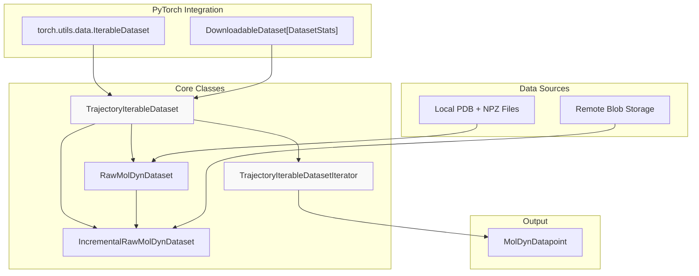
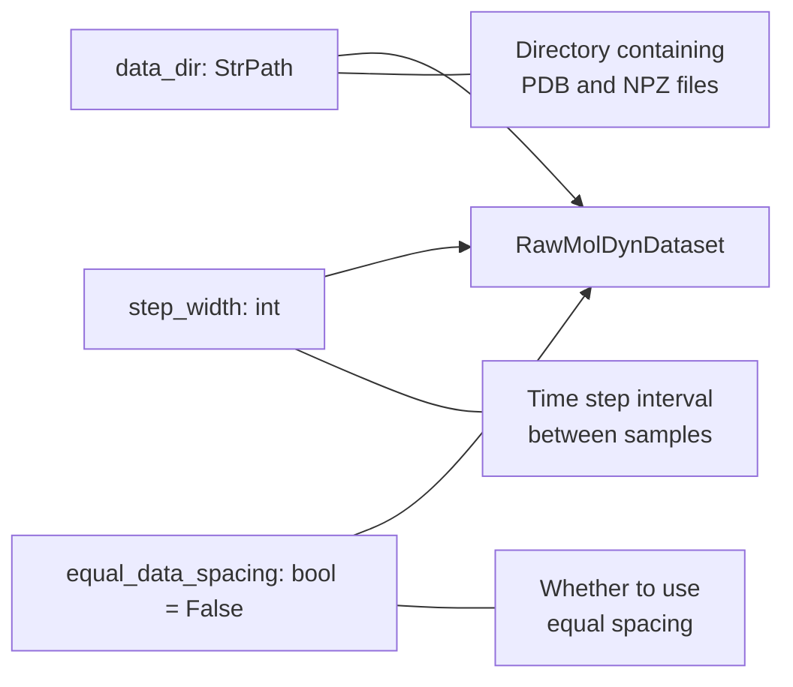
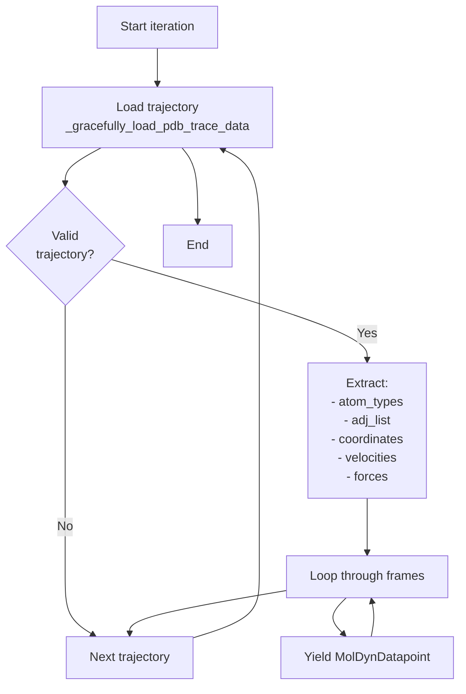
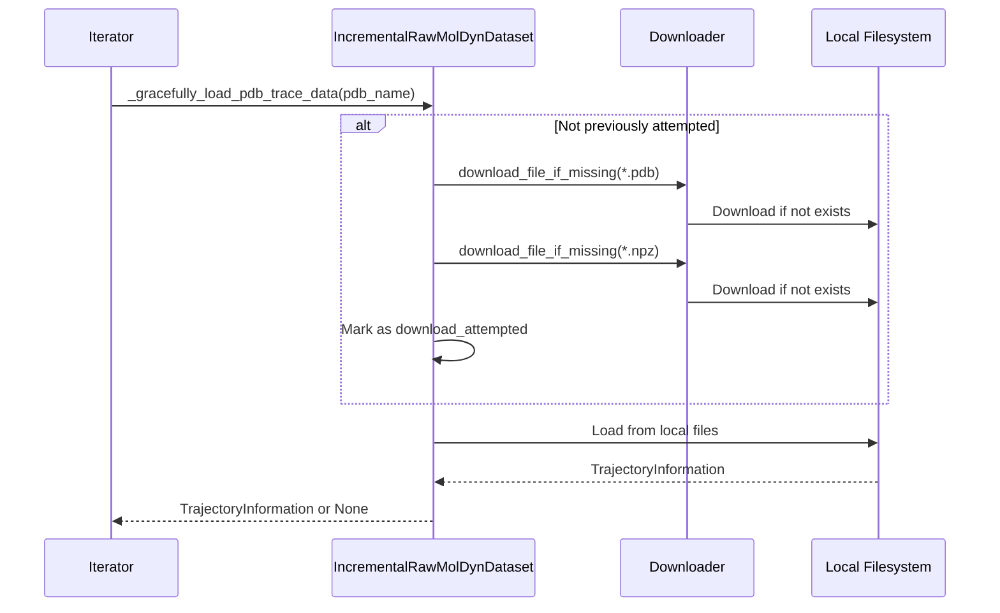
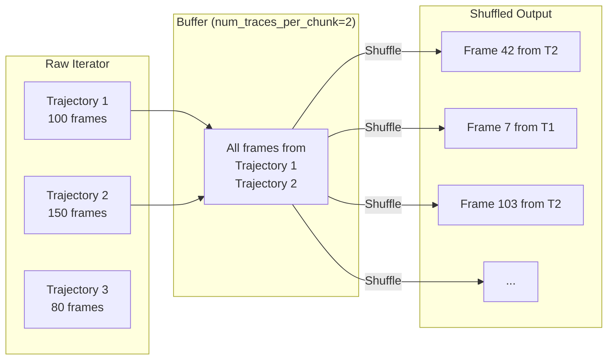
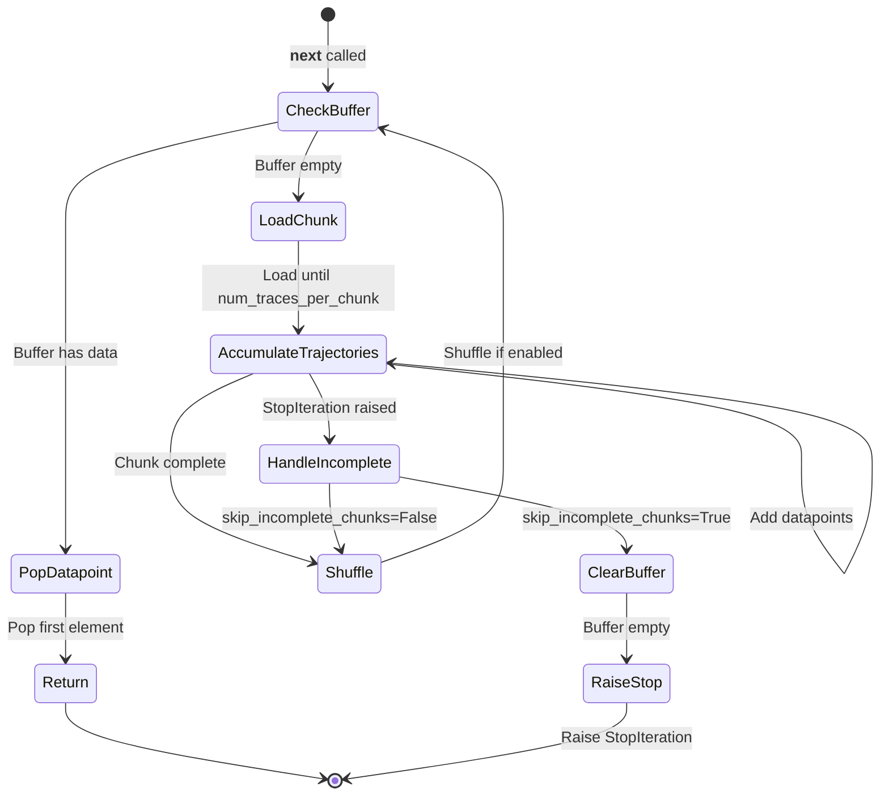
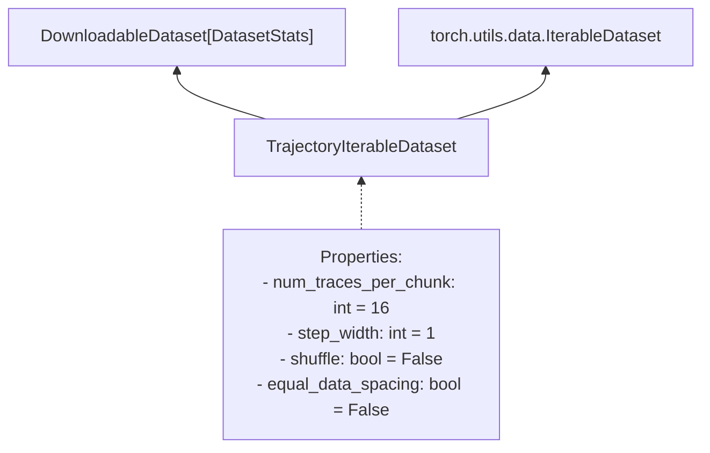
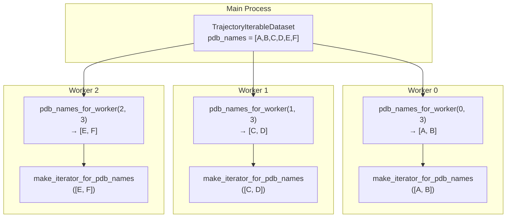
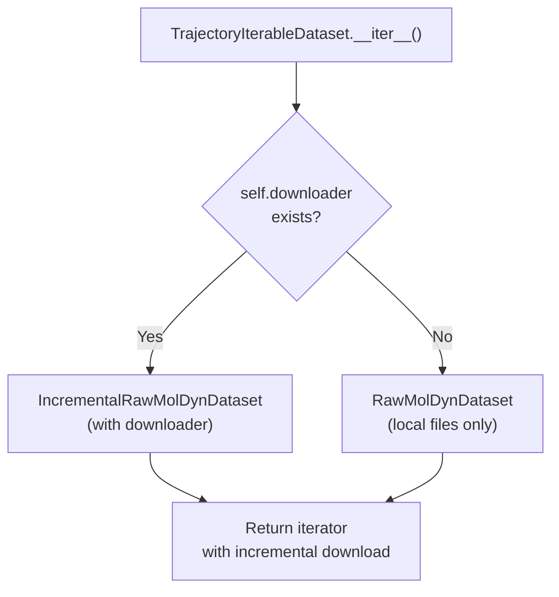
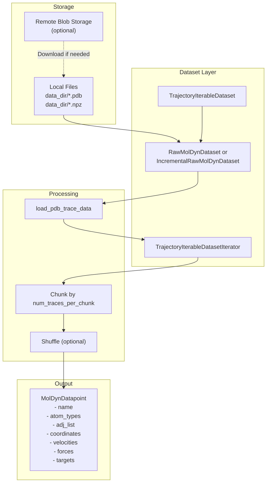

<!-- source: DeepWiki mcp.deepwiki.com · repo microsoft/timewarp · extra page Iterable Datasets · fetched 2026-10-26 -->

# Iterable Datasets

<details>
<summary>Relevant source files</summary>

The following files were used as context for generating this wiki page:

- [datasets/iterable_datasets.py](datasets/iterable_datasets.py)

</details>


## Purpose and Scope

This page documents the `TrajectoryIterableDataset` implementation for streaming molecular dynamics trajectory data. This dataset class is designed for scenarios where:

- The full dataset cannot fit in memory
- Data should be loaded on-demand during training
- Incremental downloading from remote storage is required
- Data needs to be partitioned across multiple DataLoader workers

For efficient indexed access to pre-processed trajectories, see [LMDB Datasets](#3.2.2). For the base dataloader primitives and batch formats, see [Data Loaders](#3.1).

**Sources:** [datasets/iterable_datasets.py:1-280]()

## Architecture Overview

The iterable dataset system consists of four main components organized in a hierarchy:



**Sources:** [datasets/iterable_datasets.py:45-280]()

## RawMolDynDataset

`RawMolDynDataset` is the foundational class that handles loading molecular dynamics trajectories from local disk storage.

### Data Structure

The class expects data organized as:
```
data_dir/
├── protein1-traj-state0.pdb
├── protein1-traj-arrays.npz
├── protein2-traj-state0.pdb
├── protein2-traj-arrays.npz
└── ...
```

Each trajectory consists of:
- **PDB file** (`*-traj-state0.pdb`): Initial structure and topology
- **NPZ file** (`*-traj-arrays.npz`): Trajectory data (coordinates, velocities, forces)

**Sources:** [datasets/iterable_datasets.py:45-81]()

### Key Methods and Attributes

| Method/Attribute | Purpose |
|------------------|---------|
| `pdb_names` | Cached property that returns sorted list of available trajectory names |
| `pdb_file_name(pdb_name)` | Constructs path to PDB file for a given trajectory |
| `npz_file_name(pdb_name)` | Constructs path to NPZ file for a given trajectory |
| `_gracefully_load_pdb_trace_data(pdb_name)` | Loads trajectory data with error handling |
| `make_iterator(pdb_names)` | Creates iterator over specified trajectories |

**Sources:** [datasets/iterable_datasets.py:47-130]()

### Configuration Parameters



**Sources:** [datasets/iterable_datasets.py:34-42]()

### Error Handling

The `_gracefully_load_pdb_trace_data` method handles three types of errors gracefully:

1. **FileNotFoundError**: Logs warning when PDB or NPZ file is missing
2. **CoordDeltaTooBig**: Logs warning when coordinate changes exceed physical limits
3. **Other exceptions**: Re-raised with context about which files failed

When errors occur, the method returns `None` and the iterator skips that trajectory.

**Sources:** [datasets/iterable_datasets.py:59-80]()

### Iterator Implementation

The `make_iterator` method produces `MolDynDatapoint` objects:



**Sources:** [datasets/iterable_datasets.py:82-130]()

## IncrementalRawMolDynDataset

`IncrementalRawMolDynDataset` extends `RawMolDynDataset` to support on-demand downloading from remote blob storage.

### Key Differences from RawMolDynDataset

| Aspect | RawMolDynDataset | IncrementalRawMolDynDataset |
|--------|------------------|------------------------------|
| Data source | Local files only | Blob storage with local caching |
| PDB names discovery | `os.listdir(data_dir)` | `downloader.list_files()` |
| File loading | Direct file access | Download if missing, then access |
| Download tracking | N/A | Maintains `download_attempted` set |

**Sources:** [datasets/iterable_datasets.py:132-170]()

### Download Logic

The incremental download flow:



**Sources:** [datasets/iterable_datasets.py:155-169]()

### Configuration

```python
@dataclass(frozen=True)
class IncrementalRawMolDynDataset:
    downloader: Any  # BlobClient instance
    download_attempted: Set[str] = field(default_factory=set)
    # Inherits: data_dir, step_width, equal_data_spacing
```

The `downloader` parameter should be a `BlobClient` instance that implements:
- `list_files()`: Returns list of files in remote storage
- `download_file_if_missing(filename)`: Downloads file if not already cached

**Sources:** [datasets/iterable_datasets.py:133-170]()

## TrajectoryIterableDatasetIterator

`TrajectoryIterableDatasetIterator` implements chunking and shuffling logic for trajectory data.

### Chunking Strategy

Trajectories are grouped into chunks to improve data locality:



**Sources:** [datasets/iterable_datasets.py:173-212]()

### Configuration Parameters

| Parameter | Type | Default | Purpose |
|-----------|------|---------|---------|
| `raw_iterator` | `Iterator[MolDynDatapoint]` | Required | Source iterator from RawMolDynDataset |
| `num_traces_per_chunk` | `int` | Required | Number of trajectories per chunk |
| `shuffle` | `bool` | `False` | Whether to shuffle within chunks |
| `skip_incomplete_chunks` | `bool` | `False` | Whether to discard partial final chunks |

**Sources:** [datasets/iterable_datasets.py:173-178]()

### Iteration Logic

The iterator maintains a buffer and implements a pull-based loading strategy:



**Sources:** [datasets/iterable_datasets.py:181-211]()

## TrajectoryIterableDataset

`TrajectoryIterableDataset` is the primary user-facing class that integrates all components.

### Class Hierarchy



**Sources:** [datasets/iterable_datasets.py:214-220]()

### Multi-Worker Support

The dataset automatically partitions data across DataLoader workers:



The partitioning is handled by:
1. `pdb_names_for_worker(worker_id, num_workers)`: Splits PDB names using `approximately_equal_partition`
2. `make_iterator_for_worker(worker_id, num_workers)`: Creates iterator with worker-specific random seed

**Sources:** [datasets/iterable_datasets.py:240-279]()

### Random Seed Management

For reproducibility with multiple workers:

```python
# Line 262-264 in iterable_datasets.py
state = np.random.get_state(legacy=True)
assert isinstance(state, tuple)
np.random.seed(state[1][0] + worker_id)
```

This ensures:
- Each worker gets a different but deterministic random seed
- Seeds change between epochs (main process resets seed each epoch)
- Different workers produce different shuffling orders

**Sources:** [datasets/iterable_datasets.py:258-266]()

### Integration with DownloadableDataset

`TrajectoryIterableDataset` inherits from `DownloadableDataset`, providing:

- Automatic dataset downloading from Huggingface
- Dataset integrity checking via `check_dir` method
- Support for both local and remote data sources

```python
# Line 237-238 in iterable_datasets.py
@staticmethod
def check_dir(data_dir: StrPath, expected_dataset_stats: DatasetStats):
    return len(get_pdb_names(data_dir)) == expected_dataset_stats.num_files
```

**Sources:** [datasets/iterable_datasets.py:236-238]()

### Raw Dataset Factory

The dataset automatically selects the appropriate raw dataset implementation:



**Sources:** [datasets/iterable_datasets.py:221-234]()

## Complete Data Flow

The following diagram shows the complete data flow from disk to model:



**Sources:** [datasets/iterable_datasets.py:1-280]()

## Usage Example

```python
from datasets.iterable_datasets import TrajectoryIterableDataset
from torch.utils.data import DataLoader

# Create dataset
dataset = TrajectoryIterableDataset(
    data_dir="/path/to/data",
    num_traces_per_chunk=16,  # Load 16 trajectories at a time
    step_width=1,              # Use every frame
    shuffle=True,              # Shuffle within chunks
    equal_data_spacing=False   # Sample uniformly from trajectories
)

# Create DataLoader with multiple workers
dataloader = DataLoader(
    dataset,
    batch_size=None,  # Batching handled by collate_fn
    num_workers=4      # 4 workers, data automatically partitioned
)

# Iterate
for datapoint in dataloader:
    # datapoint is a MolDynDatapoint
    coords = datapoint.atom_coords
    velocities = datapoint.atom_velocs
    # ... train model ...
```

**Sources:** [datasets/iterable_datasets.py:214-280]()

## Performance Considerations

| Configuration | Memory Usage | Throughput | Use Case |
|---------------|--------------|------------|----------|
| `num_traces_per_chunk=1` | Minimal | Low (frequent I/O) | Memory-constrained |
| `num_traces_per_chunk=16` (default) | Moderate | Balanced | General use |
| `num_traces_per_chunk=64` | High | High (better locality) | Large memory available |
| `shuffle=True` | +20% (buffer overhead) | -5% (shuffle cost) | Training |
| `shuffle=False` | Baseline | Baseline | Evaluation |
| `num_workers=1` | N/A | Baseline | Single-threaded |
| `num_workers=4` | 4x (per worker) | ~3.5x | Multi-core systems |

**Note:** With remote downloading enabled (`IncrementalRawMolDynDataset`), throughput depends heavily on network bandwidth and latency. The `download_attempted` tracking prevents redundant download attempts.

**Sources:** [datasets/iterable_datasets.py:173-280]()

---

