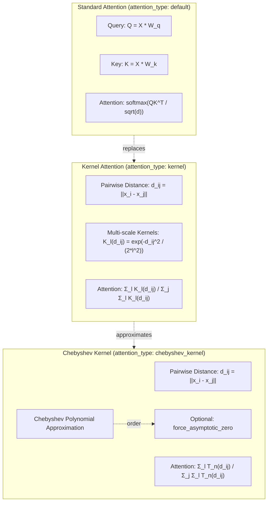
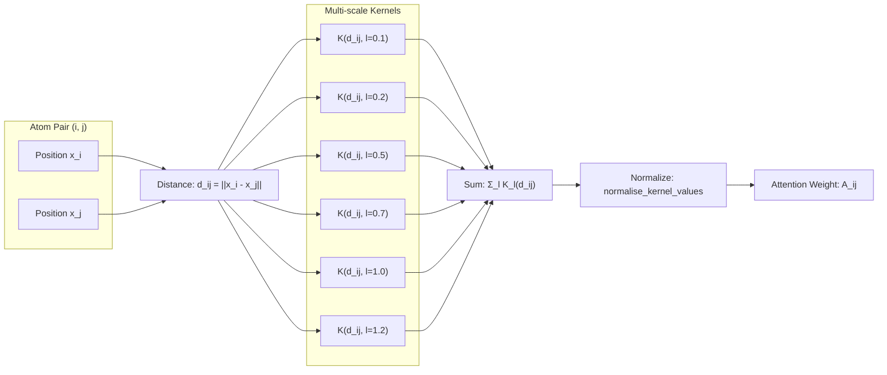
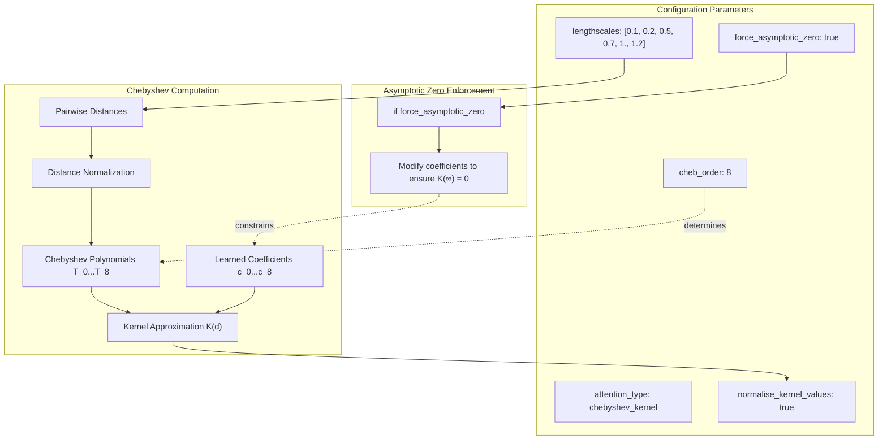
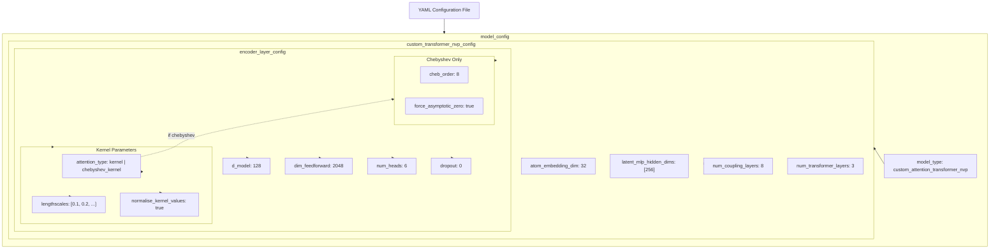

<!-- source: DeepWiki mcp.deepwiki.com · repo microsoft/timewarp · extra page Kernel Attention Variants · fetched 2026-10-26 -->

# Kernel Attention Variants

<details>
<summary>Relevant source files</summary>

The following files were used as context for generating this wiki page:

- [configs/kernel_cheb_transformer_nvp.yaml](configs/kernel_cheb_transformer_nvp.yaml)
- [configs/kernel_transformer_nvp.yaml](configs/kernel_transformer_nvp.yaml)

</details>


## Purpose and Scope

This page documents the kernel-based attention mechanisms available in Timewarp's Transformer NVP models. Kernel attention replaces the standard dot-product attention with distance-based kernels that use multiple learnable lengthscales. Two variants are provided: standard kernel attention and Chebyshev polynomial approximation for computational efficiency.

For the baseline transformer architecture with standard attention, see [Standard Transformer NVP](#4.2.1). For spatially-restricted attention, see [Local Attention NVP](#4.2.3).

## Overview

Kernel attention mechanisms compute attention weights based on pairwise distances between atoms rather than learned query-key dot products. This approach incorporates spatial structure directly into the attention computation and allows the model to learn multiple characteristic length scales that are relevant for molecular interactions.

Both kernel variants are configured through the `custom_attention_transformer_nvp` model type with different `attention_type` values in the encoder layer configuration.

**Sources:** [configs/kernel_transformer_nvp.yaml:16-30](), [configs/kernel_cheb_transformer_nvp.yaml:16-32]()

## Attention Type Comparison



**Diagram: Comparison of Attention Mechanisms**

The standard attention mechanism learns query and key projections and computes attention through dot products. Kernel attention instead uses Gaussian kernels centered at multiple lengthscales, computing attention based on spatial proximity. Chebyshev kernel attention approximates the same computation using Chebyshev polynomials for improved computational efficiency.

**Sources:** [configs/kernel_transformer_nvp.yaml:23-30](), [configs/kernel_cheb_transformer_nvp.yaml:23-32]()

## Standard Kernel Attention

### Configuration

Standard kernel attention is enabled by setting `attention_type: kernel` in the encoder layer configuration. The key parameters are:

| Parameter | Type | Description | Example Value |
|-----------|------|-------------|---------------|
| `attention_type` | string | Must be `"kernel"` | `kernel` |
| `lengthscales` | list[float] | Multiple characteristic length scales | `[0.1, 0.2, 0.5, 0.7, 1., 1.2]` |
| `normalise_kernel_values` | bool | Whether to normalize kernel outputs | `true` |

**Sources:** [configs/kernel_transformer_nvp.yaml:28-30]()

### Multi-Lengthscale Kernels

The attention mechanism computes Gaussian kernels at each specified lengthscale, allowing the model to capture interactions at multiple spatial scales simultaneously. For a pair of atoms at positions **x**_i and **x**_j:

```
K_l(d_ij) = exp(-d_ij^2 / (2 * l^2))
```

where d_ij = ||**x**_i - **x**_j|| and l ∈ lengthscales.

The final attention weight is the normalized sum over all lengthscales:

```
A_ij = (Σ_l K_l(d_ij)) / (Σ_j Σ_l K_l(d_ij))
```



**Diagram: Multi-Lengthscale Kernel Computation**

The model computes six independent Gaussian kernels (one for each lengthscale) and sums them to produce the final attention weight. Short lengthscales (0.1, 0.2) capture local interactions, while longer lengthscales (1.0, 1.2) capture longer-range effects.

**Sources:** [configs/kernel_transformer_nvp.yaml:29]()

### Example Configuration

```yaml
encoder_layer_config:
  d_model: 128
  dim_feedforward: 2048
  num_heads: 6
  dropout: 0
  attention_type: kernel
  lengthscales: [0.1, 0.2, 0.5, 0.7, 1., 1.2]
  normalise_kernel_values: true
```

**Sources:** [configs/kernel_transformer_nvp.yaml:23-30]()

## Chebyshev Kernel Attention

### Overview

Chebyshev kernel attention approximates the multi-lengthscale Gaussian kernels using Chebyshev polynomials. This reduces computational cost while maintaining similar expressiveness. The approximation uses Chebyshev polynomials T_n(x) of order n to represent the kernel functions.

### Configuration

Chebyshev kernel attention requires additional parameters beyond standard kernel attention:

| Parameter | Type | Description | Example Value |
|-----------|------|-------------|---------------|
| `attention_type` | string | Must be `"chebyshev_kernel"` | `chebyshev_kernel` |
| `lengthscales` | list[float] | Multiple characteristic length scales | `[0.1, 0.2, 0.5, 0.7, 1., 1.2]` |
| `normalise_kernel_values` | bool | Whether to normalize kernel outputs | `true` |
| `cheb_order` | int | Order of Chebyshev polynomial expansion | `8` |
| `force_asymptotic_zero` | bool | Force kernels to decay to zero at large distances | `true` |

**Sources:** [configs/kernel_cheb_transformer_nvp.yaml:28-32]()

### Chebyshev Polynomial Approximation

The Chebyshev polynomial T_n(x) of order n provides an efficient approximation to smooth functions. For kernel attention, the distance-based kernel K(d) is approximated as:

```
K(d) ≈ Σ_{n=0}^{N} c_n * T_n(d')
```

where d' is a normalized distance, N is `cheb_order`, and c_n are learned coefficients.

The `force_asymptotic_zero` parameter ensures that the approximated kernel decays to zero at large distances, which is physically motivated for molecular interactions that should vanish at infinity.



**Diagram: Chebyshev Kernel Configuration and Computation Flow**

The configuration parameters control how distances are transformed into attention weights through Chebyshev polynomial approximation. The `cheb_order` determines the degree of the polynomial (higher order = better approximation but more parameters), while `force_asymptotic_zero` adds a physical constraint.

**Sources:** [configs/kernel_cheb_transformer_nvp.yaml:28-32]()

### Example Configuration

```yaml
encoder_layer_config:
  d_model: 128
  dim_feedforward: 2048
  num_heads: 6
  dropout: 0
  attention_type: chebyshev_kernel
  lengthscales: [0.1, 0.2, 0.5, 0.7, 1., 1.2]
  normalise_kernel_values: true
  cheb_order: 8
  force_asymptotic_zero: true
```

**Sources:** [configs/kernel_cheb_transformer_nvp.yaml:23-32]()

## Configuration Structure



**Diagram: Configuration Hierarchy for Kernel Attention Variants**

Both kernel attention variants use the same base configuration structure under `custom_attention_transformer_nvp`. The `attention_type` field determines which variant is used, with Chebyshev kernels requiring two additional parameters.

**Sources:** [configs/kernel_transformer_nvp.yaml:16-30](), [configs/kernel_cheb_transformer_nvp.yaml:16-32]()

## Usage Guidelines

### Choosing Lengthscales

The `lengthscales` parameter should be chosen based on the characteristic spatial scales in the molecular system:

- **Short scales (0.1-0.2 Å):** Capture bonded interactions and local geometry
- **Medium scales (0.5-0.7 Å):** Capture non-bonded interactions within close proximity
- **Long scales (1.0-1.2 Å):** Capture longer-range electrostatic and van der Waals interactions

The default configuration `[0.1, 0.2, 0.5, 0.7, 1., 1.2]` provides a good starting point for typical molecular systems.

### Choosing Between Variants

| Consideration | Standard Kernel | Chebyshev Kernel |
|---------------|----------------|------------------|
| **Computational Cost** | Higher | Lower |
| **Approximation Error** | None (exact) | Small (controlled by `cheb_order`) |
| **Memory Usage** | Moderate | Moderate |
| **Physical Constraints** | Automatic | Requires `force_asymptotic_zero` |
| **Recommended For** | Small molecules, exact modeling | Large systems, faster training |

For most applications, Chebyshev kernel attention with `cheb_order: 8` provides a good balance between accuracy and efficiency.

**Sources:** [configs/kernel_transformer_nvp.yaml:1-31](), [configs/kernel_cheb_transformer_nvp.yaml:1-33]()

## Model Instantiation

Both kernel attention variants are instantiated through the same model constructor by specifying the appropriate configuration in YAML:

```yaml
model_config:
  model_type: custom_attention_transformer_nvp
  custom_transformer_nvp_config:
    # ... other parameters ...
    encoder_layer_config:
      attention_type: kernel  # or chebyshev_kernel
      lengthscales: [0.1, 0.2, 0.5, 0.7, 1., 1.2]
      normalise_kernel_values: true
      # Chebyshev-specific:
      cheb_order: 8  # only if attention_type: chebyshev_kernel
      force_asymptotic_zero: true  # only if attention_type: chebyshev_kernel
```

The configuration is parsed by the model configuration system and used to instantiate the appropriate transformer encoder layers with kernel-based attention mechanisms.

**Sources:** [configs/kernel_transformer_nvp.yaml:16-30](), [configs/kernel_cheb_transformer_nvp.yaml:16-32]()

## Performance Characteristics

### Training Performance

Based on the reference configuration for the alanine-dipeptide (AD-1) dataset:

- **Expected train loss:** -8.22
- **Expected validation loss:** -6.56
- **Training epochs:** 1000
- **Batch size:** 32
- **Patience:** 100 epochs

These metrics are consistent between standard kernel and Chebyshev kernel variants when properly configured, indicating that the Chebyshev approximation does not significantly degrade model performance.

**Sources:** [configs/kernel_transformer_nvp.yaml:1-3](), [configs/kernel_cheb_transformer_nvp.yaml:1-3]()

---

