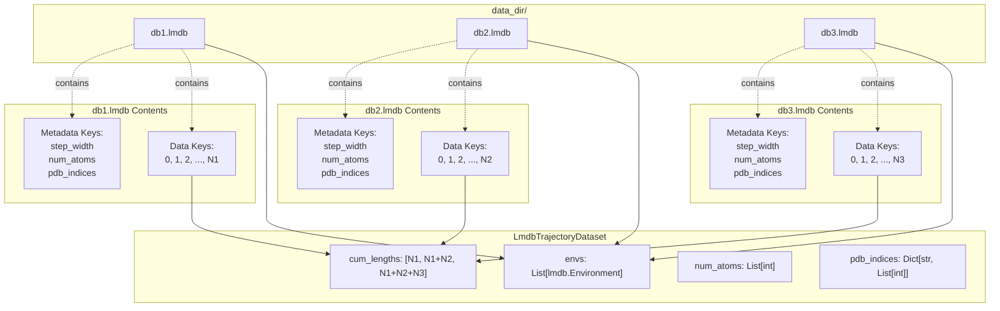
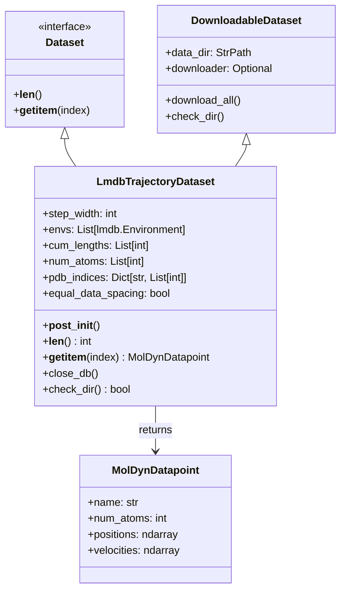
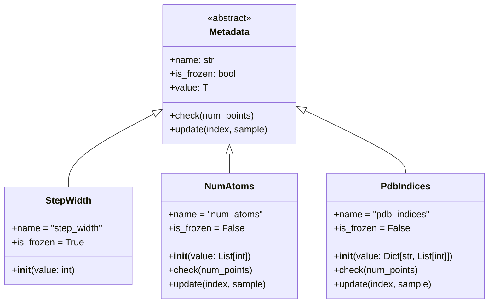
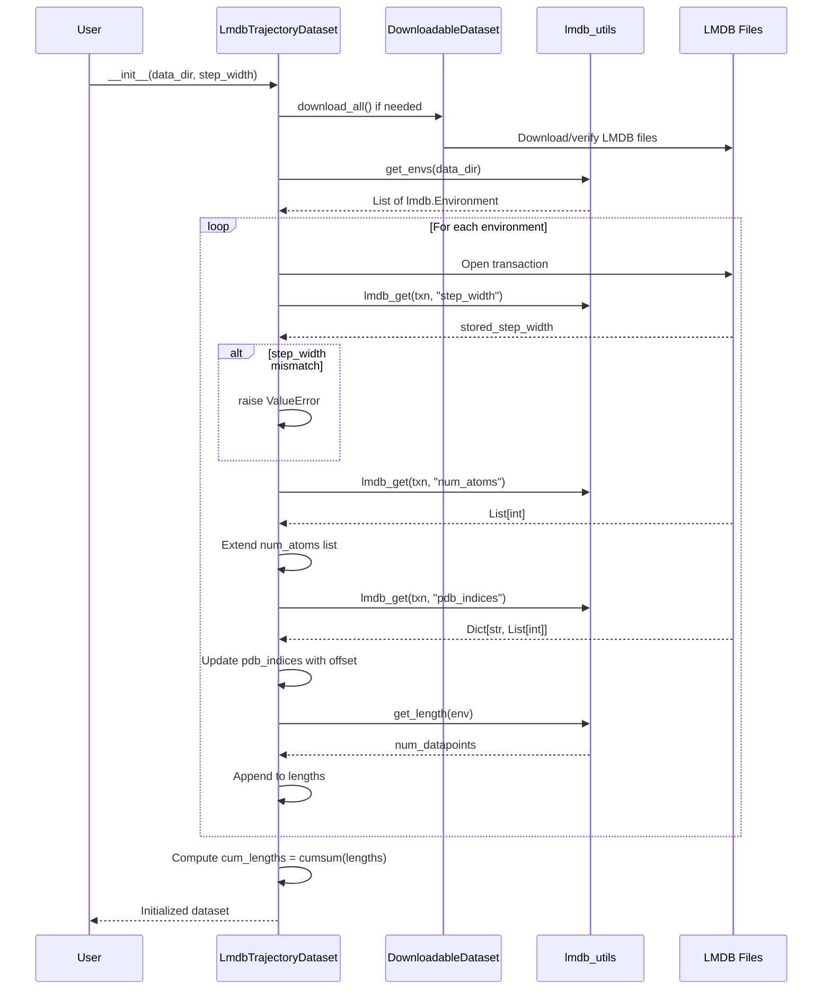
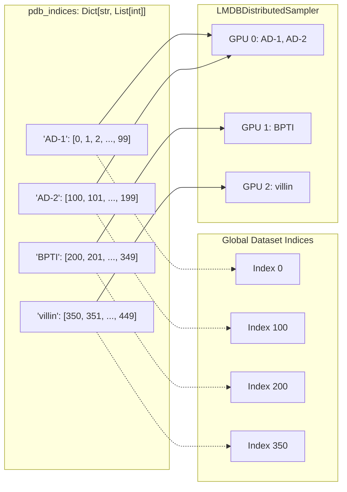
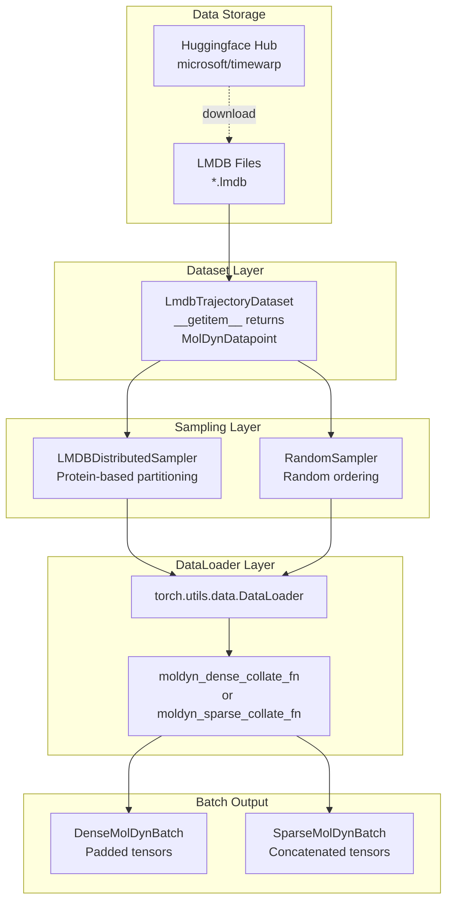

<!-- source: DeepWiki mcp.deepwiki.com · repo microsoft/timewarp · extra page LMDB Datasets · fetched 2026-10-26 -->

# LMDB Datasets

<details>
<summary>Relevant source files</summary>

The following files were used as context for generating this wiki page:

- [datasets/lmdb_dataset.py](datasets/lmdb_dataset.py)

</details>


## Purpose and Scope

This page documents the `LmdbTrajectoryDataset` class, which provides efficient indexed access to pre-processed molecular dynamics trajectory data stored in LMDB (Lightning Memory-Mapped Database) format. LMDB storage enables fast random access to individual trajectory frames, making it ideal for training scenarios where data is accessed in random order across multiple GPUs.

For streaming trajectory data with incremental downloads, see [Iterable Datasets](#3.2.1). For an overview of all dataset implementations, see [Dataset Implementations](#3.2).

## LMDB Storage Overview

LMDB is a memory-mapped key-value store that provides several advantages for molecular dynamics data:

| Feature | Benefit |
|---------|---------|
| Memory-mapped I/O | Fast random access without loading entire dataset into memory |
| ACID transactions | Data integrity guarantees |
| Multiple readers | Concurrent access from multiple training processes |
| Compact storage | Efficient binary serialization |
| Zero-copy reads | Minimal memory overhead |

The Timewarp system stores pre-processed `MolDynDatapoint` objects in LMDB databases, where each key is an integer index and each value is a serialized datapoint. Multiple LMDB files can be used to partition data across different proteins or trajectory sets.

**Diagram: LMDB Storage Structure**



Sources: [datasets/lmdb_dataset.py:59-134]()

## Class Architecture

The `LmdbTrajectoryDataset` class is implemented as a frozen dataclass that implements PyTorch's `Dataset` interface. It extends `DownloadableDataset` to support automatic data retrieval and inherits from `torch.utils.data.Dataset` for integration with PyTorch data loading.

**Diagram: LmdbTrajectoryDataset Class Structure**



Sources: [datasets/lmdb_dataset.py:60-67](), [timewarp/dataloader.py]()

### Key Fields

| Field | Type | Purpose |
|-------|------|---------|
| `step_width` | `int` | Temporal stride between consecutive trajectory frames (e.g., 1 = consecutive frames, 10 = every 10th frame) |
| `envs` | `List[lmdb.Environment]` | List of opened LMDB database environments, one per file |
| `cum_lengths` | `List[int]` | Cumulative lengths for mapping global indices to file-specific indices |
| `num_atoms` | `List[int]` | Number of atoms in each datapoint, used for batching |
| `pdb_indices` | `Dict[str, List[int]]` | Mapping from PDB name to list of datapoint indices for protein-based partitioning |
| `equal_data_spacing` | `bool` | Flag indicating whether datapoints have uniform temporal spacing |

Sources: [datasets/lmdb_dataset.py:62-67]()

## Metadata System

The LMDB files store metadata alongside the trajectory data. The metadata system uses specialized `Metadata` classes that define how metadata is stored, validated, and updated during dataset creation.

**Diagram: Metadata Class Hierarchy**



Sources: [datasets/lmdb_dataset.py:21-56]()

### Metadata Classes

**StepWidth** [datasets/lmdb_dataset.py:21-27]()
- Stores the temporal stride used when creating the dataset
- Marked as frozen (`is_frozen=True`), meaning it cannot be updated after creation
- Validated during dataset loading to ensure consistency

**NumAtoms** [datasets/lmdb_dataset.py:29-40]()
- Stores a list containing the number of atoms in each trajectory frame
- Updated incrementally as datapoints are added
- Used for efficient batching by grouping frames with similar atom counts

**PdbIndices** [datasets/lmdb_dataset.py:42-53]()
- Maps PDB protein names to lists of datapoint indices
- Enables protein-based data partitioning for distributed training
- Critical for the `LMDBDistributedSampler` (see [Distributed Sampling](#3.3))

The function `init_all_metadata(step_width)` [datasets/lmdb_dataset.py:55-56]() creates instances of all metadata classes for dataset initialization.

Sources: [datasets/lmdb_dataset.py:21-56]()

## Initialization and Multi-File Support

The `__post_init__` method [datasets/lmdb_dataset.py:69-108]() handles dataset initialization, including downloading data, opening LMDB environments, loading metadata, and building index structures.

**Diagram: Initialization Sequence**



Sources: [datasets/lmdb_dataset.py:69-108]()

### Multi-File Index Mapping

When multiple LMDB files are present, the dataset maintains a cumulative length array to map global indices to file-specific indices. The `get_indices` function from `utilities.lmdb_utils` performs this mapping efficiently.

**Example**: Given three LMDB files with lengths [100, 200, 150]:
- `cum_lengths = [100, 300, 450]`
- Global index 250 maps to file 1 (second file), local index 150
- Global index 50 maps to file 0 (first file), local index 50
- Global index 400 maps to file 2 (third file), local index 100

The `__getitem__` method [datasets/lmdb_dataset.py:113-116]() implements this mapping:

1. Call `get_indices(cum_lengths, index)` to find the file index (`db_index`) and element index (`el_index`)
2. Open a read transaction on the appropriate LMDB environment
3. Retrieve the datapoint using `lmdb_get(txn, str(el_index))`
4. Return the deserialized `MolDynDatapoint`

Sources: [datasets/lmdb_dataset.py:113-116](), [utilities/lmdb_utils.py]()

## PDB-Based Organization

The `pdb_indices` field provides a mapping from protein names to datapoint indices, enabling efficient protein-based data access and partitioning.

**Diagram: PDB Index Mapping**



Sources: [datasets/lmdb_dataset.py:42-53](), [datasets/lmdb_dataset.py:90-97]()

### PDB Index Construction

During initialization, the dataset builds the `pdb_indices` mapping by:

1. Extracting the `pdb_indices` metadata from each LMDB file
2. Adjusting indices by adding the cumulative offset from previous files
3. Merging all mappings into a single global dictionary

For example [datasets/lmdb_dataset.py:90-97]():
```python
start_index = sum(lengths)
self.pdb_indices.update(
    {
        pdb_name: [start_index + i for i in indices]
        for pdb_name, indices in pdb_indices.items()
    }
)
```

This ensures that PDB names remain unique across multiple LMDB files and indices correctly reference the global dataset.

Sources: [datasets/lmdb_dataset.py:90-97]()

## Integration with Data Pipeline

The `LmdbTrajectoryDataset` integrates with the broader data pipeline as shown below:

**Diagram: LMDB Dataset in Data Pipeline**



Sources: [datasets/lmdb_dataset.py](), [timewarp/dataloader.py](), [datasets/distributed_sampler.py]()

## Dataset Validation

The `check_dir` static method [datasets/lmdb_dataset.py:118-130]() validates that a data directory contains the expected number of datapoints. This method is called during initialization to verify data integrity:

```python
@staticmethod
def check_dir(data_dir: StrPath, expected_dataset_stats: DatasetStats):
    total_num_points = 0
    for env in get_envs(data_dir):
        total_num_points += get_length(env)
        env.close()
    if expected_dataset_stats.num_points:
        return total_num_points == expected_dataset_stats.num_points
    else:
        return True
```

The validation accounts for the fact that the number of datapoints may vary depending on the `step_width` parameter. If `step_width` is larger than the trajectory frame spacing, fewer training pairs will be available.

Sources: [datasets/lmdb_dataset.py:118-130]()

## Resource Management

The `close_db` method [datasets/lmdb_dataset.py:132-134]() properly closes all LMDB environments to release resources:

```python
def close_db(self):
    for env in self.envs:
        env.close()
```

This should be called when the dataset is no longer needed, especially in long-running processes or when using multiple dataset instances sequentially.

Sources: [datasets/lmdb_dataset.py:132-134]()

## Comparison with Other Dataset Implementations

| Feature | LmdbTrajectoryDataset | TrajectoryIterableDataset | RawMolDynDataset |
|---------|----------------------|---------------------------|------------------|
| Storage format | LMDB (binary) | NPZ files | PDB + NPZ files |
| Access pattern | Random access | Sequential streaming | Random access |
| Memory usage | Memory-mapped (low) | Streaming (low) | Full load (high) |
| Multi-GPU support | Excellent (via LMDBDistributedSampler) | Good | Good |
| Incremental download | Yes (via DownloadableDataset) | Yes (native) | Yes (via DownloadableDataset) |
| Pre-processing | Required (LMDB creation) | None | None |
| Best use case | Production training on large datasets | Prototyping, streaming | Small datasets, development |

Sources: [datasets/lmdb_dataset.py](), [datasets/iterable_dataset.py](), [datasets/moldyn_dataset.py]()

## Usage Example

Typical usage of `LmdbTrajectoryDataset` in a training configuration:

```python
from datasets.lmdb_dataset import LmdbTrajectoryDataset
from datasets.distributed_sampler import LMDBDistributedSampler
from torch.utils.data import DataLoader
from timewarp.dataloader import moldyn_dense_collate_fn

# Initialize dataset
dataset = LmdbTrajectoryDataset(
    data_dir="data/lmdb/",
    step_width=10  # Use every 10th frame
)

# Create distributed sampler for multi-GPU training
sampler = LMDBDistributedSampler(
    dataset=dataset,
    pdb_indices=dataset.pdb_indices,
    num_replicas=4,  # 4 GPUs
    rank=0  # Current GPU rank
)

# Create DataLoader
dataloader = DataLoader(
    dataset,
    batch_size=32,
    sampler=sampler,
    collate_fn=moldyn_dense_collate_fn,
    num_workers=4
)

# Training loop
for batch in dataloader:
    # batch is a DenseMolDynBatch with padded tensors
    train_step(batch)

# Cleanup
dataset.close_db()
```

For details on the `LMDBDistributedSampler`, see [Distributed Sampling](#3.3). For information on batch formats, see [Data Loaders](#3.1).

Sources: [datasets/lmdb_dataset.py](), [datasets/distributed_sampler.py](), [timewarp/dataloader.py]()

---

