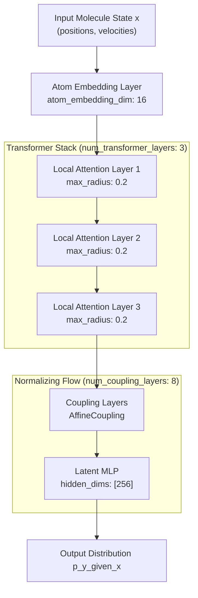
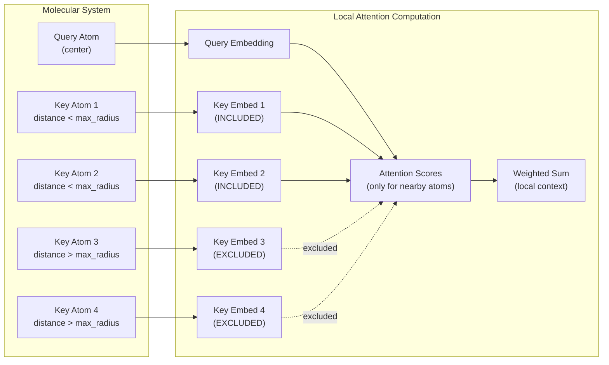
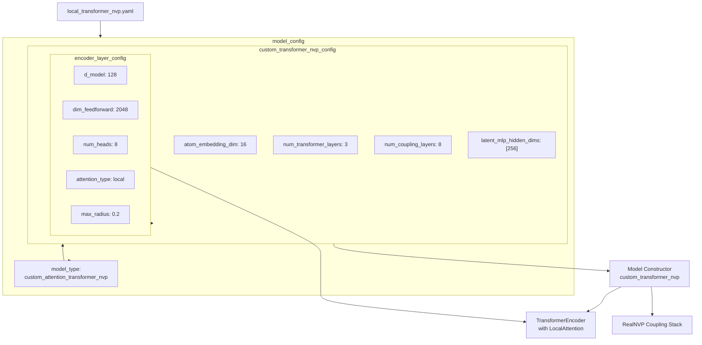
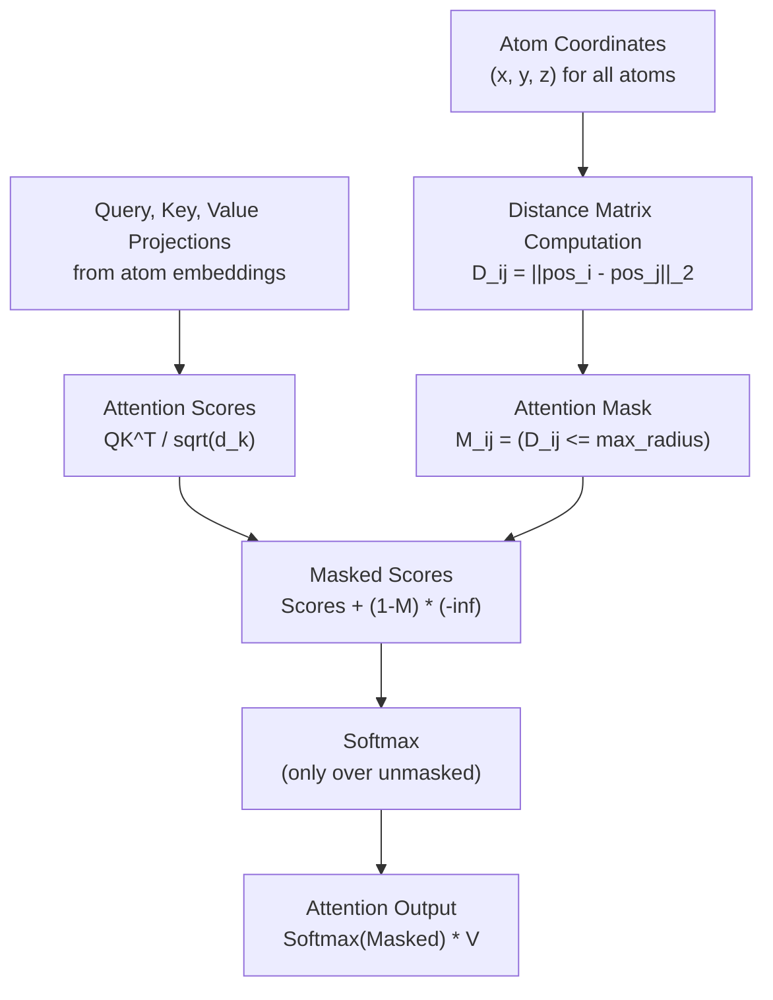
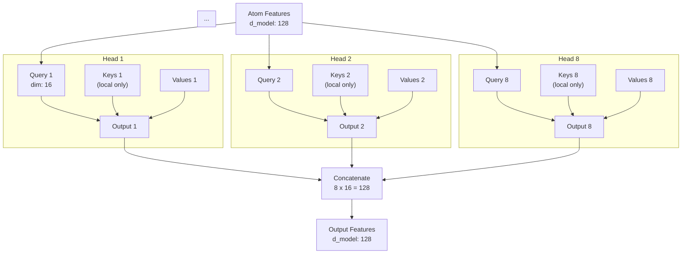

<!-- source: DeepWiki mcp.deepwiki.com · repo microsoft/timewarp · extra page Local Attention NVP · fetched 2026-10-26 -->

# Local Attention NVP

<details>
<summary>Relevant source files</summary>

The following files were used as context for generating this wiki page:

- [configs/local_transformer_nvp.yaml](configs/local_transformer_nvp.yaml)

</details>


## Purpose and Scope

This document describes the Local Attention NVP model variant, a transformer-based normalizing flow architecture that restricts attention mechanisms to spatial neighborhoods defined by a maximum radius. This variant is designed to improve computational efficiency and incorporate spatial inductive bias for molecular dynamics prediction by limiting each atom's attention to nearby atoms in 3D space.

For information about the standard transformer NVP architecture, see [Standard Transformer NVP](#4.2.1). For kernel-based attention alternatives, see [Kernel Attention Variants](#4.2.2). For general transformer NVP configuration, see [Transformer NVP Models](#4.2).

## Architecture Overview

The Local Attention NVP follows the same overall architecture as other transformer NVP variants: it embeds atoms, processes them through transformer layers, and uses coupling layers to construct a normalizing flow for the conditional distribution p(y|x). The key distinction is the attention mechanism, which restricts each atom to only attend to atoms within a spatial radius rather than all atoms in the molecule.



**Diagram: Local Attention NVP Architecture**

The architecture uses `custom_attention_transformer_nvp` as the `model_type` and configures `attention_type: local` within the `encoder_layer_config` to enable spatial locality constraints.

Sources: [configs/local_transformer_nvp.yaml:13-26]()

## Local Attention Mechanism

Local attention restricts the attention computation to a spatial neighborhood defined by `max_radius`. For each query atom, only key atoms within the specified Euclidean distance (in nanometers) participate in the attention calculation. This creates a sparse attention pattern that reflects the physical locality of molecular interactions.



**Diagram: Spatial Locality in Local Attention**

The `max_radius` parameter (default: 0.2 nm in the configuration) determines which atoms participate in attention. Atoms beyond this distance are effectively masked out, reducing computational cost from O(N²) to O(N·k) where k is the average number of neighbors within the radius.

Sources: [configs/local_transformer_nvp.yaml:25-26]()

## Configuration Parameters

The local attention variant uses the standard transformer NVP configuration structure with specific attention-related parameters:

| Parameter | Value | Purpose |
|-----------|-------|---------|
| `model_type` | `custom_attention_transformer_nvp` | Enables custom attention mechanisms |
| `attention_type` | `local` | Selects local attention variant |
| `max_radius` | `0.2` | Maximum distance (nm) for attention neighbors |
| `atom_embedding_dim` | `16` | Dimension of atom embeddings |
| `num_transformer_layers` | `3` | Number of stacked local attention layers |
| `num_coupling_layers` | `8` | Number of flow coupling layers |
| `d_model` | `128` | Transformer hidden dimension |
| `dim_feedforward` | `2048` | Feedforward network dimension |
| `num_heads` | `8` | Number of attention heads |
| `dropout` | `0` | Dropout rate (disabled) |
| `latent_mlp_hidden_dims` | `[256]` | Hidden dimensions for latent MLP |

The `max_radius` parameter is the key hyperparameter that controls the spatial extent of attention. Smaller values increase sparsity and computational efficiency but may limit the model's ability to capture long-range interactions. Larger values approach standard full attention but retain the explicit spatial bias.

Sources: [configs/local_transformer_nvp.yaml:13-26]()

## Configuration Flow

The configuration system instantiates the local attention model through a hierarchical parameter structure:



**Diagram: Configuration to Model Instantiation**

The `attention_type: local` setting in the `encoder_layer_config` instructs the model constructor to instantiate transformer encoder layers with local attention mechanisms instead of standard full attention.

Sources: [configs/local_transformer_nvp.yaml:13-26]()

## Training Configuration

The local attention variant uses standard training hyperparameters:

| Parameter | Value | Purpose |
|-----------|-------|---------|
| `learning_rate` | `1e-4` | Adam optimizer learning rate |
| `warmup_steps` | `1000` | Linear warmup period |
| `weight_decay` | `0.0` | L2 regularization (disabled) |
| `batch_size` | `32` | Training batch size per GPU |
| `num_epochs` | `1000` | Maximum training epochs |
| `patience` | `100` | Early stopping patience |
| `data_augmentation` | `true` | Enable equivariant augmentation |

The training configuration is identical to other transformer NVP variants, demonstrating that local attention is a drop-in replacement for the attention mechanism without requiring training procedure changes.

Sources: [configs/local_transformer_nvp.yaml:3-11]()

## Spatial Attention Computation

The local attention mechanism operates on 3D molecular coordinates to determine attention masks:



**Diagram: Local Attention Computation Pipeline**

The spatial coordinates are used to compute pairwise distances, which generate a binary attention mask. This mask is applied to the attention scores before the softmax operation, effectively excluding distant atoms from the attention computation.

Sources: [configs/local_transformer_nvp.yaml:25-26]()

## Comparison with Other Attention Variants

| Variant | Attention Pattern | Complexity | Parameters | Key Use Case |
|---------|------------------|------------|------------|--------------|
| **Standard** | Full (all-to-all) | O(N²) | None | Small molecules, full context needed |
| **Kernel** | Kernel-weighted | O(N²) | Lengthscales | Smooth distance weighting |
| **Local** (this page) | Radius-restricted | O(N·k) | `max_radius` | Large molecules, local interactions |
| **Chebyshev** | Polynomial approximation | O(N²) | Polynomial order | Efficient kernel approximation |

The local attention variant is particularly suited for:
- **Large molecular systems** where full attention is computationally prohibitive
- **Systems with strong locality** where atoms primarily interact with nearby neighbors
- **Memory-constrained scenarios** where sparse attention reduces memory footprint
- **Physically-motivated architectures** where spatial proximity reflects interaction strength

Sources: [configs/local_transformer_nvp.yaml:25]()

## Integration with Normalizing Flows

The local attention layers serve as the conditioning network for the normalizing flow. The transformer stack with local attention processes the input state x to produce contextual representations, which then parameterize the coupling layers:

```mermaid
graph LR
    X["Current State x<br/>(positions, velocities)"]
    
    subgraph Encoder["Local Attention Encoder"]
        Embed["Atom Embeddings"]
        LA1["Local Attention 1"]
        LA2["Local Attention 2"]
        LA3["Local Attention 3"]
        Context["Contextual Features h"]
        
        Embed --> LA1
        LA1 --> LA2
        LA2 --> LA3
        LA3 --> Context
    end
    
    subgraph Flow["RealNVP Flow"]
        C1["Coupling Layer 1<br/>conditioned on h"]
        C2["Coupling Layer 2<br/>conditioned on h"]
        C3["..."]
        C8["Coupling Layer 8<br/>conditioned on h"]
        
        C1 --> C2
        C2 --> C3
        C3 --> C8
    end
    
    Z["Latent Variable z"]
    Y["Target State y<br/>(future positions, velocities)"]
    
    X --> Embed
    Context --> C1
    Context --> C2
    Context --> C8
    
    C8 --> Z
    Z -.inverse flow.-> Y
```



**Diagram: Local Attention NVP Forward and Inverse Flow**

During training, the forward flow maps y → z given context from x. During inference, the inverse flow samples z ~ N(0,I) and maps z → y using the same context. The local attention ensures that the contextual features h capture spatially local information relevant for predicting each atom's future state.

Sources: [configs/local_transformer_nvp.yaml:13-26]()

## Dataset and Training

The reference configuration trains on the `AD-1` dataset (Alanine Dipeptide) with:

| Parameter | Value | Meaning |
|-----------|-------|---------|
| `dataset` | `AD-1` | Alanine dipeptide system |
| `step_width` | `1000` | Time steps between x and y |
| `seed` | `0` | Random seed for reproducibility |
| `data_augmentation` | `true` | Equivariant rotations/translations |

The `step_width: 1000` indicates that the model learns to predict molecular states 1000 time steps (typically 1 ps for 1 fs timesteps) into the future. The local attention mechanism must capture sufficient spatial context within the `max_radius` to make accurate long-time predictions.

Sources: [configs/local_transformer_nvp.yaml:1-10]()

## Hyperparameter Selection

The `max_radius` parameter requires careful tuning:

**Too Small (< 0.1 nm)**
- Insufficient context for accurate predictions
- May miss important non-bonded interactions
- Faster computation but lower accuracy

**Optimal Range (0.2 - 0.5 nm)**
- Captures first coordination shell
- Includes bonded neighbors and close non-bonded interactions
- Balances accuracy and efficiency

**Too Large (> 1.0 nm)**
- Approaches full attention complexity
- Loses sparsity benefits
- May include irrelevant distant atoms

For small peptides like AD-1, `max_radius: 0.2` (2 Ångströms) typically captures all directly bonded and most nearby atoms. For larger proteins, larger radii may be necessary to capture relevant context.

Sources: [configs/local_transformer_nvp.yaml:26]()

## Multi-Head Local Attention

The configuration specifies `num_heads: 8`, meaning the local attention is multi-headed:



**Diagram: Multi-Head Local Attention Structure**

Each attention head independently computes local attention with the same `max_radius` constraint. This allows the model to capture different types of local interactions (e.g., bonded, electrostatic, van der Waals) in parallel attention heads. The `d_model: 128` is split evenly across 8 heads, giving each head a dimension of 16.

Sources: [configs/local_transformer_nvp.yaml:21-24]()

## Model Instantiation Command

To train the local attention NVP model:

```bash
# Single GPU
python train.py configs/local_transformer_nvp.yaml

# Multi-GPU with DeepSpeed
deepspeed --num_gpus=4 train.py configs/local_transformer_nvp.yaml
```

The configuration file path is passed to `train.py`, which parses the YAML, validates parameters through `training_config.py`, and instantiates the appropriate model constructor based on `model_type: custom_attention_transformer_nvp` with `attention_type: local`.

Sources: [configs/local_transformer_nvp.yaml]()

## Performance Considerations

The local attention variant offers several computational advantages:

**Memory Efficiency**
- Sparse attention pattern reduces memory from O(N²) to O(N·k)
- Particularly beneficial for molecules with > 100 atoms
- Enables larger batch sizes on limited GPU memory

**Computational Speed**
- Reduced FLOPs in attention computation
- Proportional to average number of neighbors k vs all atoms N
- Speedup factor approximately N/k for large molecules

**Scaling Properties**
- Standard attention: quadratic in number of atoms
- Local attention: linear in number of atoms (if k is roughly constant)
- Critical for extending to protein-scale systems (thousands of atoms)

The `max_radius: 0.2` setting with ~22 atoms in AD-1 typically results in k ≈ 5-10 neighbors per atom, providing approximately 2-4x speedup compared to full attention.

Sources: [configs/local_transformer_nvp.yaml:2,25-26]()

## Summary

Local Attention NVP provides a spatially-aware normalizing flow architecture for molecular dynamics by restricting transformer attention to local neighborhoods. The key configuration parameters are:

- **`model_type: custom_attention_transformer_nvp`** - enables custom attention
- **`attention_type: local`** - selects local attention mechanism  
- **`max_radius: 0.2`** - defines spatial neighborhood size in nanometers

This variant is particularly effective for systems where molecular interactions are dominated by local forces, offering improved computational efficiency while maintaining physical inductive bias. It serves as a middle ground between full attention (maximum expressiveness) and fixed molecular graph approaches (maximum efficiency), providing tunable locality through the `max_radius` parameter.

Sources: [configs/local_transformer_nvp.yaml]()

---

