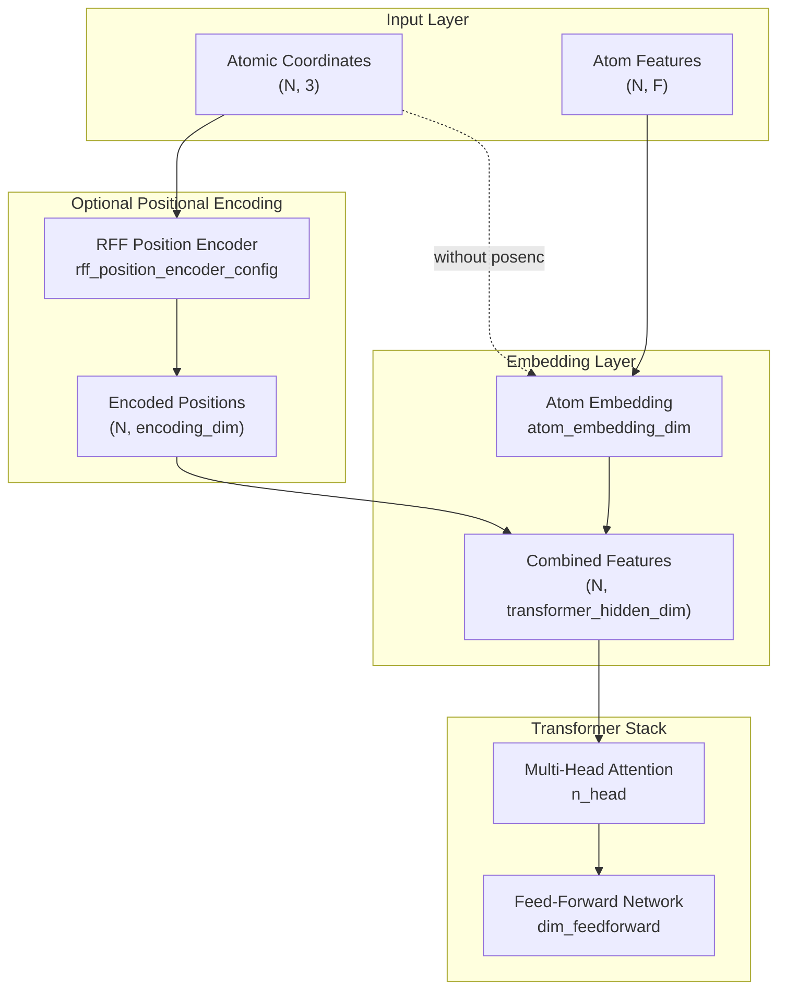
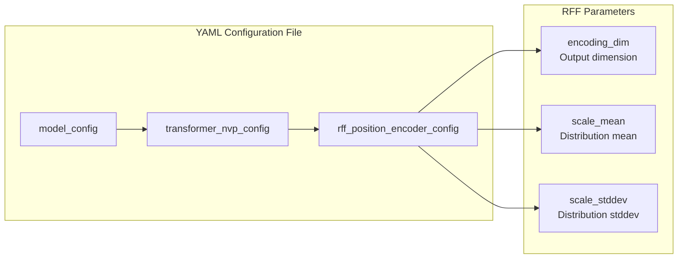
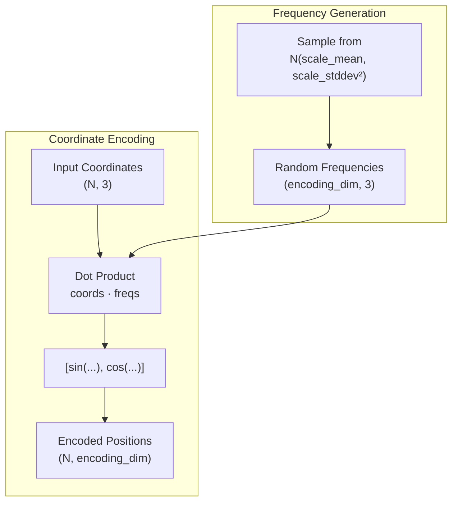
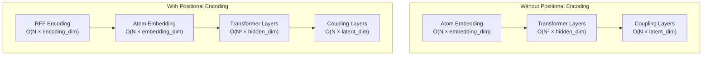
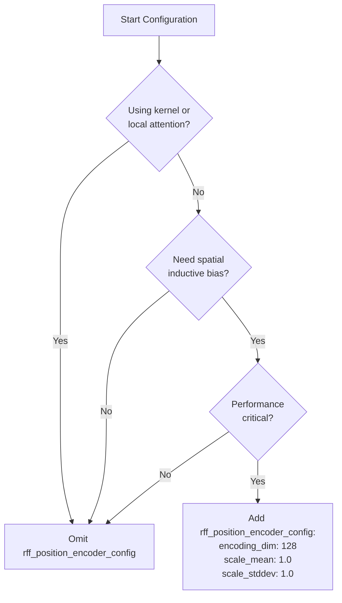

<!-- source: DeepWiki mcp.deepwiki.com · repo microsoft/timewarp · extra page Positional Encoding · fetched 2026-10-26 -->

# Positional Encoding

<details>
<summary>Relevant source files</summary>

The following files were used as context for generating this wiki page:

- [configs/transformer_nvp.yaml](configs/transformer_nvp.yaml)
- [configs/transformer_nvp_posenc.yaml](configs/transformer_nvp_posenc.yaml)

</details>


## Purpose and Scope

This document explains the optional RFF (Random Fourier Feature) positional encoding mechanism available for Transformer NVP models in Timewarp. Positional encoding enhances the transformer's ability to utilize spatial information about atomic positions by encoding coordinate information into higher-dimensional feature space before attention operations.

For general information about Transformer NVP model architectures, see [Standard Transformer NVP](#4.2.1). For kernel-based attention mechanisms that also leverage spatial information, see [Kernel Attention Variants](#4.2.2).

---

## Overview

Positional encoding in Timewarp is an optional configuration feature that can be added to Transformer NVP models to improve their ability to process spatial information. The system uses RFF (Random Fourier Feature) encoding to transform 3D atomic coordinates into a higher-dimensional representation that better captures spatial relationships.

### When to Use Positional Encoding

Positional encoding is beneficial when:
- The model needs stronger spatial inductive biases
- Atomic coordinates carry critical information for dynamics prediction
- Standard transformer attention needs enhancement for spatial reasoning
- Performance improvements justify the additional computational cost

### Architecture Integration



**Diagram: Positional Encoding Integration in Transformer NVP**

When `rff_position_encoder_config` is present in the model configuration, atomic coordinates are passed through the RFF encoder before being combined with atom features. Without this configuration, coordinates are used directly in the embedding layer.

Sources: [configs/transformer_nvp.yaml:1-26](), [configs/transformer_nvp_posenc.yaml:1-30]()

---

## RFF Position Encoder Configuration

The RFF position encoder is configured through the `rff_position_encoder_config` section within `transformer_nvp_config`. This section is optional; when omitted, the model operates without positional encoding.

### Configuration Structure



**Diagram: RFF Configuration Hierarchy**

The configuration follows a nested structure where `rff_position_encoder_config` is nested within `transformer_nvp_config`, which itself is nested within `model_config`.

Sources: [configs/transformer_nvp_posenc.yaml:14-30]()

### Configuration Parameters

| Parameter | Type | Description | Typical Value |
|-----------|------|-------------|---------------|
| `encoding_dim` | integer | Dimensionality of the encoded position features | 128 |
| `scale_mean` | float | Mean of the random Fourier feature scale distribution | 1.0 |
| `scale_stddev` | float | Standard deviation of the random Fourier feature scale distribution | 1.0 |

**Table: RFF Position Encoder Parameters**

Sources: [configs/transformer_nvp_posenc.yaml:26-29]()

---

## Parameter Details

### encoding_dim

The `encoding_dim` parameter controls the dimensionality of the output positional encoding. This value determines how much representational capacity is allocated to encoding spatial information.

- **Purpose**: Higher dimensions allow more complex spatial patterns to be captured
- **Trade-offs**: Larger values increase computational cost but may improve spatial reasoning
- **Typical range**: 64-256 dimensions
- **Default value**: 128 (as shown in reference configuration)

### scale_mean and scale_stddev

These parameters control the distribution of random frequencies used in the Fourier feature transformation. They determine the characteristic length scales at which the encoding captures spatial variations.

- **scale_mean**: Center of the frequency distribution
  - Value of 1.0 provides frequencies appropriate for atomic-scale features
  - Controls the "center frequency" of the encoding
  
- **scale_stddev**: Spread of the frequency distribution
  - Value of 1.0 provides a reasonable range of frequencies
  - Controls the bandwidth of spatial scales captured



**Diagram: RFF Encoding Process**

The RFF encoder generates random frequencies sampled from a Gaussian distribution, then computes sine and cosine features of the dot products between coordinates and frequencies.

Sources: [configs/transformer_nvp_posenc.yaml:26-29]()

---

## Configuration Examples

### Without Positional Encoding

The baseline Transformer NVP configuration operates without positional encoding:

```yaml
model_config:
  model_type: transformer_nvp
  transformer_nvp_config:
    atom_embedding_dim: 32
    transformer_hidden_dim: 128
    latent_mlp_hidden_dims: [256]
    num_coupling_layers: 8
    num_transformer_layers: 3
    transformer_config:
      n_head: 8
      dim_feedforward: 2048
      dropout: 0
```

This configuration achieves a validation NLL of -6.25 after 100k iterations on the AD-1 dataset.

Sources: [configs/transformer_nvp.yaml:14-26]()

### With Positional Encoding

Adding RFF positional encoding to the same architecture:

```yaml
model_config:
  model_type: transformer_nvp
  transformer_nvp_config:
    atom_embedding_dim: 32
    transformer_hidden_dim: 128
    latent_mlp_hidden_dims: [256]
    num_coupling_layers: 8
    num_transformer_layers: 3
    transformer_config:
      n_head: 8
      dim_feedforward: 2048
      dropout: 0
    rff_position_encoder_config:
      encoding_dim: 128
      scale_mean: 1.0
      scale_stddev: 1.0
```

This configuration achieves an improved validation NLL of -6.9 after 100k iterations on the AD-1 dataset.

Sources: [configs/transformer_nvp_posenc.yaml:14-30]()

---

## Performance Impact

### Quantitative Results

The following table summarizes the performance impact of adding positional encoding to the Transformer NVP model on the AD-1 dataset:

| Configuration | Validation NLL | Improvement |
|---------------|----------------|-------------|
| Without positional encoding | -6.25 | Baseline |
| With RFF positional encoding | -6.9 | +0.65 nats |

**Table: Performance Comparison**

The addition of positional encoding provides a substantial improvement of 0.65 nats in negative log-likelihood, indicating better predictive quality for molecular dynamics.

Sources: [configs/transformer_nvp.yaml:1](), [configs/transformer_nvp_posenc.yaml:1]()

### Computational Considerations



**Diagram: Computational Complexity Comparison**

Adding RFF positional encoding introduces an additional O(N × encoding_dim) operation, which is typically negligible compared to the O(N²) complexity of transformer attention.

Sources: [configs/transformer_nvp_posenc.yaml:26-29]()

---

## Usage Guidelines

### When to Enable Positional Encoding

Enable `rff_position_encoder_config` when:

1. **Spatial reasoning is critical**: The model needs to understand geometric relationships between atoms
2. **Performance matters**: The 0.65-nat improvement justifies configuration complexity
3. **Small to medium systems**: For very large molecular systems (>1000 atoms), test computational feasibility
4. **Standard attention is used**: Not using kernel or local attention variants that already incorporate spatial information

### When to Skip Positional Encoding

Consider omitting positional encoding when:

1. **Using kernel attention**: Kernel-based attention already incorporates spatial information through lengthscales (see [Kernel Attention Variants](#4.2.2))
2. **Using local attention**: Local attention restricts to spatial neighborhoods (see [Local Attention NVP](#4.2.3))
3. **Baseline comparison needed**: To isolate the effect of other architectural choices
4. **Minimal configuration preferred**: When simplicity is prioritized over performance

### Configuration Checklist



**Diagram: Decision Flow for Enabling Positional Encoding**

This flowchart helps determine whether to include positional encoding in your model configuration.

Sources: [configs/transformer_nvp.yaml:1-26](), [configs/transformer_nvp_posenc.yaml:1-30]()

---

## Integration with Other Features

### Compatibility Matrix

| Feature | Compatible with RFF Positional Encoding | Notes |
|---------|----------------------------------------|-------|
| Standard Transformer NVP | ✓ Yes | Primary use case |
| Kernel Transformer NVP | ⚠ Redundant | Kernel attention already uses spatial info |
| Local Transformer NVP | ⚠ Redundant | Local attention already spatially restricted |
| Data Augmentation | ✓ Yes | Positional encoding is equivariant-compatible |
| Multi-GPU Training | ✓ Yes | No special considerations needed |
| All Coupling Layer Counts | ✓ Yes | Independent of flow architecture |

**Table: Feature Compatibility**

The positional encoding system is designed to be orthogonal to most other architectural choices, with the exception of attention mechanisms that already incorporate spatial information.

Sources: [configs/transformer_nvp.yaml:1-26](), [configs/transformer_nvp_posenc.yaml:1-30]()

---

## Summary

The RFF positional encoding system in Timewarp provides an optional enhancement for Transformer NVP models that improves spatial reasoning by encoding atomic coordinates into a higher-dimensional Fourier feature space. The system is configured through three parameters (`encoding_dim`, `scale_mean`, `scale_stddev`) in the `rff_position_encoder_config` section and demonstrates a meaningful performance improvement (+0.65 nats validation NLL) on the AD-1 dataset with minimal computational overhead. It is most beneficial for standard transformer attention and should generally be omitted when using kernel or local attention variants that already incorporate spatial information.

Sources: [configs/transformer_nvp.yaml:1-26](), [configs/transformer_nvp_posenc.yaml:1-30]()

---

