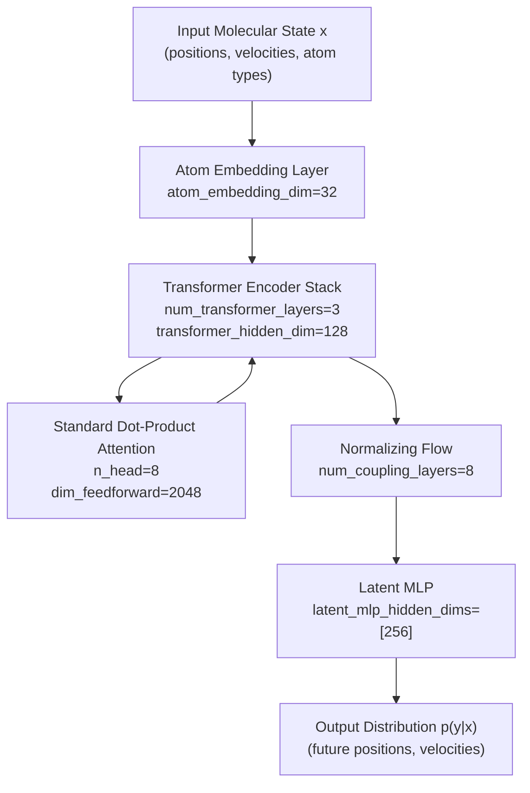
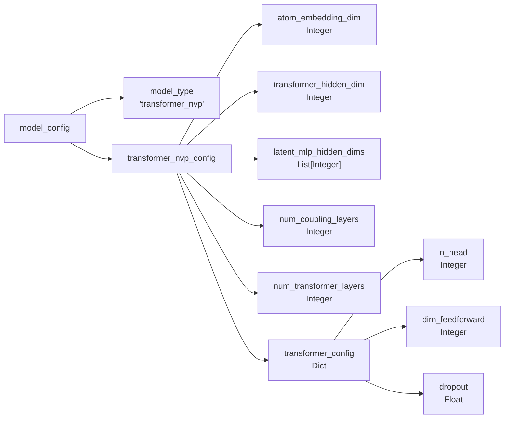
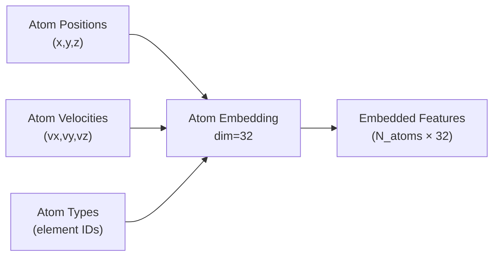
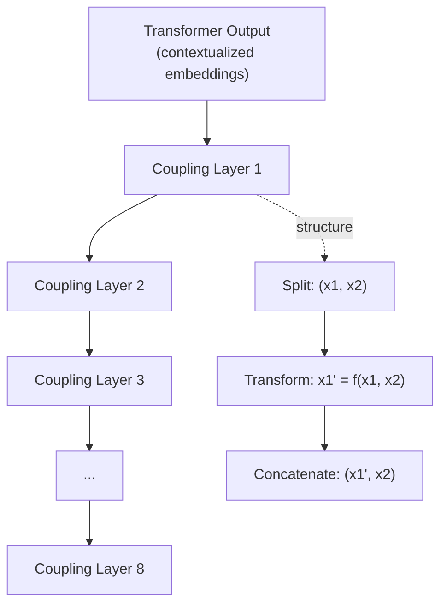
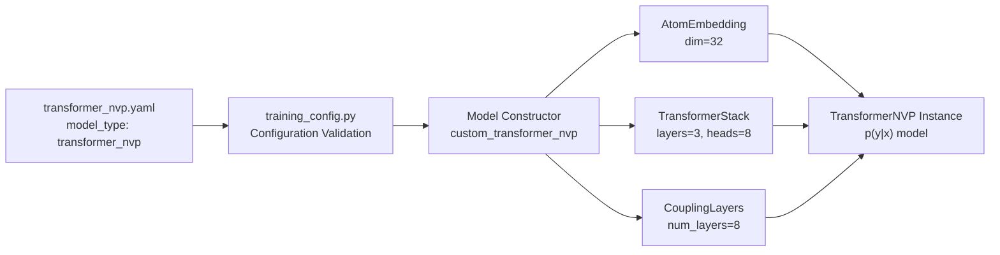
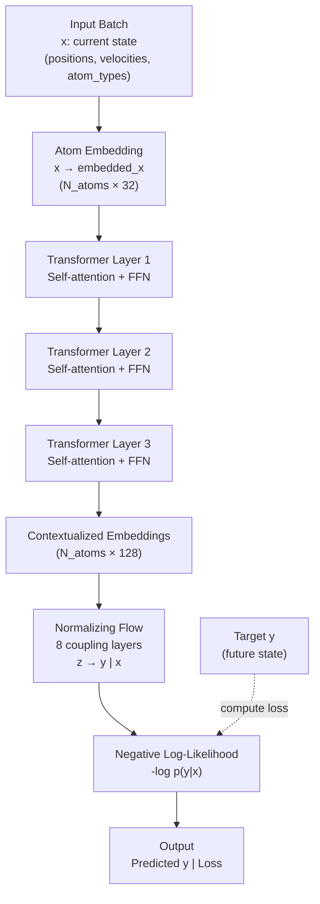

<!-- source: DeepWiki mcp.deepwiki.com · repo microsoft/timewarp · extra page Standard Transformer NVP · fetched 2026-10-26 -->

# Standard Transformer NVP

<details>
<summary>Relevant source files</summary>

The following files were used as context for generating this wiki page:

- [configs/transformer_nvp.yaml](configs/transformer_nvp.yaml)

</details>


## Purpose and Scope

This page documents the **Standard Transformer NVP** architecture, which serves as the baseline transformer-based normalizing flow model in Timewarp. This model uses standard dot-product attention to learn conditional distributions p(y|x) for time-coarsened molecular dynamics.

For other transformer-based NVP variants, see:
- Kernel-based attention mechanisms: [Kernel Attention Variants](#4.2.2)
- Spatially-restricted attention: [Local Attention NVP](#4.2.3)
- Equivariant geometric constraints: [Equivariant NVP](#4.3)
- Latent variable models: [Transformer CVAE](#4.4)

This page covers the model's architecture, configuration parameters, and how it differs from other variants in the transformer NVP family.

Sources: [configs/transformer_nvp.yaml:1-26]()

---

## Architecture Overview

The Standard Transformer NVP is a conditional density model that learns to predict future molecular states given current states. It combines three key architectural components:

1. **Atom Embeddings**: Maps atomic features to dense vector representations
2. **Transformer Encoder**: Applies self-attention to capture inter-atomic relationships using standard dot-product attention
3. **Normalizing Flow**: Uses coupling layers to model the conditional distribution p(y|x)

The model is configured via the `transformer_nvp` model type, which distinguishes it from kernel-based and local attention variants that modify the attention mechanism.

**Model Architecture Diagram**



Sources: [configs/transformer_nvp.yaml:14-25]()

---

## Configuration Structure

The Standard Transformer NVP is instantiated through a hierarchical configuration structure. The top-level `model_config` specifies the model type, while the nested `transformer_nvp_config` defines architecture-specific parameters.

**Configuration Hierarchy**



Sources: [configs/transformer_nvp.yaml:14-25]()

### Configuration Parameters

| Parameter | Default Value | Purpose |
|-----------|---------------|---------|
| `atom_embedding_dim` | 32 | Dimensionality of atom feature embeddings |
| `transformer_hidden_dim` | 128 | Hidden dimension size for transformer layers |
| `latent_mlp_hidden_dims` | [256] | List of hidden layer sizes in the latent MLP |
| `num_coupling_layers` | 8 | Number of coupling layers in the normalizing flow |
| `num_transformer_layers` | 3 | Number of transformer encoder layers in the stack |
| `n_head` | 8 | Number of attention heads in multi-head attention |
| `dim_feedforward` | 2048 | Dimensionality of feedforward network in transformer |
| `dropout` | 0 | Dropout probability (0 = no dropout) |

Sources: [configs/transformer_nvp.yaml:16-25]()

---

## Component Details

### Atom Embedding Layer

The atom embedding layer transforms raw atomic features into dense vector representations of dimension `atom_embedding_dim`. This layer processes:
- Atomic positions
- Atomic velocities  
- Atom type identifiers

The embedding dimension of 32 provides a balance between model capacity and computational efficiency for the baseline architecture.

**Embedding Data Flow**



Sources: [configs/transformer_nvp.yaml:17]()

### Transformer Encoder

The transformer encoder consists of a stack of `num_transformer_layers` layers (default: 3). Each layer applies:

1. **Multi-head self-attention** with standard dot-product attention mechanism
2. **Feedforward network** with dimension `dim_feedforward` (default: 2048)
3. **Layer normalization** and residual connections

The `transformer_hidden_dim` parameter (default: 128) controls the internal dimensionality of the transformer representations.

**Key Distinction**: Unlike kernel-based variants ([4.2.2](#4.2.2)) or local attention variants ([4.2.3](#4.2.3)), this model uses standard scaled dot-product attention:

```
Attention(Q, K, V) = softmax(QK^T / sqrt(d_k)) V
```

Sources: [configs/transformer_nvp.yaml:18-24]()

### Normalizing Flow (Coupling Layers)

The normalizing flow component uses `num_coupling_layers` coupling layers (default: 8) to model the conditional distribution p(y|x). This implements the Real NVP (Non-Volume Preserving) architecture, where each coupling layer:

1. Splits the input into two parts
2. Transforms one part conditioned on the other
3. Preserves invertibility for efficient sampling and density evaluation

The coupling layers receive context from the transformer encoder output, allowing the flow to condition on the full molecular state.

**Normalizing Flow Structure**



Sources: [configs/transformer_nvp.yaml:20]()

### Latent MLP

The latent MLP provides additional non-linear transformations within the coupling layers. The `latent_mlp_hidden_dims` parameter specifies the hidden layer dimensions (default: [256], indicating a single hidden layer with 256 units).

This MLP processes the conditioning information from the transformer before it's used to parameterize the coupling layer transformations.

Sources: [configs/transformer_nvp.yaml:19]()

---

## Training Configuration

The Standard Transformer NVP is trained with the following default hyperparameters, which achieve a validation NLL of -6.25 on the AD-1 dataset after 100,000 iterations:

| Parameter | Value | Purpose |
|-----------|-------|---------|
| `dataset` | AD-1 | Alanine dipeptide trajectory dataset |
| `step_width` | 1000 | Time steps between x and y states |
| `learning_rate` | 1e-4 | Adam optimizer learning rate |
| `warmup_steps` | 1000 | Linear warmup steps for learning rate |
| `weight_decay` | 0.0 | L2 regularization (disabled by default) |
| `batch_size` | 32 | Training batch size per GPU |
| `num_epochs` | 1000 | Maximum training epochs |
| `patience` | 100 | Early stopping patience in epochs |
| `data_augmentation` | true | Apply equivariant data augmentation |

Sources: [configs/transformer_nvp.yaml:1-13]()

### Data Augmentation

With `data_augmentation: true`, the model applies random rotations, translations, and permutations during training to improve generalization. This encourages the model to learn approximately equivariant representations without hard geometric constraints (unlike the Equivariant NVP model in [4.3](#4.3)).

Sources: [configs/transformer_nvp.yaml:11]()

---

## Model Instantiation

The model is instantiated through the configuration system by specifying `model_type: transformer_nvp` in the model configuration. The system reads this configuration and constructs the appropriate model architecture with the specified parameters.

**Configuration to Model Mapping**



Sources: [configs/transformer_nvp.yaml:14-15]()

---

## Data Flow Through the Model

The following diagram shows how molecular dynamics data flows through the Standard Transformer NVP during both training and inference:

**Forward Pass Data Flow**



Sources: [configs/transformer_nvp.yaml:16-25]()

### Training Phase

During training:
1. Input state `x` is embedded and processed through the transformer
2. The flow maps from a base distribution `z ~ N(0, I)` to the target `y` conditioned on transformer output
3. The negative log-likelihood `-log p(y|x)` is computed and used as the loss
4. Gradients flow back through the entire architecture

### Sampling Phase

During sampling/inference:
1. Input state `x` is processed through embedding and transformer
2. A sample `z` is drawn from the base distribution `z ~ N(0, I)`
3. The normalizing flow transforms `z → y` conditioned on the transformer output
4. The predicted future state `y` is returned

---

## Comparison with Other Variants

The Standard Transformer NVP differs from other model variants primarily in its attention mechanism:

| Model Variant | Attention Type | Key Configuration Difference |
|---------------|----------------|------------------------------|
| **Standard Transformer NVP** | Dot-product | `model_type: transformer_nvp` |
| Kernel Transformer NVP | Kernel-based | `model_type: kernel_transformer_nvp`<br/>Adds `kernel_lengthscales` |
| Local Transformer NVP | Spatially restricted | `model_type: local_transformer_nvp`<br/>Adds `max_radius` |
| Chebyshev Kernel NVP | Polynomial approximation | `model_type: kernel_cheb_transformer_nvp`<br/>Adds `polynomial_order` |
| Equivariant NVP | E(3)-equivariant layers | `model_type: equivariant_nvp`<br/>Different architecture |

The standard variant provides a baseline for comparing more specialized attention mechanisms. Its standard dot-product attention:
- **Advantages**: Well-established, stable training, good general-purpose performance
- **Limitations**: Quadratic complexity in sequence length, no explicit spatial bias, no guaranteed equivariance

For use cases requiring specific properties (e.g., local interactions, geometric invariance), consider the specialized variants documented in pages [4.2.2](#4.2.2), [4.2.3](#4.2.3), and [4.3](#4.3).

Sources: [configs/transformer_nvp.yaml:15]()

---

## Performance Characteristics

The Standard Transformer NVP achieves a validation negative log-likelihood of **-6.25** on the AD-1 (alanine dipeptide) dataset after 100,000 training iterations using the default configuration.

**Computational Complexity**:
- **Attention**: O(N²d) where N is the number of atoms and d is the embedding dimension
- **Feedforward**: O(Nd²) per transformer layer
- **Coupling Layers**: O(Nd) per layer

The model scales quadratically with the number of atoms due to the standard attention mechanism, making it most suitable for small to medium-sized molecular systems. For larger systems, consider using the Local Attention NVP ([4.2.3](#4.2.3)) which reduces complexity through spatial restrictions.

Sources: [configs/transformer_nvp.yaml:1]()

---

