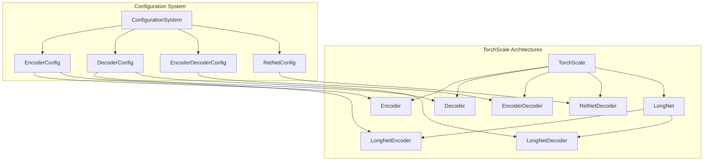
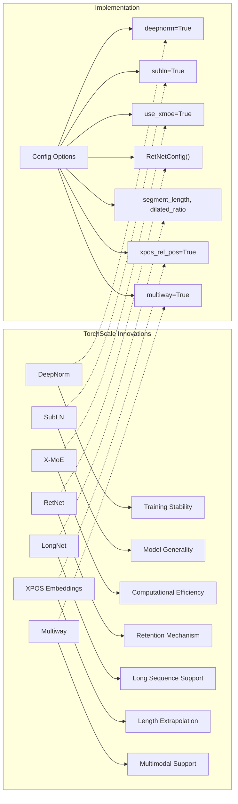
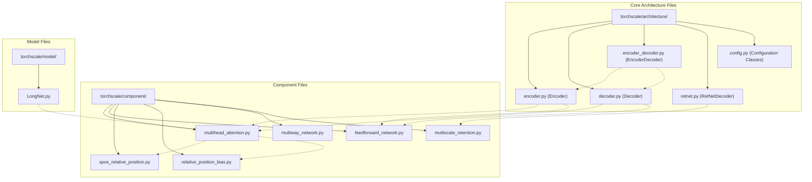
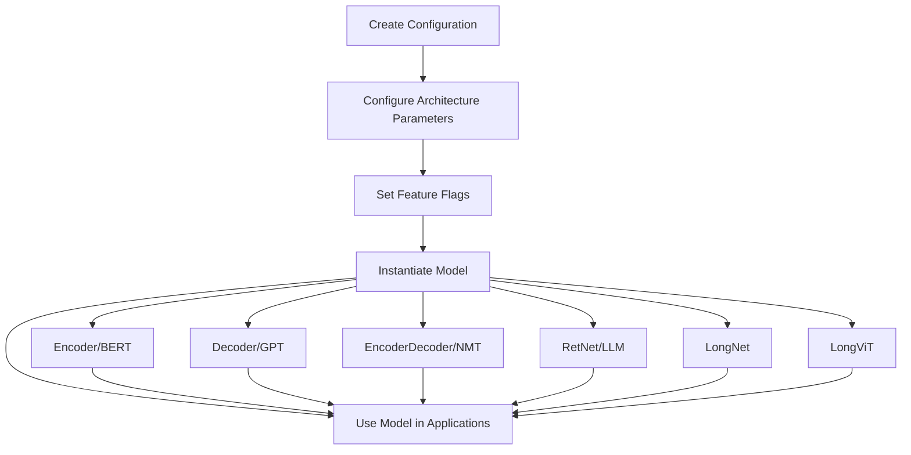

<!-- source: DeepWiki mcp.deepwiki.com · repo microsoft/torchscale · page 1 Overview · fetched 2026-10-26 -->

# Overview

<details>
<summary>Relevant source files</summary>

The following files were used as context for generating this wiki page:

- [README.md](README.md)
- [setup.py](setup.py)
- [torchscale/component/relative_position_bias.py](torchscale/component/relative_position_bias.py)
- [torchscale/component/xpos_relative_position.py](torchscale/component/xpos_relative_position.py)

</details>


TorchScale is a PyTorch library that enables researchers and developers to scale up Transformer models efficiently and effectively. This page provides a comprehensive introduction to the TorchScale repository, summarizing its purpose, key features, main components, and architecture overview. For installation details, refer to [Installation & Setup](#1.1).

Sources: [README.md:1-10]()

## Purpose and Scope

TorchScale focuses on fundamental research to develop new architectures for foundation models and AI, with specific emphasis on:

1. **Modeling Generality** - Building models that work across diverse tasks and modalities
2. **Model Capability** - Developing architectures that can handle complex problems
3. **Training Stability** - Enabling stable training of extremely deep networks
4. **Computational Efficiency** - Optimizing models for better performance with fewer resources

The library provides implementations of several innovative architectures including DeepNet, Foundation Transformers (Magneto), RetNet, LongNet, and integration with sparse Mixture-of-Experts (MoE) models.

Sources: [README.md:10-14](), [README.md:16-19]()

## Architecture Overview

TorchScale provides multiple architecture types that can be easily instantiated through a unified configuration system:

**Architecture Types Diagram**


Each architecture can be instantiated using only a few lines of code through the appropriate configuration class:

```python
# Example: Creating an encoder model
from torchscale.architecture.config import EncoderConfig
from torchscale.architecture.encoder import Encoder

config = EncoderConfig(vocab_size=64000)
model = Encoder(config)
```

Sources: [README.md:53-65](), [README.md:67-85](), [README.md:89-99](), [README.md:101-114]()

## Key Architectural Innovations

TorchScale implements several cutting-edge transformer architecture innovations:

**Architectural Innovations Diagram**


### Key Features in Detail

1. **DeepNorm**: Improves training stability of Post-LayerNorm Transformers, enabling scaling to 1,000+ layers
   - Enabled via `deepnorm=True` in the configuration
   - Adjusts residual connections and initialization based on model architecture

2. **SubLN** (Submodule LayerNorm): Enhances model generality and training stability
   - Enabled via `subln=True` (default setting)
   - Introduces additional LayerNorm to each sublayer with architecture-specific initialization
   - Note: Cannot be used alongside DeepNorm

3. **X-MoE**: Provides efficient and finetunable sparse Mixture-of-Experts modeling
   - Enabled via `use_xmoe=True`
   - Replaces every `moe_freq` feedforward layers with X-MoE layers

4. **RetNet**: Retentive Network as a successor to Transformer for large language models
   - Created using `RetNetConfig` and `RetNetDecoder`
   - Implements a multi-scale retention mechanism with multiple operational modes

5. **LongNet**: Scales transformers to handle up to 1 billion tokens
   - Implements dilated attention patterns for efficient processing of extremely long sequences
   - Requires Flash Attention for optimal performance

6. **Positional Embeddings**:
   - **XPOS**: Extrapolatable position embedding for better length generalization
   - **Relative Position Bias**: Alternative position encoding mechanism

7. **Multiway Architecture**: Enables parameter sharing across different modalities

Sources: [README.md:116-146]()

## Code Architecture to Component Mapping

**Code to Component Mapping Diagram**


The diagram above shows the relationship between the main code files and components in TorchScale. The library is organized into architecture, component, and model modules, with configuration classes linking them together.

Sources: [README.md:1-264](), [torchscale/component/relative_position_bias.py:1-84](), [torchscale/component/xpos_relative_position.py:1-66]()

## Usage Flow

**Usage Flow Diagram**


The diagram illustrates how to use TorchScale: first create a configuration with the desired parameters, then instantiate the model, and finally use it in various applications such as BERT pretraining, GPT language modeling, machine translation, or vision tasks with LongViT.

Sources: [README.md:152-159](), [README.md:162-186]()

## Integration Examples

TorchScale can be integrated with various frameworks and used for different tasks:

### Language
- Decoder/GPT models for language modeling
- Encoder-Decoder models for machine translation
- Encoder/BERT models for masked language modeling

### Vision
- LongViT for gigapixel image processing (computational pathology)

### Multimodal
- Multiway Transformers/BEiT-3 for multimodal tasks

Sources: [README.md:162-186]()

## Model Architecture Comparison

| Architecture | Primary Use Case | Key Components | Unique Features |
|--------------|------------------|----------------|-----------------|
| Encoder | Text understanding | Self-attention | BERT-like bidirectional context |
| Decoder | Text generation | Masked self-attention | GPT-like autoregressive generation |
| EncoderDecoder | Translation, summarization | Self-attention, cross-attention | Sequence-to-sequence tasks |
| RetNet | Language modeling | Multi-scale retention | Parallel, recurrent, and chunkwise modes |
| LongNet | Long-context processing | Dilated attention | Processing sequences up to 1B tokens |

Sources: [README.md:16-20](), [README.md:89-114]()

## Installation

TorchScale can be installed via pip:

```bash
pip install torchscale
```

For local development:

```bash
git clone https://github.com/microsoft/torchscale.git
cd torchscale
pip install -e .
```

For optimal performance, TorchScale can be installed with Flash Attention or xFormers for faster training on compatible GPUs.

Sources: [README.md:27-51](), [setup.py:1-25]()

## Conclusion

TorchScale provides a comprehensive library for scaling transformer models with various architectural innovations. Its modular design allows researchers and developers to easily experiment with different model architectures while benefiting from cutting-edge techniques for improving training stability, model generality, and computational efficiency.

For more detailed information about the different architectures, see [Architecture Overview](#2), or for specific components, see [Core Components](#4).

Sources: [README.md:1-264]()

---

