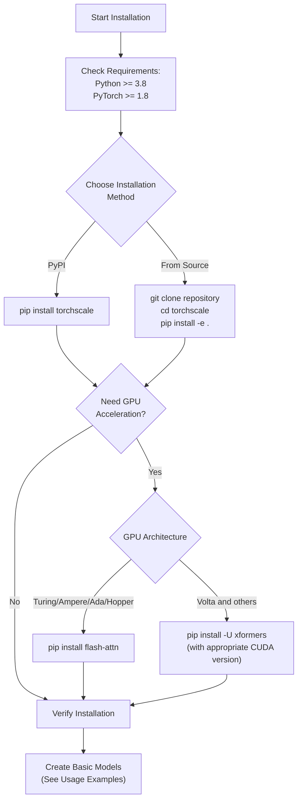
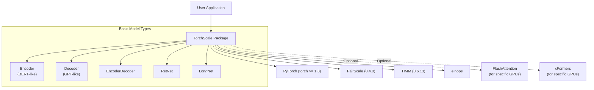

<!-- source: DeepWiki mcp.deepwiki.com · repo microsoft/torchscale · page 1.1 Installation & Setup · fetched 2026-10-26 -->

# Installation & Setup

<details>
<summary>Relevant source files</summary>

The following files were used as context for generating this wiki page:

- [.gitignore](.gitignore)
- [README.md](README.md)
- [SUPPORT.md](SUPPORT.md)
- [setup.py](setup.py)
- [torchscale/component/relative_position_bias.py](torchscale/component/relative_position_bias.py)
- [torchscale/component/xpos_relative_position.py](torchscale/component/xpos_relative_position.py)

</details>


This page provides detailed instructions for installing and configuring TorchScale, a PyTorch library designed for efficiently scaling Transformer models. For information about specific architectural features or components, please refer to [Key Features](#1.2) and [Architecture Overview](#2).

## System Requirements

Before installing TorchScale, ensure your system meets the following requirements:

- Python >= 3.8
- PyTorch >= 1.8

## Installation Methods

### Installation Workflow



Sources: [README.md:27-51]()

### Method 1: Install from PyPI (Recommended)

The simplest way to install TorchScale is through pip:

```
pip install torchscale
```

This command installs the latest stable release along with required dependencies.

Sources: [README.md:29-32]()

### Method 2: Install from Source

For the latest development version or to contribute to the project:

```
git clone https://github.com/microsoft/torchscale.git
cd torchscale
pip install -e .
```

The `-e` flag installs the package in "editable" mode, allowing you to modify the source code with changes reflected immediately.

Sources: [README.md:34-39](), [setup.py:8-25]()

## Dependencies



Sources: [setup.py:20](), [README.md:41-51]()

### Required Dependencies

TorchScale automatically installs the following dependencies:

| Dependency | Version Requirement | Purpose |
|------------|---------------------|---------|
| PyTorch    | >= 1.8              | Core deep learning framework |
| FairScale  | == 0.4.0            | Scaling neural networks |
| TIMM       | == 0.6.13           | PyTorch Image Models |
| einops     | (Latest)            | Tensor operations |

Sources: [setup.py:20]()

### Optional Dependencies for Performance

#### Flash Attention

For faster attention computation on Turing, Ampere, Ada, or Hopper NVIDIA GPUs:

```
pip install flash-attn
```

Sources: [README.md:41-44]()

#### xFormers

For efficient transformer operations on Volta, Turing, Ampere, Ada, or Hopper NVIDIA GPUs:

```
# For CUDA 11.8
pip install -U xformers --index-url https://download.pytorch.org/whl/cu118

# For CUDA 12.1
pip install -U xformers --index-url https://download.pytorch.org/whl/cu121
```

Sources: [README.md:45-51]()

## Verifying Installation

To verify that TorchScale is installed correctly, import the package in Python:

```python
import torchscale
# No errors should occur
```

## Basic Usage

After installation, you can quickly start using TorchScale with the following examples:

### Creating an Encoder (BERT-like) Model

```python
from torchscale.architecture.config import EncoderConfig
from torchscale.architecture.encoder import Encoder

config = EncoderConfig(vocab_size=64000)
model = Encoder(config)
```

Sources: [README.md:57-65]()

### Creating a Decoder (GPT-like) Model

```python
from torchscale.architecture.config import DecoderConfig
from torchscale.architecture.decoder import Decoder

config = DecoderConfig(vocab_size=64000)
model = Decoder(config)
```

Sources: [README.md:70-76]()

### Creating an Encoder-Decoder Model

```python
from torchscale.architecture.config import EncoderDecoderConfig
from torchscale.architecture.encoder_decoder import EncoderDecoder

config = EncoderDecoderConfig(vocab_size=64000)
model = EncoderDecoder(config)
```

Sources: [README.md:78-84]()

### Creating a RetNet Model

```python
from torchscale.architecture.config import RetNetConfig
from torchscale.architecture.retnet import RetNetDecoder

config = RetNetConfig(vocab_size=64000)
model = RetNetDecoder(config)
```

Sources: [README.md:89-98]()

### Creating a LongNet Model

For working with extremely long sequences (requires Flash Attention):

```python
from torchscale.architecture.config import EncoderConfig, DecoderConfig
from torchscale.model.longnet import LongNetEncoder, LongNetDecoder

# Encoder for long sequences
config = EncoderConfig(
    vocab_size=64000, 
    segment_length='[2048,4096]', 
    dilated_ratio='[1,2]', 
    flash_attention=True
)
model = LongNetEncoder(config)
```

Sources: [README.md:101-114]()

## Troubleshooting

If you encounter issues during installation:

1. Ensure your Python and PyTorch versions meet the requirements
2. Check that your CUDA version is compatible if using GPU acceleration
3. For Flash Attention or xFormers, verify your GPU architecture is supported
4. If installing from source, make sure all dependencies are properly installed

## Next Steps

After successful installation, you can explore TorchScale's key features and architecture:

- [Key Features](#1.2) - Learn about DeepNorm, SubLN, X-MoE, and other architectural innovations
- [Architecture Overview](#2) - Understand the different architectures available in TorchScale
- [Configuration System](#3) - Learn how to configure your models

---

