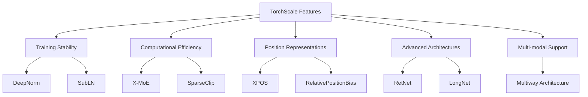
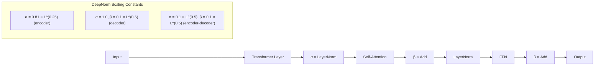
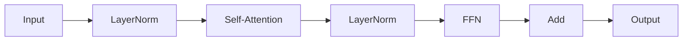
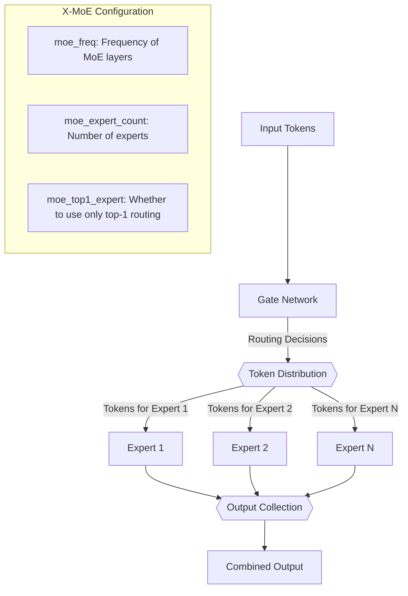
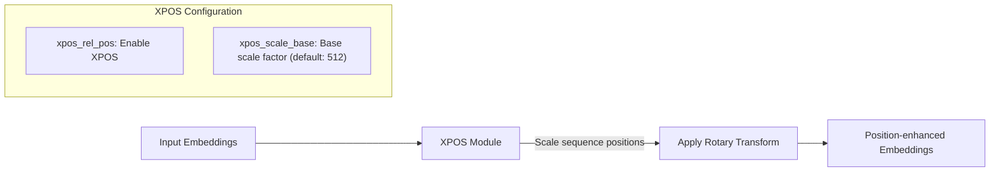
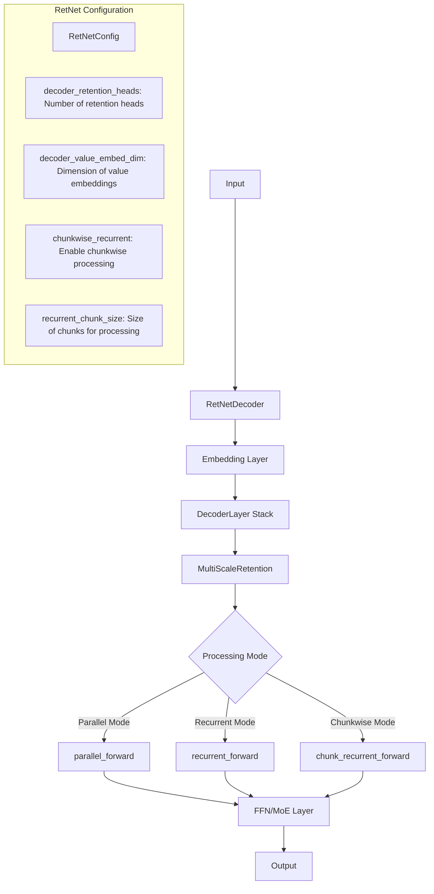
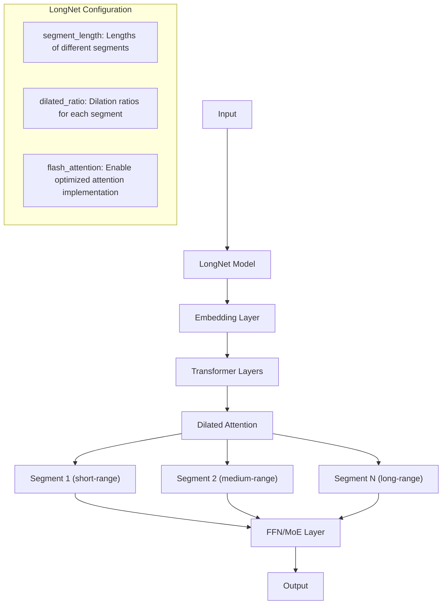
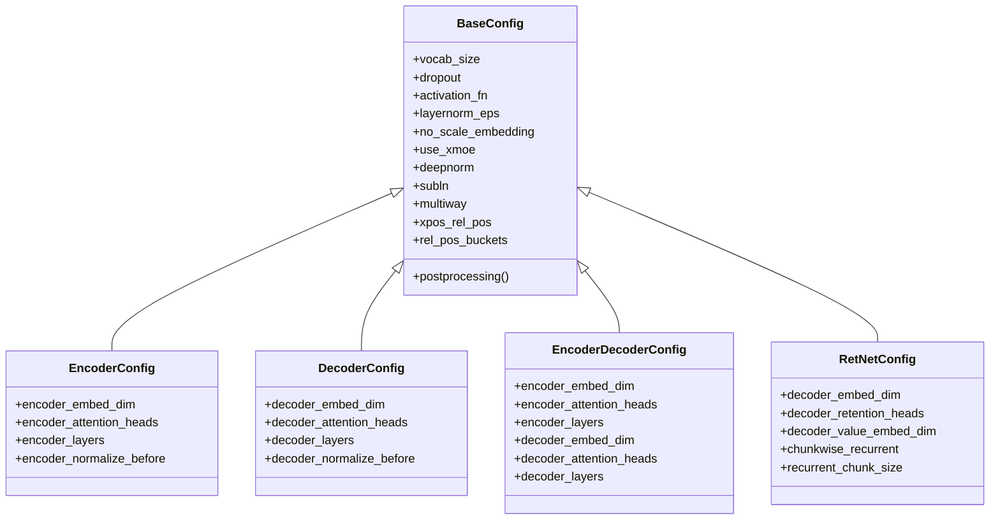

<!-- source: DeepWiki mcp.deepwiki.com · repo microsoft/torchscale · page 1.2 Key Features · fetched 2026-10-26 -->

# Key Features

<details>
<summary>Relevant source files</summary>

The following files were used as context for generating this wiki page:

- [README.md](README.md)
- [torchscale/architecture/config.py](torchscale/architecture/config.py)
- [torchscale/component/xpos_relative_position.py](torchscale/component/xpos_relative_position.py)

</details>


This page provides a comprehensive overview of TorchScale's key architectural innovations and components that enable efficient scaling of transformer models. For installation instructions, see [Installation & Setup](#1.1).

TorchScale implements several architectural improvements that address common challenges in scaling transformer models, including training stability, computational efficiency, sequence length limitations, and multi-modality support.

## Core Technical Innovations



Sources: [README.md:116-148]()

## Training Stability Features

TorchScale offers two primary normalization strategies to improve training stability for deep transformer models:

### DeepNorm

DeepNorm enables stable training of transformers with hundreds or even thousands of layers by adjusting the residual connection scaling and initialization method based on the model architecture. It is an alternative to Pre-LayerNorm that maintains better performance for very deep networks.

When enabled, DeepNorm automatically:
- Disables the Pre-LayerNorm (encoder_normalize_before)
- Applies model-specific initialization based on network depth
- Uses a modified residual connection pattern



To enable DeepNorm in TorchScale:

```python
config = EncoderConfig(
    vocab_size=64000,
    deepnorm=True,
    # this will automatically set subln=False
)
```

Sources: [README.md:118-120](), [torchscale/architecture/config.py:74-77]()

### SubLN (Submodule LayerNorm)

SubLN introduces an additional LayerNorm to each sublayer (attention and feed-forward network) and adjusts initialization methods accordingly. This is enabled by default and provides better model generality and training stability.

When enabled, SubLN:
- Enforces Pre-LayerNorm (encoder_normalize_before=True)
- Applies LayerNorm at more points in the network
- Uses specialized initialization methods



To enable SubLN (default behavior):

```python
config = EncoderConfig(
    vocab_size=64000,
    subln=True,
    # this will automatically set deepnorm=False
)
```

Sources: [README.md:122-125](), [torchscale/architecture/config.py:78-80]()

## Computational Efficiency Features

### X-MoE (Cross-Expert Mixture of Experts)

X-MoE addresses the representation collapse problem in sparse Mixture of Experts (MoE) models, enabling more efficient and finetunable sparse networks. It replaces feed-forward networks with expert layers at a configurable frequency.

Key X-MoE features:
- Improved expert specialization
- Better load balancing
- Prevents representation collapse
- Supports fine-tuning of expert layers



To enable X-MoE:

```python
config = EncoderConfig(
    vocab_size=64000,
    use_xmoe=True,
    moe_freq=2,  # every 2nd FFN is an MoE layer
    moe_expert_count=8,  # number of experts
)
```

Sources: [README.md:127-130](), [torchscale/architecture/config.py:81-84]()

### SparseClip

SparseClip improves gradient clipping for sparse MoE models, addressing the unique challenges of having both dense and sparse components in the network. TorchScale provides sample code for integration with training frameworks.

Sources: [README.md:141-142]()

## Position Representation Features

### XPOS (Extrapolatable Position Embedding)

XPOS enables transformer models to generalize to longer sequences than those seen during training by using a mathematically principled positional encoding that extrapolates better.

Key characteristics:
- Rotary position encoding with carefully designed decay
- Better extrapolation to unseen sequence lengths
- Integration with attention mechanism



To enable XPOS:

```python
config = EncoderConfig(
    vocab_size=64000,
    xpos_rel_pos=True,
    xpos_scale_base=512,  # default value
)
```

Sources: [README.md:135-136](), [torchscale/component/xpos_relative_position.py:38-65]()

### Relative Position Bias

As an alternative to absolute position encoding, TorchScale supports relative position bias that represents the relative distance between tokens rather than their absolute positions. This often performs better for certain tasks and architectures.

To enable Relative Position Bias:

```python
config = EncoderConfig(
    vocab_size=64000,
    rel_pos_buckets=32,  # number of position buckets
    max_rel_pos=128,     # maximum relative position
)
```

Sources: [README.md:138-139]()

## Advanced Architectures

### RetNet (Retentive Network)

RetNet is designed as a successor to traditional transformer architectures for large language models, featuring multi-scale retention mechanisms that combine the advantages of recurrent neural networks and transformers.

Key characteristics:
- Three operating modes: parallel, recurrent, and chunkwise
- Multi-scale retention mechanism
- Better computational efficiency than traditional transformers
- Improved sequence modeling capabilities



To create a RetNet model:

```python
from torchscale.architecture.config import RetNetConfig
from torchscale.architecture.retnet import RetNetDecoder

config = RetNetConfig(
    vocab_size=64000,
    decoder_retention_heads=8,
    decoder_value_embed_dim=1280,
)
retnet = RetNetDecoder(config)
```

Sources: [README.md:144-146](), [torchscale/architecture/config.py:249-297]()

### LongNet

LongNet is designed to scale transformers to extremely long contexts (up to 1 billion tokens) through dilated attention mechanisms and optimized memory usage.

Key characteristics:
- Segmented dilated attention pattern
- Flash attention integration for speed
- Support for extremely long contexts
- Configurable segment lengths and dilation ratios



To create a LongNet model:

```python
from torchscale.architecture.config import EncoderConfig
from torchscale.model.longnet import LongNetEncoder

config = EncoderConfig(
    vocab_size=64000,
    segment_length='[2048,4096]',   # different segments for attention
    dilated_ratio='[1,2]',          # dilation ratio for each segment
    flash_attention=True,           # requires Flash Attention library
)
longnet = LongNetEncoder(config)
```

Sources: [README.md:147-148](), [torchscale/architecture/config.py:56-59]()

## Multi-modality Support

### Multiway Architecture

The multiway architecture enables models to handle multiple modalities (text, vision, speech, etc.) by providing specialized parameters for different input types while sharing core Transformer blocks.

To enable multiway architecture:

```python
config = EncoderConfig(
    vocab_size=64000,
    multiway=True,
)
```

Sources: [README.md:131-133]()

## Configuration System

TorchScale uses a unified configuration system that consistently applies these features across different model architectures through specialized config classes:



Sources: [torchscale/architecture/config.py:5-315]()

This unified configuration system simplifies the application of features across different model architectures, allowing researchers to easily experiment with different combinations of features.

---

