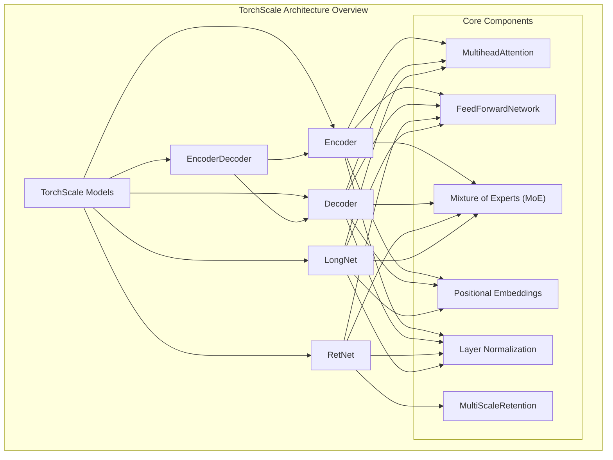
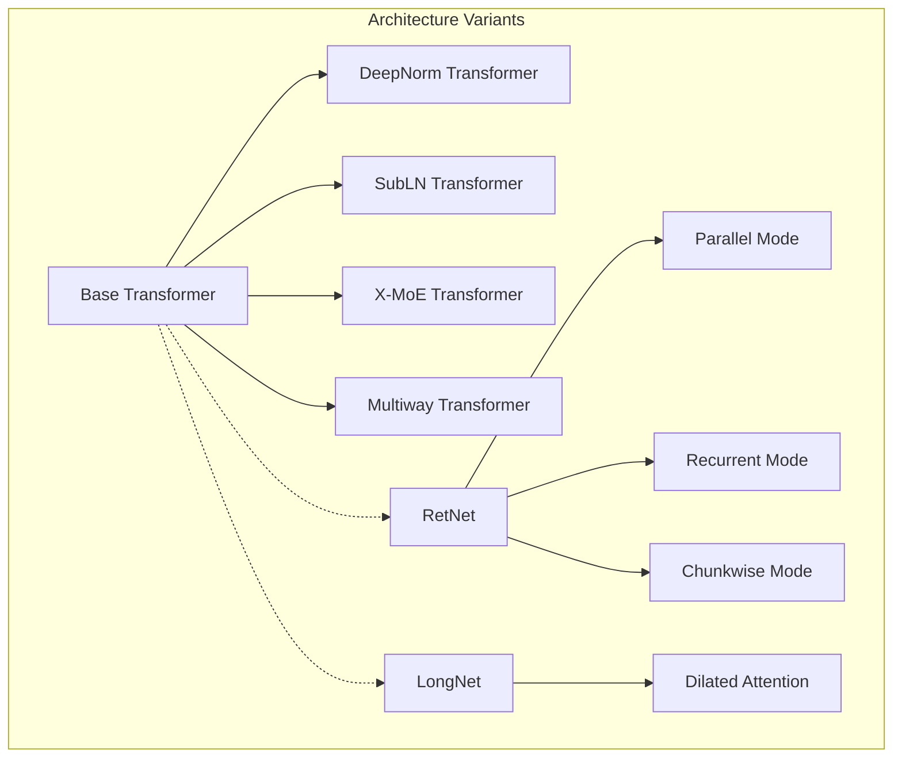
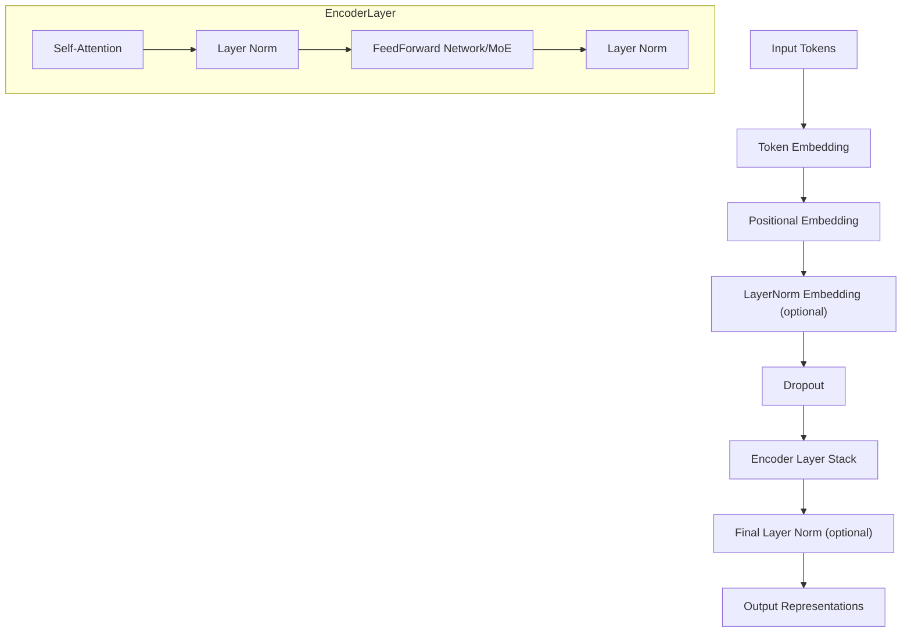
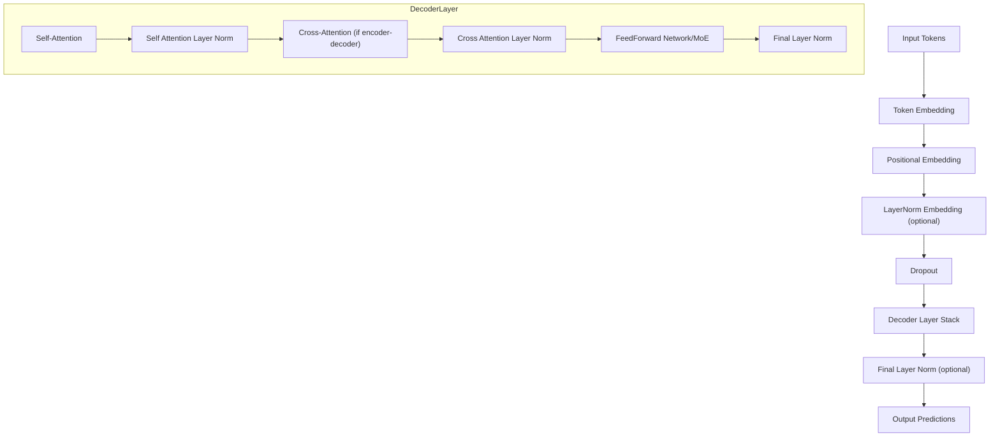
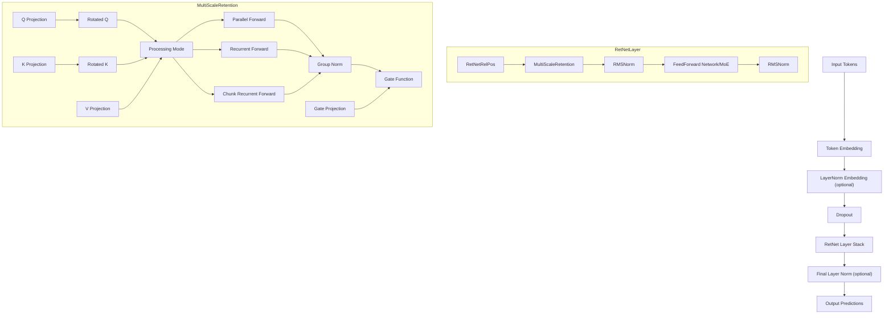
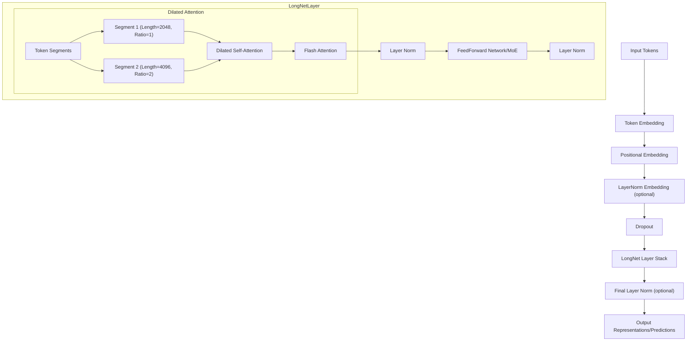
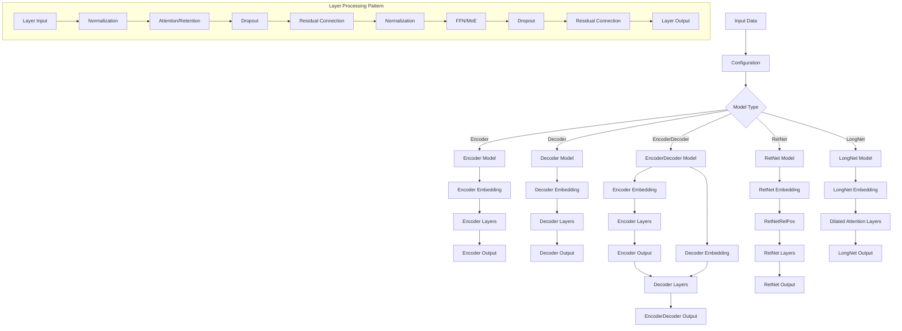
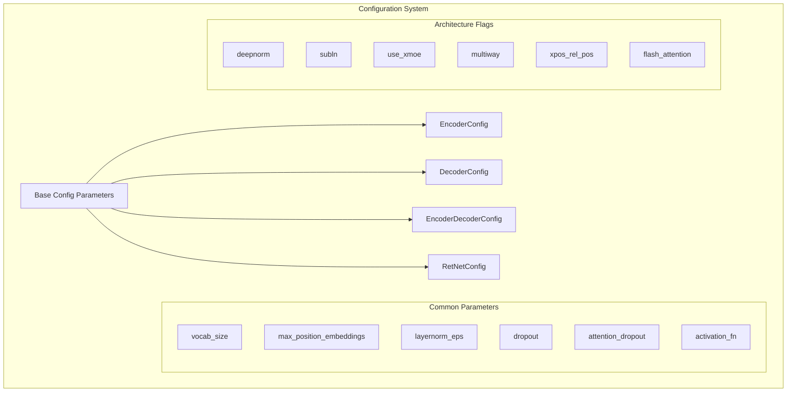
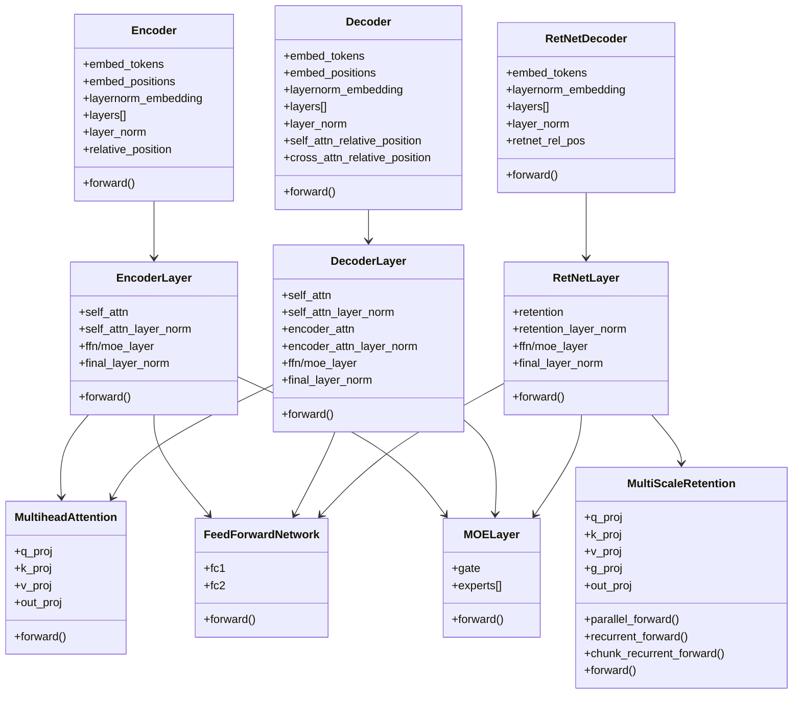

<!-- source: DeepWiki mcp.deepwiki.com · repo microsoft/torchscale · page 2 Architecture Overview · fetched 2026-10-26 -->

# Architecture Overview

Relevant source files

The following files were used as context for generating this wiki page:

- [README.md](README.md)
- [torchscale/architecture/decoder.py](torchscale/architecture/decoder.py)
- [torchscale/architecture/encoder.py](torchscale/architecture/encoder.py)
- [torchscale/architecture/retnet.py](torchscale/architecture/retnet.py)
- [torchscale/component/multiscale_retention.py](torchscale/component/multiscale_retention.py)
- [torchscale/component/xpos_relative_position.py](torchscale/component/xpos_relative_position.py)

This page provides a high-level overview of the different architecture implementations available in TorchScale. We'll examine the core model architectures, how they relate to each other, and their key characteristics. For specific implementation details of individual architectures, see the dedicated pages for [Encoder Architecture](#2.1), [Decoder Architecture](#2.2), [RetNet Architecture](#2.3), and [LongNet Architecture](#2.4).

## Core Architecture Overview

TorchScale provides several foundational architectures that can be used as building blocks for various natural language processing and multimodal tasks:

1. **Encoder** - A bidirectional transformer encoder architecture (BERT-like)
2. **Decoder** - An autoregressive transformer decoder architecture (GPT-like)
3. **EncoderDecoder** - A combined encoder-decoder architecture (T5-like)
4. **RetNet** - A retention-based alternative to transformers
5. **LongNet** - A transformer variant for extremely long sequences

These architectures share common components while introducing specialized innovations for specific use cases.

Sources: [README.md:56-85](), [torchscale/architecture/encoder.py:165-400](), [torchscale/architecture/decoder.py:210-482](), [torchscale/architecture/retnet.py:199-392]()

## Model Architecture Variations

TorchScale supports multiple variations of each architecture through a flexible configuration system, providing options for different model sizes, normalization techniques, and architectural enhancements.

Sources: [README.md:115-147](), [torchscale/architecture/retnet.py:166-196]()

### Key Architecture Features

| Feature | Description | Enabled By |
|---------|-------------|------------|
| DeepNorm | Improves training stability of Post-LayerNorm Transformers | `deepnorm=True` |
| SubLN | Introduces another LayerNorm to each sublayer for stability and generality | `subln=True` (default) |
| X-MoE | Replaces FFN with Mixture of Experts for efficiency and scalability | `use_xmoe=True` |
| Multiway | Provides a pool of parameters for different modalities | `multiway=True` |
| XPOS | Extrapolatable position embedding | `xpos_rel_pos=True` |
| Relative Position Bias | Alternative positional encoding | Adjusting `rel_pos_buckets` and `max_rel_pos` |

Sources: [README.md:115-147]()

## Encoder Architecture

The Encoder architecture implements a bidirectional transformer encoder that processes all inputs simultaneously. It consists of multiple EncoderLayer instances stacked together.

The encoder architecture is defined in [torchscale/architecture/encoder.py:165-400](), with the core layer implementation in [torchscale/architecture/encoder.py:25-162]().

Sources: [torchscale/architecture/encoder.py:165-400]()

## Decoder Architecture

The Decoder architecture implements an autoregressive transformer decoder that processes inputs sequentially. It consists of multiple DecoderLayer instances stacked together.

The decoder architecture is defined in [torchscale/architecture/decoder.py:210-482](), with the core layer implementation in [torchscale/architecture/decoder.py:23-208]().

Sources: [torchscale/architecture/decoder.py:210-482]()

## RetNet Architecture

RetNet (Retention Network) is a novel architecture proposed as a successor to Transformers for large language models. It replaces the attention mechanism with a Multi-Scale Retention mechanism.

RetNet's key innovation is the MultiScaleRetention mechanism, which offers three processing modes:

1. **Parallel Mode** - Similar to attention but with O(n²) complexity
2. **Recurrent Mode** - Linear complexity O(n) for inference
3. **Chunkwise Recurrent Mode** - Balances between parallel and recurrent

The RetNet architecture is defined in [torchscale/architecture/retnet.py:199-392](), with the MultiScaleRetention implementation in [torchscale/component/multiscale_retention.py:39-204]().

Sources: [torchscale/architecture/retnet.py:199-392](), [torchscale/component/multiscale_retention.py:39-204]()

## LongNet Architecture

LongNet is designed to process extremely long sequences (up to 1 billion tokens) through a dilated attention pattern that groups tokens into segments with different dilation ratios.

LongNet's key features:
- Segmented token representations with different dilation ratios
- Flash Attention for memory-efficient computation
- Support for sequences up to 1 billion tokens

LongNet's approach enables linear complexity relative to sequence length, making it suitable for extremely long context processing.

Sources: [README.md:102-114](), [README.md:144-148]()

## Data Flow Through Models

The following diagram illustrates how data flows through TorchScale models during forward passes:

Sources: [torchscale/architecture/encoder.py:327-399](), [torchscale/architecture/decoder.py:388-481](), [torchscale/architecture/retnet.py:328-391]()

## Extension and Configuration

TorchScale is designed to be easily configured and extended through its configuration system. Each architecture type has a corresponding configuration class that allows customization of model dimensions, number of layers, attention heads, and other architectural parameters.

The configuration system provides a unified interface for creating and customizing different architectures, allowing users to easily experiment with architectural variations.

Sources: [README.md:52-159]()

## Component Relationships

The following diagram illustrates how various components in TorchScale interact with each other:

Sources: [torchscale/architecture/encoder.py:25-400](), [torchscale/architecture/decoder.py:23-482](), [torchscale/architecture/retnet.py:72-392](), [torchscale/component/multiscale_retention.py:39-204]()

## Conclusion

TorchScale provides a comprehensive set of architectures for transformer-based models, with a focus on scalability, efficiency, and innovation. The library includes traditional transformer architectures (Encoder, Decoder, EncoderDecoder) as well as cutting-edge designs like RetNet and LongNet for specialized use cases.

Each architecture is highly configurable through a unified configuration system, allowing researchers and practitioners to easily experiment with different model variations. The shared components across architectures ensure consistency while enabling specific optimizations for different use cases.

For more details on specific architectures, refer to:
- [Encoder Architecture](#2.1)
- [Decoder Architecture](#2.2)
- [RetNet Architecture](#2.3)
- [LongNet Architecture](#2.4)

---

