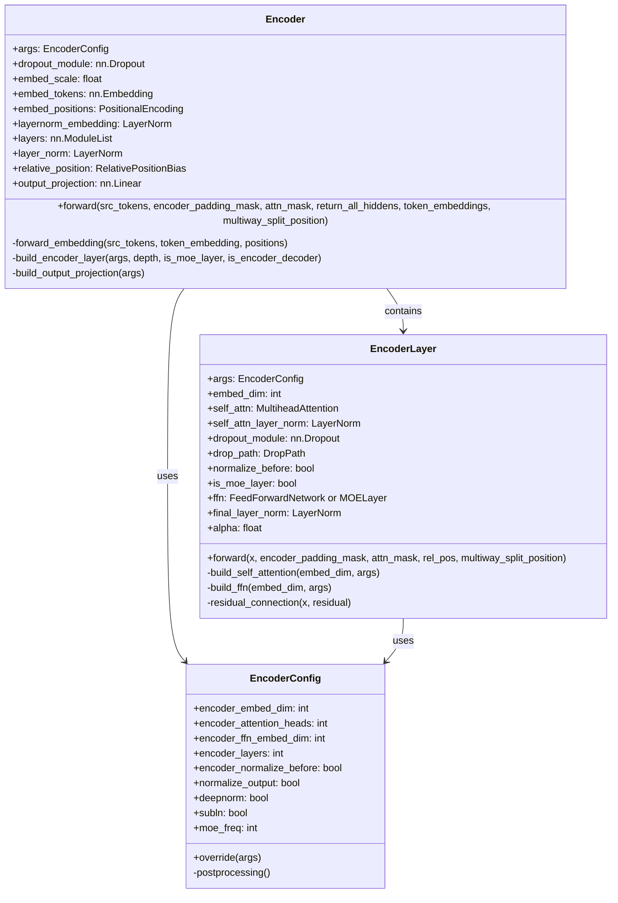
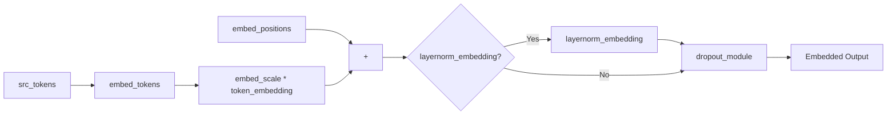
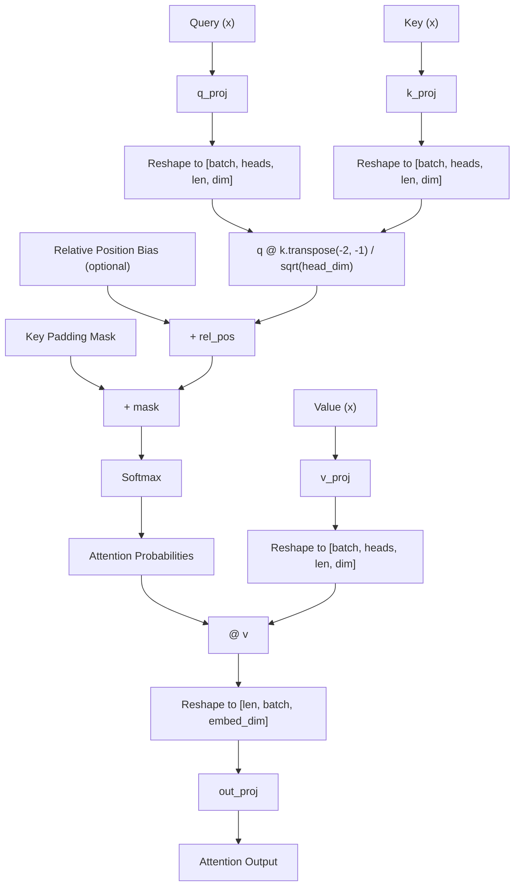
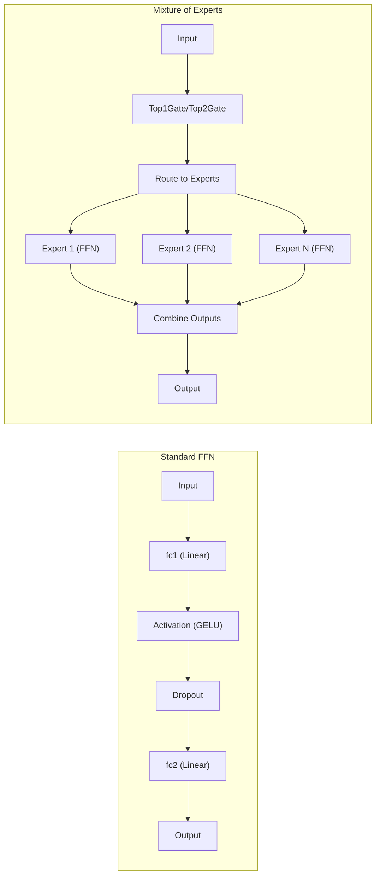
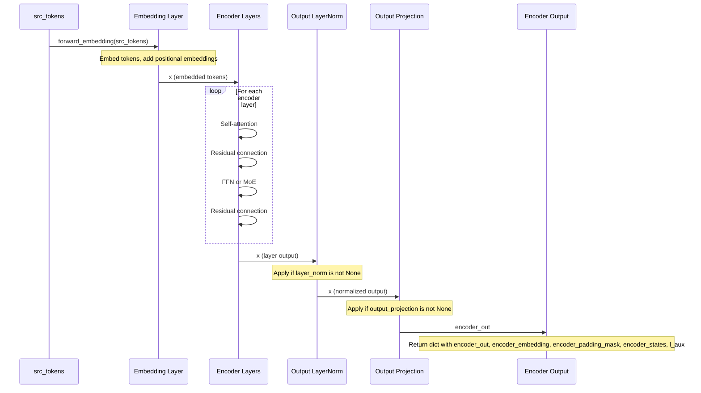
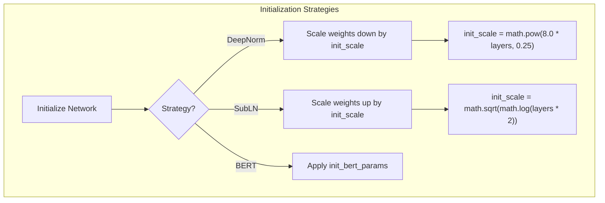
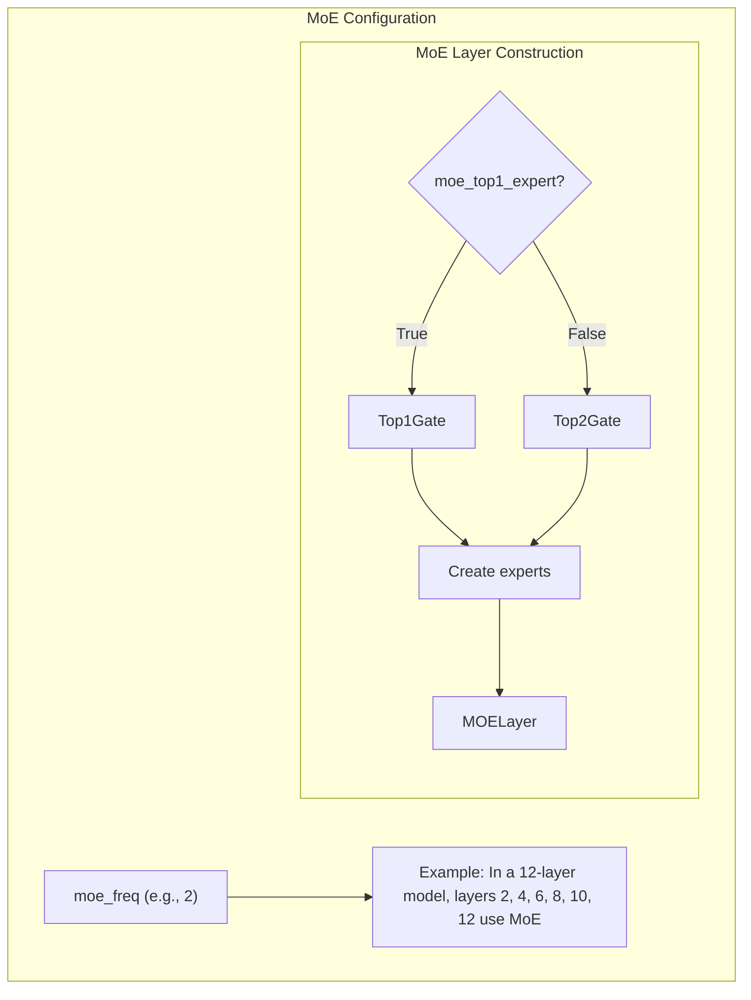

<!-- source: DeepWiki mcp.deepwiki.com · repo microsoft/torchscale · page 2.1 Encoder Architecture · fetched 2026-10-26 -->

# Encoder Architecture

<details>
<summary>Relevant source files</summary>

The following files were used as context for generating this wiki page:

- [torchscale/architecture/config.py](torchscale/architecture/config.py)
- [torchscale/architecture/encoder.py](torchscale/architecture/encoder.py)

</details>


## Purpose and Scope

This document provides a detailed technical overview of the encoder architecture within TorchScale. The encoder is the fundamental building block for transformer-based models that process input sequences, transforming them into contextual representations. This document covers the encoder's internal structure, components, configuration options, and key implementation details. For information about the decoder architecture, see [Decoder Architecture](#2.2). For RetNet and LongNet specific architectures, see their respective pages at [RetNet Architecture](#2.3) and [LongNet Architecture](#2.4).

## Overview

The TorchScale encoder follows the transformer architecture with several configurable enhancements including DeepNorm, SubLN normalization strategies, support for Mixture of Experts (MoE), and positional encoding variations. The encoder processes input sequences through a stack of identical layers, each containing self-attention and feedforward components with residual connections.

```mermaid
flowchart TD
    subgraph "Encoder Architecture"
        input["Input Tokens"] --> embeddings["Embed Tokens & Positions"]
        embeddings --> layernorm_embed["LayerNorm Embedding (optional)"]
        layernorm_embed --> encoder_stack["Encoder Layer Stack"]
        encoder_stack --> output_norm["Output LayerNorm (optional)"]
        output_norm --> output_proj["Output Projection (optional)"]
        output_proj --> output["Encoder Output"]
    end

    subgraph "EncoderLayer Components"
        layer_input["Layer Input"] --> attn_norm["Self-Attention LayerNorm"]
        attn_norm --> self_attn["MultiheadAttention"]
        self_attn --> dropout1["Dropout"]
        dropout1 --> residual1["Residual Connection"]
        residual1 --> ffn_norm["FFN LayerNorm"]
        ffn_norm --> ffn["FFN or MoE Layer"]
        ffn --> dropout2["Dropout"]
        dropout2 --> residual2["Residual Connection"]
        residual2 --> layer_output["Layer Output"]
    end
```



Sources: [torchscale/architecture/encoder.py:165-399](), [torchscale/architecture/encoder.py:25-162]()

## Configuration

The encoder is highly configurable through the `EncoderConfig` class, allowing for customization of dimensions, normalization strategies, dropout rates, and more.

| Parameter | Description | Default Value |
|-----------|-------------|---------------|
| `encoder_embed_dim` | Dimensionality of the encoder embeddings | 768 |
| `encoder_attention_heads` | Number of attention heads | 12 |
| `encoder_ffn_embed_dim` | Dimensionality of the feedforward network | 3072 |
| `encoder_layers` | Number of encoder layers | 12 |
| `encoder_normalize_before` | Apply layer norm before each encoder block | True |
| `normalize_output` | Apply layer norm to encoder output | True |
| `deepnorm` | Use DeepNorm initialization and scaling | False |
| `subln` | Use SubLN normalization strategy | True |
| `moe_freq` | Frequency of MoE layers in the stack (0 = no MoE) | 0 |
| `moe_expert_count` | Number of experts in MoE layers | 0 |
| `drop_path_rate` | Stochastic depth rate | 0.0 |
| `rel_pos_buckets` | Number of buckets for relative position bias | 0 |
| `max_rel_pos` | Maximum distance for relative position bias | 0 |
| `flash_attention` | Use Flash Attention for more efficient attention | False |

Sources: [torchscale/architecture/config.py:5-85]()

## Internal Structure

### Encoder Class Architecture

The `Encoder` class is the main implementation of the transformer encoder. It manages a stack of `EncoderLayer` instances and handles the overall flow of data through the model.



Sources: [torchscale/architecture/encoder.py:165-399](), [torchscale/architecture/encoder.py:25-162](), [torchscale/architecture/config.py:5-85]()

### Encoder Layer

Each encoder layer consists of a self-attention mechanism followed by a feedforward network (or an MoE layer), with residual connections and layer normalization.

```mermaid
flowchart TD
    subgraph "EncoderLayer"
        input["x"] --> conditional1{"normalize_before?"}
        conditional1 -->|"Yes"| ln1["self_attn_layer_norm"]
        ln1 --> attn["MultiheadAttention"]
        conditional1 -->|"No"| attn
        
        attn --> dropout1["Dropout"]
        dropout1 --> drop_path1["DropPath (optional)"]
        drop_path1 --> add1["+ x * alpha"]
        
        add1 --> conditional2{"normalize_before?"}
        conditional2 -->|"No"| ln2["self_attn_layer_norm"]
        ln2 --> ffn_input["FFN Input"]
        conditional2 -->|"Yes"| ffn_input
        
        ffn_input --> conditional3{"normalize_before?"}
        conditional3 -->|"Yes"| ln3["final_layer_norm"]
        ln3 --> branch{"is_moe_layer?"}
        conditional3 -->|"No"| branch
        
        branch -->|"No"| ffn["FeedForwardNetwork"]
        branch -->|"Yes"| moe["MOELayer"]
        
        ffn --> drop_path2["DropPath (optional)"]
        moe --> drop_path2
        
        drop_path2 --> add2["+ x * alpha"]
        
        add2 --> conditional4{"normalize_before?"}
        conditional4 -->|"No"| ln4["final_layer_norm"]
        ln4 --> output["Layer Output"]
        conditional4 -->|"Yes"| output
    end
```



Sources: [torchscale/architecture/encoder.py:25-162]()

## Key Components

### Embeddings and Input Processing

The encoder first converts input tokens into embeddings, optionally adds positional information, and passes them through a layer normalization and dropout:



Sources: [torchscale/architecture/encoder.py:308-325](), [torchscale/architecture/encoder.py:327-358]()

### Self-Attention Mechanism

The encoder uses the `MultiheadAttention` component for self-attention. This implementation supports standard attention patterns as well as relative position bias when configured:



Sources: [torchscale/architecture/encoder.py:102-111](), [torchscale/architecture/encoder.py:127-135]()

### Feedforward Network and MoE

The encoder supports both standard feedforward networks and Mixture of Experts (MoE) for more parameter-efficient scaling:



Sources: [torchscale/architecture/encoder.py:46-76](), [torchscale/architecture/encoder.py:91-100]()

### Normalization Strategies

TorchScale implements several normalization strategies, including Pre-LN (standard), DeepNorm, and SubLN:

```mermaid
flowchart TD
    subgraph "Pre-LN (normalize_before=True)"
        input1["Input"] --> ln1["LayerNorm"]
        ln1 --> sublayer1["Sublayer (Attention/FFN)"]
        sublayer1 --> add1["+ Input"]
        add1 --> output1["Output"]
    end
    
    subgraph "Post-LN (normalize_before=False)"
        input2["Input"] --> sublayer2["Sublayer (Attention/FFN)"]
        sublayer2 --> add2["+ Input"]
        add2 --> ln2["LayerNorm"]
        ln2 --> output2["Output"]
    end
    
    subgraph "DeepNorm (deepnorm=True)"
        input3["Input"] --> sublayer3["Sublayer (Attention/FFN)"]
        sublayer3 --> add3["+ Input * alpha"]
        add3 --> ln3["LayerNorm"]
        ln3 --> output3["Output"]
    end
    
    subgraph "SubLN (subln=True)"
        input4["Input"] --> ln4a["LayerNorm"]
        ln4a --> sublayer4["Sublayer (Attention/FFN)"]
        sublayer4 --> add4["+ Input"]
        add4 --> output4["Output"]
    end
```



Sources: [torchscale/architecture/encoder.py:113-163](), [torchscale/architecture/config.py:75-84]()

## Data Flow

The full data flow through the encoder during a forward pass is illustrated below:



Sources: [torchscale/architecture/encoder.py:327-399]()

## Special Features

### Initialization Strategies

TorchScale supports special parameter initialization strategies to help with training very deep models:

1. **DeepNorm initialization**: Scales the weights of specific layers by a factor based on the depth of the network.
2. **SubLN initialization**: Scales weights by a factor derived from the logarithm of the network depth.
3. **BERT initialization**: Applies the standard BERT parameter initialization scheme.



Sources: [torchscale/architecture/encoder.py:235-270]()

### Mixture of Experts Integration

When configured with `moe_freq > 0`, certain layers in the encoder stack are replaced with MoE layers. Each MoE layer routes tokens to different experts based on a gating mechanism:



Sources: [torchscale/architecture/encoder.py:55-76](), [torchscale/architecture/encoder.py:205-215](), [torchscale/architecture/config.py:20-35]()

## Integration with Other Components

The encoder can be used in various configurations, including standalone (BERT-like models), paired with a decoder (transformer encoder-decoder models), or as part of more complex architectures like RetNet and LongNet.

```mermaid
flowchart LR
    encoder["Encoder"]
    
    encoder --> bert["BERT-like Models"]
    encoder --> ed["Encoder-Decoder Models"]
    encoder --> mm["Multiway Network for Multi-modal Tasks"]
    
    subgraph "Advanced Architectures"
        ed --> mt["Machine Translation"]
        ed --> summ["Summarization"]
        
        bert --> mlm["Masked Language Modeling"]
        bert --> class["Classification Tasks"]
    end
```

Sources: [torchscale/architecture/encoder.py:172-176](), [torchscale/architecture/config.py:37-38]()

## Performance Considerations

The encoder implementation includes several optimizations:

1. **Checkpoint Activations**: Optional gradient checkpointing to save memory
2. **Flash Attention**: Optimized attention implementation for faster processing and lower memory usage
3. **Sequence Parallel**: Distributing sequence dimensions across devices
4. **Fairscale Integration**: Support for Fully Sharded Data Parallel (FSDP)

Enabling these optimizations allows the encoder to scale to larger model sizes and sequence lengths efficiently.

Sources: [torchscale/architecture/config.py:50-60](), [torchscale/architecture/encoder.py:302-306]()

---

