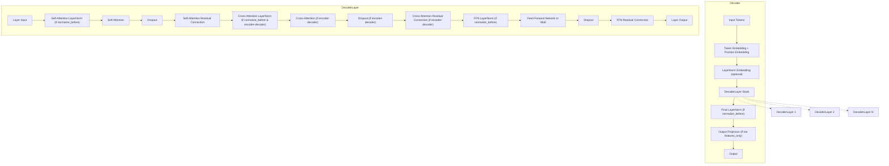
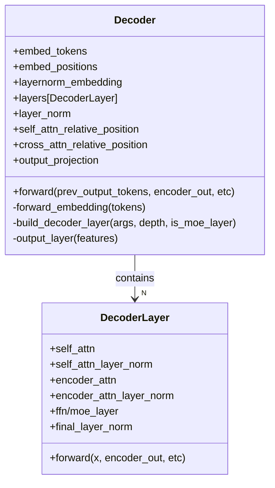
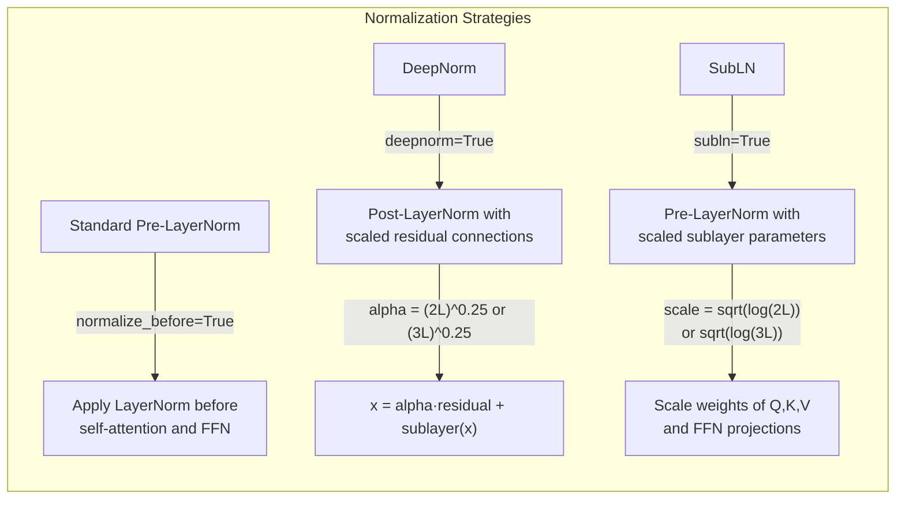
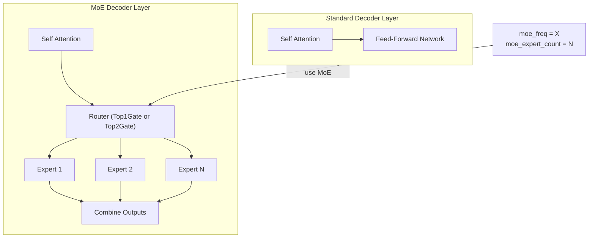
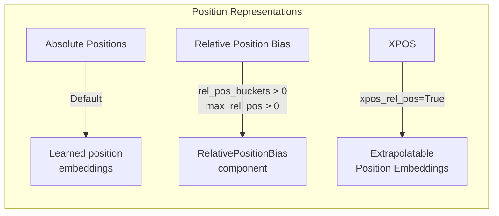
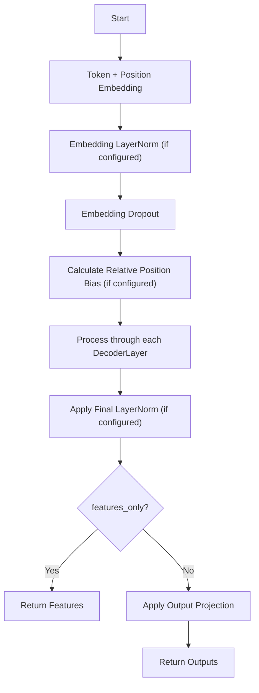
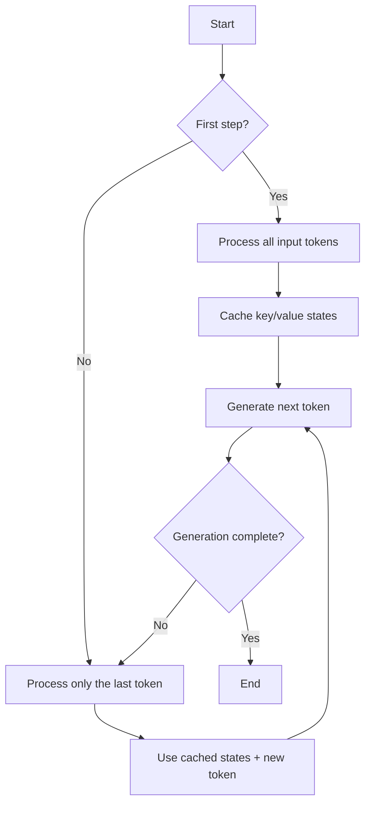
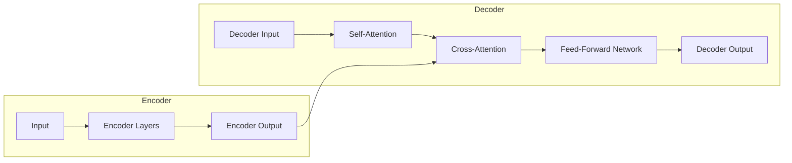

<!-- source: DeepWiki mcp.deepwiki.com · repo microsoft/torchscale · page 2.2 Decoder Architecture · fetched 2026-10-26 -->

# Decoder Architecture

Relevant source files

The following files were used as context for generating this wiki page:

- [torchscale/architecture/config.py](torchscale/architecture/config.py)
- [torchscale/architecture/decoder.py](torchscale/architecture/decoder.py)

## Purpose and Scope

This document details the decoder architecture in TorchScale, a modular and flexible implementation designed for both decoder-only and encoder-decoder transformer models. The decoder can be used as a standalone unit (as in GPT-style models) or in conjunction with an encoder (as in BERT-T5 style models). This page covers the implementation of the core decoder components, configuration options, and key architectural variations.

For information about the encoder architecture, see [Encoder Architecture](#2.1). For specialized architectures like RetNet and LongNet, see [RetNet Architecture](#2.3) and [LongNet Architecture](#2.4) respectively.

## Architecture Overview

The TorchScale decoder follows the standard transformer decoder architecture with several enhancements for scalability and performance. It consists of a series of stacked decoder layers, each containing self-attention mechanisms, optional cross-attention for encoder-decoder models, and feed-forward networks (which can be replaced with Mixture of Experts in specified layers).

Sources: [torchscale/architecture/decoder.py:210-482](), [torchscale/architecture/decoder.py:23-207]()

## Decoder Components

### Decoder Class

The `Decoder` class is the main container for the decoder architecture. It handles:

1. Token and position embeddings
2. Layer normalization of embeddings (if configured)
3. Creation and management of decoder layers
4. Final layer normalization
5. Output projection to vocabulary size
6. Support for relative position biases
7. Initialization strategies (BERT init, DeepNorm, SubLN)

Sources: [torchscale/architecture/decoder.py:210-482]()

### DecoderLayer

The `DecoderLayer` class implements a single transformer decoder layer with the following components:

1. Self-attention mechanism for attending to previous positions
2. Cross-attention mechanism for attending to encoder outputs (in encoder-decoder models)
3. Feed-forward network or Mixture of Experts (MoE) layer
4. Layer normalization and residual connections
5. Support for DropPath regularization

Sources: [torchscale/architecture/decoder.py:23-207]()

## Configuration Options

The decoder architecture is highly configurable through the `DecoderConfig` class, which provides the following key options:

| Parameter | Description | Default Value |
|-----------|-------------|---------------|
| `decoder_embed_dim` | Dimension of embedding vectors | 768 |
| `decoder_attention_heads` | Number of attention heads | 12 |
| `decoder_ffn_embed_dim` | Feed-forward network dimension | 3072 |
| `decoder_layers` | Number of decoder layers | 12 |
| `decoder_normalize_before` | Apply layer norm before each component | True |
| `dropout` | Dropout probability | 0.0 |
| `drop_path_rate` | DropPath regularization rate | 0.0 |
| `moe_freq` | Frequency of MoE layers | 0 |
| `moe_expert_count` | Number of experts in MoE layers | 0 |
| `deepnorm` | Use DeepNorm initialization and normalization | False |
| `subln` | Use SubLN initialization and normalization | True |
| `layernorm_embedding` | Apply layer norm after embeddings | False |
| `rel_pos_buckets` | Number of relative position buckets | 0 |
| `max_rel_pos` | Maximum relative position | 0 |
| `xpos_rel_pos` | Use XPOS relative positioning | False |
| `flash_attention` | Use optimized flash attention | False |

Sources: [torchscale/architecture/config.py:87-161]()

## Normalization Strategies

TorchScale implements multiple normalization strategies for improved stability and performance in deep transformer models:

Sources: [torchscale/architecture/decoder.py:87-96](), [torchscale/architecture/decoder.py:299-314](), [torchscale/architecture/config.py:152-157]()

## Mixture of Experts Integration

TorchScale supports Mixture of Experts (MoE) at configurable frequencies within the decoder. When activated, the feed-forward network in specified layers is replaced with a set of expert networks and a routing mechanism.

The MoE implementation supports:
- Top-1 or Top-2 expert routing
- Configurable number of experts
- X-MoE for better performance and stability
- Load balancing and capacity control

Sources: [torchscale/architecture/decoder.py:57-85](), [torchscale/architecture/decoder.py:194-198](), [torchscale/architecture/config.py:101-112]()

## Position Representations

TorchScale provides multiple position representation methods for the decoder:

1. **Absolute Position Embeddings**: Standard learned position embeddings
2. **Relative Position Bias**: Adds relative position information to attention scores
3. **XPOS (Extrapolatable Position Embeddings)**: Improve generalization to longer sequences

Sources: [torchscale/architecture/decoder.py:267-281](), [torchscale/architecture/config.py:131-132]()

## Forward Pass and Data Flow

The forward pass through the decoder follows these steps:

### Incremental Decoding

For autoregressive generation, the decoder supports incremental decoding where tokens are generated one at a time, reusing cached states from previous steps:

Sources: [torchscale/architecture/decoder.py:351-381](), [torchscale/architecture/decoder.py:388-478]()

## Encoder-Decoder Integration

When used in an encoder-decoder setup, the decoder receives encoded representations from an encoder and processes them through the cross-attention mechanism:

Cross-attention layers are only created when the decoder is initialized with `is_encoder_decoder=True`.

Sources: [torchscale/architecture/decoder.py:50-55](), [torchscale/architecture/decoder.py:169-189]()

## Performance Optimizations

TorchScale includes several optimizations for improving training and inference performance:

1. **Checkpoint Activations**: Reduces memory consumption during training by recomputing activations in the backward pass
2. **FSDP (Fully Sharded Data Parallel)**: Supports model parallelism across multiple devices
3. **Flash Attention**: Optional optimized attention implementation for faster computation
4. **Sequence Parallelism**: Option for improved parallel processing of long sequences

Sources: [torchscale/architecture/config.py:134-137](), [torchscale/architecture/decoder.py:345-348]()

## Initialization Strategies

The decoder supports multiple initialization strategies for improved training stability:

1. **BERT Initialization**: Initializes weights following the BERT strategy
2. **DeepNorm Initialization**: Scales output projection weights by a factor based on the number of layers
3. **SubLN Initialization**: Scales weights of Q, K, V, and FFN projections

These initialization strategies are particularly important for very deep models to ensure stable gradient flow.

Sources: [torchscale/architecture/decoder.py:283-314]()

---

