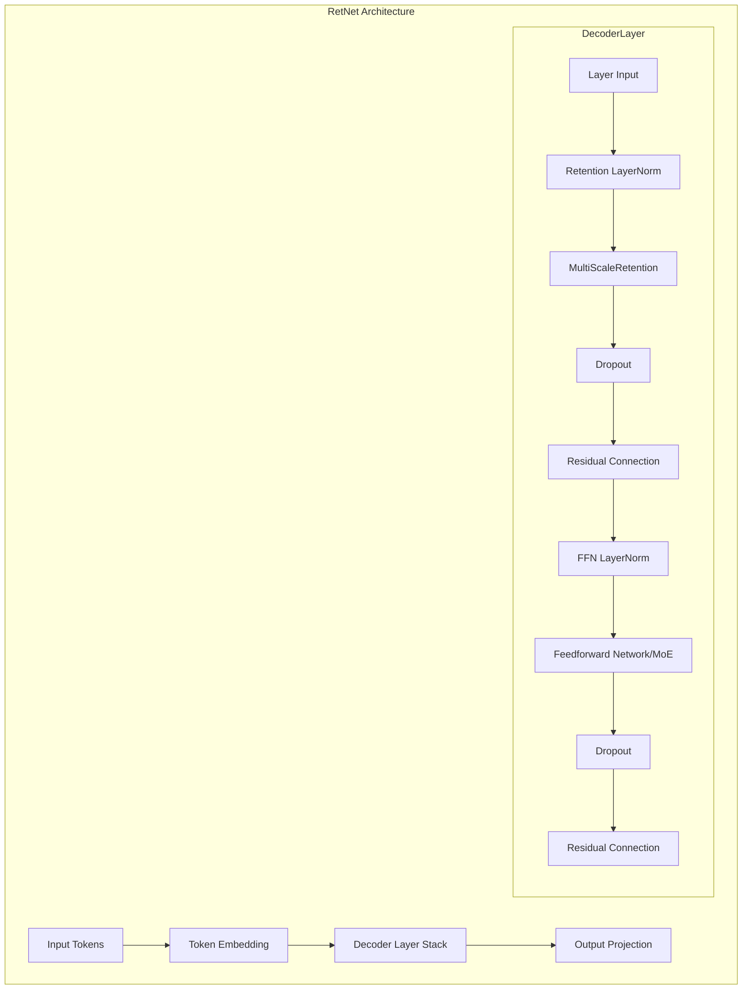
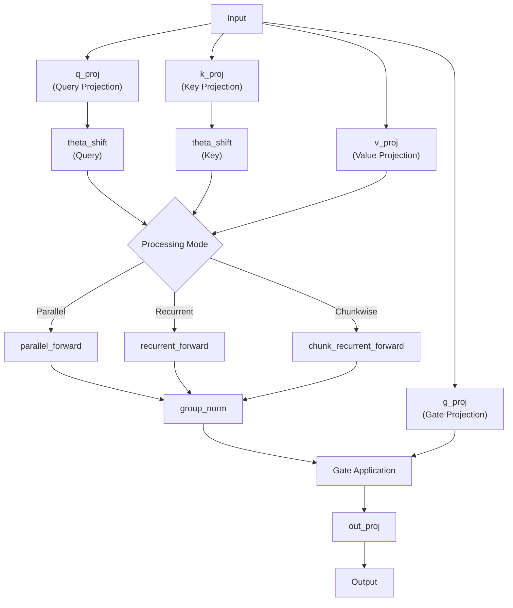
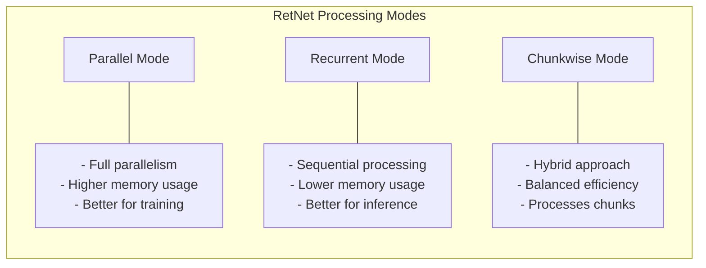
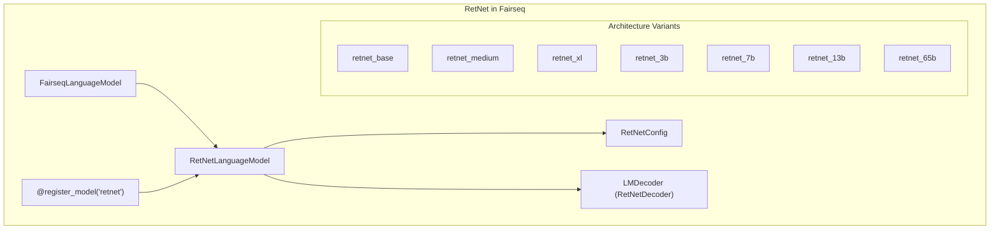
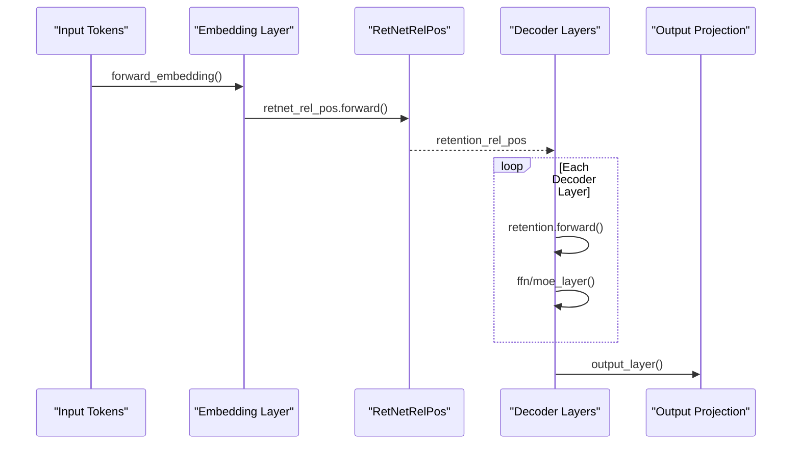

<!-- source: DeepWiki mcp.deepwiki.com · repo microsoft/torchscale · page 2.3 RetNet Architecture · fetched 2026-10-26 -->

# RetNet Architecture

<details>
<summary>Relevant source files</summary>

The following files were used as context for generating this wiki page:

- [examples/fairseq/models/retnet.py](examples/fairseq/models/retnet.py)
- [torchscale/architecture/retnet.py](torchscale/architecture/retnet.py)
- [torchscale/component/multiscale_retention.py](torchscale/component/multiscale_retention.py)

</details>


## Purpose and Scope

This document provides a technical overview of RetNet (Retention Network), an architecture that replaces traditional Transformer self-attention with a retention mechanism. This document focuses on RetNet's core components, operating modes, and implementation details. For information about other architectures in TorchScale, see [Architecture Overview](#2).

## 1. RetNet Overview

RetNet is a neural network architecture designed as an alternative to Transformers, replacing self-attention with a retention mechanism while maintaining competitive performance. RetNet's key innovation is the MultiScaleRetention mechanism, which supports three distinct operational modes that enable flexible computation for different scenarios.



Sources: [torchscale/architecture/retnet.py:199-391](), [torchscale/architecture/retnet.py:71-196]()

## 2. Core Components

### 2.1 RetNetDecoder

The `RetNetDecoder` is the main class implementing the RetNet architecture. It manages:

- Token embedding layer
- Stack of decoder layers
- Positional encoding via `RetNetRelPos`
- Output projection

The decoder supports different operating modes and can be configured with various parameters such as embedding dimension, number of layers, and normalization strategies.

```mermaid
classDiagram
    class RetNetDecoder {
        +embed_tokens
        +layers[DecoderLayer]
        +retnet_rel_pos
        +output_projection
        +forward()
        +forward_embedding()
    }
    
    class DecoderLayer {
        +retention
        +ffn
        +moe_layer
        +forward()
    }
    
    class RetNetRelPos {
        +angle
        +decay
        +forward()
    }
    
    RetNetDecoder --> DecoderLayer : contains
    RetNetDecoder --> RetNetRelPos : uses
    DecoderLayer --> "MultiScaleRetention" : contains
```

Sources: [torchscale/architecture/retnet.py:199-391]()

### 2.2 DecoderLayer

Each `DecoderLayer` consists of:

1. A `MultiScaleRetention` module (replacing self-attention)
2. A feedforward network (FFN) or Mixture of Experts (MoE) layer
3. Layer normalization and residual connections

Like transformer layers, RetNet uses residual connections and normalization, but it can be configured to use different normalization strategies such as:
- DeepNorm, which scales residual connections by a factor related to network depth
- Layer normalization before or after each component

Sources: [torchscale/architecture/retnet.py:71-196]()

### 2.3 MultiScaleRetention

The `MultiScaleRetention` module is the core innovation of RetNet, replacing self-attention with a retention mechanism. Key features include:

- Query, key, value, and gate projections (`q_proj`, `k_proj`, `v_proj`, `g_proj`)
- Support for three distinct processing modes
- Rotary positional encoding integration via theta shifting
- Gating mechanism to control information flow



Sources: [torchscale/component/multiscale_retention.py:39-202]()

### 2.4 RetNetRelPos

The `RetNetRelPos` class manages positional encoding for RetNet:

- Uses sine/cosine functions similar to transformers
- Supports exponential decay factors for different attention heads
- Generates different mask patterns for each processing mode
- Provides specialized patterns for chunkwise recurrent processing

Sources: [torchscale/architecture/retnet.py:22-69]()

## 3. Processing Modes

A key feature of RetNet is its support for three distinct processing modes, allowing flexible computation for different scenarios:



### 3.1 Parallel Mode

Parallel mode computes attention for all tokens simultaneously, similar to traditional transformers:

- Computes the full query-key matrix for the entire sequence
- Applies the scaled matrix to values
- Memory usage scales quadratically with sequence length
- Ideal for training where parallelism is beneficial

Implementation details:
```python
# Computes QK matrix and applies mask
qk_mat = qr @ kr.transpose(-1, -2)
qk_mat = qk_mat * mask
# Normalizes for stability
qk_mat = qk_mat / qk_mat.detach().abs().sum(dim=-1, keepdim=True).clamp(min=1, max=5e4)
# Matrix multiplication with values
output = torch.matmul(qk_mat, vr)
```

Sources: [torchscale/component/multiscale_retention.py:76-87]()

### 3.2 Recurrent Mode

Recurrent mode processes tokens sequentially, updating a persistent state:

- Maintains a state matrix that gets updated with each new token
- Memory usage scales linearly with sequence length
- Ideal for inference where tokens are processed one by one
- Uses decay factors to control how quickly past information is forgotten

Implementation details:
```python
# Update state with new key-value pair
if "prev_key_value" in incremental_state:
    prev_kv = incremental_state["prev_key_value"]
    prev_scale = incremental_state["scale"]
    scale = prev_scale * decay + 1
    kv = prev_kv * (prev_scale.sqrt() * decay / scale.sqrt()).view(self.num_heads, 1, 1) + kv / scale.sqrt().view(self.num_heads, 1, 1)
else:
    scale = torch.ones_like(decay)
```

Sources: [torchscale/component/multiscale_retention.py:89-112]()

### 3.3 Chunkwise Recurrent Mode

Chunkwise mode is a hybrid approach that processes the sequence in chunks:

- Divides the sequence into chunks of specified size (`recurrent_chunk_size`)
- Processes tokens within each chunk in parallel
- Processes relationships between chunks recurrently
- Balances computational efficiency and memory usage
- Configurable via `chunkwise_recurrent` and `recurrent_chunk_size` parameters

Implementation details:
- Computes inner-chunk attention (`inner_output`)
- Accumulates cross-chunk information using a recurrent state (`kv_state`)
- Combines both inner and cross information with appropriate scaling

Sources: [torchscale/component/multiscale_retention.py:114-165]()

## 4. Integration with Fairseq

RetNet integrates with the Fairseq library through model registration and architecture definitions:



The codebase provides several predefined model configurations:

| Architecture | Embed Dim | Value/FFN Dim | Heads | Layers | Approx. Parameters |
|--------------|-----------|---------------|-------|--------|-------------------|
| base         | 512       | 864           | 2     | 6      | ~10M              |
| medium       | 1024      | 1728          | 4     | 16     | ~100M             |
| xl           | 2048      | 3456          | 8     | 24     | ~1B               |
| 3b           | 2560      | 4280          | 10    | 32     | ~3B               |
| 7b           | 4096      | 6912          | 16    | 32     | ~7B               |
| 13b          | 5120      | 8560          | 20    | 40     | ~13B              |
| 65b          | 8192      | 13824         | 32    | 64     | ~65B              |

Sources: [examples/fairseq/models/retnet.py:1-387]()

## 5. Key Configuration Parameters

RetNet can be customized through various configuration parameters:

| Parameter | Description | Default |
|-----------|-------------|---------|
| `decoder_embed_dim` | Dimension of token embeddings | 512 |
| `decoder_value_embed_dim` | Dimension of value embeddings | 864 |
| `decoder_ffn_embed_dim` | Dimension of feedforward network | 864 |
| `decoder_retention_heads` | Number of retention heads | 2 |
| `decoder_layers` | Number of decoder layers | 6 |
| `decoder_normalize_before` | Apply normalization before each block | True |
| `chunkwise_recurrent` | Enable chunkwise recurrent mode | False |
| `recurrent_chunk_size` | Size of chunks in chunkwise mode | 512 |
| `deepnorm` | Use DeepNorm normalization strategy | False |
| `moe_freq` | Frequency of MoE layers | 0 |
| `activation_fn` | Activation function | "swish" |

Sources: [examples/fairseq/models/retnet.py:32-187](), [torchscale/architecture/retnet.py:199-267]()

## 6. Forward Pass Flow

The forward pass through RetNet follows these steps:



1. Tokens are embedded using `forward_embedding()`
2. Positional encoding is computed using `retnet_rel_pos.forward()`
3. For each decoder layer:
   - Apply MultiScaleRetention with the appropriate mode
   - Apply feedforward network or MoE layer
   - Add residual connections and normalization
4. Apply final layer normalization if needed
5. Project to vocabulary size via the output projection

During inference, RetNet can operate in "incremental" mode, maintaining a state between forward passes to process tokens one by one efficiently.

Sources: [torchscale/architecture/retnet.py:328-391](), [torchscale/architecture/retnet.py:154-196]()

---

