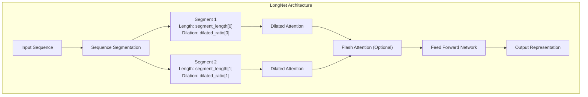
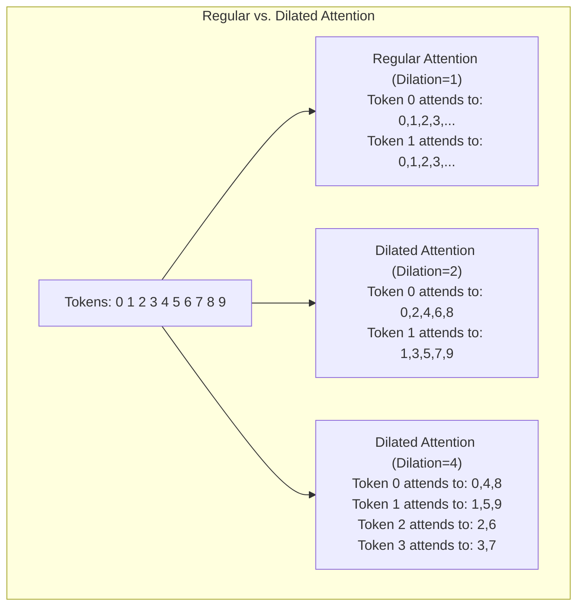
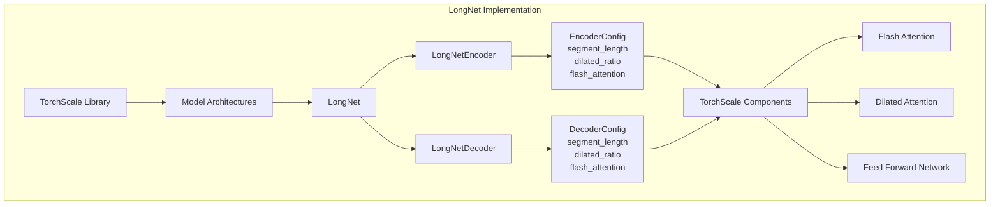
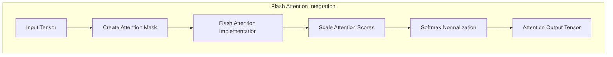
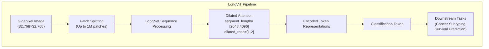

<!-- source: DeepWiki mcp.deepwiki.com · repo microsoft/torchscale · page 2.4 LongNet Architecture · fetched 2026-10-26 -->

# LongNet Architecture

<details>
<summary>Relevant source files</summary>

The following files were used as context for generating this wiki page:

- [README.md](README.md)
- [examples/fairseq/README.md](examples/fairseq/README.md)
- [examples/longvit/README.md](examples/longvit/README.md)
- [torchscale/component/xpos_relative_position.py](torchscale/component/xpos_relative_position.py)

</details>


## Purpose and Scope

This document provides a detailed explanation of the LongNet architecture in TorchScale. LongNet is designed to scale Transformer models to extremely long sequences—up to 1,000,000,000 tokens—by using dilated attention patterns. This document covers the architectural design, key components, configuration options, and implementation details of LongNet. For information about RetNet architecture, see [RetNet Architecture](#2.3).

## Architecture Overview

LongNet addresses the quadratic complexity problem of standard Transformer attention by introducing a segmented dilated attention mechanism. Instead of having each token attend to all other tokens (which would be computationally prohibitive for very long sequences), LongNet introduces a dilated attention pattern where tokens attend to other tokens at specific intervals.



Sources: [README.md:19](), [README.md:101-114]()

## Dilated Attention Mechanism

The key innovation in LongNet is its dilated attention mechanism, which reduces the computational complexity while maintaining the model's ability to capture dependencies across long distances.



When using dilated attention:

1. The input sequence is divided into segments based on the `segment_length` parameter
2. Each segment uses a different dilation ratio specified by the `dilated_ratio` parameter
3. Tokens only attend to other tokens at intervals determined by the dilation ratio
4. This creates a sparse attention pattern that scales better for long sequences

Sources: [README.md:148](), [README.md:107-108]()

## Implementation Details

In TorchScale, LongNet is implemented as two main classes:



The implementation builds on the standard TorchScale components but modifies the attention mechanism to support the dilated pattern. Flash Attention is recommended for efficiency when processing very long sequences.

Sources: [README.md:101-114]()

## Configuration Options

LongNet models require specific configuration parameters:

| Parameter | Description | Example |
|-----------|-------------|---------|
| `segment_length` | List of lengths for different segments | `'[2048,4096]'` |
| `dilated_ratio` | List of dilation ratios for each segment | `'[1,2]'` |
| `flash_attention` | Enable optimized attention implementation | `True` |

Here's how to instantiate LongNet models:

For an encoder:
```python
config = EncoderConfig(
    vocab_size=64000,
    segment_length='[2048,4096]',
    dilated_ratio='[1,2]',
    flash_attention=True
)
longnet = LongNetEncoder(config)
```

For a decoder:
```python
config = DecoderConfig(
    vocab_size=64000,
    segment_length='[2048,4096]',
    dilated_ratio='[1,2]',
    flash_attention=True
)
longnet = LongNetDecoder(config)
```

Sources: [README.md:107-113]()

## Flash Attention Integration

LongNet leverages Flash Attention for optimal performance. Flash Attention is a memory-efficient implementation that reduces the memory footprint and computational complexity of the attention operation.

To enable Flash Attention:
1. Install the Flash Attention library as described in [README.md:41-44]()
2. Set `flash_attention=True` in your configuration



Flash Attention is particularly important for LongNet as it allows processing extremely long sequences that would otherwise be impractical due to memory constraints.

Sources: [README.md:41-44](), [README.md:108]()

## Applications and Use Cases

### Language Modeling

LongNet can be used for language modeling tasks with very long contexts:

```bash
python -m torch.distributed.launch --nproc_per_node=2 --nnodes=1 train.py \
    ${PATH_TO_DATA} \
    --tokens-per-sample 4096 \
    --flash-attention \
    --segment-length [2048,4096] \
    --dilated-ratio [1,2]
```

Sources: [examples/fairseq/README.md:254-290]()

### Vision Applications with LongViT

LongViT applies LongNet to vision tasks, particularly in computational pathology for processing gigapixel images:

1. Images as large as 32,768×32,768 pixels are split into millions of patches
2. These patches are processed as a long sequence using LongNet's dilated attention
3. The model has shown strong performance on cancer subtyping and survival prediction tasks



Sources: [examples/longvit/README.md:1-4]()

## Benefits and Limitations

### Benefits

1. **Scalability**: Handles sequences up to 1 billion tokens, far beyond standard Transformer capabilities
2. **Efficiency**: Reduces computational complexity from quadratic to sub-quadratic
3. **Flexibility**: Works for both encoder and decoder architectures
4. **Multimodal**: Applicable to text, vision, and potentially other modalities

### Limitations

1. **Hardware Requirements**: Still requires significant computational resources for very long sequences
2. **Flash Attention Dependency**: Optimal performance requires GPU hardware supporting Flash Attention
3. **Parameter Tuning**: Finding the optimal `segment_length` and `dilated_ratio` settings may require experimentation

Sources: [README.md:148]()

## Conclusion

LongNet represents a significant advancement in Transformer architecture design, enabling the processing of extremely long sequences that would be impossible with standard attention mechanisms. By using dilated attention patterns and leveraging optimized implementations like Flash Attention, LongNet makes it practical to work with sequences of unprecedented length, opening new possibilities for language modeling, vision processing, and multimodal applications.

Sources: [README.md:247-253]()

---

