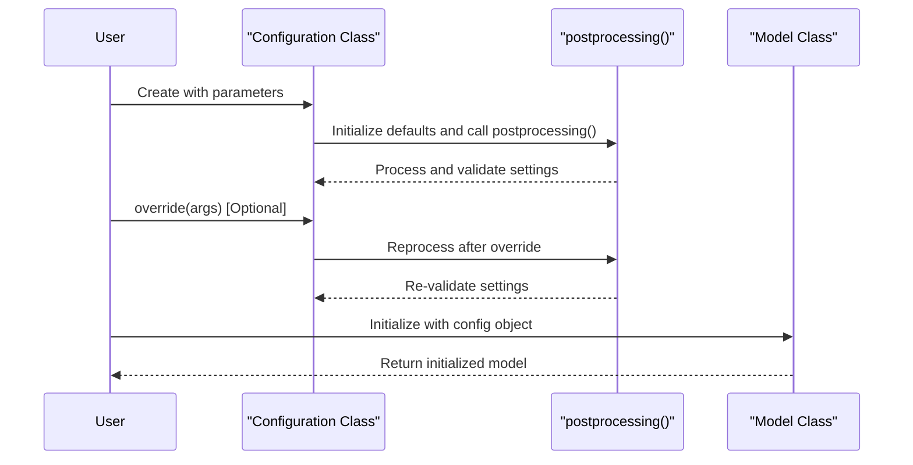

<!-- source: DeepWiki mcp.deepwiki.com · repo microsoft/torchscale · page 3 Configuration System · fetched 2026-10-26 -->

# Configuration System

<details>
<summary>Relevant source files</summary>

The following files were used as context for generating this wiki page:

- [README.md](README.md)
- [torchscale/architecture/config.py](torchscale/architecture/config.py)
- [torchscale/component/xpos_relative_position.py](torchscale/component/xpos_relative_position.py)

</details>


## Purpose and Overview

The Configuration System in TorchScale provides a unified interface for configuring different model architectures. It acts as the foundation for creating and customizing various transformer models with consistent parameter management. This system enables users to easily specify architectural details, normalization strategies, and advanced features like Mixture of Experts (MoE), RetNet configurations, and LongNet parameters.

This page covers the configuration classes, their parameters, and usage patterns. For specific architecture details, see [Architecture Overview](#2) and its sub-pages.

Sources: [torchscale/architecture/config.py:1-316]()

## Configuration Classes Hierarchy

TorchScale's configuration system is built around four primary configuration classes that correspond to the main architecture types supported by the library.

```mermaid
classDiagram
    class "EncoderConfig" {
        +encoder_embed_dim
        +encoder_attention_heads
        +encoder_ffn_embed_dim
        +encoder_layers
        +normalize_output
        +override(args)
        +postprocessing()
    }
    
    class "DecoderConfig" {
        +decoder_embed_dim
        +decoder_attention_heads
        +decoder_ffn_embed_dim
        +decoder_layers
        +override(args)
        +postprocessing()
    }
    
    class "EncoderDecoderConfig" {
        +encoder_embed_dim
        +encoder_attention_heads
        +decoder_embed_dim
        +decoder_attention_heads
        +share_all_embeddings
        +override(args)
        +postprocessing()
    }
    
    class "RetNetConfig" {
        +decoder_embed_dim
        +decoder_value_embed_dim
        +decoder_retention_heads
        +decoder_layers
        +chunkwise_recurrent
        +override(args)
        +postprocessing()
    }
```

**Configuration to Architecture Mapping Diagram**

```mermaid
flowchart LR
    subgraph "Configuration Classes"
        EC["EncoderConfig"]
        DC["DecoderConfig"]
        EDC["EncoderDecoderConfig"]
        RNC["RetNetConfig"]
    end
    
    subgraph "Model Architectures"
        E["Encoder\n(BERT-like models)"]
        D["Decoder\n(GPT-like models)"]
        ED["EncoderDecoder\n(Translation models)"]
        RN["RetNetDecoder"]
        LE["LongNetEncoder"]
        LD["LongNetDecoder"]
    end
    
    EC --> E
    EC --> LE
    DC --> D
    DC --> LD
    EDC --> ED
    RNC --> RN
    
    class EC,DC,EDC,RNC,E,D,ED,RN,LE,LD;
```

Sources: [torchscale/architecture/config.py:5-85](), [torchscale/architecture/config.py:87-161](), [torchscale/architecture/config.py:164-246](), [torchscale/architecture/config.py:249-315]()

## Common Configuration Parameters

All configuration classes share a set of common parameters that control fundamental aspects of the models. The following table shows the most important common parameters:

| Parameter | Description | Default | Used In |
|-----------|-------------|---------|---------|
| `*_embed_dim` | Model dimension | 768 | All configs |
| `*_attention_heads` | Number of attention heads | 12 | All configs |
| `*_ffn_embed_dim` | Feed-forward network dimension | 3072 | All configs |
| `*_layers` | Number of layers | 12 | All configs |
| `*_normalize_before` | Apply layer norm before blocks | True | All configs |
| `activation_fn` | Activation function | "gelu" | All configs |
| `dropout` | Dropout rate | 0.0 | All configs |
| `drop_path_rate` | Drop path rate | 0.0 | All configs |
| `attention_dropout` | Attention dropout rate | 0.0 | All configs |
| `activation_dropout` | Activation dropout rate | 0.0 | All configs |
| `deepnorm` | Enable DeepNorm | False | All configs |
| `subln` | Enable SubLN | True | All configs |
| `moe_freq` | MoE layer frequency | 0 | All configs |
| `moe_expert_count` | Number of MoE experts | 0 | All configs |
| `use_xmoe` | Enable X-MoE | False | All configs |
| `vocab_size` | Vocabulary size | -1 | All configs |
| `layernorm_eps` | LayerNorm epsilon | 1e-5/1e-6 | All configs |

Sources: [torchscale/architecture/config.py:5-85](), [torchscale/architecture/config.py:87-161](), [torchscale/architecture/config.py:164-246](), [torchscale/architecture/config.py:249-315]()

## Architecture-Specific Parameters

### EncoderConfig Specific Parameters

The `EncoderConfig` class includes parameters specific to encoder-only architectures:

- `normalize_output`: Whether to normalize the output embedding (default: True)
- `share_encoder_input_output_embed`: Share input and output embeddings (default: False)
- `max_source_positions`: Maximum sequence length (default: 1024)
- `no_output_layer`: Skip the final output projection layer (default: False)

### DecoderConfig Specific Parameters

The `DecoderConfig` class includes parameters specific to decoder-only architectures:

- `share_decoder_input_output_embed`: Share input and output embeddings (default: False)
- `max_target_positions`: Maximum sequence length (default: 1024)
- `no_output_layer`: Skip the final output projection layer (default: False)

### EncoderDecoderConfig Specific Parameters

The `EncoderDecoderConfig` class combines parameters from both `EncoderConfig` and `DecoderConfig`, with additional encoder-decoder specific parameters:

- `share_all_embeddings`: Share embeddings between encoder and decoder (default: False)
- `max_source_positions`: Maximum source sequence length (default: 1024)
- `max_target_positions`: Maximum target sequence length (default: 1024)

### RetNetConfig Specific Parameters

The `RetNetConfig` class includes parameters specific to RetNet architectures:

- `decoder_value_embed_dim`: Value embedding dimension (default: 1280)
- `decoder_retention_heads`: Number of retention heads (default: 3)
- `chunkwise_recurrent`: Enable chunkwise recurrent processing (default: False)
- `recurrent_chunk_size`: Chunk size for recurrent processing (default: 512)

Sources: [torchscale/architecture/config.py:5-85](), [torchscale/architecture/config.py:87-161](), [torchscale/architecture/config.py:164-246](), [torchscale/architecture/config.py:249-315]()

## Special Feature Configuration

**Feature Parameters Diagram**

```mermaid
flowchart TD
    Config["Configuration Object"]
    
    subgraph "Normalization Strategy"
        NS["Normalization Selection"]
        DN["DeepNorm\ndeepnorm=True"]
        SL["SubLN\nsubln=True"]
    end
    
    subgraph "Positional Encoding"
        PE["Position Encoding Options"]
        RPB["Relative Position Bias\nrel_pos_buckets > 0\nmax_rel_pos > 0"]
        XP["XPOS\nxpos_rel_pos=True"]
    end
    
    subgraph "Mixture of Experts"
        MoE["MoE Settings"]
        XMoE["X-MoE\nuse_xmoe=True"]
        MF["MoE Frequency\nmoe_freq > 0"]
        ME["MoE Experts\nmoe_expert_count > 0"]
    end
    
    subgraph "Advanced Architecture"
        AA["Architecture Features"]
        MW["Multiway\nmultiway=True"]
        BI["BERT Init\nbert_init=True"]
    end
    
    subgraph "LongNet Parameters"
        LN["LongNet Settings"]
        FA["Flash Attention\nflash_attention=True"]
        SL2["Segment Length\nsegment_length=[...]"]
        DR["Dilated Ratio\ndilated_ratio=[...]"]
    end
    
    Config --> NS
    Config --> PE
    Config --> MoE
    Config --> AA
    Config --> LN
    
    NS --> DN
    NS --> SL
    
    PE --> RPB
    PE --> XP
    
    MoE --> XMoE
    MoE --> MF
    MoE --> ME
    
    AA --> MW
    AA --> BI
    
    LN --> FA
    LN --> SL2
    LN --> DR
    
    class Config,NS,PE,MoE,AA,LN,DN,SL,RPB,XP,XMoE,MF,ME,MW,BI,FA,SL2,DR;
```

Sources: [torchscale/architecture/config.py:32-84](), [torchscale/architecture/config.py:152-161](), [torchscale/architecture/config.py:237-246](), [torchscale/architecture/config.py:306-315](), [torchscale/component/xpos_relative_position.py:38-65]()

### Normalization Strategies

TorchScale offers two main normalization strategies that can be configured:

1. **DeepNorm**: Improves training stability for Post-LayerNorm Transformers, especially for deep models. Enabled by setting `deepnorm=True`.

2. **SubLN**: Introduces an additional LayerNorm to each sublayer for improved model generality and training stability. Enabled by setting `subln=True` (default).

Note that DeepNorm and SubLN are mutually exclusive and cannot be enabled simultaneously. The `postprocessing()` method ensures proper configuration:

```python
if self.deepnorm:
    self.encoder_normalize_before = False
    self.subln = False
if self.subln:
    self.encoder_normalize_before = True
    self.deepnorm = False
```

Sources: [torchscale/architecture/config.py:75-80](), [torchscale/architecture/config.py:152-157](), [torchscale/architecture/config.py:237-242](), [torchscale/architecture/config.py:306-311]()

### Mixture of Experts (MoE) Configuration

TorchScale supports sparse Mixture of Experts (MoE) layers with X-MoE, a scalable and finetunable implementation. Key MoE parameters include:

- `moe_freq`: Frequency of MoE layers (e.g., 2 means every other FFN layer is an MoE layer)
- `moe_expert_count`: Number of experts
- `moe_top1_expert`: Whether to use only the top expert (default: False)
- `use_xmoe`: Enable X-MoE specific optimizations (default: False)

When `use_xmoe` is True, the configuration system automatically sets:
- `moe_normalize_gate_prob_before_dropping = True`
- `moe_second_expert_policy = "random"`

Sources: [torchscale/architecture/config.py:20-31](), [torchscale/architecture/config.py:81-84](), [torchscale/architecture/config.py:158-161](), [torchscale/architecture/config.py:243-246](), [torchscale/architecture/config.py:312-315]()

### Positional Encodings

TorchScale supports several positional encoding options:

1. **Relative Position Bias**: Configurable with `rel_pos_buckets` and `max_rel_pos` parameters.

2. **XPOS (Extrapolatable Position Embedding)**: Enabled by setting `xpos_rel_pos=True`. This provides better extrapolation to longer sequences than seen during training.

Sources: [torchscale/architecture/config.py:32-33](), [torchscale/architecture/config.py:54-55](), [torchscale/component/xpos_relative_position.py:38-65]()

### LongNet Configuration

LongNet models are configured using either `EncoderConfig` or `DecoderConfig` with specific parameters:

- `flash_attention`: Enable Flash Attention (required for LongNet, default: False)
- `segment_length`: List of segment lengths for dilated attention pattern (e.g., `[2048, 4096]`)
- `dilated_ratio`: List of dilation ratios corresponding to segment lengths (e.g., `[1, 2]`)

These parameters are processed by the `postprocessing()` method to convert from string representation to Python lists:

```python
if self.segment_length is not None and self.segment_length != '':
    self.segment_length = eval(self.segment_length)
if self.dilated_ratio is not None and self.dilated_ratio != '':
    self.dilated_ratio = eval(self.dilated_ratio)
```

Sources: [torchscale/architecture/config.py:57-59](), [torchscale/architecture/config.py:70-73](), [torchscale/architecture/config.py:147-150](), [torchscale/architecture/config.py:232-235]()

## Configuration Flow

The following diagram illustrates how configuration objects are created, processed, and used to instantiate models:



Sources: [torchscale/architecture/config.py:63-84](), [torchscale/architecture/config.py:140-161](), [torchscale/architecture/config.py:225-246](), [torchscale/architecture/config.py:299-315](), [README.md:57-114]()

## Usage Examples

### Creating a Basic Encoder Configuration

```python
from torchscale.architecture.config import EncoderConfig
from torchscale.architecture.encoder import Encoder

# Create a configuration with default parameters, only specifying vocab size
config = EncoderConfig(vocab_size=64000)
model = Encoder(config)
```

### Creating a DeepNorm-enabled Encoder

```python
from torchscale.architecture.config import EncoderConfig
from torchscale.architecture.encoder import Encoder

# Create a configuration with DeepNorm enabled
config = EncoderConfig(
    vocab_size=64000,
    deepnorm=True,
    encoder_layers=24  # DeepNorm helps with deeper models
)
model = Encoder(config)
```

### Creating an X-MoE Decoder

```python
from torchscale.architecture.config import DecoderConfig
from torchscale.architecture.decoder import Decoder

# Create a configuration with X-MoE enabled
config = DecoderConfig(
    vocab_size=64000,
    use_xmoe=True,
    moe_freq=2,            # Every other layer is MoE
    moe_expert_count=8     # 8 experts per MoE layer
)
model = Decoder(config)
```

### Creating a RetNet Configuration

```python
from torchscale.architecture.config import RetNetConfig
from torchscale.architecture.retnet import RetNetDecoder

# Create a RetNet configuration
config = RetNetConfig(
    vocab_size=64000,
    decoder_layers=24,
    decoder_embed_dim=1024,
    decoder_retention_heads=8,
    decoder_value_embed_dim=2048
)
retnet = RetNetDecoder(config)
```

### Creating a LongNet Configuration

```python
from torchscale.architecture.config import DecoderConfig
from torchscale.model.longnet import LongNetDecoder

# Create a LongNet configuration with dilated attention
config = DecoderConfig(
    vocab_size=64000,
    flash_attention=True,               # Required for LongNet
    segment_length='[2048, 4096]',      # Length of attention segments
    dilated_ratio='[1, 2]'              # Dilation ratios for each segment
)
longnet = LongNetDecoder(config)
```

Sources: [README.md:57-114]()

## Overriding Configurations

All configuration classes provide an `override()` method that allows updating configuration parameters from an argument object:

```python
# Create base configuration
config = EncoderConfig(vocab_size=64000)

# Later, override with arguments from argparse or other sources
args = some_argument_parser.parse_args()
config.override(args)
```

The `override()` method:
1. Iterates through all configuration parameters
2. Checks if the argument object has a matching attribute
3. Updates the configuration parameter if a match is found
4. Calls `postprocessing()` to ensure consistency after updates

Sources: [torchscale/architecture/config.py:63-67](), [torchscale/architecture/config.py:140-144](), [torchscale/architecture/config.py:225-229](), [torchscale/architecture/config.py:299-303]()

## Relationship with Model Architectures

**Configuration to Model Components Diagram**

```mermaid
flowchart TD
    subgraph "Configuration System"
        EC["EncoderConfig"]
        DC["DecoderConfig"]
        EDC["EncoderDecoderConfig"]
        RNC["RetNetConfig"]
    end
    
    subgraph "Encoder Components"
        EL["EncoderLayers"]
        ELD["Layer Depth"]
        DPN["DeepNorm/SubLN"]
        MH["Multi-head Attention"]
        EFFN["FFN/MoE"]
        EPE["Positional Encoding"]
    end
    
    subgraph "Decoder Components"
        DL["DecoderLayers"]
        DLD["Layer Depth"]
        DATN["Attention Type"]
        DFFN["FFN/MoE"]
        DPE["Positional Encoding"]
    end
    
    subgraph "RetNet Components"
        RL["RetNetLayers"]
        RLD["Layer Depth"]
        MSR["MultiScaleRetention"]
        RFFN["FFN/MoE"]
        RPE["RetNet Position Encoding"]
    end
    
    EC --> EL
    EC --> ELD
    EC --> DPN
    EC --> MH
    EC --> EFFN
    EC --> EPE
    
    DC --> DL
    DC --> DLD
    DC --> DATN
    DC --> DFFN
    DC --> DPE
    
    EDC --> EL
    EDC --> DL
    EDC --> ELD
    EDC --> DLD
    EDC --> DPN
    EDC --> MH
    EDC --> DATN
    EDC --> EFFN
    EDC --> DFFN
    EDC --> EPE
    EDC --> DPE
    
    RNC --> RL
    RNC --> RLD
    RNC --> MSR
    RNC --> RFFN
    RNC --> RPE
    
    class EC,DC,EDC,RNC,EL,ELD,DPN,MH,EFFN,EPE,DL,DLD,DATN,DFFN,DPE,RL,RLD,MSR,RFFN,RPE;
```

Sources: [torchscale/architecture/config.py:5-316](), [README.md:57-114]()

The configuration system provides the foundation for creating different architectures in TorchScale:

1. **Encoder Architecture**: Configured with `EncoderConfig`, influences layer depth, normalization strategy, attention mechanisms, and feed-forward networks. See [Encoder Architecture](#2.1) for details.

2. **Decoder Architecture**: Configured with `DecoderConfig`, controls similar aspects as the encoder but with decoder-specific components like causal self-attention. See [Decoder Architecture](#2.2) for more information.

3. **Encoder-Decoder Architecture**: Configured with `EncoderDecoderConfig`, combines parameters for both encoder and decoder parts, with additional controls for cross-attention and embedding sharing. 

4. **RetNet Architecture**: Configured with `RetNetConfig`, defines the parameters for the RetNet model, particularly focusing on retention mechanism parameters instead of traditional attention. See [RetNet Architecture](#2.3) for details.

5. **LongNet Architecture**: Uses `EncoderConfig` or `DecoderConfig` with specific dilated attention parameters. See [LongNet Architecture](#2.4) for more information.

Each configuration class contains parameters that directly map to the architectural components, allowing fine-grained control over model behavior and structure.

Sources: [torchscale/architecture/config.py:5-316](), [README.md:57-114]()

---

