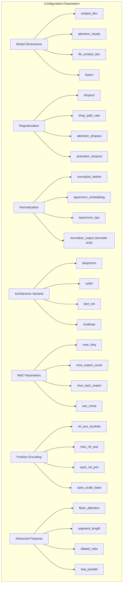
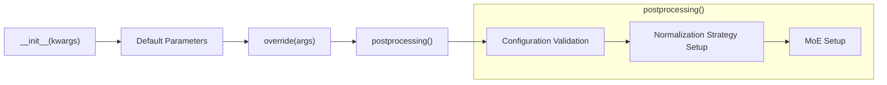
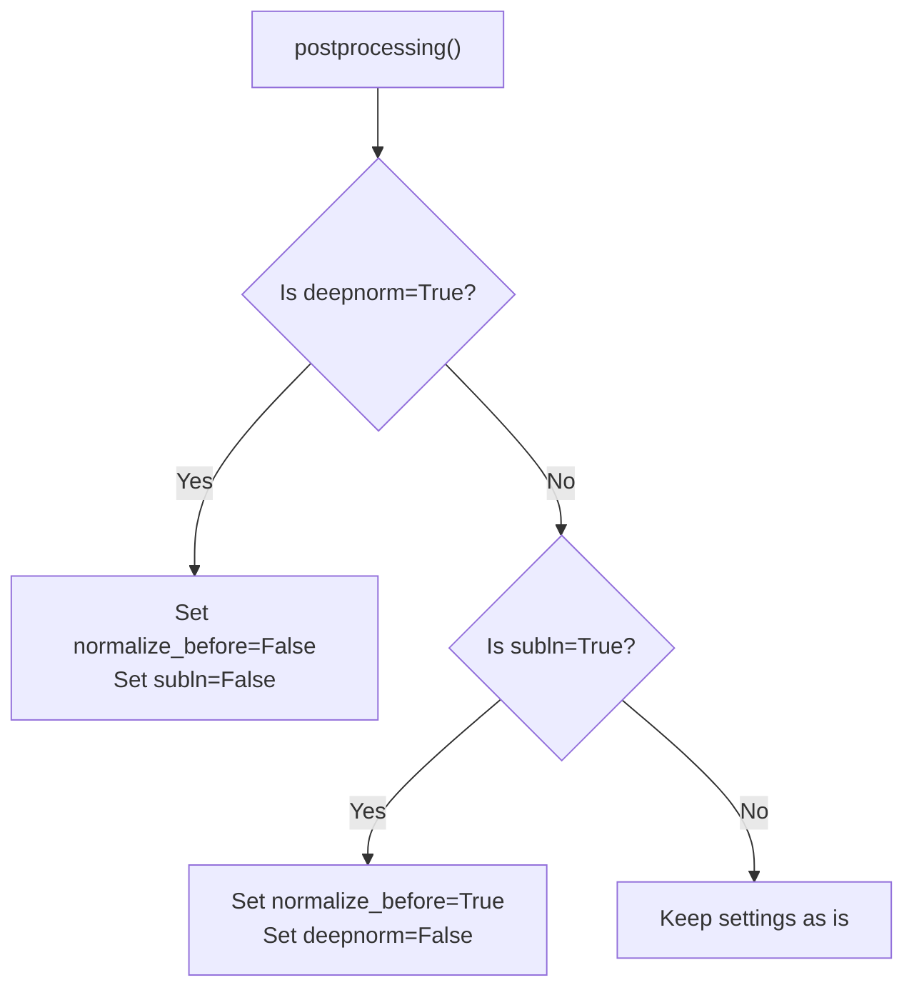
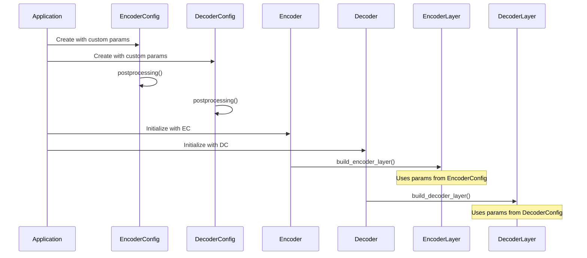

<!-- source: DeepWiki mcp.deepwiki.com · repo microsoft/torchscale · page 3.1 EncoderConfig & DecoderConfig · fetched 2026-10-26 -->

# EncoderConfig & DecoderConfig

<details>
<summary>Relevant source files</summary>

The following files were used as context for generating this wiki page:

- [torchscale/architecture/config.py](torchscale/architecture/config.py)
- [torchscale/architecture/decoder.py](torchscale/architecture/decoder.py)
- [torchscale/architecture/encoder.py](torchscale/architecture/encoder.py)

</details>


## Purpose and Scope

This document provides detailed information about the `EncoderConfig` and `DecoderConfig` classes in TorchScale. These configuration classes define the architecture and behavior of encoder and decoder models in the TorchScale library. They provide a structured way to initialize and customize transformer-based models with various architectural variations including DeepNorm, SubLN, and Mixture of Experts (MoE).

For information about combined encoder-decoder configurations, see [EncoderDecoderConfig & RetNetConfig](#3.2).

## Configuration Classes Overview

The `EncoderConfig` and `DecoderConfig` classes serve as centralized parameter storage for model initialization. They include default values for all parameters and provide methods to override these defaults and ensure configuration consistency.

```mermaid
classDiagram
    class "EncoderConfig" {
        +int encoder_embed_dim
        +int encoder_attention_heads
        +int encoder_ffn_embed_dim
        +int encoder_layers
        +bool encoder_normalize_before
        +bool normalize_output
        +str activation_fn
        +float dropout
        +__init__(kwargs)
        +override(args)
        +postprocessing()
    }
    
    class "DecoderConfig" {
        +int decoder_embed_dim
        +int decoder_attention_heads
        +int decoder_ffn_embed_dim
        +int decoder_layers
        +bool decoder_normalize_before
        +str activation_fn
        +float dropout
        +__init__(kwargs)
        +override(args)
        +postprocessing()
    }
    
    class "Encoder" {
        +build_encoder_layer()
        +forward()
    }
    
    class "Decoder" {
        +build_decoder_layer()
        +forward()
    }
    
    "EncoderConfig" --> "Encoder" : configures
    "DecoderConfig" --> "Decoder" : configures
```

Sources: [torchscale/architecture/config.py:5-85](), [torchscale/architecture/config.py:87-161]()

## Configuration Parameters

Both `EncoderConfig` and `DecoderConfig` share similar parameter categories, with naming differences reflecting their respective components.

### Common Parameter Categories



Sources: [torchscale/architecture/config.py:5-61](), [torchscale/architecture/config.py:87-138]()

## Parameter Details

### 1. Model Dimensions

These parameters define the fundamental structure and size of the model:

| Parameter | EncoderConfig | DecoderConfig | Description | Default |
|-----------|---------------|---------------|-------------|---------|
| Embedding dimension | `encoder_embed_dim` | `decoder_embed_dim` | Size of the embedding vectors | 768 |
| Attention heads | `encoder_attention_heads` | `decoder_attention_heads` | Number of attention heads | 12 |
| FFN dimension | `encoder_ffn_embed_dim` | `decoder_ffn_embed_dim` | Hidden dimension size in feed-forward networks | 3072 |
| Layers | `encoder_layers` | `decoder_layers` | Number of layers | 12 |

Sources: [torchscale/architecture/config.py:7-10](), [torchscale/architecture/config.py:89-92]()

### 2. Normalization Options

TorchScale supports several normalization strategies:

| Parameter | Description | Default |
|-----------|-------------|---------|
| `*_normalize_before` | Apply layer normalization before attention and FFN blocks | True |
| `normalize_output` (encoder only) | Normalize the final output | True |
| `layernorm_embedding` | Apply layer normalization after embeddings | False |
| `layernorm_eps` | Epsilon value for layer normalization | 1e-5 |
| `deepnorm` | Use DeepNorm initialization scheme | False |
| `subln` | Use SubLN (Sandwich LayerNorm) initialization scheme | True |

Sources: [torchscale/architecture/config.py:11-12](), [torchscale/architecture/config.py:19](), [torchscale/architecture/config.py:34-35](), [torchscale/architecture/config.py:43]()

### 3. Mixture of Experts (MoE) Configuration

TorchScale supports sparse Mixture of Experts layers:

| Parameter | Description | Default |
|-----------|-------------|---------|
| `moe_freq` | How frequently to place MoE layers (0 for no MoE) | 0 |
| `moe_expert_count` | Number of experts in MoE layers | 0 |
| `moe_top1_expert` | Whether to use top-1 expert routing instead of top-2 | False |
| `use_xmoe` | Whether to use X-MoE routing algorithm | False |
| `moe_eval_capacity_token_fraction` | Token capacity fraction during evaluation | 0.25 |
| `moe_second_expert_policy` | Policy for selecting the second expert | "random" |
| `moe_normalize_gate_prob_before_dropping` | Whether to normalize probabilities before dropping tokens | False |

Sources: [torchscale/architecture/config.py:20-31](), [torchscale/architecture/config.py:101-112]()

### 4. Positional Encoding

| Parameter | Description | Default |
|-----------|-------------|---------|
| `rel_pos_buckets` | Number of buckets for relative position encoding | 0 |
| `max_rel_pos` | Maximum relative position considered | 0 |
| `xpos_rel_pos` | Whether to use XPOS relative position encoding | False |
| `xpos_scale_base` | Scale base for XPOS encoding | 512 |

Sources: [torchscale/architecture/config.py:32-33](), [torchscale/architecture/config.py:54-55]()

### 5. Advanced Features

| Parameter | Description | Default |
|-----------|-------------|---------|
| `flash_attention` | Use optimized flash attention implementation | False |
| `segment_length` | Segment length for dilated attention | None |
| `dilated_ratio` | Dilation ratio for dilated attention | None |
| `seq_parallel` | Enable sequence parallelism | False |
| `checkpoint_activations` | Use gradient checkpointing to save memory | False |
| `fsdp` | Use fully sharded data parallelism | False |

Sources: [torchscale/architecture/config.py:57-60](), [torchscale/architecture/config.py:134-137]()

## Configuration Processing Flow

The config classes include methods to override defaults and ensure configuration consistency:



Sources: [torchscale/architecture/config.py:63-84](), [torchscale/architecture/config.py:140-161]()

### Normalization Strategy Setup

During `postprocessing()`, the configuration ensures consistent normalization settings:



Sources: [torchscale/architecture/config.py:69-80](), [torchscale/architecture/config.py:147-157]()

## Usage with Model Components

The configuration objects are used to initialize and configure `Encoder` and `Decoder` components:



Sources: [torchscale/architecture/encoder.py:165-306](), [torchscale/architecture/decoder.py:210-349]()

## Special Configuration Patterns

### SubLN (Sandwich LayerNorm)

When `subln=True`, the model uses a Sandwich LayerNorm configuration:
- Sets `normalize_before=True`
- Applies normalization before attention and FFN
- Initializes weights with scaling based on layer depth

Sources: [torchscale/architecture/config.py:35](), [torchscale/architecture/config.py:77-79]()

### DeepNorm

When `deepnorm=True`, the model uses the DeepNorm configuration:
- Sets `normalize_before=False`
- Applies normalization after attention and FFN
- Initializes with a depth-dependent scaling factor
- Disables SubLN

Sources: [torchscale/architecture/config.py:34](), [torchscale/architecture/config.py:75-77]()

### X-MoE (eXpert Mixture of Experts)

When `use_xmoe=True`, the config enforces consistent MoE settings:
- Sets `moe_normalize_gate_prob_before_dropping=True`
- Sets `moe_second_expert_policy="random"`
- Requires `moe_freq > 0` and `moe_expert_count > 0`

Sources: [torchscale/architecture/config.py:31](), [torchscale/architecture/config.py:81-84]()

## Instantiation Example

Here's a conceptual example of how to use these configuration classes:

```python
# Create encoder config with custom parameters
encoder_config = EncoderConfig(
    encoder_embed_dim=1024,
    encoder_attention_heads=16,
    encoder_layers=24,
    dropout=0.1,
    subln=True
)

# Create decoder config with custom parameters
decoder_config = DecoderConfig(
    decoder_embed_dim=1024,
    decoder_attention_heads=16,
    decoder_layers=24,
    dropout=0.1,
    subln=True
)

# Initialize encoder and decoder with their respective configs
encoder = Encoder(encoder_config)
decoder = Decoder(decoder_config)
```

## Advanced Configuration: Dilated Attention

TorchScale supports dilated attention through these configuration parameters:

| Parameter | Description |
|-----------|-------------|
| `flash_attention` | Enables optimized attention implementation |
| `segment_length` | Sets the segment length for dilated attention |
| `dilated_ratio` | Controls the dilation pattern |

These parameters enable efficient processing of long sequences by applying attention in a dilated pattern.

Sources: [torchscale/architecture/config.py:57-59](), [torchscale/architecture/config.py:134-136]()

## Parameter Parsing in `postprocessing()`

The `postprocessing()` method handles special parameter processing:

1. For parameters like `segment_length` and `dilated_ratio`, it uses `eval()` to parse string representations into Python data structures
2. For normalization strategies, it enforces that only one of `deepnorm` or `subln` is active
3. For MoE configurations, it ensures all required MoE parameters are properly set

This ensures that the configuration is consistent before being used to initialize model components.

Sources: [torchscale/architecture/config.py:69-84](), [torchscale/architecture/config.py:147-161]()

---

